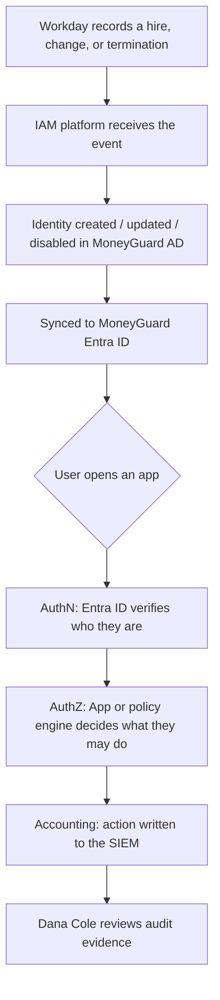
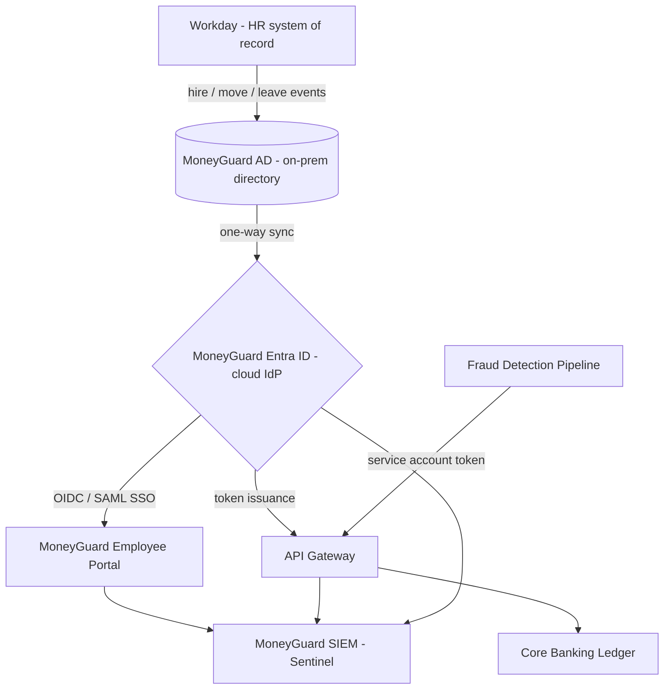

# Chapter 1: What Is IAM?

## Overview

**Identity and Access Management (IAM)** is the combination of business processes, policies, and technology that makes sure the **right people (and machines) get the right access to the right resources at the right time — and for the right reasons.**

IAM is much bigger than a login page. A login page is one small visible piece. Underneath it sits a whole machine that decides *who exists*, *what they may touch*, *for how long*, and *who is watching*.

This chapter defines IAM, explains why identity has replaced the firewall as the real security perimeter, and introduces the vocabulary used in every other chapter of this repo.

## Why This Matters

- **Security** — Most modern breaches are not "someone broke through the firewall." They are "someone logged in" with stolen or over-granted credentials. Identity is the attack surface.
- **Compliance** — Regulations like **SOX** (Sarbanes-Oxley, financial reporting controls), **GDPR** (General Data Protection Regulation, EU privacy), and **PCI-DSS** (Payment Card Industry Data Security Standard) all require you to prove *who accessed what, and when*. Without IAM, that proof does not exist.
- **Efficiency** — With **SSO (Single Sign-On)**, one login opens many apps. Without it, users juggle 40 passwords, write them on sticky notes, and flood the help desk with reset tickets.
- **Scale** — MoneyGuard Bank has ~50,000 employees and hundreds of applications. Manual account creation does not survive that math.

## Key Concepts

| Term | Plain-English Meaning |
|---|---|
| **Identity** | The digital record that represents a person, service, or device (Priya Sharma, employee ID 88412). |
| **Identification** | Claiming who you are — typing a username. No proof yet. |
| **Authentication (AuthN)** | Proving the claim — password, fingerprint, security key. |
| **Authorization (AuthZ)** | Deciding what the proven identity is allowed to do. |
| **Accounting / Auditing** | Recording what they actually did, so it can be reviewed later. |
| **IdP (Identity Provider)** | The central system that authenticates users and issues tokens. At MoneyGuard: **MoneyGuard Entra ID**. |
| **SP / RP (Service Provider / Relying Party)** | An app that trusts the IdP instead of storing passwords itself. At MoneyGuard: **MoneyGuard Employee Portal**. |
| **Provisioning** | Automatically creating an account and its access. |
| **Deprovisioning** | Automatically removing that account and access. |
| **PAM (Privileged Access Management)** | A stricter layer of IAM for admin/root/super-user accounts. |

## Detailed Notes

### Concept 1 — 🏦 The MoneyGuard Walkthrough: With IAM vs Without IAM

**Priya Sharma** is hired as a bank teller at MoneyGuard Bank.

**Without IAM:** Raj Patel (IAM Administrator) manually creates an account for Priya in MoneyGuard AD, then again in the MoneyGuard Employee Portal, then again for email, then again for the Core Banking Ledger. Four systems, four chances to typo, four chances to over-grant. When Priya later resigns, Raj must remember all four. If he forgets the Core Banking Ledger, a former employee still has access to account balances — and nobody notices until Dana Cole (Security Auditor) finds it a year later.

**With IAM:** Workday (the HR system) records the hire. That single event flows into MoneyGuard AD and MoneyGuard Entra ID automatically. Priya's job code "Teller" maps to a `Teller` role, which grants exactly the apps a teller needs. When Priya resigns, Workday flips one flag and every downstream account is disabled within minutes.

The difference is not convenience. It is whether MoneyGuard can *prove* to Dana and to regulators that access is correct.

### Concept 2 — Identity Is the New Perimeter

The old model was a castle: a firewall at the edge, and everything inside the network was trusted. That model died with cloud and remote work.

Today Priya works from a branch, Alex Kim (Backend Engineer) works from home, the Fraud Detection Pipeline runs in Kubernetes, and the Business Banking SaaS Portal is reached over the public internet by Acme Corp. There is no single edge to defend.

So the control point moved. Every request now carries an **identity**, and the identity — not the network location — decides access. This is the foundation of **Zero Trust** ("never trust, always verify"), covered in Module 02.

### Concept 3 — The Three Questions Every Request Must Answer

1. **Identification** — "I am priya.sharma@moneyguard.com."
2. **Authentication** — "Here is my password and my security key. Verify me."
3. **Authorization** — "Now, may I view account 4417's balance?"

These are three separate decisions, made at three separate times, often by three separate systems. Confusing them is the single most common beginner mistake in IAM. Chapter 2 expands this into the full **AAA framework** by adding *Accounting*.

### Concept 4 — IAM vs PAM

**IAM** manages everyday identities. **PAM (Privileged Access Management)** manages the dangerous ones — domain admins, database administrators, root accounts, break-glass accounts.

| Feature | IAM | PAM |
|---|---|---|
| **Who it covers** | Priya (teller), Alex (engineer), Sam (contractor) | Raj's domain-admin account, Core Banking Ledger DBA account |
| **Main goal** | Productivity + baseline security | Damage containment on crown-jewel systems |
| **Typical controls** | SSO, MFA, RBAC/ABAC groups | Credential vaulting, automatic password rotation, session recording, approval workflows |
| **Analogy** | The badge that opens the office building | The two-person combination that opens the vault |
| **Example tools** | Entra ID, Okta, Ping | CyberArk, Delinea, HashiCorp Vault |

💡 PAM is not a competitor to IAM — it is IAM turned up to maximum for a small, high-risk population.

### Concept 5 — Human vs Non-Human Identity

Not every identity is a person. The **Fraud Detection Pipeline** calls the Core Banking Ledger thousands of times an hour and needs an identity to do it. These are **non-human identities (NHIs)** or **service accounts** — same rigor required, different mechanics (no password prompt, no MFA, no "working hours"). Chapter 7 introduces them.

## Workflow



## Architecture Diagram



## Step-by-Step Process

1. **Establish a source of truth.** For employees, that is Workday. Nobody creates an employee identity by hand.
2. **Create the identity.** Workday's event provisions an account in MoneyGuard AD with a permanent, unchanging ID.
3. **Sync to the cloud IdP.** MoneyGuard Entra ID receives the record and becomes the front door for SSO.
4. **Grant birthright access.** Priya's job code "Teller" automatically grants email, the Employee Portal, and branch tools — nothing more.
5. **Authenticate on login.** Entra ID challenges for password + MFA and issues tokens.
6. **Authorize per action.** The Employee Portal and API Gateway check permissions on *every* request, not just at login.
7. **Log everything.** Every authentication and every sensitive action is written to the SIEM.
8. **Review and revoke.** Dana runs access reviews; Workday termination events trigger the kill switch.

## Commands and Examples

**A simplified MoneyGuard identity record (what the IdP stores):**

```json
{
  "id": "8f14e45f-ceea-467a-9a1b-2b5c0d1e7a90",
  "userPrincipalName": "priya.sharma@moneyguard.com",
  "displayName": "Priya Sharma",
  "employeeId": "88412",
  "jobTitle": "Bank Teller",
  "department": "Retail Banking",
  "branchCode": "NYC-014",
  "accountEnabled": true,
  "assignedRoles": ["Teller"],
  "mfaRegistered": true,
  "createdDateTime": "2026-02-01T08:00:00Z"
}
```

**Reading an identity from the cloud IdP (Microsoft Graph style REST call):**

```bash
curl -s -H "Authorization: Bearer $ACCESS_TOKEN" \
  "https://graph.microsoft.com/v1.0/users/priya.sharma@moneyguard.com?\$select=displayName,jobTitle,accountEnabled"
```

**Reading the same identity from the legacy on-prem directory (LDAP):**

```bash
ldapsearch -x -H ldaps://dc01.corp.moneyguard.com \
  -D "CN=svc-ldap-reader,OU=ServiceAccounts,DC=corp,DC=moneyguard,DC=com" -W \
  -b "DC=corp,DC=moneyguard,DC=com" \
  "(sAMAccountName=priya.sharma)" displayName title memberOf
```

**What the API sees after Priya logs in (decoded token payload):**

```json
{
  "iss": "https://login.moneyguard.com/",
  "sub": "8f14e45f-ceea-467a-9a1b-2b5c0d1e7a90",
  "aud": "moneyguard-employee-portal",
  "roles": ["Teller"],
  "amr": ["pwd", "fido"],
  "iat": 1770000000,
  "exp": 1770003600
}
```

`amr` = *authentication methods reference* — it proves MFA was actually used, which authorization policies can require later.

## Best Practices

- Pick **one authoritative source** per identity type (Workday for employees, a vendor system for contractors, a deployment pipeline for services).
- **Centralize authentication** in the IdP; never let individual apps store passwords.
- Give identities a **permanent immutable ID** and key everything off it, never off email or name.
- Make access **role-driven by default**, exception-driven only when justified.
- **Log every authentication and every sensitive authorization decision** to the SIEM.
- Treat **non-human identities** with the same lifecycle rigor as human ones.
- Design for **removal**, not just for granting. Deprovisioning is the harder half.

## Common Mistakes

- ⚠️ **Treating IAM as "the login page."** Login is 5% of IAM; lifecycle and governance are the rest.
- ⚠️ **Letting each app own its own user table.** This creates identity silos where terminating Priya in one place leaves her active in six others.
- ⚠️ **Using email address as the primary key.** Priya changes her surname, her email changes, and every link to her access breaks.
- ⚠️ **Granting access "temporarily" with no expiry.** Temporary access with no end date is permanent access.
- ⚠️ **Ignoring service accounts** because "they're just scripts." They are credentials with no MFA and no owner — attacker gold.
- ⚠️ **No audit trail.** If you cannot answer "who viewed this account balance last Tuesday," you fail the audit regardless of how good your controls are.

## Pro Tips

- 💡 Always ask "**what happens when this person leaves?**" before designing how they get access. Offboarding is the true test of an IAM design.
- 💡 The fastest way to judge an organization's IAM maturity: ask how long it takes to fully revoke a terminated employee. Minutes = mature. Days = broken.
- 💡 Keep **identity** in the token and **permissions** at runtime. Tokens are frozen at issue time; permissions change constantly.
- 💡 When Dana asks for evidence, the answer should be a report, not a spreadsheet exercise. If it requires manual CSV merging, your IAM isn't centralized yet.

## Real-World Use Cases

1. **Audit season at MoneyGuard.** Dana Cole asks "who had access to the Core Banking Ledger in Q3, and who approved it?" With centralized IAM this is one report. Without it, it is weeks of emailing managers and exporting CSVs.
2. **The contractor who never left.** Sam Torres finishes a 6-week project. Because his account had no expiry and no HR record, his VPN access stayed live for months — a classic insider-threat hole that IAM lifecycle automation closes.
3. **The phished teller.** Eve phishes Priya's password. Because MoneyGuard enforces MFA at the IdP and least-privilege roles, Eve gets a blocked login attempt and a SIEM alert instead of the customer database.
4. **Merger integration.** MoneyGuard acquires a smaller bank. Centralized IAM lets the new employees be federated in weeks rather than rebuilt account-by-account.

## Key Takeaways

- IAM = right people + right access + right time + right reasons, provable after the fact.
- Identity, not the network, is the modern security perimeter.
- Identification → Authentication → Authorization → Accounting are four distinct steps.
- IAM covers humans *and* machines.
- PAM is the high-security subset of IAM for privileged accounts.
- Centralization is what makes both security and compliance possible.

## Glossary

| Term | Definition |
|---|---|
| **IAM** | Identity and Access Management — processes and technology governing digital identities and their access. |
| **AuthN** | Authentication — proving who you are. |
| **AuthZ** | Authorization — deciding what you may do. |
| **IdP** | Identity Provider — the system that authenticates users and issues tokens. |
| **SSO** | Single Sign-On — one authentication opens many applications. |
| **MFA** | Multi-Factor Authentication — two or more independent proofs of identity. |
| **PAM** | Privileged Access Management — extra controls for admin-level accounts. |
| **NHI** | Non-Human Identity — an identity for software, not a person. |
| **Provisioning** | Automated creation of accounts and access. |
| **Deprovisioning** | Automated removal of accounts and access. |
| **SIEM** | Security Information and Event Management — the log aggregation and alerting platform. |
| **Zero Trust** | Security model that verifies every request instead of trusting the network. |
| **Blast radius** | How much damage one compromised identity can cause. |

## Revision Notes

- **Definition:** right people → right resources → right time → right reasons.
- **Four steps:** Identification (claim) → AuthN (prove) → AuthZ (permit) → Accounting (record).
- **Three drivers:** Security, Compliance, Efficiency.
- **IAM vs PAM:** everyday users vs. super-users (vaulting + session recording).
- **Perimeter shift:** firewall → identity.
- **Key rule:** identity in the token, permissions at runtime.
- **MoneyGuard chain:** Workday → MoneyGuard AD → MoneyGuard Entra ID → apps → SIEM.

## Interview Questions

**Q1: What is IAM in one sentence?**
A: IAM is the set of processes and technologies that ensures the right identities — human and machine — have the right access to the right resources at the right time, with an audit trail proving it.

**Q2: How does IAM improve an organization's security posture?**
A: It shifts control from the network perimeter to the identity layer. It shrinks the attack surface through least privilege, protects credentials through SSO and MFA, and gives a single place to revoke access instantly. It also creates the forensic trail needed to investigate incidents.

**Q3: What is the difference between IAM and PAM?**
A: IAM manages the whole population — standard users, apps, services — focusing on productivity plus baseline security (SSO, MFA, role assignment). PAM protects the small set of privileged accounts using vaulting, automatic credential rotation, approval workflows, and session recording. PAM is IAM with much stricter controls for accounts that could destroy the business.

**Q4: Why is identity called "the new perimeter"?**
A: Because cloud services and remote work removed the single network edge. MoneyGuard's SaaS portal, its Kubernetes fraud pipeline, and its remote engineers are all outside the old firewall. The only thing consistently present in every request is the identity, so that becomes the enforcement point.

**Q5: Why not just let each application manage its own users?**
A: Identity silos. You cannot enforce consistent MFA, you cannot revoke access in one place, you cannot answer audit questions without merging exports, and terminated users linger in forgotten systems. Centralized identity with federation solves all four.

**Q6: What is the single most dangerous failure mode in IAM?**
A: Failed deprovisioning. Access that outlives the business need — a terminated employee, an expired contractor, an orphaned service account — is unmonitored, unowned, and often over-privileged. Most insider breaches trace back to it.

**Q7: Where does a service account fit into IAM?**
A: It is a first-class identity with a lifecycle, an owner, scoped permissions, and rotation requirements. It differs only in mechanics: no interactive login, no MFA, and authentication via short-lived tokens or certificates rather than passwords.

**Q8: If you joined MoneyGuard tomorrow as an IAM engineer, what would you check first?**
A: Whether there is one authoritative source for identities and whether termination in that source reliably disables access everywhere within minutes. If that loop is broken, nothing else in the IAM program can be trusted.

## Practice Exercises

1. **Map the sources of truth.** List every identity type at MoneyGuard (employee, contractor, customer, partner from PartnerBank, service account) and name the system that should be authoritative for each. Justify each choice in one sentence.
2. **Trace a request.** Write out, step by step, what happens from the moment Priya clicks "View Balance" in the MoneyGuard Employee Portal to the moment the balance appears. Label which step is identification, authentication, authorization, and accounting.
3. **Find the silo.** Assume the Core Banking Ledger still has its own local username/password table. Write down three concrete risks this creates for MoneyGuard, and one migration step to fix each.
4. **IAM or PAM?** Classify these into IAM or PAM and explain why: (a) Priya's teller account, (b) Raj's domain admin account, (c) the Fraud Detection Pipeline's service account, (d) Sam's contractor account, (e) the Core Banking Ledger database root account.
5. **Write the audit answer.** Draft the exact response you would give Dana Cole when she asks: "Prove that no terminated employee had access to the Core Banking Ledger last quarter." List which systems you would query and what evidence each provides.

---
⬅ Back to [Module 01 Index](./README.md) · [Main README](../README.md) · [MoneyGuard Scenario](../SCENARIO.md)
Next: [Chapter 2 — The AAA Framework](./02_AAA_Framework.md) ➡
