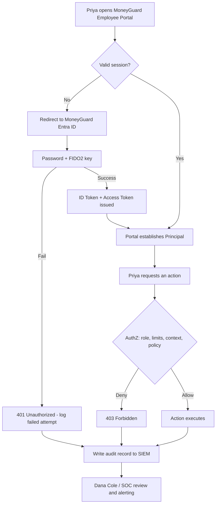
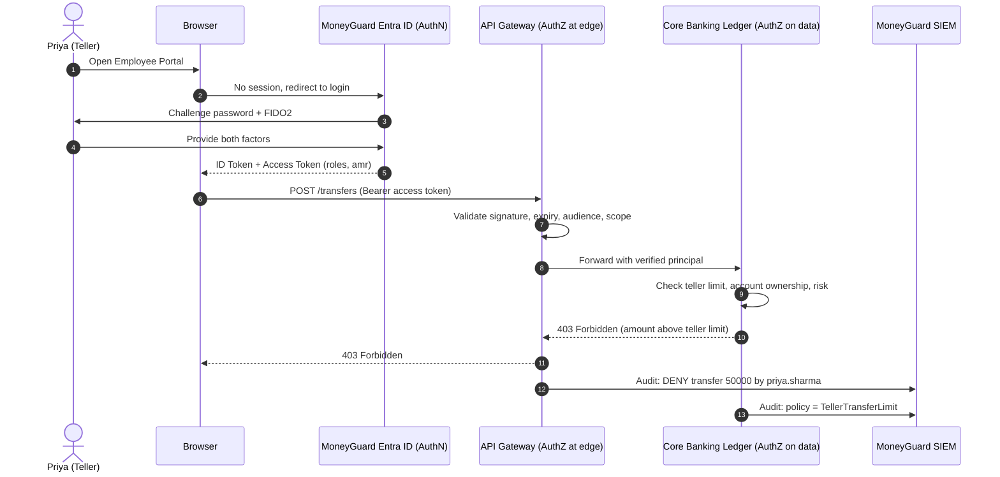

# Chapter 2: The AAA Framework (Authentication, Authorization, Accounting)

## Overview

**AAA** stands for **Authentication**, **Authorization**, and **Accounting**. It is the three-part model that every access decision in every system passes through:

1. **Authentication (AuthN)** — *Who are you?*
2. **Authorization (AuthZ)** — *What are you allowed to do?*
3. **Accounting (Auditing)** — *What did you actually do?*

In a small application all three might live in one file. At MoneyGuard Bank they are three distinct systems: MoneyGuard Entra ID authenticates, the API Gateway plus each application authorizes, and the SIEM records.

## Why This Matters

- **They fail differently.** A broken AuthN means impostors get in. A broken AuthZ means legitimate users reach data they should not. A broken Accounting means you never find out either happened.
- **They run on different clocks.** Authentication happens roughly once per session. Authorization happens on *every single request*. Mixing them up is how organizations end up unable to revoke access.
- **Regulators care about the third A.** SOX and PCI-DSS audits are largely about Accounting — non-repudiation, the ability to prove exactly who moved money and when.

## Key Concepts

| Concept | Question | Typical Output |
|---|---|---|
| **Authentication (AuthN)** | Is this really Priya? | An **ID Token** describing the user |
| **Authorization (AuthZ)** | May Priya do *this*, to *that*, right now? | An allow/deny decision |
| **Accounting** | What did Priya do? | An immutable audit log record |
| **Principal** | The authenticated actor the system now "believes in" | `sub` claim in a token |
| **Claim** | A single fact about the principal (`department = Retail Banking`) | Key/value in a token |
| **Non-repudiation** | Proof so strong the actor cannot credibly deny the action | Signed, tamper-evident logs |
| **401 Unauthorized** | Confusingly named — it means **not authenticated** | HTTP status |
| **403 Forbidden** | Authenticated, but **not authorized** | HTTP status |

## Detailed Notes

### Concept 1 — 🏦 Authentication (AuthN): "Who are you?"

**Scenario:** Priya Sharma opens the **MoneyGuard Employee Portal** from her branch workstation.

1. The Portal sees no valid session and redirects her browser to **MoneyGuard Entra ID** (the IdP).
2. Entra ID challenges her with two independent factors:
   - **Something she knows** — her password.
   - **Something she has** — a FIDO2 security key / push approval on her phone.
3. On success, Entra ID issues an **ID Token** containing claims: `name = Priya Sharma`, `employeeId = 88412`, `department = Retail Banking`, `amr = ["pwd","fido"]`.
4. The Portal now has a **Principal** — an established, verified identity for this session.

Authentication only ever answers *identity*. It never answers *permission*.

**Developer translation:** this is the step that flips `HttpContext.User.Identity.IsAuthenticated` to `true`.

### Concept 2 — 🏦 Authorization (AuthZ): "What can you do?"

Being in the building is not the same as having the key to the vault.

**Scenario:** Priya, now authenticated, tries to process a **$50,000 wire transfer**.

The application evaluates policy:

- *Rule 1:* Does she hold the `Teller` role? **Yes.**
- *Rule 2:* Is the amount within a teller's limit of $10,000? **No.**

**Decision: DENY (HTTP 403).** The system offers a manager-approval workflow instead.

Notice what happened: authentication succeeded completely, and access was still correctly refused. That separation is the whole point.

**Developer translation:** `[Authorize(Roles = "Manager")]`, or a policy requirement such as `policy.RequireClaim("transferLimit")`, or a call out to a central policy engine.

### Concept 3 — 🏦 Accounting (Auditing): "What did you do?"

**Scenario:** Priya views the balance of a high-net-worth customer's account.

Nothing is blocked — a teller viewing a balance is legitimate. But an immutable record is written to the **MoneyGuard SIEM**:

```json
{
  "timestamp": "2026-03-04T14:22:07Z",
  "actor": "priya.sharma@moneyguard.com",
  "actorId": "8f14e45f-ceea-467a-9a1b-2b5c0d1e7a90",
  "action": "View_Balance",
  "resource": "acct:4417-8890",
  "resourceClass": "HighNetWorth",
  "decision": "ALLOW",
  "sourceIp": "10.14.7.55",
  "branch": "NYC-014",
  "correlationId": "req-9c1e-4477"
}
```

The goal is **non-repudiation**. If money goes missing, MoneyGuard must be able to prove exactly who touched what.

**Developer translation:** this is *not* `ILogger.LogInformation`. It is structured audit logging, written to append-only or **WORM (Write Once, Read Many)** storage so an attacker who gains admin rights still cannot erase their tracks.

### Concept 4 — AuthN vs AuthZ Side by Side

| Feature | Authentication (AuthN) | Authorization (AuthZ) |
|---|---|---|
| **Question** | "Is this really Priya?" | "May Priya approve this $50k transfer?" |
| **Main artifact** | **ID Token** (user profile) | **Access Token** + runtime policy check |
| **Timing** | Usually once, at session start | On **every** request |
| **Protocols/tech** | OIDC, SAML 2.0, Kerberos, WebAuthn | OAuth 2.0 scopes, RBAC/ABAC, XACML, OPA |
| **Failure code** | `401 Unauthorized` (you are not logged in) | `403 Forbidden` (logged in, still blocked) |
| **Changes when...** | Credentials or MFA change | Roles, data, context, or policy change |

### Concept 5 — Why Authorization Must Be Checked at Runtime

It is tempting to stuff every permission into the token at login. Don't.

Tokens are **static** — once issued they stay valid until they expire. If Dana revokes Priya's access at 10:05 AM but Priya's token was issued at 9:30 AM with a 1-hour lifetime, Priya keeps her old permissions until 10:30 AM.

In a bank, 25 minutes of stale authorization is unacceptable. So:

- Put **stable identity facts** in the token: user ID, department, coarse roles, MFA status.
- Evaluate **volatile decisions** at runtime: account suspension, transaction limits, risk score, data ownership.
- Keep token lifetimes short and revoke refresh tokens on termination.

### Concept 6 — Where MFA Fits

**MFA belongs entirely to Authentication.** Its only job is to prove identity more strongly.

But **authorization policies may depend on authentication strength**. A policy can say: *"Wire transfers require that the login used a phishing-resistant factor."* AuthZ is not performing MFA — it is reading an authentication attribute (`amr` contains `fido`) and making a decision from it.

This keeps the layers clean while still supporting risk-based access.

## Workflow



## Architecture Diagram



## Step-by-Step Process

1. **Identify** — the user states who they are.
2. **Authenticate** — the IdP verifies with one or more factors and issues tokens.
3. **Establish the principal** — the app converts the token into an in-memory identity.
4. **Coarse authorization at the edge** — the API Gateway rejects tokens lacking the right audience or scope. Cheap, fast filtering.
5. **Fine-grained authorization in the service** — check the specific resource, amount, ownership, and context.
6. **Execute or refuse** — return the result, or `403`.
7. **Account** — write a structured, immutable record of the decision (allow *and* deny) to the SIEM.
8. **Detect** — the SOC correlates records and raises alerts on anomalies.

## Commands and Examples

**An ID Token (identity — output of AuthN):**

```json
{
  "iss": "https://login.moneyguard.com/",
  "aud": "moneyguard-employee-portal",
  "sub": "8f14e45f-ceea-467a-9a1b-2b5c0d1e7a90",
  "name": "Priya Sharma",
  "employeeId": "88412",
  "department": "Retail Banking",
  "amr": ["pwd", "fido"],
  "auth_time": 1770000000,
  "exp": 1770003600
}
```

**An Access Token (permission to call an API — input to AuthZ):**

```json
{
  "iss": "https://login.moneyguard.com/",
  "aud": "https://api.moneyguard.com/ledger",
  "sub": "8f14e45f-ceea-467a-9a1b-2b5c0d1e7a90",
  "scp": "accounts.read transfers.write",
  "roles": ["Teller"],
  "exp": 1770003600
}
```

**Authorization in code (.NET, coarse then fine):**

```csharp
[Authorize(Roles = "Teller")]                    // coarse: can she use this feature at all?
[HttpPost("transfers")]
public async Task<IActionResult> CreateTransfer(TransferRequest req)
{
    // fine-grained: runtime facts the token cannot know
    var limit = await _limits.GetDailyLimitAsync(User.GetSubjectId());   // 10_000 for tellers
    if (req.Amount > limit)
    {
        _audit.Deny(User, "CreateTransfer", req.AccountId, "AmountAboveTellerLimit");
        return Forbid();                                                // 403, not 401
    }

    var result = await _ledger.TransferAsync(req);
    _audit.Allow(User, "CreateTransfer", req.AccountId, result.TransferId);
    return Ok(result);
}
```

**Requiring MFA for a sensitive operation (policy reads an AuthN attribute):**

```csharp
options.AddPolicy("WireTransferPolicy", policy =>
    policy.RequireRole("Teller", "BranchManager")
          .RequireClaim("amr", "fido"));   // must have used a phishing-resistant factor
```

**Querying the audit trail (SIEM / KQL-style):**

```kusto
AuditLogs
| where TimeGenerated between (startofday(ago(90d)) .. now())
| where Resource startswith "acct:" and ResourceClass == "HighNetWorth"
| where Decision == "ALLOW"
| summarize Views = count(), Accounts = dcount(Resource) by Actor
| where Accounts > 25
| order by Accounts desc
```

## Best Practices

- Return the **correct status code**: `401` when the caller is not authenticated, `403` when they are authenticated but not permitted.
- Do **coarse checks at the gateway** and **fine-grained checks in the service** that owns the data.
- Log **denies as well as allows** — a burst of denials is often the first signal of an attack.
- Write audit logs to **append-only / WORM storage**, separate from application logs.
- Include a **correlation ID** so one user action can be traced across services.
- Keep access tokens **short-lived** (minutes, not hours) and revoke refresh tokens on termination.
- Record **why** a decision was made (the policy name), not just the outcome.

## Common Mistakes

- ⚠️ **Confusing 401 and 403.** Returning 401 for a permission failure sends clients into pointless re-login loops.
- ⚠️ **Authorizing only at login.** Permissions must be re-evaluated per request; otherwise revocation is impossible until token expiry.
- ⚠️ **Baking fine-grained permissions into the token.** It bloats the token and freezes decisions that should be live.
- ⚠️ **Trusting the client.** Hiding a button is UX, not authorization. The API must enforce it.
- ⚠️ **Using application logs as audit logs.** Developers can rotate, delete, or filter application logs — that breaks non-repudiation.
- ⚠️ **Logging secrets.** Never write tokens, passwords, or full card numbers into audit records.
- ⚠️ **Forgetting to log denials.** You lose the ability to detect probing.

## Pro Tips

- 💡 Mnemonic: **AuthN = who, AuthZ = what, Accounting = what happened.**
- 💡 "**401 = I don't know you. 403 = I know you, and no.**"
- 💡 If your only authorization is a role check on the controller, you have coarse-grained access control — fine for feature gates, not for record-level data.
- 💡 Design audit records so an auditor with no engineering knowledge can read one line and understand who did what to which resource.
- 💡 Anomaly detection is only as good as the fields you log. Always include actor, action, resource, decision, reason, IP, and time.

## Real-World Use Cases

1. **🏦 The suspicious wire transfer.** Alex Kim logs in from a café Wi-Fi. Entra ID sees a new device and risky IP and forces a biometric challenge — he passes (**AuthN succeeds**). He then opens the wire-transfer function; policy requires a corporate network or VPN, and he is on public Wi-Fi — **403 Forbidden** (**AuthZ denies on context**). The denial reaches the SIEM, which alerts the SOC (**Accounting**). This is the whole framework in one incident.
2. **Insider data browsing.** No single balance view is suspicious. But the SIEM notices Priya's account viewed 400 distinct high-net-worth accounts in a day. Only Accounting could catch this — AuthN and AuthZ both said yes every time.
3. **The stolen token.** Eve steals an access token. Because MoneyGuard tokens live 15 minutes and the ledger re-checks account suspension at runtime, the usable window is tiny and the anomalous calls are logged.
4. **SOX evidence.** Dana must show that only authorized staff approved journal entries. The audit trail, with policy names and approver IDs, *is* the evidence.

## Key Takeaways

- AAA = Authentication (who), Authorization (what), Accounting (what happened).
- AuthN produces an identity; AuthZ produces a decision; Accounting produces evidence.
- AuthN happens once per session; AuthZ happens every request.
- `401` = not authenticated. `403` = authenticated but forbidden.
- MFA is Authentication, but Authorization can *require* that MFA was used.
- Put stable identity in tokens; evaluate volatile permissions at runtime.
- Audit logs must be immutable, structured, and include denials.

## Glossary

| Term | Definition |
|---|---|
| **AAA** | Authentication, Authorization, Accounting. |
| **Principal** | The authenticated actor a system is operating on behalf of. |
| **Claim** | A single key/value fact about a principal, carried in a token. |
| **ID Token** | An OIDC token describing *who* the user is. |
| **Access Token** | A token presented to an API granting *what* the caller may request. |
| **Scope** | An OAuth 2.0 permission label limiting what a client app may request. |
| **amr** | Authentication Methods Reference — which factors were used at login. |
| **Non-repudiation** | The property that an actor cannot deny having performed a recorded action. |
| **WORM storage** | Write Once, Read Many — storage that prevents deletion or modification. |
| **SIEM** | Security Information and Event Management platform (MoneyGuard's is "Sentinel"). |
| **Step-up authentication** | Requiring a stronger factor before a sensitive action. |
| **Correlation ID** | A shared identifier linking all log entries for one user action. |

## Revision Notes

| A | Question | Happens | Artifact | Failure |
|---|---|---|---|---|
| **Authentication** | Who are you? | Once per session | ID Token | `401` |
| **Authorization** | What may you do? | Every request | Allow/Deny + Access Token | `403` |
| **Accounting** | What did you do? | Every action | Immutable audit record | Undetected breach |

- Protocols: AuthN → OIDC, SAML, Kerberos, WebAuthn. AuthZ → OAuth 2.0 scopes, RBAC/ABAC, OPA.
- MFA is AuthN; AuthZ may *require* MFA (`amr` claim).
- Tokens are static → revocation needs runtime checks + short lifetimes.
- Log allows **and** denies, to WORM storage, with a reason.

## Interview Questions

**Q1: Explain the difference between authentication and authorization.**
A: Authentication verifies identity — proving the user is who they claim, typically with a password plus a second factor, producing an ID token. Authorization decides whether that verified identity may perform a specific action on a specific resource, and it runs on every request. Priya can authenticate perfectly and still be correctly refused a $50,000 transfer.

**Q2: Why do I get a 401 when I'm sure my password is correct?**
A: In a token-based system, 401 usually means the *token* is missing, expired, malformed, or has the wrong audience — not that the password was wrong. You may have authenticated successfully 20 minutes ago, but if the access token has expired the API treats you as anonymous. The fix is to refresh the token, not to re-enter the password.

**Q3: Can we handle authorization entirely inside authentication by embedding permissions in the token?**
A: You can, but it is a bad practice for day-2 operations. Tokens are static once issued. If Priya is terminated at 10:05 AM and her token expires at 11:00 AM, she retains access for 55 minutes. Policy changes and contextual rules — time, risk, transaction value — are also ignored until renewal. In regulated environments, authorization should be evaluated at runtime against current state so revocation is immediate.

**Q4: Is MFA part of AuthN or AuthZ?**
A: MFA is entirely Authentication — its purpose is to prove identity with multiple independent factors. However, authorization policies can depend on authentication strength, for example denying wire transfers unless the `amr` claim shows a phishing-resistant factor was used. AuthZ is not performing MFA; it is reading an authentication attribute.

**Q5: Why is Accounting considered as important as the other two As?**
A: Because AuthN and AuthZ only prevent what you anticipated. Accounting catches what you did not: a legitimate user abusing legitimate access, a compromised account behaving oddly, or a misconfigured policy. It is also the only thing that satisfies auditors and provides non-repudiation for financial transactions.

**Q6: What makes an audit log trustworthy?**
A: It must be structured (machine-parsable fields, not free text), complete (allows and denies), attributable (immutable user ID, not just a display name), tamper-evident (append-only or WORM storage, ideally signed), time-synchronized (NTP across all sources), and retained for the period regulators require.

**Q7: Where should authorization be enforced in a microservices architecture?**
A: In layers. The API Gateway does coarse checks — valid signature, correct audience, required scope — so bad requests are rejected cheaply at the edge. The service that owns the data does fine-grained checks, because only it knows resource ownership, amounts, and classifications. Never rely on the gateway alone; a service must not trust that traffic reaching it was already authorized.

**Q8: A user's manager revokes their access. How fast should that take effect, and how do you achieve it?**
A: For sensitive systems, effectively immediately. Achieve it with short access-token lifetimes (5-15 minutes), refresh-token revocation on the IdP, runtime authorization checks against current state rather than token contents, and continuous access evaluation where the IdP pushes revocation signals to relying parties.

## Practice Exercises

1. **Classify the failures.** For each, state whether it is an AuthN, AuthZ, or Accounting failure, and what the correct HTTP status would be: (a) Eve guesses Priya's password and logs in; (b) Sam the contractor reads a payroll file he never needed; (c) MoneyGuard cannot tell Dana who exported a customer list; (d) a client sends an expired token.
2. **Design the audit record.** Write the JSON audit record MoneyGuard should emit when Raj Patel elevates himself to domain admin. Include every field an auditor would need and explain why each is there.
3. **Split the decision.** For the rule *"a Branch Manager may approve transfers up to $250,000, only from the corporate network, during business hours, and only if MFA was used"* — list which parts belong in the token and which must be evaluated at runtime, with reasoning.
4. **Fix the code.** A MoneyGuard endpoint returns `401` whenever a teller attempts a manager-only action. Explain what breaks for the client, and write the corrected handling.
5. **Build a detection rule.** Write a SIEM query (pseudocode is fine) that flags any MoneyGuard account with more than 10 authorization denials to the Core Banking Ledger within 5 minutes, and explain what attack that pattern suggests.

---
⬅ [Chapter 1 — What Is IAM?](./01_What_Is_IAM.md) · [Module 01 Index](./README.md) · [MoneyGuard Scenario](../SCENARIO.md)
Next: [Chapter 3 — Access Control Models Overview](./03_Access_Control_Models_Overview.md) ➡
