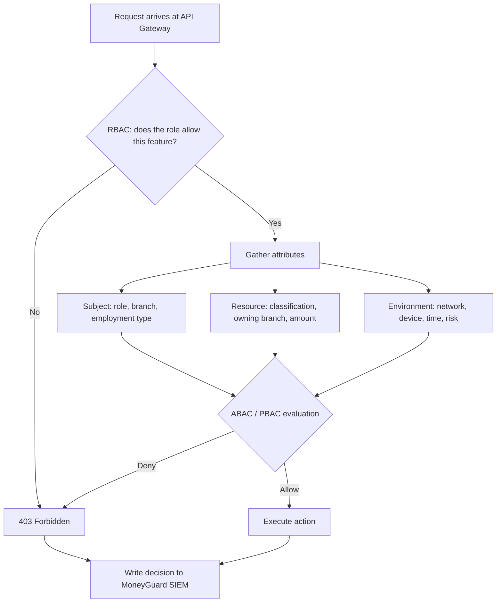
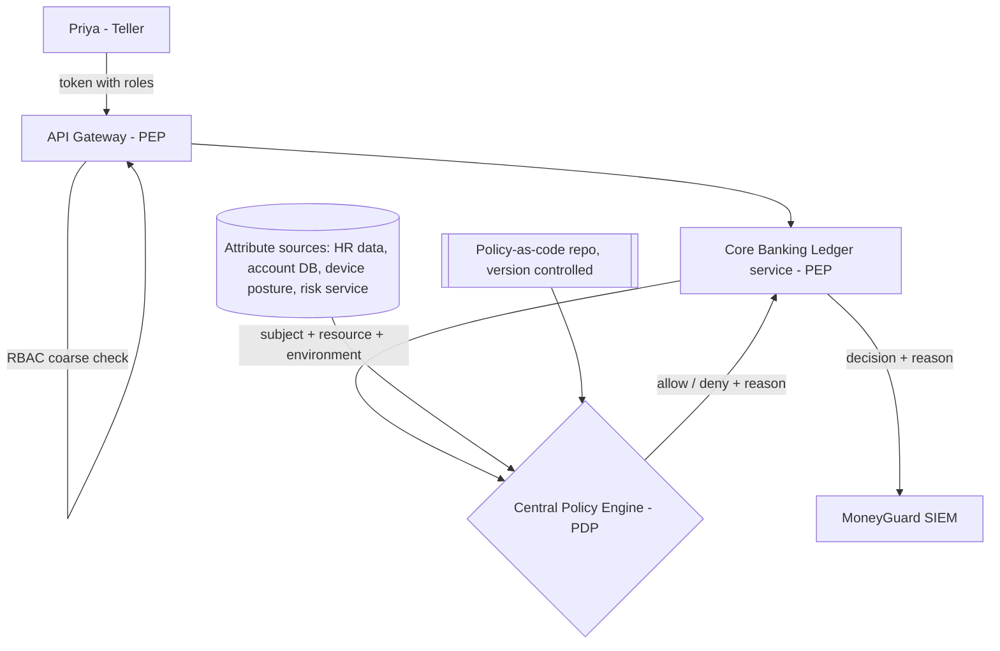

# Chapter 3: Access Control Models Overview (RBAC, ABAC, PBAC)

## Overview

Once a user is authenticated, something must decide **what they are allowed to do**. An **access control model** is the pattern you use to make that decision.

This chapter is an **introduction** to the three models you will meet most often:

- **RBAC — Role-Based Access Control:** access follows your job title.
- **ABAC — Attribute-Based Access Control:** access follows facts about the user, the resource, and the situation.
- **PBAC — Policy-Based Access Control:** the rules live in one central engine instead of scattered through application code.

These are not competing choices. Real systems layer them.

## Why This Matters

- Authorization is where most real-world security incidents actually land. Attackers rarely break cryptography; they use an account that had more access than it needed.
- Choosing the wrong model early creates permanent pain. Pure RBAC in a bank leads to thousands of unmanageable roles; pure ABAC everywhere leads to logic nobody can audit.
- Auditors like Dana Cole must be able to answer "who can do what, and why" — and that answer is only as clear as your model.

## Key Concepts

| Term | Plain-English Meaning |
|---|---|
| **Permission** | A single allowed operation, e.g. `accounts.read`. |
| **Role** | A named bundle of permissions matching a job function, e.g. `Teller`. |
| **Attribute** | A fact used in a decision — user's branch, an account's classification, the time of day. |
| **Policy** | A written rule that turns inputs into allow/deny. |
| **Coarse-grained** | Broad decisions: "can this person open the app at all?" |
| **Fine-grained** | Narrow decisions: "can this person see *this specific* account?" |
| **Role explosion** | The failure mode where every combination of conditions becomes its own role. |
| **PDP / PEP** | Policy Decision Point (decides) and Policy Enforcement Point (enforces). |

## Detailed Notes

### 🏦 The Setting

When **Priya Sharma** joins MoneyGuard Bank as a teller in branch NYC-014, someone must decide what she can see in the **MoneyGuard Employee Portal** and what she can do in the **Core Banking Ledger**. Watch how each model answers that.

### Concept 1 — RBAC (Role-Based Access Control)

**Mental model:** the badge. Your job title determines your access.

You do not grant permissions to Priya. You grant permissions to the **`Teller` role**, and then you make Priya a Teller. When she leaves, you remove the role, and everything goes with it.

**At MoneyGuard:**

| Role | Permissions |
|---|---|
| `Teller` | View customer accounts, process deposits, transfers up to $10,000 |
| `BranchManager` | Everything a Teller can do, plus approve transfers up to $250,000 |
| `Auditor` | Read-only access to transaction history and audit logs — no write access at all |
| `IAMAdmin` | Manage groups and role assignments — no access to customer money |

**Strengths:** simple, fast, matches how the business already thinks, easy to explain to an auditor, and supported natively by every identity provider including MoneyGuard Entra ID.

**The breaking point — role explosion:** New rules arrive. *"Tellers may only view accounts in their own branch."* *"Tellers working from home may not approve anything."* *"Tellers may not view VIP accounts."* If you express these as roles you end up with `Teller_NYC014`, `Teller_NYC014_WFH`, `Teller_NYC014_NoVIP`… Thousands of near-identical roles that nobody can audit. That is the signal you need attributes.

### Concept 2 — ABAC (Attribute-Based Access Control)

**Mental model:** a security guard with a checklist. Context matters.

ABAC does not ask only *who you are*. It asks *under what conditions* the request is being made, and evaluates that at the moment of the request. Attributes come from three places:

**1. Subject attributes (the "who")** — role, department, branch code, clearance level, employment type (full-time vs contractor like Sam Torres).

**2. Resource attributes (the "what")** — account classification (standard vs VIP), the owning branch, the transaction amount, the data's region (US vs EU, which matters for GDPR).

**3. Environment attributes (the "context")** — network (corporate vs public Wi-Fi), device (managed laptop vs personal phone), time of day, and current risk score.

**At MoneyGuard, one ABAC rule replaces dozens of roles:**

> Allow `view_account` **IF** subject.role = `Teller` **AND** subject.branchCode = resource.branchCode **AND** resource.classification ≠ `VIP` **AND** environment.network = `corporate`.

Priya at her branch desk viewing a local standard account: **allowed**. Priya from home viewing a VIP account: **denied** — with no `WFH_Teller_NoVIP` role ever created.

**Strengths:** fine-grained, contextual, scales without role explosion.
**Costs:** you must reliably source all those attributes, and the logic can sprawl across services if you are not careful.

### Concept 3 — PBAC (Policy-Based Access Control)

**Mental model:** the central rulebook. ABAC says *what* to evaluate; PBAC says *where* the rules live.

Once MoneyGuard has 50 services, duplicating ABAC logic in each one is unmaintainable. PBAC pulls authorization rules out of application code and into a **central policy engine**. The application becomes a **PEP (Policy Enforcement Point)**: it gathers context, asks the **PDP (Policy Decision Point)** for a decision, and enforces the answer.

**At MoneyGuard:** regulators introduce *"transfers over $10,000 require two separate approvers, MFA, and a risk score below 40."* Instead of shipping code changes to 50 services, the security team updates one **policy-as-code** file and it takes effect bank-wide.

**Strengths:** consistent rules everywhere, versioned and reviewable in Git, one place for auditors to look, changes without redeployment.
**Costs:** you now run a critical service in the request path, so you must plan for latency, caching, and what happens if it is unavailable.

### Concept 4 — How They Layer Together

A single $25,000 transfer approved by a MoneyGuard branch manager passes all three:

1. **RBAC** — "Is she a `BranchManager`?" Yes → she may open the transfer feature at all. Cheap, fast, filters out most unauthorized traffic before expensive checks run.
2. **ABAC** — "Is she on the corporate network, during business hours, and is $25,000 within her limit?" Yes → contextually allowed.
3. **PBAC** — "Does bank policy allow this right now?" The central engine replies *"pending second approver"*, then allows once a second manager signs.

Remove RBAC and every request pays full attribute evaluation. Remove ABAC and you get role explosion. Remove PBAC and multi-step and regulatory rules get copy-pasted inconsistently across services.

### Concept 5 — What Belongs in a Token

A very common beginner trap is trying to encode all authorization in the login token.

| Model | Fits in a token? | Why |
|---|---|---|
| **RBAC** | ✅ Yes | Roles are stable and small: `"roles": ["Teller"]`. |
| **ABAC** | ⚠️ Partly | Subject attributes can ride along; resource and environment attributes change constantly and must be read at runtime. |
| **PBAC** | ❌ No | The token only says *who* is asking; the engine decides. |

⚠️ Never encode fine-grained permissions such as `can_edit_account_4417` in a token. It breaks size limits, leaks your data model, and cannot be revoked before expiry.

## Workflow



## Architecture Diagram



## Step-by-Step Process

1. **Start with RBAC.** Define a small number of roles that mirror real job functions at MoneyGuard: Teller, BranchManager, Auditor, IAMAdmin.
2. **Assign roles from HR data**, not by hand — Workday's job code drives the role.
3. **Watch for role explosion.** The moment you are tempted to create `Teller_NYC014_WFH`, stop: that condition is an attribute, not a role.
4. **Introduce ABAC for the conditional rules.** Identify which subject, resource, and environment attributes you need and where each is reliably sourced.
5. **Enforce coarse checks at the edge, fine checks in the owning service.** The gateway cannot know which branch owns an account; the ledger can.
6. **Externalize to PBAC when duplication hurts.** When the same rule exists in three services, move it into a central policy engine.
7. **Log every decision with its reason** so Dana can reconstruct *why* access was allowed, not just that it was.
8. **Review roles and policies on a schedule** — quarterly for anything touching the Core Banking Ledger.

## Commands and Examples

**RBAC — role assignment as configuration:**

```json
{
  "role": "Teller",
  "description": "Retail branch teller at MoneyGuard Bank",
  "permissions": [
    "accounts.read",
    "deposits.create",
    "transfers.create:limit=10000"
  ],
  "assignedFrom": "workday.jobCode=TELL-01"
}
```

**RBAC in application code (.NET):**

```csharp
[Authorize(Roles = "Teller,BranchManager")]
[HttpGet("accounts/{id}")]
public async Task<IActionResult> GetAccount(Guid id) { ... }
```

**ABAC — the decision request a MoneyGuard service sends:**

```json
{
  "subject":     { "id": "88412", "role": "Teller", "branchCode": "NYC-014", "employmentType": "FTE" },
  "action":      "view_account",
  "resource":    { "accountId": "4417-8890", "branchCode": "NYC-014", "classification": "VIP" },
  "environment": { "network": "corporate", "deviceManaged": true, "timeLocal": "14:22", "riskScore": 12 }
}
```

**PBAC — the same rule written as policy-as-code (Rego, the Open Policy Agent language):**

```rego
package moneyguard.accounts

default allow := false

# A teller may view an account in their own branch, unless it is VIP,
# and only from the corporate network.
allow if {
    input.subject.role == "Teller"
    input.subject.branchCode == input.resource.branchCode
    input.resource.classification != "VIP"
    input.environment.network == "corporate"
}

# Branch managers may view VIP accounts in their branch on a managed device.
allow if {
    input.subject.role == "BranchManager"
    input.subject.branchCode == input.resource.branchCode
    input.environment.deviceManaged == true
}
```

**The decision the engine returns:**

```json
{ "allow": false, "policy": "moneyguard.accounts", "reason": "VIP account requires BranchManager role" }
```

## Best Practices

- Start simple: **RBAC first**, add attributes only when a real requirement demands context.
- Keep roles **business-meaningful** — a role should map to a job someone actually holds.
- Enforce **layered checks**: coarse at the gateway, fine in the data-owning service.
- Source attributes from **authoritative systems** (Workday for department, the account DB for classification) — never from user-supplied input.
- Store policies in **version control** so changes are reviewed and auditable.
- Always return a **reason** with a denial, and log it.
- **Fail closed** for high-risk operations if the policy engine is unreachable.
- Re-evaluate authorization at **runtime**, not just at login.

## Common Mistakes

- ⚠️ **Role explosion.** Creating a new role for every combination of conditions until nobody can audit them.
- ⚠️ **Putting fine-grained permissions in tokens.** Static tokens cannot express dynamic decisions and cannot be revoked mid-flight.
- ⚠️ **Confusing OAuth scopes with user permissions.** A scope limits what a *client application* may request on the user's behalf; it does not say the user is entitled to that data.
- ⚠️ **Trusting attributes from the client.** If the caller can set `classification = standard`, ABAC is decoration, not security.
- ⚠️ **Skipping RBAC and doing everything in ABAC.** Every request then pays for full attribute evaluation, and broad access becomes hard to reason about.
- ⚠️ **No fallback plan for the policy engine.** If the PDP is down and you fail open on wire transfers, you have built an outage into a robbery.
- ⚠️ **Client-side-only enforcement.** Hiding the "Approve" button is not authorization.

## Pro Tips

- 💡 A good rule of thumb: **RBAC gets you in the building, ABAC decides which rooms, PBAC is the corporate rulebook governing both.**
- 💡 If a requirement contains the words *"only when"*, *"only from"*, or *"only during"*, it is an attribute, not a role.
- 💡 Keep role count roughly proportional to job functions. If MoneyGuard has 40 job families and 900 roles, something is wrong.
- 💡 Write the denial reason for a human. `"VIP account requires BranchManager role"` saves hours of support and audit time versus `"denied"`.
- 💡 Cache policy decisions carefully — cache the *policy bundle*, and be very cautious about caching *decisions* for sensitive actions.

## Real-World Use Cases

1. **🏦 Branch-scoped account access.** MoneyGuard needs tellers to see only their own branch's accounts. RBAC alone would need a role per branch (hundreds). One ABAC rule comparing `subject.branchCode` to `resource.branchCode` handles all of them.
2. **Contractor restrictions.** Sam Torres has the `Teller` role for a short project, but policy adds *"employmentType = Contractor may not view accounts classified VIP or export data."* An attribute check enforces it without a separate role tree.
3. **Regulatory dual approval.** Transfers above $10,000 need two approvers. This spans multiple users and multiple requests, so it belongs in a central policy engine — no single ABAC check inside one service can express it cleanly.
4. **GDPR data residency.** EU customer records may only be read by staff in EU locations. `resource.region` vs `subject.region` is a two-attribute rule that would be a nightmare as roles.
5. **Emergency lockdown.** During an active incident, MoneyGuard flips a global risk attribute; the central policy tightens every service at once without a single deployment.

## Key Takeaways

- **RBAC** = access by job title. Simple, auditable, the right starting point.
- **ABAC** = access by attributes of subject, resource, and environment. Solves role explosion.
- **PBAC** = the rules live centrally as policy-as-code. Solves duplication and governance.
- They **layer**: coarse RBAC first, then fine-grained ABAC/PBAC.
- Tokens carry **identity and stable roles**; volatile decisions happen at runtime.
- Every decision should be logged **with its reason**.

## Glossary

| Term | Definition |
|---|---|
| **RBAC** | Role-Based Access Control — permissions attached to named roles. |
| **ABAC** | Attribute-Based Access Control — decisions from subject, resource, and environment attributes. |
| **PBAC** | Policy-Based Access Control — rules centralized in a policy engine. |
| **PDP** | Policy Decision Point — the component that evaluates a policy and returns allow/deny. |
| **PEP** | Policy Enforcement Point — the component that asks the PDP and enforces the answer. |
| **Policy-as-code** | Authorization rules written in a text language and version-controlled. |
| **Rego** | The policy language used by Open Policy Agent (OPA). |
| **Role explosion** | Uncontrolled growth of near-duplicate roles for every condition combination. |
| **Coarse-grained** | Broad, feature-level access decisions. |
| **Fine-grained** | Record- or field-level access decisions. |
| **Scope** | OAuth 2.0 label limiting what a client app may request on a user's behalf. |
| **Fail closed / fail open** | Deny (safe) or allow (risky) when the decision system is unavailable. |

## Revision Notes

| Feature | RBAC | ABAC | PBAC |
|---|---|---|---|
| **Decision driver** | Static job title | Runtime attributes | Centralized policy rules |
| **Superpower** | Simple and auditable | Flexible and fine-grained | Consistent and governable |
| **Achilles heel** | Role explosion | Attribute sourcing + logic sprawl | Operational complexity, availability risk |
| **Best for** | App entry, feature toggles | Record-level and contextual access | Regulatory and cross-service rules |
| **Token friendly?** | Yes | Partly (subject only) | No — identity only |
| **MoneyGuard example** | `Teller` may open the Portal | Teller sees only own-branch, non-VIP accounts | Transfers over $10k need two approvers |

**Golden rules:** start with RBAC · "only when/from/during" = attribute · identity in the token, permissions at runtime · fail closed on money.

## Interview Questions

**Q1: If you could only pick one model to start with, which and why?**
A: RBAC. It maps directly to how the business is already organized, every identity provider supports it natively, it is cheap to evaluate, and it is easy for an auditor to review. You add ABAC or PBAC later, when a real requirement needs context.

**Q2: When does RBAC stop being sufficient?**
A: When context enters the requirement. Phrases like "only during business hours," "only under $10,000," "only from the office," or "only for accounts in their own branch" cannot be expressed as job titles. Forcing them into roles produces role explosion and an unauditable directory.

**Q3: Can RBAC and ABAC be used together?**
A: Yes, and they almost always should be. RBAC acts as the gatekeeper at the entry point — "is this user a Teller at all?" — which is cheap and filters most traffic. ABAC acts as the guard inside the data-owning service — "is this specific account in this teller's branch, and is it VIP?"

**Q4: Why not use ABAC for everything and drop RBAC?**
A: Cost and clarity. Evaluating full attribute sets on every request adds latency and requires reliably sourcing many attributes. It also makes broad access harder to reason about and to certify: "who can enter this application?" becomes a policy simulation instead of a group listing.

**Q5: Where does PBAC fit in a microservices architecture?**
A: As a shared decision service. Each service is a Policy Enforcement Point that assembles context and asks a central Policy Decision Point. This gives consistent decisions across services written in different languages, one versioned place for auditors, and rule changes without redeploying applications.

**Q6: What happens if the central policy engine goes down?**
A: You need a deliberate strategy per risk level. Fail closed for high-risk actions like wire transfers — denying is safer than allowing. Consider a short-lived cached decision or a locally-evaluated cached policy bundle for lower-risk reads. Never let "the PDP timed out" silently become "allow" on money movement.

**Q7: How would you explain this model to an auditor?**
A: Layered defense. RBAC limits who can enter each system, enforcing least privilege at the coarse level. ABAC limits which specific records they can touch based on context. PBAC ensures the regulatory rules are written once, versioned, reviewed, and applied consistently everywhere. Every decision, allow or deny, is logged with the policy that produced it.

**Q8: What's the most common authorization design mistake you see?**
A: Pushing authorization complexity into the token. Developers embed permissions, limits, and flags into a JWT, which freezes those decisions until expiry and makes instant revocation impossible. The rule is: identity goes in the token, authorization happens at runtime.

## Practice Exercises

1. **Design MoneyGuard's role set.** Define 5-7 RBAC roles covering tellers, branch managers, auditors, IAM administrators, and contractors. For each, list its permissions and the Workday job code that should grant it.
2. **Spot the role explosion.** MoneyGuard has these roles: `Teller`, `Teller_NYC`, `Teller_NYC_WFH`, `Teller_VIP`, `Teller_NYC_VIP_WFH`. Rewrite them as one role plus a set of attribute rules, and explain what each attribute replaces.
3. **Write the policy.** Express this in plain-language pseudo-policy or Rego: *"Sam Torres, a contractor, may read transaction history for accounts in his assigned branch, only on a managed device, only Monday-Friday 09:00-18:00, and never for VIP accounts."* Identify which facts are subject, resource, and environment attributes.
4. **Decide the failure mode.** For each MoneyGuard operation, choose fail-open or fail-closed if the policy engine is unreachable, and justify it: (a) viewing the branch holiday calendar, (b) viewing an account balance, (c) approving a $250,000 wire transfer, (d) resetting a customer's password.
5. **Audit the token.** You find a MoneyGuard access token containing `"permissions": ["approve_transfer_up_to_500000", "view_account_4417"]`. List three specific problems this creates and describe what should be in the token instead.

---

## 📚 Going Deeper

This chapter is deliberately introductory — enough to choose and reason about a model. A deep dive into **ReBAC (Relationship-Based Access Control)**, **Google Zanzibar**, and policy engines like **OPA** is in [Module 03 — Authorization & Policy Engines](../03_Authorization_And_Policy_Engines/README.md).

---
⬅ [Chapter 2 — The AAA Framework](./02_AAA_Framework.md) · [Module 01 Index](./README.md) · [MoneyGuard Scenario](../SCENARIO.md)
Next: [Chapter 4 — Principle of Least Privilege](./04_Principle_Of_Least_Privilege.md) ➡
