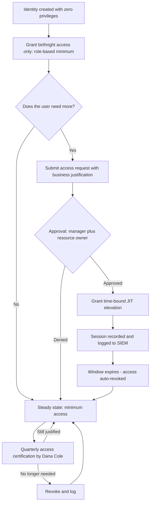
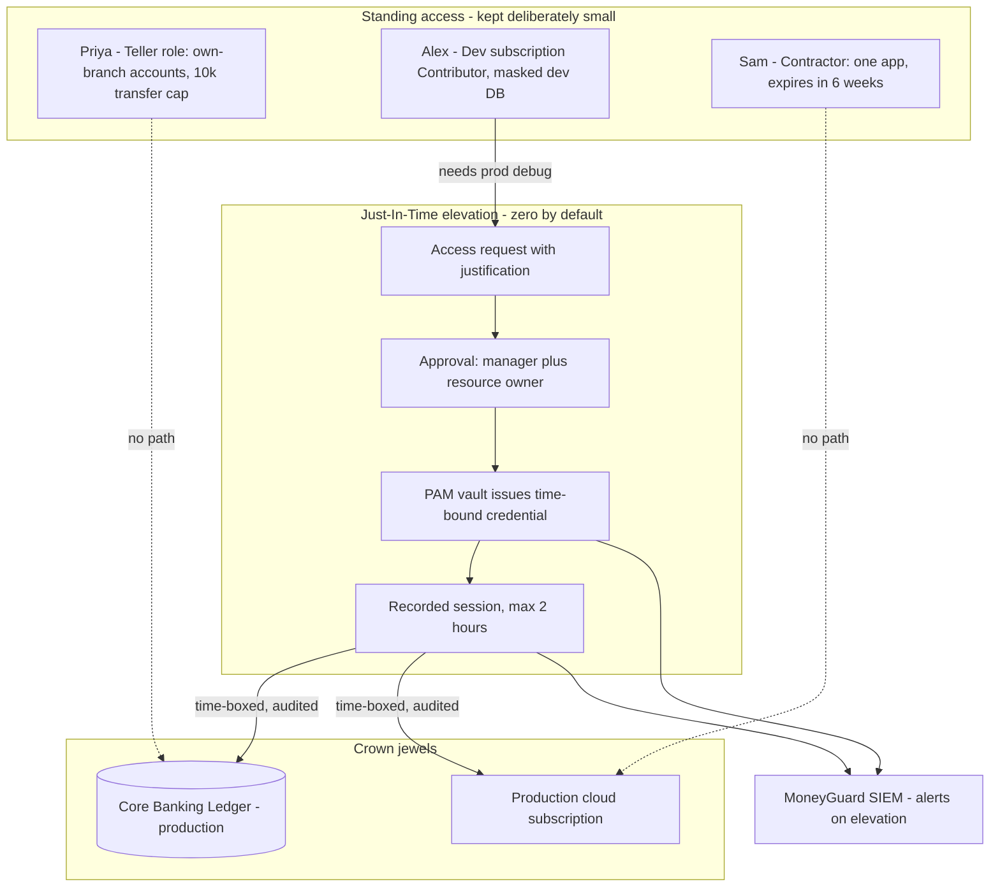

# Chapter 4: The Principle of Least Privilege (PoLP)

## Overview

The **Principle of Least Privilege (PoLP)** says that every user, service, and process should have **exactly the access it needs to do its job — no more, and no longer than necessary.**

It is the rule that decides whether an IAM system actually reduces risk or just creates a comforting illusion of control. You can have perfect authentication, a beautiful role model, and flawless audit logs — and still be one phishing email away from disaster if everyone is an administrator.

PoLP has two dimensions people often forget:

- **Scope** — how *much* can this identity touch?
- **Time** — how *long* does it keep that access?

## Why This Matters

- **PoLP does not prevent breaches — it prevents breaches from becoming disasters.** It shrinks the **blast radius**.
- Over-privilege is the single most common root cause finding in breach reports. The attacker did not need an exploit; the account they stole already had the access.
- Auditors test it directly. Dana Cole's access reviews at MoneyGuard exist specifically to find privileges that no longer have a business justification.
- It is a core pillar of **Zero Trust**: Zero Trust assumes breach, and PoLP is what makes that assumption survivable.

## Key Concepts

| Term | Plain-English Meaning |
|---|---|
| **Least privilege** | Grant only what is needed, only for as long as it is needed. |
| **Blast radius** | The total damage a single compromised identity can cause. |
| **Standing access** | Permissions that are always on, whether being used or not. |
| **JIT (Just-In-Time) access** | Elevated access granted on request, for a fixed window, then automatically removed. |
| **Privilege creep** | Access accumulating over a career because nothing is ever removed. |
| **Access certification** | A scheduled review where managers confirm or revoke their team's access. |
| **Segregation of Duties (SoD)** | No single person can complete a sensitive process end-to-end alone. |
| **Break-glass account** | An emergency high-privilege account, heavily monitored, used only in a crisis. |
| **Lateral movement** | An attacker moving from one compromised system to another. |

## Detailed Notes

### Concept 1 — 🏦 "Start With Zero"

PoLP starts from **deny by default**. Nothing is granted unless a legitimate business need justifies it.

**When Priya Sharma joins MoneyGuard as a teller**, she does not receive "everything a teller *might* one day need." She receives what the `Teller` role requires on day one: the Employee Portal, branch tools, view access to accounts in branch NYC-014, and the ability to create transfers up to $10,000. That is it.

If Eve compromises Priya's account:

- **Without PoLP:** Eve can browse every customer record in the bank, alter transactions, reach backup systems, and pivot to other systems using Priya's over-broad group memberships.
- **With PoLP:** Eve gets one branch's standard accounts, a $10,000 transfer ceiling, no export capability, and no path sideways. The incident is contained and detectable.

Same breach. Completely different Tuesday.

### Concept 2 — 🏦 The Over-Privileged Developer (The Classic Anti-Pattern)

**Alex Kim** is a backend engineer at MoneyGuard.

❌ **Before — over-privileged:**

- Read/write to source code — appropriate.
- **Administrator** on both the development *and* production cloud subscriptions.
- **Full read/write** on the production Core Banking Ledger database.

The justification is always the same sentence: *"Alex might need to debug a production issue."*

The risk: Alex's laptop is compromised by malware. The malware now holds production administrator rights to a bank's ledger. One infected endpoint has become a full institutional compromise.

✅ **After — least privilege applied:**

- Read/write to source code — unchanged.
- **Contributor** on the development subscription only.
- **No standing access** to production.
- Read-only access to a **sanitized, masked** development database.
- Production access available **just-in-time**: request it, get approval, receive a 2-hour elevated session that is fully recorded and expires automatically.

Alex can still do his job during an incident. But there is no permanently armed weapon sitting on his laptop.

### Concept 3 — The Three Implementation Strategies

**A. Role trimming (access audits).** PoLP starts with visibility.

1. **Discover** — list every identity holding high-privilege roles. Include service accounts.
2. **Justify** — for each permission, ask *why does this exist?* If the answer is "historical" or nobody knows, that is a finding.
3. **Remove** — strip anything without a current business justification, and monitor for breakage.

At the application level this means moving away from broad `[Authorize]` checks toward specific capability policies like `[Authorize(Policy = "CanApproveLoans")]`.

**B. Just-In-Time (JIT) access.** Eliminate standing admin rights entirely.

1. The user has **zero** elevated privileges by default.
2. They request elevation for a specific task, with a reason.
3. The request is approved (by a human, or automatically for low-risk cases).
4. Access is granted **for a fixed time window**.
5. Access is **automatically revoked** when the window closes.

This is the compromise that makes PoLP survivable in practice: productivity is preserved, but the dangerous permissions exist only in narrow, logged windows.

**C. Segmentation (blocking lateral movement).** PoLP is not only about what access exists, but about **where it can spread**.

- Business users cannot reach infrastructure networks.
- The Fraud Detection Pipeline's service account can call the scoring API and nothing else — it cannot read customer PII.
- A compromise of the Business Banking SaaS Portal must not provide a path into the Core Banking Ledger.

### Concept 4 — Time-Bound Access for Contractors

**Sam Torres** joins MoneyGuard for a six-week project. PoLP for Sam means:

- Access **expires automatically** on a set date recorded at creation time — not "when someone remembers."
- Scoped to **one application and one dataset**.
- **No** ability to create users, roles, or new access.
- **No** VPN access outside project hours.

An access grant without an expiry date is a permanent grant wearing a disguise.

### Concept 5 — PoLP vs Productivity (The Honest Trade-Off)

Yes, tightening privileges slows teams down at first. Removing excess access exposes undocumented dependencies nobody knew existed — "wait, the nightly reconciliation job was using Raj's personal admin account?"

That discovery is the *point*. Those dependencies were invisible risk. Over time, JIT access, self-service request workflows, and good tooling restore the speed while keeping the security.

The wrong response is a blanket exemption. The right response is a fast, well-instrumented path to temporary elevation.

## Workflow



## Architecture Diagram



## Step-by-Step Process

1. **Inventory privilege.** Enumerate every account — human and service — with administrative or write access to sensitive systems.
2. **Classify systems by blast radius.** The Core Banking Ledger is not the same risk tier as the branch holiday calendar.
3. **Define minimum role baselines.** For each job function, write down the smallest permission set that lets the job be done.
4. **Remove standing privilege** from the highest-risk tier first, replacing it with JIT.
5. **Add expiry to every non-permanent grant** — contractors, project access, elevated roles.
6. **Implement approval workflows** so elevation is fast but never silent.
7. **Record and alert.** Every elevation writes to the SIEM; unusual elevation patterns raise alerts.
8. **Certify on a schedule.** Quarterly for crown-jewel systems, annually for standard ones.
9. **Measure.** Track standing admin count, average time-to-revoke, and stale-access findings over time.

## Commands and Examples

**A least-privilege role definition for MoneyGuard tellers:**

```json
{
  "roleName": "Teller",
  "scope": "branch:{user.branchCode}",
  "allow": [
    "accounts.read",
    "deposits.create",
    "transfers.create"
  ],
  "constraints": {
    "transfers.create.maxAmount": 10000,
    "accounts.read.classification": ["Standard"],
    "export.enabled": false
  },
  "deny": ["accounts.delete", "customers.export", "users.manage"]
}
```

**A time-bound JIT elevation request:**

```json
{
  "requestId": "jit-2026-03-04-0118",
  "requester": "alex.kim@moneyguard.com",
  "targetRole": "LedgerDB-ReadOnly-Prod",
  "justification": "INC-44219: investigating duplicate postings in batch 8841",
  "requestedDuration": "PT2H",
  "approver": "raj.patel@moneyguard.com",
  "approvedAt": "2026-03-04T09:12:00Z",
  "expiresAt": "2026-03-04T11:12:00Z",
  "sessionRecording": true,
  "autoRevoke": true
}
```

**A capability-based authorization policy instead of a broad role check (.NET):**

```csharp
// Broad and dangerous - anyone with any admin-ish role passes
[Authorize(Roles = "Admin")]

// Least privilege - one named capability, granted deliberately
[Authorize(Policy = "CanApproveLoans")]
public async Task<IActionResult> ApproveLoan(Guid loanId) { ... }
```

**Finding standing privilege (directory query):**

```bash
# Which MoneyGuard accounts hold permanent Domain Admin?
ldapsearch -x -H ldaps://dc01.corp.moneyguard.com \
  -b "CN=Domain Admins,OU=Groups,DC=corp,DC=moneyguard,DC=com" \
  -D "CN=svc-audit,OU=ServiceAccounts,DC=corp,DC=moneyguard,DC=com" -W \
  "(objectClass=group)" member
```

**Detecting privilege creep in the SIEM:**

```kusto
RoleAssignments
| where AssignedAt < ago(180d)
| join kind=leftanti (
    AccessLogs | where TimeGenerated > ago(180d) | distinct PrincipalId, RoleName
  ) on PrincipalId, RoleName
| project PrincipalId, RoleName, AssignedAt, Finding = "Role held 180+ days, never used"
```

## Best Practices

- **Deny by default.** Every permission must be added deliberately, with a reason recorded.
- **Time-box everything you can.** Elevation, contractor access, project access, break-glass use.
- **Replace standing admin with JIT** on all crown-jewel systems.
- **Grant capabilities, not job titles**, at the application layer (`CanApproveLoans`, not `Admin`).
- **Give every grant an owner** who is accountable at review time.
- **Separate environments.** Production access is a distinct decision from development access, always.
- **Enforce Segregation of Duties** — the person who initiates a payment cannot be the person who approves it.
- **Monitor denials.** A rise in denied attempts tells you either your baselines are too tight or someone is probing.
- **Review on a cadence:** quarterly for critical systems, annually for standard ones.

## Common Mistakes

- ⚠️ **"Just make them admin to unblock the release."** Temporary in intent, permanent in practice.
- ⚠️ **Granting access with no expiry.** Especially for contractors like Sam — this is how orphaned access is born.
- ⚠️ **Adding on role change without removing.** The Mover event is where privilege creep is created (see Chapter 5).
- ⚠️ **Giving an application's database account `db_owner`.** It usually needs read and write on a handful of tables, not schema and backup rights.
- ⚠️ **Exempting service accounts from PoLP** because "they're just automation." They have no MFA and often no owner — they need *more* scrutiny, not less.
- ⚠️ **Rubber-stamped access reviews.** A manager clicking "approve all" for 60 people in 30 seconds produces audit paperwork, not security.
- ⚠️ **Confusing least privilege with no privilege.** If the controls make the job impossible, people will build shadow workarounds that are far worse.
- ⚠️ **Ignoring read access.** Read-only still means data exfiltration. A read-only account with access to every customer record is a serious breach.

## Pro Tips

- 💡 The best question in any access request review: *"What happens if this account is compromised tomorrow?"* If the answer scares you, the grant is too broad.
- 💡 **Standing admin count is a great single metric** for PoLP maturity. Track it monthly and drive it toward zero.
- 💡 Pair every privilege removal with a **fast path to get it back temporarily**. Removal without a JIT path just creates resentment and workarounds.
- 💡 Production debugging usually does not need production data — read-only structured logs, metrics, redacted traces, and synthetic transactions solve most incidents.
- 💡 Apply PoLP to **data volume**, not just operations: a support tool that returns one customer at a time is dramatically safer than one that can return all of them.
- 💡 When you remove access and something breaks, you have just discovered an undocumented dependency. Document it before restoring it.

## Real-World Use Cases

1. **🏦 The "super user" help desk.** To speed up support, MoneyGuard's help desk was granted full administrative rights. The fix: identify the actual tasks (password resets, account unlocks), create a narrow `HelpDesk_PasswordReset` role, exclude executive and privileged accounts from its scope, and alert on denied attempts. Support speed unchanged; catastrophic misuse eliminated.
2. **Production debugging without production access.** Alex needs to diagnose an incident. Instead of standing production admin: read-only structured logs, metrics dashboards, redacted traces, synthetic test transactions, and JIT elevation with recording when genuinely required.
3. **Third-party vendor access.** An external vendor needs access to one subsystem. PoLP means: time-bound to the engagement, one application only, no user or role creation ability, dedicated identities per vendor engineer, and automatic expiry. A vendor compromise no longer threatens MoneyGuard's environment.
4. **The over-privileged batch job.** A nightly reconciliation service account had full write access to the Core Banking Ledger. It only needed read on two tables and write on one. Trimming it removed the single most dangerous non-human identity in the bank.
5. **The auditor's own access.** Dana Cole needs to see everything — but only to *read* it. Her role is deliberately read-only across all systems, and her access to audit logs is itself logged.

## Key Takeaways

- PoLP = exactly the access needed, for exactly as long as needed.
- It limits **blast radius**; it does not prevent compromise.
- Two dimensions: **scope** (how much) and **time** (how long).
- The main tools are **role trimming**, **JIT access**, and **segmentation**.
- **Standing admin access is the enemy.** Drive it toward zero.
- Every grant needs an **owner**, a **justification**, and ideally an **expiry**.
- PoLP is a core pillar of Zero Trust — it is what makes "assume breach" survivable.

## Glossary

| Term | Definition |
|---|---|
| **PoLP** | Principle of Least Privilege — minimum necessary access. |
| **Blast radius** | Total potential damage from one compromised identity. |
| **Standing access** | Always-on permissions, regardless of current need. |
| **JIT access** | Just-In-Time — temporary, approved, auto-expiring elevation. |
| **PIM** | Privileged Identity Management — tooling that implements JIT elevation. |
| **Privilege creep** | Gradual accumulation of unneeded access over time. |
| **Access certification** | Scheduled manager review confirming or revoking access. |
| **SoD** | Segregation of Duties — splitting sensitive processes across people. |
| **Break-glass account** | Emergency high-privilege account, monitored and rarely used. |
| **Lateral movement** | An attacker pivoting from one compromised system to another. |
| **Toxic combination** | Two individually reasonable permissions that together enable fraud. |
| **Orphaned access** | Access with no valid owner or business purpose remaining. |

## Revision Notes

| Question | Answer |
|---|---|
| What is PoLP? | Minimum access, minimum duration. |
| What does it protect? | Blast radius — it contains damage, not prevents breaches. |
| Two dimensions? | Scope and time. |
| Three strategies? | Role trimming, JIT access, segmentation. |
| Biggest anti-pattern? | Standing admin "just in case." |
| Review cadence? | Quarterly (critical) / annually (standard). |
| Relationship to Zero Trust? | PoLP is a core pillar; Zero Trust assumes breach, PoLP limits it. |
| Applies to service accounts? | Yes — with *more* rigor, since they have no MFA. |

## Interview Questions

**Q1: Define the Principle of Least Privilege and explain what it actually buys you.**
A: PoLP means every identity gets exactly the access required for its function and nothing more, for no longer than necessary. It does not prevent compromise — phishing and malware will still succeed sometimes. What it buys you is a small blast radius: when Priya's account is compromised, the attacker reaches one branch's standard accounts with a $10,000 ceiling instead of the entire customer database.

**Q2: Doesn't least privilege slow teams down?**
A: Initially, yes. Removing excess access surfaces undocumented dependencies that nobody knew existed, and that friction is real. The answer is not exemptions but tooling: Just-In-Time elevation, self-service requests with fast approval, and good read-only observability so engineers rarely need production access at all. Long-term, teams end up faster because access is predictable rather than ticket-driven.

**Q3: How does PoLP apply to application code?**
A: Authorize on capabilities rather than broad roles. `[Authorize(Policy = "CanApproveLoans")]` is far better than `[Authorize(Roles = "Admin")]` because it expresses one specific ability. It also lets you grant "can create users" without automatically granting "can delete users," which broad role checks cannot express.

**Q4: How often should access be reviewed, and what makes a review meaningful?**
A: Quarterly for critical systems like the Core Banking Ledger, annually for standard systems. These are called access certification campaigns. A meaningful review shows the reviewer what the access actually permits and when it was last used, defaults to revoke rather than approve, requires justification for retention, and is spread out so no manager faces 200 decisions at once.

**Q5: How does PoLP apply to service accounts?**
A: More strictly than to humans, because service accounts have no MFA, no behavioral baseline, and often no owner. Each should be single-purpose, scoped to the minimum APIs and database objects it needs, use rotated credentials or platform-managed identities, have interactive login disabled, and be tied to the lifecycle of the application rather than a person.

**Q6: Is PoLP compatible with Zero Trust?**
A: They are complementary. Zero Trust assumes breach and verifies every request rather than trusting the network. PoLP determines what a verified request is allowed to reach. Zero Trust without least privilege just means an attacker gets carefully verified access to everything.

**Q7: What is Segregation of Duties and how does it relate to PoLP?**
A: SoD ensures no single person can complete a sensitive process alone — the person who initiates a payment cannot approve it, and the developer who writes code cannot approve its production release. PoLP limits how much any one identity holds; SoD ensures that even legitimate combinations of access cannot enable fraud. Together they prevent both external compromise and insider abuse.

**Q8: How would you drive a least-privilege program at a bank with 50,000 employees?**
A: Start with visibility — inventory every privileged account, human and service. Rank systems by blast radius and attack the crown jewels first. Replace standing admin on those systems with JIT elevation backed by approval and session recording, so productivity is preserved. Add expiry dates to all contractor and project access. Then institutionalize it: quarterly certifications, alerting on elevation, and a tracked metric of standing admin count trending toward zero.

## Practice Exercises

1. **Trim a role.** Alex Kim currently has: source control write, Owner on the dev subscription, Owner on the production subscription, `db_owner` on the production ledger database, and permanent VPN. Rewrite this as a least-privilege set, and specify which items move to JIT with what approval and duration.
2. **Design Sam's contractor access.** Sam Torres joins for six weeks to build a report on branch transaction volumes. Write his complete access grant: systems, permissions, data scope, expiry date, approver, and what happens automatically on day 43.
3. **Find the toxic combination.** MoneyGuard grants a role that can both create vendor payment records and approve vendor payments. Explain the fraud this enables, and redesign the roles to enforce Segregation of Duties.
4. **Write the JIT policy.** Define the elevation policy for production Core Banking Ledger access: who may request it, who approves, maximum duration, what is recorded, what triggers an alert, and what happens if the approver is unavailable during an incident.
5. **Audit for privilege creep.** Priya has been at MoneyGuard for five years: teller → senior teller → loan officer → branch operations. List the specific access she likely accumulated at each step, identify which grants should have been removed on transition, and describe the control that would have caught each one.

---
⬅ [Chapter 3 — Access Control Models Overview](./03_Access_Control_Models_Overview.md) · [Module 01 Index](./README.md) · [MoneyGuard Scenario](../SCENARIO.md)
Next: [Chapter 5 — The IAM Lifecycle (Joiner, Mover, Leaver)](./05_IAM_Lifecycle_JML.md) ➡
