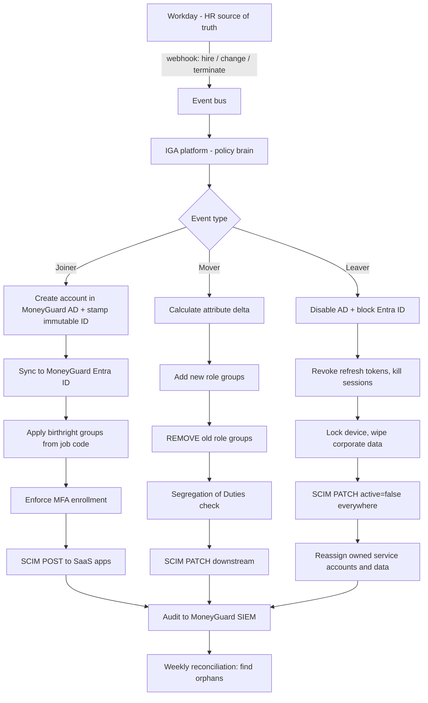
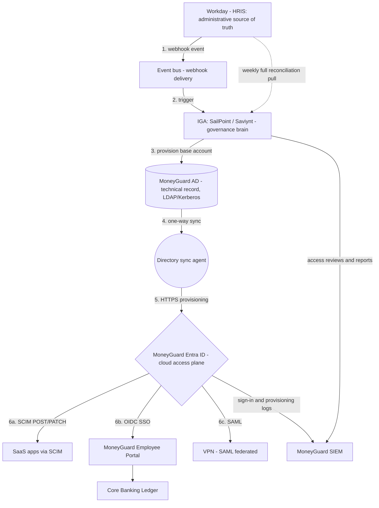

# Chapter 5: The IAM Lifecycle — Joiner, Mover, Leaver (JML)

## Overview

Every identity has a life: it is **born**, it **changes**, and it **dies**. In IAM these three phases are called **JML — Joiner, Mover, Leaver**:

- **Joiner** — a new person arrives and needs access on day one.
- **Mover** — a person changes role, team, or location, so their access must change *both ways*.
- **Leaver** — a person departs and all access must be removed immediately.

This is the **canonical JML chapter for this repository**. Every other module that mentions onboarding, role change, or offboarding refers back to here.

The goal of a mature program is **zero-touch identity lifecycle automation**: HR records a fact, and access appears, adjusts, or disappears everywhere — with no ticket, no email, and no manual script.

## Why This Matters

- **Joiner failures** waste money and create insecure workarounds. A teller who cannot log in on day one gets someone's shared password.
- **Mover failures** cause **privilege creep** — the slow accumulation of access that makes every compromised account far more dangerous than it should be.
- **Leaver failures** are the classic breach headline. Most insider data theft happens in the hours immediately after a termination, before manual offboarding catches up.
- JML is what auditors test. Dana Cole's first question is always: *"Show me a terminated employee and prove their access is gone everywhere."*

## Key Concepts

| Term | Plain-English Meaning |
|---|---|
| **HRIS** | Human Resources Information System — the authoritative record of employment. At MoneyGuard: **Workday**. |
| **Source of truth** | The one system that decides a fact; everything else copies it. |
| **Birthright access** | The baseline access every person in a given role gets automatically. |
| **Provisioning** | Automatically creating accounts and access in target systems. |
| **Deprovisioning** | Automatically removing them. |
| **IGA** | Identity Governance and Administration — the policy brain (SailPoint, Saviynt, Omada). |
| **IdP** | Identity Provider — the login engine. At MoneyGuard: **MoneyGuard Entra ID**. |
| **SCIM** | System for Cross-domain Identity Management — the standard HTTP/JSON protocol for pushing user create/update/disable to SaaS apps. |
| **Webhook** | A push notification from one system to another the moment an event happens. |
| **Immutable ID** | A permanent, never-reused identifier for an identity (a UUID). |
| **Privilege creep** | Access accumulating because Movers only ever add. |
| **Orphaned account** | An account with no valid owner or employment record behind it. |
| **Reconciliation** | Comparing actual state against expected state and correcting the difference. |

## Detailed Notes

### Concept 1 — 🏦 The Directional Flow of Truth at MoneyGuard

**Workday is where identity is born, changed, and ended.** IT never creates an employee by hand.

- **Created in:** Workday. If a person is not in Workday, they do not legally work for MoneyGuard.
- **Modified in:** Workday. Title, department, branch, and manager changes happen there and cascade down.
- **Destroyed in:** Workday. HR marks a termination; IAM turns that into a bank-wide kill switch.

Between Workday and the applications sit three layers:

1. **IGA (the brain)** — translates HR facts into technical access decisions and enforces governance rules.
2. **MoneyGuard AD (the technical record)** — where the network-level account actually lives, needed for legacy protocols.
3. **MoneyGuard Entra ID (the access plane)** — the cloud IdP that handles SSO and pushes accounts to SaaS apps via SCIM.

⚠️ If a change reaches Workday but never reaches AD, the rest of the bank still sees stale data. This is called **identity drift**, and it is why reconciliation (Concept 6) exists.

### Concept 2 — 🏦 JOINER: Priya's First Day

**Trigger:** HR creates Priya Sharma's employee record in Workday — Start Date Feb 1, Department Retail Banking, Location NYC-014, Job Code TELL-01 (Bank Teller). **No IT ticket is opened.**

**The relay race that follows:**

1. **Detection.** Workday fires a webhook to an event bus the moment the record becomes active. (Push, not polling — polling means a new hire might wait hours.)
2. **Phase A — the IGA foundation.** The IGA platform evaluates Priya's HR attributes and provisions a base account in **MoneyGuard AD**. Her **immutable ID** is generated and stamped here. AD is required because branch Wi-Fi (802.1x), Windows laptop login, and legacy branch applications speak Kerberos/LDAP/RADIUS, not web protocols.
3. **Phase B — the cloud sync.** A directory sync agent pushes the new AD object up to **MoneyGuard Entra ID**.
4. **Phase C — birthright access.** Group rules map Priya's attributes (`department = Retail Banking` + `jobCode = TELL-01` + `employmentType = FTE`) to baseline groups: corporate email, MoneyGuard Employee Portal, branch tools, VPN.
5. **MFA enrollment is enforced** at the IdP before any application access is granted. She registers a FIDO2 security key on day one.
6. **Phase D — downstream provisioning.** Entra ID uses **SCIM** to create her accounts in connected SaaS applications automatically.

**The Day-1 goal:** Priya logs in, everything works, no tickets, no shared temporary passwords. This is *security through automation* — the manual path is not just slower, it is less safe.

**Joiner failure modes:** manual account creation with typos, missed MFA enrollment, over-broad default access copied from another employee ("just give her the same as Ravi"), and onboarding spreadsheets that become the real source of truth.

### Concept 3 — 🏦 MOVER: Priya Becomes a Loan Officer

Three years later HR updates Priya's Workday profile: Job Code LOAN-02, Department Lending, still branch NYC-014.

This looks like a cosmetic HR update. **It is a security event.**

1. **Change detection.** IGA sees the attribute delta from the Workday webhook.
2. **Grants.** She is added to lending groups: loan origination system, credit bureau lookup tool, lending approval workflow.
3. **Revocations — the step everyone forgets.** Her `Teller` role, cash-drawer reconciliation access, and teller transfer permissions must be **removed**.
4. **Governance check.** IGA enforces **Segregation of Duties**: a loan officer who *originates* loans must not also hold the permission to *approve* them.

> ⚠️ **The golden rule of Movers:** every role change must include removals, not just additions. If your Mover process never removes anything, your IAM system is broken and you are manufacturing privilege creep.

Privilege creep is how a five-year employee ends up with the combined access of four different jobs — and why a single phished account can do so much damage.

**A special case: temporary moves.** If Priya covers for a branch manager for two weeks, that elevated access must carry an **expiry date**, not be granted permanently "because she might cover again."

### Concept 4 — 🏦 LEAVER: Sam's Contract Ends

HR marks Sam Torres as terminated in Workday, effective 5:00 PM today. This is a **kill-switch event**, and speed is the entire point.

1. **Immediate disable.** The AD account is disabled and the Entra ID account is blocked. *Disable, not delete* — deletion destroys audit history and can break file ownership and data recovery.
2. **Session termination.** OAuth refresh tokens are revoked and active web and mobile sessions are killed globally. A valid token is a valid credential; disabling the account without revoking tokens leaves a window open.
3. **Device enforcement.** The corporate laptop is locked and any BYOD corporate data is wiped via mobile device management.
4. **Downstream deprovisioning.** Entra ID pushes a SCIM deactivation to every connected SaaS application.
5. **Non-human cleanup.** Any service account, API key, or scheduled job that Sam personally owned is reassigned or revoked. Orphaned automation is a common leaver blind spot.
6. **Data handling.** Mailbox and file ownership transfer to his manager under a documented retention policy.

**Why "disable then delete later":** a typical policy disables immediately, retains the disabled object for 90 days for investigation and data recovery, then deletes. The immutable ID is never reused.

### Concept 5 — Why Tokens Must Be Revoked, Not Waited Out

Disabling an account stops *new* logins. It does not automatically invalidate credentials already issued.

If Sam is terminated at 5:00 PM but holds a cloud CLI session token valid until 1:00 AM, he retains infrastructure access for eight hours after "offboarding." This is why MoneyGuard combines:

- **Short access token lifetimes** (minutes, not hours).
- **Refresh token revocation** at termination.
- **Continuous Access Evaluation** — the IdP pushes revocation signals to relying parties rather than waiting for expiry.

### Concept 6 — Reconciliation: What Happens When Automation Breaks

Event-driven pipelines fail. Webhooks get dropped, queues back up, agents crash. Without a safety net you get identity drift, and drift means orphaned accounts.

MoneyGuard runs a three-layer fallback:

1. **Real-time webhooks** — the primary path.
2. **Scheduled delta pulls** — every 12 hours the IGA queries Workday for all records changed since the last successful run, catching anything the webhooks missed.
3. **Weekly full reconciliation** — the IGA pulls the complete active-employee roster and compares it against AD and Entra ID. Any enabled account with **no matching active HR record** is force-suspended and flagged for security review.

That third step is the one that catches the account nobody remembers creating.

### Concept 7 — Idempotency and Race Conditions

Two practical problems every JML pipeline hits:

**Duplicate events.** HR systems commonly fire the same webhook more than once. The listener uses the HR transaction ID as an **idempotency key** against a fast key-value store and discards repeats. Even if one slips through, SCIM operations keyed on the immutable ID are naturally idempotent — setting a user to a state they are already in changes nothing.

**Ordering.** You cannot add Priya to an application group before her account has finished replicating from AD to Entra ID. A workflow state machine waits for a success response from each stage before triggering the next, rather than firing everything in parallel and hoping.

**Rate limits.** Provisioning 200 summer interns at once will hit SaaS API limits. Provisioning queues use exponential backoff, with failures routed to a dead-letter queue and retried over 24 hours.

### Concept 8 — Why the Immutable ID Matters

Every MoneyGuard identity gets a permanent UUID at creation, and every downstream system keys off it.

If Priya changes her surname and her email becomes `priya.mehta@moneyguard.com`, nothing breaks — because no system ever used her email as the primary key. Systems that key on email or username produce duplicate accounts and broken access on every name change.

The immutable ID is also never reused after deletion, so audit history stays unambiguous forever.

## Workflow



## Architecture Diagram



## Step-by-Step Process

**Joiner**

1. HR creates the record in Workday with start date, job code, department, location, manager.
2. Workday fires a webhook; the event bus delivers it to the IGA.
3. IGA maps the job code to a role and provisions the account in MoneyGuard AD with an immutable ID.
4. Directory sync pushes the object to MoneyGuard Entra ID.
5. Group rules apply birthright access; nothing beyond the role baseline.
6. MFA enrollment is enforced before first application access.
7. SCIM provisions downstream SaaS accounts.
8. Everything is logged; the manager receives a confirmation of what was granted.

**Mover**

1. HR updates the Workday profile.
2. IGA computes the attribute delta.
3. New role groups are added.
4. **Old role groups are removed.**
5. Segregation of Duties rules are evaluated against the resulting combined access.
6. SCIM patches downstream applications in both directions.
7. The new manager is asked to confirm any retained exceptions.

**Leaver**

1. HR sets the termination effective date and time.
2. At that timestamp, IGA disables AD and blocks Entra ID.
3. Refresh tokens are revoked and sessions terminated.
4. Devices are locked and corporate data wiped.
5. SCIM deactivates every downstream SaaS account.
6. Owned service accounts, API keys, and scheduled jobs are reassigned.
7. Mailbox and file ownership transfer per retention policy.
8. The account object is retained disabled for the retention window, then deleted. The immutable ID is never reused.

## Commands and Examples

**Joiner — SCIM 2.0 create (`POST /scim/v2/Users`):**

```json
{
  "schemas": ["urn:ietf:params:scim:schemas:core:2.0:User"],
  "externalId": "8f14e45f-ceea-467a-9a1b-2b5c0d1e7a90",
  "userName": "priya.sharma@moneyguard.com",
  "name": { "givenName": "Priya", "familyName": "Sharma" },
  "active": true,
  "emails": [{ "value": "priya.sharma@moneyguard.com", "primary": true }],
  "urn:ietf:params:scim:schemas:extension:enterprise:2.0:User": {
    "employeeNumber": "88412",
    "department": "Retail Banking",
    "costCenter": "NYC-014",
    "manager": { "value": "raj.patel@moneyguard.com" }
  },
  "title": "Bank Teller"
}
```

**Mover — SCIM group membership change (`PATCH /scim/v2/Groups/{id}`):**

```json
{
  "schemas": ["urn:ietf:params:scim:api:messages:2.0:PatchOp"],
  "Operations": [
    { "op": "remove", "path": "members[value eq \"8f14e45f-ceea-467a-9a1b-2b5c0d1e7a90\"]" }
  ]
}
```

**Leaver — SCIM deactivate (`PATCH /scim/v2/Users/{id}`):**

```json
{
  "schemas": ["urn:ietf:params:scim:api:messages:2.0:PatchOp"],
  "Operations": [
    { "op": "replace", "path": "active", "value": false }
  ]
}
```

**The Workday event that starts everything:**

```json
{
  "transactionId": "wd-txn-77120934",
  "eventType": "WORKER_TERMINATION",
  "effectiveDateTime": "2026-03-04T17:00:00-05:00",
  "worker": {
    "employeeId": "91055",
    "immutableId": "b7d2e9a1-4f30-4c88-91aa-77e0c6d51234",
    "legalName": "Sam Torres",
    "workerType": "Contractor",
    "terminationReason": "ContractEnd"
  }
}
```

**Emergency manual offboarding (when automation is down — always followed by a reconciliation run):**

```powershell
# Disable the on-prem account (never delete during an active investigation)
Disable-ADAccount -Identity "sam.torres"

# Block cloud sign-in and revoke all issued refresh tokens
Update-MgUser -UserId "sam.torres@moneyguard.com" -AccountEnabled:$false
Revoke-MgUserSignInSession -UserId "sam.torres@moneyguard.com"
```

**Reconciliation query — find orphaned accounts:**

```kusto
DirectoryAccounts
| where AccountEnabled == true
| join kind=leftanti (
    WorkdayRoster | where Status == "Active" | project ImmutableId
  ) on ImmutableId
| project UserPrincipalName, ImmutableId, LastSignIn, CreatedDate,
          Finding = "Enabled account with no active HR record"
| order by LastSignIn asc
```

## Best Practices

- **One source of truth per identity type.** Workday for employees; a vendor management system for contractors; a deployment pipeline for services.
- **Push, don't poll.** Webhooks give minute-level onboarding and offboarding; nightly batches leave a full day of exposure.
- **Always keep a reconciliation safety net** — delta pulls plus a weekly full sync.
- **Key everything on an immutable ID**, never on email or username.
- **Birthright access must be minimal.** Add role-specific access through a governed request, not by default.
- **Every Mover removes as well as adds.** Make removal a required, tracked step.
- **Disable before deleting**, and retain the disabled object for the investigation window.
- **Revoke tokens and sessions**, not just accounts.
- **Time-box contractor access** with an expiry date captured at creation.
- **Include non-human identities** in offboarding — reassign what a leaver owned.
- **Test the leaver path regularly.** Pick a real terminated user and prove access is gone everywhere.

## Common Mistakes

- ⚠️ **Manual onboarding from a spreadsheet.** It becomes the real source of truth, and it is always wrong.
- ⚠️ **"Copy Ravi's access" for a new starter.** This clones years of privilege creep on day one.
- ⚠️ **Movers that only add.** The single largest cause of over-privileged employees.
- ⚠️ **Deleting the account immediately on termination.** Destroys audit trail, file ownership, and recovery options.
- ⚠️ **Disabling the account but not revoking tokens.** Leaves hours of live access after "offboarding."
- ⚠️ **Forgetting contractors.** Sam has no Workday record in many organizations, so nothing triggers his removal.
- ⚠️ **Forgetting the leaver's service accounts.** Automation owned by a departed employee becomes an unowned credential.
- ⚠️ **No reconciliation.** Every dropped webhook silently becomes a permanent orphaned account.
- ⚠️ **Reusing identifiers.** A recycled username inherits the previous holder's audit history and sometimes their access.
- ⚠️ **Treating a leave of absence as a termination** (or ignoring it entirely). Long leave should suspend access, not delete the identity.

## Pro Tips

- 💡 **Measure time-to-revoke.** From HR termination timestamp to last access removed. Minutes is mature; days means you have a real exposure window.
- 💡 The hardest JML problem is not employees — it is **contractors, interns, vendors, and service accounts**, because they often have no authoritative HR record. Give every population an authoritative source before automating.
- 💡 **Make the Mover the loudest event in your pipeline.** Joiners get attention because people complain; Leavers get attention because auditors ask. Movers fail silently for years.
- 💡 Build a **"day zero" dashboard** showing each new hire's provisioned access before their start date, so errors are caught before the person arrives.
- 💡 **Rehires are their own edge case.** Decide explicitly whether a returning employee gets the same immutable ID (preserving history) or a new one, and be consistent.
- 💡 When testing offboarding, verify from the **attacker's perspective**: try to use an old token, an old VPN profile, and an old SaaS session — not just the login page.

## Real-World Use Cases

1. **🏦 The failed leaver.** A MoneyGuard contractor retained VPN access for three weeks after his contract ended, because contractors were tracked in a spreadsheet rather than an authoritative system. He copied customer data before anyone noticed. The fix was to make the vendor management system authoritative and route it through the same automated pipeline as employees.
2. **The Monday-morning onboarding failure.** Twelve new tellers start on the same day; provisioning runs nightly, so none can log in until Tuesday. Branch managers share their own credentials to keep the branches running. One automation gap produced twelve shared-credential incidents.
3. **The five-year privilege accumulation.** Priya's access after four internal moves spans teller, lending, and operations. An access review finds she can both originate and approve small loans — a Segregation of Duties violation created entirely by Movers that never removed anything.
4. **The orphaned batch job.** A nightly reconciliation job ran under a departed engineer's personal account. Because the account had to stay enabled to keep the job alive, HR's termination was silently overridden by IT. The fix: no automation may run under a human account.
5. **The audit that passed.** Dana asks for evidence that every Q3 termination lost access within one hour. Because the pipeline is event-driven and logged end to end, the answer is a single report with timestamps rather than weeks of manual evidence gathering.

## Key Takeaways

- **JML = Joiner, Mover, Leaver** — the full life of an identity.
- **HR (Workday) is the source of truth.** IT reacts; IT does not originate employee identities.
- **Joiner:** birthright access only, MFA enforced, automated end to end.
- **Mover:** the dangerous one — it must **remove** as well as add, or you get privilege creep.
- **Leaver:** disable immediately, revoke tokens and sessions, deprovision downstream, reassign owned assets, delete later.
- **Immutable IDs** keep identity stable across name and email changes.
- **Reconciliation** is mandatory — event pipelines fail, and orphaned accounts are the result.
- **Time-to-revoke** is the single best metric for JML maturity.

## Glossary

| Term | Definition |
|---|---|
| **JML** | Joiner, Mover, Leaver — the identity lifecycle. |
| **HRIS** | Human Resources Information System (Workday at MoneyGuard). |
| **IGA** | Identity Governance and Administration — policy, provisioning, and certification platform. |
| **SCIM** | System for Cross-domain Identity Management — HTTP/JSON provisioning standard. |
| **Birthright access** | Baseline access automatically granted by role. |
| **Provisioning / Deprovisioning** | Automated creation / removal of accounts and access. |
| **Immutable ID** | Permanent, never-reused identifier for an identity. |
| **Privilege creep** | Access accumulating across role changes. |
| **Orphaned account** | An enabled account with no valid owner or HR record. |
| **Identity drift** | Divergence between the source of truth and downstream directories. |
| **Reconciliation** | Comparing actual to expected state and correcting differences. |
| **Idempotency key** | A value that lets a system safely ignore duplicate events. |
| **Dead-letter queue** | Where failed provisioning messages go for retry and investigation. |
| **Continuous Access Evaluation** | IdP pushing revocation signals to apps instead of waiting for token expiry. |
| **SoD** | Segregation of Duties. |

## Revision Notes

| Phase | Trigger | Must Happen | Failure Mode |
|---|---|---|---|
| **Joiner** | HR hire record | Account created, birthright access, MFA enrolled, SCIM provisioning | Shared credentials, over-broad copied access |
| **Mover** | HR role/department change | Add new access **and remove old**, re-check SoD | Privilege creep |
| **Leaver** | HR termination | Disable, revoke tokens, kill sessions, SCIM deactivate, reassign owned assets | Orphaned access, insider data theft |

- Chain: **Workday → event bus → IGA → MoneyGuard AD → MoneyGuard Entra ID → SCIM → SaaS**.
- Safety nets: **webhooks → 12-hour delta pull → weekly full reconciliation**.
- **Disable, don't delete** (retain ~90 days). **Never reuse identifiers.**
- **Revoke tokens**; disabling an account alone is not enough.
- Key metric: **time-to-revoke**.

## Interview Questions

**Q1: Walk me through what should happen when someone is hired.**
A: HR creates the record in the HRIS, which is the source of truth. That fires an event to the IGA platform, which maps the job code to a role and provisions a base account in the on-prem directory with an immutable ID. A sync agent pushes that account to the cloud IdP, where group rules grant birthright access and MFA enrollment is enforced. The IdP then uses SCIM to create downstream SaaS accounts. Everything is logged. The person logs in on day one with no ticket and no shared password.

**Q2: Why is the Mover event considered the most dangerous of the three?**
A: Because it fails silently. Joiner failures generate complaints and Leaver failures generate audit findings, but a Mover that adds new access without removing old access produces no visible symptom. Over years, employees accumulate the combined privileges of every role they have held, which massively increases blast radius and often creates Segregation of Duties violations nobody intended.

**Q3: A user is terminated at 5 PM. What exactly must happen, and how fast?**
A: Within minutes: disable the directory account, block cloud sign-in, revoke all refresh tokens and terminate active sessions, lock the device and wipe corporate data from personal devices, and push SCIM deactivation to every connected SaaS app. Then reassign any service accounts, API keys, or scheduled jobs the person owned, and transfer mailbox and file ownership. The account is retained disabled for the investigation window before deletion.

**Q4: Why disable rather than delete?**
A: Deletion destroys audit history and can break file ownership, group memberships, and data recovery. It also makes forensic investigation impossible if the termination turns out to be related to an incident. Standard practice is disable immediately, retain the disabled object for a defined period such as 90 days, then delete — and never reuse the identifier.

**Q5: Why isn't disabling the account enough on its own?**
A: Because previously issued tokens remain valid. A disabled account cannot start a new login, but an existing cloud CLI session or SaaS cookie may be valid for hours. That is unrestricted access after "offboarding." You must revoke refresh tokens, terminate sessions, keep access token lifetimes short, and ideally use continuous access evaluation so the IdP actively pushes revocation to relying parties.

**Q6: What happens if the HR-to-IAM event pipeline fails?**
A: You fall back through layers. Scheduled delta pulls every 12 hours catch dropped webhooks by querying all records changed since the last successful run. A weekly full reconciliation pulls the complete active roster and compares it against the directories; any enabled account with no matching active HR record is force-suspended and flagged. Without reconciliation, every dropped event silently becomes a permanent orphaned account.

**Q7: How do you handle duplicate webhook events and ordering problems?**
A: For duplicates, the listener uses the HR transaction ID as an idempotency key against a fast key-value store and discards repeats; SCIM operations keyed on the immutable ID are also naturally idempotent. For ordering, a workflow state machine requires a success response from each stage before triggering the next — you cannot add someone to an application group before their account has replicated to the IdP.

**Q8: Why maintain an on-prem directory at all if the target is cloud-native?**
A: Protocol constraints. Cloud IdPs speak web protocols — SAML, OAuth 2.0, OIDC. But branch Wi-Fi using 802.1x, Windows laptop login, legacy VPN concentrators, on-prem file shares, and older line-of-business applications require LDAP, Kerberos, NTLM, or RADIUS. A cloud IdP cannot act as a local Kerberos key distribution center or route LDAP over the internet safely. So a hybrid model persists: on-prem AD serves local network requests, and a sync agent mirrors that state to the cloud for SaaS federation.

**Q9: What is the hardest population to get right in JML, and why?**
A: Non-employees — contractors, vendors, interns, and service accounts. They frequently have no authoritative HR record, so nothing triggers their lifecycle events. The fix is to give every population an authoritative source (a vendor management system for contractors, a deployment pipeline for service identities) and route all of them through the same automated pipeline, with mandatory expiry dates.

## Practice Exercises

1. **Design Priya's Joiner flow.** Write the complete sequence from Workday hire record to Priya's first successful login, naming every system, the protocol used at each hop, and what specific access she should hold at the end. Mark which steps must complete before her start date.
2. **Fix a broken Mover.** Priya moves from Teller to Loan Officer. List every access item that must be **added**, every item that must be **removed**, and one Segregation of Duties rule that must be checked against the resulting combination. Then describe how you would detect if the removal step silently failed.
3. **Write the Leaver runbook.** Produce a step-by-step offboarding runbook for Sam Torres, including exact ordering, what happens to his mailbox and files, what happens to a scheduled job he owned, and the maximum acceptable time for each step.
4. **Build the reconciliation report.** Describe the query and comparison logic that finds orphaned accounts at MoneyGuard, what data sources it needs, and what automated action should be taken for each category of finding.
5. **Handle the edge cases.** Define MoneyGuard's policy for: (a) an employee on six months of parental leave, (b) a rehire returning after two years, (c) an employee who converts from contractor to full-time, (d) an employee terminated for cause who must lose access before being informed. For each, state what happens to the account, the immutable ID, and the access.

---

## 📚 Going Deeper

This chapter covers the JML lifecycle end to end. The **SCIM protocol itself** — its schemas, endpoints, filtering, bulk operations, JIT provisioning versus SCIM, and sync race conditions — is covered in depth in [Module 05 — Identity Lifecycle & SCIM](../05_Identity_Lifecycle_And_SCIM/README.md).

---
⬅ [Chapter 4 — Principle of Least Privilege](./04_Principle_Of_Least_Privilege.md) · [Module 01 Index](./README.md) · [MoneyGuard Scenario](../SCENARIO.md)
Next: [Chapter 6 — Identity Repositories](./06_Identity_Repositories.md) ➡
