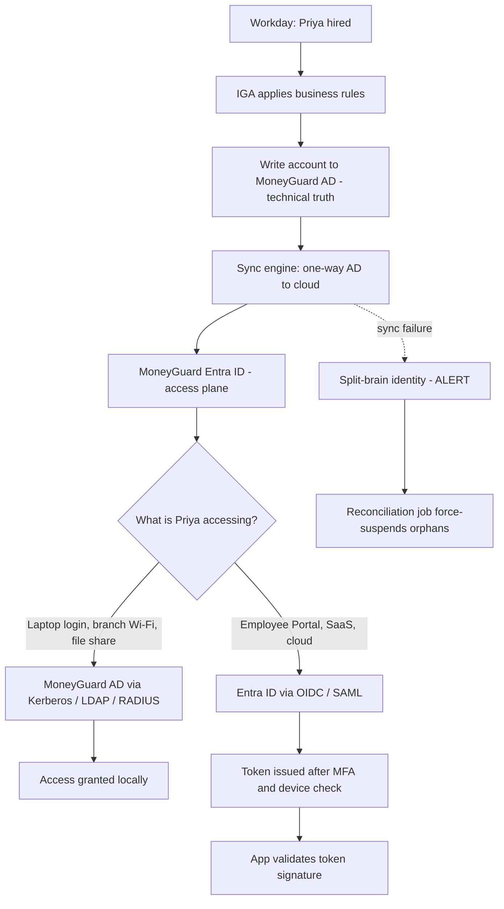
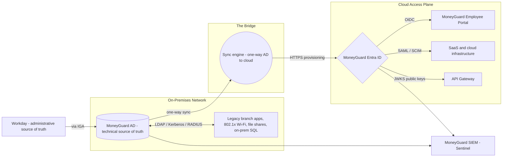

# Chapter 6: Identity Repositories (AD, LDAP, and Cloud Directories)

## Overview

An identity is only as secure as **where it is stored and how it is accessed**. An **identity repository** is the database that actually holds identities, their attributes, their credentials, and their group memberships.

This chapter covers the three you will meet constantly:

- **Active Directory (AD)** — the traditional on-premises directory, built for local networks.
- **LDAP** — not a product, but the *protocol* used to query directories.
- **Cloud directories** (Entra ID, Okta Universal Directory, Google Cloud Identity) — built for the internet, and not simply "AD in the cloud."

It also covers the reality most large organizations actually live in: a **hybrid model** where both worlds must stay in sync, and the **hierarchy of truth** that decides which system wins when they disagree.

## Why This Matters

- MoneyGuard Bank has 30 years of legacy systems and a growing cloud estate. Neither can be switched off, so both directories must coexist correctly.
- If the sync between them breaks, you get **split-brain identity**: an employee terminated on-premises but still active in the cloud. This is a leading cause of post-termination data theft.
- Choosing the wrong repository for a workload creates permanent architectural debt — for example, building a new microservice against raw LDAP instead of federating to the IdP.
- Understanding "who is the source of truth" is the difference between an IAM system that self-corrects and one that quietly drifts.

## Key Concepts

| Term | Plain-English Meaning |
|---|---|
| **Directory** | A database optimized for reading identity and group information. |
| **AD DS** | Active Directory Domain Services — Microsoft's on-prem directory plus network services. |
| **LDAP** | Lightweight Directory Access Protocol — the query language for directories. |
| **DN (Distinguished Name)** | The exact unique path to an object in the directory tree. |
| **OU (Organizational Unit)** | A folder in the AD hierarchy used for grouping and policy. |
| **Kerberos** | The ticket-based authentication protocol used inside a Windows network. |
| **Cloud directory** | An internet-native identity store speaking HTTP-based protocols. |
| **Access plane** | A directory that actively sits in the request path and enforces authentication. |
| **Hybrid identity** | Running on-prem and cloud directories together, kept in sync. |
| **Sync engine** | The one-way conveyor belt from AD to the cloud directory. |
| **Identity drift / split-brain** | The two directories disagreeing about a user's state. |
| **PRT** | Primary Refresh Token — a device-bound SSO credential stored in hardware. |
| **TPM** | Trusted Platform Module — a hardware security chip on the device. |

## Detailed Notes

### Concept 1 — 🏦 Where Priya's Identity Actually Lives

When Priya Sharma logs into her branch workstation in the morning, her identity is used three different ways within five minutes:

1. **Unlocking the laptop and joining branch Wi-Fi** — handled by **MoneyGuard AD** over Kerberos and RADIUS. These are local network protocols; the cloud cannot serve them.
2. **Opening the MoneyGuard Employee Portal** — handled by **MoneyGuard Entra ID** over OIDC. This is a web protocol; AD cannot serve it natively.
3. **Calling the Core Banking Ledger API through the API Gateway** — a token issued by Entra ID, validated cryptographically at the edge.

One person, one identity, two repositories, three protocols. That is hybrid identity in one paragraph.

### Concept 2 — Active Directory: The On-Prem Foundation

**Active Directory Domain Services (AD DS)** is a directory database bundled with core network services (Kerberos for authentication, DNS for name resolution, LDAP for queries).

- **Structure:** strictly hierarchical, like a file system. Users sit inside **Organizational Units**: `moneyguard.com > Corp > US > RetailBanking > NYC-014`.
- **Protocols:** local network protocols — **LDAP**, **Kerberos**, and legacy **NTLM**.
- **Authorization model:** group membership drives access. Adding a user to a group is the access grant.
- **MoneyGuard use cases:** Windows laptop login, 802.1x branch Wi-Fi authentication, on-prem SQL Server authentication, legacy branch teller applications, network file shares, older VPN appliances.

AD is often described as legacy, but it is not optional: it is the only thing that can serve the physical office.

### Concept 3 — LDAP: The Query Language, Not a Product

**LDAP (Lightweight Directory Access Protocol)** is frequently mistaken for a product. It is a *protocol* — the language used to talk to directory servers such as Active Directory, OpenLDAP, or FreeIPA.

| Concept | Analogy | Explanation |
|---|---|---|
| **Directory** | The database | The server storing the data (e.g. MoneyGuard AD). |
| **LDAP** | SQL | The protocol used to query it. |
| **DN (Distinguished Name)** | The primary key | The exact unique path to one object in the tree. |

A distinguished name for Priya looks like:

```
CN=Priya Sharma,OU=NYC-014,OU=RetailBanking,OU=US,DC=corp,DC=moneyguard,DC=com
```

⚠️ Always use **LDAPS** (LDAP over TLS) or StartTLS. Plain LDAP transmits credentials in the clear.

### Concept 4 — Cloud Directories: The Modern Access Plane

A cloud directory such as **MoneyGuard Entra ID** is architecturally a different animal from AD.

- **Structure:** flat. There are no forests, no domains, no nested OUs — just users, groups, and application registrations.
- **Protocols:** no Kerberos, no NTLM. Everything is HTTP-based: **OIDC**, **OAuth 2.0**, **SAML 2.0**, **SCIM**.
- **Access:** REST APIs rather than LDAP binds. You *request a token* rather than *log into a server*.
- **MoneyGuard use cases:** SSO to the Employee Portal, federated SaaS applications, cloud infrastructure access, and authenticating modern microservices.

**Why "access plane"?** A "plane" in architecture means a layer that actively sits in the traffic path. On-prem AD is largely a passive database — applications look users up in it when they choose to. A cloud directory is *unavoidable*: every login to a federated app is physically routed through it. It halts the request, evaluates device state, challenges for MFA, and only then issues a token. That interception point is what makes conditional access possible at all.

Once it has authenticated the user and issued a token, it hands fine-grained **authorization** back to the application.

### Concept 5 — 🏦 The Hierarchy of Truth at MoneyGuard

Three systems all claim to know who Priya is. They are not equal.

**1. Workday — the Administrative Source of Truth ("the legal truth").**
If a person is not in Workday, they do not legally work for MoneyGuard. It determines *whether* an identity should exist and what its core attributes are. Its limitation: it is a business database, not a network directory. It does not speak LDAP or Kerberos and cannot authenticate a laptop.

**2. MoneyGuard AD — the Technical Source of Truth ("the infrastructure truth").**
IGA reads the legal truth from Workday and writes it into AD. AD is the grounded technical record that the rest of the infrastructure listens to. If a change reaches Workday but fails to reach AD, the network still sees the old data.

**3. MoneyGuard Entra ID — the Access Plane.**
It receives a copy from AD and becomes the front door for every cloud and SaaS application.

| Concept | Workday (HRIS) | MoneyGuard AD (Directory) |
|---|---|---|
| **Type of truth** | Administrative / legal | Technical / operational |
| **Analogy** | Your birth certificate | Your driver's licence |
| **Proves** | You are employed by MoneyGuard | The network may let you in |
| **Authority** | The origin of truth | The master technical record |

**The data flow:** Workday (origin) → IGA (business logic) → MoneyGuard AD (technical truth) → MoneyGuard Entra ID (access plane) → applications.

### Concept 6 — The Sync Engine and Directional Authority

Between AD and Entra ID sits a **sync engine** (Entra Connect, or an equivalent agent). It is a **one-way conveyor belt**: it watches AD for changes and pushes them up to the cloud.

**The critical rule: AD → Cloud, never the reverse, for internal employees.** If Raj manually creates a user directly in Entra ID for someone who should have come from AD, the sync will not recognize them and you get a duplicate, unmanaged identity.

> ⚠️ **Split-brain identity.** If the sync breaks, Priya can be terminated in Workday and disabled in AD, but if the kill signal never crosses the bridge, her cloud account stays active — with access to email, SaaS, and cloud infrastructure. This is the number one cause of post-termination data theft. Monitor sync health as a security control, not an operations metric.

### Concept 7 — Device-Bound Credentials: PRT and TPM

Once Priya's laptop has authenticated her, the cloud directory issues a **Primary Refresh Token (PRT)**.

- A PRT is **not** an ID token. It is a **device-bound refresh token** that acts as a master SSO broker: the operating system uses it to silently request individual access tokens for downstream apps.
- It is cryptographically sealed inside the laptop's **TPM (Trusted Platform Module)** — a dedicated security chip on the motherboard. The token never leaves that hardware; the OS signs challenges with a key held inside it.
- This makes the credential **hardware-bound**. If an attacker copies the token file, it is useless on any other machine, and memory-scraping tools cannot extract it.

**Two consequences worth remembering:**

- **A stolen laptop does not mean stolen SaaS access.** Move the drive to another machine and the PRT is invalid; conditional access also sees an unrecognized device.
- **Staying logged in is not permanent access.** The PRT is a badge you re-tap, not a door left open. If Priya is terminated at 2:00 PM, her 2:05 PM request for a new token is rejected even though she is still sitting at an unlocked laptop.

### Concept 8 — IGA vs SIEM (Two Systems People Confuse)

Both watch identity. They answer completely different questions.

**IGA (Identity Governance and Administration)** — SailPoint, Saviynt, Omada.
Question: *"Who has access to what, and should they?"* Proactive and scheduled. Handles automated provisioning and deprovisioning, access certification campaigns, and Segregation of Duties enforcement. Data sources: Workday, AD, Entra ID, SaaS app databases.

**SIEM (Security Information and Event Management)** — Splunk, Microsoft Sentinel, QRadar. MoneyGuard's is called **Sentinel**.
Question: *"What is happening right now, and is it a threat?"* Real-time and reactive. Handles log aggregation, correlation, and incident response. Data sources: firewalls, endpoint detection, IdP sign-in logs, cloud audit trails.

| Feature | IGA | SIEM |
|---|---|---|
| **Mission** | Manage access rights, prove compliance | Detect attacks, investigate breaches |
| **Key question** | What *can* they do? | What *are* they doing? |
| **Timing** | Proactive, scheduled | Real-time, reactive |
| **Primary users** | IAM engineers, auditors, managers | SOC analysts, incident responders |
| **Action taken** | Grants or revokes access | Raises alerts, blocks activity |

**They work together.** If IGA says Sam is a contractor with read-only report access, but the SIEM sees his account running administrative queries against the Core Banking Ledger, that behaviour violates his identity baseline. The SIEM alerts, and can call back into IGA to suspend the account immediately.

## Workflow



## Architecture Diagram



## Step-by-Step Process

1. **Decide the source of truth** for each identity population — Workday for employees, a vendor system for contractors.
2. **Provision into AD first** if any on-prem resource must serve that identity (laptops, branch Wi-Fi, legacy apps).
3. **Sync one-way to the cloud directory.** Never create internal employees directly in the cloud.
4. **Register applications in the cloud directory**, not in AD, for anything that speaks web protocols.
5. **Federate new applications to the IdP** using OIDC or SAML rather than pointing them at LDAP.
6. **Restrict direct LDAP access** to legacy systems that genuinely cannot speak web protocols, and always over TLS.
7. **Monitor sync health as a security control** — alert on sync latency and failures, not just outages.
8. **Reconcile weekly:** any enabled cloud account with no corresponding active AD/HR record is force-suspended.
9. **Feed both directories' logs into the SIEM** so IGA governance and SIEM detection see the same identities.

## Commands and Examples

**Query the on-prem directory over TLS:**

```bash
ldapsearch -x -H ldaps://dc01.corp.moneyguard.com:636 \
  -D "CN=svc-ldap-reader,OU=ServiceAccounts,DC=corp,DC=moneyguard,DC=com" -W \
  -b "OU=RetailBanking,OU=US,DC=corp,DC=moneyguard,DC=com" \
  "(&(objectClass=user)(department=Retail Banking))" \
  sAMAccountName displayName title memberOf
```

**The same person, seen from the cloud directory (REST):**

```bash
curl -s -H "Authorization: Bearer $TOKEN" \
  "https://graph.microsoft.com/v1.0/users/priya.sharma@moneyguard.com?\$select=id,displayName,jobTitle,onPremisesImmutableId,accountEnabled"
```

```json
{
  "id": "8f14e45f-ceea-467a-9a1b-2b5c0d1e7a90",
  "displayName": "Priya Sharma",
  "jobTitle": "Bank Teller",
  "onPremisesImmutableId": "MG-88412",
  "accountEnabled": true
}
```

`onPremisesImmutableId` is the anchor linking the cloud object back to the AD object. If that link breaks, the sync engine creates a duplicate cloud identity instead of updating the existing one.

**Check for split-brain — enabled in the cloud but disabled on-prem:**

```powershell
$onPremDisabled = Get-ADUser -Filter 'Enabled -eq $false' -Properties mS-DS-ConsistencyGuid |
    Select-Object -ExpandProperty SamAccountName

Get-MgUser -All -Property "userPrincipalName,accountEnabled,onPremisesSamAccountName" |
    Where-Object { $_.AccountEnabled -eq $true -and
                   $onPremDisabled -contains $_.OnPremisesSamAccountName } |
    Select-Object UserPrincipalName, OnPremisesSamAccountName
# Any result here is a live split-brain identity: treat as a security incident.
```

**Prefer federation over direct LDAP for new applications (.NET):**

```csharp
// Legacy pattern - a new app binding directly to Active Directory
// var entry = new DirectoryEntry("LDAP://corp.moneyguard.com", user, password);

// Modern pattern - federate to the access plane
builder.Services.AddAuthentication(JwtBearerDefaults.AuthenticationScheme)
    .AddJwtBearer(options =>
    {
        options.Authority = "https://login.moneyguard.com/";
        options.Audience  = "https://api.moneyguard.com/ledger";
        options.TokenValidationParameters.ValidateIssuer = true;
        options.TokenValidationParameters.ValidateAudience = true;
        // Signing keys are fetched from the IdP's JWKS endpoint and cached.
    });
```

## Best Practices

- **One directional flow:** Workday → IGA → AD → cloud directory. Never edit downstream and expect it to stick.
- **Anchor on an immutable ID.** Email and username change; the anchor must not.
- **Use LDAPS/StartTLS always.** Never plain LDAP.
- **Give service accounts read-only LDAP binds**, scoped to the smallest possible subtree.
- **Federate new applications** via OIDC or SAML; reserve direct LDAP for systems that cannot do otherwise.
- **Treat sync health as a security alert.** A sync outage is a security exposure, not just an ops ticket.
- **Reconcile regularly** to catch orphaned cloud accounts.
- **Keep group naming disciplined.** `APP-EmployeePortal-Users` is auditable; `Group7-New-FINAL` is not.
- **Send both directories' logs to the SIEM** so identity events can be correlated.

## Common Mistakes

- ⚠️ **Assuming a cloud directory is "AD in the cloud."** It has no OUs, no Kerberos, no NTLM, and a completely different model. Designs that assume otherwise fail.
- ⚠️ **Creating employees directly in the cloud directory.** This breaks the sync anchor and produces duplicate, unmanaged identities.
- ⚠️ **Bidirectional sync.** Two systems both claiming authority guarantees conflicts and unpredictable overwrites.
- ⚠️ **Pointing new microservices at LDAP.** It bypasses MFA and conditional access, and it couples cloud services to on-prem infrastructure.
- ⚠️ **Ignoring sync latency.** A termination that takes an hour to cross the bridge is an hour of live access.
- ⚠️ **Plain LDAP on port 389** for authentication binds — credentials in the clear.
- ⚠️ **Over-privileged LDAP service accounts.** A bind account with directory write access is a domain-compromise waiting to happen.
- ⚠️ **Confusing IGA and SIEM.** Buying a SIEM will not tell you who *should* have access; buying IGA will not detect an attack in progress.

## Pro Tips

- 💡 **AD is not going away.** Anything with a physical plug — Wi-Fi controllers, printers, badge readers, legacy branch terminals — still speaks local protocols. Plan for hybrid to persist for years.
- 💡 **Sync latency is a security metric.** Track the 95th-percentile time from an AD change to its appearance in the cloud, and alert on regressions.
- 💡 **The immutable anchor is the most fragile part of hybrid identity.** Most duplicate-account incidents trace back to a broken or re-generated anchor.
- 💡 When someone asks "should this app use LDAP or OIDC?", the answer is OIDC unless the app physically cannot speak HTTP-based auth.
- 💡 **PRT plus TPM is why phishing-resistant SSO works.** The credential is bound to hardware, so a stolen token file is worthless elsewhere.
- 💡 Audit your directory's **group sprawl** annually. Unused groups are where forgotten access hides.

## Real-World Use Cases

1. **🏦 The split-brain termination.** A MoneyGuard employee is disabled in AD on their last day, but the sync agent has been failing silently for six hours. Their cloud account stays active and they download customer reports from home that evening. The fix was to alert on sync failure within five minutes and treat it as a P1 security incident.
2. **The duplicate identity.** An administrator creates a cloud account directly for a new hire because AD provisioning was slow. When the sync later runs, it creates a *second* cloud object. Access is split across two identities and nobody can answer who has what.
3. **Branch Wi-Fi during a cloud outage.** MoneyGuard's cloud IdP has an incident. Branch staff can still unlock laptops and reach the local network, because those depend on on-prem AD. Cloud SaaS is unavailable. This is deliberate design: keep local physical operations independent of cloud availability.
4. **Legacy app modernization.** An old branch teller application binds directly to LDAP, bypassing MFA entirely. Migrating it to OIDC federation immediately brings it under conditional access and MFA policy without changing the underlying identity.
5. **The auditor's question.** Dana asks who has access to a legacy on-prem file share. Because AD group membership is the access grant and those groups are fed into IGA, the answer is a report rather than a server-by-server investigation.

## Key Takeaways

- **AD** = on-prem, hierarchical, Kerberos/LDAP, required for the physical office.
- **LDAP** = a protocol, not a product — the SQL of directories.
- **Cloud directory** = flat, web-protocol native, an active access plane rather than a passive database.
- **Hybrid is the norm** at any organization with legacy infrastructure.
- **Hierarchy of truth:** Workday (legal) → AD (technical) → cloud directory (access).
- **Sync is one-way and its health is a security control.** Split-brain identity causes real breaches.
- **PRT bound to the TPM** makes device SSO hardware-anchored and hard to steal.
- **IGA answers "should they have this?"; SIEM answers "what are they doing right now?"**

## Glossary

| Term | Definition |
|---|---|
| **AD DS** | Active Directory Domain Services — Microsoft's on-prem directory. |
| **LDAP / LDAPS** | Lightweight Directory Access Protocol, and its TLS-protected form. |
| **DN** | Distinguished Name — the unique path to a directory object. |
| **OU** | Organizational Unit — a container in the AD hierarchy. |
| **Kerberos** | Ticket-based network authentication protocol used inside AD domains. |
| **NTLM** | Older Microsoft challenge-response authentication protocol. |
| **RADIUS** | Protocol used for network access authentication, e.g. 802.1x Wi-Fi. |
| **Cloud directory** | Internet-native identity store using OIDC, OAuth 2.0, SAML, SCIM. |
| **Access plane** | A layer sitting in the request path that enforces authentication. |
| **Sync engine** | Agent replicating AD objects to the cloud directory one-way. |
| **Immutable anchor** | The attribute linking an on-prem object to its cloud counterpart. |
| **Split-brain identity** | On-prem and cloud disagreeing about an account's state. |
| **PRT** | Primary Refresh Token — device-bound SSO credential. |
| **TPM** | Trusted Platform Module — hardware security chip storing keys. |
| **IGA** | Identity Governance and Administration. |
| **SIEM** | Security Information and Event Management. |
| **JWKS** | JSON Web Key Set — the public keys an API uses to validate tokens. |

## Revision Notes

| Feature | Active Directory (on-prem) | Cloud Directory (Entra ID / Okta) |
|---|---|---|
| **Structure** | Hierarchical: forests, domains, OUs | Flat: users, groups, app registrations |
| **Protocols** | LDAP, Kerberos, NTLM, RADIUS | OIDC, OAuth 2.0, SAML 2.0, SCIM |
| **Access method** | LDAP bind / directory queries | REST API + token issuance |
| **Role** | Passive technical record | Active access plane in the request path |
| **Best for** | Laptops, Wi-Fi, file shares, legacy apps | SSO, SaaS, cloud, modern APIs |
| **MFA** | Bolt-on, limited | Native, with conditional access |
| **Offboarding** | Disable the account object | Block sign-in + revoke tokens |

- **Truth chain:** Workday (legal) → AD (technical) → Cloud (access).
- **Sync is one-way**, AD → cloud. Reverse edits cause duplicates.
- **PRT lives in the TPM** → hardware-bound, not portable.
- **IGA = should they? SIEM = are they?**

## Interview Questions

**Q1: Is a cloud directory just Active Directory in the cloud?**
A: No. AD is hierarchical with forests, domains, and OUs, and it speaks Kerberos, NTLM, and LDAP for local network authentication. A cloud directory is flat — just users, groups, and application registrations — and speaks only HTTP-based protocols like OIDC, OAuth 2.0, SAML, and SCIM. They solve different problems, which is exactly why most enterprises run both.

**Q2: If the HRIS is the source of truth, why is AD called the technical source of truth?**
A: They are two layers of reality. The HRIS holds the administrative or legal truth — whether a person is employed and what their attributes are. But an HRIS cannot authenticate a laptop or a Wi-Fi connection; it does not speak IT protocols. AD holds the technical truth: the grounded record the infrastructure actually queries. If a change lands in HR but fails to reach AD, every downstream system still sees the old data.

**Q3: Why keep on-prem AD if the target architecture is cloud-native?**
A: Protocol constraints and the physical world. Cloud IdPs speak web protocols, but Windows laptop login, 802.1x Wi-Fi, legacy VPN concentrators, on-prem file shares, and older line-of-business applications require Kerberos, LDAP, NTLM, or RADIUS. A cloud IdP cannot act as a local Kerberos key distribution center or route LDAP traffic over the internet safely. So AD stays to serve those local requests while a sync agent mirrors identity state to the cloud.

**Q4: Should new applications talk directly to AD via LDAP?**
A: No. New applications should federate to the cloud IdP using OIDC or SAML. Direct LDAP bypasses MFA and conditional access, hard-couples the application to on-prem infrastructure, and forces the app to handle credentials it should never see. Reserve LDAP for legacy systems that genuinely cannot speak web protocols.

**Q5: What is split-brain identity and why is it dangerous?**
A: It is when the on-prem directory and the cloud directory disagree about a user's state — most dangerously when someone is disabled on-prem but still enabled in the cloud because the sync failed. The person retains access to email, SaaS applications, and cloud infrastructure after "offboarding." It is a leading cause of post-termination data theft, which is why sync health should be monitored as a security control with alerting, plus a regular reconciliation job that force-suspends orphaned cloud accounts.

**Q6: What is a Primary Refresh Token, and is it an ID token?**
A: No, it is not an ID token. A PRT is a device-bound refresh token that acts as a master SSO broker for the operating system, which uses it to silently obtain individual access tokens for downstream applications. It is sealed inside the device's TPM chip, so it is hardware-bound: copying the token file to another machine makes it useless, and memory-scraping malware cannot extract the underlying key.

**Q7: If a user stays logged into their laptop, do they keep access forever?**
A: No. The PRT is a badge that must be re-tapped, not a door left open. Every new application session or token renewal requires the device to present the PRT to the access plane. If the user is terminated at 2:00 PM and the cloud account is blocked, their 2:05 PM token request is rejected even though they are still physically sitting at an unlocked machine.

**Q8: What is the difference between IGA and SIEM?**
A: IGA governs access — automated provisioning and deprovisioning, access certification campaigns, and Segregation of Duties. Its question is "who has access to what, and should they?" and it is proactive and scheduled. SIEM detects threats — log aggregation, correlation, and incident response. Its question is "what is happening right now, and is it a threat?" and it is real-time and reactive. Mature architectures integrate them: the SIEM detects behaviour that violates the identity baseline IGA defined, and can trigger an immediate suspension.

## Practice Exercises

1. **Map the protocols.** For each MoneyGuard scenario, name the repository used and the protocol: (a) Priya unlocks her branch laptop, (b) Priya opens the Employee Portal, (c) a branch printer authenticates to the network, (d) the Fraud Detection Pipeline calls the ledger API, (e) Sam connects to the VPN.
2. **Design the hybrid flow.** Draw the complete path from a Workday hire event to Priya being able to log into both her laptop and a cloud SaaS app. Mark every hop, protocol, and the point where the immutable anchor is set.
3. **Detect split-brain.** Write the logic for a monitoring job that finds accounts disabled on-prem but still enabled in the cloud. Define how often it runs, what it alerts on, and what automated remediation is safe.
4. **Modernize a legacy app.** A MoneyGuard branch application binds directly to LDAP with a service account that has directory read access. List three security problems this creates and write the migration plan to OIDC federation.
5. **IGA or SIEM?** Assign each task to the right system and justify: (a) quarterly access certification, (b) alerting on impossible-travel logins, (c) proving to Dana who could read the ledger last quarter, (d) detecting a service account suddenly running admin queries, (e) enforcing that a loan originator cannot also approve loans.

---
⬅ [Chapter 5 — The IAM Lifecycle (JML)](./05_IAM_Lifecycle_JML.md) · [Module 01 Index](./README.md) · [MoneyGuard Scenario](../SCENARIO.md)
Next: [Chapter 7 — Service Accounts & Non-Human Identity](./07_Service_Accounts_And_NonHuman_Identity.md) ➡
