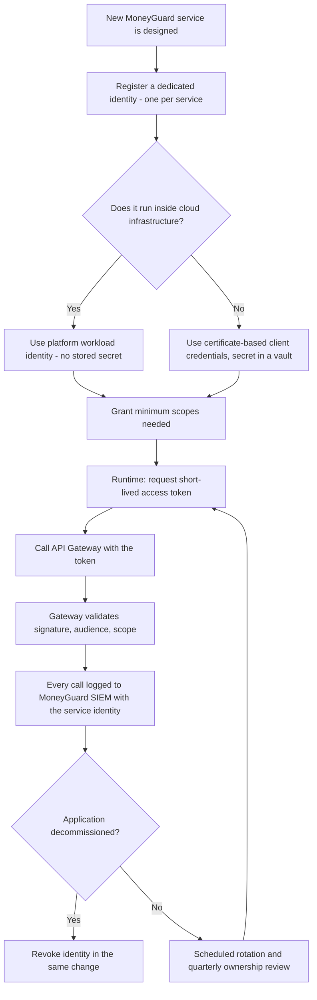
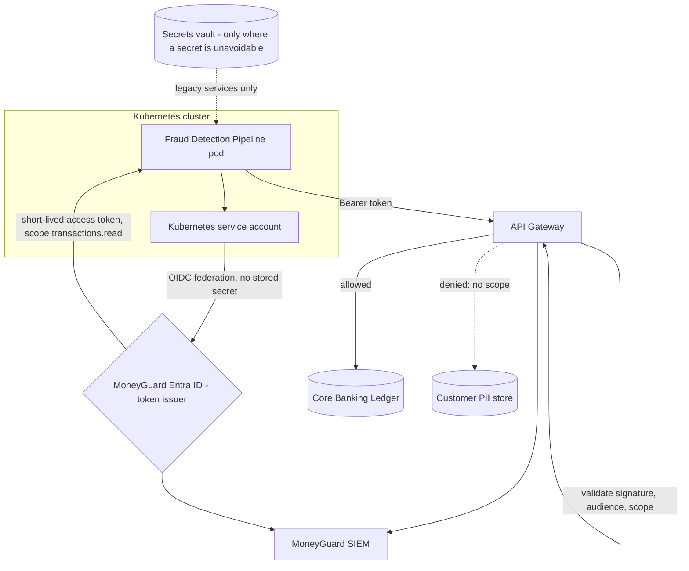

# Chapter 7: Service Accounts & Non-Human Identity (Introduction)

## Overview

Not every identity belongs to a person. In a modern architecture, machines talk to machines far more often than humans talk to machines.

A **service account** — more broadly, a **Non-Human Identity (NHI)** — is a digital identity used exclusively by software: a microservice, a scheduled batch job, a deployment pipeline, or a background worker. It authenticates, it is authorized, it is audited, and it must be deprovisioned — exactly like a human identity, but with completely different mechanics.

This chapter is an **introduction**: what NHIs are, why they are dangerous, the main types, and the ground rules. The protocol-level detail lives in Module 06.

## Why This Matters

- **They outnumber humans.** MoneyGuard has ~50,000 employees and far more service identities across microservices, pipelines, and scheduled jobs.
- **They are the quietest attack path.** A stolen service account credential triggers no MFA prompt, no "login from a new country" alert, and no behavioural anomaly. It just silently works.
- **They rot.** Human accounts are removed when people leave. Service accounts created for a project in 2019 are still enabled in 2026 because nobody remembers what would break if they were disabled.
- **They are chronically over-privileged.** "Just give it admin so the deployment works" is the most common shortcut in the industry.

## Key Concepts

| Term | Plain-English Meaning |
|---|---|
| **Service account** | An identity used by software, not a person. |
| **NHI** | Non-Human Identity — the umbrella term (services, jobs, pipelines, devices). |
| **Service principal** | An application's identity registered in a directory. |
| **Client credentials grant** | The OAuth 2.0 flow where an app authenticates as itself, with no user involved. |
| **Workload identity** | A platform-issued, automatically rotated identity for code running in cloud infrastructure. |
| **Managed identity / instance role** | Cloud-native workload identity with no stored secret at all. |
| **Static secret** | A long-lived password, API key, or client secret stored somewhere. |
| **Secret rotation** | Regularly replacing a credential so a leaked one has a short useful life. |
| **Orphaned service account** | An NHI whose owning application no longer exists. |
| **mTLS** | Mutual TLS — both client and server prove identity with certificates. |

## Detailed Notes

### Concept 1 — 🏦 When Code Needs an Identity at MoneyGuard

MoneyGuard's **Fraud Detection Pipeline** runs on Kubernetes and scores transactions in near real-time. Every few milliseconds it must call the **Core Banking Ledger** through the **API Gateway** to fetch recent transaction history.

Nobody is sitting at a keyboard. There is no password to type, no MFA push to approve, no browser to redirect. Yet the API Gateway must still answer three questions:

- **Who is calling?** The `fraud-scoring-service`, not a person.
- **What may it do?** Read transaction history for scoring. Nothing else — not customer PII, not writes, not deletes.
- **What did it do?** Every call logged to the SIEM with the service identity attached.

That is a non-human identity doing exactly what a human identity does, through a different mechanism.

### Concept 2 — What Makes a Service Account Different

| Property | Human identity | Service account |
|---|---|---|
| **Interactive login** | Yes — browser, password prompt | **Never** — should be disabled outright |
| **MFA** | Required | Impossible; replaced by cryptographic trust |
| **Working hours** | Predictable patterns | Runs at 3 AM as normally as 3 PM |
| **Lifecycle driven by** | HR (Workday) | The **application's** lifecycle, not a person's |
| **Credential** | Password + second factor | Short-lived token, certificate, or platform identity |
| **Anomaly detection** | Behaviour baselines work well | Baselines are narrow — deviation should be a hard alert |

The most important line in that table: **a service account's lifecycle is tied to the application, not to any employee.** When the app is decommissioned, its identity dies with it.

### Concept 3 — Why NHIs Are a Top Breach Vector

Service accounts are attractive targets because they are so often:

- **Long-lived** — created years ago, credential never rotated.
- **Over-privileged** — granted broad admin rights to make automation "just work."
- **Poorly monitored** — nobody knows what normal looks like, so abnormal goes unnoticed.
- **Shared** — three applications using the same credential, so nobody can tell which one acted.
- **Orphaned** — still enabled long after the project that needed them was shut down.
- **Unowned** — the engineer who created it left the company years ago.

⚠️ The core threat: when Eve steals a human's password, MoneyGuard's IdP may challenge for MFA or flag the unusual location. When Eve steals a service account credential, the request looks exactly like every other request that service makes.

### Concept 4 — Common Anti-Patterns

❌ **Shared credentials across systems.**
Three MoneyGuard applications all authenticate as `svc-payments`. You cannot tell which one performed a given action, and you cannot rotate the credential without breaking all three at once — so it never gets rotated.

❌ **Long-lived static secrets.**
An API key valid for ten years, embedded in source code, a container image layer, or a `config.json`. If it leaks — and container layers and old repository history leak constantly — the attacker has permanent access with no expiry.

❌ **Using a human account for automation.**
*"Let's just run the nightly reconciliation under Alex's account."* When Alex leaves, either the job breaks or his account is kept alive in violation of the termination policy — and now a terminated employee's credentials are still valid.

❌ **Service accounts with interactive login enabled.**
If a service account can be used to open a session at a console, it becomes a perfect hiding place for an attacker.

### Concept 5 — The Main Types of Non-Human Identity

**A. Application identity (service principal).**
Used for service-to-service calls across a trust boundary — for example, MoneyGuard calling an external partner API.
Mechanism: the **OAuth 2.0 client credentials grant**. The application authenticates as itself (ideally with a certificate rather than a shared secret) and receives a short-lived access token scoped to specific operations.

**B. Managed workload identity (cloud-native).**
Used when code runs inside cloud infrastructure, where a stored secret should not exist at all. The platform injects the identity automatically and rotates it behind the scenes.

- Virtual machines use an **instance profile / instance metadata service** to receive temporary credentials.
- Kubernetes workloads use **workload identity federation** — the cluster's service account is linked to a cloud role through OIDC, so pods get short-lived cloud credentials with no secret in the manifest. (In AWS this is IRSA; the Azure and GCP equivalents work the same way.)
- Serverless functions and containers use **execution roles** or **task roles**.

This is the strongest pattern available: **there is no static secret to steal.**

**C. Pipeline identity.**
Used by CI/CD systems and infrastructure-as-code tooling. Each pipeline gets its own identity, scoped only to the environments it deploys to. The pipeline that deploys the MoneyGuard Employee Portal to staging must not be able to touch the production Core Banking Ledger.

### Concept 6 — Authentication and Authorization for Machines

**Authentication.** Machines do not use passwords. The pattern is:

1. The workload proves itself using a platform-issued identity, a certificate, or a federated token.
2. The authorization server issues a **short-lived access token**.
3. The workload calls downstream APIs with that token.
4. When the token expires, the workload obtains a new one automatically.

**Authorization.** Strict least privilege, always. A service account should never have administrative rights by default.

An example policy for MoneyGuard's fraud scoring service:

| Target API | Action | Allowed? |
|---|---|---|
| `/transactions` | `GET` (last 90 days) | ✅ Yes |
| `/fraud-scores` | `POST` | ✅ Yes |
| `/customers` | `GET` | ❌ No — PII is not needed for scoring |
| `/transactions` | `DELETE` | ❌ No |
| `/accounts/{id}/transfer` | `POST` | ❌ No |

### Concept 7 — Secret Management and Lifecycle

🚫 **Never store secrets in:** source code or Git history, container image layers, plaintext environment variables committed to config, CI/CD logs, or wiki pages.

✅ **Do:**

- **Prefer no secret at all.** Platform-managed workload identity beats every form of stored credential.
- **Where a secret is unavoidable, use a vault** (HashiCorp Vault, a cloud secrets manager) that supports automatic rotation and logs every retrieval.
- **Inject secrets at runtime**, never write them to disk in the container.
- **Rotate on a schedule**, and make rotation routine enough that it is not scary.
- **Assign an owner** — a team, not an individual — to every service account.
- **Deprovision with the application.** When a pipeline or service is retired, its identity is revoked in the same change.

## Workflow



## Architecture Diagram



## Step-by-Step Process

1. **Give every service its own identity.** One service, one identity — never shared.
2. **Choose the strongest available mechanism:** platform workload identity first, certificate-based client credentials second, vaulted secret last.
3. **Disable interactive login** on the identity.
4. **Scope permissions to the exact operations needed**, and write them down so they can be reviewed.
5. **Assign a team owner** and record which application the identity belongs to.
6. **Issue short-lived tokens** at runtime; never embed long-lived credentials.
7. **Log every call** with the service identity, target resource, and outcome.
8. **Alert on deviation** — a service that suddenly calls an endpoint it has never called before is a strong signal.
9. **Rotate on schedule** where secrets exist at all.
10. **Revoke when the application is decommissioned**, as part of the same change.

## Commands and Examples

**Requesting a token with the OAuth 2.0 client credentials grant:**

```http
POST /oauth2/v2.0/token HTTP/1.1
Host: login.moneyguard.com
Content-Type: application/x-www-form-urlencoded

grant_type=client_credentials
&client_id=fraud-scoring-service
&scope=https%3A%2F%2Fapi.moneyguard.com%2Fledger%2F.default
&client_assertion_type=urn%3Aietf%3Aparams%3Aoauth%3Aclient-assertion-type%3Ajwt-bearer
&client_assertion=eyJhbGciOiJSUzI1NiIsInR5cCI6IkpXVCIsIng1dCI6...
```

Note the `client_assertion` — this is a signed certificate-based assertion, **not** a shared client secret. Certificates are strongly preferred.

**The resulting machine token (note: no `name`, no `amr`, no user at all):**

```json
{
  "iss": "https://login.moneyguard.com/",
  "aud": "https://api.moneyguard.com/ledger",
  "sub": "fraud-scoring-service",
  "azp": "fraud-scoring-service",
  "roles": ["Ledger.Transactions.Read"],
  "iat": 1770000000,
  "exp": 1770003600
}
```

**A service account definition with an explicit owner and expiry review:**

```yaml
serviceAccount:
  name: fraud-scoring-service
  application: Fraud Detection Pipeline
  ownerTeam: risk-engineering@moneyguard.com
  authMethod: workload-identity-federation   # no stored secret
  interactiveLogin: disabled
  scopes:
    - ledger.transactions.read
    - fraud.scores.write
  denied:
    - customers.pii.read
    - ledger.transfers.write
  reviewCadence: quarterly
  decommissionWith: fraud-detection-pipeline
```

**Kubernetes workload identity — no secret in the manifest:**

```yaml
apiVersion: v1
kind: ServiceAccount
metadata:
  name: fraud-scoring
  namespace: fraud
  annotations:
    # Federates this Kubernetes service account to a cloud role via OIDC.
    # The platform injects short-lived credentials; nothing is stored.
    moneyguard.com/workload-identity: "fraud-scoring-service"
---
apiVersion: apps/v1
kind: Deployment
metadata:
  name: fraud-scorer
  namespace: fraud
spec:
  template:
    spec:
      serviceAccountName: fraud-scoring   # identity comes from the platform
      containers:
        - name: scorer
          image: registry.moneyguard.com/fraud-scorer:2.4.1
          # NOTE: no CLIENT_SECRET env var. That is the point.
```

**Finding stale service accounts:**

```kusto
ServiceAccounts
| where AccountEnabled == true
| join kind=leftouter (
    SignInLogs | where TimeGenerated > ago(90d) | summarize LastUsed = max(TimeGenerated) by ServicePrincipalId
  ) on ServicePrincipalId
| where isnull(LastUsed) or LastUsed < ago(90d)
| project DisplayName, OwnerTeam, CredentialAge = datetime_diff('day', now(), CredentialCreated),
          LastUsed, Finding = "Unused 90+ days - candidate for revocation"
| order by CredentialAge desc
```

## Best Practices

- **One identity per service.** Never share credentials between applications.
- **Prefer platform workload identity** so there is no secret to leak.
- **Use certificates over shared secrets** when client credentials are required.
- **Disable interactive login** on every service account.
- **Scope tightly** — read-only where possible, single-purpose always.
- **Assign a team owner**, never an individual, so ownership survives departures.
- **Tie the identity's lifecycle to the application**, not to a person or a project ticket.
- **Log every call with the service identity**, and baseline what normal looks like.
- **Rotate secrets automatically** where they must exist.
- **Include NHIs in access reviews** — quarterly for anything touching the Core Banking Ledger.

## Common Mistakes

- ⚠️ **Running automation under a human's account.** The nightly job breaks when they leave, or their account is kept alive against policy.
- ⚠️ **Granting admin "temporarily" to get a deployment working.** It is never removed.
- ⚠️ **Committing secrets to Git.** Deleting the file does not remove it from history.
- ⚠️ **Baking secrets into container images.** Every layer is readable by anyone who can pull the image.
- ⚠️ **Sharing one credential across services.** Destroys attribution and makes rotation impossible.
- ⚠️ **No owner recorded.** When nobody knows what an account does, nobody dares disable it.
- ⚠️ **Excluding service accounts from access reviews** because "they're just automation."
- ⚠️ **Forgetting to revoke on decommission.** The application is gone; its credentials are still live.
- ⚠️ **Assuming MFA can be added later.** It cannot. Machines need cryptographic trust, not a second human factor.

## Pro Tips

- 💡 **The best secret is no secret.** If your workload runs on a platform that can issue identity, use it — you cannot leak what does not exist.
- 💡 **Credential age is a great risk metric.** Sort every service account by credential age; the oldest ones are usually the most dangerous.
- 💡 **Name service accounts after their application, not their creator.** `svc-fraud-scoring` survives; `svc-alex-test` becomes an orphan the day Alex leaves.
- 💡 **A service account that has never been used in 90 days is almost certainly safe to disable** — but disable first, delete after a waiting period, so you can restore quickly if something breaks.
- 💡 **Alert on first-time behaviour.** Services are extremely repetitive; a call to a brand-new endpoint is far more meaningful for an NHI than for a human.
- 💡 Ask "what is the deprovisioning trigger?" at design time. If the answer is "someone will remember," the design is wrong.

## Real-World Use Cases

1. **🏦 The orphaned batch job.** A MoneyGuard batch job was retired years ago, but its service account remained enabled with access to the transactions database. Its credentials leaked through an old unsecured backup file. An attacker replayed data extraction requests — and because it was a "trusted" service account, reading sensitive data triggered no behavioural alert. Remediation: all service accounts now tie to a deployment lifecycle with automatic revocation and short-lived tokens only.
2. **The shared payments credential.** Three MoneyGuard services authenticated as the same identity. When suspicious activity appeared in the logs, the security team could not determine which service was responsible, and rotating the credential would have caused three simultaneous outages. Splitting into three scoped identities fixed both problems.
3. **The over-privileged pipeline.** A CI/CD pipeline for a marketing microsite held credentials that could deploy to any environment, including production banking systems. A compromised build dependency would have been catastrophic. Scoping each pipeline to its own environment contained the risk.
4. **The nightly job under a human account.** MoneyGuard's reconciliation job ran as a departed engineer's personal account, forcing IT to keep a terminated employee's account enabled. Migrating it to a proper service identity resolved a standing audit finding.
5. **Fraud pipeline least privilege.** The Fraud Detection Pipeline originally had read access to full customer records. Scoping it to transaction data only meant that even a full compromise of the pipeline would not expose customer PII.

## Key Takeaways

- Service accounts are **first-class identities** — they authenticate, authorize, audit, and deprovision like humans do.
- Their lifecycle follows the **application**, not a person.
- They cannot use MFA; they rely on **short-lived, scoped, cryptographically issued tokens**.
- They are a **top breach vector** because they are long-lived, over-privileged, shared, and poorly monitored.
- **Platform workload identity is the strongest pattern** — no static secret exists to steal.
- **One service, one identity, one owner, minimum scope.**
- Any long-lived static secret is a future breach waiting to happen.

## Glossary

| Term | Definition |
|---|---|
| **Service account** | An identity used by software rather than a person. |
| **NHI** | Non-Human Identity — the umbrella term. |
| **Service principal** | An application's registered identity in a directory. |
| **Client credentials grant** | OAuth 2.0 flow where an app authenticates as itself. |
| **Client assertion** | A signed certificate-based proof used instead of a shared secret. |
| **Workload identity** | Platform-issued, auto-rotated identity for cloud workloads. |
| **Managed identity / instance role** | Cloud-native workload identity with no stored secret. |
| **IRSA** | IAM Roles for Service Accounts — the AWS Kubernetes workload identity mechanism. |
| **Static secret** | A long-lived password, API key, or client secret. |
| **Secret rotation** | Regularly replacing credentials to limit a leak's useful life. |
| **Vault** | A system that stores, rotates, and audits access to secrets. |
| **mTLS** | Mutual TLS — both sides authenticate with certificates. |
| **Orphaned service account** | An NHI whose owning application no longer exists. |

## Revision Notes

| Aspect | Rule |
|---|---|
| **Identity per service** | One service, one identity. Never shared. |
| **Interactive login** | Always disabled. |
| **MFA** | Not applicable — use cryptographic trust instead. |
| **Preferred auth** | Platform workload identity > certificate client credentials > vaulted secret |
| **Token lifetime** | Short-lived, scoped, automatically renewed |
| **Lifecycle trigger** | The application's lifecycle, not a person's |
| **Ownership** | A team, recorded at creation |
| **Review** | Quarterly for sensitive systems; NHIs included in all access reviews |
| **Worst anti-pattern** | Long-lived static secret in code or a container image |

**Mental model:** humans authenticate with MFA; machines authenticate with short-lived, scoped, non-reusable tokens.

## Interview Questions

**Q1: What is a service account and how does it differ from a user account?**
A: A service account is an identity used exclusively by software — a microservice, batch job, or pipeline. It differs in that it has no interactive login, cannot use MFA, runs at any hour, and its lifecycle is tied to the application rather than to an employee. It still needs authentication, scoped authorization, audit logging, and deprovisioning, exactly like a human identity.

**Q2: Why can't service accounts use MFA?**
A: MFA requires human interaction — a biometric, a hardware key tap, a push approval. Machines have nobody to prompt. Instead they rely on cryptographic trust: platform-issued identities, certificate-based authentication, and short-lived scoped tokens. The security property MFA gives humans is achieved for machines by removing long-lived credentials entirely.

**Q3: Why are service accounts considered a top breach vector?**
A: Because the usual detections do not fire. There is no MFA prompt to fail and no "login from a new country" signal, so stolen credentials just work silently. On top of that, service accounts tend to be long-lived, over-privileged, shared across systems, poorly monitored, and orphaned when projects end — so an attacker who obtains one often gets broad, persistent, unnoticed access.

**Q4: Why shouldn't we run automation under a human's account?**
A: Two failure modes, both bad. Either the job breaks when the person leaves, causing an outage at the worst possible time, or the account is kept enabled after termination in violation of policy — meaning a former employee's credentials remain valid. It also destroys attribution: you cannot tell whether an action was the person or the automation.

**Q5: What is the strongest authentication pattern for a workload, and why?**
A: Platform-managed workload identity — an instance role, managed identity, or Kubernetes workload identity federation. The platform injects short-lived credentials directly into the runtime and rotates them automatically, so no static secret ever exists in code, in an image, in an environment variable, or in a vault. You cannot leak what does not exist.

**Q6: Should a service account ever have administrative rights?**
A: Only temporarily, through Just-In-Time elevation for an approved, time-boxed operation such as an infrastructure deployment, with every action logged and auditable. Standing administrative rights on a service account are one of the highest-risk configurations in an enterprise, because the credential is long-lived and there is no human to notice its misuse.

**Q7: How do you audit service account usage?**
A: Every token request and API call should record the service identity, the exact scopes granted, a timestamp, the target resource, the source workload, and the outcome. Because services are highly repetitive, you can baseline normal behaviour tightly and alert on any first-time endpoint, unusual volume, or off-pattern timing — signals that are far more meaningful for machines than for humans.

**Q8: How would you find and clean up orphaned service accounts?**
A: Inventory every service identity with its owner team, owning application, credential age, and last-used timestamp. Anything unused for 90 days or with no recorded owner is a candidate. Disable first rather than deleting, wait a defined period so anything that breaks can be restored quickly, then delete. Going forward, make revocation part of the application decommissioning checklist so the problem does not recur.

## Practice Exercises

1. **Design the fraud pipeline's identity.** Write the complete service account definition for MoneyGuard's Fraud Detection Pipeline: authentication method, exact scopes allowed and denied, owner, token lifetime, rotation policy, and decommissioning trigger.
2. **Find the anti-patterns.** A MoneyGuard service authenticates with a client secret stored in an environment variable, uses the same credential as two other services, has had the same secret since 2021, and holds write access to the whole ledger database. List each problem and the specific fix.
3. **Audit for orphans.** Describe how you would build MoneyGuard's service account inventory: which data sources you need, which fields you would collect, how you would identify orphans, and what safe remediation looks like.
4. **Human or machine?** For each, decide whether it needs a human identity, a service account, or both, and justify: (a) Alex debugging production, (b) the nightly reconciliation job, (c) a CI/CD pipeline deploying the Employee Portal, (d) the API Gateway calling the ledger, (e) a report Dana runs monthly.
5. **Write the decommissioning checklist.** MoneyGuard is retiring an old batch service. Write the checklist that guarantees its identity, credentials, scopes, vault entries, and scheduled triggers are all removed — and describe how you would verify nothing was missed.

---

## 📚 Going Deeper

This chapter is deliberately introductory. A deep dive into **service accounts, the OAuth 2.0 client credentials grant, workload identity (SPIFFE/IRSA), and mutual TLS** is in [Module 06 — Machine Identity & Workload Auth](../06_Machine_Identity_And_Workload_Auth/README.md).

---
⬅ [Chapter 6 — Identity Repositories](./06_Identity_Repositories.md) · [Module 01 Index](./README.md) · [Main README](../README.md) · [MoneyGuard Scenario](../SCENARIO.md)
