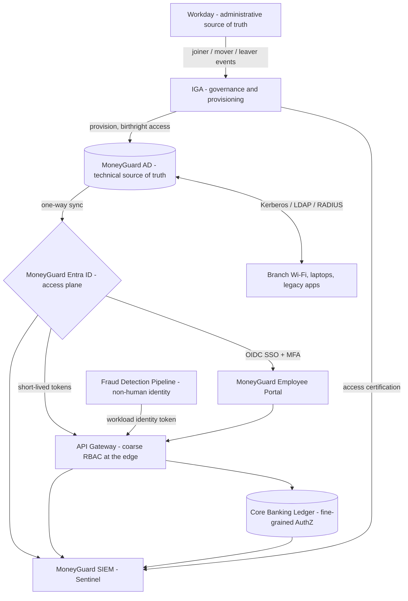

# Module 01: Core IAM Concepts

This module builds the foundation everything else in the repo stands on. It answers the basic questions — what IAM actually is, how authentication differs from authorization, how access is modelled, and where identities are stored — before moving into protocols and system design.

Every chapter is taught through **MoneyGuard Bank**: Priya joining as a teller, Raj administering access, Dana auditing it, Alex building against it, Sam contracting under it, and Eve trying to break it. Read [`../SCENARIO.md`](../SCENARIO.md) first if you haven't met the cast.

By the end you should be able to sketch a bank's identity architecture on a whiteboard and defend each decision.

## 📂 Chapters

| # | Chapter | What It Covers |
|---|---------|----------------|
| 1 | [What Is IAM?](./01_What_Is_IAM.md) | The definition, why identity replaced the firewall as the perimeter, IAM vs PAM, human vs non-human identity |
| 2 | [The AAA Framework](./02_AAA_Framework.md) | Authentication, Authorization, and Accounting — three distinct decisions, three different clocks, 401 vs 403 |
| 3 | [Access Control Models Overview](./03_Access_Control_Models_Overview.md) | RBAC, ABAC, and PBAC introduced and compared, role explosion, what belongs in a token |
| 4 | [Principle of Least Privilege](./04_Principle_Of_Least_Privilege.md) | Blast radius, standing vs Just-In-Time access, privilege creep, Segregation of Duties |
| 5 | [The IAM Lifecycle — Joiner, Mover, Leaver](./05_IAM_Lifecycle_JML.md) | The canonical JML chapter: HR-driven provisioning, the dangerous Mover event, the offboarding kill switch, reconciliation |
| 6 | [Identity Repositories](./06_Identity_Repositories.md) | Active Directory, LDAP, cloud directories, hybrid identity, the hierarchy of truth, split-brain identity, IGA vs SIEM |
| 7 | [Service Accounts & Non-Human Identity](./07_Service_Accounts_And_NonHuman_Identity.md) | Machine identities, why they are a top breach vector, workload identity, secret management |

Chapters 3 and 7 are intentionally introductory — they hand off to Module 03 (Authorization & Policy Engines) and Module 06 (Machine Identity & Workload Auth) for the deep dives.

## 🧠 Chapter 1 Capstone: MoneyGuard's Identity Architecture

After this module, MoneyGuard's high-level design looks like this:

1. **One source of truth.** Workday decides who exists; IT never creates an employee by hand.
2. **Hybrid directories.** MoneyGuard AD serves the physical branch (laptops, Wi-Fi, legacy apps over Kerberos/LDAP); MoneyGuard Entra ID serves everything web-based.
3. **Centralized authentication.** Applications federate to the IdP with OIDC/SAML instead of storing passwords.
4. **Layered authorization.** RBAC at the edge for coarse access, ABAC/policy in the service that owns the data.
5. **Least privilege by default.** Birthright access only, with Just-In-Time elevation for anything privileged.
6. **Automated lifecycle.** Joiner, Mover, and Leaver events flow from HR with no tickets — and a reconciliation job catches whatever the pipeline drops.
7. **Everything audited.** Every authentication and sensitive authorization decision lands in the SIEM for Dana and the SOC.

## 🔑 The Seven Ideas to Carry Forward

- Identity is the perimeter — the network no longer is.
- AuthN happens once per session; AuthZ happens every request.
- Identity goes in the token; permissions are evaluated at runtime.
- Start with RBAC, add attributes when context matters, centralize policy when duplication hurts.
- Least privilege limits blast radius; it does not prevent compromise.
- The Mover event is where privilege creep is born, and time-to-revoke is the best measure of JML maturity.
- Machines are identities too — with no MFA, no owner by default, and a lifecycle tied to the application.

## ➡️ Where To Next

- **Module 02 — AuthN & Federation:** how SAML, OAuth 2.0, and OIDC actually work on the wire.
- **Module 03 — Authorization & Policy Engines:** ReBAC, Google Zanzibar, and OPA in depth.
- **Module 05 — Identity Lifecycle & SCIM:** the SCIM protocol and sync race conditions.
- **Module 06 — Machine Identity & Workload Auth:** client credentials, SPIFFE/IRSA, and mTLS.

---
⬅ Back to [Main README](../README.md) · Meet the cast in [`SCENARIO.md`](../SCENARIO.md)
Start reading: [Chapter 1 — What Is IAM?](./01_What_Is_IAM.md) ➡
