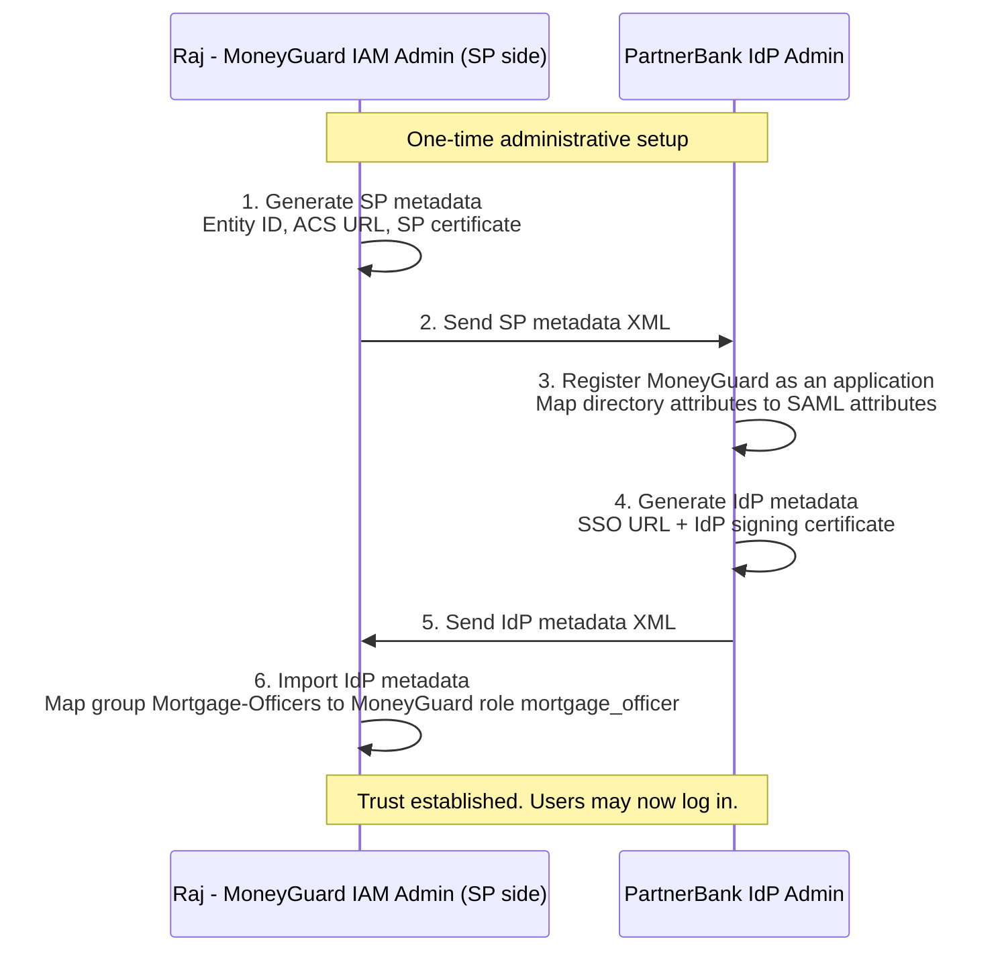
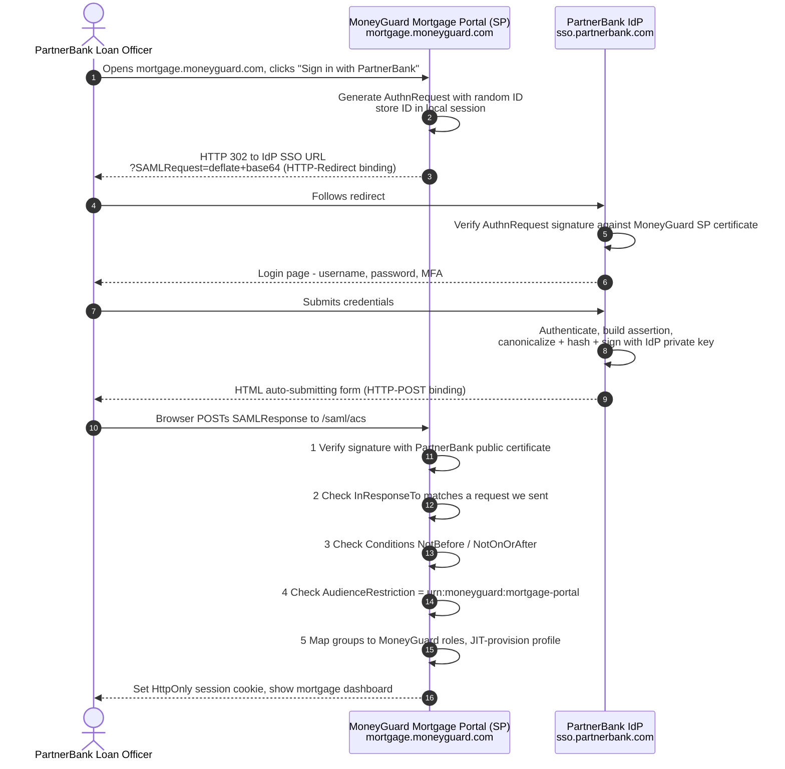
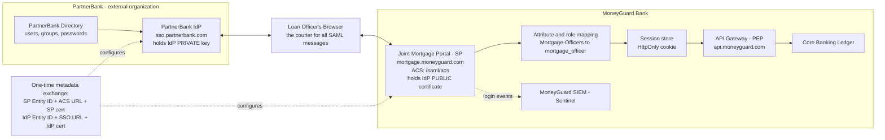

# SAML 2.0 — Enterprise Federation with PartnerBank

## Overview

**SAML** stands for **Security Assertion Markup Language**. Version 2.0, released in 2005, is still the dominant standard for **enterprise Single Sign-On (SSO)** and for **business-to-business (B2B) federation** — one company letting another company's employees in, without ever handling their passwords.

SAML works by exchanging a signed **XML** document called an **assertion**. An assertion is simply a statement one system makes about a person: *"This is `loan.officer@partnerbank.com`, they are in the group `Mortgage-Officers`, they authenticated at 14:02 UTC, and I have cryptographically signed this so you know it came from me and nobody altered it."*

🏦 In this chapter MoneyGuard Bank runs a **joint mortgage product** with **PartnerBank**, an external bank. PartnerBank's loan officers need access to MoneyGuard's joint mortgage portal at `mortgage.moneyguard.com`. MoneyGuard must never store a PartnerBank password. SAML is how that is done.

## Why This Matters

Without federation, MoneyGuard has bad options:

| Approach | What goes wrong |
|---|---|
| Create MoneyGuard accounts for 400 PartnerBank staff | MoneyGuard now owns 400 extra passwords, 400 password resets, and — critically — has **no idea** when PartnerBank fires someone. Terminated staff keep access for weeks. |
| Share one generic "PartnerBank" login | Dana the auditor cannot tell who did what. SOX compliance fails immediately. |
| **SAML federation** | PartnerBank authenticates its own people. MoneyGuard stores zero credentials. Offboarding is instantaneous and automatic. Every assertion names an individual, so audit trails work. |

SAML also solves three problems inside MoneyGuard itself:

1. **Single source of identity** — one place to disable an account instead of thirty.
2. **Consistent authentication** — MFA policy and session length are enforced once, at the IdP, for every connected app.
3. **Legacy reach** — MoneyGuard's 30-year-old on-premise banking software understands SAML XML but has never heard of a JWT.

⚠️ SAML is *not* a good fit for mobile apps, single-page applications, or API-to-API calls. For those, use OIDC and OAuth 2.0 ([Chapter 03](./03_OAuth2.md), [Chapter 04](./04_OIDC.md)). SAML's home turf is browser-based enterprise SSO.

## Key Concepts

| Term | Meaning | In the MoneyGuard ↔ PartnerBank setup |
|---|---|---|
| **Principal** | The human being authenticated | A PartnerBank loan officer |
| **IdP (Identity Provider)** | The system that holds identity data and performs authentication | **PartnerBank's IdP** at `sso.partnerbank.com` |
| **SP (Service Provider)** | The application that wants to know who the user is | **MoneyGuard's joint mortgage portal** at `mortgage.moneyguard.com` |
| **Assertion** | The signed XML statement about the principal (*what* is communicated) | "This is `loan.officer@partnerbank.com`, group `Mortgage-Officers`" |
| **Binding** | The transport used to move SAML messages (*how* it is communicated) | HTTP-Redirect for the request, HTTP-POST for the response |
| **ACS URL (Assertion Consumer Service)** | The exact HTTPS endpoint on the SP where the assertion is POSTed | `https://mortgage.moneyguard.com/saml/acs` |
| **SSO URL** | The IdP endpoint the SP redirects the browser to | `https://sso.partnerbank.com/saml2/sso` |
| **Entity ID** | A globally unique name for each party | SP: `urn:moneyguard:mortgage-portal`; IdP: `https://sso.partnerbank.com/saml2/metadata` |
| **Metadata** | An XML file describing endpoints and public certificates, exchanged once at setup | Both sides exchange these before any login |
| **NameID** | The identifier of the principal inside the assertion | `loan.officer@partnerbank.com` |
| **SP-initiated flow** | The login starts at the SP | The officer opens the mortgage portal first |
| **IdP-initiated flow** | The login starts at the IdP | The officer clicks a MoneyGuard tile in PartnerBank's app portal |

## Detailed Notes

### Concept 1 — The trust handshake (one-time administrative setup)

Nothing works until Raj (MoneyGuard's IAM administrator) and his counterpart at PartnerBank exchange **metadata**. This happens once, long before any user logs in, and it is where 90% of real-world SAML problems are actually created.

**What MoneyGuard (the SP) gives PartnerBank:**

- **SP Entity ID** — `urn:moneyguard:mortgage-portal`
- **ACS URL** — `https://mortgage.moneyguard.com/saml/acs` (must be HTTPS; it carries personal data)
- **SP signing certificate** — so PartnerBank can verify MoneyGuard's signed `AuthnRequest`
- **Requested attributes** — MoneyGuard asks PartnerBank to send `email`, `groups`, and `employeeId`

**What PartnerBank (the IdP) gives MoneyGuard:**

- **IdP Entity ID** — the unique name of PartnerBank's IdP
- **SSO URL** — `https://sso.partnerbank.com/saml2/sso`
- **IdP X.509 public certificate** — ⚠️ **the single most critical item.** PartnerBank signs assertions with its private key; MoneyGuard verifies with this public key. Configure the wrong certificate — or skip verification entirely — and Eve can forge an assertion claiming to be anyone.



💡 Import metadata as a *file or URL* rather than pasting certificates by hand. Hand-copied PEM blobs with a stray newline are the number-one cause of "invalid signature" tickets.

### Concept 2 — Bindings: how the XML actually travels

SAML messages are XML, but XML cannot ride in an HTTP header. **Bindings** define the transport:

| Binding | Mechanism | Typically used for | Why |
|---|---|---|---|
| **HTTP-Redirect** | Deflate-compress → Base64 → URL-encode → put in a `?SAMLRequest=` query parameter, then HTTP 302 | The `AuthnRequest` (SP → IdP) | Requests are small enough to fit in a URL |
| **HTTP-POST** | Base64-encode → embed in a hidden form field → browser auto-submits the form | The `Response` (IdP → SP) | Responses contain full assertions and signatures, far too big for a URL |

Notice what this means: **the browser is the courier.** The IdP and SP typically never talk to each other directly during login. All SAML data passes *through* the user's browser — which is precisely why every message must be signed.

### Concept 3 — The assertion, and what is inside it

The IdP returns a `<samlp:Response>` that wraps a `<saml:Assertion>`. Four parts matter:

- **`<Status>`** — success or failure of the authentication.
- **`<Subject>`** — who this is. The `<NameID>` carries the identifier (`loan.officer@partnerbank.com`), and `<SubjectConfirmationData>` carries `InResponseTo`, `NotOnOrAfter`, and `Recipient`.
- **`<Conditions>`** — validity constraints: `NotBefore`, `NotOnOrAfter`, and `<AudienceRestriction>` naming the SP this assertion is for. These stop replay attacks and stop an assertion meant for another SP being reused at MoneyGuard.
- **`<AttributeStatement>`** — the claims: email, groups, employee ID. MoneyGuard maps `groups = Mortgage-Officers` to its internal role `mortgage_officer`.

⚠️ An assertion is a **snapshot in time**. It says the officer was valid at 14:02 UTC. It says nothing about 14:30. That is why assertion and session lifetimes must be short and why re-authentication is enforced.

### Concept 4 — The cryptography: signing and verification

This is the heart of SAML security, and it is asymmetric cryptography, not encryption.

**PartnerBank signs (with its private key):**

1. **Prepare** the assertion XML with the user's identity.
2. **Canonicalize** the XML — normalize whitespace, attribute order, and namespaces so that harmless formatting differences do not change the result. (Algorithm: `http://www.w3.org/2001/10/xml-exc-c14n#`)
3. **Hash** the canonical XML, typically SHA-256 → this becomes the `<DigestValue>`.
4. **Sign** that digest with PartnerBank's **private key** → this becomes the `<SignatureValue>`.

**MoneyGuard verifies (with PartnerBank's public key):**

1. **Base64-decode** the `SAMLResponse` form field to get the XML.
2. **Locate** the `<ds:Signature>` element.
3. **Recanonicalize and re-hash** the signed content itself.
4. **Decrypt** the `<SignatureValue>` using PartnerBank's public certificate — revealing the digest PartnerBank computed.
5. **Compare** the two digests. Equal means: it came from PartnerBank and nobody changed a byte.

> **💡 The golden rule — signatures vs encryption**
> - **Encryption** = "lock it so only the recipient can read it." Encrypt with the recipient's *public* key; only their *private* key opens it.
> - **Digital signature** = "seal it so everyone can verify who sent it." Sign with your *private* key; anyone with your *public* key can verify. SAML assertions are **signed** (and optionally also encrypted).

### Concept 5 — SP-initiated vs IdP-initiated

| | **SP-initiated** (preferred) | **IdP-initiated** |
|---|---|---|
| Starts at | `mortgage.moneyguard.com` — the officer clicks "Sign in with PartnerBank" | PartnerBank's internal app portal — the officer clicks a MoneyGuard tile |
| `AuthnRequest` sent? | Yes | No — the IdP just POSTs an unsolicited assertion |
| `InResponseTo` present? | Yes, and the SP verifies it against a request it actually sent | No — the SP has nothing to correlate against |
| Replay/CSRF protection | Strong (the random request `ID` acts like `state`) | Weak — this is why unsolicited responses are risky |
| MoneyGuard's choice | ✅ Default for the mortgage portal | Supported only where PartnerBank's portal requires it, with extra replay controls |

⚠️ If you must support IdP-initiated SSO, enforce a strict `NotOnOrAfter` window, keep a cache of consumed assertion `ID`s to reject replays, and require `AudienceRestriction`.

### Concept 6 — Attribute mapping and Just-In-Time provisioning

PartnerBank sends *its* vocabulary; MoneyGuard needs *its own*. Raj configures the mapping:

| PartnerBank attribute | Value | MoneyGuard result |
|---|---|---|
| `NameID` | `loan.officer@partnerbank.com` | Federated user key |
| `groups` | `Mortgage-Officers` | Role `mortgage_officer` |
| `groups` | `Mortgage-Supervisors` | Role `mortgage_approver` |
| `employeeId` | `PB-44219` | Written to the audit record for Dana |

On first login MoneyGuard **JIT-provisions** a shadow profile: it creates a local record keyed by the NameID so that authorization, audit, and preferences have something to attach to — but it stores **no password**. (Provisioning approaches are covered in Module 05.)

### Concept 7 — Known SAML attacks

- **XML Signature Wrapping (XSW).** Eve takes a legitimate signed assertion and wraps it inside a crafted document with a second, unsigned assertion carrying her chosen identity. A naive parser verifies the signature on the original element but *reads* the attacker-supplied one. **Mitigation:** use a maintained, well-tested SAML library; validate that the element that was signed is the exact element you read; never write your own XML signature verification.
- **Missing audience check.** An assertion issued for a different SP is replayed at MoneyGuard. **Mitigation:** always enforce `<AudienceRestriction>`.
- **Replay.** A recorded assertion is submitted again later. **Mitigation:** enforce `NotBefore`/`NotOnOrAfter`, and cache consumed assertion IDs for that window.
- **Certificate expiry.** IdP signing certificates expire — usually at 2 AM on a Sunday. **Mitigation:** monitor expiry dates, and prefer metadata-URL auto-refresh over manual certificate pasting.
- **XXE (XML External Entity).** A malicious XML payload makes the parser fetch remote files. **Mitigation:** disable external entity resolution in the XML parser.

## Workflow

🏦 A PartnerBank loan officer opens MoneyGuard's joint mortgage portal (SP-initiated flow):



## Architecture Diagram



## Step-by-Step Process

1. **Setup (once).** Raj and PartnerBank's admin exchange metadata XML. MoneyGuard stores PartnerBank's signing certificate; PartnerBank registers MoneyGuard's Entity ID and ACS URL.
2. **Initiation.** The loan officer opens `mortgage.moneyguard.com` and clicks "Sign in with PartnerBank".
3. **AuthnRequest built.** The portal generates a `<samlp:AuthnRequest>` containing a large random `ID`, an `IssueInstant`, its `AssertionConsumerServiceURL`, and its `Issuer`. It signs the request and **stores the `ID` in the local session** so the response can be matched later.
4. **Redirect (HTTP-Redirect binding).** The request is deflated, Base64-encoded, URL-encoded, and appended as `?SAMLRequest=...`. The browser is sent to PartnerBank's SSO URL with HTTP 302.
5. **IdP validates the request.** PartnerBank checks the signature against MoneyGuard's registered SP certificate. Wrong or missing signature → reject.
6. **Authentication.** PartnerBank prompts for username, password, and its own MFA. MoneyGuard sees none of this.
7. **Assertion built and signed.** PartnerBank assembles the assertion, canonicalizes the XML, hashes it (SHA-256), and signs the digest with its private key.
8. **POST back (HTTP-POST binding).** PartnerBank returns an HTML page with a hidden form containing `SAMLResponse`; JavaScript auto-submits it to MoneyGuard's ACS URL.
9. **MoneyGuard validates — in this order, all of them:**
   - Signature verifies against PartnerBank's public certificate.
   - `InResponseTo` matches an `AuthnRequest` ID this portal actually issued.
   - `Conditions/NotBefore` and `NotOnOrAfter` bracket the current time (allow small clock skew, e.g. 2 minutes).
   - `AudienceRestriction` equals `urn:moneyguard:mortgage-portal`.
   - `Status` is `Success`.
   - The assertion ID has not been seen before (replay cache).
10. **Attribute mapping.** `groups=Mortgage-Officers` becomes MoneyGuard role `mortgage_officer`.
11. **Session creation.** MoneyGuard issues its own `HttpOnly; Secure; SameSite=Strict` session cookie. From here on, SAML is finished — the session and any downstream API tokens are MoneyGuard's own.
12. **Audit.** The login event, NameID, source IP, and mapped roles are shipped to Sentinel.

## Commands and Examples

**1. MoneyGuard's SP metadata (what Raj sends PartnerBank)**

```xml
<md:EntityDescriptor xmlns:md="urn:oasis:names:tc:SAML:2.0:metadata"
                     entityID="urn:moneyguard:mortgage-portal">
  <md:SPSSODescriptor AuthnRequestsSigned="true"
                      WantAssertionsSigned="true"
                      protocolSupportEnumeration="urn:oasis:names:tc:SAML:2.0:protocol">
    <md:KeyDescriptor use="signing">
      <ds:KeyInfo xmlns:ds="http://www.w3.org/2000/09/xmldsig#">
        <ds:X509Data><ds:X509Certificate>MIIDKjCCAhKgAwIBAgIQ...</ds:X509Certificate></ds:X509Data>
      </ds:KeyInfo>
    </md:KeyDescriptor>
    <md:NameIDFormat>urn:oasis:names:tc:SAML:1.1:nameid-format:emailAddress</md:NameIDFormat>
    <md:AssertionConsumerService
        Binding="urn:oasis:names:tc:SAML:2.0:bindings:HTTP-POST"
        Location="https://mortgage.moneyguard.com/saml/acs"
        index="0" isDefault="true"/>
  </md:SPSSODescriptor>
</md:EntityDescriptor>
```

**2. PartnerBank's IdP metadata (what MoneyGuard imports)**

```xml
<md:EntityDescriptor entityID="https://sso.partnerbank.com/saml2/metadata">
  <md:IDPSSODescriptor protocolSupportEnumeration="urn:oasis:names:tc:SAML:2.0:protocol">
    <md:KeyDescriptor use="signing">
      <ds:KeyInfo>
        <ds:X509Data><ds:X509Certificate>MIICMjCCAZugAwIBAgIBADANBgkq...</ds:X509Certificate></ds:X509Data>
      </ds:KeyInfo>
    </md:KeyDescriptor>
    <md:NameIDFormat>urn:oasis:names:tc:SAML:1.1:nameid-format:emailAddress</md:NameIDFormat>
    <md:SingleSignOnService
        Binding="urn:oasis:names:tc:SAML:2.0:bindings:HTTP-Redirect"
        Location="https://sso.partnerbank.com/saml2/sso"/>
    <md:SingleSignOnService
        Binding="urn:oasis:names:tc:SAML:2.0:bindings:HTTP-POST"
        Location="https://sso.partnerbank.com/saml2/sso"/>
  </md:IDPSSODescriptor>
</md:EntityDescriptor>
```

**3. The redirect the browser actually follows**

```http
HTTP/1.1 302 Found
Location: https://sso.partnerbank.com/saml2/sso?SAMLRequest=fVLLbtswEPwVgXdJ...%3D%3D&RelayState=%2Fapplications%2Fmortgage%2F77421&SigAlg=http%3A%2F%2Fwww.w3.org%2F2001%2F04%2Fxmldsig-more%23rsa-sha256&Signature=Kf9s...
```

`RelayState` carries the deep link the officer originally wanted (`/applications/mortgage/77421`) so they land back on the right page after login.

**4. The decoded `AuthnRequest` MoneyGuard sent**

```xml
<samlp:AuthnRequest
  xmlns:samlp="urn:oasis:names:tc:SAML:2.0:protocol"
  xmlns:saml="urn:oasis:names:tc:SAML:2.0:assertion"
  ID="_9f2a71c4-8d3e-4b16-a5c0-2e77b1d94f38"
  Version="2.0"
  IssueInstant="2026-02-28T14:01:44Z"
  Destination="https://sso.partnerbank.com/saml2/sso"
  ProtocolBinding="urn:oasis:names:tc:SAML:2.0:bindings:HTTP-POST"
  AssertionConsumerServiceURL="https://mortgage.moneyguard.com/saml/acs">
  <saml:Issuer>urn:moneyguard:mortgage-portal</saml:Issuer>
  <samlp:NameIDPolicy
    Format="urn:oasis:names:tc:SAML:1.1:nameid-format:emailAddress"
    AllowCreate="true"/>
</samlp:AuthnRequest>
```

The random `ID` is stored server-side by MoneyGuard and later matched against the response's `InResponseTo`. It plays exactly the role that `state` plays in OAuth ([Chapter 05](./05_State_Nonce_And_PKCE.md)).

**5. The signed `Response` PartnerBank POSTs back (abbreviated)**

```xml
<saml2p:Response
  xmlns:saml2p="urn:oasis:names:tc:SAML:2.0:protocol"
  xmlns:saml2="urn:oasis:names:tc:SAML:2.0:assertion"
  ID="_id4f21c9083bd1a77e0"
  InResponseTo="_9f2a71c4-8d3e-4b16-a5c0-2e77b1d94f38"
  Destination="https://mortgage.moneyguard.com/saml/acs"
  IssueInstant="2026-02-28T14:02:09Z">

  <saml2:Issuer>https://sso.partnerbank.com/saml2/metadata</saml2:Issuer>

  <saml2p:Status>
    <saml2p:StatusCode Value="urn:oasis:names:tc:SAML:2.0:status:Success"/>
  </saml2p:Status>

  <saml2:Assertion ID="_a71bd3f9c0e24d18b" IssueInstant="2026-02-28T14:02:09Z">
    <ds:Signature xmlns:ds="http://www.w3.org/2000/09/xmldsig#">
      <ds:SignedInfo>
        <ds:CanonicalizationMethod Algorithm="http://www.w3.org/2001/10/xml-exc-c14n#"/>
        <ds:SignatureMethod Algorithm="http://www.w3.org/2001/04/xmldsig-more#rsa-sha256"/>
        <ds:Reference URI="#_a71bd3f9c0e24d18b">
          <ds:DigestMethod Algorithm="http://www.w3.org/2001/04/xmlenc#sha256"/>
          <ds:DigestValue>VKPsgTPABNq1SvInCMXd04LZCvRYMnJzEeT5oIs70hw=</ds:DigestValue>
        </ds:Reference>
      </ds:SignedInfo>
      <ds:SignatureValue>gsUzQuivXX378HkYNI+plBkp1BvPUNmJD+kh825nHw...</ds:SignatureValue>
    </ds:Signature>

    <saml2:Subject>
      <saml2:NameID Format="urn:oasis:names:tc:SAML:1.1:nameid-format:emailAddress">
        loan.officer@partnerbank.com
      </saml2:NameID>
      <saml2:SubjectConfirmation Method="urn:oasis:names:tc:SAML:2.0:cm:bearer">
        <saml2:SubjectConfirmationData
          InResponseTo="_9f2a71c4-8d3e-4b16-a5c0-2e77b1d94f38"
          NotOnOrAfter="2026-02-28T14:07:09Z"
          Recipient="https://mortgage.moneyguard.com/saml/acs"/>
      </saml2:SubjectConfirmation>
    </saml2:Subject>

    <saml2:Conditions NotBefore="2026-02-28T13:57:09Z" NotOnOrAfter="2026-02-28T14:07:09Z">
      <saml2:AudienceRestriction>
        <saml2:Audience>urn:moneyguard:mortgage-portal</saml2:Audience>
      </saml2:AudienceRestriction>
    </saml2:Conditions>

    <saml2:AuthnStatement AuthnInstant="2026-02-28T14:02:08Z" SessionIndex="_sess_88f1c2">
      <saml2:AuthnContext>
        <saml2:AuthnContextClassRef>
          urn:oasis:names:tc:SAML:2.0:ac:classes:MultiFactorAuthentication
        </saml2:AuthnContextClassRef>
      </saml2:AuthnContext>
    </saml2:AuthnStatement>

    <saml2:AttributeStatement>
      <saml2:Attribute Name="email">
        <saml2:AttributeValue>loan.officer@partnerbank.com</saml2:AttributeValue>
      </saml2:Attribute>
      <saml2:Attribute Name="groups">
        <saml2:AttributeValue>Mortgage-Officers</saml2:AttributeValue>
        <saml2:AttributeValue>PartnerBank-Staff</saml2:AttributeValue>
      </saml2:Attribute>
      <saml2:Attribute Name="employeeId">
        <saml2:AttributeValue>PB-44219</saml2:AttributeValue>
      </saml2:Attribute>
    </saml2:AttributeStatement>
  </saml2:Assertion>
</saml2p:Response>
```

**6. Debugging: decode a `SAMLResponse` from the browser's network tab**

```bash
# HTTP-POST binding: Base64 only
echo 'PHNhbWwycDpSZXNwb25zZSB4bWxucz0i...' | base64 -d | xmllint --format -

# HTTP-Redirect binding: URL-decode, Base64-decode, then inflate
python3 -c "import sys,base64,zlib,urllib.parse; \
print(zlib.decompress(base64.b64decode(urllib.parse.unquote(sys.argv[1])), -15).decode())" \
"fVLLbtswEPwVgXdJ..."
```

**7. Checking the IdP certificate expiry before it breaks production**

```bash
curl -s https://sso.partnerbank.com/saml2/metadata \
  | grep -oP '(?<=<ds:X509Certificate>)[^<]+' \
  | base64 -d | openssl x509 -inform DER -noout -subject -enddate
```

## Best Practices

- **Use a maintained SAML library.** `node-saml`, `ruby-saml`, `python3-saml`, `simpleSAMLphp`, or your framework's built-in provider. Never hand-roll XML signature verification.
- **Prefer SP-initiated flows.** They give you `InResponseTo` correlation for free.
- **Enforce every validation:** signature, `InResponseTo`, `NotBefore`/`NotOnOrAfter`, `AudienceRestriction`, `Recipient`, `Status`, and a replay cache of consumed assertion IDs.
- **Consume metadata by URL** where the IdP publishes one, so certificate rollovers are picked up automatically.
- **Monitor certificate expiry** with an alert at 60, 30, and 7 days.
- **Keep assertion validity windows short** — five minutes is typical — and allow only small clock skew.
- **Sign the `AuthnRequest`** so PartnerBank can verify requests really came from MoneyGuard.
- **Map groups to roles explicitly.** Never grant access simply because a valid assertion arrived; a valid PartnerBank employee is not automatically a mortgage officer.
- **Log the NameID, `SessionIndex`, `AuthnContextClassRef`, and mapped roles** to Sentinel for Dana's audits.
- **Support Single Logout (SLO) where the partner requires it**, but treat short session lifetimes as the primary control — SLO is notoriously inconsistent across implementations.

## Common Mistakes

- ⚠️ **Not verifying the signature at all.** Astonishingly common in prototypes that reach production. Anyone who can POST to your ACS URL becomes any user.
- ⚠️ **Verifying the signature but reading a different element** — the XML Signature Wrapping attack. Use a library that binds "what was signed" to "what is read."
- ⚠️ **Skipping `AudienceRestriction`.** An assertion PartnerBank issued for a totally different service provider then works at MoneyGuard.
- ⚠️ **Skipping `InResponseTo`.** Opens the door to unsolicited/forged responses.
- ⚠️ **Trusting `RelayState` blindly.** It is attacker-controllable; validate it is a relative path on your own site or you have built an open redirect.
- ⚠️ **Long assertion windows** ("`NotOnOrAfter` = 8 hours so retries work"). That is an 8-hour replay window.
- ⚠️ **Clock drift.** Servers a few minutes out of sync produce "assertion not yet valid" failures. Run NTP; allow ~2 minutes of skew, not 2 hours.
- ⚠️ **Assuming SAML gives you an API token.** It does not. SAML ends at browser session creation; API calls still need OAuth 2.0.
- ⚠️ **Leaving XML external entity resolution enabled** in the parser — an XXE hole.

## Pro Tips

- 💡 **The browser is the courier.** If you remember only one thing about SAML, remember that the IdP and SP usually never talk directly — everything flows through the user's browser. That single fact explains why signing is mandatory and why bindings exist.
- 💡 **`RelayState` is SAML's "return to where I was."** It is not a security parameter; the random `AuthnRequest` `ID` is.
- 💡 **`AuthnContextClassRef` tells you *how* the user authenticated.** MoneyGuard can require `MultiFactorAuthentication` and reject a password-only assertion — step-up enforcement without owning the login screen.
- 💡 **Both Response and Assertion can be signed.** Some IdPs sign one, some sign the other, some sign both. Configure `WantAssertionsSigned="true"` and verify whichever signatures are present against the expected certificate.
- 💡 **Base64 + `xmllint --format`** in a terminal will solve more SAML tickets than any documentation.
- 💡 In an interview, contrast SAML's *assertion* with OIDC's *ID token*: same job (a signed statement about a user), different envelope (XML vs JWT), different transport (browser form POST vs back-channel JSON).

## Real-World Use Cases

1. **🏦 The joint mortgage product (this chapter).** PartnerBank loan officers reach `mortgage.moneyguard.com` with PartnerBank credentials. MoneyGuard holds zero PartnerBank passwords; PartnerBank's offboarding is MoneyGuard's offboarding.
2. **🏦 Legacy internal banking software.** A 2003 on-premise treasury application cannot parse a JWT but happily consumes SAML. MoneyGuard Entra ID acts as the *IdP* here, with the legacy app as SP, so employees get the same MFA policy as modern apps.
3. **🏦 SaaS vendor SSO.** MoneyGuard's HR ticketing SaaS and expenses SaaS both integrate as SAML SPs against MoneyGuard Entra ID. When Workday terminates Sam Torres, one directory change removes his access from all of them.
4. **🏦 Audit and compliance.** Because every assertion names an individual and records `AuthnInstant` and `AuthnContextClassRef`, Dana can prove to a SOX auditor exactly who accessed the joint mortgage records, when, and with what strength of authentication.
5. **🏦 Contractor access without shadow accounts.** A staffing agency's consultants federate in through the agency's IdP, so MoneyGuard never provisions or deprovisions their credentials.

## Key Takeaways

- SAML 2.0 exchanges a **signed XML assertion** to achieve browser-based SSO and B2B federation.
- The three roles: **Principal** (the human), **IdP** (authenticates), **SP** (consumes the assertion).
- **Metadata exchange establishes trust once**; the IdP's public certificate is the most security-critical item in it.
- **Bindings** define transport: HTTP-Redirect for requests, HTTP-POST for responses. **The browser carries every message.**
- Validation is not optional: **signature + `InResponseTo` + time window + `AudienceRestriction` + replay cache.**
- Assertions are a **snapshot in time** — keep windows and sessions short.
- SAML's strength is **enterprise and legacy B2B SSO**; its weakness is mobile, SPAs, and APIs — that is OIDC and OAuth 2.0 territory.

## Glossary

| Term | Definition |
|---|---|
| **SAML (Security Assertion Markup Language)** | XML-based standard for exchanging authentication and authorization statements between organizations. |
| **Principal** | The user being authenticated. |
| **IdP (Identity Provider)** | The system that authenticates the principal and issues assertions. |
| **SP (Service Provider)** | The application that consumes assertions and creates a session. |
| **Assertion** | The signed XML statement about the principal. |
| **ACS URL (Assertion Consumer Service)** | The SP endpoint where the IdP's response is POSTed. |
| **SSO URL** | The IdP endpoint that receives `AuthnRequest` messages. |
| **Entity ID** | Globally unique identifier for an IdP or SP. |
| **Metadata** | XML describing endpoints, certificates, and supported bindings. |
| **Binding** | The transport mechanism for a SAML message (HTTP-Redirect, HTTP-POST, Artifact). |
| **AuthnRequest** | The XML message an SP sends to ask an IdP to authenticate a user. |
| **NameID** | The identifier of the principal inside an assertion. |
| **AttributeStatement** | The section of an assertion carrying claims such as groups and email. |
| **Conditions** | Assertion constraints: `NotBefore`, `NotOnOrAfter`, `AudienceRestriction`. |
| **AudienceRestriction** | Names the SP the assertion is valid for. |
| **InResponseTo** | Links a response back to the `AuthnRequest` ID that triggered it. |
| **RelayState** | Opaque value used to return the user to their original deep link. |
| **Canonicalization (C14N)** | Normalizing XML before hashing so formatting differences do not break signatures. |
| **XSW (XML Signature Wrapping)** | Attack where a valid signature covers one element while the parser reads another. |
| **SLO (Single Logout)** | SAML's protocol for ending sessions across multiple SPs at once. |

## Revision Notes

- SAML = **signed XML assertion**, born 2005, still the B2B SSO standard.
- Roles: **Principal → IdP → SP**. MoneyGuard is the **SP**; PartnerBank is the **IdP**.
- Setup = **metadata exchange**: SP gives Entity ID + ACS URL + cert; IdP gives Entity ID + SSO URL + cert.
- Bindings: **Redirect out, POST back.** The **browser is the courier**.
- Sign with **private** key, verify with **public** key. Canonicalize → hash → sign.
- SP must validate: **signature, `InResponseTo`, `NotBefore`/`NotOnOrAfter`, `AudienceRestriction`, `Status`, replay cache.**
- **SP-initiated > IdP-initiated** (correlation and replay protection).
- Top attacks: **XSW**, missing audience check, replay, expired certificate, XXE.
- SAML ends at **session creation** — API calls still need OAuth ([Chapter 03](./03_OAuth2.md)).

## Interview Questions

**1. Walk me through an SP-initiated SAML login.**
The user hits the service provider with no session. The SP builds a signed `AuthnRequest` containing a random `ID`, stores that `ID` locally, and redirects the browser to the IdP's SSO URL with the request deflated and Base64-encoded in a query parameter (HTTP-Redirect binding). The IdP verifies the request signature, authenticates the user with password and MFA, builds an assertion, canonicalizes and signs it with its private key, and returns an auto-submitting HTML form that POSTs the `SAMLResponse` to the SP's ACS URL (HTTP-POST binding). The SP verifies the signature with the IdP's public certificate, checks `InResponseTo` against the stored ID, checks the `Conditions` time window and `AudienceRestriction`, maps attributes to local roles, and creates its own session cookie.

**2. Why must the assertion be signed? Couldn't HTTPS be enough?**
No, because the browser — which is fully under the user's control — is the transport. HTTPS protects the hop between the browser and each server, but it does not stop the user (or malware in the browser) from crafting their own POST to the ACS URL. The ACS endpoint performs no authentication of the caller. The signature is the only thing proving the assertion actually originated at PartnerBank and was not modified in transit or fabricated locally.

**3. What is XML Signature Wrapping and how do you defend against it?**
XSW is an attack where an attacker takes a legitimately signed assertion and restructures the XML document so it contains a second, attacker-controlled assertion. A naive implementation verifies the signature — which is still valid over the original element — but then reads identity data from the injected element. The defenses are: use a well-maintained SAML library, ensure the code verifies the signature over the *exact* element it subsequently reads (by ID reference), reject documents containing more than one assertion, and use schema validation. This is the strongest argument against writing your own SAML implementation.

**4. What is the difference between the SAML `Response` signature and the `Assertion` signature?**
The `Response` is the outer protocol envelope; the `Assertion` is the statement about the user inside it. Either or both may be signed, depending on IdP configuration. Signing only the Response protects the envelope but can leave the assertion detachable; signing the assertion is what actually binds the identity claims. Best practice is to set `WantAssertionsSigned="true"` and verify whichever signatures are present against the expected certificate — and to reject an unsigned assertion outright.

**5. Compare SAML and OIDC.**
Both perform authentication and both deliver a signed statement about a user. SAML uses XML and moves data via browser redirects and form POSTs; OIDC uses JSON, JWTs, and back-channel HTTPS calls. SAML predates mobile and APIs and has no native concept of an API access token; OIDC is built on OAuth 2.0 so it produces an ID token *and* an access token in the same flow. SAML's assertion signature is XML DSig with canonicalization — complex and historically attack-prone; OIDC's ID token is a compact JWT verified against a JWKS endpoint. For anything greenfield, choose OIDC; choose SAML when the counterparty requires it.

**6. How does MoneyGuard know which internal permissions a PartnerBank user gets?**
Not from the assertion directly — that would let PartnerBank grant itself MoneyGuard privileges. PartnerBank asserts *facts about its own directory* (`groups=Mortgage-Officers`, `employeeId=PB-44219`). MoneyGuard applies its own mapping rules to translate those facts into MoneyGuard roles like `mortgage_officer`. The mapping is owned, versioned, and audited by Raj on MoneyGuard's side. This separation is essential: the IdP asserts identity, the SP decides entitlement.

**7. What breaks when PartnerBank's signing certificate expires, and how do you avoid it?**
Every assertion suddenly fails signature validation and all PartnerBank users lose access at once, typically outside business hours. Avoid it by consuming PartnerBank's metadata by URL so new certificates are picked up automatically, supporting multiple valid signing certificates simultaneously during a rollover window, and alerting on certificate expiry at 60/30/7 days. Treat certificate rotation as a scheduled joint change, not an incident.

**8. Is IdP-initiated SSO safe?**
It is weaker and should be avoided when possible. Because no `AuthnRequest` was sent, there is no `InResponseTo` value to correlate against, so the SP cannot distinguish a legitimate unsolicited assertion from one an attacker captured and replayed into a victim's browser — a login-CSRF equivalent. If it must be supported, enforce a very short `NotOnOrAfter`, keep a cache of consumed assertion IDs to block replays, strictly enforce `AudienceRestriction` and `Recipient`, and never accept an unsolicited assertion for privileged operations without a fresh step-up authentication.

## Practice Exercises

1. **Build the metadata.** Write the SP metadata XML MoneyGuard would send PartnerBank for a *second* application, the "Joint Mortgage Document Vault" at `https://vault.moneyguard.com`, with ACS URL `/saml/acs` and Entity ID `urn:moneyguard:mortgage-vault`. State which single field, if PartnerBank copies it wrong, silently breaks every login.
2. **Trace the validation.** You are handed a `SAMLResponse` in which the signature verifies correctly, but `AudienceRestriction` is `urn:otherbank:portal`. Should MoneyGuard accept it? Explain precisely what attack the audience check prevents, with a concrete two-company example.
3. **Design the attribute mapping.** PartnerBank sends `groups` values `Mortgage-Officers`, `Mortgage-Supervisors`, `Interns`, and `PartnerBank-Staff`. Write the mapping table Raj should configure so supervisors can approve mortgages, officers can only submit them, and interns and general staff get no access at all. What should happen when an unmapped group arrives?
4. **Debug the failure.** PartnerBank users report "Assertion is not yet valid" errors every morning between 08:00 and 08:05 and never at other times. List three plausible root causes and the command or check you would run for each.
5. **Attack and defend.** Eve captures a valid SAML response from the browser's developer tools and replays it to `https://mortgage.moneyguard.com/saml/acs` twelve minutes later. List every individual validation in this chapter that would block her, and identify which single one would still stop her if the assertion's `NotOnOrAfter` had mistakenly been set to eight hours.

---
⬅ Back to [Module 02 index](./README.md) | ➡ Next: [OAuth 2.0](./03_OAuth2.md) | 🏦 [MoneyGuard scenario](../SCENARIO.md)
