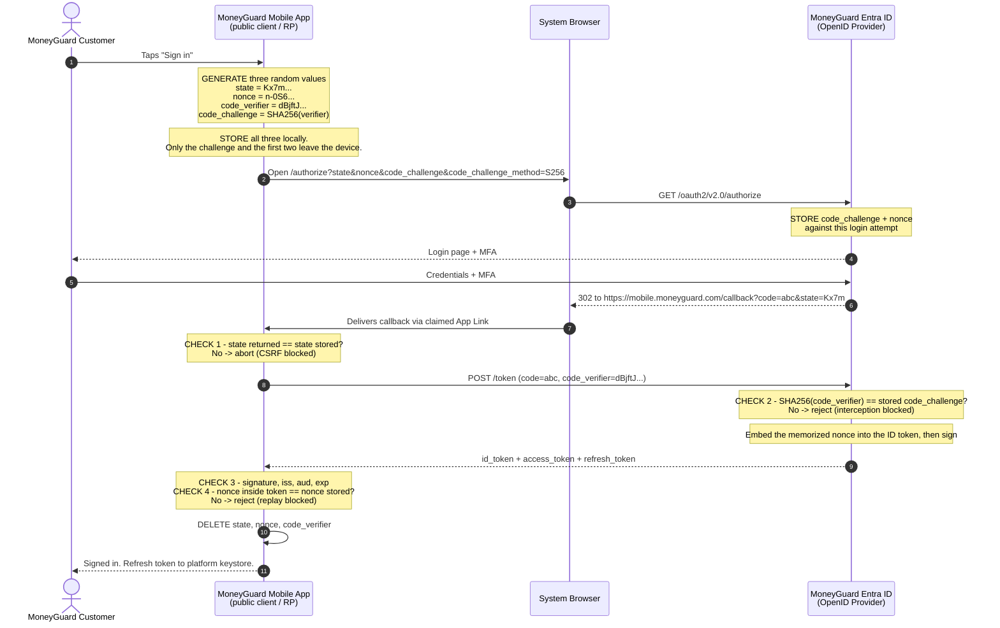
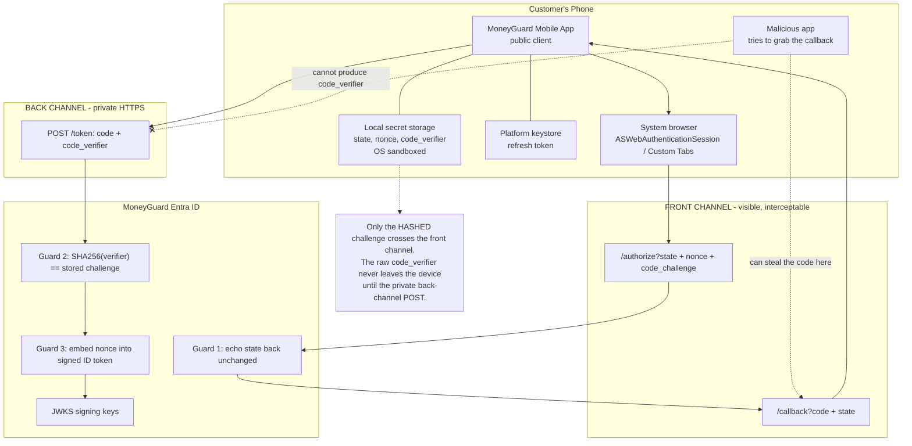

# `state`, `nonce`, and PKCE — Securing MoneyGuard Mobile App Login

## Overview

When you read an OAuth 2.0 or OpenID Connect (OIDC) authorization URL for the first time, three parameters look like noise:

```
&state=Kx7mQp2vR9tL4nZs
&nonce=n-0S6_WzA2Mj
&code_challenge=E9Melhoa2OwvFrEMTJguCHaoeK1t8URWbuGZQ5A9Djk
```

They are not noise, they are not interchangeable, and they are not optional. They are **three different security guards standing at three different doors** of the same login flow:

| Guard | Door it stands at | Attack it stops |
|---|---|---|
| **`state`** | The redirect **back** to the app | Cross-Site Request Forgery (login CSRF) |
| **`nonce`** | The **ID token** issued at the end | ID token replay |
| **PKCE** | The **authorization code exchange** | Authorization code interception |

🏦 **The MoneyGuard scenario for this chapter:** the **MoneyGuard Mobile App** — a public client on a customer's phone, with no server-side secret it can hide — logging a customer into their bank account via **MoneyGuard Entra ID**. **Eve** is going to attack that login three different ways, and each parameter is going to stop exactly one of her attacks.

You do not choose between them. You use all three, together, to build a fortress.

## Why This Matters

A mobile banking app is the single most exposed login MoneyGuard operates:

- **It cannot keep a secret.** Anyone can download the app and decompile it. A `client_secret` shipped inside is not a secret, so the usual "prove you are the real client" mechanism is unavailable.
- **The redirect lands on a shared device.** On a phone, other apps can register to receive the same custom URL scheme. The authorization code arriving back at `moneyguard://oauth/callback` can be grabbed by a malicious app the customer installed months ago.
- **Browsers share a cookie jar across tabs.** A malicious page in one tab can silently fire requests at MoneyGuard's callback URL in another, carrying the customer's real session cookie.
- **Tokens leak into logs.** ID tokens end up in crash reports, proxy logs, and analytics. A leaked one must not be reusable.

The stakes are money. If Eve wins any one of these, she is either reading a customer's balances or, worse, silently attached to their account. 💡 These three parameters cost about fifteen lines of code and are the difference between a login that "works in demo" and one that survives contact with an attacker.

## Key Concepts

| Term | Full name | One-line job |
|---|---|---|
| **`state`** | (no expansion — it is literally opaque state) | A random value the client sends out and demands back unchanged, proving the response belongs to a request *this browser actually started* |
| **`nonce`** | **N**umber used **once** | A random value the OpenID Provider bakes into the signed ID token, proving the token was minted for *this specific login attempt* |
| **PKCE** | **P**roof **K**ey for **C**ode **E**xchange (pronounced "pixy", RFC 7636) | A one-time secret proving the app redeeming the authorization code is the same app that requested it |
| **`code_verifier`** | | The raw random secret. Stays on the device. Sent only in the final back-channel POST. |
| **`code_challenge`** | | `BASE64URL(SHA256(code_verifier))` — the public, irreversible hash sent in the first redirect |
| **`code_challenge_method`** | | Must be `S256`. `plain` sends the raw secret in the URL and defeats the purpose. |
| **Public client** | | A client that cannot hold a secret — the MoneyGuard Mobile App, a browser-only SPA |
| **Front channel** | | Anything routed through the browser or OS: visible, loggable, interceptable |
| **Back channel** | | Direct HTTPS between the client and the provider: private |

## Detailed Notes

### Concept 1 — `state`: guarding the callback against login CSRF

`state` answers one question for the app: *"Is this incoming login response the answer to a request that **this** device actually made?"*

**The attack — login CSRF, step by step.**

*Phase 1 — Eve prepares the trap.*
Eve opens the MoneyGuard Mobile App's web login herself, authenticates as **herself**, and intercepts the callback URL before her own app consumes it:

```
https://mobile.moneyguard.com/callback?code=EVE_CODE_888
```

That code is tied to **Eve's** bank profile. She now has a live, unredeemed voucher for her own account.

*Phase 2 — the attack, if MoneyGuard omits `state`.*

1. **The customer opens MoneyGuard (Tab 1).** They visit `mobile.moneyguard.com`. MoneyGuard hands the anonymous browser a session cookie: `Session=CUST_123`.
2. **The customer gets distracted (Tab 2).** They leave Tab 1 open and browse to an unrelated site that Eve controls or has compromised.
3. **The silent fire.** A hidden script in Tab 2 forces the browser to load Eve's intercepted URL: `GET https://mobile.moneyguard.com/callback?code=EVE_CODE_888`.
4. **The shared cookie jar betrays them.** Browsers attach a site's cookies to *any* request to that site, regardless of which tab started it. `Session=CUST_123` rides along.
5. **MoneyGuard is fooled.** The backend sees the callback plus the customer's session cookie, redeems `EVE_CODE_888`, gets tokens belonging to **Eve**, and records: *"whoever holds `Session=CUST_123` is now logged in as Eve."*
6. **The trap springs.** The customer returns to Tab 1, is greeted normally, and — believing they are in their own account — adds a payee, uploads an ID document, or links a card. It all lands in **Eve's** MoneyGuard account.

Note what did *not* happen: nothing was stolen from the customer. The customer was **silently logged into the attacker's account**. That is why this attack is so easy to overlook — nothing looks broken.

*Phase 3 — the fix.*

1. Before redirecting, the app generates a cryptographically random `state` (e.g. `SECRET_999`) and stores it **server-side against the session** (or in a `HttpOnly` cookie).
2. It includes `&state=SECRET_999` in the `/authorize` URL.
3. The provider echoes it back unchanged in the callback.
4. The app compares the returned `state` against the stored value. Missing or different → reject and abandon the flow.

Eve's forged URL from Tab 2 has no `state`, or has *her* `state` from *her* session. Either way the comparison fails, because Eve cannot read the value MoneyGuard generated inside the customer's session. Attack blocked.

⚠️ `state` must be **random and unguessable**, generated per login attempt, single-use, and compared server-side. A constant string like `"login"` provides zero protection.

💡 `state` doubles as a place to remember where the user was going ("return to the transfer screen"). Do that by storing the destination **server-side keyed by the `state` value** — do not encode a URL into `state` itself and redirect to it blindly, or you have built an open redirect.

### Concept 2 — `nonce`: guarding the ID token against replay

`nonce` is OIDC-specific. It answers: *"Was this ID token minted for **this** login attempt, right now?"*

**The attack — ID token replay.** An ID token is a signed JWT that proves who a user is. Suppose Eve obtains a genuine ID token from a customer's login yesterday — from a leaked log file, a crash report, a shared proxy, or an old browser history entry. She starts a fresh login and injects that stolen token. The signature is mathematically perfect. The issuer is right. The audience is right. It has not expired yet. A relying party that checks only those things **accepts it and logs Eve in as the customer.**

**The fix.** The `nonce` cryptographically binds the token to one session:

1. The app generates a random `nonce` and stores it in the current login session.
2. It sends `&nonce=...` in the `/authorize` request.
3. The provider **memorizes** it against this login attempt.
4. When it mints the ID token, it embeds the `nonce` as a claim and **signs the token** — making the value immutable.
5. The app decodes the token, extracts the `nonce` claim, and compares it with the value stored in the session. Mismatch → reject.

Eve's stolen token carries yesterday's `nonce`. She cannot edit it — that breaks the signature. She cannot guess today's — it lives in the customer's session on MoneyGuard's server. Attack blocked.

#### The `nonce` chain of custody

The confusing part: **the authorization code carries no `nonce`.** Here is where it actually lives at every moment.

| Phase | Component | Action | Where the `nonce` is | Where the code/token is |
|---|---|---|---|---|
| 1. Creation | Mobile App | Generates the `nonce` | Stored in the app's login session | Not created yet |
| 2. Redirect | Browser / OS | Carries the user to Entra ID | Sent in the `/authorize` URL | Not created yet |
| 3. Code issued | Entra ID | User authenticates; a code is minted | **Memorized server-side**, tied to this attempt | `code=...` returned via redirect |
| 4. Exchange | Mobile App | POSTs the code to `/token` | Still in the app's session | Code travels the back channel |
| 5. Token minted | Entra ID | Validates the code, builds the ID token | **Retrieved and embedded as a claim**, then signed | ID token returned |
| 6. Validation | Mobile App | Compares token `nonce` to session `nonce` | Compared — mismatch rejects the login | Signature verified via JWKS |

**The "aha" moment is phase 3.** The authorization code is a blank coat-check ticket. Entra ID remembers your `nonce` on its own server and only stitches it into the ID token at phase 5 — at which point the signature freezes it forever.

⚠️ Most OIDC libraries validate signature, `iss`, `aud`, and `exp` for you — and **leave the `nonce` check to you**. It is the single most commonly skipped validation in production OIDC code.

### Concept 3 — PKCE: guarding the authorization code against interception

PKCE answers a question for the **provider**: *"Is the app redeeming this code the same app that requested it?"*

For a confidential client that question is answered by the `client_secret`. The MoneyGuard Mobile App has no secret it can hide, so it needs a different proof.

**The attack — code interception on a mobile device.**

1. The customer taps "Sign in" in the MoneyGuard Mobile App. The app opens the system browser at Entra ID.
2. The customer authenticates successfully.
3. Entra ID redirects to `moneyguard://oauth/callback?code=abc123`.
4. **A malicious app** the customer installed months ago — a free flashlight, a wallpaper app — has registered itself to handle the `moneyguard://` custom URL scheme. On many platforms, the OS hands the URL to it too, or to it *instead*.
5. That app races to Entra ID: *"Here is `code=abc123`, give me the tokens."* Without a client secret, Entra ID cannot tell the malicious app from the real one.
6. Eve's app now holds a valid access token for the customer's bank account.

**The fix — a fresh one-time secret per login.**

1. The app generates a high-entropy random `code_verifier` (43–128 characters) and keeps it in local memory.
2. It computes `code_challenge = BASE64URL(SHA256(code_verifier))` and sends **only the hash**, with `code_challenge_method=S256`.
3. Entra ID stores the challenge alongside the authorization code it is about to issue.
4. The code is returned — and yes, the malicious app may still intercept it.
5. When redeeming, the legitimate app sends the **raw `code_verifier`**.
6. Entra ID hashes it with SHA-256 and compares against the stored challenge. Match → tokens issued. Mismatch or missing → rejected.

> **💡 The coat check PIN analogy.** Dropping your coat off gets you a ticket (the authorization code). If a pickpocket steals the ticket, they walk out with your coat. **PKCE adds a PIN.** You tell the attendant a secret number when you drop the coat off. Now the pickpocket has the ticket but not the PIN, and your coat stays safe.

**Why the malicious app loses.** It only ever saw the network traffic — the redirect containing the code, and the earlier redirect containing the *hashed* challenge. SHA-256 is a one-way function: no amount of computation reverses a hash back into the verifier. And the raw verifier never travelled the front channel at all; it sat in the legitimate app's memory, protected by **OS app sandboxing** (on iOS/Android, one app cannot read another's memory) or the **same-origin policy** (in a browser, another site cannot read your `sessionStorage`).

⚠️ Two ways to get PKCE wrong:
- **`code_challenge_method=plain`** sends the raw verifier in the initial redirect — exactly where the attacker is watching. Always `S256`.
- **A downgrade attack:** if the provider accepts a token request with *no* verifier when a challenge was registered, PKCE is bypassable. Conformant providers reject this; verify yours does.

💡 **Use PKCE even for confidential clients.** Current OAuth security best practice (RFC 9700) recommends it universally. It is free defence-in-depth: if a `client_secret` leaks from a config file, CI log, or container image, an attacker who also intercepts a code still cannot redeem it.

### Concept 4 — Why `state` and PKCE do not replace each other

A common (and half-right) claim: "PKCE also protects the callback, so you can drop `state`."

They protect different things:

| | `state` | PKCE |
|---|---|---|
| Verified by | The **client** | The **authorization server** |
| Question | "Did *my* browser start this?" | "Is *the same app* redeeming this code?" |
| Blocks | The client being tricked into redeeming **someone else's** code | An attacker redeeming **the client's** code |
| Fails when omitted | The victim is silently logged into the attacker's account | The attacker gets tokens for the victim's account |

PKCE does mitigate some CSRF because the attacker's injected code will not match the victim client's verifier — but the failure mode is a broken login, not a verified rejection, and it does not cover flows or providers where PKCE is absent. It also cannot carry the "where was the user going" context. **MoneyGuard requires both.**

### Concept 5 — Generating and storing the three values

All three must be **cryptographically random** — `crypto.getRandomValues`, `SecureRandom`, `RandomNumberGenerator`, `/dev/urandom`. Never `Math.random()`, never a timestamp, never a counter.

| Value | Minimum entropy | Where it must live | Lifetime |
|---|---|---|---|
| `state` | 128 bits | Server-side session, or `HttpOnly` cookie | One login attempt |
| `nonce` | 128 bits | Server-side session (never sent to the API in a URL) | One login attempt |
| `code_verifier` | 256 bits (43–128 chars) | App memory / `sessionStorage` / platform keystore | Until the token exchange, then delete |

Why `sessionStorage` and not `localStorage` for browser flows? `sessionStorage` is scoped to a single tab, is wiped when the tab closes, is never written to disk in the same durable way, and is origin-isolated by the same-origin policy. `localStorage` persists across sessions and gives an XSS payload a much larger window.

**All three are single-use.** Delete them the moment the flow completes — success or failure. A replayed `state` or reused `code_verifier` must not work twice.

### Concept 6 — Mobile-specific hardening

Beyond the three parameters, MoneyGuard's mobile login also requires:

- **The system browser, not an embedded web view.** `ASWebAuthenticationSession` (iOS) and Custom Tabs (Android). An embedded web view lets the host app read every keystroke the customer types into the bank's login page — it destroys the entire premise that the client never sees credentials.
- **Claimed HTTPS redirects (App Links / Universal Links)** — `https://mobile.moneyguard.com/callback` — instead of a custom `moneyguard://` scheme. Custom schemes can be registered by any app; a claimed HTTPS URL is cryptographically bound to the domain via a hosted association file, so no other app can hijack it.
- **Refresh tokens in the platform keystore** (iOS Keychain, Android Keystore), access tokens in memory only.
- **Certificate pinning** for the token endpoint on high-value flows.
- **DPoP or mTLS-bound tokens** where supported, so a stolen token is unusable without the device's private key.

## Workflow

🏦 One MoneyGuard Mobile App login, with all three guards on duty. Watch where each value is created, sent, stored, and checked:



## Architecture Diagram



## Step-by-Step Process

1. **Generate.** On "Sign in", the app creates three cryptographically random values: `state`, `nonce`, and `code_verifier`.
2. **Derive.** `code_challenge = BASE64URL(SHA256(code_verifier))`.
3. **Store locally.** All three raw values go into sandboxed local storage (app memory, `sessionStorage`, or a server-side session for a web client). The `code_verifier` never leaves this storage until step 8.
4. **Redirect out.** Open the system browser at `/authorize` with `response_type=code`, `client_id`, `redirect_uri`, `scope=openid ...`, `state`, `nonce`, `code_challenge`, and `code_challenge_method=S256`.
5. **Provider records.** Entra ID stores the `code_challenge` and the `nonce` against this login attempt.
6. **Authenticate.** The customer enters credentials and completes MFA — directly with Entra ID, never through the app.
7. **Code returns.** The provider redirects to the registered callback with `code` and the original `state` echoed unchanged.
8. **✅ Check 1 — `state`.** Compare returned `state` with stored `state`. Not equal, or absent → abort the login and clear the stored values. *(CSRF blocked.)*
9. **Exchange.** POST to `/token` over the back channel with `grant_type=authorization_code`, the `code`, the `redirect_uri`, the `client_id`, and the raw `code_verifier`.
10. **✅ Check 2 — PKCE (server side).** Entra ID computes `SHA256(code_verifier)` and compares it with the stored `code_challenge`. Mismatch or missing → `400 invalid_grant`. *(Code interception blocked.)*
11. **Tokens minted.** Entra ID retrieves the memorized `nonce`, embeds it in the ID token, signs the token, and returns `id_token`, `access_token`, and `refresh_token`.
12. **✅ Check 3 — token integrity.** The app verifies the ID token signature against JWKS (selecting the key by `kid`), plus `iss`, `aud`, and `exp`.
13. **✅ Check 4 — `nonce`.** Extract the `nonce` claim from the ID token and compare with the stored value. Mismatch → reject. *(Replay blocked.)*
14. **Clean up.** Delete `state`, `nonce`, and `code_verifier`. They are single-use.
15. **Persist correctly.** Refresh token → platform keystore. Access token → memory only. ID token → discard after establishing the session.

## Commands and Examples

**1. Generating all three values (JavaScript — mobile web view / SPA)**

```javascript
// Cryptographically secure randomness. NEVER Math.random().
function randomUrlSafe(bytes = 32) {
  const a = new Uint8Array(bytes);
  crypto.getRandomValues(a);
  return btoa(String.fromCharCode(...a))
    .replace(/\+/g, '-').replace(/\//g, '_').replace(/=+$/, '');
}

async function sha256Base64Url(text) {
  const digest = await crypto.subtle.digest('SHA-256', new TextEncoder().encode(text));
  return btoa(String.fromCharCode(...new Uint8Array(digest)))
    .replace(/\+/g, '-').replace(/\//g, '_').replace(/=+$/, '');
}

async function startLogin() {
  const state        = randomUrlSafe(16);   // 128 bits
  const nonce        = randomUrlSafe(16);   // 128 bits
  const codeVerifier = randomUrlSafe(32);   // 256 bits -> 43 chars, RFC 7636 compliant
  const codeChallenge = await sha256Base64Url(codeVerifier);

  // Tab-scoped, origin-isolated, wiped when the tab closes.
  sessionStorage.setItem('mg_state',    state);
  sessionStorage.setItem('mg_nonce',    nonce);
  sessionStorage.setItem('mg_verifier', codeVerifier);

  const params = new URLSearchParams({
    response_type: 'code',
    client_id: 'moneyguard-mobile',
    redirect_uri: 'https://mobile.moneyguard.com/callback',
    scope: 'openid profile accounts.read',
    state,
    nonce,
    code_challenge: codeChallenge,
    code_challenge_method: 'S256'   // never 'plain'
  });

  window.location.href =
    `https://login.moneyguard.com/moneyguard.com/oauth2/v2.0/authorize?${params}`;
}
```

**2. The authorization request that goes out**

```http
GET /moneyguard.com/oauth2/v2.0/authorize
  ?response_type=code
  &client_id=moneyguard-mobile
  &redirect_uri=https%3A%2F%2Fmobile.moneyguard.com%2Fcallback
  &scope=openid%20profile%20accounts.read
  &state=Kx7mQp2vR9tL4nZs
  &nonce=n-0S6_WzA2Mj
  &code_challenge=E9Melhoa2OwvFrEMTJguCHaoeK1t8URWbuGZQ5A9Djk
  &code_challenge_method=S256 HTTP/1.1
Host: login.moneyguard.com
```

Only the **hash** of the verifier is here. The raw verifier is still on the phone.

**3. The callback**

```http
HTTP/1.1 302 Found
Location: https://mobile.moneyguard.com/callback?code=0.AXoAmS7...UtGf&state=Kx7mQp2vR9tL4nZs
```

**4. Check 1 — validating `state`**

```javascript
const url = new URL(window.location.href);
const returnedState = url.searchParams.get('state');
const expectedState = sessionStorage.getItem('mg_state');

// Constant-time comparison avoids leaking information through timing
if (!returnedState || !expectedState || returnedState !== expectedState) {
  clearLoginState();
  throw new Error('state mismatch - possible login CSRF, aborting');
}
```

**5. The token exchange — the raw verifier finally travels, over the back channel**

```bash
curl -X POST https://login.moneyguard.com/moneyguard.com/oauth2/v2.0/token \
  -H "Content-Type: application/x-www-form-urlencoded" \
  -d "grant_type=authorization_code" \
  -d "client_id=moneyguard-mobile" \
  -d "code=0.AXoAmS7...UtGf" \
  -d "redirect_uri=https://mobile.moneyguard.com/callback" \
  -d "code_verifier=dBjftJeZ4CVP-mB92K27uhbUJU1p1r_wW1gFWFOEjXk"
```

Note: **no `client_secret`.** This is a public client; PKCE is what replaces it.

**6. What Eve's stolen-code attempt looks like**

```bash
# Malicious app has the code but not the verifier
curl -X POST https://login.moneyguard.com/moneyguard.com/oauth2/v2.0/token \
  -d "grant_type=authorization_code" \
  -d "client_id=moneyguard-mobile" \
  -d "code=0.AXoAmS7...UtGf" \
  -d "redirect_uri=https://mobile.moneyguard.com/callback"
```

```json
{
  "error": "invalid_grant",
  "error_description": "AADSTS501481: The code_verifier does not match the code_challenge supplied in the authorization request."
}
```

Guessing is not an option either — a wrong verifier produces the same rejection, and a 256-bit secret has no meaningful chance of being guessed inside the code's 60-second lifetime.

**7. Checks 3 and 4 — verifying the ID token, including the `nonce`**

```javascript
const idToken = tokenResponse.id_token;

// Check 3: signature + iss + aud + exp, using the provider's JWKS
const claims = await verifyJwtAgainstJwks(idToken, {
  issuer:   'https://login.moneyguard.com/moneyguard.com/v2.0',
  audience: 'moneyguard-mobile',
  algorithms: ['RS256']          // pin it; never accept 'none'
});

// Check 4: the nonce - almost never done for you by the library
const expectedNonce = sessionStorage.getItem('mg_nonce');
if (!claims.nonce || claims.nonce !== expectedNonce) {
  throw new Error('nonce mismatch - ID token replay detected');
}

// Single-use: destroy all three values now
sessionStorage.removeItem('mg_state');
sessionStorage.removeItem('mg_nonce');
sessionStorage.removeItem('mg_verifier');
```

**8. The `nonce` as it appears inside the signed ID token**

```json
{
  "iss": "https://login.moneyguard.com/moneyguard.com/v2.0",
  "aud": "moneyguard-mobile",
  "sub": "c37a9be2-51f8-4d0b-8e29-6b4d7f11a903",
  "name": "MoneyGuard Customer",
  "nonce": "n-0S6_WzA2Mj",
  "auth_time": 1772539195,
  "amr": ["pwd", "mfa"],
  "iat": 1772539200,
  "exp": 1772539800
}
```

Eve cannot alter `nonce` here — any edit invalidates the RS256 signature.

**9. Verifying the PKCE maths by hand (useful when debugging a mismatch)**

```bash
VERIFIER="dBjftJeZ4CVP-mB92K27uhbUJU1p1r_wW1gFWFOEjXk"
printf '%s' "$VERIFIER" | openssl dgst -binary -sha256 | openssl base64 \
  | tr '+/' '-_' | tr -d '=\n'
# -> E9Melhoa2OwvFrEMTJguCHaoeK1t8URWbuGZQ5A9Djk
```

If this does not match the `code_challenge` you sent, the usual culprits are: hashing the Base64 of the verifier instead of the raw string, using standard Base64 instead of Base64URL, or leaving the `=` padding on.

**10. Server-side `nonce` validation (.NET — Employee Portal, same principle)**

```csharp
var token       = new JwtSecurityTokenHandler().ReadJwtToken(idToken);
var tokenNonce  = token.Payload.TryGetValue("nonce", out var n) ? n?.ToString() : null;
var storedNonce = HttpContext.Session.GetString("mg_nonce");

if (string.IsNullOrEmpty(tokenNonce) || !CryptographicOperations.FixedTimeEquals(
        Encoding.UTF8.GetBytes(tokenNonce), Encoding.UTF8.GetBytes(storedNonce ?? "")))
{
    return Unauthorized("Nonce mismatch - possible ID token replay.");
}
HttpContext.Session.Remove("mg_nonce");   // single use
```

## Best Practices

- **Use all three, every time.** `state` on every OAuth and OIDC flow, `nonce` on every OIDC flow, PKCE on every authorization code flow — public *and* confidential clients.
- **Cryptographic randomness only.** `crypto.getRandomValues`, `SecureRandom`, `RandomNumberGenerator.GetBytes`. Never `Math.random()`, timestamps, GUIDs-as-secrets, or user IDs.
- **`code_challenge_method=S256`, always.** Reject `plain` in your own client configuration and confirm your provider rejects a missing verifier.
- **Store server-side where you can.** For web apps, keep `state` and `nonce` in the server session, not in a readable client value.
- **Compare in constant time** to avoid leaking information through response timing.
- **Single-use everything.** Delete all three values on completion, on failure, and on timeout. Expire the login attempt after a few minutes.
- **Never encode a redirect URL directly into `state`.** Store the destination server-side keyed by the `state` value, or you have built an open redirect.
- **Verify the `nonce` yourself.** Assume your OIDC library does not.
- **On mobile: system browser + claimed HTTPS redirects.** No embedded web views, no bare custom schemes for a banking app.
- **Log every failed check to the SIEM.** A spike in `state` mismatches is an attack in progress, not a bug report.

## Common Mistakes

- ⚠️ **Omitting `state` because "PKCE covers it."** It does not cover the login-CSRF case cleanly, and it gives you no reliable place for return-URL context.
- ⚠️ **Echoing `state` back but never comparing it.** Sending it is not validating it. This is depressingly common.
- ⚠️ **Using a constant or predictable `state`** — `"login"`, the user ID, a timestamp. Guessable means useless.
- ⚠️ **Forgetting the `nonce` check** because the JWT library returned "valid". Libraries verify signature, `iss`, `aud`, and `exp` — the `nonce` is yours.
- ⚠️ **`code_challenge_method=plain`.** The raw secret then rides the front channel, exactly where the attacker is.
- ⚠️ **Reusing one `code_verifier` across logins**, or caching it. It is a one-time password.
- ⚠️ **Storing the verifier in `localStorage`**, where it persists and is reachable by any script on the origin.
- ⚠️ **Putting the `nonce` in the URL that goes to your own API.** It belongs in the server-side session; it is a secret for the duration of the flow.
- ⚠️ **Custom URL schemes for a banking app.** Any app can claim `moneyguard://`. Use App Links / Universal Links.
- ⚠️ **Embedded web views for login.** The host app can read the password as it is typed, which defeats the entire point of redirect-based authentication.
- ⚠️ **Failing open.** If `state` is missing from the callback, that is a rejection — not a "continue anyway, the code looks fine."

## Pro Tips

- 💡 **Memorize the one-line map:** *`state` protects the **callback**, `nonce` protects the **ID token**, PKCE protects the **code**.* Three parameters, three doors. This answers most interview questions on the topic in one sentence.
- 💡 **Remember who verifies what.** `state` and `nonce` are checked by the **client**; PKCE is checked by the **authorization server**. If you can say that, you understand the flow rather than the vocabulary.
- 💡 **Front channel vs back channel explains all of it.** The front channel (the browser/OS) is visible and interceptable, so it carries only a hash and a single-use code. The back channel is private, so that is where the raw secret and the tokens travel.
- 💡 **Two independent defences on the code.** PKCE prevents *redemption* of a stolen code; the code's 60-second single-use lifetime limits the *window*. Neither replaces the other.
- 💡 **A `state` mismatch is a security event, not a UX bug.** Alert on the rate. A sudden spike means someone is spraying forged callbacks at your endpoint.
- 💡 **When PKCE fails in production**, print your computed challenge next to the one you sent. Nine times in ten the bug is Base64 vs Base64URL, or padding.
- 💡 **`state` is not an identity.** It carries no meaning to the provider — it is opaque, echoed back verbatim. Do not put anything sensitive in it.

## Real-World Use Cases

1. **🏦 Mobile app login (this chapter).** The MoneyGuard Mobile App is a public client using Authorization Code + PKCE + `state` + `nonce`, opened in the system browser with a claimed HTTPS redirect.
2. **🏦 Employee Portal login.** A confidential client with a `client_secret` — and PKCE anyway, so that a leaked secret alone does not enable code redemption.
3. **🏦 Step-up before a wire.** A high-value transfer restarts the OIDC flow with fresh `state`, `nonce`, and verifier plus `prompt=login` and `max_age=120`. A stale ID token cannot be replayed to shortcut the re-authentication, because its `nonce` belongs to the earlier attempt.
4. **🏦 SIEM detection.** Sentinel alerts when `state` mismatches on `mobile.moneyguard.com/callback` exceed a baseline — the signature of an automated login-CSRF campaign.
5. **🏦 Penetration test finding.** A test app is found redeeming codes without a verifier because the provider allowed the downgrade. Raj fixes it by requiring PKCE at the client registration level, so the provider rejects any token request lacking a verifier.
6. **🏦 Post-incident forensics.** After an ID token turns up in a third-party crash-reporting log, Dana confirms it could not have been replayed: the `nonce` bound it to a session that ended months earlier.

## Key Takeaways

- **Three parameters, three doors, three attacks.** `state` → callback → CSRF. `nonce` → ID token → replay. PKCE → code exchange → interception.
- **Not interchangeable.** Use all three together; each covers a gap the others do not.
- **Who verifies:** `state` and `nonce` are checked by the **client**; PKCE is checked by the **authorization server**.
- **PKCE:** send `SHA256(verifier)` on the front channel, send the raw `verifier` only on the back channel. `S256`, never `plain`.
- **The `nonce` is memorized by the provider** and embedded in the ID token only at minting time — the authorization code carries no `nonce`.
- **All three must be cryptographically random, single-use, and deleted after the flow.**
- The `nonce` check is the **most commonly skipped validation** in production OIDC code — libraries usually do not do it for you.
- On mobile, add **system browser + claimed HTTPS redirects + keystore storage**; on the web, add the **BFF pattern with `HttpOnly` cookies**.

## Glossary

| Term | Definition |
|---|---|
| **`state`** | Opaque random value sent in the authorization request and echoed back, compared by the client to prevent CSRF. |
| **`nonce`** | "Number used once" — random value embedded by the OpenID Provider into the ID token to prevent replay. |
| **PKCE (RFC 7636)** | Proof Key for Code Exchange — proves the app redeeming a code is the app that requested it. |
| **`code_verifier`** | The raw 43–128 character random secret held by the client. |
| **`code_challenge`** | `BASE64URL(SHA256(code_verifier))`, sent in the authorization request. |
| **`code_challenge_method`** | `S256` (hashed, correct) or `plain` (raw, unsafe). |
| **CSRF (Cross-Site Request Forgery)** | Attack where a victim's browser is made to send an authenticated request the victim did not intend. |
| **Login CSRF** | CSRF variant that silently logs a victim into the *attacker's* account. |
| **Replay attack** | Reusing a previously valid token or message to impersonate someone. |
| **Code interception** | Stealing an authorization code from the redirect, typically on a mobile device. |
| **Public client** | A client that cannot keep a secret — mobile app, SPA. |
| **Confidential client** | A client with a backend that can protect a secret. |
| **Front channel** | Communication routed through the browser or OS — visible and interceptable. |
| **Back channel** | Direct server-to-server HTTPS — private. |
| **Base64URL** | Base64 using `-` and `_` instead of `+` and `/`, with padding stripped. |
| **App sandboxing** | OS isolation preventing one app from reading another's memory or storage. |
| **Same-origin policy** | Browser rule preventing one origin from reading another's storage. |
| **App Links / Universal Links** | Claimed HTTPS redirect URIs cryptographically bound to a domain, unhijackable by other apps. |
| **DPoP** | Demonstrating Proof-of-Possession — binds a token to a client-held private key. |

## Revision Notes

- **`state` → callback → CSRF → checked by the client.**
- **`nonce` → ID token → replay → checked by the client.**
- **PKCE → code exchange → interception → checked by the authorization server.**

| Parameter | `state` | `nonce` | PKCE |
|---|---|---|---|
| **Protocol** | OAuth 2.0 & OIDC | **OIDC only** | OAuth 2.0 & OIDC |
| **Prevents** | CSRF / login CSRF | ID token replay | Authorization code interception |
| **Who verifies** | The client | The client | The **authorization server** |
| **Protected step** | The redirect back to the client | ID token issuance | The code-for-token exchange |
| **Where it appears** | `/authorize` request **and** the callback URL | `/authorize` request, then as a **claim inside the ID token** | `code_challenge` in `/authorize`, `code_verifier` in `/token` |
| **Where the secret lives** | Server session / `HttpOnly` cookie | Server session | App memory / `sessionStorage` |
| **Required for** | Every flow | Every OIDC flow | Every authorization code flow |

- PKCE maths: `code_challenge = BASE64URL(SHA256(code_verifier))`, method **`S256`**.
- The **code carries no `nonce`** — the provider memorizes it and injects it at token-minting time.
- All three: **crypto-random, ≥128 bits, single-use, deleted after the flow**.
- Mobile extras: **system browser**, **App Links**, **keystore**, **no embedded web views**.
- Prior chapters: [OAuth 2.0](./03_OAuth2.md) for the flow itself, [OIDC](./04_OIDC.md) for the ID token these bind to.

## Interview Questions

**1. What do `state`, `nonce`, and PKCE each protect, and are they interchangeable?**
They are not interchangeable — they guard three different steps. `state` is a random value the client sends in the authorization request and demands back unchanged in the callback; it proves the response corresponds to a request this browser started, preventing login CSRF. `nonce` is an OIDC-only value the provider embeds inside the signed ID token; it proves the token was minted for this specific login attempt, preventing replay of a stolen but genuine token. PKCE protects the authorization code itself: the client sends a hash of a one-time secret up front and the raw secret at redemption, so an attacker who intercepts the code cannot exchange it. In a well-built flow you use all three.

**2. Walk me through a login CSRF attack and how `state` stops it.**
The attacker starts a legitimate login themselves and captures the callback URL containing *their own* authorization code, unredeemed. They then get the victim's browser to load that URL — from a malicious page in another tab, or an image tag, or a link. Because browsers attach a site's cookies to any request to that site, the victim's session cookie rides along, so the application redeems the attacker's code against the victim's session and silently logs the victim into the *attacker's* account. Anything the victim then enters — a payee, a card, a document — lands in the attacker's profile. `state` stops it because the application generated a random value tied to the victim's own session and requires it back in the callback; the attacker's forged URL cannot contain a value they never saw.

**3. Why does PKCE work if the attacker can see the whole redirect?**
Because only the *hash* crosses the visible front channel. The client generates a high-entropy `code_verifier`, keeps it in sandboxed local memory, and sends only `BASE64URL(SHA256(verifier))` in the authorization request. SHA-256 is one-way, so observing the challenge reveals nothing about the verifier. The raw verifier travels exactly once, in the direct back-channel POST to the token endpoint. An attacker who intercepts the authorization code therefore has half a handshake: the provider re-hashes whatever verifier is presented and rejects the request when it does not match the stored challenge.

**4. Where exactly does the `nonce` live between the authorization request and the ID token?**
On the authorization server. The client generates the `nonce` and stores it in its own session, then sends it in the `/authorize` request. The provider memorizes it against that login attempt — critically, it does **not** put it into the authorization code, which is just an opaque single-use ticket. When the client redeems the code at the token endpoint, the provider retrieves the memorized `nonce`, embeds it as a claim in the ID token, and signs the token, which freezes the value. The client then compares the claim against its stored session value. That is why editing the `nonce` in a stolen token is impossible without breaking the signature.

**5. Do you still need PKCE if your client is confidential and has a `client_secret`?**
Yes, and current OAuth security best practice recommends it universally. The `client_secret` and PKCE defend against overlapping but distinct failures. A secret is long-lived and lives in config files, environment variables, CI logs, and container images; when one leaks, an attacker who also obtains an authorization code can redeem it. PKCE's verifier is generated fresh per login and exists only in the running process's memory, so a leaked secret alone is not enough. It costs nothing, breaks nothing, and converts a single-point failure into a two-point one.

**6. A developer says the OIDC library validated the token, so the `nonce` check is redundant. Response?**
Most libraries validate the signature, `iss`, `aud`, and `exp` — and stop there, because they have no way to know what `nonce` your application generated for this session. That means a stolen but structurally perfect ID token from an earlier session will pass every check the library performs. The `nonce` comparison against the value stored in the current session is the only thing that binds the token to *this* login attempt, and it must be written explicitly by the application. It is the most commonly skipped validation in production OIDC code.

**7. What is wrong with `code_challenge_method=plain`?**
It sends the raw `code_verifier` in the initial authorization request, which travels the front channel — the browser URL bar, browser history, OS logs, referrer headers, and any app that can observe the redirect. The attacker who intercepts the authorization code sees the verifier at the same time and can redeem the code perfectly. `plain` exists only for very constrained devices that cannot compute SHA-256, which in practice means nothing built this decade. Configure `S256` on the client, and confirm the authorization server rejects both `plain` and a token request that omits the verifier entirely, since a downgrade is as good as no PKCE.

**8. What mobile-specific risks remain even with all three parameters correct?**
Chiefly the redirect and the login surface. A custom URL scheme like `moneyguard://` can be registered by any installed app, so the callback can be delivered to an attacker — the fix is claimed HTTPS redirects (App Links / Universal Links) that are cryptographically bound to the domain. An embedded web view lets the host app read credentials directly as they are typed, which defeats redirect-based authentication entirely — the fix is the system browser via `ASWebAuthenticationSession` or Custom Tabs. Beyond that, refresh tokens must live in the hardware-backed keystore rather than app storage, and where the provider supports it, DPoP or mTLS token binding makes a stolen token useless off the original device.

## Practice Exercises

1. **Build the request.** Write the complete `/authorize` URL the MoneyGuard Mobile App should send, including every security parameter, with realistic values. Then write the matching `/token` request. Mark on each which values are secret, which are public, and which channel each one travels.
2. **Run the attacks.** For each of Eve's three attacks — forged callback, replayed ID token, intercepted code — write out (a) the exact HTTP request Eve sends, (b) which single check rejects it, (c) which component performs that check, and (d) what error the legitimate system should return and log.
3. **Audit a real flow.** Take any OAuth login you can observe in your browser's network tab. Record whether `state`, `nonce`, and `code_challenge` are present, and what `code_challenge_method` is used. For each missing parameter, write one sentence describing the concrete attack it leaves open.
4. **Verify the maths.** Using the command in this chapter, generate a `code_verifier` and compute its `code_challenge`. Then deliberately introduce each of these bugs and record the resulting challenge: hashing the Base64 of the verifier instead of the raw string, using standard Base64 rather than Base64URL, and leaving the `=` padding in place. Explain why each produces a `invalid_grant` at the token endpoint.
5. **Write the SIEM rule.** Design a detection rule for Sentinel that would catch an in-progress login-CSRF campaign against `mobile.moneyguard.com/callback`. Specify which fields you log on a failed `state` check, what threshold and time window you would alert on, and how you would avoid false positives from customers who simply left a login tab open too long.

---
⬅ Back to [Module 02 index](./README.md) | ⬅ Previous: [OpenID Connect](./04_OIDC.md) | 🏦 [MoneyGuard scenario](../SCENARIO.md)
