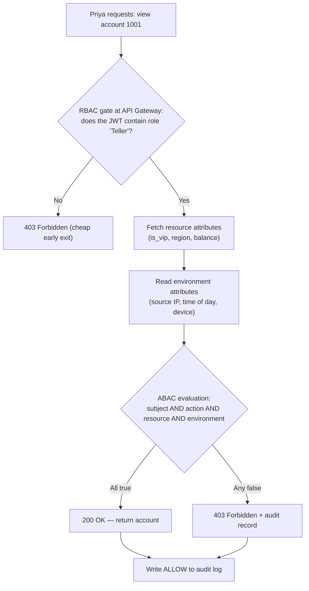
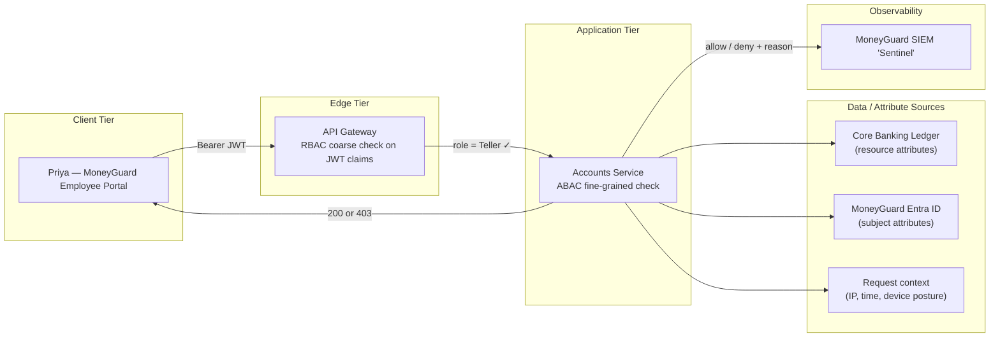

# RBAC and ABAC Deep Dive

## Overview

**Authorization (AuthZ)** answers one question: *"Now that we know who you are, what are you allowed to do?"* This chapter takes the two most common answers — **RBAC (Role-Based Access Control)** and **ABAC (Attribute-Based Access Control)** — and pushes them to their breaking points, so you know exactly when each one stops working and what to reach for next.

🏦 **The MoneyGuard scenario for this chapter:** Raj Patel (IAM Administrator) needs to let Dana Cole approve wire transfers over $50,000 — but only from the corporate network, only during business hours, and only for accounts in her own region. That single sentence is the difference between RBAC and ABAC in one breath: RBAC can say *"Dana is an Approver."* Only ABAC can say *"…under these conditions, on this specific account, right now."*

## Why This Matters

Authentication (AuthN) happens **once per login**. Authorization happens on **every single API request** — thousands of times per second at a bank the size of MoneyGuard. That means:

- A bad authorization model doesn't just create a security hole; it creates a **latency tax** on every click a customer makes.
- Authorization is the layer auditors like Dana actually inspect. "Who could have viewed this account on March 14th?" is an authorization question, not an authentication one.
- Getting the model wrong early is expensive. Migrating 50,000 employees off a broken role structure is a multi-year project. Choosing correctly at design time is nearly free.

## Key Concepts

| Term | Expansion | One-line meaning |
|---|---|---|
| **AuthN** | Authentication | Proving *who* you are (covered in Module 02) |
| **AuthZ** | Authorization | Deciding *what* you may do |
| **ACL** | Access Control List | A raw list mapping one user directly to one resource |
| **RBAC** | Role-Based Access Control | Permissions attached to a job title, users attached to the title |
| **ABAC** | Attribute-Based Access Control | Permissions computed at runtime from facts about the user, the thing, and the situation |
| **PBAC** | Policy-Based Access Control | The *architecture* of moving those rules out of app code into a central engine (Chapter 3) |
| **ReBAC** | Relationship-Based Access Control | Permissions derived from how objects are connected (Chapter 2) |
| **Role explosion** | — | The failure mode where you invent hyper-specific roles until nobody can audit them |
| **Coarse-grained** | — | Big, cheap checks: "can this person open the app at all?" |
| **Fine-grained** | — | Small, expensive checks: "can this person see *this row* of *this table*?" |

## Detailed Notes

### Concept 1 — Where authorization starts: the ACL

The very first authorization system anyone builds is an **ACL (Access Control List)**: a database table mapping a user ID straight to a resource ID.

```
priya.sharma  →  account:1001  →  READ
priya.sharma  →  account:1002  →  READ
dana.cole     →  audit_log:*   →  READ
```

This works beautifully for a five-person startup. It collapses at MoneyGuard scale:

- MoneyGuard has ~50,000 employees and millions of accounts. Hiring one loan officer would mean inserting **hundreds of thousands** of rows.
- When Priya moves from the New York branch to Chicago, Raj has to find and delete every one of those rows by hand.
- ⚠️ Dana cannot audit it. There is no single record that answers "what *should* a teller have?" — only a giant pile of "what does this one person happen to have?"

### Concept 2 — RBAC: the ID badge model

**RBAC** fixes the ACL nightmare by inserting a reusable middle layer: **the role**.

```
Permissions  →  Role  →  Users
```

Raj defines the role `Teller` once and attaches the ~40 permissions a teller needs. When Priya is hired, he assigns her one thing — `Teller` — and she inherits all 40. Onboarding drops from days to seconds.

Roles are also **stable**, which is why they belong in a token claim:

```json
{
  "sub": "priya.sharma@moneyguard.com",
  "roles": ["Teller"],
  "groups": ["Branch-NY-014"]
}
```

In application code this becomes a one-line, near-free check:

```csharp
[Authorize(Roles = "Teller")]
public IActionResult ViewAccount(Guid accountId) { ... }
```

**The breaking point: role explosion.** RBAC only knows job titles. It has no idea *where* you are, *when* it is, or *what* you are touching. So the moment MoneyGuard's compliance team says:

- "New York tellers may not view VIP accounts."
- "Tellers working from home may not approve loans."
- "Contractors like Sam get read-only access after 6 PM."

…the only RBAC-shaped answer is to invent new roles: `NY_Teller`, `WFH_Teller`, `NY_Teller_NonVIP`, `Contractor_ReadOnly_AfterHours`. Multiply that across departments and you land at thousands of overlapping roles. ⚠️ Two real consequences:

1. **Unauditable.** Dana can no longer state with confidence what any given role grants.
2. **Token bloat.** Roles ride in the JWT. Fifty roles will blow past HTTP header size limits, and load balancers will start rejecting the request outright.

### Concept 3 — ABAC: the security guard with a checklist

**ABAC** stops asking only *who you are* and starts asking *under what conditions*. Every decision is computed at request time from four pillars of context.

#### 🧑‍💼 Pillar 1 — Subject attributes (the "who")
Facts about the person or workload making the request.
- Role and department: `Teller`, `Approver`, `Retail`, `IT`
- Clearance level, employment type (full-time vs. contractor — this is how Sam Torres gets treated differently from Priya)
- Whether MFA was actually used during login (the `acr` / `amr` claims)

#### 🎬 Pillar 2 — Action attributes (the "verb")
What is being attempted: `view_account`, `approve_wire`, `export_ledger`. Checking the action explicitly is a real security control — a policy that forgets to pin the action can be reused to escalate privilege.

#### 📁 Pillar 3 — Resource attributes (the "what")
Facts about the specific object being touched.
- Classification: public, internal, VIP customer, highly confidential
- Value: a $50 transfer versus a $5,000,000 transfer
- Data residency: EU-resident customer data (GDPR) versus US data

#### 🌍 Pillar 4 — Environment attributes (the "context")
Facts about the moment. This is what static roles can never capture.
- **Where:** corporate Wi-Fi versus an unknown foreign IP
- **When:** 2:30 PM Tuesday versus 3:00 AM Sunday
- **How:** a managed MoneyGuard laptop versus a personal jailbroken phone
- **Risk:** normal operations versus an active-incident lockdown declared by the SOC

🏦 **Walkthrough:** Priya (a `Teller`) opens a VIP customer's account from her home Wi-Fi. The ABAC rule is: *allow if the subject is a Teller **AND** the resource is not VIP **OR** the request comes from the corporate network.* Priya fails the last clause, so she is denied — and Raj never had to create a `WFH_Teller` role.

### Concept 4 — ABAC's own breaking point: spaghetti controllers

ABAC solves role explosion but creates a software-engineering problem. To evaluate attributes, the API has to *go shopping for data* before it can decide anything:

```csharp
// ⚠️ The ABAC anti-pattern: the spaghetti controller
public async Task<IActionResult> ApproveWire(string wireId)
{
    var user    = await _userRepo.GetUser(User.Id);            // DB call 1
    var wire    = await _wireRepo.GetWire(wireId);             // DB call 2
    var branch  = await _branchClient.GetStatus(user.BranchId);// DB call 3

    if (user.Region != wire.Region || branch.Status == "Frozen")
        return Forbid();

    // Three round trips burned before a single byte of business logic ran.
    return Ok();
}
```

Two things are now broken:

1. **Deployment bottleneck.** If regulators change the threshold from $50,000 to $25,000, Alex Kim has to edit C#, open a pull request, recompile, and redeploy — for a *number*.
2. **The N+1 latency tax.** Three network calls just to answer "may I?" on every single request.

That pain is exactly what **PBAC** and policy engines exist to fix — Chapter 3.

### Concept 5 — Layering them: RBAC as the gate, ABAC as the guard

RBAC and ABAC are not competitors. Mature systems run both, in order of cost:

| Layer | Question | Where it runs | Cost |
|---|---|---|---|
| **RBAC** | "Is this person a Teller at all?" | API Gateway / middleware, straight off the JWT claim | Nearly free |
| **ABAC** | "Is *this* account in her region, on a trusted network, during her shift?" | Inside the service, or in a policy engine | Expensive (needs data) |

💡 Run RBAC first as a cheap filter. If Eve (an external attacker) has forged nothing more than a `Customer` token, RBAC rejects her before MoneyGuard spends three database queries evaluating attributes on her behalf.

### Concept 6 — What belongs in the token, and what does not

A token is a **snapshot of identity**, not a live permission database.

| Put in the token ✅ | Keep out of the token ❌ |
|---|---|
| `sub` (user ID), `tenant_id` | `can_edit_account_12345` (fine-grained permissions) |
| Stable roles / group memberships | Current risk score |
| MFA / authentication context (`acr`, `amr`) | Account balance thresholds |
| Issuer, audience, expiry | Anything that can change in the next 15 minutes |

⚠️ **The single most common IAM design mistake** is stuffing authorization complexity into the JWT. Tokens are immutable once signed. If Raj revokes Sam's approval rights at 10:00, Sam's already-issued token still says he has them until it expires. **Identity goes in the token; authorization happens at runtime.**

## Workflow



## Architecture Diagram



## Step-by-Step Process

1. **Inventory the job functions.** Raj lists the ~30 real job functions at MoneyGuard: Teller, Loan Officer, Branch Manager, Auditor, Contractor, IAM Admin. These become roles.
2. **Attach permissions to roles, never to people.** `Teller` gets `view_account`, `open_account`, `deposit`. Priya gets `Teller`.
3. **Put roles in the token.** MoneyGuard Entra ID stamps `roles` and `groups` into the JWT at login.
4. **Enforce RBAC at the edge.** The API Gateway rejects anyone whose role can't touch the endpoint at all — the cheapest possible denial.
5. **Identify the conditional rules.** Anything a stakeholder phrases with "only if", "only during", "only from", or "only under $X" is an ABAC rule, not a role.
6. **Name the attributes.** For each rule, write down which pillar each fact comes from — subject, action, resource, or environment.
7. **Evaluate ABAC as close to the data as possible**, inside the service that already owns the resource, so you don't add network hops.
8. **Default to deny.** If an attribute is missing or a lookup fails, the answer is *no*. This is **fail-closed**.
9. **Log the decision, not just the outcome.** Record subject, action, resource, decision, and *which rule fired*, so Dana can reconstruct it six months later.
10. **Review roles quarterly.** Count them. If the number is climbing fast, you are drifting into role explosion and the rule that caused it should have been ABAC.

## Commands and Examples

**1. The JWT MoneyGuard Entra ID issues to Priya (payload, decoded):**

```json
{
  "iss": "https://login.moneyguard.com/",
  "sub": "8f2b1c44-priya-sharma",
  "aud": "urn:moneyguard:employee-portal",
  "roles": ["Teller"],
  "groups": ["Branch-NY-014"],
  "department": "Retail",
  "employment_type": "full_time",
  "amr": ["pwd", "otp"],
  "acr": "mfa",
  "exp": 1772539200
}
```

Note what is **not** here: no account IDs, no dollar limits, no risk score.

**2. The same rule expressed three ways.** The rule: *an Approver may approve a wire over $50,000 only from the corporate network, only 08:00–18:00, and only in their own region.*

*As ABAC inside a .NET handler:*

```csharp
public class WireApprovalHandler
    : AuthorizationHandler<HighValueWireRequirement, WireTransfer>
{
    protected override Task HandleRequirementAsync(
        AuthorizationHandlerContext ctx,
        HighValueWireRequirement req,
        WireTransfer wire)
    {
        // 1. SUBJECT
        if (!ctx.User.IsInRole("Approver")) return Task.CompletedTask;
        var userRegion = ctx.User.FindFirst("region")?.Value;

        // 2. RESOURCE
        if (wire.Amount <= 50_000m) { ctx.Succeed(req); return Task.CompletedTask; }
        if (wire.Region != userRegion) return Task.CompletedTask;

        // 3. ENVIRONMENT
        var ip   = _http.HttpContext?.Connection?.RemoteIpAddress?.ToString() ?? "";
        var hour = DateTime.UtcNow.Hour;
        if (ip.StartsWith("10.20.") && hour >= 8 && hour < 18) ctx.Succeed(req);

        return Task.CompletedTask; // default: no Succeed() == deny
    }
}
```

*As an OPA Rego policy (previewing Chapter 3):*

```rego
package moneyguard.wires

default allow = false

allow {
    input.subject.role     == "Approver"
    input.action           == "approve_wire"
    input.resource.amount  <= 50000
}

allow {
    input.subject.role     == "Approver"
    input.action           == "approve_wire"
    input.resource.amount  > 50000
    input.subject.region   == input.resource.region
    startswith(input.environment.ip, "10.20.")
    input.environment.hour >= 8
    input.environment.hour <  18
}
```

*As the JSON payload the service sends to the engine:*

```json
{
  "input": {
    "subject":     { "id": "dana.cole", "role": "Approver", "region": "US-EAST" },
    "action":      "approve_wire",
    "resource":    { "type": "wire", "id": "W-88210", "amount": 75000, "region": "US-EAST" },
    "environment": { "ip": "10.20.44.17", "hour": 14, "device_managed": true }
  }
}
```

**3. What a bad role list looks like (⚠️ role explosion in progress):**

```text
Teller
NY_Teller
NY_Teller_VIP
NY_Teller_NonVIP
WFH_Teller
WFH_Teller_ReadOnly
Contractor_Teller_AfterHours
...  # 1,400 more
```

Every underscore in those names is an attribute that should have been ABAC.

## Best Practices

- **Start with RBAC.** It matches how the business already thinks (teams, titles), every identity provider supports it, and it is trivially auditable.
- **Introduce ABAC the first time a requirement contains the word "only".** That word is the signal.
- **Layer, don't replace.** RBAC at the gateway, ABAC inside the service.
- **Keep roles business-shaped, not app-shaped.** `Loan Officer` is a role; `can_click_the_blue_button` is a permission.
- **Fail closed.** Missing attribute, unreachable attribute source, or unparseable rule all mean deny.
- **Always pin the action.** A policy that checks subject and resource but not action can be reused to do something you never intended.
- **Version your rules.** Log which policy version produced each decision so an old decision can be explained later.
- **Cap token size.** If roles push the JWT past ~4 KB, you are using roles for something ABAC or ReBAC should own.

## Common Mistakes

- ⚠️ **Encoding fine-grained permissions in the JWT** (`"perms": ["edit_account_12345", ...]`). Breaks header limits and makes revocation impossible until expiry.
- ⚠️ **Confusing OAuth scopes with user permissions.** A scope like `read:accounts` says what *the client application* was delegated, not what *the human* is allowed to see. Both checks are required.
- ⚠️ **Treating a long-lived token as current truth.** Priya's risk profile may have changed ten minutes ago. Re-check sensitive actions at runtime.
- ⚠️ **Building ABAC for everything.** Evaluating full attribute sets on every request is slow and hard to reason about. Filter with RBAC first.
- ⚠️ **Forgetting to log denials.** Most systems log successes. The security-interesting record is the *denial* — that's how Dana spots Eve probing the ledger.
- ⚠️ **Using department strings as an access control mechanism.** `department == "Design"` is a label, not a grant; the moment finance wants only 10 of 50 people to have something, it falls apart.
- ⚠️ **Assuming MFA is authorization.** MFA is authentication. Authorization may *require* that MFA happened (`acr == "mfa"`), which is a different statement.

## Pro Tips

- 💡 **The "only if" test.** Read a requirement out loud. If you can say it without a conditional, it's RBAC. If you need "only if", it's ABAC.
- 💡 **Count your roles monthly.** A steadily rising role count is the earliest measurable symptom of role explosion — well before anyone complains.
- 💡 **Name attributes once, bank-wide.** If one service calls it `region` and another calls it `branch_region`, your policies will silently disagree. Publish an attribute dictionary.
- 💡 **Explain it to auditors in three sentences:** RBAC controls *who gets in*, ABAC controls *what data they touch*, PBAC makes both *centrally provable*. Dana will accept that framing.
- 💡 **Time-box contractor attributes.** Give Sam Torres an `access_expires_at` attribute rather than trusting anyone to remember to delete a role.
- 💡 **Cache the RBAC verdict, never the ABAC verdict, for long.** Roles change slowly; environment changes every second.

## Real-World Use Cases

1. **Branch teller access (RBAC).** Priya's `Teller` role opens the MoneyGuard Employee Portal and the account-lookup screen. One assignment, forty permissions, done on day one.
2. **VIP account protection (ABAC).** A VIP customer's account carries `classification: vip`. Policy: tellers may read VIP accounts only from a branch IP on a managed device. No new role required.
3. **Contractor least privilege (ABAC).** Sam Torres has `employment_type: contractor` and a 90-day `access_expires_at`. Policy denies every write action after that timestamp automatically — no offboarding ticket needed.
4. **GDPR data residency (ABAC).** EU customer records carry `residency: EU`. Policy denies access from subjects whose `work_location` is outside the EU, satisfying a regulator without duplicating the app per region.
5. **Incident lockdown (ABAC environment).** When the SOC declares an incident, an environment attribute `threat_level: high` flips bank-wide, and policies tighten automatically — no code deploy, no role edits.
6. **Auditor read-everything (RBAC).** Dana's `Auditor` role grants broad read and zero write. Coarse, stable, and exactly what RBAC is good at.

## Key Takeaways

- ACLs → RBAC → ABAC is an **evolution driven by pain**, not a menu of alternatives.
- **RBAC** = static job title. Fast, auditable, cheap. Fails when context matters (**role explosion**).
- **ABAC** = runtime evaluation of **subject + action + resource + environment**. Flexible and fine-grained. Fails by tangling security logic into application code (**spaghetti controllers**).
- Use RBAC as the **coarse gate** and ABAC as the **fine-grained guard**. Nearly every real system runs both.
- Tokens carry **identity**; authorization happens at **runtime**. Never bake fine-grained permissions into a JWT.
- Default to **deny**, pin the **action**, and log every decision with its rule version.

## Glossary

| Term | Definition |
|---|---|
| **Access Control List (ACL)** | A direct user-to-resource permission record; the primitive that RBAC replaced. |
| **Attribute** | A single fact used in a decision, e.g. `amount = 75000` or `ip = 10.20.44.17`. |
| **Coarse-grained authorization** | A broad allow/deny, typically at the endpoint or application level. |
| **Fail-closed** | When the system cannot decide, it denies. The correct default for banking. |
| **Fine-grained authorization** | A per-record or per-field allow/deny. |
| **JWT (JSON Web Token)** | A signed, self-contained token carrying identity claims. See Module 04. |
| **Least privilege** | Granting only the access needed for the immediate task, for the shortest time. |
| **Permission** | The atomic right to perform one action on one type of resource. |
| **Policy** | A written rule that maps attributes to an allow/deny decision. |
| **Role** | A named, reusable bundle of permissions matching a job function. |
| **Role explosion** | Uncontrolled growth of hyper-specific roles caused by encoding context into role names. |
| **Scope** | An OAuth 2.0 value describing what a *client application* was delegated — not a user permission. |
| **Subject** | The entity making the request: a person, a service account, or a workload. |

## Revision Notes

- Order of evolution: **ACL → RBAC → ABAC → PBAC → ReBAC**. Each solves the previous one's failure.
- RBAC failure mode: **role explosion**. ABAC failure mode: **spaghetti code + N+1 latency**.
- The four pillars of ABAC context: **Subject, Action, Resource, Environment**.
- Token rule: **identity in the token, authorization at runtime**.
- Gateway does RBAC (cheap), service does ABAC (expensive).
- MFA is AuthN; policies may *require evidence* of MFA via the `acr` / `amr` claims.
- Scopes ≠ permissions. Scopes constrain the client; permissions constrain the human.
- Fail-closed is non-negotiable for money movement.

## Interview Questions

**Q1. Can RBAC and ABAC be used together, and should they?**
Yes, and in enterprise systems they almost always are. RBAC handles coarse-grained entry — "is this user a Teller, and may Tellers call this endpoint at all?" — right at the API Gateway using a claim already in the JWT, which costs microseconds. ABAC handles fine-grained, record-level decisions inside the service, where the resource and environment data actually live. The layering matters for performance as much as security: RBAC filters out the obviously unauthorized before you spend three database round trips evaluating attributes.

**Q2. Why not just use ABAC everywhere and drop RBAC entirely?**
Three reasons. Cost: every ABAC decision needs attribute lookups, so ABAC-on-everything means a latency tax on every request. Auditability: an auditor can read a role definition and understand it; reconstructing "who could do X" from a pile of boolean expressions is far harder. Comprehensibility: RBAC maps to how the business already organizes itself, so role reviews can be done by managers rather than engineers.

**Q3. A product manager says "New York tellers shouldn't see VIP accounts." How do you implement that, and why?**
I would *not* create an `NY_Teller_NonVIP` role — that's the first step into role explosion. I'd keep the single `Teller` role and express the constraint as an ABAC policy over three attributes: subject `branch_region`, resource `classification`, and optionally environment `network`. That way the rule is one policy line that Dana can audit, it applies uniformly to every teller in every region, and adding a second constraint next quarter doesn't double the role count.

**Q4. Where should authorization be enforced in a microservices architecture?**
At two points. The API Gateway performs coarse RBAC and token validation so that garbage never enters the mesh. Each service performs fine-grained ABAC on the resources it owns, because only that service has the resource attributes. Critically, the gateway check is a *filter*, not the security boundary — services must never assume "the gateway already checked it," since anything inside the mesh could be compromised. That's defense in depth.

**Q5. Why is putting permissions inside a JWT considered an anti-pattern?**
Because JWTs are immutable snapshots. Once signed, the claims are frozen until expiry, so revoking a permission has no effect on tokens already in the wild — if Sam's approval right is pulled at 10:00 and his token lives until 10:15, he keeps it. It also breaks physically: fine-grained permissions grow linearly with the data, so the token eventually exceeds HTTP header limits and load balancers reject it. Stable identity belongs in the token; changeable authorization is a runtime lookup.

**Q6. Is MFA part of authentication or authorization?**
MFA is authentication — it strengthens the proof of *who* you are. But authorization can and should *consume* it. A policy can require that the access token's `acr` claim equals `mfa` (or that `amr` contains a phishing-resistant method) before allowing a $1,000,000 transfer. That's the mechanism behind step-up authentication: the authorization layer rejects the request and signals the client to re-authenticate more strongly.

**Q7. How would you explain this whole model to a compliance auditor?**
As layered defense. RBAC limits *who enters the system*, which demonstrates least privilege at the job-function level. ABAC limits *what data they touch* using conditions like region, classification, and network, which demonstrates data-level control. And PBAC — the next chapters — ensures every one of those rules is centralized, versioned in Git, and produces an immutable decision log, which is what makes the controls provable rather than merely claimed.

**Q8. What's your migration path from a legacy ACL system to this model?**
Mine the ACL table for clusters — groups of users holding near-identical permission sets are latent roles. Define those roles and dual-run: keep the ACL authoritative while shadow-evaluating the role model and logging disagreements. When the disagreement rate approaches zero, flip enforcement to RBAC and keep the ACL as a read-only fallback for one cycle. Then take the leftover exceptions — the rows that never fit a role — and re-express them as ABAC policies, because exceptions are almost always context, not job function.

## Practice Exercises

1. **Spot the role explosion.** Raj hands you this list: `Teller`, `NY_Teller`, `NY_Teller_VIP`, `WFH_Teller`, `Contractor_Teller_AfterHours`, `EU_Teller_GDPR`. Collapse it back to a single role plus a set of ABAC rules. For each rule, label which of the four pillars every attribute comes from.

2. **Write the policy.** MoneyGuard's compliance team issues this rule: *"A Branch Manager may reverse a transaction under $10,000 from any network, but a reversal of $10,000 or more requires the corporate network, business hours, and an MFA-backed session."* Write it as Rego with a `default allow = false`, then write the matching `input` JSON for a $12,500 reversal attempted by Dana at 09:15 from `10.20.9.4` with `acr: "mfa"`.

3. **Design the token.** Sam Torres is a 90-day contractor who needs read access to the MoneyGuard Employee Portal but must never touch the Core Banking Ledger. Draft the JWT payload MoneyGuard Entra ID should issue him. Then list three facts you deliberately left *out* of the token and say where each one will be evaluated instead.

4. **Break the gateway.** Assume Eve compromises a service *inside* MoneyGuard's network and can call the Accounts Service directly, bypassing the API Gateway. Which of your RBAC checks still protect you, and which don't? Rewrite the enforcement plan so the answer is "all of them."

5. **Audit reconstruction.** Dana asks: *"On 14 March at 03:12, did anyone read VIP account 88401, and under what rule?"* Design the minimum audit record your ABAC layer must emit — list every field — so that this question is answerable from logs alone, with no access to the running system.

---

⬅ Back to [Module 03 README](./README.md) · [Main README](../README.md) · [MoneyGuard Scenario](../SCENARIO.md)
➡ Next: [ReBAC and Google Zanzibar](./02_ReBAC_And_Google_Zanzibar.md)
