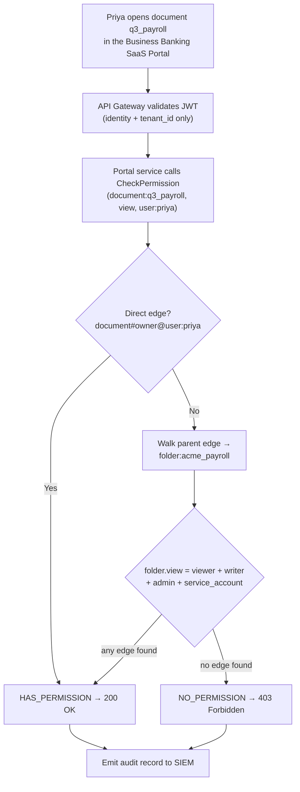
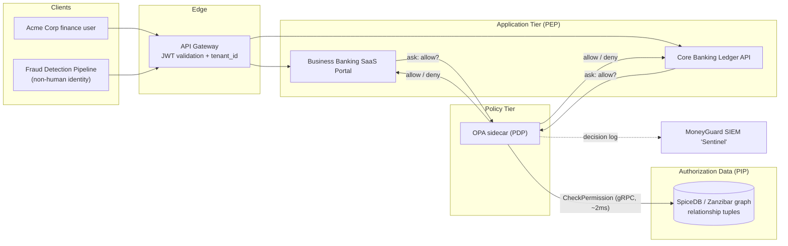

# ReBAC and Google Zanzibar

## Overview

**ReBAC (Relationship-Based Access Control)** answers authorization questions by asking *"how are these two things connected?"* rather than *"what is this person's title?"* or *"what are this person's attributes?"* It is the model Google published in the **Zanzibar** paper (2019) to power Google Drive, and it is the right tool whenever permissions are inherited down a tree of nested objects.

🏦 **The MoneyGuard scenario for this chapter:** Alex Kim is building the **Business Banking SaaS Portal**, where corporate clients like **Acme Corp** and **Globex Inc** manage payroll folders and invoice batches. An Acme finance manager shares a folder; every document inside it must inherit that access instantly. Meanwhile Raj needs to grant Sam Torres four hours of elevated access to one specific ledger folder — and revoke it globally the second the window closes. RBAC would need a role per folder. ABAC would need a recursive database query on every click. ReBAC answers both in about two milliseconds.

## Why This Matters

- **Nested inheritance breaks SQL.** A file five folders deep needs a recursive query to answer "can Priya see this?". At millions of objects, that query is too slow to sit on the hot path.
- **Multi-tenancy breaks RBAC.** In the Business Banking SaaS Portal, an Acme user is an admin *for Acme* and nothing at all *for Globex*. Encoding that in roles gives you `Acme_Admin`, `Globex_Viewer`, and 50,000 more once you have 25,000 clients — plus a JWT too large to send.
- **Sharing is a first-class product feature.** "Share this payroll folder with our accountant" is a relationship, not a job title and not an attribute. Modelling it as anything else fights the product.
- **Revocation must be instant and global.** Deleting one relationship edge makes the next permission check fail everywhere on Earth, with no cache-invalidation dance across a hundred services.

## Key Concepts

| Term | Expansion | Meaning |
|---|---|---|
| **ReBAC** | Relationship-Based Access Control | Access derived from graph edges between objects and subjects |
| **Zanzibar** | — | Google's 2019 paper describing a globally distributed authorization system |
| **SpiceDB** | — | The best-known open-source implementation of Zanzibar (by AuthZed) |
| **Tuple** | Relationship tuple | One edge in the graph: `object#relation@subject` |
| **Definition** | Object definition | The blueprint declaring what relations and permissions an object type has |
| **Relation** | — | A named link a subject can hold on an object, e.g. `viewer`, `admin` |
| **Permission** | Computed permission | Math over relations, e.g. `permission write = writer + admin` |
| **Graph walk** | — | Following edges from a resource to a subject, instead of joining tables |
| **Check** | `CheckPermission` | The API call that asks "does this subject hold this permission on this object?" |
| **Zookie** | Consistency token | An opaque token Zanzibar returns so callers can demand "at least this fresh" reads |
| **New Enemy Problem** | — | The stale-read bug where a just-revoked user still passes a check |

## Detailed Notes

### Concept 1 — Why Google had to invent this

When Google built Drive they hit a wall that is easy to state and hard to solve: **billions of files, arbitrarily deep folders, sub-10 millisecond permission checks, worldwide.**

A relational database cannot do that. To answer "can Priya view `Q3_Payroll.pdf`?" when the file sits inside four nested folders, SQL must climb the tree:

```sql
WITH RECURSIVE AccessPath AS (
    SELECT id, parent_id FROM Resources WHERE name = 'Q3_Payroll.pdf'
    UNION ALL
    SELECT r.id, r.parent_id
      FROM Resources r
      JOIN AccessPath ap ON r.id = ap.parent_id
)
SELECT 1
  FROM Permissions
 WHERE resource_id IN (SELECT id FROM AccessPath)
   AND user_id = 'priya.sharma';
```

⚠️ Twenty folders deep means twenty join iterations, in memory, on every click. It works in a demo and dies in production.

Google's answer was to abandon relational tables for permissions entirely and build a **globally distributed graph database dedicated to authorization**. That is Zanzibar; that model is ReBAC.

### Concept 2 — The tuple: the only data structure

Zanzibar has no `users` table and no `roles` table. It has one thing: **relationship tuples**, each a single directed edge.

**Format:** `object_type:object_id#relation@subject_type:subject_id`

🏦 Mapping MoneyGuard's Business Banking SaaS Portal onto tuples:

| What it means | The tuple |
|---|---|
| Priya can view the Acme payroll folder | `folder:acme_payroll#viewer@user:priya` |
| Raj is an admin of that folder | `folder:acme_payroll#admin@user:raj` |
| The Q3 payroll document lives in that folder | `document:q3_payroll#parent@folder:acme_payroll` |
| The Acme payroll folder belongs to the Acme tenant | `folder:acme_payroll#tenant@tenant:acme_corp` |
| Everyone in the Acme finance group can write | `folder:acme_payroll#writer@group:acme_finance#member` |
| The Fraud Detection Pipeline service can read the ledger export | `folder:ledger_export#service_account@user:svc_fraud_pipeline` |

That last row is worth pausing on. The **Fraud Detection Pipeline** is a non-human identity, and ReBAC treats it exactly like a person — it is just another subject with an edge. (More on machine identity in Module 06.)

### Concept 3 — The definition: the blueprint

Before you write tuples you declare a **schema** of **definitions**. A definition is a container that says: here is an object type, here are the relations subjects may hold on it, and here is the math that turns relations into permissions.

```text
definition user {}

definition group {
    relation member: user
}

definition tenant {
    relation admin: user
}

definition folder {
    # 1. RELATIONS — the links a subject can hold
    relation tenant:  tenant
    relation admin:   user
    relation writer:  user | group#member
    relation viewer:  user | group#member
    relation service_account: user

    # 2. PERMISSIONS — the math ("+" means union / OR)
    permission write = writer + admin
    permission view  = viewer + writer + admin + service_account
    permission share = admin
}

definition document {
    relation parent: folder
    relation owner:  user

    # Inheritance: "->" walks the arrow to the parent folder
    permission view  = owner + parent->view
    permission write = owner + parent->write
}
```

The line `permission view = owner + parent->view` is the whole point of ReBAC. It says: *you can view this document if you own it, **or** if you can view the folder it lives in.* Grant one person access to the folder and every current and future document inside inherits it, with no fan-out writes and no recursive query.

If no edge connects a subject to an object, the subject is **mathematically invisible** to it. That is zero-trust by construction — there is nothing to "forget to deny."

### Concept 4 — SQL versus Zanzibar, side by side

| Concept | SQL (table-centric) | Zanzibar (relationship-centric) |
|---|---|---|
| The container | Table `folder_permissions` | `definition folder { }` |
| The connection | A row with a `role_name` column | `relation admin: user` |
| The rule | Hardcoded `if (role == "admin" \|\| role == "writer")` in app code | `permission write = writer + admin` in the schema |
| Inheritance | Recursive CTE at query time | `parent->view` traversal in the index |
| Revocation | `DELETE FROM permissions WHERE …` plus cache invalidation everywhere | Delete one tuple; the next check is false globally |
| Deep-tree latency | Grows with depth | Roughly flat (sub-10 ms) |

### Concept 5 — How a check actually resolves

When Alex's service asks `CheckPermission(document:q3_payroll, view, user:priya)`, the engine does a parallel graph search rather than a join:

1. `permission view = owner + parent->view`, so try both branches at once.
2. Branch A: does `document:q3_payroll#owner@user:priya` exist? → No.
3. Branch B: find the parent → `folder:acme_payroll`. Now evaluate `folder.view = viewer + writer + admin + service_account`.
4. Does `folder:acme_payroll#viewer@user:priya` exist? → **Yes.** Short-circuit, return `HAS_PERMISSION`.

Total: two index lookups, not a twenty-way join.

For Eve, an attacker with no edges at all, every branch misses and the engine returns `NO_PERMISSION`. She isn't *denied* so much as *absent from the graph*.

### Concept 6 — Temporary elevation and hard revocation

🏦 Raj needs to give Sam Torres four hours of admin on `folder:ledger_export` to finish a migration.

- **RBAC answer:** create a role, assign it, and hope someone remembers to remove it. (Nobody ever does.)
- **ReBAC answer:** write one tuple with a four-hour TTL (time to live) — or write it now and schedule the delete.

```text
WRITE  folder:ledger_export#admin@user:sam     # expires in 4h
```

Revoking it is equally trivial:

```text
DELETE folder:ledger_export#admin@user:sam
```

The instant that edge is gone, the next `CheckPermission` returns false — in every region, for every service, with no cache flush to coordinate. Compare that to revoking a role baked into a JWT, which you cannot do at all until the token expires (see Module 04, Chapter 3).

### Concept 7 — Consistency: zookies and the New Enemy Problem

A globally replicated graph is **eventually consistent**: a write in the US may take a moment to reach the EU replica. That creates the **New Enemy Problem**, which has two nasty shapes:

1. Raj removes Eve from the Acme finance group, then Alex adds a sensitive document to the folder. A stale replica still shows Eve as a member, so she reads the new document.
2. The reverse: an ACL is tightened but a replica serves the old, looser version.

Zanzibar solves this with **zookies** — opaque consistency tokens. When you write a tuple you get a zookie back; when you later run a check you can pass that zookie to demand "evaluate at least as fresh as this point in time." SpiceDB exposes the same idea as *consistency modes*:

| Mode | Behaviour | Use it for |
|---|---|---|
| `minimize_latency` | Serve from any replica, possibly stale | Low-risk reads (rendering a UI list) |
| `at_least_as_fresh` | Must be at least as fresh as the supplied zookie | The normal choice after a known write |
| `full_consistency` | Read from the leader; slowest, always current | Money movement, revocation checks |

💡 Rule of thumb at MoneyGuard: **anything that moves money or reads the Core Banking Ledger uses full consistency; everything else uses `at_least_as_fresh` with the zookie from the user's last write.**

### Concept 8 — Where ReBAC fits with RBAC, ABAC and PBAC

ReBAC does not replace the other models. In a real architecture it becomes the **PIP (Policy Information Point)** — the fast data source the policy engine consults.

| Model | Core question | MoneyGuard example |
|---|---|---|
| **RBAC** | "What is your title?" | Priya is a `Teller`, so the portal opens |
| **ABAC** | "What are the circumstances?" | Only from the corporate network, only 08:00–18:00 |
| **ReBAC** | "How are we connected?" | Priya is a `viewer` of `folder:acme_payroll`, so she sees everything inside |
| **PBAC** | "What does the rulebook say?" | Wires over $50k need two approvals — enforced centrally (Chapter 3) |

## Workflow



## Architecture Diagram



## Step-by-Step Process

1. **Model the object types.** For MoneyGuard's portal: `tenant`, `group`, `folder`, `document`, `wire_batch`, `user`.
2. **Declare relations, not permissions, first.** Ask "what links can exist?" — `admin`, `writer`, `viewer`, `parent`, `member`, `service_account`.
3. **Write the permission math.** `permission write = writer + admin`. Use `+` for union, `&` for intersection, `-` for exclusion.
4. **Add inheritance arrows.** `permission view = owner + parent->view` is what makes nested folders work.
5. **Anchor tenancy in the graph.** Give every object a `tenant` relation so cross-tenant edges are structurally impossible.
6. **Migrate existing grants into tuples.** Every row in the old `permissions` table becomes one edge; run both systems in parallel and diff the answers.
7. **Replace app-side `if` chains with `CheckPermission` calls.** Delete the hand-written `role == "admin" || role == "writer"` logic; the schema owns it now.
8. **Choose a consistency mode per call site.** Full consistency on the ledger, `at_least_as_fresh` elsewhere.
9. **Wire lifecycle events to tuple writes.** When SCIM adds a member to a group (Module 05), write the tuple in the same transaction.
10. **Log every check.** Subject, permission, object, result, and the zookie used — that is Dana's audit trail.

## Commands and Examples

**1. The MoneyGuard schema (SpiceDB syntax):**

```text
definition user {}

definition group {
    relation member: user
}

definition tenant {
    relation admin: user
    permission administer = admin
}

definition folder {
    relation tenant: tenant
    relation admin:  user | group#member
    relation writer: user | group#member
    relation viewer: user | group#member
    relation service_account: user

    permission view   = viewer + writer + admin + service_account
    permission write  = writer + admin
    permission share  = admin
    permission manage = admin + tenant->administer
}

definition document {
    relation parent: folder
    relation owner:  user

    permission view  = owner + parent->view
    permission write = owner + parent->write
}
```

**2. Writing a tuple (temporary elevation for Sam Torres), in C# over gRPC:**

```csharp
using Authzed.Api.V1;
using Grpc.Net.Client;

public class LedgerAccessService
{
    private readonly PermissionsService.PermissionsServiceClient _spiceDb;

    public LedgerAccessService(string spiceDbUrl) =>
        _spiceDb = new PermissionsService.PermissionsServiceClient(
                        GrpcChannel.ForAddress(spiceDbUrl));

    /// Writes: folder:{folderId}#admin@user:{userId}
    public async Task ElevateToFolderAdminAsync(string userId, string folderId)
    {
        var request = new WriteRelationshipsRequest
        {
            Updates =
            {
                new RelationshipUpdate
                {
                    Operation    = RelationshipUpdate.Types.Operation.Create,
                    Relationship = new Relationship
                    {
                        Resource = new ObjectReference
                                   { ObjectType = "folder", ObjectId = folderId },
                        Relation = "admin",
                        Subject  = new SubjectReference
                                   { Object = new ObjectReference
                                     { ObjectType = "user", ObjectId = userId } }
                    }
                }
            }
        };

        await _spiceDb.WriteRelationshipsAsync(request);
        // Schedule the matching DELETE 4 hours from now — elevation must expire.
    }
}
```

**3. Checking a permission:**

```csharp
public async Task<bool> CanWriteFolderAsync(string userId, string folderId)
{
    var response = await _spiceDb.CheckPermissionAsync(new CheckPermissionRequest
    {
        Resource   = new ObjectReference { ObjectType = "folder", ObjectId = folderId },
        Permission = "write",                    // matches `permission write` in the schema
        Subject    = new SubjectReference
                     { Object = new ObjectReference
                       { ObjectType = "user", ObjectId = userId } },
        Consistency = new Consistency { FullyConsistent = true }  // money-adjacent: no stale reads
    });

    return response.Permissionship
        == CheckPermissionResponse.Types.Permissionship.HasPermission;
}
```

**4. Executing the scenario:**

```csharp
var access = new LedgerAccessService("https://spicedb.moneyguard.internal:50051");

await access.ElevateToFolderAdminAsync("sam", "ledger_export");

await access.CanWriteFolderAsync("sam",  "ledger_export"); // true  — the tuple exists
await access.CanWriteFolderAsync("eve",  "ledger_export"); // false — no edge, mathematically invisible
```

Why Eve is denied, mechanically: the schema says `permission write = writer + admin`. The engine searches for `folder:ledger_export#writer@user:eve` → not found; then `folder:ledger_export#admin@user:eve` → not found. Union of two misses is a miss, so it returns `NO_PERMISSION`.

**5. Hard revocation (one line, global effect):**

```csharp
await _spiceDb.DeleteRelationshipsAsync(new DeleteRelationshipsRequest
{
    RelationshipFilter = new RelationshipFilter
    {
        ResourceType       = "folder",
        OptionalResourceId = "ledger_export",
        OptionalRelation   = "admin",
        OptionalSubjectFilter = new SubjectFilter
                               { SubjectType = "user", OptionalSubjectId = "sam" }
    }
});
```

**6. Inheritance walk for a deeply nested document:**

```text
document:q3_payroll#parent@folder:acme_payroll
folder:acme_payroll#parent@folder:acme_2026
folder:acme_2026#parent@folder:acme_root
folder:acme_root#viewer@user:priya
```

One grant at `acme_root` gives Priya view access to every descendant — no fan-out, no recursive query, and it stays true for documents created tomorrow.

## Best Practices

- **Let the schema own the "OR" logic.** If you find yourself writing `role == "admin" || role == "writer"` in C#, that belongs in `permission write = writer + admin`.
- **Model tenancy as a relation, not a string column.** `folder#tenant@tenant:acme_corp` makes cross-tenant access structurally impossible rather than merely checked.
- **Prefer group edges to per-user edges.** `folder:x#viewer@group:acme_finance#member` scales; writing 500 individual tuples does not.
- **Always give elevation an expiry.** Temporary access with no TTL becomes permanent access.
- **Pick consistency per call site, deliberately.** Full consistency everywhere is slow; stale everywhere is a security bug.
- **Keep the graph as the single source of truth for permissions**, and let your SQL tables be a display cache — never the reverse.
- **Write tuples in the same transaction as the business event** that caused them (a SCIM group add, a "Share" button click), so the two can never drift.
- **Test the schema like code.** SpiceDB supports assertion files; assert that Eve is denied, not just that Priya is allowed.

## Common Mistakes

- ⚠️ **Reaching for ReBAC when RBAC would do.** ReBAC needs a specialised database and new operational skills. If MoneyGuard's internal HR app has six roles and no nesting, ReBAC is over-engineering.
- ⚠️ **Ignoring consistency modes.** Defaulting everything to `minimize_latency` is how you get the New Enemy Problem: a revoked contractor still reading the ledger from a stale replica.
- ⚠️ **Duplicating permissions in SQL "for reporting" and letting them diverge.** Derive reports from the graph, don't maintain a parallel truth.
- ⚠️ **Forgetting to delete tuples on offboarding.** ReBAC revokes instantly *if you actually delete the edge*. Wire deletion into the leaver process (Module 05).
- ⚠️ **Putting attributes in the graph.** Amount thresholds, time-of-day and IP ranges are ABAC facts. Don't create `folder:x#under_50k@user:y` — that's a relationship abused as an attribute.
- ⚠️ **Unbounded permission expressions.** Deep chains of `->` arrows across many object types can make checks expensive; keep the traversal shallow and measure it.
- ⚠️ **Assuming the graph is your identity store.** Zanzibar stores *relationships*, not profiles. Names, emails and MFA state live in MoneyGuard Entra ID.

## Pro Tips

- 💡 **Say the tuple out loud.** `folder:acme_payroll#viewer@user:priya` reads as "Acme payroll folder has Priya as a viewer." If a proposed tuple doesn't read as a sentence, the model is wrong.
- 💡 **Draw before you code.** ReBAC modelling errors are cheap on a whiteboard and brutally expensive after ten million tuples exist.
- 💡 **Use the `LookupResources` API for list screens.** Instead of checking 500 documents one at a time to render a folder view, ask the graph "which documents can Priya view?" in one call.
- 💡 **Zookie discipline:** stash the zookie from the last write in the user's session and pass it on subsequent checks. You get correctness without paying for full consistency on every read.
- 💡 **Combine, don't choose.** The strongest MoneyGuard design is OPA (Chapter 3) as the decision point, SpiceDB as the relationship source, and ABAC attributes fetched alongside — one decision, three inputs.
- 💡 **Interview framing:** "SQL asks *who is my parent, and who is theirs?* repeatedly. ReBAC asks *is there a path from this object to this subject?* once." That single sentence usually lands the point.

## Real-World Use Cases

1. **Google Drive / Docs.** The original Zanzibar workload: billions of files, arbitrary nesting, shared links, sub-10 ms checks worldwide.
2. **MoneyGuard Business Banking SaaS Portal.** Acme Corp's finance manager shares `folder:acme_payroll` with an external accountant; every invoice inside inherits it, and unsharing revokes it globally in one tuple delete.
3. **Core Banking Ledger export folders.** Sam Torres gets a four-hour `admin` edge on exactly one export folder — the smallest possible grant, with a built-in expiry.
4. **Group-driven access at scale.** MoneyGuard Entra ID's `Acme-Finance` group syncs into the graph via SCIM; adding one person to the group grants folder access without touching folder tuples (Module 05).
5. **Non-human identity.** The Fraud Detection Pipeline holds a `service_account` edge on the ledger export folder — read-only, revocable, and auditable exactly like a person.
6. **Support delegation.** An Acme admin clicks "Grant support access"; MoneyGuard writes `tenant:acme_corp#support_partner@group:mg_support#member` with a short TTL, replacing a permanent super-admin backdoor.

## Key Takeaways

- ReBAC stores permissions as **graph edges (tuples)**, not table rows: `object#relation@subject`.
- The **definition/schema** declares relations and computes permissions from them (`permission write = writer + admin`), so the "OR" logic lives in one place instead of every controller.
- **Inheritance** (`parent->view`) is the killer feature: one grant on a parent covers every descendant, present and future, with no fan-out.
- Zanzibar is **fast because it walks a purpose-built graph index**, not because the data is small — deep nesting stays roughly flat in latency where recursive SQL degrades.
- **Zero-trust by construction:** no edge means no access; there is nothing to "forget to deny."
- **Revocation is a tuple delete** and takes global effect on the next check.
- **Consistency is a deliberate choice.** Zookies and consistency modes exist to prevent the **New Enemy Problem**; use full consistency for money.
- ReBAC is usually the **PIP** feeding a policy engine, not a replacement for RBAC/ABAC/PBAC.

## Glossary

| Term | Definition |
|---|---|
| **Consistency mode** | A per-request choice of how fresh the graph read must be (`minimize_latency`, `at_least_as_fresh`, `full_consistency`). |
| **Definition** | The schema block declaring an object type's relations and computed permissions. |
| **Graph walk** | Traversing relationship edges from resource to subject to resolve a check. |
| **LookupResources** | The API that returns all objects on which a subject holds a permission — used for list views. |
| **New Enemy Problem** | A stale-replica bug where a revoked subject still passes a check, or new content is exposed under an old ACL. |
| **PIP (Policy Information Point)** | The component that supplies facts to a policy decision point; ReBAC graphs typically play this role. |
| **Permission** | A computed expression over relations, e.g. `viewer + writer + admin`. |
| **ReBAC** | Relationship-Based Access Control. |
| **Relation** | A named edge type a subject may hold on an object. |
| **SpiceDB** | Open-source Zanzibar implementation; exposes `WriteRelationships`, `CheckPermission`, `LookupResources` over gRPC. |
| **Subject** | The entity on the right side of a tuple — a user, a group's members, or a service account. |
| **Tuple** | One relationship record: `object_type:id#relation@subject_type:id`. |
| **Zanzibar** | Google's 2019 paper describing a globally distributed authorization system. |
| **Zookie** | An opaque consistency token returned by writes and passed to reads to bound staleness. |

## Revision Notes

- Tuple format: **`object#relation@subject`**. Say it as a sentence to sanity-check it.
- Permission math: `+` union (OR), `&` intersection (AND), `-` exclusion; `->` walks to another object's permission.
- ReBAC beats SQL specifically on **nested inheritance** and **sharing**, not on simple flat roles.
- **Revoke = delete the tuple.** Instant and global on the next check.
- **New Enemy Problem** ⇒ zookies / consistency modes. Full consistency for anything touching money.
- Zanzibar stores relationships only — profiles stay in the IdP, attributes stay in ABAC.
- Layer it: RBAC gate → OPA decision → SpiceDB relationships → ABAC attributes.
- Give every elevation a **TTL**.

## Interview Questions

**Q1. Explain ReBAC to someone who only knows RBAC, in thirty seconds.**
RBAC says "you can do this because of your job title." ReBAC says "you can do this because of how you're connected to the thing." The unit of data is a relationship tuple — `folder:acme_payroll#viewer@user:priya` — and permissions are computed from those edges, including inherited ones. It's the right model whenever access flows down a hierarchy or comes from sharing, because RBAC would need one role per object and ABAC would need a recursive query per request.

**Q2. Why can't you just implement inheritance with a recursive SQL query?**
You can — until you can't. A recursive CTE climbs the tree one level at a time, so the cost grows with depth and with table size, and it sits on the hot path of every single page view. At Drive scale that's seconds, not milliseconds. Zanzibar precomputes a graph index designed for exactly this traversal, so a check on a document twenty folders deep costs about the same as one two folders deep. It's not that SQL is wrong, it's that the access pattern is graph-shaped and a relational engine is optimised for a different shape.

**Q3. What is the New Enemy Problem and how does Zanzibar solve it?**
It's a consistency bug with two faces. First: I remove Eve from a group, then add a sensitive file to a folder that group could read — a stale replica still lists Eve as a member, so she reads the new file. Second: I tighten an ACL, but a replica serves the old, looser version. Zanzibar solves it with zookies: every write returns an opaque consistency token, and a subsequent check can carry that token to demand a read at least as fresh as that write. Practically, you use `at_least_as_fresh` for normal traffic and full consistency for high-risk operations.

**Q4. How do you handle temporary access elevation in ReBAC versus RBAC?**
In RBAC you create or assign a role and rely on a human or a scheduled job to remove it, which is where standing privilege creeps in. In ReBAC it's a single tuple with a TTL: write `folder:ledger_export#admin@user:sam`, expire it in four hours. Revocation is a tuple delete that takes effect globally on the very next check, with no cache invalidation across services and no waiting for a token to expire. That property — instant, global, single-write revocation — is one of the strongest arguments for the model.

**Q5. Where does ReBAC sit relative to OPA and ABAC in a real architecture?**
They compose. OPA is the Policy Decision Point: it holds the business rules in Rego. SpiceDB is the Policy Information Point: it answers relationship questions fast. ABAC attributes — amount, time, IP, device posture — arrive in the OPA input or are fetched by OPA. So a single decision might be: "allow if the caller has `write` on this folder *per the graph*, **and** the amount is under the limit *per ABAC*, **and** the tenant matches *per the boundary check*." Trying to force any one of those three into the wrong model is where designs go wrong.

**Q6. What are the real costs of adopting Zanzibar?**
Operational and cognitive. You're adding a stateful, globally replicated database to your critical path, which means capacity planning, backups, disaster recovery, and an on-call rotation for a system where an outage means nobody can do anything. The schema language is a new skill, and modelling mistakes are expensive to unwind once you have millions of tuples. You also have to keep the graph in sync with lifecycle events, which is a new class of bug. I'd only take that on when nested inheritance or sharing is genuinely core to the product.

**Q7. How do you prevent cross-tenant leakage in a ReBAC model?**
Two layers. Structurally, give every object a `tenant` relation and make sure no tuple ever links an object in one tenant to a subject rooted in another — then a graph walk physically cannot cross the boundary. Defensively, keep an explicit boundary check in the policy engine comparing the `tenant_id` claim from the JWT against the resource's tenant before any permission math runs, so a bug in tuple-writing code can't become a data breach. And prefix every cache key with the tenant ID so a cached decision can never be served across the wall.

**Q8. How would you render a folder listing of 500 documents efficiently?**
Not with 500 individual checks — that's the N+1 problem in a new costume. Zanzibar implementations expose a reverse-index API (`LookupResources` in SpiceDB) that answers "which documents of this type can this subject view?" in one call, returning a stream of object IDs you intersect with the page you're rendering. For very large sets you page the lookup and filter server-side. The general principle: if you're looping over `CheckPermission`, there's almost certainly a bulk API you should be using instead.

## Practice Exercises

1. **Write the schema.** Model MoneyGuard's Business Banking SaaS Portal so that: a tenant admin can manage every folder in their tenant; folder admins can share; writers can upload invoices; viewers can only read; and documents inherit view and write from their parent folder. Then write the exact tuples that give Acme Corp's finance group write access to `folder:acme_payroll`.

2. **Trace the walk.** Given `document:q3_invoice#parent@folder:acme_payroll`, `folder:acme_payroll#parent@folder:acme_root`, and `folder:acme_root#viewer@group:acme_finance#member`, plus `group:acme_finance#member@user:priya` — write out, step by step, how `CheckPermission(document:q3_invoice, view, user:priya)` resolves. Then state exactly which single tuple you would delete to revoke her, and what side effects that has.

3. **Design the revocation.** Sam Torres's four-hour elevation on `folder:ledger_export` must end automatically. Design the mechanism end to end: who writes the tuple, who deletes it, what happens if the deleting job fails, and how Dana proves after the fact that the access really ended on time.

4. **Find the modelling error.** A junior engineer proposes the tuple `folder:acme_payroll#under_50k_approver@user:dana` to enforce the $50,000 wire limit. Explain why this is wrong, which model the rule actually belongs to, and rewrite the design so the graph and the policy engine each handle the part they're good at.

5. **Pick the consistency mode.** For each of these MoneyGuard operations, choose `minimize_latency`, `at_least_as_fresh`, or `full_consistency`, and justify it in one line: (a) rendering the folder sidebar, (b) approving a $2,000,000 wire, (c) a page load immediately after the user clicked "Share", (d) the Fraud Detection Pipeline batch-reading yesterday's ledger export, (e) checking whether a just-terminated employee still has access.

---

⬅ Back to [Module 03 README](./README.md) · [Main README](../README.md) · [MoneyGuard Scenario](../SCENARIO.md)
⬅ Previous: [RBAC and ABAC Deep Dive](./01_RBAC_And_ABAC_Deep_Dive.md) · ➡ Next: [Policy Engines, OPA and PBAC](./03_Policy_Engines_OPA_And_PBAC.md)
