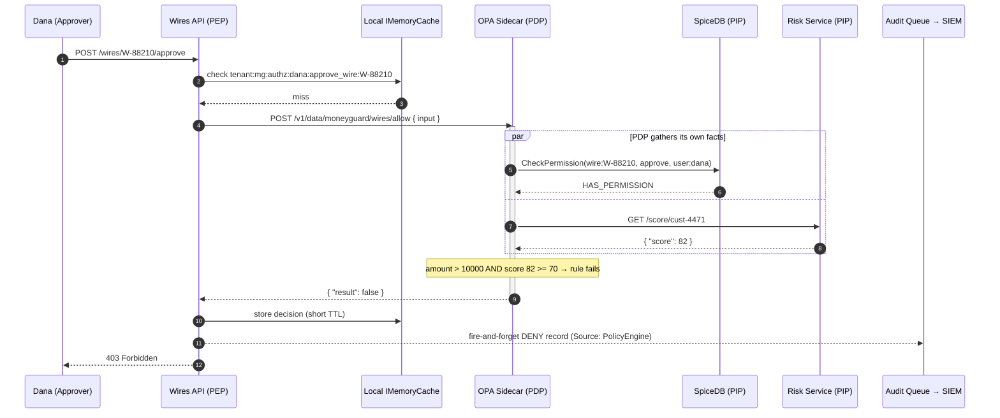
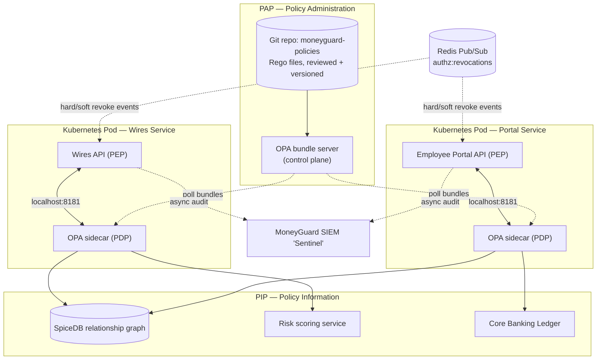

# Policy Engines, OPA and PBAC

## Overview

**PBAC (Policy-Based Access Control)** is not a fourth alternative to RBAC, ABAC and ReBAC — it is an *architectural pattern*. It takes the authorization rules that were scattered across your application code and moves them into a single, versioned, externally managed **policy engine**. The most widely used open-source engine is **OPA (Open Policy Agent)**, which evaluates policies written in a declarative language called **Rego**.

🏦 **The MoneyGuard scenario for this chapter:** Regulators hand Dana Cole a new rule — *"any wire transfer over $10,000 needs two separate manager approvals, an MFA-backed session, and a risk score below 70."* MoneyGuard has 50 microservices. Without PBAC, Alex Kim and 49 other engineers each write that rule in code, get it slightly wrong in slightly different ways, and every future tweak means 50 pull requests. With PBAC, the security team edits one Rego file and the rule takes effect bank-wide in seconds, with no redeploys.

## Why This Matters

- **Authorization runs on every request.** A policy engine that adds 50 ms to every call is a bank-wide outage waiting for peak hour. Architecture — sidecars, caching, prewarming — is as important as the rules themselves.
- **Rules change faster than code ships.** Financial regulation changes quarterly. Deployment cycles are weekly at best. Decoupling the two is the whole point.
- **Auditors need one place to look.** Dana cannot audit 50 codebases. She can audit one Git repository of policy files with a full commit history.
- **A compromised session must die immediately.** Caching authorization decisions is mandatory for speed and dangerous for security. The resolution — a push-based kill switch — is a design pattern you will be asked about in interviews.

## Key Concepts

| Term | Expansion | Meaning |
|---|---|---|
| **PBAC** | Policy-Based Access Control | The architecture of externalising authorization rules into a central engine |
| **OPA** | Open Policy Agent | A general-purpose, CNCF-graduated policy engine |
| **Rego** | — | OPA's declarative policy language |
| **PEP** | Policy Enforcement Point | The component that *asks* and then *obeys* — usually your API |
| **PDP** | Policy Decision Point | The engine that evaluates rules and returns allow/deny |
| **PIP** | Policy Information Point | The data source that supplies facts (SpiceDB, a billing API, a database) |
| **PAP** | Policy Administration Point | Where humans author and version policies — in practice, Git |
| **Sidecar** | — | The engine deployed in the same pod as the app, reachable over `localhost` |
| **Hot path** | — | Code that runs on every request; latency here multiplies across all traffic |
| **Fail-closed** | — | If the engine is unreachable, deny |
| **Hard / soft revocation** | — | Immediate cache purge versus background refresh |

## Detailed Notes

### Concept 1 — The problem PBAC solves

Chapter 1 ended with the ABAC anti-pattern: a controller that fetches three pieces of data just to decide whether to proceed. Here it is again in MoneyGuard terms:

```csharp
// ⚠️ Phase 3: the spaghetti controller
[HttpPost("wires/{wireId}/approve")]
public async Task<IActionResult> ApproveWire(string wireId)
{
    var user    = await _userRepo.GetUser(User.Id);              // DB hit
    var wire    = await _wireRepo.GetWire(wireId);               // DB hit
    var risk    = await _riskClient.GetScore(wire.CustomerId);   // network hit

    if (user.Region != wire.Region
        || risk.Score > 70
        || (wire.Amount > 10_000 && wire.ApprovalCount < 2))
        return Forbid();

    return Ok();
}
```

Three failures, all structural:

1. **Tight coupling.** Security logic and business logic are inseparable.
2. **Deployment bottleneck.** Changing `70` to `60` requires a pull request, a build, and a production deploy — of a bank.
3. **The N+1 latency tax.** Three round trips burned before the real work starts, on every request.

⚠️ And the worst part: the *other 49 services* each have their own slightly different copy of that `if` statement.

### Concept 2 — Separation of concerns: PEP, PDP, PIP, PAP

PBAC splits authorization into four named roles. Learning these acronyms is worth it — they are the vocabulary of every authorization design interview.

| Component | Role | At MoneyGuard |
|---|---|---|
| **PEP** — Policy Enforcement Point | Pauses the request, asks the question, obeys the answer. Knows *nothing* about the rules. | The .NET API / API Gateway |
| **PDP** — Policy Decision Point | Holds the rules as code. Evaluates and returns `allow: true/false`. | OPA sidecar |
| **PIP** — Policy Information Point | Supplies the facts the rules need. | SpiceDB graph, Core Banking Ledger, risk-scoring service |
| **PAP** — Policy Administration Point | Where humans write, review and version policies. | A Git repository owned by the security team |

🏦 **Walkthrough — Dana approves a wire:**

- **PEP (the API):** receives `POST /wires/W-88210/approve`. It does *not* query the database for Dana's role, and does *not* check the risk score. It builds a small JSON question and posts it to `http://localhost:8181`.
- **PDP (OPA):** reads the Rego policy. It calls SpiceDB to confirm Dana has `approve` on this wire, calls the risk service for the score, and computes the boolean.
- **The answer:** `{"allow": false}` — because the risk score came back at 82.
- **Enforcement:** the API returns `403 Forbidden`. It does not know *why*. It doesn't need to.

### Concept 3 — Writing Rego

Rego is declarative. Inside an `allow { ... }` block, **every line must be true** — that is an implicit AND. Multiple `allow` blocks are ORed together. If nothing makes `allow` true, the `default` wins.

```rego
package moneyguard.wires

# 1. Zero trust: deny unless proven otherwise
default allow = false

# 2. Small wires: role + region is enough
allow {
    input.action          == "approve_wire"
    input.subject.role    == "Approver"
    input.subject.region  == input.resource.region
    input.resource.amount <= 10000
}

# 3. Large wires: everything above, plus dual approval, MFA and risk
allow {
    input.action          == "approve_wire"
    input.subject.role    == "Approver"
    input.subject.region  == input.resource.region
    input.resource.amount >  10000

    # Dual control: this approver must not be the one who already signed
    input.resource.approval_count      >= 1
    input.resource.first_approver_id   != input.subject.id

    # Authentication context: the session must have used MFA
    input.subject.acr == "mfa"

    # The PDP fetches its own facts — the API never sees the risk service
    risk := http.send({
        "method": "GET",
        "url": concat("", ["http://risk-service.moneyguard.internal/score/",
                            input.resource.customer_id]),
        "raise_error": false
    })
    risk.status_code == 200
    risk.body.score < 70
}

# 4. A separate, lighter rule for a different action
allow {
    input.action       == "view_wire"
    input.subject.role == "Auditor"       # Dana can read everything, write nothing
}
```

Three things to notice:

- **Always pin the action** (`input.action == "approve_wire"`). A policy that forgets this can be reused to escalate privilege.
- **The PDP fetches its own environment attributes.** The API passed the amount and the subject; OPA fetched the risk score itself. That is what keeps the controller free of data-fetching spaghetti.
- **`default allow = false`** is the fail-closed foundation. Never omit it.

### Concept 4 — The decoupled controller

After PBAC, the C# collapses to three steps: build context, ask, enforce.

```csharp
// Phase 4: the PBAC pattern — decoupled and clean
[HttpPost("wires/{wireId}/approve")]
public async Task<IActionResult> ApproveWire(string wireId)
{
    // 1. Build the context — no database queries here
    var context = new
    {
        subject     = new { id     = User.FindFirst("sub")?.Value,
                            role   = User.FindFirst("role")?.Value,
                            region = User.FindFirst("region")?.Value,
                            acr    = User.FindFirst("acr")?.Value },
        action      = "approve_wire",
        resource    = new { type = "wire", id = wireId },
        environment = new { ip = HttpContext.Connection.RemoteIpAddress?.ToString() }
    };

    // 2. Ask the PDP
    if (!await _pdp.EvaluateAsync("moneyguard/wires/allow", context))
        return Forbid();            // 3. Enforce

    // 4. Business logic
    return Ok(await _wireService.ApproveAsync(wireId));
}
```

And the bridge to OPA is an ordinary HTTP POST to `localhost`:

```csharp
public async Task<bool> EvaluateAsync(string policyPath, object input)
{
    var response = await _httpClient.PostAsJsonAsync(
        $"http://localhost:8181/v1/data/{policyPath}", new { input });

    if (!response.IsSuccessStatusCode) return false;   // ⚠️ fail closed

    var opa = await response.Content.ReadFromJsonAsync<OpaResponse>();
    return opa?.Result ?? false;
}
```

### Concept 5 — Surviving the hot path

Authorization runs on **every** request. Four techniques keep it fast.

**1. Proximity — the sidecar (and WASM).**
Deploy OPA in the same Kubernetes pod as the service. The call goes to `localhost`, never crosses the network, and takes under a millisecond. For extreme scale, compile the Rego to **WebAssembly (WASM)** and load it into the application process — then it is a function call in memory, with no socket at all.

**2. Caching — the N+1 shield.**
If Priya refreshes the portal ten times, don't ask the PDP ten times.

```csharp
string cacheKey = $"tenant:{tenantId}:authz:{userId}:{action}:{resource}";
if (_cache.TryGetValue(cacheKey, out bool cached)) return cached;
```

⚠️ Note the **tenant prefix**. Without it, a cached "allow" for an Acme Corp user can be served to a Globex Inc user — a cross-tenant data leak caused purely by a cache key.

**3. Prewarming.**
MoneyGuard knows the New York branch opens at 09:00. At 08:55 a background job asks the PDP for the top few hundred tellers' common decisions, so the first click of the day is as fast as the hundredth.

**4. Graceful degradation.**
If the sidecar crashes, the PEP must **fail closed** — deny. A sophisticated system may hardcode a tiny emergency allow-list (for example, "employees may still *read* their own profile") but never anything that moves money.

### Concept 6 — Revocation: hard versus soft

Caching creates a race condition. Suppose Eve steals Priya's session and the SOC clicks "Revoke." If Priya's `allow: true` is cached for five more minutes, Eve gets five more minutes.

The fix is **push, not poll**: a Redis Pub/Sub (publish/subscribe) channel every service instance subscribes to.

```csharp
// The broadcaster — used by the SOC console
public async Task RevokeUserAccessAsync(string userId)
{
    var message = JsonSerializer.Serialize(new { action = "hard_revoke", subject = userId });
    await _subscriber.PublishAsync(RedisChannel.Literal("authz:revocations"), message);
}
```

```csharp
// The listener — a BackgroundService inside every API instance
protected override Task ExecuteAsync(CancellationToken ct) =>
    _subscriber.SubscribeAsync(RedisChannel.Literal("authz:revocations"), (channel, message) =>
    {
        var data   = JsonDocument.Parse(message.ToString()).RootElement;
        var userId = data.GetProperty("subject").GetString();
        var action = data.GetProperty("action").GetString();
        var key    = $"authz_cache:{userId}";

        if (action == "hard_revoke")
        {
            _cache.Remove(key);                       // instant eviction
        }
        else if (action == "soft_revoke"
                 && _cache.TryGetValue(key, out AuthzDecision d))
        {
            d.IsStale = true;                         // refresh in background, don't block
            _cache.Set(key, d);
        }
    });
```

| | **Hard revocation (kill switch)** | **Soft revocation (graceful)** |
|---|---|---|
| **Trigger** | Compromised session, termination, fraud alert | Routine role change, department move, billing update |
| **Action** | `_cache.Remove(key)` | `decision.IsStale = true` |
| **User experience** | Immediate `403` | Zero interruption |
| **System impact** | Higher — risks a thundering herd | Low — background refresh spreads the load |
| **Vulnerability window** | Redis latency, typically < 20 ms | Until the next background refresh |

💡 Redis Pub/Sub is required precisely *because* `IMemoryCache` is local to one process. With ten API instances, evicting on one leaves nine still serving the stale "allow."

### Concept 7 — Multi-tenant boundary checks

The number one failure in multi-tenant SaaS is **cross-tenant data leakage** — an API verifies someone is an admin but forgets to verify *which company they administer*. The policy engine is the last wall:

```rego
package moneyguard.portal

default allow = false

allow {
    # 1. THE BOUNDARY CHECK — must come first
    input.subject.tenant_id == input.resource.tenant_id

    # 2. Only then, the permission check
    has_required_role
}

has_required_role { input.action == "view_invoice";   input.subject.role == "viewer" }
has_required_role { input.action == "view_invoice";   input.subject.role == "admin"  }
has_required_role { input.action == "upload_invoice"; input.subject.role == "admin"  }
```

Even if Alex ships a bug in the C# that mixes up tenant IDs, the boundary check denies. Combine that with tenant-prefixed cache keys and the tenant relation in the ReBAC graph (Chapter 2) and you have three independent walls.

### Concept 8 — Auditing the decision, not just the outcome

Ordinary application logs record what *happened* (`200 OK`). Authorization logs must record what *didn't* — every denial, with the reason.

```csharp
public class AuthzAuditRecord
{
    public DateTime Timestamp     { get; set; } = DateTime.UtcNow;
    public string   UserId        { get; set; }
    public string   TenantId      { get; set; }
    public string   Action        { get; set; }
    public string   Resource      { get; set; }
    public string   Decision      { get; set; }  // "Allow" | "Deny"
    public string   Source        { get; set; }  // "PolicyEngine" | "CacheHit" | "SystemError_FailClosed"
    public string   PolicyVersion { get; set; }  // e.g. "v2.1-prod" — which Rego produced this
    public string   RequestId     { get; set; }  // correlates with application logs
}
```

Logging must be **asynchronous** — write to an in-process channel and let a background worker persist it, so the user never waits for a database write.

| Timestamp | User | Action | Resource | Decision | Source |
|---|---|---|---|---|---|
| 08:00:01 | priya | `view_account` | `account:1001` | **ALLOW** | `PolicyEngine` |
| 08:00:05 | priya | `view_account` | `account:1001` | **ALLOW** | `CacheHit` |
| 08:05:00 | eve | `export_ledger` | `folder:ledger_export` | **DENY** | `PolicyEngine` |
| 08:05:02 | sam | `approve_wire` | `wire:W-88210` | **DENY** | `SystemError_FailClosed` |

That last row is why `Source` matters: Dana can prove the denial came from an outage, not from a policy decision.

### Concept 9 — Control plane versus data plane

| | **Control plane (the brain)** | **Data plane (the muscle)** |
|---|---|---|
| **What** | Where Raj authors rules and manages policy bundles | The fleet of OPA sidecars evaluating requests |
| **Throughput** | Low — a few changes an hour | Very high — millions of checks per second |
| **Consistency** | Strong — a half-saved rule is a security hole | Eventual — a change takes seconds to reach every sidecar |
| **Failure impact** | Cannot change rules; existing rules keep working | Requests fail closed in the affected pods |

⚠️ Accept the eventual-consistency window honestly: for a few seconds after Raj publishes a new bundle, some sidecars evaluate the old rule. For urgent revocations, use the Redis kill switch (which is push-based and near-instant), not a policy bundle update.

## Workflow



## Architecture Diagram



## Step-by-Step Process

1. **Inventory the rules.** Grep every service for `if (user.Role ...)`. That list is your first policy bundle.
2. **Create the PAP.** One Git repository, owned by security, with code review and a CI pipeline that runs `opa test`.
3. **Write policies with `default allow = false`.** Start by *shadow-evaluating*: run OPA, log its verdict, but keep enforcing the old C# logic.
4. **Diff the verdicts.** Any disagreement between OPA and the legacy code is a bug in one of them. Drive the disagreement rate to zero.
5. **Flip enforcement.** Delete the C# `if` statements. The controller now only builds context, asks, and obeys.
6. **Deploy OPA as a sidecar.** Same pod, `localhost:8181`. Never a shared central OPA service on the hot path.
7. **Add per-decision caching** with a short TTL (1–5 minutes) and a tenant-prefixed key.
8. **Wire the kill switch.** Redis Pub/Sub channel, a `BackgroundService` listener in every instance, triggered by the SOC console and by SCIM deprovisioning (Module 05).
9. **Make failure closed and observable.** Catch every exception around the PDP call, return deny, and log `Source: SystemError_FailClosed`.
10. **Ship async audit logging** with policy version and request ID, into the SIEM.
11. **Load-test the hot path.** Measure p99 latency of the authorization call specifically, not just the endpoint.
12. **Review policies like code.** Quarterly, with Dana in the room; the Git history is the compliance evidence.

## Commands and Examples

**1. Running OPA locally and testing a policy:**

```bash
# Start OPA as a server with the MoneyGuard bundle
opa run --server --addr localhost:8181 policies/

# Ask it a question directly
curl -s -X POST http://localhost:8181/v1/data/moneyguard/wires/allow \
  -H 'Content-Type: application/json' \
  -d '{
    "input": {
      "action": "approve_wire",
      "subject":  { "id": "dana", "role": "Approver", "region": "US-EAST", "acr": "mfa" },
      "resource": { "id": "W-88210", "amount": 75000, "region": "US-EAST",
                    "customer_id": "cust-4471",
                    "approval_count": 1, "first_approver_id": "raj" }
    }
  }'
# → { "result": false }     (risk score 82 >= 70)
```

**2. A Rego unit test (this belongs in CI):**

```rego
package moneyguard.wires_test

import data.moneyguard.wires

test_small_wire_allowed_for_approver {
    wires.allow with input as {
        "action": "approve_wire",
        "subject":  {"id": "dana", "role": "Approver", "region": "US-EAST"},
        "resource": {"amount": 5000, "region": "US-EAST"}
    }
}

test_self_approval_denied {
    not wires.allow with input as {
        "action": "approve_wire",
        "subject":  {"id": "dana", "role": "Approver", "region": "US-EAST", "acr": "mfa"},
        "resource": {"amount": 50000, "region": "US-EAST",
                     "approval_count": 1, "first_approver_id": "dana"}
    }
}

test_eve_denied_by_default {
    not wires.allow with input as {"action": "approve_wire", "subject": {"id": "eve"}}
}
```

**3. The hot-path enforcement service (cache → sidecar → fail closed → audit):**

```csharp
public class HotPathEnforcementService
{
    private readonly IMemoryCache _cache;
    private readonly IPdpClient   _pdp;
    private readonly Channel<AuthzAuditRecord> _auditQueue;

    public async Task<bool> IsAuthorizedAsync(
        string tenantId, string userId, string action, string resource)
    {
        var key = $"tenant:{tenantId}:authz:{userId}:{action}:{resource}";
        var requestId = Guid.NewGuid().ToString();

        // 1. HOT PATH — local memory (~0.01 ms)
        if (_cache.TryGetValue(key, out bool cached))
        {
            Audit(tenantId, userId, action, resource, cached, "CacheHit", requestId);
            return cached;
        }

        try
        {
            // 2. LOCAL HOP — sidecar on localhost (~1–2 ms)
            bool fresh = await _pdp.CheckAsync(userId, action, resource);
            _cache.Set(key, fresh, TimeSpan.FromMinutes(5));
            Audit(tenantId, userId, action, resource, fresh, "PolicyEngine", requestId);
            return fresh;
        }
        catch (Exception)
        {
            // 3. GRACEFUL DEGRADATION — fail closed
            Audit(tenantId, userId, action, resource, false, "SystemError_FailClosed", requestId);
            return false;
        }
    }

    private void Audit(string tenant, string user, string act, string res,
                       bool decision, string source, string reqId) =>
        _auditQueue.Writer.TryWrite(new AuthzAuditRecord {   // non-blocking
            TenantId = tenant, UserId = user, Action = act, Resource = res,
            Decision = decision ? "Allow" : "Deny",
            Source = source, PolicyVersion = "v2.1-prod", RequestId = reqId });
}
```

**4. Deploying the sidecar (Kubernetes, abbreviated):**

```yaml
spec:
  containers:
    - name: wires-api
      image: moneyguard/wires-api:1.14.0
      env:
        - name: PDP_URL
          value: "http://localhost:8181"
    - name: opa
      image: openpolicyagent/opa:latest-static
      args:
        - "run"
        - "--server"
        - "--addr=localhost:8181"          # localhost only — never exposed
        - "--set=services.mg.url=https://policies.moneyguard.internal"
        - "--set=bundles.authz.service=mg"
        - "--set=bundles.authz.resource=moneyguard/bundle.tar.gz"
        - "--set=bundles.authz.polling.min_delay_seconds=20"
```

## Best Practices

- **Always `default allow = false`.** Every policy file, no exceptions.
- **Always pin `input.action`.** A rule without an action check is a privilege-escalation primitive.
- **Deploy the PDP as a sidecar, not a central service.** A shared network hop on the hot path is a single point of failure *and* a latency tax.
- **Prefix every cache key with the tenant ID.** This one habit prevents an entire class of cross-tenant leaks.
- **Fail closed, and label it.** Log `SystemError_FailClosed` distinctly from a real policy denial.
- **Audit asynchronously.** `TryWrite` to a channel; never make the user wait for a log write.
- **Record the policy version in every decision.** Six months later, "which rule allowed this?" must be answerable.
- **Test policies in CI.** `opa test` on every pull request, including explicit "Eve is denied" cases.
- **Let the PDP fetch its own facts** where sensible — that is what keeps controllers clean.
- **Use the kill switch for urgency, bundles for policy.** Bundle propagation is eventual; Pub/Sub revocation is near-instant.

## Common Mistakes

- ⚠️ **Calling a central, remote OPA on every request.** You've replaced spaghetti code with a network dependency on the hot path.
- ⚠️ **Omitting `default allow = false`.** Rego returns `undefined` when no rule matches; a sloppy client can read that as truthy.
- ⚠️ **Caching without a tenant prefix.** The fastest way to leak Acme Corp's data to Globex Inc.
- ⚠️ **Long cache TTLs with no invalidation.** A ten-minute TTL is a ten-minute window for a compromised session.
- ⚠️ **Failing open "for availability."** For money movement this is indefensible. A frustrated teller is better than an unauthorized transfer.
- ⚠️ **Logging only allows.** The denials are the security signal.
- ⚠️ **Letting the PEP interpret the reason.** If the API starts branching on *why* it was denied, coupling has crept back in.
- ⚠️ **Treating a policy bundle push as instant revocation.** It is eventually consistent across the sidecar fleet.
- ⚠️ **Making Rego fetch slow external data on every check** with no timeout — `http.send` without `timeout` and `raise_error: false` will eventually hang your hot path.

## Pro Tips

- 💡 **Say the four letters in interviews.** "The API is the PEP, OPA is the PDP, SpiceDB is the PIP, Git is the PAP" instantly signals you have done this before.
- 💡 **Shadow mode is the safest migration.** Run OPA in parallel, log disagreements, and only flip enforcement when the diff is zero.
- 💡 **Compile to WASM when a millisecond matters.** Rego → WebAssembly loaded into the process removes even the localhost socket.
- 💡 **Two caches, two TTLs.** Cache coarse RBAC verdicts for minutes; cache context-dependent ABAC verdicts for seconds, or not at all.
- 💡 **Make `Source` a first-class audit field.** Distinguishing `CacheHit` from `PolicyEngine` from `SystemError_FailClosed` turns an incident review from guesswork into reading a table.
- 💡 **Wire SCIM deprovisioning straight into the kill switch.** When Module 05's `PATCH { "active": false }` arrives, publish a `hard_revoke` in the same handler.
- 💡 **Give policies a canary.** Roll a new bundle to 5% of sidecars first; a bad policy that denies everything is an outage.

## Real-World Use Cases

1. **Dual approval for large wires.** The $10,000 two-approver rule lives in one Rego file, enforced identically by the Employee Portal, the mobile app and the batch payments service.
2. **Emergency threshold change.** Fraud spikes on a holiday weekend. Security lowers the risk cutoff from 70 to 40 by editing one file and pushing a bundle — no engineer is paged, no deploy happens.
3. **Compromised session lockout.** The SOC spots Priya's session in two countries at once, clicks Revoke, and Redis Pub/Sub purges her cached decisions from all instances in under 20 ms.
4. **Contractor offboarding.** Sam Torres's last day triggers a SCIM `active: false`, which triggers a `hard_revoke`, which kills his cached authorizations before his laptop is even returned.
5. **Cross-tenant protection in the Business Banking SaaS Portal.** The boundary check in Rego catches an application bug that would otherwise have shown a Globex Inc invoice to an Acme Corp user.
6. **SOX audit.** Dana asks what could have been approved on 14 March. The Git history shows the exact policy version in force, and the decision log shows every allow and deny stamped with that version.
7. **Kubernetes admission control.** The same OPA engine also validates that no MoneyGuard pod deploys without resource limits — PBAC is not only about user access.

## Key Takeaways

- **PBAC is an architecture, not a model.** It externalises whatever rules you have — RBAC, ABAC, ReBAC — into a central, versioned engine.
- Learn the four roles: **PEP** asks and obeys, **PDP** decides, **PIP** supplies facts, **PAP** is where humans author.
- **Rego** uses implicit AND within a rule and OR across rules, and must always start with `default allow = false`.
- The PDP can **fetch its own facts**, which is what keeps application controllers free of security data-fetching.
- **Latency is the design constraint.** Sidecar on localhost, optional WASM, tenant-prefixed caching, prewarming.
- **Cache invalidation is a security control.** Push-based Redis Pub/Sub gives hard revocation in ~20 ms; soft revocation refreshes in the background without interrupting users.
- **Fail closed**, and log the fact that you failed closed as a distinct source.
- **Audit asynchronously**, recording policy version and request ID, so decisions are provable months later.

## Glossary

| Term | Definition |
|---|---|
| **Bundle** | A packaged, versioned set of Rego policies and data that OPA downloads and hot-reloads. |
| **Control plane** | The strongly consistent, low-throughput layer where policies are authored and distributed. |
| **Data plane** | The high-throughput, eventually consistent fleet of PDPs evaluating live requests. |
| **Fail-closed** | Denying when a decision cannot be obtained. The correct default for financial systems. |
| **Hard revocation** | Immediate cache eviction so the very next request re-checks with the PDP. |
| **Hot path** | Code executed on every request, where latency multiplies across all traffic. |
| **OPA (Open Policy Agent)** | A CNCF-graduated general-purpose policy engine. |
| **PAP** | Policy Administration Point — where policies are authored and versioned (Git). |
| **PDP** | Policy Decision Point — evaluates policies and returns allow/deny. |
| **PEP** | Policy Enforcement Point — asks the PDP and enforces the answer. |
| **PIP** | Policy Information Point — supplies the facts a policy needs. |
| **Rego** | OPA's declarative policy language. |
| **Sidecar** | A container running alongside the app in the same pod, reachable on `localhost`. |
| **Soft revocation** | Marking a cached decision stale so it refreshes in the background without blocking. |
| **Thundering herd** | A stampede of simultaneous cache misses overwhelming a backend. |
| **WASM (WebAssembly)** | A portable binary format; Rego compiled to WASM runs in-process with no network hop. |

## Revision Notes

- **PEP / PDP / PIP / PAP** — memorise all four; interviewers use them as shorthand.
- Rego: implicit **AND** inside a rule, **OR** across rules, `default allow = false` always.
- Sidecar on `localhost:8181`; WASM for extreme latency budgets.
- Cache key must include **tenant ID**; TTL 1–5 minutes.
- **Hard revoke** = `_cache.Remove`. **Soft revoke** = mark stale, refresh in background.
- Redis Pub/Sub exists because `IMemoryCache` is per-process; ten instances need a broadcast.
- **Fail closed**, and log `SystemError_FailClosed` as a distinct source.
- Audit is **asynchronous** and carries **policy version** + **request ID**.
- Control plane = consistent + slow; data plane = fast + eventually consistent.

## Interview Questions

**Q1. Is PBAC just ABAC with a nicer name?**
No — they answer different questions. ABAC is a *strategy*: decide using attributes of the subject, action, resource and environment. PBAC is an *architecture*: move that evaluation out of application code into a dedicated Policy Decision Point with its own lifecycle. You can do ABAC badly inside a controller, which is the spaghetti anti-pattern, or you can do RBAC in a policy engine, which is PBAC without any attributes at all. In practice, PBAC is how you make ABAC survivable at 50 services.

**Q2. What happens when the policy engine goes down?**
You choose deliberately, per risk tier. For anything touching money — wire approval, ledger writes — you fail closed and return 403; an annoyed teller is vastly cheaper than an unauthorized transfer. For genuinely low-risk reads you might serve the last known good cached decision, but only within a bounded staleness window, and you log it as a degraded decision so it's visible afterwards. The pattern I'd never accept is a blanket fail-open, because it converts an availability incident into a security incident.

**Q3. Why a sidecar instead of a central authorization service?**
Latency and blast radius. A central service adds a network round trip to every request — call it 20–50 ms — which at a bank's request volume is enormous, and it becomes a single point of failure whose outage takes down every service simultaneously. A sidecar talks over `localhost` in under a millisecond, and if one pod's OPA dies, only that pod is affected. The trade-off is propagation: policy updates reach the fleet eventually rather than instantly, which is why urgent revocation goes over a push channel rather than a policy change.

**Q4. You cache authorization decisions for five minutes. How do you revoke someone in under a second?**
Push-based invalidation. When the SOC or the SCIM deprovisioning handler fires a revocation, it publishes to a Redis Pub/Sub channel that every API instance subscribes to. Each instance's background listener evicts that user's cache entries immediately, so the next request misses the cache, hits the PDP, sees the suspended state, and returns 403. The vulnerability window shrinks from the full TTL to Redis propagation latency, typically under 20 milliseconds. The reason a local `IMemoryCache` alone can't do this is that it's per-process — with ten instances, evicting on one leaves nine serving stale allows.

**Q5. What's the difference between hard and soft revocation, and when do you use each?**
Hard revocation deletes the cache entry outright. It's for emergencies — a stolen session, a termination, a fraud alert — and it accepts the cost of a synchronous re-check and a possible thundering herd. Soft revocation marks the entry stale, returns the cached answer to the current request so the user sees no interruption, and kicks off a background refresh. That's for routine changes like a department move or a billing status update, where correctness within a few seconds is fine and you'd rather not stampede the PDP. Using hard revocation for routine changes is how you accidentally DDoS your own policy engine.

**Q6. How do you prevent one tenant's cached decision from leaking to another?**
Three independent layers. In the policy, a boundary check comparing the JWT's `tenant_id` to the resource's `tenant_id` runs *before* any permission math, so even an application bug can't get past the PDP. In the cache, every key is prefixed with the tenant ID, making cross-contamination structurally impossible. And in the data model, the ReBAC graph anchors each object to a tenant so a traversal can't cross the wall. Any one of these can fail; all three failing at once is unlikely.

**Q7. How do you migrate 50 services off hardcoded authorization without a big-bang cutover?**
Shadow mode. First, extract the rules into Rego and deploy OPA alongside each service, but keep the existing C# checks authoritative. Every request asks both, and any disagreement is logged with full context. You then chase the disagreement rate to zero, which surfaces both the rules you transcribed wrong and the ones the legacy code got wrong. Once a service has been clean for a couple of weeks, you flip that one service to enforce OPA's answer and delete its `if` statements. Service by service, always reversible.

**Q8. Auditors ask "who could have approved this wire on 14 March, and why?" How does your architecture answer that?**
Two artefacts, joined by a version string. The decision log — written asynchronously to the SIEM — has one row per authorization decision with subject, action, resource, allow/deny, source, request ID and policy version. The policy repository has the exact Rego that `v2.1-prod` refers to, immutable in Git history with the review that approved it. So I can show the decision *and* reproduce it by replaying the logged input against that policy version. Critically, because the log is emitted by the enforcement layer rather than by business logic, application developers can't shape it, which is what makes it credible evidence.

## Practice Exercises

1. **Write and test the policy.** Implement MoneyGuard's rule in Rego: *a wire over $10,000 requires the Approver role, matching region, an MFA session, two distinct approvers, and a risk score under 70.* Then write four `opa test` cases: the happy path, self-approval, missing MFA, and Eve with no role at all.

2. **Extract the spaghetti.** Take the `ApproveWire` controller from Concept 1 and rewrite it as a PEP. List every database and network call you removed, say which component now makes each one, and explain what the controller can no longer learn about the decision.

3. **Design the kill switch.** Sam Torres is terminated at 14:02. Trace, step by step and with timings, everything that must happen between Workday recording the termination and Sam's cached `allow` disappearing from all ten API instances. Identify the single longest step and propose how to shorten it.

4. **Break the cache.** An engineer writes the cache key as `$"authz:{userId}:{action}:{resource}"`. Describe a concrete sequence of events in the Business Banking SaaS Portal where this leaks Acme Corp data to Globex Inc, then fix the key and name one other place in the system the same prefix rule must apply.

5. **Choose the failure mode.** For each MoneyGuard operation, decide fail-open, fail-closed, or serve-stale-cache when the PDP is unreachable, and justify each in one sentence: (a) viewing your own payslip, (b) approving a $2,000,000 wire, (c) the Fraud Detection Pipeline reading yesterday's ledger export, (d) Dana exporting an audit report, (e) a customer checking their balance in the MoneyGuard Mobile App.

---

⬅ Back to [Module 03 README](./README.md) · [Main README](../README.md) · [MoneyGuard Scenario](../SCENARIO.md)
⬅ Previous: [ReBAC and Google Zanzibar](./02_ReBAC_And_Google_Zanzibar.md) · ➡ Next module: [Edge Security, Tokens & Sessions](../04_Edge_Security_Tokens_And_Sessions/README.md)
