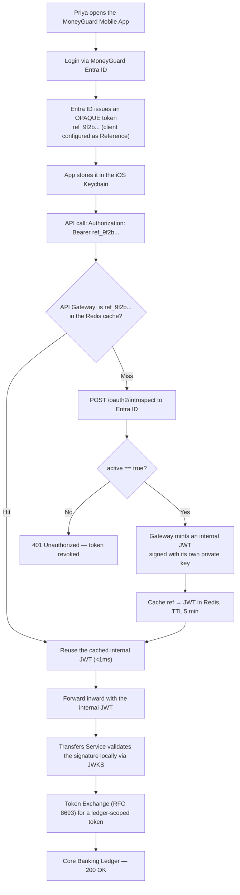
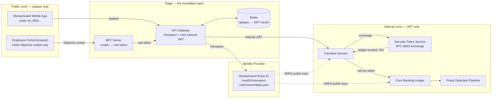

# JWT vs Opaque Tokens

## Overview

Once MoneyGuard has authenticated someone, it has to *carry* that identity across a hostile internet and then across dozens of internal microservices. The container it travels in is a **token**, and there are exactly two shapes of token: one that **contains** the identity (a **JWT**) and one that merely **points at** it (an **opaque token**). Choosing the wrong one for the wrong zone is one of the most common — and most expensive — architectural mistakes in IAM.

🏦 **The MoneyGuard scenario for this chapter:** Alex Kim is building the login flow for the **MoneyGuard Mobile App**. He does the obvious thing: he takes the signed JWT from **MoneyGuard Entra ID** and hands it straight to the phone, which stores it and sends it on every API call. Six weeks later, Eve finds a cross-site scripting flaw in the companion web portal, reads the token out of browser storage, decodes it in a free online viewer, and reads MoneyGuard's internal role names, tenant IDs and employee email addresses — then replays it from her own laptop for the next 55 minutes. Every one of those failures has a name, and this chapter fixes them.

## Why This Matters

- **A token is a bearer instrument.** Like cash, whoever holds it can spend it. There is no "but that's not really you" check unless you add one.
- **JWTs are encoded, not encrypted.** Anyone can Base64-decode one and read every claim. Putting internal structure in a token you hand to a browser is publishing your architecture.
- **Revocation is the whole game.** A stateless JWT is valid until it expires — full stop. If your incident response plan is "wait 55 minutes," you do not have an incident response plan.
- **Performance pulls the other way.** Asking a central identity server to validate every request would melt it. The tension between *instant revocation* and *zero network calls* is what the patterns in this chapter resolve.

## Key Concepts

| Term | Expansion | Meaning |
|---|---|---|
| **JWT** | JSON Web Token | A signed, self-contained token whose claims are readable by anyone holding it |
| **Opaque token** | Reference token | A random meaningless string that points to a record on the server |
| **Claim** | — | One key/value fact inside a JWT, e.g. `"role": "Teller"` |
| **Introspection** | RFC 7662 | The standard endpoint for asking the issuer "what does this opaque token mean?" |
| **Phantom Token Pattern** | — | Opaque outside the perimeter, JWT inside — translated at the edge |
| **BFF** | Backend-for-Frontend | A small backend that holds the real token and gives the browser only a cookie |
| **DPoP** | Demonstrating Proof-of-Possession | Binding a token to a device's private key so a stolen copy is useless |
| **Token Exchange** | RFC 8693 | Swapping a broad token for a narrow, single-audience one at each service hop |
| **XSS** | Cross-Site Scripting | An injection flaw that lets attacker JavaScript run in your page and read storage |
| **Confused deputy** | — | A service tricked into using its (over-broad) authority on an attacker's behalf |
| **Blast radius** | — | How much damage one compromised component can cause |

## Detailed Notes

### Concept 1 — Value tokens versus reference tokens

The distinction is **value versus reference**, exactly as in programming.

A **JWT** is a value. It is three Base64url-encoded segments joined by dots — `header.payload.signature` — and the payload *is* the data:

```
eyJhbGciOiJSUzI1NiIsImtpZCI6ImtleS0yMDI2LTAyLWFscGhhIn0.
eyJzdWIiOiJwcml5YSIsInJvbGVzIjpbIlRlbGxlciJdfQ.
MEUCIQDx...
```

Decoded, the parts are:

```json
// Header — how it was signed and with which key
{ "alg": "RS256", "typ": "JWT", "kid": "key-2026-02-alpha" }

// Payload — the claims
{
  "iss": "https://login.moneyguard.com/",
  "sub": "8f2b1c44-priya-sharma",
  "aud": "urn:moneyguard:core-banking-ledger",
  "roles": ["Teller"],
  "tenant_id": "moneyguard-internal",
  "acr": "mfa",
  "iat": 1772535600,
  "exp": 1772536500,
  "jti": "b7c1f0a2-2f65-4a1e-9c33-2b8ad6f39001"
}

// Signature — RS256 over header+payload using the issuer's private key
```

An **opaque token** is a reference. It is a random string with no structure and no meaning:

```
ref_9f2b7c41d8e04a6b93f0aa15c7e2d380
```

To learn anything about it, a service must call the issuer's **introspection** endpoint (RFC 7662):

```http
POST /oauth2/introspect HTTP/1.1
Host: login.moneyguard.com
Authorization: Basic <gateway client credentials>
Content-Type: application/x-www-form-urlencoded

token=ref_9f2b7c41d8e04a6b93f0aa15c7e2d380
```

```json
{
  "active": true,
  "sub": "8f2b1c44-priya-sharma",
  "scope": "accounts.read transfers.write",
  "client_id": "moneyguard-mobile",
  "exp": 1772536500
}
```

That single field — `"active"` — is the superpower. The server decides it *at read time*, so revocation is instantaneous.

### Concept 2 — The full comparison

| Feature | **Opaque token (reference)** | **JWT (value)** |
|---|---|---|
| **Contents** | Random string; no data inside | Base64url JSON; data inside, readable by anyone |
| **Validation** | Network call to the issuer (introspection) | Local signature check, offline |
| **Revocation** | **Instant** — flip `active` to false | **Hard** — valid until `exp` unless you add a blocklist |
| **Size** | Tiny and constant (~32–64 chars) | Grows with every claim; can exceed header limits |
| **Privacy** | Leaks nothing — claims never leave the server | Leaks internal roles, tenant IDs, emails to anyone who decodes it |
| **Performance** | Slower — a network hop per validation (unless cached) | Faster — CPU-only, no network |
| **If stolen** | Lower risk — useless once revoked | Higher risk — carries its own authority until expiry |
| **Best for** | **Public clients**: browsers, mobile apps | **Internal microservices**: service-to-service calls |

⚠️ Read the last row twice. The correct answer is almost never "pick one." It is **"opaque outside, JWT inside."**

### Concept 3 — Why you must not hand a JWT to a browser or phone

Alex's original design fails in three distinct ways:

1. **Information disclosure.** JWTs are *encoded*, not *encrypted*. Eve pastes it into any online decoder and reads MoneyGuard's internal role taxonomy, tenant identifiers and employee email format — a free reconnaissance report for her next attack.
2. **XSS theft.** If the token sits in `localStorage`, one cross-site scripting flaw anywhere on the domain lets attacker JavaScript read it and post it to her server. The browser's same-origin policy does not help; the script *is* same-origin.
3. **Replay with no revocation.** Because internal services validate a JWT purely by mathematics, they cannot know Priya was suspended thirty seconds ago. Eve replays the token from her own laptop and gets the full remaining lifetime.

### Concept 4 — The Phantom Token Pattern

The **Phantom Token Pattern** gives you both properties at once: the public client only ever handles a meaningless opaque string, while internal services get the rich, fast JWT they need.

- **Outside the perimeter:** opaque. Maximum privacy, instant revocability.
- **At the edge (API Gateway):** translate once, cache briefly.
- **Inside the perimeter:** JWT. Maximum speed, zero network calls.

There are two implementations, and which one you use depends entirely on the client type.

#### Variant A — The browser: BFF + `HttpOnly` cookie

For the **MoneyGuard Employee Portal** running in a browser, the safest answer is that JavaScript never touches a token at all.

- A small **Backend-for-Frontend (BFF)** performs the OAuth/OIDC exchange with MoneyGuard Entra ID and receives the real tokens.
- The BFF stores those tokens server-side (Redis) and issues the browser only a session cookie marked **`HttpOnly`, `Secure`, `SameSite=Strict`**.
- `HttpOnly` means JavaScript *mathematically cannot read it* — `document.cookie` simply does not return it. An XSS flaw can still make requests as the user, but it cannot exfiltrate a credential to use later from elsewhere.
- On each API call the browser sends the cookie automatically; the BFF looks up the real token and forwards it inward.

```http
Set-Cookie: mg_session=s%3AeyJ1c2Vy...; HttpOnly; Secure; SameSite=Strict; Path=/; Max-Age=1800
```

#### Variant B — The mobile app: opaque access token + gateway introspection

The **MoneyGuard Mobile App** cannot rely on cookies; it stores credentials in the iOS Keychain or Android Keystore and sends them as an `Authorization` header. So the identity provider itself issues an **opaque** access token to that client, and the **API Gateway** does the translation.

💡 In most identity providers this is a configuration switch. In Auth0-style providers, requesting a custom API `audience` yields a JWT while omitting it yields an opaque token; in Okta, Duende IdentityServer and Entra ID there is an explicit *Access Token Type: JWT / Reference* setting per client.

**The mechanics at the gateway:**

1. **First request (cache miss).** The gateway sees `Bearer ref_9f2b...`, finds nothing in Redis.
2. **Introspection.** It calls `POST /oauth2/introspect` and gets back `{"active": true, "sub": "priya", ...}`.
3. **Mint an internal JWT.** The gateway signs a *new*, short-lived JWT with its own private key, audience-scoped to the internal service.
4. **Cache the mapping** `ref_9f2b... → internal JWT` in Redis with a short TTL (about 5 minutes).
5. **Forward** the request inward with the internal JWT attached.
6. **Subsequent requests (cache hit)** skip the identity provider entirely — sub-millisecond, no load on Entra ID.

The result: ~99% of mobile API calls never touch the identity provider, yet a revoked token stops working within one cache TTL at the absolute worst — and immediately if you also run the blocklist from Chapter 3 of this module.

### Concept 5 — Even opaque tokens are bearer tokens: DPoP

An opaque token stolen from a phone is still usable by whoever holds it. **DPoP (Demonstrating Proof-of-Possession)** removes that property.

1. At login, the device generates a public/private key pair, keeping the private key in the hardware secure enclave.
2. It sends the **public** key to the identity provider, which **binds** the issued token to that key.
3. On every request, the device signs a small proof (a `DPoP` header covering the HTTP method, URL and a timestamp) with its private key.
4. The API Gateway verifies the proof against the bound public key.

If Eve steals the token but not the hardware-held private key, she cannot produce a valid proof, and the request fails instantly. The token becomes a **sender-constrained** credential rather than a bearer one.

```http
POST /api/transfers HTTP/1.1
Host: api.moneyguard.com
Authorization: DPoP ref_9f2b7c41d8e04a6b93f0aa15c7e2d380
DPoP: eyJ0eXAiOiJkcG9wK2p3dCIsImFsZyI6IkVTMjU2Iiwiandr...
```

### Concept 6 — Inside the perimeter: don't forward the same JWT

The gateway has minted an internal JWT and handed it to the Transfers Service. Should that service forward the identical token to the Core Banking Ledger?

**No.** That is the **confused deputy** problem. If the internal JWT carries broad scopes — `accounts.read`, `transfers.write`, `ledger.write` — and the Transfers Service is compromised, Eve now holds a token she can point at *any* internal service.

The fix is **OAuth 2.0 Token Exchange (RFC 8693)**. Before calling the ledger, the Transfers Service asks the internal Security Token Service (STS): *"I am the Transfers Service, here is Priya's token, mint me one that only works on the Core Banking Ledger."* The STS returns a token with:

- a narrow `aud` (audience) claim — valid only for that one service, and
- a tiny lifetime, typically 60 seconds.

```http
POST /connect/token HTTP/1.1
Host: sts.moneyguard.internal
Content-Type: application/x-www-form-urlencoded

grant_type=urn:ietf:params:oauth:grant-type:token-exchange
&subject_token=<Priya's internal JWT>
&subject_token_type=urn:ietf:params:oauth:token-type:access_token
&audience=urn:moneyguard:core-banking-ledger
&scope=ledger.write
```

That is **blast radius control**: a breach in one service cannot spread to the next, because the credential it holds is physically unusable elsewhere. In practice this is often handled by a **service mesh sidecar** (Envoy/Istio/Dapr) so application developers write no security code at all — they call `localhost` and the sidecar performs the exchange.

### Concept 7 — RS256 versus HS256, and why it matters

Internal services validate a JWT locally using the issuer's **public** key. That only works because MoneyGuard signs with an **asymmetric** algorithm.

| | **RS256 (asymmetric)** | **HS256 (symmetric)** |
|---|---|---|
| **Keys** | Private key signs, public key verifies | One shared secret does both |
| **Distribution** | Public key can be published freely (JWKS) | Every verifier needs the signing secret |
| **If a verifier is compromised** | Attacker gets a public key — useless for forging | Attacker gets the secret — **can mint admin tokens** |
| **Use for** | Any multi-service architecture | Only a single app that signs and verifies its own tokens |

⚠️ HS256 in a microservices estate means fifty copies of the key that can forge tokens for the entire bank. Use RS256 (or ES256) and distribute public keys via **JWKS** — the subject of the next chapter.

## Workflow



## Architecture Diagram



## Step-by-Step Process

1. **Draw the trust zones.** Public internet, edge, internal mesh. Write on each boundary which token format crosses it.
2. **Configure public clients for opaque tokens.** In MoneyGuard Entra ID, set the mobile client's access token type to *Reference*.
3. **Put a BFF in front of every browser app.** The browser gets an `HttpOnly; Secure; SameSite=Strict` cookie and nothing else.
4. **Implement introspection at the gateway**, using RFC 7662 with the gateway's own client credentials.
5. **Mint short-lived internal JWTs** at the gateway, signed with RS256, with an explicit `aud` for the target service.
6. **Cache the opaque→JWT mapping** in Redis with a short TTL — 5 minutes is a common starting point.
7. **Never cache longer than your revocation tolerance**, and pair the cache with a blocklist check (next chapters).
8. **Validate `iss`, `aud`, `exp`, `nbf` and the signature** in every internal service. Rejecting on audience mismatch is what makes token exchange meaningful.
9. **Add token exchange at each service hop** so no service ever holds authority it doesn't need.
10. **Adopt DPoP for mobile** where the platform supports hardware-backed keys.
11. **Keep tokens small.** If the JWT exceeds a few kilobytes, you are carrying authorization data that belongs in a runtime lookup (Module 03).
12. **Log the `jti`** (JWT ID) so a specific token can be traced through the SIEM and, if needed, individually blocklisted.

## Commands and Examples

**1. Decoding a JWT safely on the command line (never paste a production token into a website):**

```bash
# Split on '.' and Base64url-decode the payload
echo "$MG_TOKEN" | cut -d. -f2 | tr '_-' '/+' | base64 -d 2>/dev/null | jq .
```

**2. Introspecting an opaque token (RFC 7662):**

```bash
curl -s -X POST https://login.moneyguard.com/oauth2/introspect \
  -u "$GATEWAY_CLIENT_ID:$GATEWAY_CLIENT_SECRET" \
  -d "token=ref_9f2b7c41d8e04a6b93f0aa15c7e2d380" | jq .
```

```json
{
  "active": true,
  "sub": "8f2b1c44-priya-sharma",
  "client_id": "moneyguard-mobile",
  "scope": "accounts.read transfers.write",
  "token_type": "Bearer",
  "exp": 1772536500
}
```

A revoked token returns exactly one thing — and nothing else, by design:

```json
{ "active": false }
```

**3. The internal JWT the gateway mints (payload):**

```json
{
  "iss": "https://api.moneyguard.com/gateway",
  "sub": "8f2b1c44-priya-sharma",
  "aud": "urn:moneyguard:transfers-service",
  "client_id": "moneyguard-mobile",
  "scope": "transfers.write",
  "acr": "mfa",
  "iat": 1772535600,
  "exp": 1772535900,
  "jti": "9d4e2c11-8f77-4b0a-a5de-31c9f8a02c44"
}
```

Note the deliberately narrow `aud` and the five-minute lifetime.

**4. A .NET gateway that translates opaque → JWT with caching:**

```csharp
public async Task<string> TranslateAsync(string opaqueToken)
{
    var cacheKey = $"phantom:{Sha256(opaqueToken)}";   // never cache the raw token as a key
    if (_cache.TryGetValue(cacheKey, out string internalJwt)) return internalJwt;

    var introspection = await _idpClient.IntrospectAsync(opaqueToken);
    if (introspection is null || !introspection.Active)
        throw new UnauthorizedAccessException("Token is not active.");

    internalJwt = _internalTokenService.Mint(
        subject:  introspection.Sub,
        audience: "urn:moneyguard:transfers-service",
        scope:    introspection.Scope,
        lifetime: TimeSpan.FromMinutes(5));

    _cache.Set(cacheKey, internalJwt, TimeSpan.FromMinutes(5));
    return internalJwt;
}
```

**5. Validating an internal JWT in a downstream service:**

```csharp
builder.Services.AddAuthentication(JwtBearerDefaults.AuthenticationScheme)
    .AddJwtBearer(options =>
    {
        options.Authority = "https://api.moneyguard.com/gateway";
        options.TokenValidationParameters = new TokenValidationParameters
        {
            ValidateIssuer           = true,
            ValidIssuer              = "https://api.moneyguard.com/gateway",
            ValidateAudience         = true,
            ValidAudience            = "urn:moneyguard:transfers-service", // ⚠️ non-negotiable
            ValidateLifetime         = true,
            ValidateIssuerSigningKey = true,
            ValidAlgorithms          = new[] { "RS256" },   // pin it: reject "alg": "none"
            ClockSkew                = TimeSpan.FromSeconds(30)
        };
    });
```

**6. Token exchange from the Transfers Service to the ledger (.NET, via the token-management library):**

```csharp
builder.Services.AddAccessTokenManagement()
    .AddTokenExchangeToken("ledger-exchange", options =>
    {
        options.Address      = "https://sts.moneyguard.internal/connect/token";
        options.ClientId     = "transfers-service";
        options.ClientSecret = builder.Configuration["Sts:Secret"];   // from Vault, never source
        options.Scope        = "ledger.write";
    });

builder.Services.AddHttpClient<ILedgerClient, LedgerClient>()
    .AddTokenExchangeHandler("ledger-exchange");
```

## Best Practices

- **Opaque outside, JWT inside.** If you remember one rule from this chapter, make it this one.
- **Never store a token in `localStorage` or `sessionStorage`.** Use an `HttpOnly; Secure; SameSite=Strict` cookie fronted by a BFF.
- **Sign with RS256 or ES256**, never HS256, in any multi-service system.
- **Always validate `aud`.** A token minted for the Transfers Service must be rejected by the ledger; that is what makes token exchange a real boundary.
- **Pin the algorithm list** in your validator. Never let the token's own header choose the algorithm.
- **Keep access tokens short** — 5 to 15 minutes — and let refresh tokens carry the long-lived session.
- **Exchange tokens at every hop** so no service holds more authority than it needs.
- **Cache introspection results with a short TTL** and treat that TTL as your worst-case revocation delay.
- **Include a `jti`** on every token so individual tokens can be traced and blocklisted.
- **Use DPoP or mTLS binding** for high-value clients so a stolen token is worthless without the device key.

## Common Mistakes

- ⚠️ **Sending a JWT to a browser or phone.** Leaks your internal architecture and hands an XSS attacker a self-contained credential.
- ⚠️ **Assuming "encoded" means "encrypted."** Base64 is not a security control. Never put anything in a JWT you would not print on a postcard.
- ⚠️ **Skipping audience validation.** Without it, every internal token is a master key and token exchange buys you nothing.
- ⚠️ **Accepting `"alg": "none"` or algorithm confusion.** Attackers submit an unsigned token, or an HS256 token signed with your *public* key. Pin allowed algorithms explicitly.
- ⚠️ **Introspecting on every single request.** You will add tens of milliseconds per call and hit the identity provider's rate limits. Cache at the edge.
- ⚠️ **Forwarding the original broad token downstream.** Classic confused deputy: one compromised service becomes a breach of all of them.
- ⚠️ **Long-lived access tokens "for convenience."** A 24-hour access token is a 24-hour breach window.
- ⚠️ **Stuffing permissions into the token.** Header size limits and stale authorization — see Module 03, Chapter 1.
- ⚠️ **Caching by the raw opaque token string.** Hash it before using it as a cache key so the credential itself isn't sitting in your cache keyspace or logs.

## Pro Tips

- 💡 **The postcard test.** Before adding a claim, ask: would I be comfortable printing this on a postcard? If not, it does not belong in a JWT.
- 💡 **Name your zones out loud in interviews.** "Public zone gets references, edge translates, internal zone gets values" is a complete answer in one sentence.
- 💡 **The gateway's cache TTL *is* your revocation SLA.** Write it down as a number and defend it; five minutes is a decision, not an accident.
- 💡 **`HttpOnly` stops exfiltration, not abuse.** XSS can still make requests as the user. Pair it with `SameSite=Strict`, CSRF tokens on the BFF, and short sessions.
- 💡 **Log the `jti`, not the token.** You get traceability without writing credentials into the SIEM.
- 💡 **Let a service mesh do the exchange.** Envoy or Dapr as a sidecar means the token-exchange logic is configuration, patched centrally, and identical for .NET, Go and Python services.
- 💡 **Measure token size in CI.** A test that fails when the JWT exceeds 4 KB catches claim bloat before a load balancer does.

## Real-World Use Cases

1. **MoneyGuard Mobile App.** Entra ID issues an opaque token; the API Gateway introspects once, caches for five minutes, and mints internal JWTs. The phone never holds anything decodable.
2. **MoneyGuard Employee Portal.** A BFF holds the real tokens in Redis and gives the browser an `HttpOnly` cookie, so the XSS flaw Eve found in the marketing widget yields nothing usable.
3. **Wire transfer chain.** The Transfers Service exchanges Priya's token for a 60-second, ledger-only token before touching the Core Banking Ledger. A compromise of Transfers cannot reach the Fraud Detection Pipeline.
4. **PartnerBank federation.** An external partner's users arrive with tokens from a foreign issuer; the edge normalises them into MoneyGuard-internal JWTs so no downstream service ever trusts an external signature directly.
5. **High-value customer sessions.** Private-banking clients get DPoP-bound tokens, so a token lifted from a compromised device is unusable from Eve's laptop.
6. **Auditability.** Every internal JWT carries a `jti`; Dana can follow one transaction from the mobile tap through the gateway, the transfers service and the ledger using a single identifier.

## Key Takeaways

- Two shapes of token: **JWT = value** (self-contained, fast, hard to revoke) and **opaque = reference** (meaningless, revocable instantly, needs a network lookup).
- **JWTs are encoded, not encrypted.** Never hand one to a public client.
- The **Phantom Token Pattern** resolves the trade-off: opaque outside the perimeter, JWT inside, translated and cached at the edge.
- **Browsers get a BFF and an `HttpOnly` cookie; mobile apps get an opaque token and gateway introspection.**
- **DPoP** converts a bearer token into a sender-constrained one, so theft alone is not enough.
- **Token Exchange (RFC 8693)** at each hop keeps the blast radius of any single compromised service to that service alone.
- **RS256, not HS256**, in any multi-service estate — a compromised verifier must not be able to forge tokens.
- Always validate **issuer, audience, expiry, signature**, and pin the allowed algorithms.

## Glossary

| Term | Definition |
|---|---|
| **Access token** | The credential presented to an API to authorize a request. |
| **`aud` (audience)** | The claim naming which service a token is valid for. |
| **Bearer token** | A credential usable by anyone who holds it, with no proof of possession. |
| **BFF (Backend-for-Frontend)** | A per-frontend backend that holds tokens server-side and gives the browser only a cookie. |
| **Claim** | A single key/value fact inside a JWT. |
| **Confused deputy** | A service tricked into exercising authority it holds on an attacker's behalf. |
| **DPoP** | Demonstrating Proof-of-Possession — binds a token to a client-held private key. |
| **`HttpOnly`** | A cookie flag that makes the cookie unreadable by JavaScript. |
| **Introspection (RFC 7662)** | The standard endpoint for resolving an opaque token to its metadata. |
| **`jti`** | JWT ID — a unique identifier for one token, used for tracing and blocklisting. |
| **JWT** | JSON Web Token — a signed, self-contained token of `header.payload.signature`. |
| **Opaque / reference token** | A random string that points to server-side state. |
| **Phantom Token Pattern** | Opaque externally, JWT internally, translated at the edge. |
| **RS256** | RSA signature with SHA-256 — asymmetric: private key signs, public key verifies. |
| **`SameSite`** | A cookie attribute controlling whether the cookie is sent on cross-site requests. |
| **Token Exchange (RFC 8693)** | Swapping one token for another with a narrower audience and scope. |
| **XSS** | Cross-Site Scripting — injected JavaScript running in your page's origin. |

## Revision Notes

- **Value vs reference** is the entire distinction. JWT = value. Opaque = reference.
- Opaque wins on **revocation and privacy**; JWT wins on **speed and scalability**.
- **Phantom Token Pattern**: opaque outside → introspect + mint at edge → JWT inside.
- Browser ⇒ **BFF + `HttpOnly; Secure; SameSite=Strict` cookie**. Mobile ⇒ **opaque + gateway introspection cache**.
- **RFC 7662** = introspection. **RFC 8693** = token exchange. Know both numbers.
- **RS256** (asymmetric) for multi-service; **HS256** only for a single self-contained app.
- Validate `iss`, `aud`, `exp`, signature; **pin the algorithm**; reject `alg: none`.
- **DPoP** = sender-constrained token via a hardware-held private key.
- Gateway introspection **cache TTL = worst-case revocation delay**.

## Interview Questions

**Q1. What's the fundamental difference between a JWT and an opaque token?**
Value versus reference. A JWT *contains* the identity — Base64url-encoded JSON claims plus a signature — so any service holding the issuer's public key can validate it offline with no network call. An opaque token contains nothing; it's a random string that acts as a database key, so the only way to learn what it means is to call the issuer's introspection endpoint. That one difference drives everything else: JWTs are fast but effectively unrevocable until expiry, opaque tokens are revocable instantly but cost a network hop.

**Q2. Why shouldn't we send a JWT to a browser or mobile app?**
Two reasons. Information disclosure: JWTs are encoded, not encrypted, so anyone who obtains one can decode it and read your internal role names, tenant identifiers and user attributes — free reconnaissance. And theft impact: a JWT is a self-contained bearer credential, so an XSS flaw that reads it from `localStorage` gives the attacker full access for the remaining token lifetime, with no way for you to cut it off. An opaque token leaks nothing and can be killed server-side the moment you notice.

**Q3. Explain the Phantom Token Pattern and why it's worth the complexity.**
It puts a different token type on each side of the trust boundary. The public client — browser or phone — only ever holds an opaque reference, so nothing leaks and revocation is immediate. At the edge, the API Gateway introspects that reference once, mints a signed internal JWT, and caches the mapping for a few minutes. Internal microservices then validate JWTs locally with zero network calls. You get the revocability and privacy of reference tokens externally and the performance and statelessness of JWTs internally. The complexity is one translation step at one place, which is a good trade for a property you cannot otherwise have.

**Q4. Doesn't introspecting on every request create a bottleneck?**
It would, which is why you never do it per request. The gateway caches the introspection result — or the minted internal JWT — in Redis keyed by a hash of the opaque token, with a short TTL. In steady state roughly 99% of requests are cache hits served in under a millisecond, and the identity provider sees traffic proportional to distinct sessions per TTL rather than to request volume. The important design decision is that the TTL you choose *is* your worst-case revocation delay, so you pick it consciously and, for high-risk systems, back it up with a real-time blocklist at the gateway.

**Q5. Why RS256 rather than HS256?**
HS256 is symmetric: the same secret both signs and verifies. In a microservices estate that means every service that validates tokens holds the key that can *mint* them, so compromising the least important service lets an attacker forge an admin token for the most important one. RS256 is asymmetric: the identity provider holds the private signing key, and services get only the public key, which can verify but never create. That's why public keys can be published openly through a JWKS endpoint. HS256 is only defensible when a single application signs and verifies its own tokens and shares them with nobody.

**Q6. Service A has a token and needs to call Service B. Should it forward it?**
No — that's the confused deputy problem. If the token carries broad scopes, then any compromise of Service A yields a credential the attacker can point at every other service. Instead, Service A performs an OAuth 2.0 Token Exchange (RFC 8693) with the internal STS: it presents the user's token and asks for one whose `aud` is Service B and whose scope is the minimum needed, with a lifetime measured in seconds. If Service B is later breached, the token it holds is physically unusable anywhere else. In production I'd push this into a service mesh sidecar so application code stays free of security plumbing.

**Q7. How does DPoP change the threat model?**
It converts a bearer token into a sender-constrained one. The client generates a key pair at login, keeps the private key in the device's secure enclave, and the issuer binds the token to the corresponding public key. Every request then carries a short signed proof over the method, URI and a timestamp. The API verifies that proof against the bound key. So stealing the token is no longer sufficient — the attacker also needs a private key that never leaves the hardware. It's especially valuable for mobile and for anything where cookies aren't available, and it's the natural complement to the phantom token pattern.

**Q8. Where would you put the trust boundary in MoneyGuard's architecture, and what crosses it?**
At the API Gateway and the BFF — those are the only two components that talk to both the public internet and the internal mesh. Crossing inward from the public side: opaque references only, plus a DPoP proof for high-value clients. Crossing inward from the edge: short-lived, audience-scoped internal JWTs signed with RS256, keys distributed by JWKS. Between internal services: exchanged tokens with a single audience and 60-second lifetimes. And critically, no internal service ever trusts an external issuer's signature directly — the edge normalises every external identity into a MoneyGuard-issued token first, so there is exactly one trust root inside the perimeter.

## Practice Exercises

1. **Fix Alex's design.** Alex currently sends the Entra ID JWT straight to the MoneyGuard Mobile App. Redraw the flow using the Phantom Token Pattern. For each arrow in your diagram, state the token format, where it is stored, and what an attacker gains by stealing it at that point.

2. **Choose the format.** For each MoneyGuard component, choose JWT or opaque and justify it in one sentence: (a) the browser session for the Employee Portal, (b) the mobile app's access token, (c) the token the API Gateway forwards to the Transfers Service, (d) the token the Transfers Service presents to the Core Banking Ledger, (e) the credential the Fraud Detection Pipeline uses to read ledger exports.

3. **Write the token.** Draft the exact JWT payload the API Gateway should mint for Priya calling `POST /transfers`. Include every claim you would validate downstream, then write the matching `TokenValidationParameters` for the Transfers Service. Name one claim you deliberately left out and say where that data lives instead.

4. **Trace the theft.** Eve steals a token from a compromised MoneyGuard laptop at 14:00. Work out her maximum window of access under each design: (a) a 60-minute JWT handed to the browser, (b) an opaque token with a 5-minute gateway cache, (c) the same plus a Redis blocklist, (d) the same plus DPoP. Give a number for each and explain what bounds it.

5. **Design the exchange chain.** A wire transfer touches the Transfers Service, the Core Banking Ledger, and the Fraud Detection Pipeline. Write out the token exchange calls needed so that no service ever holds authority for another, specifying the `audience`, `scope` and lifetime of each token. Then describe exactly what Eve gets if she fully compromises the middle service.

---

⬅ Back to [Module 04 README](./README.md) · [Main README](../README.md) · [MoneyGuard Scenario](../SCENARIO.md)
➡ Next: [JWKS and Key Rotation](./02_JWKS_And_Key_Rotation.md)
