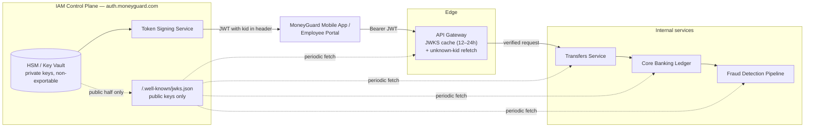

# JWKS and Key Rotation

## Overview

In the previous chapter, MoneyGuard's internal services validated JWTs **offline** — no database, no network call — by checking a signature with the issuer's **public key**. That is only safe if two things are true: the public key must be distributed reliably to every service, and the underlying **private key must be rotated regularly** so a leaked key cannot be used forever.

**JWKS (JSON Web Key Set)** is the standard that makes both possible. It is a plain JSON endpoint that publishes a *set* of currently valid public keys, each labelled with a **`kid` (Key ID)**. Combined with a phased rollout, it lets MoneyGuard swap signing keys with **zero dropped requests**.

🏦 **The MoneyGuard scenario for this chapter:** MoneyGuard's security policy — driven by financial regulation — says signing keys must be replaced every 90 days. Raj Patel schedules the rotation for a Tuesday night. If he simply generates a new key and starts signing with it, the API Gateway will still be holding the *old* public key in memory, every signature check across the bank will fail, and at 06:00 on Wednesday all 50,000 employees and every mobile customer will get `401 Unauthorized`. This chapter is how Raj avoids that.

## Why This Matters

- **Keys leak.** Backups, misconfigured vaults, a departing engineer, a compromised build server. Rotation is what limits the **blast radius** of a leak you haven't discovered yet.
- **Regulators require it.** SOX, PCI-DSS and internal banking policy all mandate periodic cryptographic key rotation with evidence.
- **A botched rotation is a total outage.** Signature validation is not degraded by a key mismatch — it fails completely, for every request, everywhere, at once.
- **Emergency rotation must be possible.** If a private key is confirmed compromised at 03:00, MoneyGuard must be able to burn it immediately, and the system has to survive that too.

## Key Concepts

| Term | Expansion | Meaning |
|---|---|---|
| **JWKS** | JSON Web Key Set | A JSON document containing an array of public keys |
| **JWK** | JSON Web Key | One key inside that set, in JSON form |
| **`kid`** | Key ID | A unique label identifying which key signed a token |
| **`kty`** | Key Type | The key family, e.g. `RSA` or `EC` |
| **`use`** | Public Key Use | `sig` for signature verification, `enc` for encryption |
| **`alg`** | Algorithm | The signing algorithm, e.g. `RS256` |
| **`n` / `e`** | Modulus / Exponent | The two numbers that make up an RSA public key |
| **Rotation** | — | Replacing a signing keypair on a schedule |
| **Overlap window** | — | The period during which two keys are both accepted |
| **Key ceremony** | — | The controlled, witnessed process of generating a production key |
| **HSM** | Hardware Security Module | Tamper-resistant hardware that holds a private key and never releases it |

## Detailed Notes

### Concept 1 — The outage scenario (why naive rotation fails)

Assume MoneyGuard's IAM Control Plane (`auth.moneyguard.com`) abruptly discards its old private key and starts signing new JWTs with a brand new one:

1. The API Gateway (`api.moneyguard.com`) has the **old** public key cached in memory.
2. Priya logs in and receives a brand new JWT signed by the **new** private key.
3. The gateway attempts to verify the new signature using the old public key.
4. **The math fails.** The gateway cannot distinguish "signed by a key I don't know" from "forged by Eve" — both look identical. It returns `401 Unauthorized`.
5. Every API call across the entire bank fails, until every cache everywhere happens to refresh.

⚠️ The critical insight: **a signature check has no "maybe."** There is no graceful degradation. That is why rotation must be *coordinated*, not merely *performed*.

### Concept 2 — The solution: `kid` plus a key *set*

Instead of hosting one public key, the IAM Control Plane hosts a **set** at a well-known URL:

```
https://auth.moneyguard.com/.well-known/jwks.json
```

Every key in that set carries a unique **`kid` (Key ID)**. When the control plane mints a token for Priya, it stamps the `kid` of the active private key into the **header** of the JWT — deliberately *not* the payload, because the verifier needs to know which key to use *before* it can trust anything in the payload.

**The decoded JWT header:**

```json
{
  "alg": "RS256",
  "typ": "JWT",
  "kid": "key-2026-02-alpha"
}
```

**The JWKS endpoint response:**

```json
{
  "keys": [
    {
      "kty": "RSA",
      "alg": "RS256",
      "use": "sig",
      "kid": "key-2026-02-alpha",
      "n": "vX1r...[public modulus]...8zQ",
      "e": "AQAB"
    },
    {
      "kty": "RSA",
      "alg": "RS256",
      "use": "sig",
      "kid": "key-2026-03-beta",
      "n": "mB4c...[public modulus]...2xT",
      "e": "AQAB"
    }
  ]
}
```

Note that the JWKS contains **only public material**. `n` (modulus) and `e` (exponent) are safe to publish to the entire internet — that is the point of asymmetric cryptography. There is no private component anywhere in this document.

### Concept 3 — The gateway's matching logic

When the API Gateway receives Priya's request, verification is a three-step lookup:

1. Read the `kid` from the JWT header → `key-2026-02-alpha`.
2. Look in the local in-memory cache for a public key with that exact `kid`.
3. Run the RS256 signature math using **only that one key**.

💡 This is far better than the alternative some naive implementations use — trying every key in the set until one works. That approach is slower and, worse, obscures which key actually validated, making audit and incident response harder.

### Concept 4 — The three-phase zero-downtime rotation

The whole trick is **publish the new public key long before you sign anything with the new private key**. Assume MoneyGuard JWTs have a maximum lifespan of **1 hour**.

#### Phase 1 — Preparation (publish early)

The IAM Control Plane generates a new "Beta" keypair and adds the Beta **public** key to `jwks.json` alongside the existing "Alpha" key. **It does not sign anything with Beta yet.**

*Why?* Every API Gateway and microservice across MoneyGuard's regions needs time to refresh its local cache and download the Beta key. Until you are confident they all have it, switching would strand traffic.

#### Phase 2 — Issuance (switch signing keys)

Once every verifier has had time to cache both keys, the control plane flips the active signing key to Beta. All *new* JWTs carry `"kid": "key-2026-03-beta"`.

*What about old tokens?* Someone who logged in ten minutes ago holds an Alpha-signed token. The gateway accepts it, because it currently holds **both** public keys. No user is interrupted mid-session.

#### Phase 3 — Retirement (cleanup)

The control plane waits for the **maximum JWT lifetime** (1 hour) to elapse. After that, it is mathematically impossible for a valid, unexpired Alpha token to exist anywhere. The control plane then removes the Alpha public key from `jwks.json` and destroys the Alpha private key.

⚠️ **Do not skip the wait.** Retiring the old public key while valid old tokens are still circulating causes exactly the outage Phase 1 was designed to prevent — just at a smaller scale.

### Concept 5 — Caching JWKS without creating a bottleneck

If the API Gateway called `auth.moneyguard.com/.well-known/jwks.json` on every incoming request, it would generate one outbound HTTP call per API call — a self-inflicted denial of service against MoneyGuard's own identity infrastructure.

Instead, verifiers **cache the key set in memory**, typically for hours (12–24 is common). In .NET, `Microsoft.IdentityModel.Tokens` and the `JwtBearer` middleware do this automatically via the OpenID Connect discovery document.

**The safety net: automatic cache invalidation on unknown `kid`.**

What happens during an *emergency* rotation, when the gateway still has 23 hours of cache TTL left? The standard libraries handle it:

- A JWT arrives with `"kid": "key-emergency-01"`, which is not in the local cache.
- Rather than immediately rejecting it, the middleware **pauses, refetches `jwks.json` bypassing the cache**, and retries the lookup once.
- If the key is now present, validation proceeds. If not, the request is rejected.

This gives you long caches in steady state *and* fast propagation for emergencies.

⚠️ **This mechanism is also a denial-of-service vector.** Eve can send a stream of tokens with random `kid` values, each triggering a cache-bypassing refetch that hammers the identity provider. Every serious library rate-limits refreshes (for example, at most one refresh every five minutes per process). Verify that your configuration does this — do not assume.

### Concept 6 — Where the private key actually lives

The public key is published to the world. The private key must be the most protected asset MoneyGuard has.

| Storage | Protection | Suitable for |
|---|---|---|
| **HSM (Hardware Security Module)** | Key generated inside, never leaves; signing happens in hardware | Production banking — the correct answer |
| **Cloud KMS** (AWS KMS, Azure Key Vault Managed HSM) | Managed, FIPS-validated, key material non-exportable | Production cloud workloads |
| **Secrets manager** (Vault, Secrets Manager) | Encrypted at rest, access-controlled, but the key *is* retrievable | Acceptable for lower tiers |
| **Environment variable / config file** | ⚠️ None worth the name | Never |

💡 The strongest property of an HSM is that **the private key is never exportable, even by an administrator**. Rotation still happens — you generate a new key inside the HSM — but nobody, including Raj, can copy the old one out.

### Concept 7 — Emergency rotation

Scheduled rotation is a calm three-phase process. Emergency rotation is not, and the trade-offs invert.

| | **Scheduled rotation** | **Emergency rotation** |
|---|---|---|
| **Trigger** | Calendar — every 90 days | Confirmed or suspected key compromise |
| **Old key** | Kept in JWKS until all tokens expire | **Removed immediately** |
| **User impact** | Zero | Everyone holding an old token is logged out |
| **Sequence** | Publish → switch → wait → retire | Publish new, remove old, force re-auth, invalidate sessions |
| **Cache handling** | Natural TTL expiry | Rely on the unknown-`kid` refetch, and push a manual refresh if you can |

An emergency rotation must be paired with **session invalidation** (next chapter). Removing the old public key stops old *tokens*, but if refresh tokens signed under the compromised key are still honoured, Eve simply gets a new access token. Kill both.

## Workflow

```mermaid
sequenceDiagram
    autonumber
    participant App as Client Apps
    participant IAM as IAM Control Plane<br/>(auth.moneyguard.com)
    participant GW as API Gateway Cache<br/>(api.moneyguard.com)

    Note over IAM,GW: PHASE 1 — PREPARATION (Day 1)
    IAM->>IAM: Generate new keypair (Beta) inside the HSM
    IAM->>IAM: Publish BOTH Alpha and Beta PUBLIC keys to jwks.json
    GW->>IAM: Fetch JWKS (downloads both keys into cache)
    Note right of IAM: IAM still signs new tokens<br/>with the OLD Alpha private key.

    Note over IAM,GW: PHASE 2 — ISSUANCE (Day 2)
    IAM->>IAM: Switch the active signing key to Beta
    App->>IAM: Request token
    IAM-->>App: Returns JWT (kid: key-2026-03-beta)
    App->>GW: API call with JWT (kid: beta)
    GW->>GW: Verifies using the cached Beta public key
    Note over App,GW: Old tokens (kid: alpha) are STILL accepted<br/>because GW holds both public keys.

    Note over IAM,GW: PHASE 3 — RETIREMENT (Day 2 + 1 hour)
    IAM->>IAM: Wait for max JWT lifetime so no Alpha token can be valid
    IAM->>IAM: Remove the Alpha public key from jwks.json; destroy Alpha private key
    GW->>IAM: Fetch JWKS (downloads only Beta)
    Note right of IAM: Rotation complete.<br/>Zero dropped requests.
```

## Architecture Diagram



## Step-by-Step Process

1. **Inventory every verifier.** List every component that validates MoneyGuard JWTs — the gateway, each microservice, the BFF, partner integrations. Each one has a cache you must reason about.
2. **Record the maximum token lifetime.** This single number determines the length of Phase 3. If any token type lives 8 hours, Phase 3 waits 8 hours.
3. **Measure the JWKS cache TTL** of every verifier. Phase 1 must be at least as long as the longest of these.
4. **Generate the new keypair inside the HSM or KMS.** Never on a laptop; never exported.
5. **Assign a meaningful, unique `kid`.** `key-2026-03-beta` beats a random GUID for incident response — you can tell at a glance when it was minted.
6. **Publish the new public key** to `jwks.json` alongside the current one. Do not change the signing key yet.
7. **Verify propagation.** Poll each verifier's health or metrics endpoint to confirm it has the new `kid` cached. Do not proceed on faith.
8. **Flip the active signing key.** New tokens now carry the new `kid`.
9. **Monitor `401` rates closely** for the first hour. A spike means a verifier missed Phase 1 — roll the signing key back immediately.
10. **Wait for the maximum token lifetime** to fully elapse.
11. **Remove the old public key** from `jwks.json` and destroy the old private key inside the HSM.
12. **Record the evidence.** Timestamps, `kid` values, who approved it. This is what Dana needs at audit time.

## Commands and Examples

**1. Fetching and inspecting MoneyGuard's key set:**

```bash
curl -s https://auth.moneyguard.com/.well-known/jwks.json | jq '.keys[] | {kid, kty, alg, use}'
```

```json
{ "kid": "key-2026-02-alpha", "kty": "RSA", "alg": "RS256", "use": "sig" }
{ "kid": "key-2026-03-beta",  "kty": "RSA", "alg": "RS256", "use": "sig" }
```

**2. Finding out which key signed a given token:**

```bash
# Decode only the header — no signature verification, just the kid
echo "$MG_TOKEN" | cut -d. -f1 | tr '_-' '/+' | base64 -d 2>/dev/null | jq .
```

```json
{ "alg": "RS256", "typ": "JWT", "kid": "key-2026-03-beta" }
```

**3. The discovery document that points verifiers at the JWKS:**

```bash
curl -s https://auth.moneyguard.com/.well-known/openid-configuration | jq '{issuer, jwks_uri}'
```

```json
{
  "issuer": "https://auth.moneyguard.com/",
  "jwks_uri": "https://auth.moneyguard.com/.well-known/jwks.json"
}
```

**4. Configuring a .NET verifier (caching and refresh handled for you):**

```csharp
builder.Services.AddAuthentication(JwtBearerDefaults.AuthenticationScheme)
    .AddJwtBearer(options =>
    {
        // Discovery: the middleware finds jwks_uri itself and caches the key set.
        options.Authority = "https://auth.moneyguard.com/";
        options.MetadataAddress =
            "https://auth.moneyguard.com/.well-known/openid-configuration";

        // How long to keep the cached key set before a scheduled refresh.
        options.RefreshInterval        = TimeSpan.FromHours(12);
        // Minimum gap between forced refreshes — the DoS guard for unknown kids.
        options.AutomaticRefreshInterval = TimeSpan.FromHours(24);
        options.RefreshOnIssuerKeyNotFound = true;   // the unknown-kid safety net

        options.TokenValidationParameters = new TokenValidationParameters
        {
            ValidateIssuer           = true,
            ValidIssuer              = "https://auth.moneyguard.com/",
            ValidateAudience         = true,
            ValidAudience            = "urn:moneyguard:core-banking-ledger",
            ValidateLifetime         = true,
            ValidateIssuerSigningKey = true,
            ValidAlgorithms          = new[] { "RS256" },  // ⚠️ pin it; reject alg:none
            ClockSkew                = TimeSpan.FromSeconds(30)
        };
    });
```

**5. Manual `kid` lookup in Node.js (what the library does for you):**

```javascript
const jwksClient = require('jwks-rsa');
const jwt        = require('jsonwebtoken');

const client = jwksClient({
  jwksUri: 'https://auth.moneyguard.com/.well-known/jwks.json',
  cache: true,                 // cache the key set in memory
  cacheMaxAge: 12 * 60 * 60_000,
  rateLimit: true,             // ⚠️ throttle refetches — DoS guard
  jwksRequestsPerMinute: 5
});

function getKey(header, callback) {
  // header.kid tells us exactly which key to fetch — no trial and error
  client.getSigningKey(header.kid, (err, key) => {
    if (err) return callback(err);
    callback(null, key.getPublicKey());
  });
}

jwt.verify(token, getKey,
  { algorithms: ['RS256'], issuer: 'https://auth.moneyguard.com/' },
  (err, decoded) => { /* ... */ });
```

**6. A rotation runbook as executable steps:**

```bash
# PHASE 1 — publish the new public key, keep signing with the old one
mg-iam keys create   --kid key-2026-03-beta --alg RS256 --hsm moneyguard-prod
mg-iam jwks publish  --include key-2026-02-alpha,key-2026-03-beta
mg-iam jwks verify-propagation --targets gateway,transfers,ledger,fraud --timeout 24h

# PHASE 2 — switch the active signing key
mg-iam keys set-active --kid key-2026-03-beta
mg-iam monitor 401-rate --window 60m --alert-threshold 0.5%

# PHASE 3 — after max token lifetime (1h), retire the old key
sleep 3600
mg-iam jwks publish  --include key-2026-03-beta
mg-iam keys destroy  --kid key-2026-02-alpha --confirm
```

## Best Practices

- **Always publish before you sign.** Phase 1 must be longer than the longest JWKS cache TTL across all verifiers.
- **Always wait before you retire.** Phase 3 must be longer than the maximum token lifetime.
- **Use meaningful `kid` values** that encode the date, so an incident responder can date a token at a glance.
- **Never put private key material in a JWKS.** A JWKS contains `n` and `e` for RSA, or `x`/`y`/`crv` for EC — and nothing else.
- **Generate and hold private keys in an HSM or managed KMS** where the key is non-exportable.
- **Enable refresh-on-unknown-`kid`**, and confirm the library rate-limits it.
- **Pin allowed algorithms** in the verifier. Never trust the token's own `alg` header to choose.
- **Rotate on a schedule, not on incident.** A team that has rotated ten times calmly can rotate under pressure.
- **Test the rotation in staging first**, including the rollback.
- **Alert on `401` rate, not just error rate.** A rotation gone wrong shows up there first.
- **Keep an overlap of at least two keys permanently.** Never let the set shrink to exactly one in normal operation.

## Common Mistakes

- ⚠️ **Rotating in one step.** Generating a key and immediately signing with it is the classic bank-wide outage.
- ⚠️ **Omitting `kid` from the JWT header.** Verifiers are then forced to try every key, which is slow and destroys attribution.
- ⚠️ **Retiring the old public key too early**, while unexpired tokens signed with it are still in flight.
- ⚠️ **Caching the JWKS forever** with no refresh, so an emergency rotation cannot propagate.
- ⚠️ **Fetching the JWKS on every request.** A self-inflicted denial of service against your own identity provider.
- ⚠️ **No rate limit on unknown-`kid` refetches**, turning the safety net into an amplification attack vector.
- ⚠️ **Trusting the `kid` blindly as a file path or URL.** Treat it as an opaque lookup key into your cached set; never use it to construct a filesystem path or fetch an arbitrary URL.
- ⚠️ **Accepting `"alg": "none"` or allowing algorithm confusion**, where Eve submits an HS256 token signed with your published RSA public key.
- ⚠️ **Forgetting non-HTTP verifiers.** Batch jobs, the Fraud Detection Pipeline, and partner integrations all cache keys too — and are the ones everyone forgets in Phase 1.
- ⚠️ **Serving JWKS over anything but HTTPS with a valid certificate.** The whole trust chain rests on that fetch being authentic.

## Pro Tips

- 💡 **The two golden inequalities.** `Phase 1 duration > longest JWKS cache TTL` and `Phase 3 wait > longest token lifetime`. Every rotation failure is a violation of one of them.
- 💡 **Date-stamp your `kid`s.** When Dana asks "when was this token issued?", `key-2026-03-beta` answers before you even decode the payload.
- 💡 **Emit a metric per `kid`.** A dashboard showing validation counts by key ID makes Phase 2 and Phase 3 observable rather than hopeful — you retire Alpha when its counter hits zero, not when a timer fires.
- 💡 **Rehearse emergency rotation quarterly.** The first time you do it should not be during a real compromise.
- 💡 **Keep two keys published permanently.** Then an emergency rotation is a *promotion* of an already-distributed standby key rather than a cold start.
- 💡 **Interview framing:** "The `kid` is the join key between the token and the key set — that indirection is what makes zero-downtime rotation possible." That one sentence usually covers the whole topic.
- 💡 **Watch for clock skew.** A verifier whose clock is minutes ahead will reject freshly issued tokens. Allow ~30 seconds of skew and run NTP everywhere.

## Real-World Use Cases

1. **Quarterly scheduled rotation.** Raj runs the three-phase process every 90 days. Employees never notice; Dana gets a timestamped record for the SOX audit.
2. **Emergency rotation after a build-server breach.** A private key may have been exposed in CI logs. Raj promotes the standby key, removes the suspect key from JWKS immediately, and forces global re-authentication.
3. **Adding a new region.** MoneyGuard opens an EU data centre. The new gateways fetch the same JWKS on boot and can verify existing tokens immediately — no key distribution project required.
4. **PartnerBank federation.** PartnerBank publishes its own JWKS; MoneyGuard's edge fetches and caches it, so PartnerBank can rotate its keys independently without a coordination call.
5. **Fraud Detection Pipeline.** Kubernetes pods validating service tokens fetch the JWKS on startup and refresh on a timer, so pods that scale up mid-rotation are never stranded with a stale key set.
6. **Algorithm migration.** Moving from RS256 to ES256 uses the same machinery: publish the EC key alongside the RSA key, switch signing, wait, retire. The `kid` indirection makes an algorithm change no harder than a key change.

## Key Takeaways

- **JWKS** publishes a *set* of public keys as JSON at `/.well-known/jwks.json`. Public material only — safe to serve to the whole internet.
- The **`kid` in the JWT header** is the join key that tells the verifier which public key to use, without trial and error.
- **Zero-downtime rotation is three phases:** publish the new public key early → switch the signing key → wait out the maximum token lifetime → retire the old key.
- **Two inequalities govern safety:** Phase 1 must exceed the longest JWKS cache TTL; Phase 3 must exceed the longest token lifetime.
- **Cache the JWKS for hours**, but enable a rate-limited refetch when an unknown `kid` appears — that is the emergency safety net.
- **Private keys belong in an HSM or managed KMS**, non-exportable, never in config or environment variables.
- **Emergency rotation inverts the trade-off:** remove the old key immediately, accept that everyone is logged out, and pair it with session invalidation.
- **Pin allowed algorithms** and reject `alg: none` — the key set tells you *which* key, not *whether* to trust the token's own claims about itself.

## Glossary

| Term | Definition |
|---|---|
| **`alg`** | The JOSE header/JWK field naming the signing algorithm, e.g. `RS256`. |
| **Discovery document** | `/.well-known/openid-configuration`, the JSON that tells clients where `jwks_uri` is. |
| **`e`** | The RSA public exponent, part of a public key in JWK form. |
| **HSM** | Hardware Security Module — tamper-resistant hardware where a private key is generated and never leaves. |
| **JWK** | JSON Web Key — one cryptographic key represented as JSON. |
| **JWKS** | JSON Web Key Set — a JSON object with a `keys` array of JWKs. |
| **`kid`** | Key ID — the unique label linking a token to the key that signed it. |
| **KMS** | Key Management Service — a managed cloud service for key storage and cryptographic operations. |
| **`kty`** | Key Type — the key family, e.g. `RSA` or `EC`. |
| **`n`** | The RSA modulus, part of a public key in JWK form. |
| **Overlap window** | The period during which both the old and new keys are accepted. |
| **Rotation** | Replacing a signing keypair, on schedule or in emergency. |
| **`use`** | Public Key Use — `sig` for signature verification, `enc` for encryption. |

## Revision Notes

- **JWKS = public keys only**, published at `/.well-known/jwks.json`, discovered via `jwks_uri`.
- **`kid` lives in the JWT *header***, not the payload — the verifier needs it before it trusts anything.
- Three phases: **Publish → Switch → Wait → Retire**.
- Inequality 1: **Phase 1 > longest JWKS cache TTL**. Inequality 2: **Phase 3 wait > longest token lifetime**.
- **Refresh-on-unknown-`kid`** is the emergency propagation mechanism; it **must be rate-limited**.
- **RS256/ES256 only.** Pin `ValidAlgorithms`. Reject `alg: none` and HS256-with-public-key confusion.
- Private keys: **HSM / KMS, non-exportable**. Never in config, environment variables or source control.
- Emergency rotation ⇒ remove the old key **immediately** *and* invalidate sessions (next chapter).
- Watch the **`401` rate** during Phase 2; a spike means a verifier missed Phase 1.

## Interview Questions

**Q1. What is a JWKS and why does it exist?**
It's a JSON document at a well-known URL containing an array of the issuer's currently valid *public* keys, each labelled with a `kid`. It exists because hardcoding a public key into fifty microservices makes rotation impossible — you'd have to redeploy every service in lockstep to change a key. With JWKS, verifiers fetch and cache the key set, so the issuer can add and remove keys independently and rotation becomes a publishing operation rather than a deployment.

**Q2. Walk me through a zero-downtime key rotation.**
Three phases. Phase 1, preparation: generate the new keypair in the HSM and publish its *public* half to the JWKS alongside the current key, but keep signing with the old private key. You wait longer than the longest verifier cache TTL so every gateway and service has both keys. Phase 2, issuance: flip the active signing key so new tokens carry the new `kid`. Old tokens keep working because verifiers hold both public keys. Phase 3, retirement: wait out the maximum token lifetime — after which no valid old token can exist — then remove the old public key from the JWKS and destroy the private key. Two inequalities make it safe: Phase 1 must exceed the longest cache TTL, and the Phase 3 wait must exceed the longest token lifetime.

**Q3. Why does the `kid` go in the header rather than the payload?**
Because the verifier needs it *before* it can trust anything. The payload's integrity is only guaranteed *after* signature verification, and you can't verify the signature without knowing which key to use — that's circular. The header is deliberately the untrusted-but-necessary routing information: it tells you which key to try, and then the signature check over header-plus-payload proves both were authentic. Note that this means you must treat `kid` as an opaque lookup key into a set you already trust, never as a path or URL to fetch, or you've handed the attacker key selection.

**Q4. A key is confirmed compromised at 03:00. What do you do?**
Emergency rotation, which inverts the normal trade-offs. Promote the standby key that's already published in the JWKS — this is why you always keep two — then remove the compromised key from the key set immediately rather than waiting out token lifetimes. That deliberately invalidates every token signed with it, logging everyone out; that's the correct price. Crucially, I'd pair it with session and refresh-token invalidation, because removing the public key stops old access tokens but if refresh tokens issued under that key are still honoured the attacker just mints a fresh one. Then I'd verify propagation via the unknown-`kid` refresh path and watch the `401` metrics.

**Q5. How do verifiers handle a token signed with a key they've never seen?**
Standard libraries implement refresh-on-unknown-`kid`: rather than rejecting immediately, they pause, refetch the JWKS bypassing the cache, and retry the lookup once. That's what lets an emergency rotation propagate faster than the cache TTL. But it's also an amplification vector — an attacker can send tokens with random `kid` values and cause a refetch storm against your identity provider — so every serious implementation rate-limits it, typically to one refresh per few minutes per process. If someone tells me they've enabled the safety net, my follow-up is always "and what's the rate limit?"

**Q6. Why is it safe to publish public keys openly?**
That's the definition of asymmetric cryptography. An RSA public key is just the modulus `n` and exponent `e`; it can verify a signature but cannot produce one, and deriving the private key from it requires factoring a very large number. This is exactly why RS256 is right for microservices and HS256 is wrong: with HS256 the same shared secret both signs and verifies, so every service that validates tokens could also forge them, and compromising the least important service lets an attacker mint an admin token for the most important one.

**Q7. What could go wrong with JWKS caching?**
Both extremes fail. Cache too long with no refresh mechanism and you can't propagate an emergency rotation — the compromised key stays trusted for hours. Cache too short, or fetch per request, and you generate one outbound call per API call, which is a self-inflicted denial of service against your own identity provider and will hit its rate limits at peak. The right shape is a long scheduled refresh — twelve to twenty-four hours — plus a rate-limited refetch triggered by an unknown `kid`. And you have to inventory *every* verifier, including batch jobs and partner integrations, because those are the caches people forget when planning Phase 1.

**Q8. How would you prove to an auditor that key rotation actually happens?**
Three artefacts. First, the key inventory from the HSM or KMS showing creation and destruction timestamps per `kid` — that's tamper-evident and not something engineering can edit. Second, a metric time series of token validations broken down by `kid`, which shows the Alpha counter falling to zero and the Beta counter rising, proving the overlap and retirement really happened rather than just being scheduled. Third, the change record with the approver. Together those show the rotation occurred, that it was clean, and that a human authorised it — which is what SOX actually asks for.

## Practice Exercises

1. **Compute the timeline.** MoneyGuard's access tokens live 15 minutes, its internal service tokens live 60 minutes, the API Gateway caches JWKS for 12 hours, and the Fraud Detection Pipeline caches it for 24 hours. Write out the exact minimum duration of Phase 1 and of the Phase 3 wait, and justify each number. Then say what breaks if you halve either one.

2. **Debug the outage.** At 02:00 Raj rotated the key. At 02:01 every API call started returning `401`. Given only the JWT header of a failing token and the current `jwks.json`, describe the three checks you would run, in order, to identify the root cause — and state which phase was skipped.

3. **Design the emergency runbook.** A private key may have leaked into CI logs. Write the ordered steps MoneyGuard executes, including who is notified, what happens to Priya's active session, what happens to her refresh token, and how you confirm every verifier has stopped accepting the old `kid`. Give an estimated wall-clock time for each step.

4. **Spot the vulnerabilities.** Review this verifier config and list every problem: `Authority = "http://auth.moneyguard.com/"`, `ValidateAudience = false`, no `ValidAlgorithms`, `RefreshOnIssuerKeyNotFound = true` with no rate limit, `ClockSkew = TimeSpan.FromMinutes(30)`. For each, state the concrete attack or failure it enables.

5. **Add a verifier.** MoneyGuard is onboarding PartnerBank, whose systems will validate MoneyGuard-issued tokens. Write the checklist you hand PartnerBank's engineers so that MoneyGuard's next quarterly rotation cannot break them — and separately, list what MoneyGuard must change in its own rotation runbook now that an external party is in the verifier inventory.

---

⬅ Back to [Module 04 README](./README.md) · [Main README](../README.md) · [MoneyGuard Scenario](../SCENARIO.md)
⬅ Previous: [JWT vs Opaque Tokens](./01_JWT_Vs_Opaque_Tokens.md) · ➡ Next: [Token Revocation and Session Management](./03_Token_Revocation_And_Session_Management.md)
