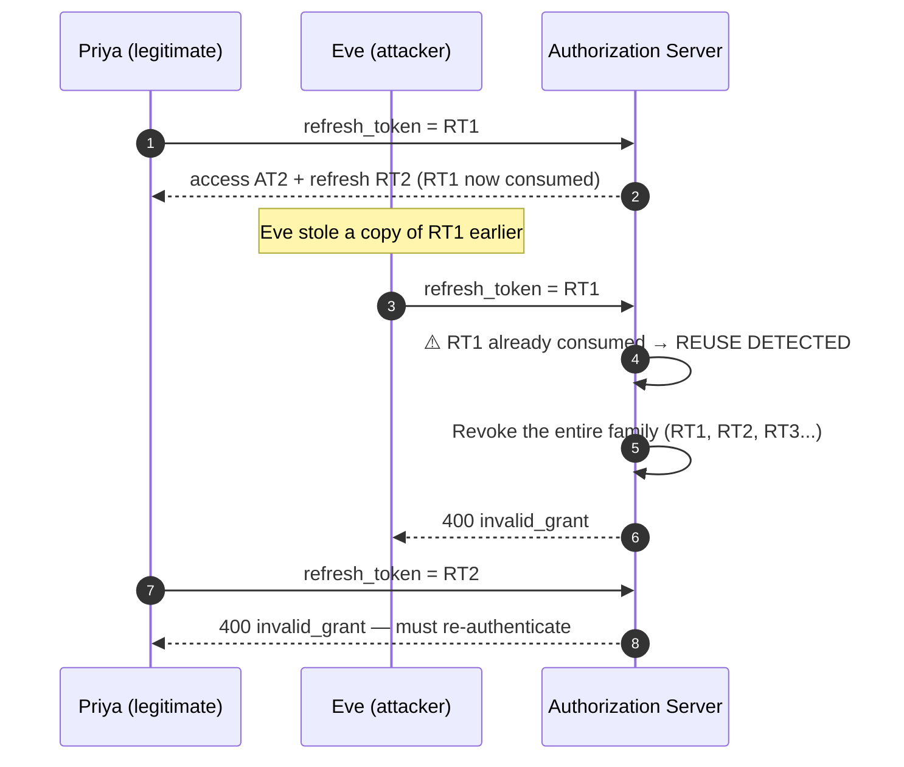
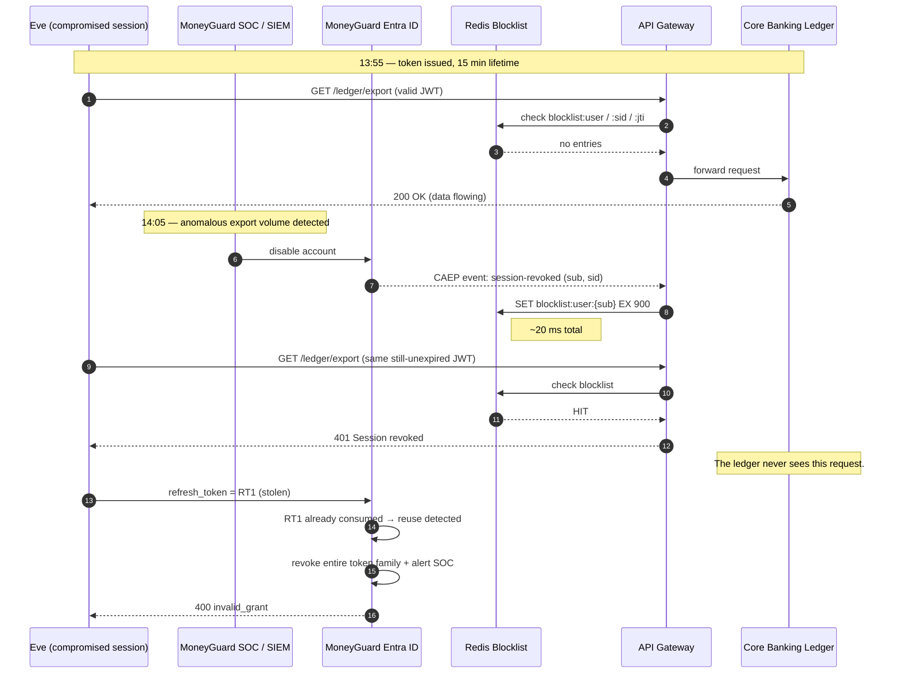
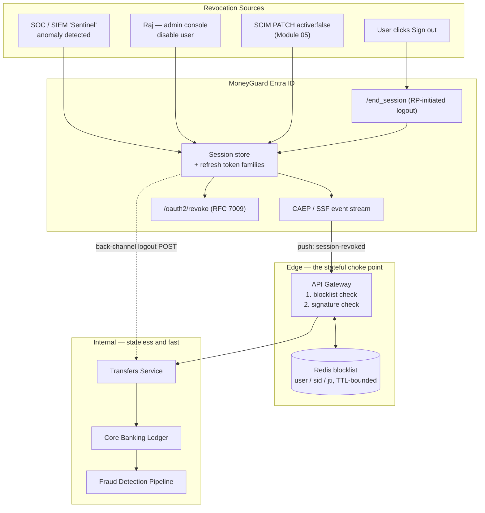

# Token Revocation and Session Management

## Overview

A JWT is valid until it expires. That is not a bug — it is the entire point of a stateless token, and it is exactly why internal services can validate one in microseconds with no database call. But it creates the hardest problem in edge security: **once you have issued a token, how do you take it back?**

This chapter covers the answer: short-lived access tokens, long-lived refresh tokens with rotation, a **stateful blocklist at the edge**, and the difference between killing a *token* and killing a *session*.

🏦 **The MoneyGuard scenario for this chapter:** At 14:00 a compromised account starts bulk-exporting customer records from the **Core Banking Ledger**. The SOC spots it at 14:05 and Raj Patel immediately disables the account in **MoneyGuard Entra ID**. But the attacker's access token was issued at 13:55 and is valid for 60 minutes. Every internal microservice is stateless — it sees a mathematically valid signature and keeps serving data. **The export continues until 14:55.** Fifty minutes of exfiltration, after the moment the bank decided to stop it. This chapter is how MoneyGuard makes that window twenty milliseconds instead of fifty minutes.

## Why This Matters

- **Detection is worthless without response.** A SOC that detects a breach in five minutes but cannot stop it for fifty has a monitoring tool, not a security control.
- **"Pure statelessness" is a myth in high-security systems.** Every real bank reintroduces state somewhere. The engineering question is *where* — and the answer is "at the edge, in memory, at Redis speed."
- **Logout must actually log out.** A user who clicks "Sign out" on a shared branch terminal and remains authenticated is a compliance finding and a real risk.
- **Refresh tokens are the crown jewels.** They are long-lived by design. A stolen refresh token that is never detected is permanent access.

## Key Concepts

| Term | Expansion | Meaning |
|---|---|---|
| **Access token** | — | The short-lived credential presented to APIs on each call |
| **Refresh token** | — | A long-lived credential used only to obtain new access tokens |
| **Blocklist / denylist** | — | A fast store of revoked subjects or token IDs, checked at the edge |
| **`jti`** | JWT ID | A unique identifier for one specific token |
| **`sid`** | Session ID | A claim identifying the login session a token belongs to |
| **Refresh token rotation** | — | Issuing a new refresh token on every use and invalidating the old one |
| **Reuse detection** | — | Treating a replayed old refresh token as proof of theft |
| **Revocation (RFC 7009)** | OAuth 2.0 Token Revocation | The standard endpoint for asking the issuer to invalidate a token |
| **Back-channel logout** | OIDC | The IdP notifying each application server-to-server that a session ended |
| **CAEP / SSF** | Continuous Access Evaluation Protocol / Shared Signals Framework | A push event stream for security signals between IdP and relying parties |
| **Sliding vs absolute expiry** | — | Whether idle time or total elapsed time ends the session |

## Detailed Notes

### Concept 1 — Why stateless tokens cannot be revoked

Internal microservices validate a JWT by checking four things locally: the signature, the issuer, the audience, and the expiry. Every one of those is computed from the token itself plus a cached public key. **None of them involves asking anyone whether the user is still allowed in.**

That is deliberate — it is what lets the Core Banking Ledger handle enormous request volumes without a network hop per call. But it means:

- Raj disables the account → the token doesn't know.
- Priya's role is downgraded → the token still says `Approver`.
- The user clicks "Sign out" → the token in the attacker's hands is unaffected.

⚠️ The naive fix — "just check the database on every request" — is worse than the disease. If MoneyGuard's Fraud Detection Pipeline makes thousands of parallel calls per second, adding one PostgreSQL query per call to ask *"is this user still active?"* will saturate connection pools and take the primary database down, which takes the whole bank down with it.

### Concept 2 — Defence one: make the window small

The first and cheapest control is simply **shorter access tokens**.

| Access token lifetime | Worst-case exposure after revocation |
|---|---|
| 24 hours | 24 hours — indefensible |
| 60 minutes | 60 minutes — the scenario above |
| 15 minutes | 15 minutes — acceptable for many systems |
| 5 minutes | 5 minutes — common for high-value APIs |

The cost of shortening is more frequent refresh calls, which is a load question, not a security one. MoneyGuard's answer: **15 minutes for employee access tokens, 5 minutes for anything that touches the Core Banking Ledger, 60 seconds for exchanged service-to-service tokens** (Chapter 1).

Short tokens alone are not enough — five minutes of ledger exfiltration is still a breach — but they bound the damage from every *other* failure, including a blocklist outage.

### Concept 3 — Defence two: the stateful edge (Redis blocklist)

The architectural move is to **push state to the edge**. Internal services stay stateless and fast; the API Gateway — a single, well-defined choke point — becomes stateful.

1. Raj clicks "Disable user" (or SCIM pushes `active: false`, or the SOC hits the kill switch).
2. An event fires that writes the user's `sub` into a **Redis blocklist**, with a TTL equal to the maximum token lifetime.
3. Every request hitting the gateway checks Redis **before** doing anything else.
4. On a hit, the gateway drops the connection. The internal microservices never even see the request.

Redis is the right tool precisely because it is an in-memory store handling millions of reads per second at sub-millisecond latency. You get the *instant revocation* of a stateful architecture without paying the *latency* of one.

```javascript
// API Gateway middleware (Node.js / Express)
async function gatewayAuth(req, res, next) {
  const token = req.headers.authorization?.split(' ')[1];
  if (!token) return res.status(401).send('No token');

  // Decode WITHOUT verifying, purely to read identifiers for the blocklist lookup.
  const decoded = jwt.decode(token);
  if (!decoded) return res.status(401).send('Malformed token');

  // 1. STATEFUL REVOCATION CHECK — the fix for the 50-minute window
  const [userBlocked, tokenBlocked, sessionBlocked] = await redisClient.mGet([
    `blocklist:user:${decoded.sub}`,
    `blocklist:jti:${decoded.jti}`,
    `blocklist:sid:${decoded.sid}`
  ]);
  if (userBlocked || tokenBlocked || sessionBlocked) {
    return res.status(401).send('Session revoked.');
  }

  // 2. STATELESS SIGNATURE CHECK — RS256 via cached JWKS (Chapter 2)
  jwt.verify(token, getKey, { algorithms: ['RS256'] }, (err, verified) => {
    if (err) return res.status(401).send('Invalid signature');
    req.user = verified;
    next();
  });
}
```

💡 Note the ordering: the cheap Redis lookup runs **before** the more expensive cryptographic verification. Also note that `jwt.decode` here is *not* a trust decision — a forged token will fail step 2 regardless. Decoding first is safe as long as you never act on the claims before verification, and blocking is a fail-safe direction.

**Three granularities of blocking**, and when to use each:

| Key | Blocks | Use when |
|---|---|---|
| `blocklist:user:{sub}` | Every token for that person | Termination, account compromise, fraud |
| `blocklist:sid:{sid}` | One login session across devices | "Sign out this device", branch terminal logout |
| `blocklist:jti:{jti}` | One specific token | A single token known to be leaked (e.g. found in a log) |

**Always set a TTL.** If MoneyGuard's longest access token lives 60 minutes, a blocklist entry only needs to live 60 minutes — after that the token expires on its own and the entry is dead weight. This keeps the blocklist small and bounded no matter how many revocations occur.

⚠️ **The blocklist must be highly available.** If Redis is down, the gateway must **fail closed** for sensitive operations. An unavailable blocklist means you cannot prove someone *isn't* revoked.

### Concept 4 — Defence three: refresh token rotation and reuse detection

Short access tokens push the security burden onto the **refresh token**, which by design is long-lived — days or weeks. If Eve steals a refresh token, she can mint fresh access tokens indefinitely and never trip a login alert.

**Rotation** fixes this: every time a refresh token is used, the authorization server issues a **new** refresh token and invalidates the old one. A refresh token is strictly one-use.

That gives you something powerful: **reuse detection**. If an old, already-consumed refresh token is ever presented again, exactly one of two things has happened — either the legitimate client didn't receive its replacement, or someone is replaying a stolen copy. You cannot tell which, so you assume the worst:

**Revoke the entire token family.** Every refresh token descended from that original login is invalidated, and the user must log in again.



Priya is inconvenienced by one extra login. Eve is locked out permanently, and MoneyGuard gets a high-fidelity security alert that a refresh token was stolen — a signal it would otherwise never have received.

💡 Bind refresh tokens to the client further where you can: **DPoP** or mutual TLS makes a stolen refresh token unusable even before reuse detection fires (Chapter 1).

### Concept 5 — Sessions versus tokens

These are different things, and conflating them causes real bugs.

| | **Token** | **Session** |
|---|---|---|
| **What it is** | A credential for calling an API | The record that a human logged in |
| **Lives where** | The client (or a BFF's Redis) | The identity provider, and often a BFF |
| **Lifetime** | Minutes | Hours to days |
| **Identified by** | `jti` | `sid` |
| **Ends when** | It expires or is blocklisted | The user logs out, it times out, or an admin kills it |

One session normally spawns many tokens. Killing a token stops one credential; **killing a session must stop every token descended from it**, which is why the `sid` claim and the `blocklist:sid:` key exist.

**Session expiry has two independent clocks, and you want both:**

- **Sliding (idle) expiry** — "log out after 15 minutes of inactivity." Protects an unattended branch terminal.
- **Absolute expiry** — "this session dies 8 hours after login regardless of activity." Prevents a session that is kept alive forever by background polling.

🏦 MoneyGuard's settings: teller terminals get a 10-minute idle timeout and an 8-hour absolute cap tied to the shift. Customers on the MoneyGuard Mobile App get a 30-day absolute session but must step up to biometrics for any transfer.

### Concept 6 — Doing logout properly

"Sign out" must clear more than the browser's local state.

| Mechanism | What it does | Spec |
|---|---|---|
| **Local logout** | Clear the app's own cookie/session | — |
| **Token revocation** | Ask the issuer to invalidate the refresh token | RFC 7009 |
| **RP-initiated logout** | Redirect the browser to the IdP's `end_session_endpoint` to end the SSO session | OIDC |
| **Back-channel logout** | The IdP POSTs a logout token to each application's registered endpoint, server-to-server | OIDC |
| **Blocklist write** | Add the `sid` to Redis so tokens already issued stop working at the gateway | — |

⚠️ Doing only local logout is the classic mistake. The user's browser forgets, but the SSO session at the IdP is intact — so clicking "Log in" logs them straight back in with no prompt, and any tokens already issued keep working until expiry.

**Back-channel logout** matters at a bank because Priya may be signed into the Employee Portal, an internal wiki, and a reporting tool through one SSO session. Front-channel logout (hidden iframes) is increasingly blocked by browser third-party-cookie restrictions; back-channel is server-to-server and therefore reliable.

**Revoking a refresh token (RFC 7009):**

```http
POST /oauth2/revoke HTTP/1.1
Host: auth.moneyguard.com
Authorization: Basic <client credentials>
Content-Type: application/x-www-form-urlencoded

token=<the refresh token>&token_type_hint=refresh_token
```

The endpoint returns `200 OK` whether or not the token existed — deliberately, so it cannot be used to probe which tokens are valid.

### Concept 7 — Push, don't poll: CAEP and Shared Signals

The blocklist works because *something* writes to it. **CAEP (Continuous Access Evaluation Protocol)**, part of the OpenID **Shared Signals Framework (SSF)**, is the standard for that something.

Instead of the gateway polling the IdP asking "is Priya still OK?", the IdP **pushes** security events to subscribers:

- `session-revoked` — an admin or the user ended the session
- `credential-change` — the password was changed or MFA was reset
- `assurance-level-change` — MFA was downgraded
- `device-compliance-change` — the laptop fell out of compliance
- `token-claims-change` — a role or group changed

MoneyGuard's API Gateway subscribes to this stream. When the SOC disables an account, a CAEP event arrives within milliseconds, the gateway writes the blocklist entry, and the *next* request from Eve is rejected — no polling, no cache TTL to wait out.

This is the same push-based pattern as the Redis Pub/Sub kill switch in [Module 03, Chapter 3](../03_Authorization_And_Policy_Engines/03_Policy_Engines_OPA_And_PBAC.md), applied one layer lower: there it evicted a cached *authorization decision*; here it invalidates the *identity credential* itself.

### Concept 8 — Putting the layers together

No single mechanism is sufficient. MoneyGuard runs five, and each covers the others' gaps:

| Layer | Mechanism | Worst-case window |
|---|---|---|
| 1 | Short access token lifetime | 5–15 minutes |
| 2 | Redis blocklist at the gateway | ~20 ms after the event |
| 3 | Refresh token rotation + reuse detection | Immediate on replay, plus an alert |
| 4 | Back-channel logout | Seconds |
| 5 | CAEP push events | Milliseconds |

⚠️ Layer 2 has a blind spot worth naming: it only protects traffic that passes through the gateway. Any internal service reachable without traversing the edge — a batch job, an admin tool on the internal network, a service mesh path that bypasses the gateway — will keep honouring a revoked token. Either force *all* traffic through an enforcement point, or replicate the blocklist check into the service mesh sidecar.

## Workflow



## Architecture Diagram



## Step-by-Step Process

1. **Set token lifetimes by risk tier.** 5 minutes for ledger access, 15 for general employee APIs, 60 seconds for exchanged service tokens.
2. **Add `jti` and `sid` to every token.** Without them you can only revoke at user granularity, which is a blunt instrument.
3. **Stand up Redis as a highly available blocklist**, replicated, with the gateway configured to fail closed if it is unreachable.
4. **Write the gateway middleware:** blocklist check first, signature check second.
5. **Set a TTL on every blocklist entry** equal to the maximum access token lifetime. The list stays bounded forever.
6. **Enable refresh token rotation** with one-time-use semantics at the authorization server.
7. **Implement reuse detection**: a replayed refresh token revokes the whole family and raises a SIEM alert.
8. **Register back-channel logout endpoints** for every relying party so one logout ends all of them.
9. **Subscribe the gateway to CAEP/SSF events** from MoneyGuard Entra ID, so revocation is pushed rather than polled.
10. **Wire every revocation source into the same path** — admin console, SOC kill switch, SCIM deprovisioning, user logout all end at the same blocklist write.
11. **Configure both idle and absolute session expiry** on every client type.
12. **Test the kill switch quarterly.** Revoke a real test account and measure the actual time to first `401`. If nobody has measured it, it does not work.

## Commands and Examples

**1. Writing a blocklist entry (the kill switch):**

```bash
# Block a whole user for the max access-token lifetime (15 min = 900s)
redis-cli SET "blocklist:user:8f2b1c44-priya-sharma" "revoked:soc-incident-4471" EX 900

# Block one login session across all their devices
redis-cli SET "blocklist:sid:sess-7c31a9" "logout" EX 900

# Block one specific leaked token
redis-cli SET "blocklist:jti:9d4e2c11-8f77-4b0a-a5de-31c9f8a02c44" "leaked-in-log" EX 900
```

**2. The .NET revocation service (fan-out to every enforcement point):**

```csharp
public class SessionRevocationService
{
    private readonly IDatabase    _redis;
    private readonly ISubscriber  _bus;
    private readonly IIdpClient   _idp;

    public async Task RevokeUserAsync(string sub, string reason, TimeSpan maxTokenLife)
    {
        // 1. Edge blocklist — stops tokens already in the wild at the gateway
        await _redis.StringSetAsync($"blocklist:user:{sub}", reason, maxTokenLife);

        // 2. Kill the refresh tokens — otherwise the attacker just mints a new one
        await _idp.RevokeAllRefreshTokensAsync(sub);

        // 3. End the SSO session at the IdP (triggers back-channel logout to RPs)
        await _idp.EndSessionsAsync(sub);

        // 4. Broadcast to every service instance to evict cached authz decisions
        //    (the Module 03 kill switch)
        await _bus.PublishAsync(
            RedisChannel.Literal("authz:revocations"),
            JsonSerializer.Serialize(new { action = "hard_revoke", subject = sub }));

        // 5. Evidence for Dana
        _audit.Write(new RevocationRecord {
            Subject = sub, Reason = reason, At = DateTime.UtcNow, Actor = _current.User });
    }
}
```

⚠️ Steps 1 and 2 are both mandatory. Blocking access tokens without revoking refresh tokens means the attacker refreshes and continues.

**3. Refresh token rotation with reuse detection (server side):**

```csharp
public async Task<TokenResponse> RefreshAsync(string presentedRefreshToken)
{
    var stored = await _refreshTokens.FindAsync(Hash(presentedRefreshToken));
    if (stored is null) throw new InvalidGrantException();

    if (stored.ConsumedAt is not null)
    {
        // ⚠️ REUSE DETECTED — this token was already exchanged once.
        // Either the client lost its replacement, or it was stolen. Assume theft.
        await _refreshTokens.RevokeFamilyAsync(stored.FamilyId);
        await _revocation.RevokeUserAsync(stored.Subject,
                                          "refresh_token_reuse", TimeSpan.FromMinutes(15));
        _siem.Alert("RefreshTokenReuse", stored.Subject, stored.FamilyId);
        throw new InvalidGrantException();
    }

    stored.ConsumedAt = DateTime.UtcNow;                  // one-time use
    var next = await _refreshTokens.IssueAsync(
        subject: stored.Subject, familyId: stored.FamilyId);   // same family, new token

    return new TokenResponse {
        AccessToken  = _tokens.MintAccess(stored.Subject, TimeSpan.FromMinutes(15)),
        RefreshToken = next.Value
    };
}
```

**4. Revoking a refresh token from the client (RFC 7009):**

```bash
curl -s -X POST https://auth.moneyguard.com/oauth2/revoke \
  -u "$CLIENT_ID:$CLIENT_SECRET" \
  -d "token=$REFRESH_TOKEN" \
  -d "token_type_hint=refresh_token" -o /dev/null -w '%{http_code}\n'
# → 200   (returns 200 even for unknown tokens, so it can't be used to probe validity)
```

**5. Receiving an OIDC back-channel logout:**

```csharp
[HttpPost("/logout/backchannel")]
[AllowAnonymous]
public async Task<IActionResult> BackChannelLogout([FromForm] string logout_token)
{
    // Validate exactly like an ID token: signature via JWKS, iss, aud, iat,
    // plus the required events claim and no nonce.
    var claims = await _logoutTokenValidator.ValidateAsync(logout_token);

    var sid = claims.FindFirst("sid")?.Value;
    var sub = claims.FindFirst("sub")?.Value;

    if (sid is not null)
        await _redis.StringSetAsync($"blocklist:sid:{sid}", "backchannel_logout",
                                    TimeSpan.FromMinutes(15));

    await _localSessions.EndAsync(sub, sid);
    return Ok();   // must return 200 or the IdP will retry
}
```

**6. Cookie settings for a BFF-managed session:**

```csharp
builder.Services.ConfigureApplicationCookie(options =>
{
    options.Cookie.HttpOnly     = true;                       // JS cannot read it
    options.Cookie.SecurePolicy = CookieSecurePolicy.Always;  // HTTPS only
    options.Cookie.SameSite     = SameSiteMode.Strict;        // no cross-site sending
    options.ExpireTimeSpan      = TimeSpan.FromMinutes(10);   // idle timeout
    options.SlidingExpiration   = true;                       // reset on activity
    // Absolute cap is enforced separately against the session's created-at timestamp.
});
```

## Best Practices

- **Short access tokens plus a blocklist.** Neither alone is enough; together they bound the window from both ends.
- **Always include `jti` and `sid`** so you can revoke a single token or a single session, not just an entire person.
- **TTL every blocklist entry** to the maximum token lifetime. The list then never grows without bound.
- **Fail closed when the blocklist is unreachable** for anything sensitive.
- **Rotate refresh tokens and detect reuse.** Reuse detection is one of the few high-fidelity theft signals you will ever get — alert on it loudly.
- **Revoke access *and* refresh together.** Revoking one without the other accomplishes nothing.
- **Use back-channel logout**, not front-channel iframes — third-party cookie restrictions have made front-channel unreliable.
- **Set both idle and absolute session expiry** on every client type.
- **Subscribe to CAEP/SSF** so revocation is pushed in milliseconds rather than discovered on a timer.
- **Route all traffic through an enforcement point**, or replicate the blocklist check into the mesh sidecars.
- **Measure time-to-revoke quarterly** with a real test, and treat the number as an SLO.

## Common Mistakes

- ⚠️ **Assuming "stateless" means "no revocation needed."** It means "no revocation *possible*" unless you add state somewhere.
- ⚠️ **Checking the primary database on every request.** Correct in principle, catastrophic in practice — the database becomes the bottleneck and then the outage.
- ⚠️ **Blocklist entries with no TTL.** The list grows forever, memory pressure builds, and eventually Redis evicts entries unpredictably — silently un-revoking people.
- ⚠️ **Blocking access tokens but leaving refresh tokens alive.** The attacker simply refreshes.
- ⚠️ **Local-only logout.** The browser forgets, the IdP session persists, and one click logs the user straight back in.
- ⚠️ **Not rotating refresh tokens.** A stolen refresh token becomes permanent, undetectable access.
- ⚠️ **Treating reuse detection as a nuisance and disabling it** because it occasionally logs a user out after a network hiccup. That occasional logout is the price of your only theft signal.
- ⚠️ **Failing open when Redis is down.** An unavailable blocklist means you cannot prove anyone is *not* revoked.
- ⚠️ **Forgetting internal paths that bypass the gateway.** Batch jobs and admin tools will happily honour a revoked token.
- ⚠️ **Sliding expiry with no absolute cap.** A background poll every nine minutes keeps a ten-minute idle session alive for months.

## Pro Tips

- 💡 **State the number.** "Our time-to-revoke is under 100 ms at the edge, bounded by a 15-minute token lifetime as the fallback" is a far stronger answer than "we revoke tokens."
- 💡 **Blocklist, not allowlist.** An allowlist of valid sessions is a lookup on every request for every user; a blocklist is nearly always empty and only holds the exceptions.
- 💡 **Make the TTL derive from config, not a constant.** If someone lengthens token lifetime and the blocklist TTL doesn't follow, you have silently created a gap.
- 💡 **Alert on reuse detection as a security event, not an error.** It is one of the highest-signal alerts in the whole IAM stack.
- 💡 **One revocation function, many callers.** Admin console, SOC kill switch, SCIM deprovisioning and user logout should all call the same code path — divergent implementations are how gaps appear.
- 💡 **Wire SCIM straight in.** When Module 05's `PATCH { "active": false }` lands, call `RevokeUserAsync` in the same handler. Offboarding then kills live sessions automatically.
- 💡 **Interview framing:** "Stateless inside, stateful at the edge." That single phrase communicates the entire architecture.

## Real-World Use Cases

1. **The bulk-export incident.** The SOC detects the anomaly at 14:05; a CAEP event and blocklist write cut access by 14:05:00.02 instead of 14:55.
2. **Employee termination.** Sam Torres's contract ends. Workday → Entra ID → SCIM `active: false` → blocklist write + refresh revocation + authz cache eviction, all in one automated chain (Module 05).
3. **Shared branch terminal.** Priya signs out at the end of her shift. RP-initiated logout ends the SSO session; back-channel logout notifies the portal, the wiki and the reporting tool; the `sid` goes on the blocklist so any token already issued is dead.
4. **Stolen phone.** A customer reports a lost device. MoneyGuard revokes that `sid`, leaving their desktop session untouched — session-granular revocation instead of a blunt full lockout.
5. **Refresh token theft caught in the act.** Eve replays a refresh token she captured a week earlier. Reuse detection fires, the family is revoked, and the SIEM alert tells MoneyGuard *when* the original theft must have occurred.
6. **Password reset.** Changing a password fires a `credential-change` CAEP event, invalidating every session issued before the change — closing the gap where an attacker who knew the old password keeps a live session.
7. **Token found in a log file.** A single `jti` is blocklisted without disturbing any other session belonging to that user.

## Key Takeaways

- A stateless JWT is **valid until it expires**. Revocation requires reintroducing state — the only question is where.
- Put the state **at the edge**, not in every microservice: a Redis blocklist at the API Gateway, checked before signature verification.
- **Short access tokens (5–15 min)** bound the damage from every failure of every other layer.
- **Blocklist at three granularities**: `user` (`sub`), `session` (`sid`), and `token` (`jti`). Always with a TTL equal to the max token lifetime.
- **Refresh token rotation with reuse detection** turns a stolen refresh token from permanent access into a one-shot that triggers an alert and revokes the whole family.
- **Revoke access and refresh together** — one without the other is theatre.
- **Real logout is four things:** clear local state, revoke the refresh token, end the IdP session, and notify relying parties via back-channel logout.
- **Push beats poll.** CAEP/SSF events give millisecond revocation without asking the IdP anything on the hot path.
- **Fail closed** when the blocklist is unavailable, and remember it only protects traffic that actually traverses the enforcement point.

## Glossary

| Term | Definition |
|---|---|
| **Absolute expiry** | A session end time fixed from login, regardless of activity. |
| **Access token** | The short-lived credential presented to APIs. |
| **Back-channel logout** | Server-to-server OIDC notification from the IdP to each relying party that a session ended. |
| **Blocklist** | A store of revoked identifiers checked at the edge before a request proceeds. |
| **CAEP** | Continuous Access Evaluation Protocol — pushed security events under the Shared Signals Framework. |
| **`jti`** | JWT ID — a unique identifier for one token. |
| **Reuse detection** | Treating a replayed one-time refresh token as evidence of theft. |
| **Refresh token** | A long-lived credential used only to obtain new access tokens. |
| **Refresh token family** | All refresh tokens descended from a single login, revoked together on reuse. |
| **RFC 7009** | OAuth 2.0 Token Revocation — the standard `/revoke` endpoint. |
| **Rotation** | Issuing a new refresh token on every use and invalidating the previous one. |
| **RP-initiated logout** | The application redirecting the browser to the IdP's `end_session_endpoint`. |
| **`sid`** | Session ID claim — links a token to the login session that produced it. |
| **Sliding expiry** | A session timeout measured from the last activity rather than from login. |
| **SSF** | Shared Signals Framework — the OpenID standard under which CAEP events are delivered. |

## Revision Notes

- **Stateless inside, stateful at the edge.** Redis blocklist at the gateway; microservices stay pure.
- Gateway order: **blocklist check first (cheap), signature check second (expensive)**.
- Blocklist keys: `blocklist:user:{sub}`, `blocklist:sid:{sid}`, `blocklist:jti:{jti}` — **always with a TTL = max token lifetime**.
- **Access token 5–15 min; refresh token rotated one-time-use with reuse detection → revoke the family.**
- **Revoke access AND refresh**, or the attacker refreshes straight back in.
- Logout = local clear + **RFC 7009 revoke** + **RP-initiated `end_session`** + **back-channel logout** + blocklist write.
- **CAEP / SSF** = push-based revocation events; the successor to polling.
- Sessions need **both** sliding (idle) and absolute expiry.
- Blind spot: anything that **bypasses the gateway** still honours revoked tokens.
- **Fail closed** if the blocklist is unreachable.

## Interview Questions

**Q1. If JWTs are stateless, how do you revoke one?**
You don't revoke the token — you make the system stop honouring it, which means reintroducing state somewhere. Pure statelessness is a myth in high-security systems. The pattern is short-lived access tokens, typically 5 to 15 minutes, combined with a Redis blocklist at the API Gateway. When a user is revoked, their `sub` goes into Redis with a TTL equal to the maximum token lifetime, and the gateway checks that blocklist *before* validating the signature. Internal microservices stay completely stateless and fast; the state lives at one well-defined choke point. That gives you the instant revocation of a stateful system with the performance of a stateless one.

**Q2. Why not just check the primary database on every request?**
Because it converts a security control into an availability incident. If MoneyGuard's Fraud Detection Pipeline is making thousands of parallel calls per second and every one adds a PostgreSQL query asking "is this user still active?", you exhaust the connection pool and take the primary database down — and with it the entire bank. Redis is the right tool because it's in-memory, handles millions of reads per second at sub-millisecond latency, and the blocklist is tiny since it only holds exceptions with a bounded TTL. The general principle is: push validation to the edge, and keep the hot path off your system of record.

**Q3. What's the difference between revoking a token and revoking a session?**
A token is one credential; a session is the record that a human logged in, and it normally spawns many tokens over its life. Blocklisting a `jti` kills exactly one token — useful if you found a specific one leaked in a log. Blocklisting a `sid` kills every token descended from that login, which is what "sign out this device" should do. Blocklisting a `sub` kills everything for that person, which is what termination or account compromise requires. If you only have user-level revocation you're forced to nuke every device whenever anything goes wrong, so I'd insist on `jti` and `sid` claims from day one.

**Q4. Explain refresh token rotation and reuse detection.**
Short access tokens shift the risk onto the refresh token, which is long-lived by design — so a stolen one is permanent, silent access. Rotation makes every refresh token single-use: presenting it returns both a new access token and a new refresh token, and marks the old one consumed. Then, if an already-consumed token is ever presented again, something is wrong — either the legitimate client never received its replacement, or someone is replaying a stolen copy. You can't distinguish those, so you assume theft and revoke the entire token family back to the original login. The legitimate user re-authenticates once; the attacker is locked out permanently. And critically, you've generated a high-fidelity alert that a refresh token was stolen — a signal you'd otherwise never get.

**Q5. A user clicks "Sign out." What must actually happen?**
Four things, and most implementations only do the first. Clear the local application session or cookie. Call the issuer's RFC 7009 revocation endpoint to invalidate the refresh token, so no new access tokens can be minted. Redirect to the IdP's `end_session_endpoint` so the SSO session itself ends — otherwise clicking "Log in" silently logs them straight back in. And write the `sid` to the edge blocklist so access tokens already issued stop working immediately rather than lingering until expiry. In a bank with several SSO-connected applications I'd also rely on OIDC back-channel logout so the IdP notifies each relying party server-to-server; front-channel iframe logout is increasingly broken by third-party cookie restrictions.

**Q6. What is CAEP and why does it matter?**
CAEP — Continuous Access Evaluation Protocol, part of the OpenID Shared Signals Framework — replaces polling with pushed security events. Instead of the gateway periodically asking the IdP whether each user is still valid, the IdP pushes events like `session-revoked`, `credential-change` or `device-compliance-change` to subscribers. The gateway receives the event and writes the blocklist entry within milliseconds. This closes the gap between "the IdP knows" and "the enforcement point knows," which under polling is bounded by your polling interval and under naive designs is bounded by token lifetime. It's the same push-not-poll principle as the Redis Pub/Sub kill switch for cached authorization decisions, applied one layer down at the credential level.

**Q7. What happens if Redis goes down?**
You fail closed for anything sensitive. An unavailable blocklist means you cannot prove a given token *hasn't* been revoked, and for money movement that uncertainty has to resolve to a denial. For genuinely low-risk read operations you might degrade to relying solely on the short token lifetime, but you'd log every such request as a degraded decision so it's visible in the incident review afterwards. Operationally this means the blocklist has to be treated as tier-zero infrastructure — replicated, multi-AZ, monitored — because its availability is now coupled to the availability of the whole platform. That coupling is a real cost of the design and worth naming explicitly.

**Q8. Where does this design have gaps?**
Three that I'd call out. First, the blocklist only protects traffic that traverses the gateway — a batch job, an admin tool on the internal network, or a mesh route that bypasses the edge will keep honouring a revoked token, so either you force all traffic through an enforcement point or you replicate the check into the sidecars. Second, there's an unavoidable floor set by however long you're willing to accept between the revocation decision and the blocklist write; CAEP shrinks it to milliseconds but never to zero. Third, the token lifetime is your fallback if every push mechanism fails, which is why I wouldn't accept a 60-minute access token even with a perfect blocklist — defence in depth means the fallback has to be tolerable on its own.

## Practice Exercises

1. **Close the 50-minute window.** Take the opening scenario — token issued at 13:55 with a 60-minute lifetime, breach detected at 14:05. Design the full revocation path and give a time-to-first-`401` for each of these designs: (a) no blocklist, (b) blocklist written by a 60-second polling job, (c) blocklist written by a CAEP push. Then state what the access token lifetime should be, and why, in each case.

2. **Pick the granularity.** For each MoneyGuard event, choose `jti`, `sid`, or `sub` blocklisting and justify it in one line: (a) a customer reports a stolen phone, (b) Sam Torres's contract ends, (c) a token turns up in a leaked application log, (d) Priya signs out of a shared branch terminal, (e) the SOC detects credential stuffing against one account.

3. **Trace the reuse.** Priya's laptop loses connectivity mid-refresh: the authorization server issued RT2 but the response never arrived, so the client retries with RT1. Walk through exactly what happens, explain why the system cannot distinguish this from theft, and propose two mitigations that reduce false positives *without* weakening the theft signal.

4. **Audit the logout.** MoneyGuard's Employee Portal currently implements sign-out as `Session.Clear()` and a redirect to the home page. List every way this fails, then write the corrected sequence including every endpoint called and every store written to. Say specifically what an attacker holding a stolen access token can still do after each stage of your fix.

5. **Design the SLO.** Write MoneyGuard's revocation SLO as a measurable statement covering: the detection-to-enforcement time, the fallback bound if the push channel fails, what "measured" means, and how you would test it quarterly without disrupting production. Then identify the single component whose outage would breach the SLO, and what you'd do about it.

---

⬅ Back to [Module 04 README](./README.md) · [Main README](../README.md) · [MoneyGuard Scenario](../SCENARIO.md)
⬅ Previous: [JWKS and Key Rotation](./02_JWKS_And_Key_Rotation.md) · ➡ Next module: [Identity Lifecycle & SCIM](../05_Identity_Lifecycle_And_SCIM/README.md)
