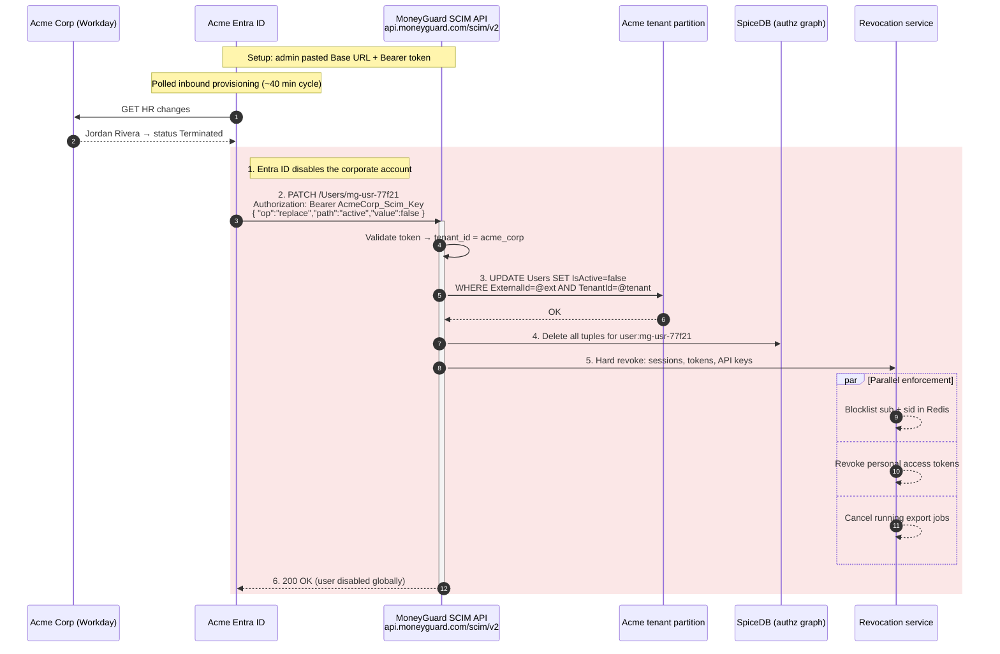
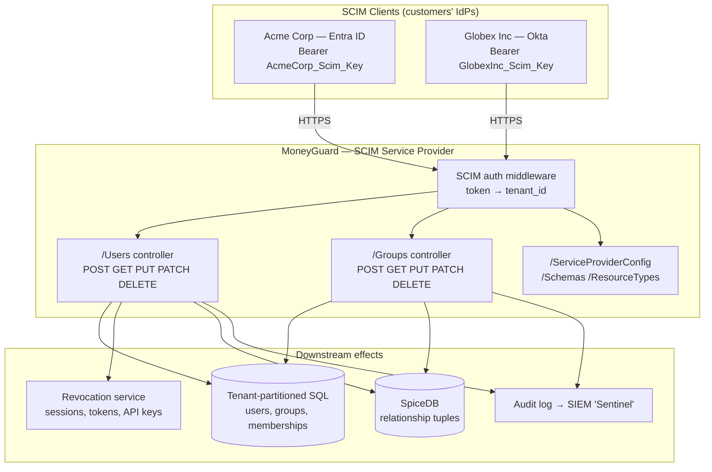

# SCIM Protocol Deep Dive

## Overview

Chapter 1 established *why* MoneyGuard needs SCIM. This chapter is the *how*: the exact routes, the exact JSON, the exact status codes. **SCIM (System for Cross-domain Identity Management)** is defined by three IETF standards — **RFC 7642** (the use cases), **RFC 7643** (the schema), and **RFC 7644** (the protocol) — and its value comes entirely from being implemented *exactly*. A "mostly SCIM" endpoint works with one identity provider and breaks with the next.

🏦 **The MoneyGuard scenario for this chapter:** Alex Kim is building the SCIM API for the **Business Banking SaaS Portal**. **Acme Corp** runs Entra ID, **Globex Inc** runs Okta. Alex has to write the endpoints once and have both drive them correctly — including the awkward parts, like Okta sending a group `PATCH` with a filter expression in the path and Entra ID sending a bare `POST` twice because the first response timed out.

## Why This Matters

- **The standard is the integration.** Implement it exactly once and every enterprise identity provider works. Implement it approximately and you are writing a bespoke integration per customer forever.
- **Providers branch on your status codes.** Return `500` where you should have returned `409` and Entra ID will retry the same request until a human intervenes.
- **`PATCH` is where implementations break.** It is the most-used operation in production and the one with the most provider-specific quirks.
- **The endpoint is a write path into your identity store**, authenticated by a single long-lived token. Getting the tenant scoping wrong is a cross-tenant breach.

## Key Concepts

| Term | Expansion | Meaning |
|---|---|---|
| **SCIM 2.0** | System for Cross-domain Identity Management | The REST/JSON identity synchronisation standard |
| **RFC 7643** | — | Core schema: `User`, `Group`, `meta`, attribute types |
| **RFC 7644** | — | Protocol: routes, filtering, `PatchOp`, errors, `/Bulk` |
| **Resource** | — | One entity — a `User` or a `Group` |
| **`schemas`** | — | The array declaring which schema(s) a payload conforms to |
| **`externalId`** | — | The client's (IdP's) immutable identifier for the resource |
| **`id`** | — | The *service provider's* (your) identifier for the resource |
| **`meta`** | — | Server-generated metadata: type, timestamps, location, version |
| **`PatchOp`** | — | The partial-update message format with `add`/`remove`/`replace` |
| **`ListResponse`** | — | The envelope wrapping any multi-resource result |
| **Enterprise extension** | — | The standard add-on schema for `employeeNumber`, `department`, `manager` |
| **`ServiceProviderConfig`** | — | The discovery endpoint declaring which SCIM features you support |

## Detailed Notes

### Concept 1 — Vocabulary: who is who

SCIM's own terms are the reverse of what most people expect:

| SCIM term | Who it is at MoneyGuard |
|---|---|
| **Client** | Acme Corp's Entra ID — the one *making* the requests |
| **Service Provider** | MoneyGuard's Business Banking SaaS Portal — the one *implementing* the API |

So MoneyGuard is the *service provider*, even though Acme is MoneyGuard's customer. When documentation says "the service provider MUST return...", that is Alex's code.

Two identifiers travel together and must never be confused:

- **`id`** — MoneyGuard's identifier, generated by MoneyGuard, returned in every response. Acme's IdP stores it and uses it in subsequent URLs.
- **`externalId`** — Acme's identifier, generated by Entra ID, sent by Acme. MoneyGuard stores it as the permanent anchor.

### Concept 2 — The endpoint surface

A SCIM 2.0 service provider exposes these routes under a base path such as `https://api.moneyguard.com/scim/v2`:

| Method + Path | Purpose | Required? |
|---|---|---|
| `POST /Users` | Create a user | ✅ |
| `GET /Users/{id}` | Retrieve one user | ✅ |
| `GET /Users?filter=...` | Search and list users | ✅ |
| `PUT /Users/{id}` | Replace a user entirely | ✅ |
| `PATCH /Users/{id}` | Modify specific attributes | ✅ (in practice) |
| `DELETE /Users/{id}` | Delete a user | Optional — prefer soft-disable |
| `POST /Groups` | Create a group | ✅ for entitlement sync |
| `GET /Groups/{id}` | Retrieve one group | ✅ |
| `GET /Groups?filter=...` | Search groups | ✅ |
| `PUT /Groups/{id}` | Replace a group | ✅ |
| `PATCH /Groups/{id}` | Add/remove members | ✅ **most used** |
| `DELETE /Groups/{id}` | Delete a group | ✅ |
| `GET /ServiceProviderConfig` | Declare supported features | ✅ |
| `GET /Schemas` | Publish your schema definitions | ✅ |
| `GET /ResourceTypes` | List the resource types you expose | ✅ |
| `GET /Me` | The authenticated subject | Optional |
| `POST /Bulk` | Many operations in one request | Optional |
| `POST /.search` | Search via POST for long filters | Optional |

⚠️ Note the exact casing: `/Users`, `/Groups`, `/ServiceProviderConfig`. SCIM paths are case-sensitive by convention and providers hardcode them. `/users` will not work.

The content type is `application/scim+json`, though most providers also accept `application/json`.

### Concept 3 — The `User` resource

```json
{
  "schemas": [
    "urn:ietf:params:scim:schemas:core:2.0:User",
    "urn:ietf:params:scim:schemas:extension:enterprise:2.0:User"
  ],
  "id": "mg-usr-77f21",
  "externalId": "aad-user-object-12345",
  "userName": "j.rivera@acmecorp.com",
  "name": {
    "formatted": "Jordan Rivera",
    "familyName": "Rivera",
    "givenName": "Jordan"
  },
  "displayName": "Jordan Rivera",
  "emails": [
    { "value": "j.rivera@acmecorp.com", "type": "work", "primary": true }
  ],
  "phoneNumbers": [
    { "value": "+1-555-0142", "type": "work" }
  ],
  "active": true,
  "title": "Payroll Analyst",
  "urn:ietf:params:scim:schemas:extension:enterprise:2.0:User": {
    "employeeNumber": "ACME-88214",
    "department": "Finance",
    "costCenter": "CC-4471",
    "manager": { "value": "mg-usr-33a09", "displayName": "Priya Sharma" }
  },
  "groups": [
    { "value": "mg-grp-901", "display": "Acme-Payroll-Approvers", "type": "direct" }
  ],
  "meta": {
    "resourceType": "User",
    "created":      "2026-02-14T09:00:00Z",
    "lastModified": "2026-03-01T11:32:07Z",
    "location":     "https://api.moneyguard.com/scim/v2/Users/mg-usr-77f21",
    "version":      "W/\"a3f91c\""
  }
}
```

Points that matter in practice:

- **`schemas` is mandatory** on every request and response. Providers validate it.
- **`userName` is the unique login identifier**, and is required and unique per tenant.
- **`active`** is the deprovisioning switch — the single most security-critical field in the whole schema.
- **`meta.version`** is an **ETag**, enabling optimistic concurrency (Chapter 3).
- **`groups` on a user is read-only.** You compute it from group membership; the IdP writes membership through `/Groups`, never here.
- The **enterprise extension** carries `employeeNumber`, `department`, `manager` and friends, namespaced under its full URN.

### Concept 4 — The `Group` resource, and why it exists

```json
{
  "schemas": ["urn:ietf:params:scim:schemas:core:2.0:Group"],
  "id": "mg-grp-901",
  "externalId": "aad-group-object-55501",
  "displayName": "Acme-Payroll-Approvers",
  "members": [
    { "value": "mg-usr-77f21", "display": "Jordan Rivera",
      "$ref": "https://api.moneyguard.com/scim/v2/Users/mg-usr-77f21" },
    { "value": "mg-usr-33a09", "display": "Priya Sharma",
      "$ref": "https://api.moneyguard.com/scim/v2/Users/mg-usr-33a09" }
  ],
  "meta": {
    "resourceType": "Group",
    "created":      "2026-02-14T09:00:00Z",
    "lastModified": "2026-03-01T11:32:07Z",
    "location":     "https://api.moneyguard.com/scim/v2/Groups/mg-grp-901",
    "version":      "W/\"7d20b1\""
  }
}
```

🏦 **Why `/Groups` matters when `/Users` already carries `department`.**

Acme Corp has 50 finance staff but pays for only 10 premium payroll licences. `department` is a *label*, not an entitlement — a rule saying "grant premium to everyone where `department == Finance`" gives away 50 licences. The admin's only workaround would be to invent fake department names in the HR system, corrupting Acme's own data to manipulate MoneyGuard's authorization.

With `/Groups`, the admin creates an Entra ID security group called `MoneyGuard-Payroll-Premium`, drops in exactly 10 people, and MoneyGuard receives an explicit member list. Swapping three people next quarter is a group edit that propagates automatically.

💡 **Groups are the entitlement mechanism. Attributes are metadata.** Design your authorization around groups.

### Concept 5 — `PATCH`: the operation that matters most

`PUT` replaces an entire resource. For a group with 5,000 members, sending the whole list every time one person joins is absurd — and dangerous, because a `PUT` with a truncated list silently removes everyone missing from it.

`PATCH` (RFC 7644 §3.5.2) sends a surgical instruction instead.

**Adding a member:**

```json
PATCH /scim/v2/Groups/mg-grp-901
Content-Type: application/scim+json

{
  "schemas": ["urn:ietf:params:scim:api:messages:2.0:PatchOp"],
  "Operations": [
    {
      "op": "add",
      "path": "members",
      "value": [ { "value": "mg-usr-77f21", "display": "Jordan Rivera" } ]
    }
  ]
}
```

**Removing a member** — and here is the first big provider quirk. The specification uses a filter expression inside the path:

```json
{
  "schemas": ["urn:ietf:params:scim:api:messages:2.0:PatchOp"],
  "Operations": [
    { "op": "remove", "path": "members[value eq \"mg-usr-77f21\"]" }
  ]
}
```

⚠️ But **Entra ID commonly sends this instead**, with the target in `value` rather than the path:

```json
{
  "schemas": ["urn:ietf:params:scim:api:messages:2.0:PatchOp"],
  "Operations": [
    { "op": "remove", "path": "members",
      "value": [ { "value": "mg-usr-77f21" } ] }
  ]
}
```

**Your handler must accept both forms.** This is the single most common cause of "removals silently don't work" bug reports.

**Deactivating a user:**

```json
{
  "schemas": ["urn:ietf:params:scim:api:messages:2.0:PatchOp"],
  "Operations": [
    { "op": "replace", "path": "active", "value": false }
  ]
}
```

⚠️ Second quirk: some providers omit `path` entirely and send the change as an object in `value`:

```json
{
  "schemas": ["urn:ietf:params:scim:api:messages:2.0:PatchOp"],
  "Operations": [
    { "op": "replace", "value": { "active": false } }
  ]
}
```

And third: `value` may be the **string** `"False"` rather than the boolean `false`. Parse defensively.

### Concept 6 — Filtering, pagination and `ListResponse`

Identity providers query before they write, mainly to avoid creating duplicates. The filter language (RFC 7644 §3.4.2.2) supports `eq`, `ne`, `co` (contains), `sw` (starts with), `ew` (ends with), `pr` (present), `gt`, `ge`, `lt`, `le`, plus `and`, `or`, `not` and parentheses.

```http
GET /scim/v2/Users?filter=userName eq "j.rivera@acmecorp.com" HTTP/1.1
GET /scim/v2/Users?filter=externalId eq "aad-user-object-12345"
GET /scim/v2/Users?filter=active eq true and meta.lastModified gt "2026-03-01T00:00:00Z"
GET /scim/v2/Groups?filter=displayName eq "Acme-Payroll-Approvers"
GET /scim/v2/Users?startIndex=1&count=100&attributes=id,userName,active
```

💡 In practice you need `userName eq` and `externalId eq` on `/Users` and `displayName eq` on `/Groups`. Those three cover almost all real provider traffic. Support the rest as you meet demand.

Every multi-result response is wrapped in a `ListResponse`:

```json
{
  "schemas": ["urn:ietf:params:scim:api:messages:2.0:ListResponse"],
  "totalResults": 512,
  "startIndex": 1,
  "itemsPerPage": 100,
  "Resources": [ { "...": "user objects" } ]
}
```

⚠️ **`startIndex` is 1-based, not 0-based.** Off-by-one here means the first user in every page is skipped or duplicated. An empty result is `totalResults: 0` with `Resources: []` and HTTP `200` — never `404`.

### Concept 7 — Status codes and the error schema

Providers make retry decisions from your status code, so these are behavioural contracts, not cosmetics.

| Code | When | Provider behaviour |
|---|---|---|
| `200 OK` | Successful `GET`, `PUT`, `PATCH` | Proceeds |
| `201 Created` | Successful `POST` (with `Location` header) | Stores your `id` |
| `204 No Content` | Successful `DELETE`, or `PATCH` with no body returned | Proceeds |
| `400 Bad Request` | Malformed payload or filter | ⚠️ Marks the object as failed; no retry |
| `401 Unauthorized` | Bad or missing bearer token | Stops syncing, alerts the admin |
| `404 Not Found` | Unknown `id` | Often re-creates the resource |
| `409 Conflict` | `userName` or `externalId` already exists | Attempts to match instead of retrying |
| `412 Precondition Failed` | ETag mismatch on `If-Match` | Re-reads and retries |
| `429 Too Many Requests` | Rate limited (send `Retry-After`) | Backs off and retries |
| `500 Internal Server Error` | Genuine server fault | Retries with exponential backoff |

Errors use their own schema:

```json
{
  "schemas": ["urn:ietf:params:scim:api:messages:2.0:Error"],
  "scimType": "uniqueness",
  "detail": "A user with userName 'j.rivera@acmecorp.com' already exists in this tenant.",
  "status": "409"
}
```

Valid `scimType` values include `invalidFilter`, `tooMany`, `uniqueness`, `mutability`, `invalidSyntax`, `invalidPath`, `noTarget`, `invalidValue` and `sensitive`. ⚠️ Note `status` is a **string**, not a number — a genuine source of parser failures.

### Concept 8 — Discovery endpoints

Before syncing, a provider asks what you support. These three endpoints are required and are the cheapest part of the implementation.

```json
GET /scim/v2/ServiceProviderConfig

{
  "schemas": ["urn:ietf:params:scim:schemas:core:2.0:ServiceProviderConfig"],
  "documentationUri": "https://docs.moneyguard.com/scim",
  "patch":         { "supported": true },
  "bulk":          { "supported": false, "maxOperations": 0, "maxPayloadSize": 0 },
  "filter":        { "supported": true, "maxResults": 200 },
  "changePassword":{ "supported": false },
  "sort":          { "supported": false },
  "etag":          { "supported": true },
  "authenticationSchemes": [
    {
      "type": "oauthbearertoken",
      "name": "OAuth Bearer Token",
      "description": "Per-tenant long-lived bearer token issued by MoneyGuard",
      "primary": true
    }
  ]
}
```

💡 Declare honestly. Advertising `bulk: true` when you have not implemented `/Bulk` causes the provider to send requests you cannot answer.

### Concept 9 — Security: tenant scoping is everything

The SCIM endpoint is an authenticated write path into MoneyGuard's identity store. Three rules:

1. **One bearer token per tenant**, stored hashed, independently revocable, rotatable without downtime. A shared token means one leak compromises every customer.
2. **The tenant comes from the token, never from the payload.** Middleware validates the token, extracts `tenant_id`, and every query is scoped by it. If a caller can name the tenant, Acme's token can write into Globex's partition.
3. **Scope reads too.** `GET /Users/{id}` must be `WHERE id = @id AND tenant_id = @tenant`. Otherwise Acme can enumerate Globex's users by guessing IDs.

```csharp
[Authorize(Policy = "ScimSyncPolicy")]
[ApiController]
[Route("scim/v2/[controller]")]
[Produces("application/scim+json")]
public abstract class ScimControllerBase : ControllerBase
{
    // ⚠️ ALWAYS from the authenticated token. NEVER from the body or a query string.
    protected string TenantId => User.FindFirst("tenant_id")!.Value;
}
```

Beyond that: TLS only, rate limiting per tenant with `Retry-After` on `429`, and an audit record for every operation.

### Concept 10 — Wiring SCIM into authorization

A SCIM write is not just a database update; it is an authorization event. When a `PATCH /Groups` adds Jordan to `Acme-Payroll-Approvers`, MoneyGuard must update **both** the SQL row (so the admin UI shows it) **and** the ReBAC relationship tuple (so the policy engine honours it) — in the same unit of work.

```csharp
if (op.Op.Equals("add", StringComparison.OrdinalIgnoreCase))
{
    foreach (var userId in ExtractMemberIds(op))
    {
        // A. Relational store — powers the admin UI and reporting
        await _groups.AddMemberAsync(TenantId, groupId, userId);

        // B. Authorization graph — powers the actual access decision
        //    Tuple: group:{groupId}#member@user:{userId}
        await _spiceDb.WriteRelationshipAsync("group", groupId, "member", "user", userId);
    }
}
else if (op.Op.Equals("remove", StringComparison.OrdinalIgnoreCase))
{
    foreach (var userId in ExtractMemberIds(op))
    {
        await _groups.RemoveMemberAsync(TenantId, groupId, userId);
        // Deleting the tuple severs access mathematically, within milliseconds
        await _spiceDb.DeleteRelationshipAsync("group", groupId, "member", "user", userId);
    }
}
```

The moment that tuple is deleted, the policy engine from [Module 03](../03_Authorization_And_Policy_Engines/02_ReBAC_And_Google_Zanzibar.md) returns `NO_PERMISSION` and the portal returns `403` — globally, in single-digit milliseconds. That is the payoff for wiring the two together.

## Workflow



## Architecture Diagram



## Step-by-Step Process

1. **Read RFC 7643 and 7644 properly.** Every hour here saves a day of provider-specific debugging.
2. **Implement the discovery endpoints first** — `/ServiceProviderConfig`, `/Schemas`, `/ResourceTypes`. They are trivial and providers call them before anything else.
3. **Build authentication as middleware**, mapping bearer token → `tenant_id`, applied to every SCIM route.
4. **Implement `POST /Users`** with an idempotency check on `externalId`, returning `201` plus a `Location` header, or `409` with a proper error body.
5. **Implement `GET /Users` with filtering**, supporting at minimum `userName eq` and `externalId eq`, wrapped in a `ListResponse` with 1-based `startIndex`.
6. **Implement `PATCH /Users`** handling `replace` on `active`, and tolerate both the `path`-based and `value`-object forms.
7. **Implement the `/Groups` endpoints**, with `PATCH` handling `add` and `remove` in **both** the filtered-path and `value`-array shapes.
8. **Wire group changes into the authorization graph** in the same operation as the SQL write.
9. **Wire `active: false` into the full revocation chain** — the seven steps from Chapter 1.
10. **Return exact status codes**, especially `409` for duplicates and `429` with `Retry-After` for rate limits.
11. **Emit ETags** in `meta.version` and honour `If-Match` for optimistic concurrency.
12. **Log every operation** with tenant, method, path, target, outcome and correlation ID.
13. **Test against real providers.** Entra ID and Okta both publish SCIM validators — run both.

## Commands and Examples

**1. Full create round trip:**

```bash
curl -sS -X POST https://api.moneyguard.com/scim/v2/Users \
  -H "Authorization: Bearer $ACME_SCIM_TOKEN" \
  -H "Content-Type: application/scim+json" \
  -d '{
    "schemas": ["urn:ietf:params:scim:schemas:core:2.0:User"],
    "userName": "j.rivera@acmecorp.com",
    "name": { "givenName": "Jordan", "familyName": "Rivera" },
    "emails": [{ "value": "j.rivera@acmecorp.com", "type": "work", "primary": true }],
    "active": true,
    "externalId": "aad-user-object-12345"
  }' -i
```

```http
HTTP/1.1 201 Created
Location: https://api.moneyguard.com/scim/v2/Users/mg-usr-77f21
ETag: W/"a3f91c"
Content-Type: application/scim+json
```

**2. Searching before creating (what the IdP does first):**

```bash
curl -sS -G https://api.moneyguard.com/scim/v2/Users \
  -H "Authorization: Bearer $ACME_SCIM_TOKEN" \
  --data-urlencode 'filter=externalId eq "aad-user-object-12345"'
```

```json
{
  "schemas": ["urn:ietf:params:scim:api:messages:2.0:ListResponse"],
  "totalResults": 1,
  "startIndex": 1,
  "itemsPerPage": 1,
  "Resources": [ { "id": "mg-usr-77f21", "userName": "j.rivera@acmecorp.com", "active": true } ]
}
```

**3. A `PATCH` handler that tolerates every provider dialect:**

```csharp
[HttpPatch("{id}")]
public async Task<IActionResult> PatchGroup(string id, [FromBody] ScimPatchDto patch)
{
    var group = await _groups.FindByIdAsync(TenantId, id);
    if (group is null) return NotFound(ScimError("404", "noTarget", "Group not found."));

    foreach (var op in patch.Operations)
    {
        var path = op.Path?.ToLowerInvariant() ?? "";

        // Accept "members", "members[value eq \"x\"]", and an absent path.
        if (!path.StartsWith("members") && !string.IsNullOrEmpty(op.Path)) continue;

        var memberIds = ExtractMemberIds(op);   // handles BOTH dialects — see below
        if (memberIds.Count == 0) continue;

        switch (op.Op.ToLowerInvariant())
        {
            case "add":
                foreach (var uid in memberIds)
                {
                    await _groups.AddMemberAsync(TenantId, id, uid);
                    await _spiceDb.WriteRelationshipAsync("group", id, "member", "user", uid);
                }
                break;

            case "remove":
                foreach (var uid in memberIds)
                {
                    await _groups.RemoveMemberAsync(TenantId, id, uid);
                    await _spiceDb.DeleteRelationshipAsync("group", id, "member", "user", uid);
                }
                break;

            case "replace":   // ⚠️ PUT semantics on a sub-attribute: anyone missing is removed
                await ReplaceAllMembersAsync(TenantId, id, memberIds);
                break;
        }
    }

    _audit.Write("scim.group.patch", TenantId, id, patch.Operations.Count);
    return NoContent();   // 204 is valid; 200 with the resource is also acceptable
}

/// Extracts member ids from either dialect:
///   A) "path": "members[value eq \"mg-usr-77f21\"]"      (spec-literal, Okta)
///   B) "path": "members", "value": [ { "value": "..." } ] (Entra ID)
private static List<string> ExtractMemberIds(ScimOperation op)
{
    var ids = new List<string>();

    // Dialect A — a filter expression embedded in the path
    var match = Regex.Match(op.Path ?? "", @"value\s+eq\s+""([^""]+)""",
                            RegexOptions.IgnoreCase);
    if (match.Success) { ids.Add(match.Groups[1].Value); return ids; }

    // Dialect B — an array (or single object) in value
    if (op.Value.ValueKind == JsonValueKind.Array)
    {
        foreach (var item in op.Value.EnumerateArray())
            if (item.TryGetProperty("value", out var v) && v.GetString() is string s)
                ids.Add(s);
    }
    else if (op.Value.ValueKind == JsonValueKind.Object &&
             op.Value.TryGetProperty("value", out var single))
    {
        if (single.GetString() is string s) ids.Add(s);
    }

    return ids;
}
```

💡 `TryGetProperty` rather than direct indexing is deliberate. SCIM payloads vary between providers and a malformed field must not crash the endpoint — a `500` here makes the IdP retry forever.

**4. Parsing `active` defensively:**

```csharp
private static bool ParseActive(JsonElement value) => value.ValueKind switch
{
    JsonValueKind.True   => true,
    JsonValueKind.False  => false,
    // ⚠️ Some providers send the STRING "False"
    JsonValueKind.String => bool.TryParse(value.GetString(), out var b) && b,
    // Or the whole object: { "active": false }
    JsonValueKind.Object => value.TryGetProperty("active", out var inner) && ParseActive(inner),
    _ => throw new ScimBadRequestException("invalidValue", "Unparseable 'active' value.")
};
```

**5. Optimistic concurrency with ETags:**

```bash
curl -sS -X PATCH https://api.moneyguard.com/scim/v2/Users/mg-usr-77f21 \
  -H "Authorization: Bearer $ACME_SCIM_TOKEN" \
  -H "Content-Type: application/scim+json" \
  -H 'If-Match: W/"a3f91c"' \
  -d '{
    "schemas": ["urn:ietf:params:scim:api:messages:2.0:PatchOp"],
    "Operations": [{ "op": "replace", "path": "active", "value": false }]
  }'
# 200 OK if the version matches; 412 Precondition Failed if someone else changed it first
```

**6. The error body for a duplicate create:**

```json
HTTP/1.1 409 Conflict
Content-Type: application/scim+json

{
  "schemas": ["urn:ietf:params:scim:api:messages:2.0:Error"],
  "scimType": "uniqueness",
  "detail": "A user with userName 'j.rivera@acmecorp.com' already exists in tenant acme_corp.",
  "status": "409"
}
```

## Best Practices

- **Implement the standard exactly.** Every deviation becomes a per-customer support burden.
- **Get the discovery endpoints right early** — they are cheap and providers call them first.
- **Accept every `PATCH` dialect**: filtered path, `value` array, and absent path. Normalise internally.
- **Parse defensively.** `TryGetProperty` everywhere; never let a malformed payload produce a `500`.
- **Return `409`, not `500`, for duplicates.** The provider then matches instead of retrying forever.
- **Emit ETags in `meta.version`** and honour `If-Match` so concurrent writers can't clobber each other.
- **Wrap every list in a `ListResponse` with 1-based `startIndex`**, and return `200` with `totalResults: 0` for empty results.
- **Scope every query by tenant, on reads as well as writes.**
- **Prefer soft-disable to hard delete** so the audit trail survives.
- **Rate limit per tenant** and always send `Retry-After` with a `429`.
- **Write group changes to SQL and the authorization graph together** so the UI and the policy engine never disagree.
- **Validate against real providers**, not just a mock — run the Entra ID and Okta SCIM validators.

## Common Mistakes

- ⚠️ **Handling only one `PATCH` dialect.** Removals silently do nothing for half your customers.
- ⚠️ **0-based `startIndex`.** Every page skips or duplicates a user.
- ⚠️ **Returning `404` for an empty search.** It must be `200` with `totalResults: 0`; `404` makes providers re-create users.
- ⚠️ **Returning `500` on a duplicate `POST`.** The provider retries indefinitely and the customer's sync gets stuck.
- ⚠️ **`"status": 409` as a number.** The SCIM error schema requires a string; strict parsers reject it.
- ⚠️ **Lowercase routes** (`/users`, `/groups`). Providers hardcode the capitalised paths.
- ⚠️ **Treating the user's `groups` attribute as writable.** It is read-only and computed; membership is written through `/Groups`.
- ⚠️ **Reading `tenantId` from the payload.** A cross-tenant write primitive.
- ⚠️ **Unscoped `GET /Users/{id}`.** Lets one customer enumerate another's users by guessing IDs.
- ⚠️ **Treating `replace` on `members` as an add.** `replace` has `PUT` semantics — everyone not in the list must be removed.
- ⚠️ **Advertising features you haven't built** in `/ServiceProviderConfig`, especially `bulk` and `sort`.
- ⚠️ **Assuming `active` is always a JSON boolean.** It may arrive as the string `"False"`.

## Pro Tips

- 💡 **Normalise at the edge.** Convert every incoming `PatchOp` dialect into one internal representation immediately; the rest of your code then sees a single shape.
- 💡 **Log the raw payload for the first month** of each new customer, redacting PII. Provider quirks reveal themselves fast.
- 💡 **Build a replay harness.** Capture real Entra ID and Okta traffic and replay it in CI — the best regression suite you can have for SCIM.
- 💡 **Return the full resource on `PATCH`.** `204` is legal, but returning `200` with the updated object saves the provider a follow-up `GET` and makes debugging far easier.
- 💡 **Support `attributes=` and `excludedAttributes=`.** Providers use them to reduce payload size on large syncs, and it is a small amount of code.
- 💡 **Give each SCIM request a correlation ID** and return it in a response header. When a customer says "the sync is broken", you can find the exact request.
- 💡 **Interview framing:** "RFC 7643 is the schema, RFC 7644 is the protocol, and `PATCH` on `/Groups` is where every implementation actually breaks." That level of specificity signals real experience.

## Real-World Use Cases

1. **Acme Corp bulk onboarding.** 500 `POST /Users` calls create dormant accounts; the admin then pre-assigns payroll workspaces before anyone's first day.
2. **Premium licence management.** Acme's `MoneyGuard-Payroll-Premium` group carries exactly 10 members; `PATCH /Groups` swaps three of them next quarter with a 2 KB payload instead of a 5,000-member `PUT`.
3. **Two providers, one API.** Acme drives the endpoint from Entra ID and Globex from Okta; the same controllers serve both because the `PATCH` handler normalises dialects.
4. **Instant entitlement revocation.** A `remove` on `members` deletes the SpiceDB tuple, and the policy engine returns `403` on the very next request — milliseconds, not the next sync cycle.
5. **Surname change after marriage.** Entra ID sends `PATCH /Users` updating `name.familyName` and `userName`; because MoneyGuard matched on `externalId`, the record updates cleanly instead of duplicating.
6. **Outage recovery.** MoneyGuard's API is down for 20 minutes; Entra ID retries with backoff and every queued change lands once service is restored, because the handlers are idempotent.
7. **SOX evidence.** Dana filters the SCIM audit log by tenant and operation to show, per terminated user, the exact timestamp of the `active: false` and the resulting revocations.

## Key Takeaways

- SCIM 2.0 is three RFCs: **7642** (use cases), **7643** (schema), **7644** (protocol). Its value is in exactness.
- MoneyGuard is the **service provider**; the customer's IdP is the **client**. `id` is yours; `externalId` is theirs.
- The required surface is `/Users`, `/Groups`, and the three discovery endpoints. Content type `application/scim+json`, capitalised paths.
- **`/Groups` is the entitlement mechanism**; attributes like `department` are metadata. Design authorization around groups.
- **`PATCH` is the most-used and most-broken operation.** Accept the filtered-path form, the `value`-array form, and the absent-path form.
- **Status codes are behavioural contracts** — `409` for duplicates, `429` with `Retry-After`, `200` with `totalResults: 0` for empty searches.
- **`startIndex` is 1-based.** `"status"` in an error body is a **string**.
- **Tenant comes from the token**, and scopes reads as well as writes.
- A SCIM write is an **authorization event**: update the relational store and the relationship graph together.

## Glossary

| Term | Definition |
|---|---|
| **Client (SCIM)** | The system making SCIM requests — the customer's identity provider. |
| **ETag** | A version identifier in `meta.version`, used with `If-Match` for optimistic concurrency. |
| **Enterprise extension** | The standard schema extension carrying `employeeNumber`, `department`, `manager`, etc. |
| **`externalId`** | The client's immutable identifier for a resource, stored by the service provider. |
| **Filter** | The SCIM query language (`eq`, `co`, `sw`, `pr`, `and`, `or`, `not`). |
| **`id`** | The service provider's identifier for a resource. |
| **`ListResponse`** | The envelope wrapping multi-resource results, with `totalResults`, `startIndex`, `itemsPerPage`. |
| **`meta`** | Server-generated metadata: `resourceType`, `created`, `lastModified`, `location`, `version`. |
| **`PatchOp`** | The partial-update message schema containing an `Operations` array. |
| **RFC 7643** | The SCIM core schema specification. |
| **RFC 7644** | The SCIM protocol specification. |
| **`scimType`** | A machine-readable error subtype, e.g. `uniqueness`, `invalidFilter`, `mutability`. |
| **Service Provider** | The system implementing the SCIM API — MoneyGuard's portal. |
| **`ServiceProviderConfig`** | The discovery endpoint declaring which SCIM features are supported. |
| **`startIndex`** | The 1-based index of the first result in a page. |

## Revision Notes

- **RFC 7642 / 7643 / 7644** = use cases / schema / protocol.
- Base path `/scim/v2`; **capitalised** `/Users`, `/Groups`, `/ServiceProviderConfig`; type `application/scim+json`.
- **`id` = yours. `externalId` = theirs (immutable anchor).**
- `active: false` is the deprovisioning switch and the most security-critical field.
- **`/Groups` for entitlements**, attributes for metadata.
- `PATCH` dialects: **filtered path**, **`value` array**, **absent path**. Support all three.
- `replace` on `members` has **`PUT` semantics** — omissions are removals.
- **`startIndex` is 1-based**; empty search = `200` + `totalResults: 0`.
- Error body: `schemas`, `scimType`, `detail`, **`status` as a string**.
- `409` duplicate, `412` ETag mismatch, `429` + `Retry-After`, `500` only for genuine faults.
- **Tenant from the token; scope reads too.**
- Group write ⇒ **SQL + ReBAC tuple** in one operation.

## Interview Questions

**Q1. What are the core SCIM endpoints and what does each do?**
Under a base path like `/scim/v2` you need `/Users` and `/Groups`, each supporting `POST` to create, `GET` by id and by filter, `PUT` to replace, `PATCH` to modify, and optionally `DELETE`. Plus three discovery endpoints: `/ServiceProviderConfig` declaring which features you support, `/Schemas` publishing your attribute definitions, and `/ResourceTypes` listing what you expose. The paths are capitalised and providers hardcode them, so `/users` won't work. In production the two operations that carry almost all the traffic are `PATCH /Users` for activation changes and `PATCH /Groups` for membership changes.

**Q2. Why do you need `/Groups` if `/Users` already carries `department`?**
Because a department is a label and a group is an entitlement. If a customer has 50 finance staff but bought 10 premium licences, a rule keyed on `department == "Finance"` gives away 50. The admin's only workaround would be inventing fake departments in their HR system, which corrupts their own data to manipulate your authorization. With `/Groups` they create a security group in their IdP, drop in exactly the 10 people, and you receive an explicit member list you can map to a role. Swapping people next quarter is then a group edit that propagates automatically. So: design entitlements around groups, treat attributes as metadata.

**Q3. Why is `PATCH` harder than `PUT`, and where do implementations break?**
`PUT` is conceptually simple but operationally dangerous — replacing a 5,000-member group every time one person joins is wasteful, and a truncated list silently removes everyone missing from it. `PATCH` sends a surgical instruction instead, which is right but under-specified in practice. Providers disagree on how to express the target of a `remove`: the spec-literal form embeds a filter in the path, `members[value eq "x"]`, while Entra ID commonly sends `path: "members"` with the id in a `value` array. Some omit `path` entirely and put the whole change in `value`. And `active` can arrive as the string `"False"` rather than a boolean. A handler that supports only one dialect appears to work in testing and then silently fails to remove anyone for half your customers.

**Q4. What status codes matter and why?**
They're behavioural contracts, because providers branch their retry logic on them. `409` for a duplicate is critical: return `500` instead and the IdP retries the same create forever and the customer's sync gets permanently stuck, whereas `409` makes it fall back to matching the existing record. `429` with a `Retry-After` header gets you polite backoff instead of a hammering. An empty search must be `200` with `totalResults: 0` — return `404` and many providers conclude the user doesn't exist and re-create them. `400` marks the object as permanently failed with no retry, so only use it for genuinely malformed input. And `500` should be reserved for real faults, because it triggers retries you may not want.

**Q5. How do you secure the SCIM endpoint?**
A long-lived, cryptographically strong bearer token issued per customer tenant, stored hashed, independently revocable and rotatable without downtime — never one shared token, since a single leak would compromise every customer at once. Middleware validates the token and extracts the tenant ID, and that value scopes every query. The absolutely critical rule is that the tenant comes from the authenticated token and never from the request body or a query parameter, because a caller who can name the tenant has a cross-tenant write primitive. And scoping must apply to reads too — `GET /Users/{id}` needs the tenant in the WHERE clause, or one customer can enumerate another's users by guessing identifiers.

**Q6. Why match on `externalId` rather than `userName`?**
Because `externalId` is the IdP's immutable object identifier and `userName` isn't. Usernames are typically email addresses, and those change — marriages, rebrands, domain migrations after an acquisition. If you key on `userName`, the moment IT updates an address you create a duplicate record while the original keeps its entitlements, which is a data-integrity bug and a security one. Keying on `externalId` means a rename is just an update to an existing row. I'd also write `externalId` on the JIT path at first login, so that when the SCIM message arrives later it links to the existing record rather than colliding with it.

**Q7. What does a SCIM group membership change need to do beyond updating a table?**
It's an authorization event, not just a data change. The relational write powers the admin UI and reporting, but the actual access decision comes from the authorization layer — in our design, a relationship tuple in the graph database. So an `add` writes both the membership row and the `group:{id}#member@user:{id}` tuple, and a `remove` deletes both, in the same unit of work. If they can diverge, the UI and the policy engine disagree, which is exactly the kind of bug that shows up as "we removed her last week but she can still see payroll." Getting them consistent is what makes revocation take milliseconds rather than waiting for the next sync cycle.

**Q8. How would you validate a SCIM implementation before shipping it?**
Three layers. First, run the official validators — Entra ID and Okta both publish SCIM compliance tools, and they exercise the discovery endpoints, filtering, pagination and `PATCH` dialects you'd otherwise miss. Second, build a replay harness: capture real provider traffic from an early customer, redact the PII, and replay it in CI as a regression suite — that catches the quirks no spec document mentions. Third, test the failure paths explicitly: duplicate creates, malformed `PATCH` bodies, unknown ids, ETag conflicts, and rate limiting, asserting on the exact status code and error body each time. The mistake is testing only the happy path, because in SCIM the happy path is the part that already works.

## Practice Exercises

1. **Write the `PATCH` normaliser.** Implement a function that takes any of the three `PatchOp` dialects — filtered path, `value` array, absent path — for both `add` and `remove` on `members`, and returns a single internal representation `(op, memberIds)`. Include the case where `value` is a single object rather than an array, and say what your function does with an operation it doesn't recognise.

2. **Design the error responses.** For each situation, write the exact HTTP status, headers and SCIM error body MoneyGuard should return, and state what the identity provider will do next: (a) a `POST /Users` for an `externalId` that already exists, (b) a `PATCH` on an unknown id, (c) a filter using an operator you don't support, (d) the 501st request in a minute from Acme Corp, (e) an `If-Match` ETag that no longer matches.

3. **Trace the entitlement.** Acme's admin removes Jordan Rivera from `MoneyGuard-Payroll-Premium` in Entra ID. Write the complete sequence from that click to Jordan receiving a `403`, naming every system touched, the exact SCIM payload, both writes MoneyGuard performs, and the approximate elapsed time for each step. Then say what breaks if only the SQL write succeeds.

4. **Audit the security.** Review this handler signature and list every vulnerability: `[HttpGet("{id}")] public async Task<IActionResult> GetUser(string id) => Ok(await _users.FindByIdAsync(id));` — assume `ScimSyncPolicy` authentication is applied. For each issue, describe the concrete attack Acme Corp could run against Globex Inc, and write the corrected version.

5. **Fill in the config.** Write MoneyGuard's `/ServiceProviderConfig` response given that the portal supports `PATCH`, filtering with a 200-result cap, and ETags, but has not implemented `/Bulk`, sorting, or password change. Then explain, for each `false` you wrote, what would go wrong if you had declared it `true` instead.

---

⬅ Back to [Module 05 README](./README.md) · [Main README](../README.md) · [MoneyGuard Scenario](../SCENARIO.md)
⬅ Previous: [JIT Provisioning vs SCIM](./01_JIT_Provisioning_Vs_SCIM.md) · ➡ Next: [Handling Sync Race Conditions](./03_Handling_Sync_Race_Conditions.md)
