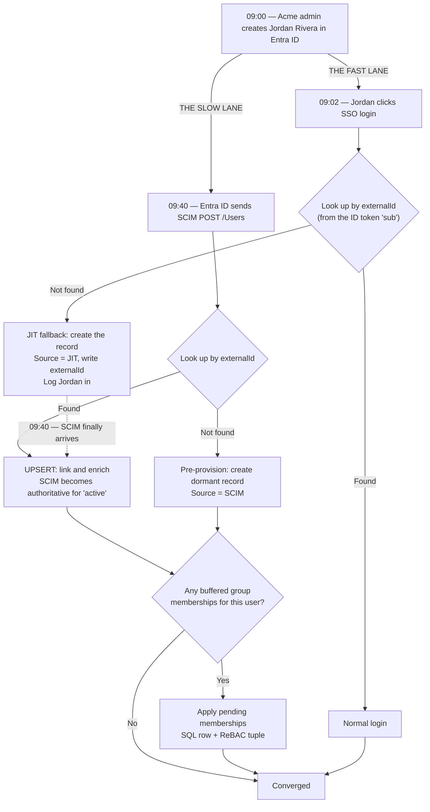
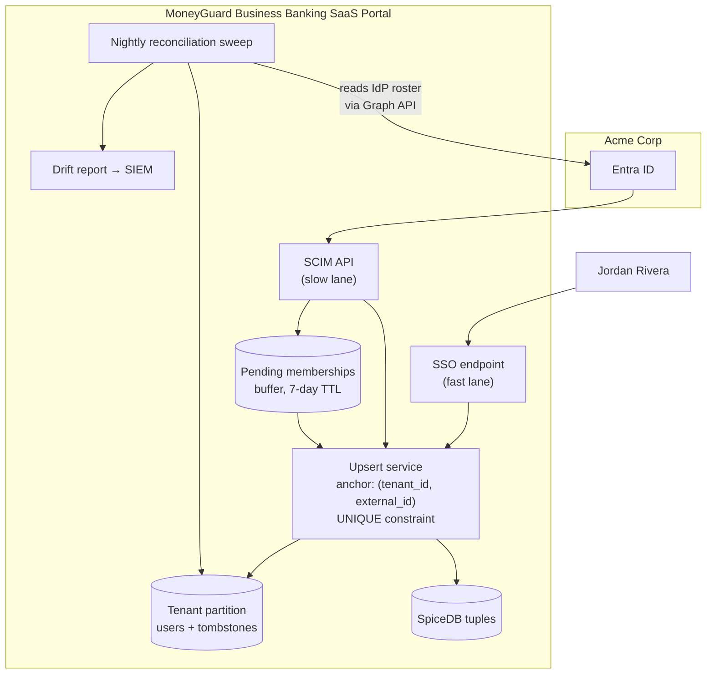

# Handling Sync Race Conditions

## Overview

SCIM and SSO are two completely separate systems moving toward your application on two different clocks. **SSO is instantaneous** — the moment an admin creates an account, the user can click "Sign in". **SCIM is batched** — Entra ID typically runs its provisioning sync every ~40 minutes. Nothing coordinates them. Whichever arrives first wins, and your application has to be correct either way.

This chapter is about the class of bugs that emerges from that gap: users locked out on day one, duplicate accounts, entitlements applied to the wrong record, group members that reference users who don't exist yet, and updates that arrive out of order and silently un-do each other.

🏦 **The MoneyGuard scenario for this chapter:** At 09:00 Acme Corp's IT admin creates Jordan Rivera in Entra ID. The SCIM sync is queued for **09:40**. At 09:02 Jordan's manager says "log into the Business Banking SaaS Portal and get started." Jordan clicks Sign In, MoneyGuard's portal looks in its database, finds nothing, and throws an error. **Jordan is locked out on their first morning because the fast lane beat the slow lane.**

## Why This Matters

- **Day-one lockouts are the most visible provisioning failure.** They generate support tickets, embarrass the customer's IT team, and are entirely avoidable.
- **Duplicate accounts are worse than lockouts.** Entitlements get attached to one record while the user logs into the other, producing "I have the licence but I can't see the feature" bugs that are painful to diagnose.
- **Out-of-order delivery silently reverses security decisions.** A delayed "enable" arriving after a "disable" re-enables a terminated employee, and nothing in the system flags it.
- **Distributed systems fundamentals.** Idempotency, eventual consistency, optimistic concurrency, and reconciliation are exactly what a system-design interviewer is probing for here.

## Key Concepts

| Term | Expansion | Meaning |
|---|---|---|
| **Race condition** | — | Two independent operations whose outcome depends on arrival order |
| **Fast lane** | — | SSO login — instantaneous |
| **Slow lane** | — | SCIM background sync — batched, ~40 minutes on Entra ID |
| **Upsert** | Update-or-insert | Link to an existing record if present, otherwise create one |
| **Idempotency** | — | Repeating an operation produces the same result as doing it once |
| **Eventual consistency** | — | The systems converge over time rather than being in step at every instant |
| **Optimistic concurrency** | — | Detect conflicting writes with a version/ETag instead of locking |
| **Out-of-order delivery** | — | A later-generated change arriving before an earlier one |
| **Dangling reference** | — | A group membership pointing at a user record that doesn't exist yet |
| **Reconciliation sweep** | — | A periodic full comparison that repairs whatever the push channel dropped |
| **Tombstone** | — | A record kept after deletion so late-arriving updates can be recognised and ignored |

## Detailed Notes

### Concept 1 — The two lanes

When Acme Corp hires Jordan Rivera, two independent systems start moving toward MoneyGuard's portal:

| | **Fast lane — SSO login** | **Slow lane — SCIM sync** |
|---|---|---|
| **Trigger** | Jordan clicks "Sign in" | A timer in Entra ID |
| **Latency** | Instant | Batched, typically ~40 minutes |
| **Carries** | Whatever claims are in the ID token | The full SCIM `User` resource |
| **Reliable?** | Only if the user acts | Yes — retried until it succeeds |
| **Can deprovision?** | No | Yes |

Neither is wrong. They are optimised for different things, and the mismatch is structural — you cannot configure it away. ⚠️ **Design for both arrival orders from the start.**

### Concept 2 — Race one: SSO wins (the day-one lockout)

**The timeline:**

- **09:00** — Admin creates Jordan in Entra ID. SCIM `POST /Users` queued for 09:40.
- **09:02** — Jordan clicks "Sign in with Microsoft."
- **09:02** — MoneyGuard's portal receives a valid ID token, looks up the user, finds nothing.
- **The crash** — "Unknown user." Jordan is locked out for 38 minutes.

**The fix: JIT as a fallback.** Rather than rejecting an authenticated user it has never seen, the portal creates the record on the spot from the token's claims — and, crucially, writes `externalId` from the token's `sub` so the later SCIM message can *link* rather than *duplicate*.

**Then at 09:40**, the SCIM `POST` arrives for a user who already exists. Without upsert logic this returns a duplicate-key error and the customer's sync shows a failure. With upsert, MoneyGuard recognises the `externalId`, updates the record with the richer SCIM attributes, and returns success.

### Concept 3 — Race two: SCIM wins (the happy path)

- **09:40** — SCIM `POST /Users` arrives. No record exists, so MoneyGuard pre-provisions Jordan as a dormant account.
- **10:00** — Jordan logs in via SSO. The lookup by `externalId` finds the record. Straight in, fully configured.

This is the intended flow, and it is why enterprises want SCIM: the admin could have assigned Jordan's payroll workspace at 09:41, before Jordan ever logged in.

### Concept 4 — Upsert: the reconciling primitive

Both paths converge on one rule: **never assume the record does or doesn't exist. Look it up by the immutable anchor and branch.**

```csharp
public async Task<PortalUser> UpsertAsync(string tenantId, string externalId,
                                          UserAttributes incoming, string source)
{
    // The anchor is externalId — never email, never userName.
    var existing = await _users.FindByExternalIdAsync(tenantId, externalId);

    if (existing is null)
    {
        return await _users.InsertAsync(new PortalUser
        {
            Id         = Guid.NewGuid().ToString(),
            TenantId   = tenantId,
            ExternalId = externalId,
            Email      = incoming.Email,
            FirstName  = incoming.FirstName,
            LastName   = incoming.LastName,
            IsActive   = incoming.IsActive,
            Source     = source        // "SCIM" or "JIT" — so you can measure the race
        });
    }

    // Already here — this is the reconciliation, not an error.
    existing.Email     = incoming.Email     ?? existing.Email;
    existing.FirstName = incoming.FirstName ?? existing.FirstName;
    existing.LastName  = incoming.LastName  ?? existing.LastName;
    if (source == "SCIM") existing.IsActive = incoming.IsActive;   // SCIM is authoritative
    existing.Source    = "SCIM";      // SCIM has now taken over as the source of truth

    return await _users.UpdateAsync(existing);
}
```

💡 Note the asymmetry: **SCIM is authoritative for `active`; JIT is not.** A JIT login must never flip a user back to active — otherwise a terminated employee with a cached session could resurrect their own account by logging in.

⚠️ **Do the lookup and insert atomically.** Two simultaneous requests can both find nothing and both insert. Use a unique database constraint on `(tenant_id, external_id)` and catch the violation:

```csharp
try { return await _users.InsertAsync(newUser); }
catch (DbUpdateException ex) when (ex.IsUniqueViolation())
{
    // Someone else inserted between our SELECT and our INSERT — take theirs.
    return await _users.FindByExternalIdAsync(tenantId, externalId);
}
```

The database constraint is the real defence. Application-level checking alone is a race in itself.

### Concept 5 — Idempotency: the same message, twice

Identity providers retry. A response that times out on the network still committed on your side, so the provider sends it again. Your handlers must be **idempotent**: processing the same message twice must leave the system in the same state as processing it once.

| Operation | Idempotent by design? | How to make it so |
|---|---|---|
| `POST /Users` | ❌ No | Look up `externalId` first; return `409` or the existing resource |
| `PUT /Users/{id}` | ✅ Yes | Full replacement is naturally idempotent |
| `PATCH replace active` | ✅ Yes | Setting `false` twice is still `false` |
| `PATCH add members` | ⚠️ Usually | Adding an existing member must be a no-op, not an error |
| `PATCH remove members` | ⚠️ Usually | Removing an absent member must be a no-op, not a `404` |
| `DELETE /Users/{id}` | ⚠️ Careful | A second delete should return `204`, not `500` |

⚠️ The side effects need care too. If `active: false` triggers a "your access has been revoked" email, sending it three times because of retries is a bad customer experience. Guard side effects with a state transition check:

```csharp
if (user.IsActive && !incoming.IsActive)     // only on the actual transition
{
    await _revocation.RevokeUserAsync(user.Id, "scim_deprovision", TimeSpan.FromMinutes(15));
    await _notifications.SendAccessRevokedAsync(user.Id);
}
user.IsActive = incoming.IsActive;           // the state write is always safe to repeat
```

### Concept 6 — Out-of-order delivery, the silent reverser

Retries and parallel workers mean messages can arrive in a different order than they were generated. The dangerous case:

- **10:00** — Admin disables Jordan. SCIM sends `active: false`. **The request times out** and is queued for retry.
- **10:05** — Admin re-enables Jordan briefly, then disables again. Two more messages queue.
- **10:07** — The retried 10:00 message finally lands, **after** the 10:05 messages.

If you apply blindly in arrival order, the final state may be the *older* value. ⚠️ A terminated employee is silently re-enabled and nothing alerts.

**Three defences, in increasing strength:**

**1. Version comparison.** SCIM's `meta.lastModified` on the incoming resource, compared to what you have stored:

```csharp
if (incoming.Meta?.LastModified is DateTime incomingTs &&
    incomingTs < existing.SourceLastModified)
{
    _log.Warning("Stale SCIM update ignored for {User}: incoming {In} < stored {Stored}",
                 existing.Id, incomingTs, existing.SourceLastModified);
    return Ok(ToScim(existing));   // 200 so the provider stops retrying — we did consider it
}
```

**2. Optimistic concurrency with ETags.** You emit `meta.version` and honour `If-Match`; a provider writing against a stale version gets `412 Precondition Failed` and re-reads first. Well-behaved providers do this; not all do, which is why you also need defence 1.

**3. Fail safe on ambiguity.** When you genuinely cannot order two conflicting messages, **prefer the more restrictive outcome**. A wrongly-disabled user files a ticket; a wrongly-enabled terminated employee is a breach.

### Concept 7 — Dangling references: groups before users

A frequent and confusing failure: a `PATCH /Groups` arrives adding member `mg-usr-77f21`, but no such user exists yet — the user's `POST` is later in the batch, or failed, or is still queued.

Three possible responses, and only one is right:

| Response | Consequence |
|---|---|
| Return `400`/`404` | ⚠️ The provider marks the group as failed; the membership may never be retried |
| Silently drop the member | ⚠️ Worst option — sync reports success while the entitlement is missing forever |
| **Buffer it** | ✅ Store a pending membership, resolve it when the user arrives |

```csharp
foreach (var memberId in memberIds)
{
    var user = await _users.FindByIdAsync(TenantId, memberId);
    if (user is null)
    {
        // The user's POST hasn't landed yet. Don't fail, don't drop — remember.
        await _pendingMemberships.RecordAsync(TenantId, groupId, memberId,
                                              expiresAfter: TimeSpan.FromDays(7));
        _metrics.Increment("scim.pending_membership");
        continue;
    }
    await _groups.AddMemberAsync(TenantId, groupId, memberId);
    await _spiceDb.WriteRelationshipAsync("group", groupId, "member", "user", memberId);
}
```

Then, whenever a user is created, drain the buffer:

```csharp
// Called at the end of every user upsert, whether from SCIM or JIT
var pending = await _pendingMemberships.TakeForUserAsync(tenantId, user.Id);
foreach (var groupId in pending)
{
    await _groups.AddMemberAsync(tenantId, groupId, user.Id);
    await _spiceDb.WriteRelationshipAsync("group", groupId, "member", "user", user.Id);
    _audit.Write("scim.pending_membership.resolved", tenantId, user.Id, groupId);
}
```

💡 Give buffered entries a TTL and alert if any survive it. A membership pending for a week means something upstream is genuinely broken, not merely out of order.

### Concept 8 — Deletion and the resurrection problem

Hard-deleting a user creates a nasty race. If a queued `PATCH` for that user arrives after the `DELETE`, your upsert logic sees "no record" and helpfully **re-creates** them — resurrecting a deleted account.

**Use tombstones.** Soft-delete by keeping the row with `DeletedAt` set, so a late message is recognised and ignored rather than treated as a new user:

```csharp
var existing = await _users.FindByExternalIdIncludingDeletedAsync(tenantId, externalId);

if (existing?.DeletedAt is not null)
{
    // A late message for a deleted user. Ignore it — do NOT resurrect.
    // Only an explicit new POST with active:true should undelete.
    _log.Warning("Update ignored for tombstoned user {External}", externalId);
    return Ok();
}
```

This has the added benefit of preserving the audit trail Dana needs to prove the account ever existed and when it ended.

### Concept 9 — The reconciliation sweep (the backstop)

Every push-based system drops messages eventually: an outage longer than the provider's retry window, a bug that returned `200` on a failed write, a `400` that permanently failed an object. Push gets you speed; **reconciliation gets you correctness.**

A nightly job per tenant:

1. Page through the IdP's users via **its** API (Microsoft Graph, the Okta API).
2. Page through MoneyGuard's records for that tenant.
3. Diff on `externalId`.
4. **In the IdP but not in MoneyGuard** → create (a dropped joiner).
5. **In MoneyGuard but not in the IdP** → ⚠️ **disable, do not delete**, and alert. This is the zombie account detector.
6. **In both, attributes differ** → the IdP wins; update.
7. **In both, `active` differs** → ⚠️ the highest-severity finding. Take the restrictive value and raise an alert.
8. Emit a drift report per tenant.

```csharp
public async Task<DriftReport> ReconcileAsync(string tenantId)
{
    var idpUsers   = await _idp.ListAllUsersAsync(tenantId);
    var localUsers = await _users.ListAllAsync(tenantId);
    var report     = new DriftReport(tenantId);

    var localByExternal = localUsers.ToDictionary(u => u.ExternalId);

    foreach (var idpUser in idpUsers)
    {
        if (!localByExternal.TryGetValue(idpUser.ExternalId, out var local))
        {
            await UpsertAsync(tenantId, idpUser.ExternalId, idpUser.ToAttributes(), "RECONCILE");
            report.Created++;
            continue;
        }

        if (local.IsActive != idpUser.IsActive)
        {
            // The most important finding in the whole sweep.
            local.IsActive = idpUser.IsActive;
            if (!idpUser.IsActive)
                await _revocation.RevokeUserAsync(local.Id, "reconciliation",
                                                  TimeSpan.FromMinutes(15));
            await _users.UpdateAsync(local);
            report.ActiveStateDrift++;
        }
        localByExternal.Remove(idpUser.ExternalId);
    }

    // Anything left is in MoneyGuard but not in the IdP — a zombie candidate.
    foreach (var orphan in localByExternal.Values.Where(u => u.IsActive))
    {
        orphan.IsActive = false;                       // ⚠️ disable, never delete
        await _revocation.RevokeUserAsync(orphan.Id, "orphaned_no_idp_record",
                                          TimeSpan.FromMinutes(15));
        await _users.UpdateAsync(orphan);
        report.OrphansDisabled++;
    }

    _metrics.Gauge("scim.drift", report.Total, tenantId);
    return report;
}
```

💡 **Drift count is your best provisioning health metric.** A tenant whose drift is consistently zero has working SCIM; one with rising drift has a broken integration you can fix before the customer notices.

### Concept 10 — Clock skew and timestamps

If you order messages by timestamps generated on the provider's machines, remember those clocks are not yours.

- **Always store and compare in UTC.**
- **Allow a skew tolerance** — treat differences under about 30 seconds as "same time" rather than trusting the ordering.
- **Prefer monotonic sources where available**: Okta's system log has an ordered event stream; Microsoft Graph exposes delta tokens. Both beat wall-clock comparison.
- **Record your own receipt time** alongside the provider's `lastModified`, so you can distinguish "generated late" from "delivered late" when debugging.

## Workflow



## Architecture Diagram



## Step-by-Step Process

1. **Choose the anchor: `externalId`, scoped by tenant.** Never email, never `userName`.
2. **Add a unique database constraint on `(tenant_id, external_id)`.** This, not application logic, is what actually prevents duplicates.
3. **Write one `UpsertAsync` used by both SSO and SCIM.** Two code paths guarantee divergent behaviour.
4. **Make SCIM authoritative for `active`; never let a JIT login re-enable someone.**
5. **Record the `Source`** (`SCIM`, `JIT`, `RECONCILE`) on every record, so you can measure how often the race is lost.
6. **Catch unique-constraint violations and re-read** rather than failing.
7. **Guard side effects with a state-transition check**, so retries don't re-send emails or re-fire kill switches.
8. **Compare `meta.lastModified` before applying**, and skip stale updates with a warning and a `200`.
9. **Emit ETags and honour `If-Match`** for optimistic concurrency.
10. **Buffer group memberships that reference unknown users**, with a TTL and an alert.
11. **Drain the buffer at the end of every user upsert.**
12. **Soft-delete with tombstones**, and refuse to resurrect a tombstoned user from a late update.
13. **Run a nightly reconciliation sweep per tenant**, disabling orphans rather than deleting them.
14. **Alert on drift and on pending memberships past TTL.** These are your early warnings.

## Commands and Examples

**1. The constraint that actually prevents duplicates:**

```sql
ALTER TABLE portal_users
  ADD CONSTRAINT uq_portal_users_tenant_external
  UNIQUE (tenant_id, external_id);

-- Support the reconciliation and lookup paths
CREATE INDEX ix_portal_users_tenant_active
  ON portal_users (tenant_id, is_active)
  WHERE deleted_at IS NULL;
```

**2. The shared upsert, called by both lanes:**

```csharp
public async Task<PortalUser> UpsertAsync(
    string tenantId, string externalId, UserAttributes incoming, string source)
{
    var existing = await _users.FindByExternalIdIncludingDeletedAsync(tenantId, externalId);

    // Tombstone guard — a late message must not resurrect a deleted user.
    if (existing?.DeletedAt is not null && source != "SCIM_CREATE")
    {
        _log.Warning("Ignored {Source} update for tombstoned user {Ext}", source, externalId);
        return existing;
    }

    if (existing is null)
    {
        var created = new PortalUser
        {
            Id = Guid.NewGuid().ToString(), TenantId = tenantId, ExternalId = externalId,
            Email = incoming.Email, FirstName = incoming.FirstName,
            LastName = incoming.LastName, IsActive = incoming.IsActive,
            Source = source, SourceLastModified = incoming.LastModified ?? DateTime.UtcNow
        };

        try { await _users.InsertAsync(created); }
        catch (DbUpdateException ex) when (ex.IsUniqueViolation())
        {
            // Lost the insert race — adopt the row the other request created.
            existing = await _users.FindByExternalIdAsync(tenantId, externalId);
            return await ApplyAsync(existing!, incoming, source);
        }

        await DrainPendingMembershipsAsync(tenantId, created.Id);
        return created;
    }

    return await ApplyAsync(existing, incoming, source);
}

private async Task<PortalUser> ApplyAsync(
    PortalUser user, UserAttributes incoming, string source)
{
    // Out-of-order guard
    if (incoming.LastModified is DateTime ts &&
        ts < user.SourceLastModified.AddSeconds(-30))     // 30s clock-skew tolerance
    {
        _metrics.Increment("scim.stale_update_ignored");
        return user;
    }

    user.Email     = incoming.Email     ?? user.Email;
    user.FirstName = incoming.FirstName ?? user.FirstName;
    user.LastName  = incoming.LastName  ?? user.LastName;

    // ⚠️ Only SCIM may change 'active'. A JIT login must never re-enable a leaver.
    if (source.StartsWith("SCIM") || source == "RECONCILE")
    {
        if (user.IsActive && !incoming.IsActive)        // the transition, not the state
        {
            await _revocation.RevokeUserAsync(user.Id, source, TimeSpan.FromMinutes(15));
            await _apiKeys.RevokeAllForUserAsync(user.Id);
            await _spiceDb.DeleteAllRelationshipsForSubjectAsync("user", user.Id);
        }
        user.IsActive = incoming.IsActive;
    }

    user.SourceLastModified = incoming.LastModified ?? user.SourceLastModified;
    user.Source = source;
    await _users.UpdateAsync(user);
    await DrainPendingMembershipsAsync(user.TenantId, user.Id);
    return user;
}
```

**3. Buffering a membership for a user who hasn't arrived:**

```sql
CREATE TABLE pending_group_memberships (
    tenant_id     VARCHAR(64)  NOT NULL,
    group_id      VARCHAR(64)  NOT NULL,
    member_ref    VARCHAR(128) NOT NULL,   -- the id SCIM sent, not yet resolvable
    received_at   TIMESTAMPTZ  NOT NULL DEFAULT now(),
    expires_at    TIMESTAMPTZ  NOT NULL,
    PRIMARY KEY (tenant_id, group_id, member_ref)
);

-- Alert on anything that has been waiting too long: something upstream is broken.
SELECT tenant_id, count(*) AS stuck
  FROM pending_group_memberships
 WHERE expires_at < now()
 GROUP BY tenant_id;
```

**4. The reconciliation report you actually look at:**

```json
{
  "tenant": "acme_corp",
  "ran_at": "2026-03-04T02:00:00Z",
  "idp_users": 512,
  "local_users": 514,
  "created": 0,
  "attribute_drift": 3,
  "active_state_drift": 1,
  "orphans_disabled": 2,
  "pending_memberships_expired": 0,
  "verdict": "INVESTIGATE",
  "notes": "2 local users have no Entra ID record (disabled + revoked). 1 user was active locally but disabled in the IdP — corrected."
}
```

⚠️ `active_state_drift: 1` is the line that matters. It means for some period a terminated person retained access, and Dana will want to know how long.

**5. Detecting the race in production:**

```sql
-- What fraction of users were created by the JIT fallback rather than SCIM?
SELECT tenant_id,
       count(*) FILTER (WHERE source = 'JIT')  AS jit_created,
       count(*) FILTER (WHERE source = 'SCIM') AS scim_created,
       round(100.0 * count(*) FILTER (WHERE source = 'JIT') / count(*), 1) AS jit_pct
  FROM portal_users
 WHERE created_at > now() - interval '30 days'
 GROUP BY tenant_id
 ORDER BY jit_pct DESC;
```

A high `jit_pct` for a tenant means either their SCIM isn't configured, or their sync is too slow for how quickly their people start work. Both are worth a conversation with the customer.

## Best Practices

- **Anchor on `(tenant_id, external_id)` with a unique database constraint.** Application-level checks alone are themselves a race.
- **One upsert function for both lanes.** Divergent code paths guarantee divergent behaviour.
- **SCIM is authoritative for `active`.** JIT must never re-enable.
- **Guard side effects with state-transition checks**, not state checks, so retries are harmless.
- **Compare `meta.lastModified` with a skew tolerance** before applying an update.
- **Buffer dangling group memberships** rather than failing or silently dropping them.
- **Soft-delete with tombstones** so late messages can't resurrect deleted users.
- **Prefer the restrictive outcome** whenever ordering is genuinely ambiguous.
- **Run reconciliation nightly per tenant**, and treat drift as a monitored metric.
- **Disable orphans, never delete them** — deletion destroys the evidence and can't be undone.
- **Record `Source` on every write** so the race is measurable rather than theoretical.

## Common Mistakes

- ⚠️ **Rejecting the login when the user isn't found.** The day-one lockout — the single most common provisioning complaint.
- ⚠️ **Throwing a duplicate-key error when SCIM arrives after JIT.** The customer's sync dashboard fills with red for a situation you designed for.
- ⚠️ **Matching on email instead of `externalId`.** A surname change produces a duplicate and orphans the entitlements.
- ⚠️ **Letting a JIT login set `active: true`.** A terminated user with a valid IdP session can resurrect their own account.
- ⚠️ **No unique constraint**, relying on a `SELECT` then `INSERT`. Two concurrent requests both insert.
- ⚠️ **Applying updates blindly in arrival order.** A stale "enable" silently reverses a termination.
- ⚠️ **Returning `400` for a membership referencing an unknown user.** The provider marks the group failed and may never retry.
- ⚠️ **Silently dropping the unresolvable member.** Worse still — the sync reports success while the entitlement is permanently missing.
- ⚠️ **Hard-deleting users.** Late messages resurrect them, and the audit trail is gone.
- ⚠️ **No reconciliation sweep.** Push-only means every dropped message is permanent and invisible.
- ⚠️ **Reconciliation that deletes orphans.** One bad IdP API page and you have wiped real customer data.
- ⚠️ **Comparing timestamps without UTC normalisation or skew tolerance.** You will reject valid updates.

## Pro Tips

- 💡 **Name the two lanes out loud** — "the fast lane is SSO, the slow lane is the SCIM batch." Interviewers recognise immediately that you have operated this.
- 💡 **Make the unique constraint the safety net, not the check.** Catching the violation and re-reading is more correct than any amount of pre-checking.
- 💡 **Track `jit_pct` per tenant.** It is a customer-health metric disguised as a database column.
- 💡 **Alert on `active_state_drift` at high severity.** It is the only reconciliation finding that represents an actual security exposure.
- 💡 **Log both timestamps** — the provider's `lastModified` and your receipt time. Debugging ordering bugs without both is guesswork.
- 💡 **Test with the clock skewed.** Set a test provider's clock two minutes fast and confirm you still converge.
- 💡 **Make reconciliation dry-runnable.** A `--report-only` mode you can run against production builds confidence before you let it write.
- 💡 **Treat "pending membership expired" as a page-worthy alert.** It means the buffer is masking a genuine upstream failure.

## Real-World Use Cases

1. **Jordan's day one.** Jordan logs in at 09:02, JIT creates the record, and the 09:40 SCIM message links to it via `externalId`. No lockout, no duplicate, and the payroll workspace lands automatically.
2. **The double `POST`.** Entra ID's first create times out after MoneyGuard committed. The retry hits the `externalId` check and returns `409` with a proper error body; Entra ID matches the existing user and moves on.
3. **Group before user.** A `PATCH /Groups` adds a member whose `POST` is later in the batch. MoneyGuard buffers it, then applies it 90 seconds later when the user lands — writing both the SQL row and the SpiceDB tuple.
4. **The reversed termination.** A retried "enable" from before a termination arrives after the "disable". The `lastModified` comparison rejects it, logs a warning, and the terminated employee stays out.
5. **Weekend outage.** MoneyGuard's SCIM API is down for six hours. Entra ID retries with backoff and every queued change lands afterwards; the nightly reconciliation confirms zero drift.
6. **The zombie sweep.** Reconciliation finds two active MoneyGuard users with no Entra ID record — accounts from a `400` that permanently failed months earlier. They are disabled and revoked, and Dana gets the report.
7. **The customer with 40% JIT.** The `jit_pct` dashboard shows one tenant creating most users through the fallback. Investigation reveals they never finished configuring SCIM — caught by a metric, not a support ticket.

## Key Takeaways

- **Two lanes, two clocks:** SSO is instant, SCIM is batched (~40 minutes). Nothing coordinates them, so handle **both arrival orders**.
- **Upsert on `(tenant_id, external_id)`** is the reconciling primitive, backed by a **unique database constraint** — not just an application check.
- **JIT is the safety net** that prevents day-one lockouts; **SCIM is authoritative** for `active`, and JIT must never re-enable.
- **Idempotency is mandatory** because providers retry; guard **side effects** with state-transition checks.
- **Out-of-order delivery silently reverses security decisions.** Defend with `meta.lastModified` comparison, ETags/`If-Match`, and a bias toward the restrictive outcome.
- **Buffer dangling group memberships** with a TTL — never fail, never silently drop.
- **Tombstone deletions** so late messages cannot resurrect a removed user.
- **Push gets you speed; reconciliation gets you correctness.** Run a nightly sweep, disable orphans (never delete), and monitor drift.
- **Make the race measurable**: record `Source` on every record and track `jit_pct` and `active_state_drift`.

## Glossary

| Term | Definition |
|---|---|
| **Clock skew** | Disagreement between the clocks of two systems, which breaks naive timestamp ordering. |
| **Dangling reference** | A group membership referring to a user record that does not yet exist. |
| **Drift** | Divergence between the identity provider's state and the application's state. |
| **Eventual consistency** | The property that systems converge over time rather than matching at every instant. |
| **Fast lane** | The SSO login path — instantaneous. |
| **Idempotency** | Repeating an operation yields the same result as performing it once. |
| **Optimistic concurrency** | Detecting conflicting writes via a version/ETag instead of locking. |
| **Out-of-order delivery** | A message generated earlier arriving after one generated later. |
| **Pending membership buffer** | A store for group memberships awaiting the arrival of their user record. |
| **Race condition** | A situation whose outcome depends on the relative timing of independent operations. |
| **Reconciliation sweep** | A periodic full comparison and repair between the IdP and the application. |
| **Slow lane** | The batched SCIM provisioning path. |
| **Tombstone** | A retained record marking a deleted resource, so late updates are recognised and ignored. |
| **Upsert** | Update-or-insert against an immutable anchor. |

## Revision Notes

- **Fast lane = SSO (instant). Slow lane = SCIM (~40 min batch).** Design for either winning.
- **Anchor = `(tenant_id, external_id)`** with a **UNIQUE constraint**; catch the violation and re-read.
- **One upsert function, two callers.** `Source` column records which lane created the row.
- **SCIM authoritative for `active`; JIT must never re-enable.**
- **Idempotency**: `POST` needs an explicit check; `PATCH`/`PUT` are naturally idempotent; **guard side effects on the transition**.
- **Out-of-order** ⇒ compare `meta.lastModified` (UTC, ~30 s skew tolerance), use **ETag / `If-Match`**, and **prefer restrictive** when ambiguous.
- **Dangling membership** ⇒ **buffer with TTL**, drain on user creation, alert on expiry. Never `400`, never silently drop.
- **Tombstone** deletions to prevent resurrection.
- **Nightly reconciliation**: create missing, **disable (never delete)** orphans, correct drift, report.
- Metrics that matter: **`jit_pct`**, **drift count**, **`active_state_drift`**, **expired pending memberships**.

## Interview Questions

**Q1. Describe the SCIM/SSO race condition and how you'd solve it.**
SSO and SCIM run on completely different clocks: SSO is instantaneous the moment an admin creates the account, while SCIM provisioning is batched — Entra ID typically syncs every forty minutes. So a keen new hire regularly logs in before their record has been provisioned, and a naive implementation rejects them with "unknown user" on their first morning. The fix is twofold. JIT provisioning as a fallback creates the record from the ID token's claims so the user isn't blocked, and critically it writes `externalId` from the token's `sub`. Then when the SCIM message arrives later, upsert logic looks up by `externalId`, finds the existing row, and enriches it rather than throwing a duplicate error. Both arrival orders converge on the same correct state.

**Q2. Why anchor on `externalId` rather than email?**
Because `externalId` is the identity provider's immutable object identifier and email isn't. Emails change constantly — marriages, rebrands, domain migrations after an acquisition. If you key on email, the moment IT updates an address you create a second record while the original keeps its entitlements, so the user logs into an account that can't see the features they were granted. That's a genuinely painful class of bug to diagnose because everything looks correct in isolation. Anchoring on `externalId` makes a rename a simple update. And I'd write `externalId` on the JIT path too, at first login, precisely so the SCIM message can link rather than collide.

**Q3. How do you make SCIM handlers idempotent, and why does it matter?**
It matters because providers retry aggressively — if a response times out after you've already committed, the same message comes again. `PUT` and `PATCH replace` are naturally idempotent since setting a value twice is the same as setting it once. `POST` isn't, so it needs an explicit `externalId` lookup returning `409` or the existing resource rather than a duplicate row. `PATCH add`/`remove` on members need to treat "already a member" and "not a member" as no-ops rather than errors. The subtler part is side effects: if `active: false` fires a revocation and an email, you don't want three of each. So you guard on the *transition* — `if (user.IsActive && !incoming.IsActive)` — rather than on the state, which makes the state write itself safe to repeat.

**Q4. What happens if updates arrive out of order?**
You can silently reverse a security decision, which is the worst kind of bug because nothing alerts. Concretely: a "disable" times out and is queued for retry, an "enable" and a second "disable" are generated afterwards and delivered first, then the retried older message lands last. Applied blindly in arrival order, the final state is the older value and a terminated employee is re-enabled. Three defences: compare the incoming `meta.lastModified` against what you've stored and skip stale updates — returning `200` so the provider stops retrying rather than `4xx`; emit ETags and honour `If-Match` so a well-behaved provider gets `412` and re-reads; and when ordering is genuinely ambiguous, take the more restrictive outcome, because a wrongly-disabled user files a ticket while a wrongly-enabled one is a breach.

**Q5. A `PATCH /Groups` adds a member you've never heard of. What do you do?**
Buffer it — don't fail and definitely don't silently drop it. Returning `400` or `404` causes the provider to mark the group operation as failed, and depending on the provider the membership may never be retried. Silently dropping is worse: the sync reports success while the entitlement is permanently missing, so the customer believes it worked. Instead I write a pending-membership row keyed on tenant, group and the unresolved member reference, with a TTL of about a week, and return success. Then every user upsert — from SCIM, JIT, or reconciliation — drains the buffer for that user, applying both the SQL membership and the authorization tuple. And I alert if anything sits in the buffer past its TTL, because that means something upstream is genuinely broken rather than merely out of order.

**Q6. Why do you need a reconciliation sweep if SCIM already pushes changes?**
Because push-based systems drop messages and you have no way to know. An outage longer than the provider's retry window, a bug that returned `200` on a failed write, a `400` that permanently failed one object — each leaves a silent, permanent divergence. Push gets you speed; reconciliation gets you correctness. So I run a nightly per-tenant job that pages the IdP's roster via its own API, diffs on `externalId`, creates anything missing, corrects attribute drift, and — the important one — finds users active locally with no IdP record, which are exactly the zombie accounts that fail audits. Those get disabled and revoked, never deleted, because one bad API page shouldn't wipe customer data. And the drift count becomes a monitored metric that tells you which customers' integrations are quietly broken.

**Q7. Why soft-delete rather than hard-delete users?**
Two reasons. First, the resurrection race: if a queued update for a user arrives after you've hard-deleted them, your upsert logic sees no record and helpfully creates one, bringing a deleted account back to life with no audit trail explaining how. A tombstone — the row retained with `DeletedAt` set — lets you recognise a late message and ignore it. Second, evidence: the auditor's question is "did this person have access, and when did it end?", and a deleted row cannot answer it. Soft delete preserves that history along with everything attached to it. The general principle in identity systems is that deletion destroys the thing you'll later be asked to prove.

**Q8. How would you detect that this is going wrong in production?**
Four signals. The proportion of users created via the JIT fallback rather than SCIM, per tenant — a high number means either SCIM isn't configured or the sync is too slow for that customer's onboarding pace, and it's a customer-health signal you'd otherwise learn from a support ticket. Reconciliation drift count, tracked as a gauge per tenant, where a rising trend means a broken integration. `active_state_drift` specifically, alerted at high severity, because it's the only finding that represents actual security exposure — someone had access who shouldn't have. And pending memberships past their TTL, which means the buffer is masking a real upstream failure. Together those turn a class of silent, eventually-discovered bugs into monitored metrics.

## Practice Exercises

1. **Trace both orders.** Write the complete state of MoneyGuard's `portal_users` row for Jordan Rivera at 09:01, 09:03, 09:41 and 10:00, under two scenarios: (a) Jordan logs in at 09:02, (b) Jordan doesn't log in until 10:00. Include every column that changes and identify the exact moment SCIM becomes authoritative.

2. **Break the upsert.** Two SCIM `POST /Users` requests for the same `externalId` arrive simultaneously on two application servers. Walk through what happens with only an application-level `SELECT`-then-`INSERT`, then rewrite the code so it is correct, and state precisely which database feature makes it correct.

3. **Order the messages.** Four SCIM messages for one user are generated at 10:00 (`active: false`), 10:05 (`active: true`), 10:06 (`active: false`) and 10:07 (a name change), but arrive in the order 10:05, 10:07, 10:00, 10:06. Write the final state under (a) blind application, (b) `lastModified` comparison. Then design a test that would have caught the bug in (a).

4. **Design the reconciliation.** Write the full specification for MoneyGuard's nightly sweep: what it reads, what it compares, what action it takes for each of the five possible diff outcomes, what it must never do, what it reports, and which findings page someone at 02:00 versus which wait for the morning. Include how you would safely dry-run it against production.

5. **Instrument the race.** Design the dashboard MoneyGuard's provisioning team looks at every morning. Specify each metric, its source, its alert threshold, and — for each one — the exact customer-visible problem it is designed to catch before a support ticket arrives.

---

⬅ Back to [Module 05 README](./README.md) · [Main README](../README.md) · [MoneyGuard Scenario](../SCENARIO.md)
⬅ Previous: [SCIM Protocol Deep Dive](./02_SCIM_Protocol_Deep_Dive.md)
