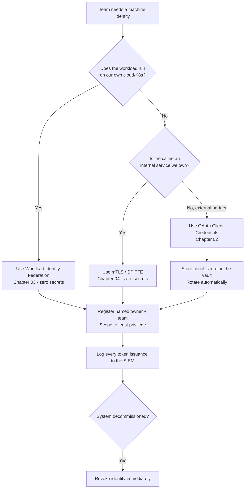
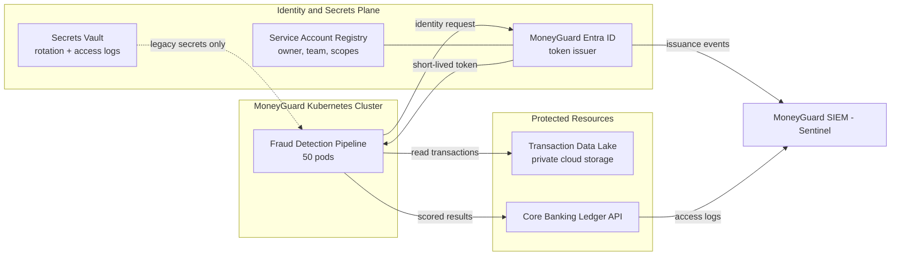

# Service Accounts and API Keys

## Overview

Not every identity in a bank belongs to a person. At MoneyGuard Bank, roughly 95% of the traffic hitting internal APIs is *machine talking to machine* — batch jobs, microservices, CI/CD pipelines, and ML models. Those machines still need to prove who they are.

A **service account** is a digital identity used exclusively by software, never by a human. An **API key** is the simplest (and weakest) credential you can hand a service account: a long random string that acts as a password.

This chapter covers what service accounts are, why they are the single most abused identity type in most enterprises, and why static API keys are the "Basic Auth of machines" — the thing every later chapter in this module exists to replace.

🏦 **The MoneyGuard scenario for this whole module:** The **Fraud Detection Pipeline** runs as 50 Kubernetes pods that must read transaction data from MoneyGuard's private cloud storage and call the **Core Banking Ledger** API — *without a hardcoded password anywhere in the container image*. This chapter shows the naive way. The next three chapters fix it.

## Why This Matters

- **Machines outnumber humans.** MoneyGuard has ~50,000 employees but hundreds of thousands of non-human identities (NHIs). Whatever rigor you apply to Priya's teller account, you owe the machines too.
- **There is no MFA safety net.** If Eve steals Priya's password, MFA and "impossible travel" alerts fire. If Eve steals the Fraud Detection Pipeline's API key, *nothing fires*. It just works, silently, from anywhere on earth.
- **Leaked keys are the #1 breach vector.** Static keys end up in Git history, Docker image layers, CI logs, and Slack messages. They rarely expire.
- **Auditors ask.** Dana Cole (Compliance) has to answer "who accessed the Core Banking Ledger last quarter?" If three systems share one credential, the honest answer is "we cannot tell" — which is a SOX audit finding.

## Key Concepts

| Term | Plain-English meaning |
|---|---|
| **Service account** | A login identity owned by software, not a person. No interactive login, no MFA. |
| **Non-Human Identity (NHI)** | The umbrella term for all machine identities: service accounts, workload identities, bots, certificates. |
| **API key** | A long random string sent with every request that acts as both username and password. |
| **Bearer credential** | Anything where *possession = authorization*. Whoever holds it can use it, from anywhere. |
| **Secret sprawl** | The same secret copied into config files, images, wikis, and pipelines until nobody knows where it all lives. |
| **Orphaned account** | A service account whose owning system was decommissioned but whose credential is still valid. |
| **Least privilege** | Give the identity only the exact permissions it needs — nothing "just in case". |
| **Secrets vault** | A managed store (HashiCorp Vault, AWS Secrets Manager, Azure Key Vault) that holds, rotates, and audits secrets. |

## Detailed Notes

### Concept 1 — What makes a service account different from a human account

| Property | Human account (Priya Sharma) | Service account (Fraud Detection Pipeline) |
|---|---|---|
| Interactive login | Yes — types a password | No — never a login screen |
| MFA | Required | Impossible (no human to tap a key) |
| Password rotation | Every 90 days, user-driven | Must be automated or it never happens |
| Behavioral alerting | "Login from Brazil at 3am" is suspicious | Every call looks identical; anomalies are hard to spot |
| Lifecycle trigger | Workday hire/terminate event | Deployment pipeline create/destroy event |
| Owner | The person | **Must be an explicitly named team** — otherwise nobody owns it |

The last row is the one teams forget. Every service account at MoneyGuard must have a named human owner and a named team, recorded at creation. An NHI with no owner is an NHI nobody will ever decommission.

### Concept 2 — Why service accounts are dangerous

Eve loves service accounts because they are usually:

- **Long-lived** — created in 2016, never rotated.
- **Over-privileged** — someone gave it `Admin` to make a deployment work at 2am, and it stayed.
- **Shared** — three apps use `svc_ledger_reader`, so you can't rotate it without breaking all three, and you can't tell which one made a given call.
- **Poorly monitored** — service traffic is "normal", so nothing looks odd.
- **Orphaned** — the batch job was retired; the credential wasn't.

⚠️ **The core asymmetry:** a stolen human credential trips alarms; a stolen machine credential does not.

### Concept 3 — API keys, and exactly why they fail

An API key is just a bearer string:

```
GET /v1/transactions?date=2026-09-03
Host: ledger.moneyguard.internal
X-API-Key: mg_live_9f3a17c4b8e24d0aa5c1e77b3d09f2ac
```

Three fatal flaws:

1. **Secret sprawl.** The key is injected as an environment variable, so it also lives in the Kubernetes manifest, the Helm values file, the CI pipeline variables, and — inevitably — one developer's `appsettings.local.json` that got committed.
2. **The rotation nightmare.** Rotating means coordinating a redeploy of every consumer. So teams don't rotate. MoneyGuard has keys older than some of its employees' careers.
3. **The bearer vulnerability.** The key carries no information about *where* it is being used. Eve can copy it out of a Git repo, paste it into `curl` on a laptop anywhere, and the Core Banking Ledger cannot tell the difference.

### Concept 4 — The three anti-patterns to ban outright

**❌ Shared credentials across systems.** `svc_payment_processor` used by the batch payer, the refund service, and a reporting job. You lose attribution and you lose the ability to rotate.

**❌ Long-lived static secrets in code or images.** A 10-year client secret baked into a Docker layer is permanently readable by anyone who can pull the image — including from your internal registry.

**❌ Using a human account for automation.** "Let's just run the nightly reconciliation as Raj's account." When Raj changes teams, the job breaks — or worse, HR's termination process is bypassed to keep the job alive, which is exactly the finding Dana Cole writes up.

### Concept 5 — The proper taxonomy of non-human identities

| Type | Where it runs | How it authenticates | MoneyGuard example |
|---|---|---|---|
| **Application identity / service principal** | Anywhere, calling an external boundary | OAuth 2.0 Client Credentials (Chapter 02) | Ledger service calling PartnerBank's settlement API |
| **Managed workload identity** | Inside cloud infrastructure | Platform-injected, auto-rotated credentials (Chapter 03) | Fraud Detection Pipeline pods reading the transaction data lake |
| **Pipeline identity** | CI/CD systems | OIDC federation from the CI provider (Chapter 03) | GitHub Actions deploying the Employee Portal |
| **Mesh / peer identity** | Service-to-service inside your own network | Mutual TLS with X.509 certificates (Chapter 04) | Fraud scorer → Core Banking Ledger inside the cluster |

### Concept 6 — Comparing the credential options

| | Static API key | OAuth client credentials | Workload identity federation |
|---|---|---|---|
| Secret stored by the app | Yes, forever | Yes (`client_secret`) | **None** |
| Credential lifetime | Years | Token: minutes; secret: years | Token: minutes; nothing long-lived |
| Rotation | Manual, painful | Manual for the secret | Automatic, invisible |
| Scoped permissions | Usually all-or-nothing | Yes, via `scope` | Yes, via cloud IAM policy |
| Usable if stolen off-box | Yes ✅ (bad) | Yes ✅ (bad) | No — bound to the workload |
| Central revocation | Delete the key | Revoke the client | Delete the trust/role binding |
| Good for | Nothing new. Legacy only. | External partner APIs | Cloud + Kubernetes workloads |

💡 The whole arc of this module is reading that table left to right.

### Concept 7 — Secret management, when you truly cannot avoid a secret

Sometimes a secret is unavoidable (an external partner who only accepts a `client_secret`). Then:

- **Never** store it in source control, a container image, or a plaintext env var checked into a manifest.
- Store it in a vault (HashiCorp Vault / AWS Secrets Manager / Azure Key Vault) with access logging.
- Inject it **just-in-time** into memory at startup; never write it to disk.
- Give every consumer its **own** secret so rotation is independent.
- Automate rotation on a schedule and prove it with a dashboard, not a wiki page.

## Workflow



## Architecture Diagram



## Step-by-Step Process

Raj Patel provisions a machine identity for Alex Kim's Fraud Detection Pipeline:

1. **Register the identity.** Create `svc-fraud-detection-prod` in the registry with owner = Alex Kim, team = Fraud Platform, and a decommission review date.
2. **Choose the credential type.** It runs on Kubernetes in MoneyGuard's cloud → workload identity federation, no secret. (If it were calling PartnerBank, it would be client credentials.)
3. **Scope the permissions.** Read-only on the `moneyguard-transactions-raw` prefix; `POST /v1/fraud-scores` on the Ledger; nothing else.
4. **Bind the identity to the workload.** Link the Kubernetes ServiceAccount to the cloud role — never a shared cluster-wide identity.
5. **Wire up logging.** Every token issuance and every Ledger call is shipped to Sentinel with the identity ID, scopes, timestamp, and target resource.
6. **Set expiry and review.** Tokens live 15 minutes. The identity itself gets an access review every 90 days signed off by Dana Cole.
7. **Tie decommission to deployment.** When the Helm release is deleted, the identity binding is deleted by the same pipeline. No orphans.

## Commands and Examples

**⚠️ The legacy way (what MoneyGuard is migrating off).** A static key in the pod spec:

```yaml
# DO NOT COPY - shown as the anti-pattern
apiVersion: v1
kind: Pod
metadata:
  name: fraud-scorer
spec:
  containers:
    - name: scorer
      image: moneyguard/fraud-scorer:2.4.1
      env:
        - name: LEDGER_API_KEY
          value: "mg_live_9f3a17c4b8e24d0aa5c1e77b3d09f2ac"  # never expires, in Git forever
```

The matching call:

```bash
curl -s https://ledger.moneyguard.internal/v1/transactions \
  -H "X-API-Key: mg_live_9f3a17c4b8e24d0aa5c1e77b3d09f2ac"
```

Eve only needs read access to this repo — or the image, or a CI log — to own the Core Banking Ledger read path.

**A slightly better interim step: vault-injected secret, never on disk.**

```csharp
// C# - the secret is fetched at startup into memory only.
// Note: this still leaves a secret in process memory. Chapters 03/04 remove it entirely.
var vault = new SecretClient(
    new Uri("https://moneyguard-prod.vault.azure.net/"),
    new DefaultAzureCredential());          // platform identity, no password

KeyVaultSecret secret = await vault.GetSecretAsync("PartnerBankClientSecret");
```

**Auditing service accounts — the query Dana Cole runs quarterly.** Every NHI must answer these five columns:

```text
identity_id                 owner        last_used     credential_age   scopes
svc-fraud-detection-prod    Alex Kim     2026-09-03    0d (federated)   lake:read, ledger:score:write
svc-nightly-recon           <none>       2019-11-02    2,497d           ledger:*          <-- ORPHAN, REVOKE
svc-payment-processor       Ops Team     2026-09-03    1,203d           payments:write    <-- ROTATE
```

**A least-privilege policy for the pipeline** (conceptual IAM policy):

```json
{
  "Version": "2012-10-17",
  "Statement": [
    {
      "Sid": "ReadTransactionsOnly",
      "Effect": "Allow",
      "Action": ["storage:GetObject", "storage:ListBucket"],
      "Resource": [
        "mg:storage:::moneyguard-transactions-raw",
        "mg:storage:::moneyguard-transactions-raw/scoring-input/*"
      ]
    },
    {
      "Sid": "DenyEverythingElseSensitive",
      "Effect": "Deny",
      "Action": ["storage:DeleteObject", "storage:PutObject"],
      "Resource": "mg:storage:::moneyguard-transactions-raw/*"
    }
  ]
}
```

## Best Practices

- **One identity per workload per environment.** `svc-fraud-detection-dev` ≠ `svc-fraud-detection-prod`. Never share.
- **Every NHI has a named human owner and team**, recorded at creation and re-confirmed at each access review.
- **Prefer no secret at all.** Reach for workload identity (Chapter 03) or mTLS (Chapter 04) before you reach for a key.
- **If a secret is unavoidable, vault it**, inject it just-in-time, and rotate it automatically.
- **Scope aggressively.** Read-only if it only reads. One API path if it only calls one path.
- **Tie the identity's lifecycle to the deployment's lifecycle** — created and destroyed by the same pipeline.
- **Log identity ID + scope + resource + timestamp** on every issuance and every call. Without this, forensics is guesswork.
- **Alert on the unusual for machines too**: a pipeline that suddenly reads 100× more data, or calls at 3am when it only ever ran at 1am.

## Common Mistakes

- ⚠️ **Giving the service account `Admin` to unblock a deploy** and never walking it back. Temporary elevation becomes permanent.
- ⚠️ **Rotating a shared key at 2pm on a Tuesday** and taking down three unrelated systems.
- ⚠️ **Assuming a private container registry is a safe place for secrets.** Image layers are readable by anyone who can pull.
- ⚠️ **Treating "it's an internal network" as authentication.** Being on the VPN is not an identity.
- ⚠️ **Forgetting the decommission step.** The retired batch job whose credential leaked in an old backup is the classic MoneyGuard incident below.
- ⚠️ **Using a leaver's human account for a cron job**, which forces you to keep a terminated employee's account alive.

## Pro Tips

- 💡 **Rotate on day one, not day 400.** If you rotate a new credential within the first week, you prove the rotation path works while the change is cheap. Teams that "will rotate later" never do.
- 💡 **Make the secure path the easy path.** Give Alex Kim a platform template where a federated identity is three lines of YAML and a static key requires a security exception ticket. Developers follow the path of least resistance — so make that path secure.
- 💡 **Scan for secrets in CI, and fail the build.** Pre-commit hooks plus a repo-history scan catches the majority of sprawl.
- 💡 **Count your NHIs.** Most banks discover they have 10–50× more machine identities than employees. If you don't have the number, you don't have the inventory, and you can't spot orphans.
- 💡 **Give every key a "last used" timestamp.** Anything unused for 90 days is a free, zero-risk deletion candidate.

## Real-World Use Cases

- 🏦 **The orphaned batch job (MoneyGuard's real incident).** A retired nightly job still had an active service account with read access to the transactions database. Its credentials leaked via an old, unsecured backup file. Eve extracted them and quietly replayed data-extraction requests for weeks. Because the traffic came from a "trusted" service account, no behavioral alert fired. **Fix:** all service accounts are now tied to a deployment lifecycle with automatic revocation and short-lived tokens only.
- **CI/CD deploying the Employee Portal.** Previously one shared GitHub Actions secret with production write access for every repo. Now each repo has its own federated identity scoped to its own namespace.
- **Contractor tooling.** Sam Torres's data-extract script ran under his personal account. When his contract ended, the script broke overnight. Now it has its own service account with an expiry date matching the contract end date.
- **PartnerBank settlement.** MoneyGuard calls PartnerBank's external API. PartnerBank only accepts a `client_secret`, so it lives in the vault, rotates every 30 days automatically, and is used by exactly one service.

## Key Takeaways

1. A service account is an identity for software: no interactive login, no MFA, so it must lean on **short-lived, scoped, auditable credentials** instead.
2. Static API keys are bearer credentials that never expire — the machine equivalent of a shared password taped to a monitor.
3. The three deadly anti-patterns: **shared credentials**, **long-lived static secrets**, and **humans' accounts used for automation**.
4. Every NHI needs an **owner, a scope, an expiry, and a decommission trigger**.
5. The whole point of the rest of this module is to remove the secret entirely — via OAuth client credentials, workload identity federation, and mTLS.

## Glossary

- **API key** — A long random string used as a machine password, sent on every request.
- **Bearer credential** — A credential where mere possession grants access; there is no proof of *who* is holding it.
- **CI/CD** — Continuous Integration / Continuous Deployment; automated build and release pipelines.
- **NHI (Non-Human Identity)** — Any identity that belongs to software rather than a person.
- **Orphaned account** — An identity whose owning system no longer exists but whose credential still works.
- **PoLP (Principle of Least Privilege)** — Grant only the minimum permissions needed for the task.
- **Secret sprawl** — Uncontrolled duplication of a secret across code, configs, images, and logs.
- **Service account** — A non-human identity used by an application, job, or pipeline.
- **Service principal** — A cloud/directory term for the object representing an application identity (e.g. in Entra ID).
- **SOX** — Sarbanes-Oxley Act; US regulation driving financial-system audit and access controls.
- **Vault** — A managed secret store with encryption, access control, rotation, and audit logging.

## Revision Notes

- Machines are ~95% of internal traffic; treat their identities with the same rigor as humans' — plus automation, because there is no MFA fallback.
- API key = bearer + eternal + unscoped = worst option. Client credentials = better. Workload identity/mTLS = best.
- Danger checklist for any NHI: **long-lived? over-privileged? shared? unmonitored? orphaned?**
- If a credential can be copied off the box and still work, you have a bearer problem.
- Every service account: owner, scope, expiry, log trail, decommission trigger.
- Vault + just-in-time injection + independent per-consumer secrets + automatic rotation.

## Interview Questions

**Q1. Why can't service accounts use MFA, and what replaces it?**
A: MFA requires a human to perform an interactive gesture (tap a key, present a biometric). Machines have no human in the loop. The replacement is **cryptographic trust**: short-lived tokens, narrowly scoped permissions, platform-attested identity (the hypervisor or OS vouches for the workload), and mutual TLS. The security property you want — "the credential is useless to an attacker who copied it" — is achieved by binding it to the workload rather than by adding a second factor.

**Q2. A team says "we need one API key shared by three services because rotating three keys is too much work." What's your response?**
A: Shared keys destroy attribution — you cannot tell Dana Cole which service made a given Ledger call, which is a SOX finding on its own. They also make rotation a coordinated outage across three teams, which is precisely why nobody rotates. The right answer is one identity per service and *automated* rotation, so three keys is no more work than one. If the effort is the real objection, the fix is platform tooling, not fewer identities.

**Q3. What is the difference between a service account and a workload identity?**
A: A service account is the identity *record* — the thing that exists in a directory with permissions attached. A workload identity is a way of *authenticating* that record without a stored secret: the platform (Kubernetes + cloud IdP, or SPIRE) attests that a specific running workload is who it claims to be, and issues a short-lived credential on the spot. You can have a service account authenticated by a static key (bad) or by workload identity (good).

**Q4. How would you find orphaned service accounts at MoneyGuard?**
A: Join three data sources: (1) the identity registry, (2) authentication/token-issuance logs from Entra ID, and (3) the CMDB or deployment inventory. Flag any identity with no successful authentication in 90 days, or whose owning application is not in the current deployment inventory, or whose named owner is no longer an employee per Workday. Disable first (reversible), then delete after a soak period.

**Q5. Should a service account ever have admin rights?**
A: Only via **Just-In-Time elevation** for a specific, approved operation — for example an infrastructure-as-code deployment that genuinely needs to create roles. The elevation is time-boxed, requires an approval record, and every action taken under it is logged and reviewed. Standing admin on a machine identity is an unmonitored, un-MFA'd, permanently valid path to your crown jewels.

**Q6. An API key was accidentally committed to a public GitHub repo. Walk me through your response.**
A: (1) Revoke the key immediately — do not wait for the redeploy; availability is secondary to containment. (2) Issue a replacement through the vault and redeploy consumers. (3) Pull the access logs for that key ID and look for any call from an unexpected source IP or at an unexpected time since the commit date. (4) Assume compromise: rewriting Git history does not help, because the key was scraped within seconds by bots. (5) Root-cause it: add secret scanning to pre-commit and CI, and migrate that workload to a federated identity so there is no key to leak next time.

**Q7. What does "the credential is a bearer token" actually mean for your threat model?**
A: It means the server can verify *that a valid secret was presented* but not *who presented it or from where*. Any copy works identically. So your threat model must assume that anywhere the secret is written — config file, image layer, env var, log line, memory dump, backup — is an equivalent breach path. That is why the endgame is credentials bound to the workload (mTLS certificates with private keys that never leave the host) rather than copyable strings.

## Practice Exercises

1. **Inventory.** List every non-human identity you would expect the Fraud Detection Pipeline to need end-to-end: reading from the transaction data lake, writing scores to the Core Banking Ledger, pulling its container image, publishing metrics, and being deployed by CI. For each, name the owner, the minimum scope, and the credential type you'd choose.

2. **Anti-pattern hunt.** Take the "legacy way" Kubernetes pod spec in this chapter and write down every distinct place that API key now exists (there are at least six). For each, describe who can read it and how you would remove it.

3. **Design a least-privilege policy.** Write the policy statements for `svc-fraud-detection-prod` so that it can read `scoring-input/*` from `moneyguard-transactions-raw` and `POST` to `/v1/fraud-scores`, but cannot read customer PII, cannot delete anything, and cannot call any other Ledger endpoint. Then write the one test that proves each restriction actually holds.

4. **Orphan detection query.** Sketch the report Dana Cole should receive each quarter. What columns does it need, which systems supply each column, and what is the automatic action for each red flag (never used / owner departed / credential older than 90 days / owning app not deployed)?

5. **Incident tabletop.** Eve obtains the `svc-nightly-recon` credential from an old backup. Write the timeline: what she can do, what MoneyGuard would (and would not) detect today, which single control would have prevented it, and which single control would have detected it fastest.

---

⬅ Back to [Module 06 Index](./README.md) | [Main README](../README.md) | [MoneyGuard Scenario](../SCENARIO.md)
Next: [Chapter 02 — OAuth 2.0 Client Credentials Grant](./02_OAuth_Client_Credentials_Grant.md) ➡
