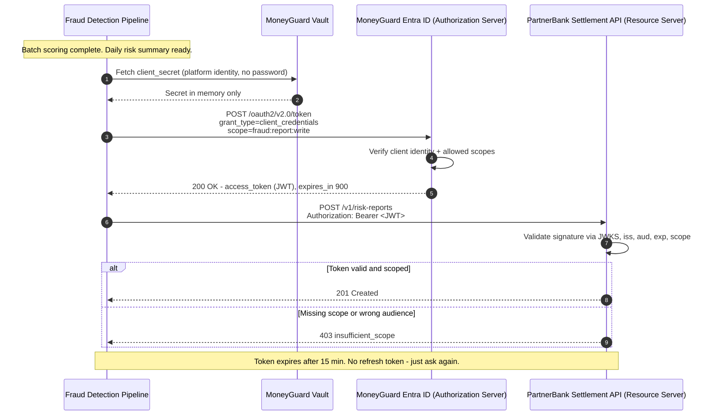
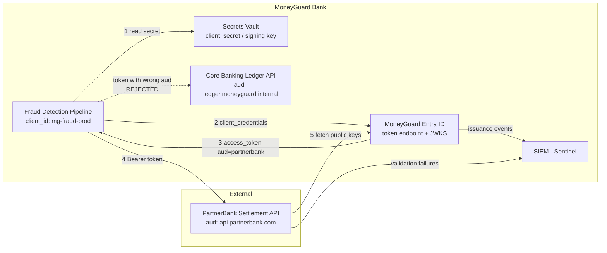

# OAuth 2.0 Client Credentials Grant

## Overview

The **Client Credentials grant** is the OAuth 2.0 flow designed for machines. There is no user, no browser, and no consent screen — an application authenticates *as itself* to an authorization server and receives a short-lived access token.

It is the direct upgrade from the static API keys of [Chapter 01](./01_Service_Accounts_And_API_Keys.md): instead of shipping a permanent password to every API, the application holds one credential, exchanges it for a token that lives 15 minutes, and sends that token onward.

🏦 **MoneyGuard scenario:** The **Fraud Detection Pipeline** finishes scoring a batch of transactions and must push a daily risk summary to **PartnerBank**, an external partner MoneyGuard does not control. PartnerBank will not accept MoneyGuard's internal certificates or Kubernetes identities — it is outside the trust boundary. The only thing that crosses the public internet cleanly is an OAuth access token. This chapter is that flow.

If you have not read the OAuth basics, start with [Module 02 — AuthN & Federation](../02_AuthN_Federation/README.md).

## Why This Matters

- **It is the interoperable standard.** Every major IdP (MoneyGuard Entra ID, Okta, Auth0, Ping) and every API gateway speaks it. When you integrate with an external party, this is what they will ask for.
- **It shrinks the blast radius in time.** A leaked API key is valid forever; a leaked access token is valid for 15 minutes.
- **It gives you scopes.** `POST /payments` becomes possible while `GET /customers` stays impossible, enforced centrally rather than in each API's code.
- **It centralises revocation and audit.** Raj Patel disables one client in Entra ID and every downstream API stops honouring its new tokens. Dana Cole gets one issuance log covering every machine.
- **It has a famous limitation.** The application still needs a `client_secret` to get the token — the **Secret Zero problem** — which is exactly what Chapters 03 and 04 solve. Understanding *why* client credentials is not the endgame is a standard interview probe.

## Key Concepts

| Term | Plain-English meaning |
|---|---|
| **Grant type** | The specific OAuth "recipe" for getting a token. `client_credentials` is the machine recipe. |
| **Client ID** | A public, non-secret identifier for the calling application. |
| **Client secret** | The application's password. Confidential; must live in a vault. |
| **Authorization Server (AS)** | The token issuer — MoneyGuard Entra ID. |
| **Resource Server (RS)** | The API being protected — PartnerBank's settlement API, or MoneyGuard's Core Banking Ledger. |
| **Access token** | The short-lived credential the client presents to the resource server, usually a JWT. |
| **Scope** | A named permission requested by the client and stamped into the token (`fraud:report:write`). |
| **Audience (`aud`)** | Which API the token is *for*. A token for API A must be rejected by API B. |
| **`private_key_jwt`** | A stronger client authentication method: sign a JWT with a private key instead of sending a shared secret. |
| **mTLS client auth** | The strongest: authenticate the client with a TLS certificate (see [Chapter 04](./04_Mutual_TLS_mTLS.md)). |
| **Secret Zero** | The bootstrapping paradox: you need a secret to fetch the secret. |

## Detailed Notes

### Concept 1 — How the grant works, conceptually

There are only two round trips:

1. **Token request.** The client POSTs to the authorization server's token endpoint with `grant_type=client_credentials`, its identity (client ID + secret, or a signed JWT, or a TLS certificate), and the `scope` it wants.
2. **API call.** The client puts the returned access token in an `Authorization: Bearer …` header and calls the resource server, which validates the signature, issuer, audience, expiry, and scope.

No user is involved anywhere. There is **no refresh token** in this grant — when the token expires the client simply asks for a new one, because it can re-authenticate at any time on its own.

### Concept 2 — Why there is no refresh token (a favourite interview question)

Refresh tokens exist so an app can keep acting on behalf of a *user* who is no longer at the keyboard. In client credentials there is no user and the client holds its own credential permanently, so a refresh token would add a second long-lived secret for zero benefit. ⚠️ If an IdP hands you a refresh token on a client-credentials response, that is a misconfiguration, not a feature.

### Concept 3 — The three ways a client can authenticate

| Method | What is sent | Strength | When MoneyGuard uses it |
|---|---|---|---|
| `client_secret_post` / `client_secret_basic` | A shared secret string | Weakest — a bearer secret | Legacy integrations only |
| `private_key_jwt` | A short-lived JWT signed by the client's private key | Strong — the secret never leaves the client | Default for new external integrations |
| `tls_client_auth` (mTLS) | An X.509 client certificate during the TLS handshake | Strongest — bound to the machine | Regulated flows (PSD2/Open Banking) |

💡 With `private_key_jwt`, MoneyGuard registers only a **public** key with PartnerBank. Even a full breach of PartnerBank cannot leak a credential that impersonates MoneyGuard — there is nothing to leak.

### Concept 4 — Scopes and audiences: the two claims that stop lateral movement

A token is not "access to MoneyGuard." It is access to **one audience** with **specific scopes**.

- `aud: "https://api.partnerbank.com"` — the Core Banking Ledger must reject this token even though it is validly signed by MoneyGuard Entra ID.
- `scope: "fraud:report:write"` — PartnerBank's settlement endpoint must reject it for `DELETE /accounts`.

⚠️ **The most common production bug in this flow** is a resource server that validates the signature and expiry but forgets `aud`. That turns any token issued anywhere in the estate into a universal key.

### Concept 5 — Sender-constrained tokens (making a stolen token useless)

A plain access token is still a bearer token: for its 15-minute life, whoever holds it can use it. Two standards fix that:

- **mTLS-bound tokens (RFC 8705).** The AS embeds a hash of the client's TLS certificate in the token's `cnf` (confirmation) claim. The RS checks that the certificate on the current connection matches. Eve's laptop has the token but not the private key, so the call fails.
- **DPoP — Demonstrating Proof of Possession (RFC 9449).** The client signs each request with a key it holds, and the token carries the key's thumbprint. Same effect, no TLS-layer plumbing required.

This is the answer to "how do you protect the 15-minute window?"

### Concept 6 — The Secret Zero problem

The flow is mathematically sound, but ask the obvious question: **where does the Fraud Detection Pipeline keep the `client_secret`?**

- In the container image? Anyone who can pull the image has it.
- In an environment variable? It is in the manifest, the CI variables, and any memory dump.
- In Azure Key Vault or AWS Secrets Manager? Better — but now, *how does the pipeline authenticate to the vault?* It needs a password to get the password.

That infinite regress is **Secret Zero**. Cloud platforms break the loop with platform-attested identity (Managed Identities, IAM roles, IRSA) — the subject of [Chapter 03](./03_Workload_Identity_Federation.md).

⚠️ And even once the vault is unlocked without a password, the secret is now sitting in the pipeline's memory. If Eve breaches that pod, she copies the secret to her own laptop and mints valid tokens from anywhere. That residual **bearer vulnerability** is what mTLS and SPIFFE ([Chapter 04](./04_Mutual_TLS_mTLS.md)) eliminate.

### Concept 7 — When to use client credentials, and when not to

| Situation | Use client credentials? |
|---|---|
| Calling an **external** partner API across the internet | ✅ Yes — it's the only thing they'll accept |
| Calling your **own** internal service inside the cluster | ❌ Prefer mTLS/SPIFFE — no secret at all |
| Calling a **cloud managed service** (object storage, key vault) | ❌ Prefer cloud workload identity — they don't speak your IdP's tokens |
| Acting **on behalf of a user** (Priya's data) | ❌ Wrong grant. Use authorization code + PKCE, or token exchange |
| CI/CD pipeline deploying to production | ❌ Prefer OIDC federation from the CI provider |

⚠️ The single worst misuse: using client credentials and then passing a `user_id` in the request body to "act as" Priya. The token proves nothing about Priya, so you have silently rebuilt an unauthenticated admin API.

## Workflow



## Architecture Diagram



## Step-by-Step Process

1. **Register the client.** Raj Patel creates an app registration `mg-fraud-prod` in MoneyGuard Entra ID. He records the owner (Alex Kim), the allowed audiences, and the allowed scopes.
2. **Choose the client authentication method.** For a new integration, `private_key_jwt`: MoneyGuard generates a key pair, keeps the private key in the vault, and shares only the public key (via a JWKS URL) with PartnerBank.
3. **Grant scopes, not roles.** `fraud:report:write` only. No wildcard.
4. **The workload gets its credential.** At startup the pipeline authenticates to the vault using its platform identity (Chapter 03) and loads the signing key into memory.
5. **Request a token.** POST to the token endpoint with `grant_type=client_credentials`, the client assertion, and the requested scope + audience.
6. **Cache the token.** Reuse it until ~60 seconds before `exp`. Do not fetch a fresh token per request — that hammers the IdP and is the most common cause of self-inflicted rate limiting.
7. **Call the API.** `Authorization: Bearer <token>`.
8. **The resource server validates.** Signature against the IdP's JWKS, then `iss`, `aud`, `exp`, `nbf`, and the required `scope`. All five, every time.
9. **Handle 401 vs 403 correctly.** `401` → token expired or invalid, so refetch a token and retry once. `403 insufficient_scope` → a configuration problem; do not retry, alert instead.
10. **Log and review.** Every issuance lands in Sentinel; the client's scopes are reviewed quarterly.

## Commands and Examples

**The token request (shared secret — the legacy form):**

```bash
curl -X POST https://login.moneyguard.com/oauth2/v2.0/token \
  -H "Content-Type: application/x-www-form-urlencoded" \
  -d "grant_type=client_credentials" \
  -d "client_id=mg-fraud-prod" \
  -d "client_secret=$MG_FRAUD_CLIENT_SECRET" \
  -d "scope=https://api.partnerbank.com/fraud:report:write"
```

**The token response:**

```json
{
  "token_type": "Bearer",
  "expires_in": 900,
  "ext_expires_in": 900,
  "access_token": "eyJhbGciOiJSUzI1NiIsImtpZCI6Im1nLTIwMjYtMDkifQ.eyJ..."
}
```

Note what is **not** there: no `refresh_token`, no `id_token`. There is no user, so there is no ID token.

**The decoded access token payload — the claims the resource server must check:**

```json
{
  "iss": "https://login.moneyguard.com/9f1c.../v2.0",
  "aud": "https://api.partnerbank.com",
  "sub": "mg-fraud-prod",
  "azp": "mg-fraud-prod",
  "scp": "fraud:report:write",
  "iat": 1772539200,
  "nbf": 1772539200,
  "exp": 1772540100,
  "cnf": { "x5t#S256": "bwcK0esc3ACC3DB2Y5_lESsXE8o9ltc05O89jdN-dg2" }
}
```

The `cnf` claim is the mTLS binding from Concept 5: this token only works on a TLS connection using that exact client certificate.

**The stronger client assertion (`private_key_jwt`):**

```bash
curl -X POST https://login.moneyguard.com/oauth2/v2.0/token \
  -d "grant_type=client_credentials" \
  -d "client_id=mg-fraud-prod" \
  -d "client_assertion_type=urn:ietf:params:oauth:client-assertion-type:jwt-bearer" \
  -d "client_assertion=eyJhbGciOiJSUzI1NiIsIng1dCI6Ii4uLiJ9.eyJpc3MiOiJtZy1mcmF1ZC1wcm9kIiwic3ViIjoibWctZnJhdWQtcHJvZCIsImF1ZCI6Imh0dHBzOi8vbG9naW4ubW9uZXlndWFyZC5jb20vb2F1dGgyL3YyLjAvdG9rZW4iLCJqdGkiOiI3ZjNhIiwiZXhwIjoxNzcyNTM5MzAwfQ.SIG" \
  -d "scope=https://api.partnerbank.com/fraud:report:write"
```

The assertion is a JWT whose `aud` is the **token endpoint**, with a one-time `jti` and a ~60-second lifetime, so it cannot be replayed.

**Client side (C#, with correct caching):**

```csharp
public sealed class PartnerBankClient
{
    private readonly IMemoryCache _cache;
    private readonly HttpClient _http;

    private async Task<string> GetTokenAsync(CancellationToken ct)
    {
        // Cache until 60s before expiry - never fetch a token per request.
        if (_cache.TryGetValue("partnerbank_token", out string cached)) return cached;

        var response = await _http.RequestClientCredentialsTokenAsync(
            new ClientCredentialsTokenRequest
            {
                Address      = "https://login.moneyguard.com/oauth2/v2.0/token",
                ClientId     = "mg-fraud-prod",
                ClientSecret = _vault.GetSecret("PartnerBankClientSecret"), // memory only
                Scope        = "https://api.partnerbank.com/fraud:report:write"
            }, ct);

        if (response.IsError) throw new AuthenticationException(response.Error);

        _cache.Set("partnerbank_token", response.AccessToken,
                   TimeSpan.FromSeconds(response.ExpiresIn - 60));
        return response.AccessToken;
    }

    public async Task PublishRiskReportAsync(RiskReport report, CancellationToken ct)
    {
        var token = await GetTokenAsync(ct);
        _http.DefaultRequestHeaders.Authorization = new AuthenticationHeaderValue("Bearer", token);
        var res = await _http.PostAsJsonAsync("https://api.partnerbank.com/v1/risk-reports", report, ct);
        res.EnsureSuccessStatusCode();
    }
}
```

**Resource server side — validating all five things (C#):**

```csharp
builder.Services.AddAuthentication(JwtBearerDefaults.AuthenticationScheme)
    .AddJwtBearer(options =>
    {
        options.Authority = "https://login.moneyguard.com/9f1c.../v2.0"; // fetches JWKS
        options.TokenValidationParameters = new TokenValidationParameters
        {
            ValidateIssuer           = true,
            ValidIssuer              = "https://login.moneyguard.com/9f1c.../v2.0",
            ValidateAudience         = true,                       // <-- the one people forget
            ValidAudience            = "https://ledger.moneyguard.internal",
            ValidateLifetime         = true,
            ClockSkew                = TimeSpan.FromSeconds(30),   // not the 5-minute default
            ValidateIssuerSigningKey = true
        };
    });

builder.Services.AddAuthorization(o =>
    o.AddPolicy("CanWriteFraudScores", p =>
        p.RequireClaim("scp", "fraud:score:write")));
```

**What a rejection looks like** (the standard `WWW-Authenticate` challenge):

```http
HTTP/1.1 403 Forbidden
WWW-Authenticate: Bearer error="insufficient_scope",
                  error_description="Token lacks required scope",
                  scope="fraud:report:write"
```

## Best Practices

- **Prefer `private_key_jwt` or mTLS client authentication** over a shared `client_secret` for anything new.
- **One client per workload per environment.** `mg-fraud-dev` and `mg-fraud-prod` are separate registrations with separate keys.
- **Keep tokens short (5–15 minutes)** and always cache them until just before expiry.
- **Always validate `aud`** on the resource server, plus `iss`, `exp`, `nbf`, and signature via JWKS.
- **Request the narrowest scope** that works, and make the IdP refuse scopes the client isn't entitled to — don't rely on the client asking nicely.
- **Bind tokens to the sender** (mTLS `cnf` or DPoP) for any high-value API such as the Core Banking Ledger.
- **Rotate signing keys and secrets automatically**, with overlap windows so nothing breaks mid-rotation (see JWKS key rotation in [Module 04](../04_Edge_Security_Tokens_And_Sessions/02_JWKS_And_Key_Rotation.md)).
- **Log `client_id`, scopes, audience, and result** on every issuance and every rejection; ship it to Sentinel.

## Common Mistakes

- ⚠️ **Not validating the audience.** Then a token minted for the low-value metrics API opens the Core Banking Ledger.
- ⚠️ **Fetching a new token on every request.** Latency spikes, IdP throttling, and a self-inflicted outage during a traffic peak.
- ⚠️ **Caching a token past its expiry** — or caching it under a key that ignores the scope/audience, so a narrow token gets reused for a broad call and fails confusingly.
- ⚠️ **Using client credentials to impersonate a user** by passing `user_id` in the body. The token carries no user identity; you've built an unauthenticated admin door.
- ⚠️ **Treating the `client_secret` as safe because it's "internal".** It is a password. Vault it.
- ⚠️ **Leaving a huge `ClockSkew`** (the .NET default is 5 minutes), which silently extends every token's life.
- ⚠️ **Assuming client credentials solved the secret problem.** It moved it. Secret Zero is still there.
- ⚠️ **Retrying forever on `403 insufficient_scope`.** That's a config error; retrying just generates noise.

## Pro Tips

- 💡 **Say "it moves the secret, it doesn't remove it" in interviews.** Naming the Secret Zero problem unprompted is the fastest way to show you've operated this at scale.
- 💡 **Make the IdP the scope authority.** If a client asks for a scope it isn't entitled to, the IdP should refuse rather than issue it and hope the API checks. Defence in depth, but the IdP is the cheaper enforcement point.
- 💡 **Give each client its own `client_id` even inside a monorepo.** Attribution in the logs is worth the extra registration.
- 💡 **Set token lifetime by blast radius, not convenience.** Ledger write scopes get 5 minutes; a read-only reporting scope can have 60.
- 💡 **Test the negative cases in CI**: wrong audience, expired token, missing scope, tampered signature. Four tests that catch the four classic production failures.

## Real-World Use Cases

- 🏦 **Fraud Detection Pipeline → PartnerBank.** The canonical external-boundary case from this chapter: `private_key_jwt`, 15-minute tokens, one narrow scope.
- 🏦 **Core Banking Ledger → SIEM ingestion API.** The Ledger pushes audit events using a client-credentials token scoped to `audit:write` and nothing else, so a compromised Ledger process cannot read other teams' audit data.
- **Open Banking / PSD2.** European regulation requires third-party providers to authenticate to bank APIs with mTLS-bound client credentials — Concept 5 as a legal requirement, not a nice-to-have.
- **The MoneyGuard Mobile App backend.** The mobile app itself uses authorization code + PKCE (a user is present). Its *backend* uses client credentials to call the Ledger for aggregate data with no user context. Two different grants in one product — knowing which is which is the point.
- **Nightly reconciliation job.** Replaced a 4-year-old API key with a client-credentials client scoped to `ledger:reconcile:read`, cutting the credential's useful life from "forever" to 15 minutes.

## Key Takeaways

1. `client_credentials` is the OAuth flow for **machines acting as themselves** — no user, no browser, no consent, and **no refresh token**.
2. It replaces eternal API keys with **short-lived, scoped, centrally revocable** access tokens.
3. The resource server must validate **signature, `iss`, `aud`, `exp`, and `scope`** — forgetting `aud` is the classic production hole.
4. Prefer **`private_key_jwt` or mTLS client auth** over a shared secret; prefer **sender-constrained tokens** (mTLS `cnf` / DPoP) for high-value APIs.
5. It does not eliminate the secret — it relocates it. **Secret Zero** and the residual bearer risk are why Chapters 03 and 04 exist.
6. Use it at **external boundaries**. Inside your own network or against cloud managed services, there are better options.

## Glossary

- **Access token** — A short-lived credential presented to an API to prove authorization.
- **Assertion (client assertion)** — A signed JWT a client uses to authenticate itself instead of sending a shared secret.
- **`aud` (audience)** — The claim naming which API a token is valid for.
- **Authorization Server (AS)** — The service that issues tokens (MoneyGuard Entra ID).
- **`cnf` (confirmation) claim** — Binds a token to a specific key or certificate, making it non-bearer.
- **DPoP** — Demonstrating Proof of Possession; per-request client signatures that bind a token to a key (RFC 9449).
- **Grant type** — The OAuth procedure used to obtain a token.
- **JWKS (JSON Web Key Set)** — The published set of public keys a resource server uses to verify token signatures.
- **`private_key_jwt`** — Client authentication by signing a JWT with the client's private key.
- **Resource Server (RS)** — The API that consumes and validates access tokens.
- **Scope** — A named permission requested by a client and recorded in the token.
- **Secret Zero** — The bootstrap paradox of needing a credential to retrieve a credential.
- **Sender-constrained token** — A token usable only by the party that proved possession of a key.

## Revision Notes

- Two calls: `POST /token` (grant_type=client_credentials) → `Authorization: Bearer` on the API call.
- **No user, no ID token, no refresh token.**
- Client auth ladder: `client_secret` < `private_key_jwt` < mTLS.
- RS must validate five things: signature (JWKS), `iss`, `aud`, `exp`/`nbf`, `scope`.
- Cache the token until 60s before expiry. Never one token per request.
- `401` = bad/expired token → refetch and retry once. `403 insufficient_scope` = config error → alert.
- Sender-constraining: `cnf` + mTLS, or DPoP.
- Remaining problems: **Secret Zero** and the **bearer window** → Chapters 03 and 04.

## Interview Questions

**Q1. Why does the client credentials grant have no refresh token?**
A: Refresh tokens let an app continue acting for an absent *user*. Here the client is the subject and holds its own credential permanently, so it can re-authenticate at any moment. Issuing a refresh token would create a second long-lived secret with no upside. If your IdP returns one, treat it as a misconfiguration.

**Q2. A resource server validates a token's signature and expiry but still gets breached by token reuse. What did it miss?**
A: Almost certainly the `aud` (audience) check, and possibly the scope check. Every token in the estate is signed by the same IdP, so signature+expiry alone means a token minted for a trivial internal service is accepted by the Core Banking Ledger. Audience validation is what confines a token to one API; scope validation is what confines it to one operation.

**Q3. How do you stop a stolen access token being replayed from an attacker's machine during its 15-minute life?**
A: Make it sender-constrained. Either mTLS-bound tokens (RFC 8705), where the AS puts a hash of the client certificate in the `cnf` claim and the RS checks the certificate on the live connection; or DPoP (RFC 9449), where the client signs each request with a private key whose thumbprint is in the token. In both cases Eve has the token but not the private key, so the replay fails.

**Q4. What is the Secret Zero problem, and how do you actually solve it?**
A: To get a token you need a `client_secret`; to protect the secret you put it in a vault; but then you need a credential to open the vault — an infinite regress. You break it with **platform-attested identity**: the hypervisor or orchestrator vouches for the workload without any secret (AWS instance profiles / IRSA, Azure Managed Identities, Kubernetes projected service-account tokens federated via OIDC). The platform is the root of trust because it *is* the thing running your code.

**Q5. When would you deliberately not use client credentials?**
A: (a) Acting on behalf of a user — use authorization code + PKCE, or OAuth token exchange to preserve user context. (b) Internal service-to-service inside your own network — mTLS/SPIFFE gives zero-secret authentication and machine binding. (c) Calling cloud managed services — they only accept their own native credentials, so use cloud workload identity. (d) A CI pipeline — use OIDC federation from the CI provider so no secret is stored in the pipeline at all.

**Q6. Alex Kim's service fetches a token before every single API call. What's wrong and how do you fix it?**
A: It multiplies latency (two round trips instead of one), hammers the IdP, and will trip IdP rate limits precisely during peak traffic — turning a load spike into an outage. Fix: cache per (client, audience, scope) tuple until roughly 60 seconds before `exp`, refresh in the background, and add jitter so 50 pods don't all refresh in the same second (the thundering-herd problem).

**Q7. PartnerBank asks MoneyGuard to send a `client_secret`. Why would you push back, and what would you propose?**
A: A shared secret means the credential exists in two organisations, so a breach at PartnerBank compromises MoneyGuard's identity, and rotation requires a coordinated change between two companies. Propose `private_key_jwt`: MoneyGuard holds the private key, publishes a JWKS URL, and PartnerBank stores only public keys. Rotation becomes unilateral (publish a new key, retire the old), and a PartnerBank breach leaks nothing usable. For a regulated flow, propose mTLS client authentication as well.

**Q8. How do you audit machine access at MoneyGuard using this flow?**
A: The token endpoint is a single choke point. Log `client_id`, requested vs granted scopes, audience, source IP, result, and timestamp on every issuance; log the same on every resource-server rejection. That gives Dana Cole one join key (`client_id`) across issuance and usage, so she can answer "which machine identity read the Ledger last quarter, with what scope, and was it entitled to it?" — which shared API keys can never answer.

## Practice Exercises

1. **Trace the flow.** Draw the full sequence for the Fraud Detection Pipeline publishing its daily risk summary to PartnerBank using `private_key_jwt`. Mark on your diagram exactly where a secret exists, in what form, and for how long.

2. **Break it deliberately.** Given the C# resource-server configuration in this chapter, write four failing test cases: wrong audience, expired token, missing scope, and tampered signature. For each, state the exact HTTP status and `WWW-Authenticate` header the API should return.

3. **Choose the mechanism.** For each MoneyGuard integration, pick client credentials, workload identity, or mTLS, and justify it in one sentence: (a) fraud pods reading the transaction data lake; (b) the Ledger calling PartnerBank; (c) GitHub Actions deploying the Employee Portal; (d) the Mobile App backend fetching aggregate balances; (e) the Employee Portal fetching Priya's own payslip.

4. **Design the caching layer.** The Fraud Detection Pipeline runs 50 pods. Specify a token-caching design that avoids 50 simultaneous refreshes, survives an IdP outage of 60 seconds, and never serves an expired token. State your cache key, your refresh trigger, and your jitter strategy.

5. **Write the audit report.** Define the columns and the source system for a monthly "machine token issuance" report for Dana Cole, and list three specific patterns in it that should trigger an investigation.

---

⬅ [Chapter 01 — Service Accounts and API Keys](./01_Service_Accounts_And_API_Keys.md) | [Module 06 Index](./README.md) | [Main README](../README.md) | [MoneyGuard Scenario](../SCENARIO.md)
Next: [Chapter 03 — Workload Identity Federation](./03_Workload_Identity_Federation.md) ➡
