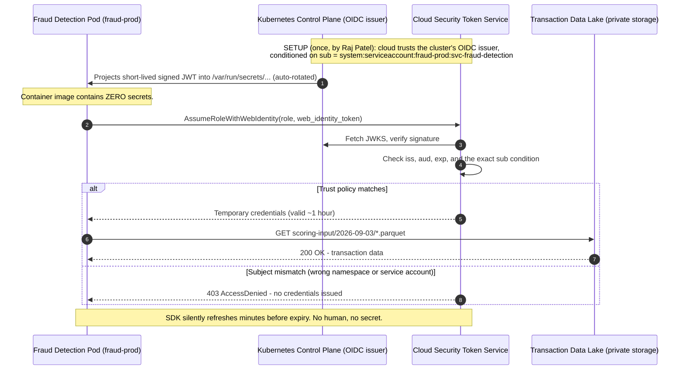
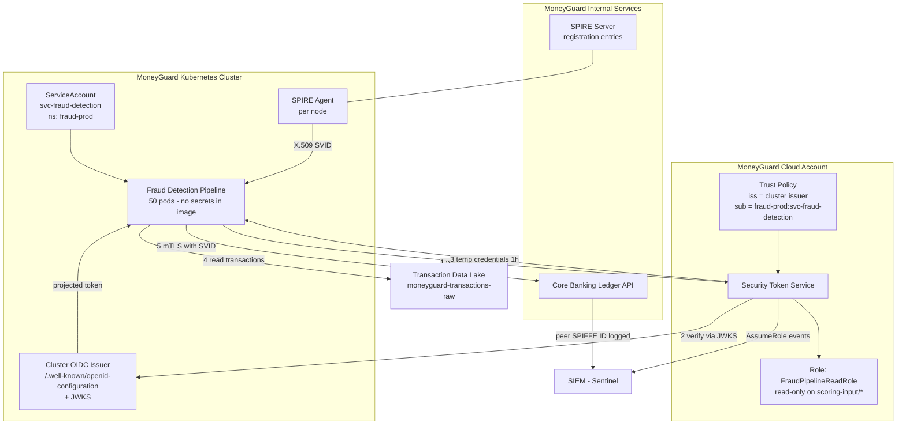

# Workload Identity Federation

## Overview

**Workload Identity Federation** is how a running piece of code proves who it is **without holding any secret at all**. Instead of storing a password, the workload asks the platform it runs on — the cloud hypervisor, the Kubernetes control plane, or a SPIRE agent — to vouch for it. The platform issues a short-lived, automatically rotated token, and a trust relationship converts that token into access.

This is the answer to the **Secret Zero problem** left open at the end of [Chapter 02](./02_OAuth_Client_Credentials_Grant.md). There is no `client_secret` in the image, no key in an environment variable, and nothing for Eve to steal out of a Git repo.

🏦 **MoneyGuard scenario:** The **Fraud Detection Pipeline** runs as 50 Kubernetes pods that must read transaction data from MoneyGuard's private cloud storage (`moneyguard-transactions-raw`) to score it for fraud. Hardcoding a cloud access key in the container image would mean 50 copies of a permanent credential, sitting in an image registry, readable by anyone who can pull it. Federation removes the credential entirely: each pod is handed a 1-hour token that the cloud minted only because the Kubernetes control plane cryptographically attested that this pod really is `svc-fraud-detection` in the `fraud-prod` namespace.

## Why This Matters

- **It removes the last long-lived secret.** Nothing to leak, nothing to rotate, nothing to commit to GitHub.
- **It scales to ephemeral infrastructure.** Pods start and die every few minutes. Manual credential provisioning cannot keep up; attestation can.
- **It binds identity to *where* the code runs.** A credential that only works from inside the attested workload is far harder to abuse than one that works from Eve's laptop.
- **It is the industry standard.** AWS IRSA, Azure Workload Identity, GCP Workload Identity Federation, GitHub Actions OIDC, and SPIFFE/SPIRE are all the same idea with different vocabulary. Interviewers expect you to see through the branding to the pattern.
- **It makes deprovisioning automatic.** Delete the Kubernetes ServiceAccount or the trust binding and access ends instantly — no hunting for copies of a key.

## Key Concepts

| Term | Plain-English meaning |
|---|---|
| **Workload** | A running unit of code: a pod, a container, a VM process, a CI job. |
| **Attestation** | The platform proving a fact about a workload that the workload cannot fake ("this pod is in namespace `fraud-prod`"). |
| **Identity federation** | System A trusting identities issued by system B, based on a pre-agreed cryptographic trust. |
| **OIDC provider (issuer)** | The service that publishes signed identity tokens and a public JWKS endpoint. |
| **Projected service account token** | A short-lived, audience-scoped JWT that Kubernetes writes into a pod's filesystem and rotates automatically. |
| **Trust policy** | The rule on the cloud side saying "accept tokens from issuer X with subject Y for role Z". |
| **STS (Security Token Service)** | The cloud service that exchanges a federated token for temporary cloud credentials. |
| **IMDS** | Instance Metadata Service — the non-routable local address (`169.254.169.254`) where a VM asks the hypervisor for its identity. |
| **IRSA** | IAM Roles for Service Accounts — AWS's name for Kubernetes → IAM federation. |
| **Managed Identity** | Azure's name for a platform-injected identity attached to a compute resource. |
| **SPIFFE** | Secure Production Identity Framework For Everyone — a universal, platform-neutral workload identity standard. |
| **SPIRE** | The reference runtime that implements SPIFFE (a central server plus per-node agents). |
| **SVID** | SPIFFE Verifiable Identity Document — the X.509 certificate or JWT carrying a SPIFFE ID. |

## Detailed Notes

### Concept 1 — The core idea: trust the platform, not a password

Ask "what does this workload have that an attacker doesn't?" With a secret, the answer is "a string" — and strings copy perfectly. With federation, the answer is "**it is actually running in the attested place**", which does not copy.

Three things must line up:

1. **An attestor** that can prove something about the workload. The AWS Nitro hypervisor knows which EC2 instance is calling. The Kubernetes API server knows which ServiceAccount a pod runs as. The Windows kernel knows which user account owns a process.
2. **An issuer** that turns the attestation into a signed, short-lived token with a public verification key (a JWKS URL).
3. **A trust policy** on the resource side: "I will accept tokens signed by *that* issuer, but only if `sub` equals *this* exact value, and only for *this* role."

⚠️ Item 3 is where nearly all real-world misconfiguration lives. A trust policy that checks the issuer but not the subject will accept **any** workload from that cluster or CI provider.

### Concept 2 — Pattern A: VM-level identity (IMDS)

The oldest form. You attach a role to the VM in the cloud console. Inside the VM, the SDK pings the link-local address `169.254.169.254`. That address does not exist on the internet — the hypervisor intercepts it. Because the hypervisor knows exactly which virtual machine sent the packet, it can hand back temporary credentials for that VM's role.

- **AWS:** Instance Profile → IMDS → temporary credentials from STS, valid ~1 hour, auto-refreshed by the SDK.
- **Azure:** System-assigned Managed Identity → the same metadata endpoint → an Entra ID JWT for a specific resource.

💡 Eve sitting in a coffee shop cannot reach `169.254.169.254`. That is the whole security property.

⚠️ **But**: any process on that VM can reach it, including a compromised sidecar or a Server-Side Request Forgery (SSRF) bug in your web app. That is why IMDSv2 requires a PUT-obtained session token with a hop limit — and why per-pod identity (Pattern B) is strictly better than per-VM identity in Kubernetes.

### Concept 3 — Pattern B: Kubernetes → cloud federation (the MoneyGuard case)

This is the pattern for the Fraud Detection Pipeline, and the one to know cold.

1. The Kubernetes cluster runs its own **OIDC provider**, publishing `/.well-known/openid-configuration` and a JWKS of public keys.
2. Alex Kim's pod declares `serviceAccountName: svc-fraud-detection`.
3. Kubernetes **projects** a signed JWT into the pod at `/var/run/secrets/…/token`. It has a specific `aud`, a short lifetime (e.g. 1 hour), and `sub: system:serviceaccount:fraud-prod:svc-fraud-detection`. Kubernetes rotates the file automatically.
4. The cloud account has been configured to **trust that cluster's OIDC issuer**, with a condition on the exact `sub`.
5. The SDK reads the projected token and calls STS `AssumeRoleWithWebIdentity`, exchanging it for temporary cloud credentials scoped to the role's policy.
6. The pod reads `moneyguard-transactions-raw`. Credentials expire in an hour and the SDK refreshes silently.

**Nothing in the container image is secret.** Copy the image; you get nothing. Run the image outside the cluster; there is no projected token to present.

### Concept 4 — Pattern C: CI/CD federation

Identical mechanism, different issuer. GitHub Actions publishes an OIDC token per workflow run whose claims include the repository, the branch/ref, and the environment. MoneyGuard's cloud account trusts that issuer **with a condition pinning the exact repo and ref**:

- ✅ `repo:moneyguard/employee-portal:ref:refs/heads/main`
- ⚠️ `repo:moneyguard/*` — far too broad. Any repo in the org can now deploy to production.
- 🚨 `sub: *` with only the issuer checked — any GitHub user on earth can assume your role. This is a real, repeatedly-exploited misconfiguration.

### Concept 5 — Pattern D: SPIFFE / SPIRE (platform-neutral, zero-secret internal identity)

Cloud federation solves "my workload → the cloud provider". SPIFFE solves "**my workload → my other workload**", anywhere: on-prem, multi-cloud, Kubernetes, or a Windows service on a legacy MoneyGuard server.

**The two machines:**

- **The SPIRE Server** (central): a hardened service holding the registration rules. Raj Patel configures it once. It never runs application code.
- **The SPIRE Agent** (on every node): runs alongside the workload, performs attestation, and hands out identities.

**Identity format — the SPIFFE ID**, a URI:

```
spiffe://moneyguard.internal/ns/fraud-prod/sa/svc-fraud-detection
spiffe://moneyguard.internal/ledger/core-banking-api
```

**Two levels of attestation, chained like a foreign key:**

1. **Node attestation** — prove the machine is a genuine MoneyGuard node (e.g. by its cloud instance identity document, its TPM, or its Kubernetes node identity).
2. **Workload attestation** — prove which *process* on that node is asking. The agent asks the OS kernel directly: "which process is on the other end of this socket, and what user/container is it?" The kernel cannot be lied to by a script.

The agent then issues an **SVID** — a short-lived X.509 certificate (often valid for ~1 hour, rotated automatically) with the SPIFFE ID stamped into the **Subject Alternative Name (SAN)** URI field. The workload uses it for mutual TLS ([Chapter 04](./04_Mutual_TLS_mTLS.md)).

### Concept 6 — Which pattern when?

The deciding question is **who owns the server receiving the request?**

| You own the client… | …and the server is | Use |
|---|---|---|
| a pod in your cluster | **your own** internal service | SPIFFE/SPIRE + mTLS |
| a pod in your cluster | a **cloud managed service** (object storage, key vault) | Cloud workload identity federation (IRSA / Azure Workload Identity) |
| a pod in your cluster | an **external partner** API | OAuth client credentials ([Chapter 02](./02_OAuth_Client_Credentials_Grant.md)), with the secret unlocked by workload identity |
| a CI job | your cloud account | CI OIDC federation, pinned to repo + ref |
| a legacy VM process | your own internal service | SPIFFE/SPIRE + mTLS |

Cloud storage does not speak SPIFFE, and PartnerBank does not care about your Kubernetes namespaces. Match the mechanism to the trust boundary.

### Concept 7 — Comparing the three credential models one more time

| | Static API key | OAuth client credentials | Workload identity federation |
|---|---|---|---|
| Long-lived secret on the workload | Yes | Yes (`client_secret`) | **No** |
| Credential lifetime | Forever | Token 15 min / secret years | Token ~1 h, nothing else |
| Rotation effort | Manual redeploy | Manual for the secret | **Zero — automatic** |
| Works if copied off the machine | Yes | Yes | **No** |
| Deprovision by | Deleting the key everywhere | Disabling the client | Deleting one trust binding |
| Crosses org boundaries | Yes | Yes | Only with pre-agreed trust |
| Best for | Nothing new | External partners | Cloud + K8s + internal mesh |

## Workflow



## Architecture Diagram



## Step-by-Step Process

**Setting up federation for the Fraud Detection Pipeline (Raj Patel, once):**

1. **Enable the cluster's OIDC issuer** and confirm its discovery document and JWKS are reachable by the cloud provider.
2. **Register the issuer as an identity provider** in MoneyGuard's cloud account, pinning the issuer URL and its thumbprint.
3. **Create the role** `FraudPipelineReadRole` with a policy granting read-only access to `moneyguard-transactions-raw/scoring-input/*` — and nothing else.
4. **Write the trust policy with a `sub` condition** pinning the exact namespace and service account. Also condition on `aud`. This is the security-critical step.
5. **Create the Kubernetes ServiceAccount** `svc-fraud-detection` in `fraud-prod`, annotated with the role to assume.
6. **Reference it in the Deployment** (`serviceAccountName`) and mount the projected token with the right audience and expiry.
7. **Remove every static credential** from the image, the Helm values, and the CI variables. Verify nothing breaks — if it still works with the keys deleted, federation is genuinely doing the work.
8. **Alert on the negative case.** If `AssumeRoleWithWebIdentity` is ever called for this role from an unexpected subject, Sentinel raises an alert.
9. **Tie teardown to the deployment.** Deleting the Helm release deletes the ServiceAccount and the trust binding together.

## Commands and Examples

**The Kubernetes ServiceAccount, annotated for cloud federation:**

```yaml
apiVersion: v1
kind: ServiceAccount
metadata:
  name: svc-fraud-detection
  namespace: fraud-prod
  annotations:
    # AWS style:
    eks.amazonaws.com/role-arn: "arn:aws:iam::210987654321:role/FraudPipelineReadRole"
    # Azure style equivalent:
    # azure.workload.identity/client-id: "8f2c1b44-...-9de3"
```

**The Deployment — note the complete absence of secrets:**

```yaml
apiVersion: apps/v1
kind: Deployment
metadata:
  name: fraud-scorer
  namespace: fraud-prod
spec:
  replicas: 50
  template:
    metadata:
      labels: { app: fraud-scorer, azure.workload.identity/use: "true" }
    spec:
      serviceAccountName: svc-fraud-detection     # <-- the identity
      containers:
        - name: scorer
          image: moneyguard/fraud-scorer:2.4.1
          env:
            - name: TRANSACTION_BUCKET
              value: "moneyguard-transactions-raw"
          # No API keys. No client_secret. Nothing to steal.
          volumeMounts:
            - name: workload-token
              mountPath: /var/run/secrets/moneyguard/token
              readOnly: true
      volumes:
        - name: workload-token
          projected:
            sources:
              - serviceAccountToken:
                  path: token
                  audience: sts.moneyguard-cloud.com   # scoped audience
                  expirationSeconds: 3600              # rotated automatically
```

**The projected token's claims (decoded) — this is what the cloud verifies:**

```json
{
  "iss": "https://oidc.eks.moneyguard.com/id/7A9C31F0B2E4",
  "aud": ["sts.moneyguard-cloud.com"],
  "sub": "system:serviceaccount:fraud-prod:svc-fraud-detection",
  "kubernetes.io": {
    "namespace": "fraud-prod",
    "pod": { "name": "fraud-scorer-6d4f9c7b8-x2klm" },
    "serviceaccount": { "name": "svc-fraud-detection" }
  },
  "exp": 1772542800,
  "iat": 1772539200
}
```

**The cloud trust policy — the `sub` condition is the whole security control:**

```json
{
  "Version": "2012-10-17",
  "Statement": [{
    "Effect": "Allow",
    "Principal": {
      "Federated": "arn:aws:iam::210987654321:oidc-provider/oidc.eks.moneyguard.com/id/7A9C31F0B2E4"
    },
    "Action": "sts:AssumeRoleWithWebIdentity",
    "Condition": {
      "StringEquals": {
        "oidc.eks.moneyguard.com/id/7A9C31F0B2E4:aud": "sts.moneyguard-cloud.com",
        "oidc.eks.moneyguard.com/id/7A9C31F0B2E4:sub": "system:serviceaccount:fraud-prod:svc-fraud-detection"
      }
    }
  }]
}
```

⚠️ Change that last line to `"StringLike": { "...:sub": "system:serviceaccount:*" }` and **every pod in the cluster** can read production transaction data.

**The application code — there is essentially none:**

```csharp
// The SDK detects the projected token, calls STS, caches and refreshes
// the temporary credentials on its own. No credentials are passed in.
var storage = new AmazonS3Client();

var response = await storage.GetObjectAsync(new GetObjectRequest
{
    BucketName = Environment.GetEnvironmentVariable("TRANSACTION_BUCKET"),
    Key        = "scoring-input/2026-09-03/batch-0042.parquet"
});
```

**GitHub Actions federation for deploying the Employee Portal:**

```yaml
permissions:
  id-token: write          # required to request the OIDC token
  contents: read

jobs:
  deploy:
    runs-on: ubuntu-latest
    steps:
      - uses: aws-actions/configure-aws-credentials@v4
        with:
          role-to-assume: arn:aws:iam::210987654321:role/EmployeePortalDeployRole
          aws-region: eu-west-1
          # No AWS_ACCESS_KEY_ID / AWS_SECRET_ACCESS_KEY anywhere.
```

with the trust condition pinned tightly:

```json
"StringEquals": {
  "token.actions.githubusercontent.com:sub": "repo:moneyguard/employee-portal:ref:refs/heads/main",
  "token.actions.githubusercontent.com:aud": "sts.amazonaws.com"
}
```

**SPIRE registration entries (run once on the SPIRE Server by Raj):**

```bash
# 1. Node attestation - trust genuine MoneyGuard cluster nodes
spire-server entry create \
  -node \
  -spiffeID  spiffe://moneyguard.internal/k8s-node \
  -selector  aws_iid:account:210987654321 \
  -selector  aws_iid:iam_principal_arn:arn:aws:iam::210987654321:role/MoneyGuardNodeRole

# 2. Workload attestation - trust the specific pod identity on those nodes
spire-server entry create \
  -spiffeID  spiffe://moneyguard.internal/ns/fraud-prod/sa/svc-fraud-detection \
  -parentID  spiffe://moneyguard.internal/k8s-node \
  -selector  k8s:ns:fraud-prod \
  -selector  k8s:sa:svc-fraud-detection \
  -ttl       3600
```

**Fetching the SVID in application code (C#):**

```csharp
using var workload = await WorkloadApiClient.CreateAsync();   // local agent socket
var ctx  = await workload.FetchX509ContextAsync();

X509Certificate2 svid = ctx.DefaultSvid.Certificate;
Console.WriteLine(ctx.DefaultSvid.Id);
// spiffe://moneyguard.internal/ns/fraud-prod/sa/svc-fraud-detection

var handler = new HttpClientHandler();
handler.ClientCertificates.Add(svid);      // used for mTLS - see Chapter 04
```

## Best Practices

- **Always pin the `sub` claim** (and `aud`) in the trust policy. Issuer-only trust is equivalent to no trust.
- **One role per workload per environment.** Never a shared "cluster role" that every namespace can assume.
- **Keep projected-token audiences narrow.** A token minted for storage should not be accepted by the Ledger.
- **Prefer pod-level identity over node/VM-level identity.** Node identity means every pod on that node shares one blast radius.
- **Enforce IMDSv2 and a hop limit of 1** on VMs so an SSRF bug in a web app cannot reach the metadata service.
- **Let the SDK handle refresh.** Never write your own credential-expiry logic; the vendors' background refresh is battle-tested.
- **Log every `AssumeRoleWithWebIdentity` with its subject** to Sentinel, and alert on unexpected subjects.
- **Delete the static keys and verify the workload still runs.** Migration is not finished until the old credential is gone and revoked.
- **Use SPIFFE for internal service-to-service**, cloud federation for cloud services, client credentials for external partners. Do not force one mechanism across all three boundaries.

## Common Mistakes

- ⚠️ **A wildcard `sub` in the trust policy.** The single most exploited misconfiguration in this space — it silently grants your role to any workload from that issuer, sometimes to the entire internet.
- ⚠️ **Trusting the CI issuer without pinning the repo and ref.** A fork or a feature branch then deploys to production.
- ⚠️ **Leaving the old static keys in place "just in case".** You now have all the risk of keys and all the complexity of federation.
- ⚠️ **Node-level identity in a multi-tenant cluster.** The reporting pod and the fraud pod on the same node share credentials.
- ⚠️ **Forgetting the `aud` on the projected token**, so a token intended for storage can be replayed against another federated service.
- ⚠️ **Assuming federation works outside the platform.** Local development has no attestor — plan a separate dev path rather than reintroducing keys in prod.
- ⚠️ **Giving the role broad permissions because "the identity is secure now".** Federation authenticates; it does not authorize. Least privilege still applies.
- ⚠️ **Not monitoring the OIDC issuer's availability.** If the cloud cannot fetch the JWKS, every pod fails to get credentials at once.

## Pro Tips

- 💡 **Say the sentence "the platform is the root of trust."** That one line shows you understand *why* federation beats vaulting a secret: the attestor is the thing actually running your code, so its claim cannot be copied.
- 💡 **Grep your trust policies for `*` before anything else** in a security review of a federated setup. It finds real vulnerabilities in minutes.
- 💡 **SPIFFE IDs make great authorization subjects.** Instead of "allow 10.4.x.x", the Ledger's policy reads `allow spiffe://moneyguard.internal/ns/fraud-prod/sa/svc-fraud-detection`. Readable, auditable, and IP-independent.
- 💡 **Federation is also a lifecycle control.** Because the identity binding lives in the same Helm chart as the workload, decommissioning is automatic — which quietly solves the orphaned-account problem from [Chapter 01](./01_Service_Accounts_And_API_Keys.md).
- 💡 **Test the negative path in staging**: deploy the same image under a *different* service account and confirm it gets `403`. That proves your `sub` condition is real and not decorative.

## Real-World Use Cases

- 🏦 **Fraud Detection Pipeline reading the transaction data lake.** 50 pods, zero secrets, 1-hour credentials, read-only on one prefix. The flagship example for this module.
- 🏦 **Fraud Detection Pipeline → Core Banking Ledger.** Internal call, so SPIFFE SVIDs and mTLS rather than cloud federation; the Ledger authorizes on the peer's SPIFFE ID.
- **GitHub Actions deploying the Employee Portal.** Long-lived deployment keys in CI secrets replaced with per-run OIDC tokens pinned to `refs/heads/main`.
- **Legacy Windows batch server.** A 20-year-old MoneyGuard reconciliation service, not containerised, gets a SPIRE agent that attests it via the Windows kernel's process owner — the same zero-secret model extended to legacy infrastructure.
- **Cross-cloud analytics.** A workload in one cloud reading a dataset in another, using each provider's federation rather than storing the other's access keys.
- **Vault unsealing.** Where a `client_secret` genuinely must exist (PartnerBank), the workload uses its platform identity to open the vault — federation bootstraps the one remaining secret rather than eliminating it.

## Key Takeaways

1. Workload identity federation replaces stored secrets with **platform attestation plus a pre-agreed trust policy**, producing short-lived credentials with nothing to leak.
2. The mechanism is always the same three parts: **attestor → signed short-lived token → trust policy that pins issuer, audience, and subject.**
3. **Pinning `sub` is the security control.** Issuer-only trust is the classic catastrophic misconfiguration.
4. IMDS/Managed Identity is VM-level; Kubernetes federation is pod-level; **prefer the finer grain.**
5. **SPIFFE/SPIRE** generalises the idea to any platform and produces SVIDs used for mTLS — ideal for internal service-to-service; **cloud federation** is for cloud managed services; **client credentials** is for external partners.
6. Federation authenticates but does not authorize — **least privilege on the role still matters.**

## Glossary

- **Attestation** — Platform-provided proof about a workload that the workload cannot forge.
- **AssumeRoleWithWebIdentity** — The STS call that exchanges a federated OIDC token for temporary cloud credentials.
- **IMDS / IMDSv2** — Instance Metadata Service; v2 requires a session token and hop limit to resist SSRF.
- **IRSA** — IAM Roles for Service Accounts; AWS's Kubernetes-to-IAM federation.
- **JWKS** — JSON Web Key Set; the public keys used to verify token signatures.
- **Managed Identity** — Azure's platform-injected identity for a compute resource.
- **Node attestation** — Proving the machine is a legitimate member of the fleet.
- **Projected service account token** — A short-lived, audience-scoped JWT mounted into a Kubernetes pod and auto-rotated.
- **SAN (Subject Alternative Name)** — The X.509 certificate field where a SPIFFE ID is stored as a URI.
- **SPIFFE** — A vendor-neutral standard for workload identity, expressed as `spiffe://` URIs.
- **SPIRE** — The reference SPIFFE implementation: a central server plus per-node agents.
- **STS** — Security Token Service; the cloud component that issues temporary credentials.
- **SVID** — SPIFFE Verifiable Identity Document; the X.509 cert or JWT carrying a SPIFFE ID.
- **Trust policy** — The resource-side rule declaring which federated identities may assume a role.
- **Workload attestation** — Proving which specific process/pod on an attested node is making the request.

## Revision Notes

- Formula: **attestor → short-lived signed token → trust policy (iss + aud + sub) → temporary credentials.**
- Kubernetes `sub` format: `system:serviceaccount:<namespace>:<serviceaccount>`.
- GitHub Actions `sub` format: `repo:<org>/<repo>:ref:refs/heads/<branch>`.
- **Wildcard `sub` = critical vulnerability.** Always pin.
- IMDS = `169.254.169.254`, link-local, hypervisor-intercepted, unreachable from outside — but reachable by SSRF, hence IMDSv2.
- SPIFFE ID lives in the X.509 SAN URI; SVIDs are short-lived and auto-rotated.
- Boundary rule: internal service → SPIFFE/mTLS; cloud managed service → cloud federation; external partner → OAuth client credentials.
- Federation ≠ authorization. Keep the role least-privilege.

## Interview Questions

**Q1. The Fraud Detection Pipeline runs as 50 Kubernetes pods and must read transaction data from private cloud storage without hardcoded keys. Design it.**
A: Enable the cluster's OIDC issuer. Register it as an identity provider in the cloud account. Create a role with read-only access to the single required prefix, and a trust policy conditioned on `iss`, `aud`, and `sub = system:serviceaccount:fraud-prod:svc-fraud-detection`. Create that ServiceAccount, annotate it with the role, and set `serviceAccountName` on the Deployment. Kubernetes projects a short-lived audience-scoped JWT into each pod; the SDK exchanges it via `AssumeRoleWithWebIdentity` for ~1-hour credentials and refreshes them automatically. The image contains no secrets, so copying it yields nothing, and running it outside the cluster yields no token.

**Q2. Someone configured the trust policy to accept any subject from the cluster's issuer. What is the impact?**
A: Every pod in the entire cluster — including a low-trust reporting job, a third-party sidecar, or anything an attacker manages to schedule — can assume the role and read production transaction data. The OIDC token itself is not secret; it is minted freely for any service account. The `sub` condition is the *only* thing distinguishing one workload from another, so removing it collapses all workloads into a single identity. The same mistake on a CI provider's public issuer is worse: it can expose the role to any user of that CI platform.

**Q3. How is workload identity different from just storing the secret in a vault?**
A: A vault protects a secret at rest and adds rotation and audit, but the workload still ends up holding a copyable credential in memory, and you still face Secret Zero — you need a credential to open the vault. Workload identity removes the credential entirely: the platform attests the running workload and mints a short-lived token on demand. The security property upgrades from "this string is hard to reach" to "**this credential only exists where the code actually runs**".

**Q4. Explain SPIFFE node attestation versus workload attestation.**
A: Node attestation proves the *machine* belongs to your fleet — e.g. by validating a cloud instance identity document or a TPM quote — and yields a node SPIFFE ID. Workload attestation then proves *which process on that trusted node* is asking: the SPIRE agent queries the OS kernel over the local socket for the caller's PID, user, and container labels, which a script cannot forge. Workload entries reference the node entry as their parent, so an attacker must compromise both layers to obtain an identity.

**Q5. When would you use SPIFFE instead of cloud workload identity, and vice versa?**
A: It depends on who owns the receiving side. If MoneyGuard owns both ends — the fraud pod calling the Core Banking Ledger — SPIFFE plus mTLS gives zero-secret, mutually authenticated, platform-neutral identity, and works on-prem and across clouds. If the receiver is a cloud managed service, it only understands its provider's native credentials and will never validate a SPIFFE certificate, so you must federate into that provider's IAM. Many real estates run both simultaneously.

**Q6. A pod's credentials expire after one hour, but a scoring batch takes three hours. What happens?**
A: Nothing, if you use the SDK correctly. The SDK's credential provider tracks expiry and, minutes before it, re-reads the projected token (which Kubernetes has already rotated) and calls STS again in the background, swapping the credentials in memory without interrupting in-flight work. Problems only appear if someone caches raw credentials at startup and holds them in a static field — a common bug that manifests as failures exactly one hour into long jobs.

**Q7. What is the risk of IMDS, and how does IMDSv2 address it?**
A: IMDSv1 answered a simple unauthenticated GET to a well-known link-local address, so any Server-Side Request Forgery bug in an application on that host could make the host fetch its own credentials and return them to the attacker. IMDSv2 requires the caller to first obtain a session token via a PUT with a special header (which browsers and most SSRF primitives cannot produce) and enforces a network hop limit so container/proxy chains cannot relay the request. Better still, use pod-level identity so the VM role is minimal in the first place.

**Q8. How does federation improve deprovisioning compared with API keys?**
A: With API keys, revocation requires finding every copy — images, configs, CI variables, developer laptops — and you can never be certain you found them all. With federation there is no copy to find: access is a trust binding plus a role. Delete the ServiceAccount or the trust condition and the next token exchange fails within minutes, everywhere at once. Because the binding lives in the same deployment manifest as the workload, tearing down the app automatically tears down its identity, which structurally prevents the orphaned-account problem.

## Practice Exercises

1. **Build the trust policy.** Write the complete cloud trust policy for `FraudPipelineReadRole` including `iss`, `aud`, and `sub` conditions, plus the least-privilege permission policy for read-only access to `moneyguard-transactions-raw/scoring-input/*`. Then write down, in one sentence each, what breaks if you remove each condition.

2. **Audit for wildcards.** You inherit five trust policies at MoneyGuard: one pins the full `sub`; one uses `StringLike` with `system:serviceaccount:*`; one pins the repo but uses `ref:refs/heads/*`; one checks only the issuer; one pins `sub` but omits `aud`. Rank them by severity and state the concrete attack each enables.

3. **Choose the boundary mechanism.** For each hop in the Fraud Detection Pipeline's day — read the data lake, call the Core Banking Ledger, publish a report to PartnerBank, pull its container image, be deployed by CI — pick the mechanism (cloud federation / SPIFFE+mTLS / client credentials) and justify it using the "who owns the receiver" rule.

4. **SPIRE registration.** Write the node and workload registration entries for the Core Banking Ledger API running in namespace `ledger-prod` under ServiceAccount `svc-ledger-api`, then write the authorization rule the Ledger uses to accept calls only from the fraud pipeline's SPIFFE ID.

5. **Migration plan.** The nightly reconciliation job currently uses a 4-year-old static cloud access key. Write a step-by-step migration to federation that never has a moment of downtime, including how you prove the old key is genuinely unused before deleting it, and what you monitor during the cutover.

---

⬅ [Chapter 02 — OAuth 2.0 Client Credentials Grant](./02_OAuth_Client_Credentials_Grant.md) | [Module 06 Index](./README.md) | [Main README](../README.md) | [MoneyGuard Scenario](../SCENARIO.md)
Next: [Chapter 04 — Mutual TLS (mTLS)](./04_Mutual_TLS_mTLS.md) ➡
