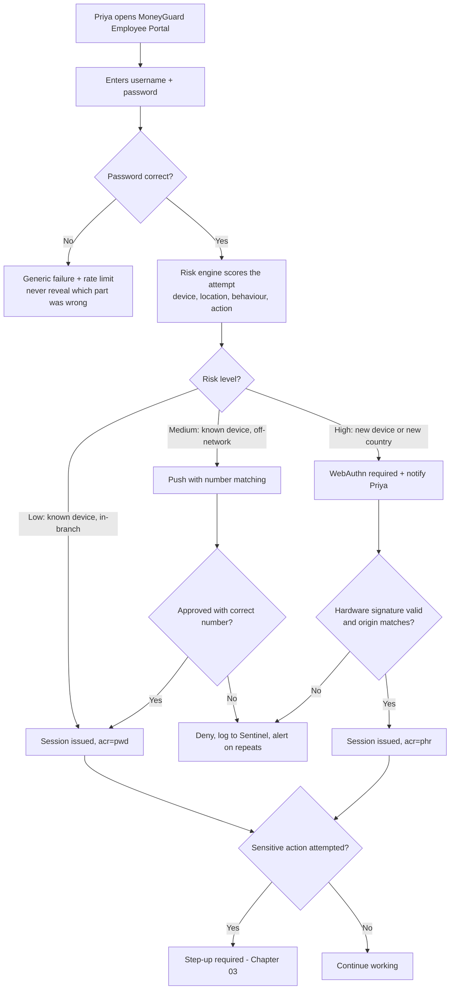
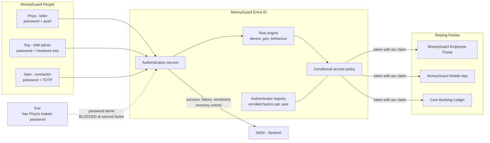

# MFA Fundamentals

## Overview

**Multi-Factor Authentication (MFA)** means proving your identity with evidence from **two or more different categories** of proof, so that stealing one of them is not enough to log in.

The three classic categories are:

- **Something you know** — a password, a PIN.
- **Something you have** — a phone, a hardware key, a smart card.
- **Something you are** — a fingerprint, a face, a voice.

This chapter covers the factor types, how they actually work, how each one gets attacked, and how MoneyGuard decides which factor to demand for which action. It is the foundation for [Chapter 02](./02_Phishing_Resistant_MFA_WebAuthn_FIDO2.md) (why most MFA still gets phished) and [Chapter 03](./03_StepUp_Authentication.md) (how to demand stronger proof only when it matters).

🏦 **MoneyGuard scenario:** Priya Sharma, a new bank teller, logs into the **MoneyGuard Employee Portal** every morning. Her password appeared in a breach dump from an unrelated shopping site three years ago, and she reused it. Eve has that password. The only thing standing between Eve and Priya's teller session is MoneyGuard's second factor — so the *choice* of that second factor is not a detail, it's the entire control.

## Why This Matters

- **Passwords are already compromised.** Billions of leaked credentials are in circulation, and people reuse them. Assume Priya's password is known to attackers, because it probably is.
- **MFA blocks the overwhelming majority of bulk attacks.** Credential stuffing, password spraying, and brute force all break against a second factor.
- **Not all MFA is equal.** SMS codes and app-generated codes stop bulk attacks but *do not* stop a targeted phishing proxy — a distinction that has caused real, expensive breaches.
- **Regulators require it.** SOX-relevant financial systems and PSD2 Strong Customer Authentication both mandate multi-factor verification for MoneyGuard.
- **It's the single highest-leverage control you own.** No other single change reduces account takeover as much for as little money.

## Key Concepts

| Term | Plain-English meaning |
|---|---|
| **Factor** | One category of evidence: knowledge, possession, or inherence. |
| **MFA** | Two or more factors from **different** categories. |
| **2FA** | MFA with exactly two factors. |
| **Authenticator** | The thing that produces the second factor: an app, a hardware key, a phone. |
| **TOTP** | Time-based One-Time Password — the rotating 6-digit code from an authenticator app. |
| **Push notification** | An "Approve / Deny" prompt sent to a registered phone. |
| **OTP** | One-Time Password, delivered by SMS, email, or app. |
| **Enrolment** | Registering an authenticator with an account for the first time. |
| **Recovery / fallback** | The path back in when a factor is lost — and usually the weakest link. |
| **Adaptive / risk-based auth** | Varying the requirement based on signals such as device, location, and behaviour. |
| **Phishing-resistant MFA** | MFA that cannot be relayed by a proxy — WebAuthn/FIDO2, and mTLS-style certificates. |
| **MFA fatigue** | Spamming push prompts until a tired user taps Approve. |

## Detailed Notes

### Concept 1 — The three categories, and why "different" is the whole point

MFA works only when the factors fail **independently**. Two passwords are not MFA — one phishing page collects both. A password plus a code from an app on a device you physically hold requires the attacker to defeat two unrelated things.

| Category | Examples | How it's stolen |
|---|---|---|
| **Knowledge** — something you know | Password, PIN, security question | Breach dumps, phishing, shoulder surfing, guessing |
| **Possession** — something you have | Phone (TOTP/push), hardware key, smart card | Theft, SIM swap, real-time relay, malware |
| **Inherence** — something you are | Fingerprint, face, voice | Very hard remotely; usually attacked by bypassing to a weaker fallback |

⚠️ **Security questions are not a second factor.** "Mother's maiden name" is knowledge, same category as a password, and usually discoverable on social media.

💡 A widely used fourth idea is **context** — somewhere you are, or a known device. It is not a true factor on its own (it can't be *presented*), but it's the backbone of adaptive authentication in Concept 5.

### Concept 2 — The factor types, ranked

| Factor | How it works | Phishing-resistant? | Strength | MoneyGuard verdict |
|---|---|---|---|---|
| **SMS OTP** | 6-digit code texted to a phone | ❌ No | Weak | Legacy only; being retired |
| **Email OTP** | Code emailed | ❌ No | Weak | Only for low-risk customer flows |
| **TOTP app** | Shared seed + clock → rotating 6-digit code | ❌ No | Medium | Acceptable minimum for staff today |
| **Push approve/deny** | Prompt on a registered phone | ❌ No | Medium | Only with number matching |
| **Push + number matching** | User types a number shown on screen into the app | ⚠️ Partly | Medium-high | Current MoneyGuard staff default |
| **WebAuthn / FIDO2 / passkey** | Origin-bound public-key signature | ✅ **Yes** | **Strongest** | Required for admins and high-risk actions |
| **Smart card / PIV** | Certificate on a physical card + PIN | ✅ Yes | Strongest | Used in MoneyGuard's data centres |

The dividing line in that table is the "phishing-resistant" column, and it is the subject of the next chapter.

### Concept 3 — How TOTP actually works (and where it breaks)

At enrolment the server generates a random **shared secret** and shows it as a QR code. Priya's authenticator app stores it. From then on both sides compute:

```
code = HMAC-SHA1(shared_secret, floor(unix_time / 30))   →  truncated to 6 digits
```

Both sides know the secret and the time, so both compute the same number. Servers usually accept the previous and next window too, to tolerate clock drift.

**What TOTP gets right:** it's offline, cheap, standardised, works on any phone, and defeats every attack that only has the password.

⚠️ **What it gets wrong — three things:**

1. **The code has no idea where it is being typed.** It knows *when*, not *where*. A phishing proxy can relay it to the real site within the 30-second window (this is the AiTM attack in [Chapter 02](./02_Phishing_Resistant_MFA_WebAuthn_FIDO2.md)).
2. **The shared secret exists in two places.** Breach the server's seed store and you can generate every user's codes.
3. **Enrolment is a weak point.** Whoever can enrol a new authenticator can bypass the old one — so enrolment must be as strongly protected as login.

### Concept 4 — Push notifications and MFA fatigue

Push is friendlier than typing codes, but plain "Approve / Deny" introduced a new attack: **MFA fatigue** (push bombing). Eve, holding Priya's password, triggers login after login. Priya's phone buzzes at 2am, twenty times. Eventually she taps Approve to make it stop — or assumes IT is doing something.

**The fix is number matching:** the login screen displays a two-digit number and Priya must *type it into her app*. She cannot approve a prompt she did not initiate, because she cannot see the attacker's screen. Additional hardening: show the requesting app, the geographic location, and the IP; rate-limit prompts per account per minute; and alert the SOC on repeated denials.

⚠️ Number matching stops *fatigue*, not *phishing*. A real-time proxy can still show Priya the correct number, because the attacker sees the genuine login screen.

### Concept 5 — Adaptive (risk-based) authentication

Prompting for MFA on every single action destroys usability and trains people to click through prompts without reading. Adaptive authentication varies the demand by risk.

Signals MoneyGuard evaluates:

- **Device** — a known, managed, compliant laptop vs an unrecognised browser.
- **Location & network** — a branch office IP vs a residential IP in another country.
- **Impossible travel** — London at 09:00, Singapore at 09:20.
- **Behaviour** — Priya normally opens 30 accounts a day; today it's 3,000.
- **Action sensitivity** — viewing her own payslip vs approving a wire transfer.

| Risk | Example | MoneyGuard requirement |
|---|---|---|
| Low | Priya on her managed laptop, in-branch, reading the intranet | Existing session; no prompt |
| Medium | Priya from home on a known device | Password + push with number matching |
| High | Login from an unrecognised device in a new country | Password + WebAuthn, plus a notification to Priya |
| Critical | Any wire transfer over £10,000, or Raj changing a role definition | WebAuthn **re-authentication now**, regardless of session age ([Chapter 03](./03_StepUp_Authentication.md)) |

### Concept 6 — Recovery is where MFA usually fails

Sam Torres, MoneyGuard's contractor, loses his phone on a Friday. He needs access. Whatever path you give him is now the *real* strength of your MFA, because Eve will use that path too.

⚠️ Bad recovery paths that quietly undo everything:
- A helpdesk agent resetting MFA after verifying "name and date of birth" — both public information. This is how a great many real breaches actually happen.
- Emailing a reset link to an address that itself is protected only by a password.
- Falling back to SMS "just this once".

✅ Better recovery paths:
- **Enrol two authenticators at registration** — e.g. two hardware keys, one kept at home. Self-service, no helpdesk.
- **One-time recovery codes** issued at enrolment, stored offline by the user, single-use, and invalidated as a set once used.
- **Verified-human recovery** for high-privilege staff: a video call with IT confirming identity against the HR record in Workday, plus manager approval, plus a mandatory re-enrolment and an audit entry.
- **Rate-limit and alert on every recovery event**, and treat a recovery as a risk signal for the following 24 hours.

### Concept 7 — MFA does not fix everything

MFA authenticates a **login**. It does not protect:

- **A stolen session cookie.** Once issued, a session token is a bearer credential — the AiTM endgame. Mitigate with short sessions, token binding, and re-authentication for sensitive actions.
- **Legacy protocols.** An old MoneyGuard system speaking basic authentication over IMAP or LDAP may bypass MFA entirely. Block legacy auth outright.
- **Machine identities.** Service accounts cannot do MFA at all — see [Module 06](../06_Machine_Identity_And_Workload_Auth/README.md).
- **Consent phishing.** Tricking a user into approving a malicious OAuth app grants access without any credential theft.
- **Post-login authorization mistakes.** MFA says *who*; it says nothing about *what they may do*.

## Workflow



## Architecture Diagram



## Step-by-Step Process

**Rolling out MFA at MoneyGuard (Raj Patel's programme):**

1. **Inventory the applications** and identify anything using legacy authentication that would bypass MFA. Block legacy auth first — otherwise the rollout is theatre.
2. **Choose factors by population.** Hardware keys for administrators and finance approvers; push with number matching for general staff; passkeys for customers on the Mobile App.
3. **Require two authenticators at enrolment**, so losing one is self-service rather than a helpdesk ticket.
4. **Protect enrolment itself.** First enrolment happens on a managed device during onboarding, or is verified against the Workday record. Adding a *new* authenticator later requires an existing one.
5. **Pilot with IT and the security team**, then roll out by department, measuring helpdesk volume as you go.
6. **Turn on adaptive policies** so low-risk in-branch work isn't prompted constantly and users don't become desensitised.
7. **Design and document recovery** before go-live — including the identity-proofing script for the helpdesk and who may authorise it.
8. **Instrument everything into Sentinel**: successes, failures, denials, enrolments, recoveries, and any factor downgrade.
9. **Retire the weak factors.** SMS moves to fallback-only, then off. Track the percentage of staff on phishing-resistant factors as the headline metric.
10. **Review quarterly with Dana Cole**: who is still on weak factors, how many recoveries occurred, and whether any were suspicious.

## Commands and Examples

**A TOTP enrolment URI** (what the QR code actually encodes):

```text
otpauth://totp/MoneyGuard:priya.sharma@moneyguard.com
  ?secret=JBSWY3DPEHPK3PXPGRZDMNBSGE2TE
  &issuer=MoneyGuard%20Bank
  &algorithm=SHA1
  &digits=6
  &period=30
```

**Verifying a TOTP code server-side, with a replay guard (C#):**

```csharp
public bool VerifyTotp(string userId, string submittedCode)
{
    var secret = _vault.GetTotpSeed(userId);          // encrypted at rest
    long window = DateTimeOffset.UtcNow.ToUnixTimeSeconds() / 30;

    // Accept the previous, current, and next window for clock drift.
    for (long w = window - 1; w <= window + 1; w++)
    {
        if (!FixedTimeEquals(Totp.Compute(secret, w), submittedCode)) continue;

        // CRITICAL: a code is single-use. Without this, an AiTM proxy can
        // replay the same code inside the same 30-second window.
        if (!_usedCodes.TryAdd($"{userId}:{w}", true, TimeSpan.FromMinutes(2)))
            return false;

        return true;
    }
    return false;
}
```

**Push with number matching — what Priya sees:**

```text
Browser (login page)                 MoneyGuard Authenticator app
---------------------                ----------------------------
  Enter this number                    Approve sign-in?
  in your app:                         MoneyGuard Employee Portal
                                       Location: Manchester, UK
        4 7                            IP: 81.***.***.44

                                       Enter the number shown
                                       on your sign-in screen:
                                       [ __ ]
```

Eve, triggering logins from Bucharest, cannot show Priya the number — she isn't looking at Priya's screen.

**An adaptive policy, expressed as configuration:**

```yaml
policy: moneyguard-staff-signin
conditions:
  users: [group:AllStaff]
  applications: [MoneyGuardEmployeePortal, CoreBankingLedger]
rules:
  - name: trusted-device-in-branch
    when:  { device: compliant, network: corporate }
    grant: session
    acr:   pwd

  - name: off-network-known-device
    when:  { device: compliant, network: any }
    grant: require_mfa
    allowed_methods: [push_number_match, webauthn]

  - name: unknown-device-or-new-country
    when:  { device: unmanaged }
    grant: require_mfa
    allowed_methods: [webauthn]        # phishing-resistant only
    notify_user: true

  - name: privileged-roles
    when:  { user_in_role: [IAMAdmin, WireTransferApprover] }
    grant: require_mfa
    allowed_methods: [webauthn]
    session_lifetime: 4h
```

**The resulting token claims — how the app knows *how* Priya logged in:**

```json
{
  "sub": "priya.sharma@moneyguard.com",
  "amr": ["pwd", "otp"],
  "acr": "pwd",
  "auth_time": 1772539200,
  "exp": 1772568000
}
```

- **`amr`** (Authentication Methods References) — the list of methods actually used.
- **`acr`** (Authentication Context Class Reference) — the *strength tier*: `pwd` for password-based, `mfa` for multi-factor, `phr` for phishing-resistant.
- **`auth_time`** — when the user last actually authenticated. Essential for step-up ([Chapter 03](./03_StepUp_Authentication.md)).

**Enforcing a minimum strength in an API (C#):**

```csharp
builder.Services.AddAuthorization(o =>
{
    o.AddPolicy("RequireMfa", p => p.RequireClaim("acr", "mfa", "phr"));
    o.AddPolicy("RequirePhishingResistant", p => p.RequireClaim("acr", "phr"));
});
```

## Best Practices

- **Enforce MFA for every user and every application** — no exception groups. "The executives find it annoying" is how the most valuable accounts end up unprotected.
- **Block legacy authentication protocols first.** They bypass MFA entirely and make the whole programme cosmetic.
- **Never treat SMS as a strong factor.** SIM swap and SS7 interception are routine. Use it only as a temporary fallback with a retirement date.
- **Require number matching on all push**, and show the app, location, and IP in the prompt.
- **Enrol two authenticators per user** so loss is self-service.
- **Protect enrolment as strongly as login** — adding a new factor must require an existing one.
- **Use adaptive policies** so low-risk activity isn't over-prompted and users don't become click-through zombies.
- **Design recovery deliberately**, and treat it as a monitored, rate-limited, audited event.
- **Emit and consume `acr` / `amr` / `auth_time`** so downstream apps can make their own decisions about strength and freshness.
- **Measure the right metric:** percentage of users on *phishing-resistant* factors, not percentage "on MFA".

## Common Mistakes

- ⚠️ **Two knowledge factors called MFA.** Password + security question is one category, and one phishing page harvests both.
- ⚠️ **Exempting VIPs or "critical" service teams.** You have exempted exactly the accounts worth attacking.
- ⚠️ **Assuming any MFA stops phishing.** SMS, TOTP, and plain push are all relayable in real time.
- ⚠️ **Not making TOTP codes single-use.** A proxy replays the same code within the same window.
- ⚠️ **A weak recovery path.** Helpdesk resets based on public information make the strongest factor irrelevant.
- ⚠️ **Prompting on everything**, which trains users to approve reflexively — the precondition for MFA fatigue attacks.
- ⚠️ **Storing TOTP seeds unencrypted.** One database breach yields every user's second factor.
- ⚠️ **Revealing whether the password was correct before prompting for MFA**, which turns the login page into a password-validity oracle.
- ⚠️ **Forgetting sessions.** MFA at login does nothing about a session cookie stolen ten minutes later.

## Pro Tips

- 💡 **Ship recovery before you ship enforcement.** Every MFA rollout that skips this ends with a helpdesk improvising bypasses under pressure — and that improvisation becomes the permanent process.
- 💡 **Two keys per admin, one kept off-site.** Cheaper than any helpdesk recovery workflow and strictly more secure.
- 💡 **Treat "MFA reset" as a privileged operation** with its own approval, its own alert, and its own quarterly review for Dana Cole.
- 💡 **Watch denials, not just failures.** A user denying prompts they didn't initiate is a live attack in progress with the password already compromised.
- 💡 **Phrase the interview answer as a hierarchy, not a binary:** SMS < TOTP < push+number-matching < WebAuthn. Saying "we have MFA" without naming the tier signals inexperience.

## Real-World Use Cases

- 🏦 **Priya's reused password.** Eve has it from an unrelated breach. She hits the Employee Portal, the password succeeds, and the push prompt with number matching stops her — and Priya's denial alerts the SOC that her password is compromised, triggering a forced reset.
- 🏦 **Raj Patel, IAM administrator.** Highest-privilege human account at MoneyGuard, so: hardware key only, two keys enrolled, 4-hour sessions, and step-up re-authentication for every role change.
- 🏦 **Sam Torres, contractor.** Personal device, so no managed-device signal. He gets TOTP plus tighter adaptive rules, and his access expires with his contract.
- **MoneyGuard Mobile App customers.** Device biometrics unlock a passkey stored in the phone's secure element — strong and frictionless, because the factor is already on the device.
- **The 2am push storm.** A general alert fires when any account receives more than five push prompts in ten minutes: a textbook MFA-fatigue attack, caught before anyone taps Approve.
- **PSD2 Strong Customer Authentication.** Regulation requires two independent factors for customer payments, with dynamic linking to the amount and payee — regulation encoding exactly the principles in this chapter.

## Key Takeaways

1. MFA means two or more factors from **different categories**: know / have / are. Two of the same category is not MFA.
2. Factors form a **strength hierarchy**: SMS < TOTP < push+number-matching < WebAuthn/FIDO2 or smart card.
3. **TOTP knows *when*, not *where*** — which is precisely why it can be relayed by a real-time phishing proxy.
4. **Number matching defeats MFA fatigue** but not phishing.
5. **Adaptive authentication** matches friction to risk, preserving both usability and user attentiveness.
6. **Recovery is the real strength of your MFA.** Design it first, monitor it, and treat resets as privileged operations.
7. MFA protects the **login**, not the session, not legacy protocols, and not machine identities.
8. Emit **`acr`, `amr`, `auth_time`** so applications can enforce strength and freshness themselves.

## Glossary

- **`acr` (Authentication Context Class Reference)** — A claim describing the *strength tier* of the authentication.
- **Adaptive authentication** — Varying MFA requirements based on risk signals.
- **`amr` (Authentication Methods References)** — A claim listing the specific methods used.
- **`auth_time`** — The timestamp of the user's last actual authentication.
- **Authenticator** — The device or app producing a factor.
- **Credential stuffing** — Automated login attempts using leaked username/password pairs.
- **Enrolment** — First-time registration of an authenticator.
- **Factor** — One of the three categories of authentication evidence.
- **HMAC** — Hash-based Message Authentication Code, the cryptographic primitive behind TOTP.
- **MFA fatigue / push bombing** — Spamming approval prompts until the user gives in.
- **Number matching** — Requiring the user to type a screen-displayed number into their app.
- **Password spraying** — Trying one common password across many accounts to evade lockouts.
- **Phishing-resistant MFA** — MFA that cannot be relayed by a proxy (WebAuthn/FIDO2, PIV).
- **SCA (Strong Customer Authentication)** — PSD2's multi-factor requirement for payments.
- **SIM swap** — Hijacking a phone number to intercept SMS codes.
- **TOTP** — Time-based One-Time Password.

## Revision Notes

- Three categories: **know / have / are.** MFA = two or more from *different* categories.
- Hierarchy: SMS < email < TOTP < push < push + number matching < WebAuthn / smart card.
- TOTP = `HMAC(shared_secret, time/30)` → 6 digits. Offline, but shared-secret and **relayable**.
- Number matching kills MFA fatigue; **only WebAuthn kills phishing**.
- Adaptive signals: device, network, geography, impossible travel, behaviour, action sensitivity.
- **Recovery is the weakest link.** Two authenticators + one-time codes + verified-human path for privileged users.
- MFA does not cover: stolen sessions, legacy auth, machine identities, consent phishing.
- Claims to emit and check: `acr` (strength), `amr` (methods), `auth_time` (freshness).

## Interview Questions

**Q1. Is a password plus a security question MFA?**
A: No. Both are knowledge factors, so they fail together: one phishing page harvests both, and both are often exposed in the same breach or discoverable from social media. MFA requires independent categories, so that compromising one gives no advantage in compromising the other. Security questions are best treated as a weak identity-proofing signal during recovery, never as a second factor.

**Q2. Rank SMS, TOTP, push, and WebAuthn, and explain the jump between them.**
A: SMS is weakest — vulnerable to SIM swap and network interception, and the code is relayable. TOTP removes the carrier from the picture and works offline, but it is still a shared secret and still relayable within its 30-second window. Push improves usability and, with number matching, defeats MFA fatigue — but a real-time proxy can still show the victim the correct number. WebAuthn is categorically different: the credential is a private key that never leaves the device and it is bound to the origin, so a proxy on a lookalike domain cannot obtain a usable signature at all. The jump from push to WebAuthn is the jump from "harder to phish" to "cannot be phished".

**Q3. What is MFA fatigue and how do you stop it?**
A: The attacker already has the password and repeatedly triggers logins so the victim's phone buzzes until they approve out of confusion or exhaustion. The primary control is number matching: the user must type a number displayed on the genuine login screen, which an attacker who is not looking at that screen cannot supply. Supporting controls are rate-limiting prompts per account, showing app/location/IP in the prompt, alerting the SOC on repeated denials, and treating any burst of denials as a confirmed password compromise requiring a reset.

**Q4. Priya's password is in a breach dump. Does MFA make that irrelevant?**
A: It makes it non-fatal, not irrelevant. MFA blocks the direct login, but the compromised password still enables MFA-fatigue attempts, gives an attacker the first half of an AiTM phishing attack, and may unlock other systems where Priya reused it — including legacy MoneyGuard systems that bypass MFA. So the correct response is still a forced reset, a check for legacy-auth exposure, and heightened monitoring on that account.

**Q5. How would you design MFA recovery for a MoneyGuard contractor who loses their phone on a Friday?**
A: Ideally recovery is unnecessary because Sam enrolled two authenticators at onboarding, so he uses the second one and re-enrols a replacement himself. Failing that, one-time recovery codes issued at enrolment, single-use, invalidated as a set. Only if both fail does a human path open: identity verification against the Workday record on a video call, plus manager approval, plus mandatory re-enrolment, plus an audit entry and a 24-hour heightened-monitoring flag on the account. Every recovery event is rate-limited, logged to Sentinel, and reviewed by Dana Cole — because whatever this path is, it is the true strength of your MFA.

**Q6. What does MFA not protect against?**
A: A session cookie stolen after login (the AiTM endgame — MFA already happened, and the token is a bearer credential); legacy protocols that never present an MFA challenge; machine identities, which have no human to present a factor; consent phishing, where the user is tricked into authorising a malicious OAuth app rather than surrendering a credential; and everything on the authorization side, since MFA establishes who you are and says nothing about what you may do.

**Q7. Why does an application need the `acr` and `auth_time` claims when the IdP already enforced MFA?**
A: Because the IdP's decision was made once, at login, for a general context. The Core Banking Ledger needs to know two further things at the moment of a specific request: *how strongly* the user authenticated — was it a password or a hardware key, which is `acr` — and *how recently*, which is `auth_time`. A twelve-hour-old `phr` session may be strong but stale for a wire transfer. Exposing these claims lets each application set its own bar and trigger step-up ([Chapter 03](./03_StepUp_Authentication.md)) rather than trusting a single blanket decision made hours earlier.

**Q8. Your CEO demands an MFA exemption because it slows him down. What do you do?**
A: Refuse the exemption but solve the actual complaint. The complaint is friction, not security, and the CEO's account is the single most valuable target at MoneyGuard, so exempting it inverts the risk model. Instead, give him the *lowest-friction strongest* option: a passkey or hardware key with biometric unlock, which is faster than typing a code; enable adaptive policies so his managed device on the corporate network is not prompted repeatedly; and enrol a backup key so he is never locked out. If the exemption is nevertheless mandated, it must be documented as an accepted risk with a named owner and a review date — which usually makes it disappear.

## Practice Exercises

1. **Classify the factors.** For each, name the category and say whether the pair is genuine MFA: (a) password + SMS code; (b) password + security question; (c) fingerprint + PIN on the same phone; (d) hardware key + PIN; (e) password + "login from a trusted device". Justify each answer in one sentence.

2. **Design MoneyGuard's factor matrix.** Assign a required factor to each of: Priya (teller), Raj (IAM admin), Dana (auditor, read-only), Sam (contractor on a personal device), a retail customer on the Mobile App, and a branch manager approving wire transfers. Justify each choice by the value at risk and the practicality of the factor.

3. **Write the adaptive policy.** Extend the YAML policy in this chapter with rules for: impossible travel, a first login from a new country, and a bulk-export action. For each, specify the required factor and whether the user is notified.

4. **Break TOTP.** Describe, step by step, how an attacker with a real-time reverse proxy defeats Priya's TOTP code, then identify exactly which line of the verification code in this chapter limits the damage and what it does *not* prevent.

5. **Recovery tabletop.** Sam Torres calls the helpdesk on a Friday afternoon claiming to have lost his phone. Write the script the agent must follow, the evidence required, who must approve, what is logged, and what monitoring is applied afterwards. Then write the version of that call where the caller is actually Eve, and identify which step stops her.

---

⬅ Back to [Module 07 Index](./README.md) | [Main README](../README.md) | [MoneyGuard Scenario](../SCENARIO.md)
Next: [Chapter 02 — Phishing-Resistant MFA: WebAuthn & FIDO2](./02_Phishing_Resistant_MFA_WebAuthn_FIDO2.md) ➡
