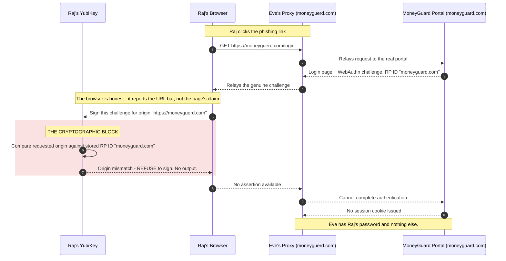
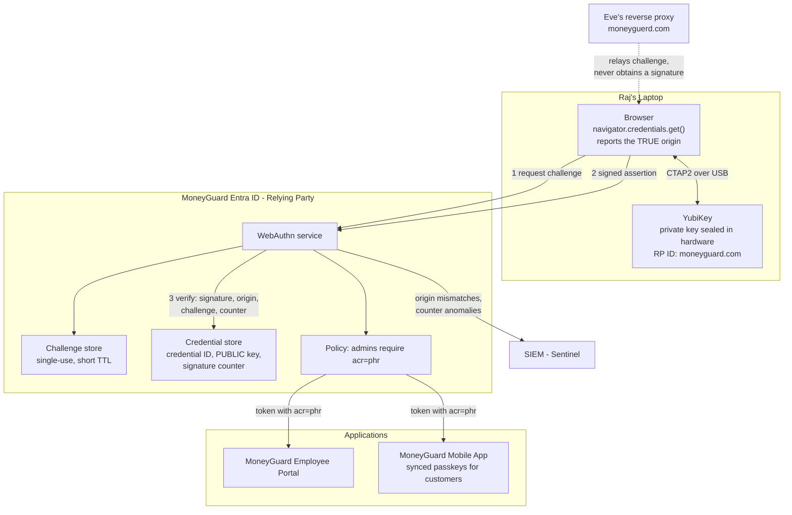

# Phishing-Resistant MFA: WebAuthn & FIDO2

## Overview

[Chapter 01](./01_MFA_Fundamentals.md) ended on an uncomfortable fact: most MFA still gets phished. A 6-digit code knows *when* it was generated but not *where* it is being typed, so an attacker running a real-time proxy can simply relay it.

**WebAuthn** fixes this by replacing shared secrets with **public-key cryptography that is bound to a specific website domain**. Your device holds a private key that never leaves it, and it refuses to sign anything for the wrong domain. There is no code to relay, no secret to steal, and no way for a lookalike site to obtain a usable signature.

This chapter covers the attack that makes WebAuthn necessary (Adversary-in-the-Middle phishing), how registration and authentication actually work, and how MoneyGuard deploys hardware keys and passkeys.

🏦 **MoneyGuard scenario:** Raj Patel is MoneyGuard's IAM Administrator — the single most valuable human account in the bank, able to grant anyone access to anything. Eve sends him a convincing email: *"Urgent: mandatory security update for the MoneyGuard Employee Portal."* The link points to `moneyguerd.com` — one letter different. Behind it sits a reverse proxy relaying every keystroke to the real portal in real time. With TOTP, Raj is compromised. With his YubiKey, the attack dies at the hardware.

## Why This Matters

- **Phishing is the number one initial access vector**, and standard MFA does not stop the modern version of it.
- **AiTM steals the session, not just the password.** The attacker ends up with an authenticated session cookie, which means MFA already ran and provided no protection.
- **Privileged accounts are the target.** Raj can grant himself access to the Core Banking Ledger. One phished admin equals total compromise.
- **It is the direction of regulation and industry.** NIST classifies WebAuthn/FIDO2 as phishing-resistant; large enterprises that mandated hardware keys report the elimination of successful credential phishing.
- **Passkeys make it usable for millions.** MoneyGuard cannot ship hardware keys to retail customers, but every modern phone can hold a passkey.

## Key Concepts

| Term | Plain-English meaning |
|---|---|
| **FIDO2** | The overall standard/alliance for passwordless, phishing-resistant authentication. |
| **WebAuthn** | The browser JavaScript API (`navigator.credentials`) that talks to authenticators. |
| **CTAP2** | The protocol between the browser and an external authenticator (USB, NFC, Bluetooth). |
| **Authenticator** | The thing holding the private key: a YubiKey, a phone's secure element, a laptop's TPM. |
| **Relying Party (RP)** | The site you're logging into — MoneyGuard. |
| **RP ID** | The domain the credential is bound to, e.g. `moneyguard.com`. |
| **Origin** | The full scheme + host the browser is actually on, e.g. `https://portal.moneyguard.com`. |
| **Challenge** | A fresh random value from the server that must be signed, preventing replay. |
| **Attestation** | Optional proof of what kind of authenticator was used (make and model). |
| **Assertion** | The signed response proving possession of the private key at login. |
| **Signature counter** | An incrementing number used to detect cloned authenticators. |
| **User verification (UV)** | Local proof it's really you: a PIN or biometric on the device. |
| **User presence (UP)** | Proof a human physically touched the device. |
| **Passkey** | A FIDO2 credential that is discoverable and often synced across a user's devices. |
| **Discoverable credential** | A credential the authenticator can find without being told the username first (enables usernameless login). |

## Detailed Notes

### Concept 1 — The attack WebAuthn exists to stop: Adversary-in-the-Middle

An AiTM attack is not a fake static webpage. It is a **live reverse proxy** sitting between the victim and the real site, relaying both directions in real time. Because it serves the *real* page, everything looks and behaves perfectly.

Here is how Eve takes Raj's session using TOTP:

1. **The bait.** Eve emails Raj a link to `moneyguerd.com`.
2. **The relay.** That domain points to a reverse proxy which fetches the genuine login page from `portal.moneyguard.com` and displays it. The site is authentic — it *is* the real code, piped through a malicious tunnel.
3. **The password steal.** Raj types his credentials. They go to Eve's proxy, which logs them and forwards them to the real server in the same millisecond.
4. **The MFA trap.** The real server responds "now enter your 6-digit code". The proxy relays that prompt onto Raj's screen.
5. **The hand-off.** Raj reads his authenticator app and types the code. The proxy grabs it and forwards it to the real server well inside the 30-second window.
6. **The victory.** The real server issues a **session cookie**. The proxy copies it for Eve, then passes it to Raj's browser so he lands in the real portal and notices nothing.

⚠️ Note what Eve walks away with: not just a password, but an **authenticated session**. MFA ran successfully and protected nothing. Raj continues his workday completely unaware.

### Concept 2 — Why TOTP loses and WebAuthn wins

| Property | TOTP (6-digit code) | WebAuthn (hardware key / passkey) |
|---|---|---|
| Phishable by a proxy? | ✅ Yes — trivially relayed | ❌ No — mathematically prevented |
| Origin-bound? | ❌ No — the code works on any site | ✅ Yes — locked to the registered domain |
| Replay protection | Only the 30-second window | ✅ Fresh server challenge every time |
| Shared secret exists? | ✅ Yes — on the server and the phone | ❌ No — only a public key is stored |
| Server breach exposes credentials? | ✅ Yes — seeds generate every code | ❌ No — public keys are useless to an attacker |
| Clone detection | ❌ None | ✅ Signature counter |
| User effort | Read and type 6 digits | One tap / one glance |

The decisive row is **origin-bound**. TOTP knows *when*; WebAuthn knows *where*.

### Concept 3 — Registration: the "digital marriage"

When Raj first registers his YubiKey with MoneyGuard:

1. The server generates a random **challenge** and sends it along with the **RP ID** (`moneyguard.com`) and Raj's user handle.
2. The browser passes this to the authenticator, adding the **origin it is actually on** — the browser is honest about this and the page cannot lie about it.
3. The authenticator generates a **brand-new key pair, unique to this site**. The private key is sealed in the secure hardware and **never leaves**. The public key goes back to the server.
4. The authenticator records the RP ID internally — this is the binding, the "vow".
5. The server stores the **credential ID, public key, and initial signature counter** against Raj's account.

💡 Because a fresh key pair is generated per site, credentials cannot be correlated across websites. Privacy is a side benefit of the design.

### Concept 4 — Authentication: the assertion, and the moment the attack dies

At login:

1. The server sends a **fresh challenge** and the list of credential IDs it knows for Raj.
2. The browser tells the authenticator the **actual origin** it is on.
3. The authenticator compares that origin against the RP ID it stored at registration.
   - **Match** → it asks for user verification (PIN or biometric), increments its counter, and signs `challenge + origin + counter + flags` with the private key.
   - **Mismatch** → ❌ **it refuses to sign.** There is no output at all. The attack simply stops.
4. The server verifies the signature against the stored public key, checks the challenge matches the one it issued, checks the origin, and checks that the counter increased.

When Raj is on Eve's `moneyguerd.com`, step 3 fails. The browser truthfully reports `https://moneyguerd.com`; the YubiKey compares it to `moneyguard.com`, sees a mismatch, and produces nothing. Eve is left waiting for a signature that will never come, and without it the real server never issues a session cookie.

⚠️ This is a *cryptographic* block, not a heuristic. There is no "the user clicked through the warning" failure mode, because there is no warning — there is no signature.

### Concept 5 — The three server-side checks that carry all the security

When verifying an assertion, the server must check:

1. **Origin** — does `clientDataJSON.origin` exactly match an expected MoneyGuard origin? *(Stops proxies.)*
2. **Challenge** — does it match the freshly issued, single-use challenge held server-side? *(Stops replay.)*
3. **Signature counter** — is it greater than the stored value? *(Detects cloned authenticators.)*

Plus the signature itself verifying against the stored public key, and the RP ID hash matching.

⚠️ A library does the maths, but **you** are responsible for configuring the expected origin correctly and for storing the challenge securely between the two requests. Getting the origin wrong — for instance allowing `*` in development and shipping it — removes the entire protection.

### Concept 6 — Subdomains, and why lookalikes always fail

The RP ID must be the origin's domain or a **registrable suffix** of it:

| Registered RP ID | Login origin | Works? | Why |
|---|---|---|---|
| `moneyguard.com` | `https://portal.moneyguard.com` | ✅ | Subdomain of the RP ID |
| `moneyguard.com` | `https://mobile.moneyguard.com` | ✅ | Same, so one credential covers all MoneyGuard apps |
| `portal.moneyguard.com` | `https://mobile.moneyguard.com` | ❌ | RP ID was set too narrowly |
| `moneyguard.com` | `https://moneyguerd.com` | ❌ | Different domain — the typosquat |
| `moneyguard.com` | `https://moneyguard.com.evil.net` | ❌ | Registrable domain is `evil.net`, not MoneyGuard |
| `moneyguard.com` | `http://moneyguard.com` | ❌ | WebAuthn requires a secure context |

💡 Set the RP ID at the **broadest domain you legitimately own and trust** — `moneyguard.com` — so one credential works across the Employee Portal and the Mobile App. Setting it too narrowly forces users to register a key per app.

### Concept 7 — FIDO2 vs WebAuthn vs passkeys

These three words get used interchangeably and they are not the same thing:

- **FIDO2** — the umbrella standard from the FIDO Alliance.
- **WebAuthn** — the W3C browser API that web pages call. It is one half of FIDO2.
- **CTAP2** — the other half: how the browser talks to an external authenticator over USB/NFC/Bluetooth.
- **Passkey** — a *user-friendly FIDO2 credential*: discoverable (so no username needed) and typically **synced** through the user's Apple, Google, or Microsoft account so it survives losing a device.

| | Hardware key (YubiKey) | Device-bound passkey | Synced passkey |
|---|---|---|---|
| Where the private key lives | The physical key | The device's secure element/TPM | Secure element, backed up to the user's cloud account |
| Survives device loss? | Only if a spare is enrolled | ❌ No | ✅ Yes — restores to a new device |
| Phishing-resistant? | ✅ | ✅ | ✅ |
| Weakest link | Losing the key | Losing the device | The **cloud account** protecting the sync |
| MoneyGuard use | Admins, wire approvers, data-centre staff | Managed staff laptops | Retail customers on the Mobile App |

⚠️ Synced passkeys inherit the security of the account they sync through. Excellent for millions of retail customers; not sufficient on their own for Raj's admin account, where MoneyGuard requires a device-bound hardware key.

### Concept 8 — What WebAuthn still doesn't solve

- **Session theft after login.** If Eve steals the cookie by other means (malware, an XSS bug), WebAuthn already did its job and is out of the picture. Mitigate with short sessions, token binding, and step-up ([Chapter 03](./03_StepUp_Authentication.md)).
- **Malware on the endpoint.** A compromised browser can act *after* a legitimate login. WebAuthn protects the credential, not the machine.
- **Weak fallback paths.** ⚠️ If "lost my key → SMS code" exists, Eve just phishes the fallback. **A phishing-resistant system is only as strong as its least phishing-resistant recovery path.**
- **Consent phishing.** Tricking a user into approving a malicious OAuth app needs no credential theft at all.

## Workflow



## Architecture Diagram



## Step-by-Step Process

**Deploying phishing-resistant MFA at MoneyGuard (Raj's rollout):**

1. **Set the RP ID correctly** to `moneyguard.com` so one credential covers the Employee Portal, the Mobile App, and future subdomains.
2. **Start with the highest-value population**: IAM administrators, wire-transfer approvers, and anyone with production Core Banking Ledger access.
3. **Issue two hardware keys per privileged user** — one carried, one stored securely. This is the recovery plan, and it removes the helpdesk from the loop.
4. **Enrol in person or on a managed device.** Registration is the moment of trust; if Eve can enrol a key, nothing else matters.
5. **Require user verification** (PIN or biometric) for privileged accounts so a stolen key alone is not enough.
6. **Store the credential ID, public key, and counter** per credential, and enforce all three server-side checks.
7. **Remove the weak fallbacks for that population.** ⚠️ This is the step organisations skip, and it is the step that decides whether the rollout is real: leaving SMS recovery in place for admins means Eve simply phishes the fallback.
8. **Emit `acr: "phr"`** in tokens so downstream APIs can require phishing-resistant authentication ([Chapter 03](./03_StepUp_Authentication.md)).
9. **Roll out passkeys to customers** on the Mobile App, where synced passkeys give strong security with biometric convenience.
10. **Monitor in Sentinel**: origin mismatches (a live phishing campaign in progress), counter regressions (a possible cloned authenticator), and the percentage of privileged users on `phr`.

## Commands and Examples

**Registration — the server's challenge (options sent to the browser):**

```json
{
  "challenge": "kR3fT8xQ1mLpZ0aY7vN2cB5wS9dH4gJ6",
  "rp": { "id": "moneyguard.com", "name": "MoneyGuard Bank" },
  "user": {
    "id": "cmFqLnBhdGVsQG1vbmV5Z3VhcmQuY29t",
    "name": "raj.patel@moneyguard.com",
    "displayName": "Raj Patel"
  },
  "pubKeyCredParams": [{ "type": "public-key", "alg": -7 }],
  "authenticatorSelection": {
    "authenticatorAttachment": "cross-platform",
    "residentKey": "required",
    "userVerification": "required"
  },
  "attestation": "direct",
  "timeout": 60000
}
```

**Registration — the browser call:**

```javascript
const credential = await navigator.credentials.create({ publicKey: options });
// The browser adds the TRUE origin. The page cannot forge it.
await fetch('/webauthn/register', { method: 'POST', body: encode(credential) });
```

**Server-side registration options and challenge storage (C#, `Fido2-NetLib`):**

```csharp
[HttpPost("make-credential-options")]
public CredentialCreateOptions MakeCredentialOptions([FromBody] string username)
{
    var user = _userRepo.GetByUsername(username);

    var options = _fido2.RequestNewCredential(
        new Fido2User { Name = user.Username, Id = user.Id.ToByteArray() },
        excludeCredentials: _db.Credentials.Where(c => c.UserId == user.Id)
                               .Select(c => new PublicKeyCredentialDescriptor(c.DescriptorId)).ToList(),
        AuthenticatorSelection.Default,
        AttestationConveyancePreference.None);

    // Store the challenge server-side, single-use, short TTL.
    _cache.Set($"reg-challenge-{username}", options.Challenge, TimeSpan.FromMinutes(2));
    return options;
}
```

**What MoneyGuard stores — note there is no secret here:**

```csharp
public class StoredCredential
{
    public byte[] DescriptorId    { get; set; }  // which authenticator
    public byte[] PublicKey       { get; set; }  // PUBLIC key only - useless to Eve
    public uint   SignatureCounter{ get; set; }  // clone detection
    public Guid   UserId          { get; set; }
    public string AaGuid          { get; set; }  // authenticator make/model
    public DateTime RegisteredAt  { get; set; }
}
```

⚠️ Compare with TOTP: a breach of MoneyGuard's credential store gives Eve a list of public keys, which lets her do precisely nothing.

**Authentication — issuing the assertion challenge (C#):**

```csharp
[HttpPost("assertion-options")]
public AssertionOptions GetAssertionOptions([FromBody] string username)
{
    var user = _userRepo.GetByUsername(username);
    var creds = _db.Credentials.Where(c => c.UserId == user.Id).ToList();

    var options = _fido2.GetAssertionOptions(
        creds.Select(c => new PublicKeyCredentialDescriptor(c.DescriptorId)).ToList(),
        UserVerificationRequirement.Required);   // require PIN/biometric for admins

    _cache.Set($"challenge-{username}", options.Challenge, TimeSpan.FromMinutes(2));
    return options;
}
```

**Authentication — verifying the assertion, where the attack is stopped (C#):**

```csharp
[HttpPost("verify-assertion")]
public async Task<IActionResult> VerifyAssertion([FromBody] AuthenticatorAssertionRawResponse res)
{
    // 1. The challenge we issued moments ago - single use.
    var challenge = _cache.Get($"challenge-{res.Username}");
    if (challenge is null) return BadRequest("Challenge expired or already used.");
    _cache.Remove($"challenge-{res.Username}");

    // 2. The public key on file for this specific authenticator.
    var cred = _db.Credentials.First(c => c.DescriptorId == res.Id);

    // 3. Verification. The library checks the signature AND that
    //    clientDataJson.Origin matches the configured MoneyGuard origin.
    //    If the assertion came via moneyguerd.com, this throws.
    var result = await _fido2.MakeAssertionAsync(
        res, challenge, cred.PublicKey, cred.SignatureCounter,
        (args, ct) => Task.FromResult(true));

    if (result.Status != "ok") return Unauthorized("Hardware verification failed.");

    // 4. Clone detection: the counter must move forward.
    if (result.Counter <= cred.SignatureCounter)
    {
        _siem.Alert("Possible cloned authenticator", res.Username);
        return Unauthorized("Counter regression detected.");
    }
    cred.SignatureCounter = result.Counter;
    await _db.SaveChangesAsync();

    // Phishing-resistant login - stamp acr so APIs can require it (Chapter 03).
    return Ok(GenerateJwt(result.User, acr: "phr", amr: new[] { "hwk", "user_verified" }));
}
```

**The `clientDataJSON` the authenticator signed over — the origin is inside the signature:**

```json
{
  "type": "webauthn.get",
  "challenge": "kR3fT8xQ1mLpZ0aY7vN2cB5wS9dH4gJ6",
  "origin": "https://portal.moneyguard.com",
  "crossOrigin": false
}
```

Because the origin is *signed*, Eve cannot alter it without invalidating the signature — and she cannot produce a valid signature for her own origin at all.

**The resulting token — the claim downstream systems act on:**

```json
{
  "sub": "raj.patel@moneyguard.com",
  "acr": "phr",
  "amr": ["hwk", "user_verified"],
  "auth_time": 1772539200
}
```

## Best Practices

- **Set the RP ID to the broadest domain you own and trust** (`moneyguard.com`), so one credential works across all MoneyGuard apps.
- **Register at least two authenticators per privileged user** — this *is* the recovery strategy.
- **Require user verification (PIN/biometric)** for privileged accounts, so a stolen key alone is not enough.
- **Remove weaker fallbacks for phishing-resistant populations.** Otherwise you have the usability cost of hardware keys and the security of SMS.
- **Store and enforce the signature counter**, and alert on regressions.
- **Store challenges server-side, single-use, with a short TTL.** Never accept a client-supplied challenge.
- **Configure the expected origin explicitly**, and never allow wildcards outside a local dev profile.
- **Never write your own cryptography.** Use a certified library and focus your effort on origin configuration and challenge handling.
- **Protect enrolment as strongly as login** — adding a new credential must require an existing strong credential.
- **Emit `acr: "phr"`** so applications can demand phishing-resistant authentication for high-risk operations.

## Common Mistakes

- ⚠️ **Leaving an SMS or TOTP fallback in place for hardware-key users.** Eve phishes the fallback and the whole investment evaporates. This is the single most common way WebAuthn deployments fail.
- ⚠️ **Misconfiguring the expected origin** — allowing a wildcard or a stale dev origin removes the exact protection you deployed WebAuthn for.
- ⚠️ **Setting the RP ID too narrowly** (`portal.moneyguard.com`), forcing users to enrol a separate key per application.
- ⚠️ **Not storing the challenge server-side**, or reusing it, which re-enables replay attacks.
- ⚠️ **Ignoring the signature counter**, losing your only clone-detection signal.
- ⚠️ **Enrolling only one authenticator**, guaranteeing a helpdesk-driven recovery path that is weaker than the credential it replaces.
- ⚠️ **Treating a synced passkey as equivalent to a hardware key for admin accounts** — it inherits the security of the sync account.
- ⚠️ **Weak enrolment.** If Eve can register her own key using a phished password, WebAuthn protects her session, not Raj's.
- ⚠️ **Assuming WebAuthn protects the session after login.** It authenticates; it does not guard the cookie.

## Pro Tips

- 💡 **The one-sentence explanation:** *"TOTP knows what time it is; WebAuthn knows what website it's on."* That single line explains the entire difference and lands well in interviews.
- 💡 **Origin mismatch events are a phishing early-warning system.** A cluster of them means a live campaign against MoneyGuard right now, and the failing origin tells you the attacker's domain — which you can then have taken down.
- 💡 **Deploy to admins first, not to everyone.** The value is concentrated: 50 hardware keys protecting the accounts that can grant access to everything beats 50,000 keys deployed slowly.
- 💡 **Passkeys for customers, hardware keys for staff.** Match the credential type to the population's device reality and the value at risk.
- 💡 **The fallback is the real policy.** When reviewing anyone's phishing-resistant MFA design, ask "what happens when they lose it?" first — the answer tells you the actual security level.

## Real-World Use Cases

- 🏦 **Raj Patel vs the `moneyguerd.com` proxy.** The chapter's core scenario: password stolen, session never established, and the failed origin logged to Sentinel so MoneyGuard's SOC gets the attacker's domain within seconds.
- 🏦 **Wire-transfer approvers.** Any transfer over £10,000 requires a fresh hardware-key signature, so even a hijacked session cannot move money ([Chapter 03](./03_StepUp_Authentication.md)).
- 🏦 **MoneyGuard Mobile App customers.** Synced passkeys unlocked by FaceID: no password to reuse, no code to phish, and account recovery handled by the platform rather than MoneyGuard's helpdesk.
- **Data-centre and privileged access.** Smart cards (PIV) provide the same origin-bound, hardware-held guarantee for on-premise systems that predate WebAuthn.
- **Large-enterprise precedent.** Organisations that mandated security keys across all staff have publicly reported zero successful credential phishing afterwards — the strongest empirical argument for the control.
- **Contractor onboarding.** Sam Torres cannot be shipped a hardware key in time, so he gets a device-bound passkey on his enrolled laptop plus tighter adaptive rules, rather than a weaker fallback.

## Key Takeaways

1. **Standard MFA is phishable.** An AiTM reverse proxy relays passwords and 6-digit codes in real time and walks away with an authenticated **session cookie**.
2. **WebAuthn is origin-bound.** The authenticator refuses to sign for a domain other than the one it registered with — a cryptographic block, not a warning.
3. **No shared secret exists.** The private key never leaves the device and the server stores only a public key, so a server breach yields nothing usable.
4. The server must verify **signature, origin, challenge, and signature counter** — and *you* configure the origin correctly.
5. **FIDO2** = the standard; **WebAuthn** = the browser API; **passkeys** = user-friendly, often synced FIDO2 credentials.
6. **Set the RP ID broadly** (`moneyguard.com`) so one credential covers all your apps.
7. **The fallback path defines your real security.** Enrol two authenticators and remove weak recovery, or the whole thing is theatre.
8. WebAuthn secures the **login**, not the session — pair it with step-up authentication.

## Glossary

- **AaGUID** — An identifier for the make and model of an authenticator.
- **AiTM (Adversary-in-the-Middle)** — A real-time reverse-proxy phishing attack that relays credentials and steals the session.
- **Assertion** — The signed response proving key possession at login.
- **Attestation** — Optional cryptographic proof of the authenticator's model.
- **Challenge** — A fresh random server value that must be signed, preventing replay.
- **CTAP2** — Client to Authenticator Protocol; how browsers talk to external authenticators.
- **Discoverable credential** — A credential the authenticator can locate without a username, enabling usernameless login.
- **FIDO2** — The umbrella standard for phishing-resistant, passwordless authentication.
- **Origin** — The scheme + host the browser is genuinely on; signed into `clientDataJSON`.
- **Passkey** — A discoverable, often cloud-synced FIDO2 credential.
- **Relying Party (RP)** — The website or service the user is authenticating to.
- **RP ID** — The domain a credential is cryptographically bound to.
- **Secure enclave / TPM** — Hardware that stores private keys so they cannot be extracted.
- **Signature counter** — An incrementing value used to detect cloned authenticators.
- **User presence (UP)** — Proof that a human touched the authenticator.
- **User verification (UV)** — Local PIN or biometric proof of *which* human.
- **WebAuthn** — The W3C browser API for FIDO2 credentials.

## Revision Notes

- **AiTM** = live reverse proxy → steals password, relays the OTP, captures the **session cookie**.
- **TOTP knows *when*; WebAuthn knows *where*.**
- Registration: server challenge + RP ID → device makes a per-site key pair → server stores **public key + credential ID + counter**.
- Authentication: fresh challenge → browser reports the true origin → device compares to RP ID → signs or **refuses**.
- Server checks: **signature, origin, challenge, counter**.
- RP ID = registrable domain; set it broadly (`moneyguard.com`) to cover subdomains.
- FIDO2 (standard) ⊃ WebAuthn (browser API) + CTAP2 (device protocol). Passkey = discoverable, often synced.
- **Weakest link = the fallback.** Two keys enrolled; delete SMS recovery.
- Doesn't cover: session theft, endpoint malware, consent phishing.

## Interview Questions

**Q1. Explain exactly why a YubiKey stops an AiTM phishing attack when a TOTP code does not.**
A: A TOTP code is a shared-secret value derived from the time; it carries no information about where it is entered, so a proxy on `moneyguerd.com` can forward it to the real site inside the 30-second window and it verifies perfectly. WebAuthn instead asks the authenticator to sign a challenge together with the **origin the browser is actually on**. The browser reports that origin truthfully from the URL bar, and the authenticator compares it against the RP ID it recorded at registration. On a mismatch it produces no signature at all — so the proxy has nothing to relay, and the real server never issues a session cookie.

**Q2. What is the difference between FIDO2, WebAuthn, and passkeys?**
A: FIDO2 is the overarching standard from the FIDO Alliance. It has two halves: WebAuthn, the W3C JavaScript API that web pages call to create and use credentials, and CTAP2, the protocol the browser uses to talk to an external authenticator over USB, NFC, or Bluetooth. A passkey is not a different protocol — it is a FIDO2 credential that is *discoverable* (so the user need not type a username) and usually *synced* through the user's platform account, so losing a phone doesn't lose the credential.

**Q3. MoneyGuard deploys hardware keys to all admins but keeps "lost your key? we'll SMS you a code" as recovery. What have they actually achieved?**
A: Very little. Eve does not need to defeat the YubiKey; she phones or phishes her way down the fallback path, which is fully phishable and often verified with public information. The system's security equals its weakest authentication path, so this deployment costs hardware and user friction while remaining phishable. The fix is to remove SMS for that population entirely and make recovery either self-service via a second enrolled key or a high-assurance verified-human process with manager approval and audit.

**Q4. What exactly must the server verify on an assertion, and which check stops which attack?**
A: Four things. The **signature** against the stored public key proves possession of the private key. The **origin** in `clientDataJSON` must match a known MoneyGuard origin — this stops the proxy. The **challenge** must match the freshly issued, single-use server value — this stops replay of a captured assertion. The **signature counter** must have increased — this detects a cloned authenticator. The RP ID hash must also match. The library performs the cryptography, but the expected origin and the challenge storage are the application's responsibility, and misconfiguring either silently disables the protection.

**Q5. Why is the RP ID choice important, and what goes wrong at each extreme?**
A: The RP ID is the domain the credential is married to, and it must be the origin's domain or a registrable suffix of it. Set it too narrowly — `portal.moneyguard.com` — and Raj's key won't work on `mobile.moneyguard.com`, so users must enrol separate credentials per app, which multiplies friction and recovery burden. Set it correctly at `moneyguard.com` and one credential covers every MoneyGuard subdomain. You cannot set it beyond the registrable domain you own, which is precisely why `moneyguard.com.evil.net` fails: its registrable domain is `evil.net`.

**Q6. A user's signature counter comes back lower than the stored value. What does that mean and what do you do?**
A: It suggests the authenticator may have been cloned — two copies of the same credential, each keeping its own count, so a signature from the copy arrives with a lower number. It can also occur with certain authenticators that legitimately don't implement counters (they always report zero), so first check whether this credential's model uses counters at all. If it does, treat it as a possible compromise: reject the authentication, alert the SOC, revoke that credential, require re-enrolment on a verified device, and review the account's recent activity.

**Q7. Does WebAuthn make MoneyGuard immune to account takeover?**
A: No. It essentially eliminates credential phishing, which is the dominant vector, but it protects the moment of login only. A session cookie stolen afterwards via malware or an XSS flaw still works, because authentication already happened. Endpoint malware can act inside a legitimate session. Consent phishing — persuading a user to authorise a malicious OAuth application — bypasses credentials entirely. And a weak enrolment or recovery path lets an attacker register their own authenticator. So WebAuthn must sit alongside short sessions, step-up authentication for sensitive actions, strong enrolment controls, and endpoint protection.

**Q8. How would you roll out phishing-resistant MFA to 50,000 MoneyGuard employees and millions of customers?**
A: Segment by value and device reality. Start with the few hundred accounts that can cause catastrophic loss — IAM admins, wire approvers, Ledger operators — giving each two hardware keys, in-person enrolment, required user verification, and removal of weaker fallbacks. Then extend device-bound passkeys to managed staff laptops, where the TPM makes it free and frictionless. For customers, ship synced passkeys in the Mobile App with biometric unlock, keeping the existing method available during transition since you cannot force millions of people to migrate at once. Throughout, measure the percentage of *privileged* users on `acr: "phr"` as the headline metric, and monitor origin-mismatch events as a live phishing detector.

## Practice Exercises

1. **Trace the block.** Write out, step by step, what Eve's proxy sees when Raj attempts to log in via `moneyguerd.com` with a YubiKey — every message she can capture, and the exact point at which she has nothing further to relay. Then explain in one sentence why she cannot simply forge the origin.

2. **Find the misconfiguration.** You are reviewing MoneyGuard's WebAuthn service. It stores public keys correctly, verifies signatures with a certified library, and has a fresh challenge per login — but the expected origin is configured as a list containing `https://localhost:5001` left over from development, and the deployment is reachable on an internal hostname. Describe the attack this enables and the fix.

3. **Design the credential policy.** Assign a credential type (hardware key / device-bound passkey / synced passkey) and a recovery plan to each: Raj (IAM admin), Priya (teller with a managed laptop), Sam (contractor, personal device), a retail customer on the Mobile App, and a data-centre engineer with no internet access. Justify each in one sentence.

4. **Write the detection rule.** Specify a Sentinel alert for a live AiTM campaign against MoneyGuard based on WebAuthn origin-mismatch events. Define the threshold, the grouping, what the alert payload must contain to be actionable, and the first three response steps.

5. **Kill the fallback.** MoneyGuard's admins have hardware keys but the helpdesk can still reset MFA after verifying name, employee ID, and date of birth. Rewrite that process so it is no weaker than the hardware key, listing the evidence required, who approves, what is logged, and what monitoring follows.

---

⬅ [Chapter 01 — MFA Fundamentals](./01_MFA_Fundamentals.md) | [Module 07 Index](./README.md) | [Main README](../README.md) | [MoneyGuard Scenario](../SCENARIO.md)
Next: [Chapter 03 — Step-Up Authentication](./03_StepUp_Authentication.md) ➡
