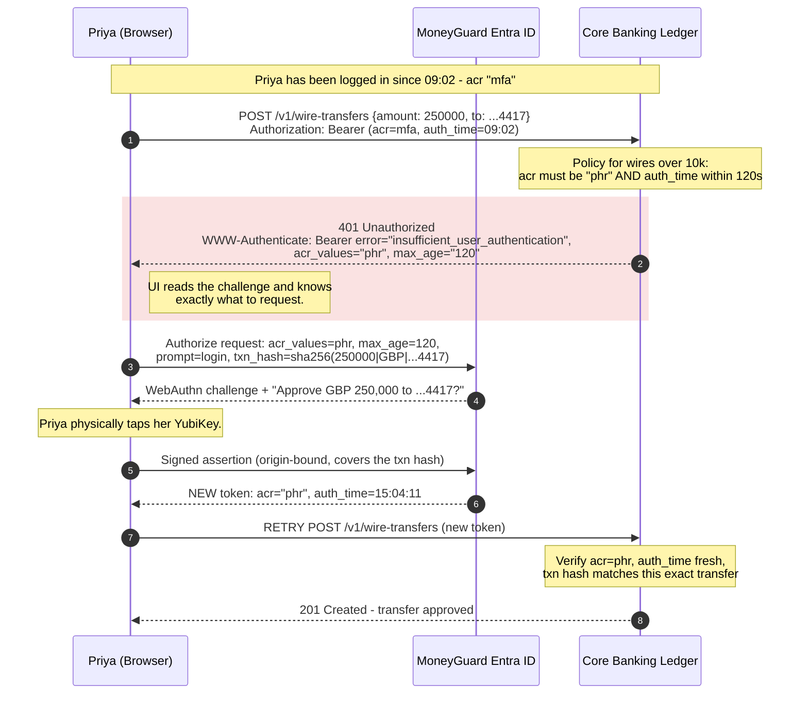
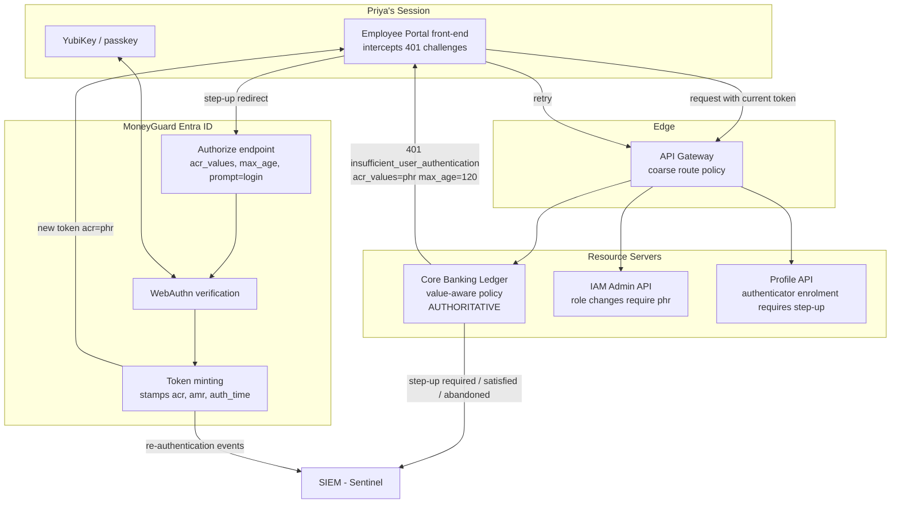

# Step-Up Authentication

## Overview

**Step-up authentication** means asking a user who is *already logged in* to prove themselves again — more strongly, or more recently — before a high-risk action goes through.

[Chapter 01](./01_MFA_Fundamentals.md) covered how people authenticate. [Chapter 02](./02_Phishing_Resistant_MFA_WebAuthn_FIDO2.md) made that login unphishable. But both protect a single moment: **the login**. A session issued at 9am is a bearer credential for the rest of the day. If it is stolen, or the laptop is left unlocked, or the user was tricked into starting a dangerous action, nothing between login and logout asks "are you still there, and are you really you?"

Step-up closes that gap. The mechanism is the **`acr` claim** (Authentication Context Class Reference), which records *how strongly* someone logged in, together with **`auth_time`**, which records *when*. Sensitive endpoints check both and reject tokens that are too weak or too stale.

🏦 **MoneyGuard scenario:** Priya Sharma logs into the Employee Portal at 9am with a password and a push notification. At 3pm — after leaving her workstation unlocked while helping a customer at the counter — a request arrives to approve a **£250,000 wire transfer** from her session. The session token is completely valid. Step-up authentication is the only control left: the Core Banking Ledger sees `acr: "mfa"` on a six-hour-old session, refuses the transfer, and demands a fresh hardware-key signature *right now*.

## Why This Matters

- **Sessions are long; danger is instantaneous.** An 8-hour session covers thousands of actions with a single authentication decision made once, hours earlier.
- **It is the last defence after session theft.** If Eve steals a cookie via malware or an XSS bug, WebAuthn has already done its job. Step-up forces her to produce a hardware signature she does not have.
- **Blast radius varies enormously.** Reading Priya's own payslip and moving a quarter of a million pounds must not share one security bar.
- **It buys usability.** Because sensitive actions are individually protected, ordinary work can proceed with fewer prompts — which keeps users attentive rather than desensitised.
- **Regulators expect it.** PSD2 dynamic linking requires authentication tied to the specific amount and payee, which is step-up by another name.

## Key Concepts

| Term | Plain-English meaning |
|---|---|
| **Step-up authentication** | Requiring stronger or fresher proof mid-session for a specific action. |
| **Re-authentication** | Asking the user to authenticate again, even with the same method, to prove presence *now*. |
| **`acr` claim** | Authentication Context Class Reference — the *strength tier* of the authentication. |
| **`amr` claim** | Authentication Methods References — the specific methods used (`pwd`, `otp`, `hwk`). |
| **`auth_time`** | When the user last actually authenticated (not when the token was issued). |
| **`max_age`** | A request parameter telling the IdP "re-authenticate if the last login is older than N seconds". |
| **`prompt=login`** | A request parameter forcing a fresh authentication regardless of existing session. |
| **`acr_values`** | A request parameter asking the IdP for a specific authentication strength. |
| **`insufficient_user_authentication`** | The standard OAuth error meaning "step up and try again" (RFC 9470). |
| **Transaction binding / dynamic linking** | Tying the authentication to the specific amount and recipient. |
| **Freshness window** | How recently the user must have authenticated for this action to be allowed. |
| **Blast radius** | How much damage an action can cause if performed maliciously. |

## Detailed Notes

### Concept 1 — Two independent dimensions: strength and freshness

Step-up is often taught as "require MFA again", but there are really two separate questions:

- **Strength (`acr`)** — *how* did they prove themselves? A password is weaker than a push, which is weaker than a hardware key.
- **Freshness (`auth_time`)** — *when* did they prove it? A hardware-key login from nine hours ago is strong but stale.

| Action | Required strength | Required freshness | Why |
|---|---|---|---|
| View the intranet | any authenticated | none | No risk |
| View Priya's own payslip | `mfa` | none | Personal data, low blast radius |
| Change Priya's own password | `mfa` | 15 minutes | Account takeover pivot |
| Approve a £250,000 wire | `phr` | **2 minutes** | Irreversible, catastrophic |
| Raj changes a role definition | `phr` | 5 minutes | Grants access to everything |
| Bulk-export customer data | `phr` | 5 minutes + second approver | GDPR exposure |

⚠️ Requiring only strength is a classic mistake: a token minted with a hardware key at 8am still says `acr: "phr"` at 6pm. If Eve stole that session at noon, the strength check passes happily. **You need `auth_time` too.**

### Concept 2 — The `acr` claim and MoneyGuard's tiers

`acr` is a string naming an authentication *tier*, agreed between the IdP and the applications. MoneyGuard uses:

| `acr` value | Meaning | How it was obtained |
|---|---|---|
| `pwd` | Password only | Legacy or low-risk sign-in |
| `mfa` | Two factors, phishable | Password + TOTP or push |
| `phr` | **Phishing-resistant** | WebAuthn hardware key or passkey |
| `phrh` | Phishing-resistant, hardware-bound | Device-bound key, not a synced passkey |

The `amr` claim carries the detail (`["pwd","hwk","user_verified"]`), but applications should authorize on the **tier**, not on the individual methods — otherwise every application needs updating each time MoneyGuard adds an authenticator type.

💡 Define the tiers once, centrally, and publish them. Ad-hoc `acr` strings invented per application are the reason step-up projects stall.

### Concept 3 — The operational flow (the standard OAuth pattern)

1. Priya's session token carries `acr: "mfa"`, `auth_time: 09:02`.
2. She (or someone using her session) attempts `POST /v1/wire-transfers` for £250,000.
3. The Core Banking Ledger's policy for that endpoint requires `acr = phr` and `auth_time` within 120 seconds. Neither holds.
4. The API responds **`401` with a `WWW-Authenticate` challenge** carrying `error="insufficient_user_authentication"` and — crucially — **stating what it needs** (`acr_values="phr"`, `max_age="120"`).
5. The front-end intercepts that specific error and redirects to MoneyGuard Entra ID with `acr_values=phr&max_age=120&prompt=login`.
6. Priya taps her YubiKey. The IdP issues a **new token** with `acr: "phr"` and a current `auth_time`.
7. The front-end retries the original request with the new token. It succeeds.

⚠️ Step 4 matters more than it looks. If the API returns a bare `403`, the front-end has no idea *why* and cannot recover. The challenge must be machine-readable so the client knows exactly what to ask for. This is standardised in **RFC 9470 (OAuth 2.0 Step-Up Authentication Challenge)**.

### Concept 4 — `prompt=login` vs `max_age`: forcing real freshness

If the IdP already has a session for Priya, a plain redirect returns instantly with a *new token wrapping the same old authentication* — including the same `auth_time`. The user sees a flash and nothing has actually been proven.

Two parameters prevent this:

- **`max_age=120`** — "if the last authentication is older than 120 seconds, re-authenticate." The IdP decides.
- **`prompt=login`** — "re-authenticate unconditionally, ignore the existing session."

💡 Use `max_age` for most step-ups (it avoids a needless prompt if the user genuinely just authenticated) and `prompt=login` for the truly irreversible operations where you always want a deliberate physical act.

⚠️ And always **verify `auth_time` server-side** after the redirect. Never trust that the IdP honoured your `max_age` — check the returned claim yourself.

### Concept 5 — Transaction binding (dynamic linking)

For money movement, step-up alone is not quite enough. Consider: Priya steps up correctly to approve a £5,000 transfer, but malware in her browser swaps the payload to £250,000 to a different account before it reaches the server. Her authentication was fresh, strong, and genuine — for the wrong transaction.

**Transaction binding** ties the authentication to the specific details:

- The step-up request includes a hash of the transaction (amount, currency, recipient account).
- The authenticator or the IdP **displays those details** to Priya: *"Approve £250,000 to account ending 4417?"*
- The signed response covers that hash, so the server can confirm the approval matches the transaction it is about to execute.

This is exactly what PSD2 calls **dynamic linking**, and it is mandatory for European payment initiation. 💡 Mentioning it unprompted signals real payments experience in an interview.

### Concept 6 — Where to enforce: the API, not the UI

⚠️ A step-up prompt in the front-end is a *user experience*, not a security control. Eve does not use your front-end; she calls the API directly with a stolen token.

The enforcement must live where the action executes:

| Layer | Role |
|---|---|
| **UI** | Detects the challenge, runs the redirect, retries. Convenience only. |
| **API Gateway** | Can enforce coarse rules (this whole route family needs `phr`). |
| **Resource server (the Ledger)** | **Authoritative.** Checks `acr` and `auth_time` on every sensitive call, because only it knows the amount and the account. |

The Ledger is the only component that knows a transfer is £250,000 rather than £50, so a value-dependent rule can only be enforced there.

### Concept 7 — Designing the policy: classify by blast radius

Work outward from consequence, not from convenience:

1. **Irreversible + high value** → `phr` + `prompt=login` + transaction binding + often a second approver. *(Wire transfers, bulk data export, deleting production systems.)*
2. **Reversible but privileged** → `phr` + `max_age` of a few minutes. *(Raj editing a role, granting Ledger access.)*
3. **Account-security actions** → `mfa` minimum + short freshness. *(Changing a password, email address, phone number, or **enrolling a new authenticator** — this last one is critical, because it is the takeover pivot.)*
4. **Sensitive reads** → `mfa`, freshness optional. *(Viewing customer PII.)*
5. **Everything else** → the existing session.

💡 Category 3 is the one teams forget. If Eve can add her own passkey using a hijacked session, she has converted a temporary session theft into permanent account ownership. **Enrolment must always require step-up.**

### Concept 8 — Comparing the mechanisms

| Mechanism | What it proves | Cost to user | When MoneyGuard uses it |
|---|---|---|---|
| Nothing (session only) | User logged in at some point | none | Routine reads |
| Re-enter password | Weak presence check | low | ⚠️ Rarely worth it — phishable and annoying |
| Re-prompt existing MFA (`max_age`) | Presence now, same strength | medium | Account-security changes |
| Step up to `phr` (`acr_values`) | Stronger method now | medium | Privileged administrative actions |
| `phr` + `prompt=login` | Deliberate physical act now | medium | Irreversible operations |
| `phr` + transaction binding | Approval of *this exact* transaction | medium | Payments, PSD2 dynamic linking |
| Second human approver | Independent judgement | high | Very large transfers, break-glass access |

## Workflow



## Architecture Diagram



## Step-by-Step Process

**Implementing step-up at MoneyGuard:**

1. **Define the `acr` tiers centrally** (`pwd` / `mfa` / `phr` / `phrh`) and publish them so every team uses the same vocabulary.
2. **Make the IdP emit `acr`, `amr`, and `auth_time`** truthfully on every token, including after silent renewals.
3. **Classify every sensitive endpoint by blast radius** using the five categories in Concept 7. Write it down; this list is the policy.
4. **Implement authorization policies on the resource servers**, not just the gateway — value-dependent rules can only live where the value is known.
5. **Return a machine-readable challenge**: `401` with `WWW-Authenticate: Bearer error="insufficient_user_authentication"` plus the required `acr_values` and `max_age`.
6. **Teach the front-end to handle it**: intercept that specific error, preserve the pending request, redirect with the requested parameters, then retry exactly once.
7. **Verify `auth_time` server-side** after the step-up. Do not assume the IdP honoured `max_age`.
8. **Add transaction binding** for payments: hash the amount, currency, and recipient into the step-up request and verify it matches at execution.
9. **Protect authenticator enrolment and account-recovery endpoints** with step-up — the most commonly missed control.
10. **Log every step-up**: required, satisfied, failed, abandoned. Repeated abandonment on wire transfers is a strong signal of a hijacked session.

## Commands and Examples

**The challenge — what a correctly implemented API returns:**

```http
HTTP/1.1 401 Unauthorized
WWW-Authenticate: Bearer error="insufficient_user_authentication",
                  error_description="A fresh phishing-resistant authentication is required for transfers over GBP 10,000",
                  acr_values="phr",
                  max_age="120"
```

⚠️ Compare with a bare `403 Forbidden`: the front-end cannot tell "you are not allowed" from "prove yourself again", so it cannot recover and the user sees a dead end.

**The step-up authorization request:**

```http
GET /oauth2/v2.0/authorize
  ?client_id=moneyguard-employee-portal
  &response_type=code
  &redirect_uri=https%3A%2F%2Fportal.moneyguard.com%2Fcallback
  &scope=openid%20ledger.write
  &acr_values=phr
  &max_age=120
  &prompt=login
  &state=8fH2...
  &nonce=Kq9x...
HTTP/1.1
Host: login.moneyguard.com
```

**The token before and after:**

```json
// BEFORE - the 9am session
{
  "sub": "priya.sharma@moneyguard.com",
  "acr": "mfa",
  "amr": ["pwd", "otp"],
  "auth_time": 1772528520,     // 09:02
  "exp":       1772557320
}

// AFTER the step-up - note acr AND auth_time both changed
{
  "sub": "priya.sharma@moneyguard.com",
  "acr": "phr",
  "amr": ["hwk", "user_verified"],
  "auth_time": 1772550251,     // 15:04:11 - seconds ago
  "txn_hash": "9c1f5d3ae0b7...", // binds this token to THIS transfer
  "exp":       1772553851
}
```

**Enforcing strength with a policy (C#):**

```csharp
builder.Services.AddAuthorization(options =>
{
    options.AddPolicy("StandardUser", p => p.RequireAuthenticatedUser());

    // Strength only - necessary but NOT sufficient on its own.
    options.AddPolicy("RequirePhishingResistant", p =>
    {
        p.RequireAuthenticatedUser();
        p.RequireClaim("acr", "phr", "phrh");
    });

    // Strength AND freshness - what high-value actions actually need.
    options.AddPolicy("RequireFreshHardwareKey", p =>
    {
        p.RequireAuthenticatedUser();
        p.RequireClaim("acr", "phr", "phrh");
        p.RequireAssertion(ctx =>
        {
            var at = ctx.User.FindFirst("auth_time")?.Value;
            if (!long.TryParse(at, out var epoch)) return false;
            var age = DateTimeOffset.UtcNow - DateTimeOffset.FromUnixTimeSeconds(epoch);
            return age <= TimeSpan.FromSeconds(120);   // <-- the freshness window
        });
    });
});
```

**The value-aware endpoint — why the resource server must decide:**

```csharp
[Authorize(Policy = "StandardUser")]
[HttpPost("/v1/wire-transfers")]
public async Task<IActionResult> CreateWire([FromBody] WireRequest req)
{
    // Only the Ledger knows the amount, so only the Ledger can apply a value rule.
    if (req.AmountGbp >= 10_000)
    {
        var result = await _authz.AuthorizeAsync(User, "RequireFreshHardwareKey");
        if (!result.Succeeded)
        {
            Response.Headers.WWWAuthenticate =
                "Bearer error=\"insufficient_user_authentication\", " +
                "acr_values=\"phr\", max_age=\"120\"";
            return Unauthorized();
        }

        // Transaction binding: the approval must be for THIS transfer.
        var expected = Hash($"{req.AmountGbp}|{req.Currency}|{req.DestinationAccount}");
        if (User.FindFirst("txn_hash")?.Value != expected)
            return BadRequest("Authentication does not match this transaction.");
    }

    await _ledger.SubmitAsync(req);
    _audit.Record(User, "wire.created", req.AmountGbp, stepUp: req.AmountGbp >= 10_000);
    return Created($"/v1/wire-transfers/{req.Id}", null);
}
```

**Simple attribute-based use for privileged administration:**

```csharp
// Raj changing a role definition grants access to everything downstream.
[Authorize(Policy = "RequireFreshHardwareKey")]
[HttpPut("/v1/roles/{roleId}")]
public IActionResult UpdateRole(string roleId, [FromBody] RoleDefinition def) { ... }

// The most-forgotten endpoint: registering a NEW authenticator.
[Authorize(Policy = "RequireFreshHardwareKey")]
[HttpPost("/v1/me/authenticators")]
public IActionResult EnrolAuthenticator([FromBody] EnrolRequest req) { ... }
```

**Front-end handling (the retry loop):**

```javascript
async function callApi(request) {
  let res = await fetch(request);
  if (res.status !== 401) return res;

  const challenge = parseWwwAuthenticate(res.headers.get('WWW-Authenticate'));
  if (challenge.error !== 'insufficient_user_authentication') return res;

  // Ask the IdP for exactly what the API said it needs.
  await stepUp({ acr_values: challenge.acr_values, max_age: challenge.max_age });

  return await fetch(request);   // retry ONCE - never loop
}
```

⚠️ Retry exactly once. An unbounded loop turns a persistent policy failure into a redirect storm.

## Best Practices

- **Check strength *and* freshness.** `acr` alone lets a nine-hour-old hardware-key session approve a wire transfer.
- **Enforce on the resource server**, because only it knows the amount, the record, and the blast radius.
- **Return a machine-readable challenge** (`insufficient_user_authentication` with `acr_values` and `max_age`), never a bare `403`.
- **Verify `auth_time` yourself** after the step-up rather than trusting that `max_age` was honoured.
- **Use `prompt=login` for irreversible actions** so the user must perform a deliberate physical act.
- **Bind the authentication to the transaction** for payments — amount, currency, and recipient hashed into the request and displayed to the user.
- **Always step up for authenticator enrolment, password change, and recovery**, or a stolen session becomes permanent ownership.
- **Define `acr` tiers centrally** and authorize on the tier, not on individual `amr` methods.
- **Keep freshness windows short but humane** — 2 minutes for money, 5–15 minutes for administration.
- **Log required / satisfied / failed / abandoned** step-ups, and alert on abandonment patterns.

## Common Mistakes

- ⚠️ **Checking `acr` but not `auth_time`.** The most common implementation bug, and it silently defeats the whole control.
- ⚠️ **Enforcing only in the UI.** Eve calls the API directly; a front-end modal stops nobody.
- ⚠️ **Returning `403` instead of the standard `401` challenge**, so the client cannot tell "denied" from "step up" and the flow dead-ends.
- ⚠️ **Omitting `prompt=login` / `max_age`**, so the IdP silently reissues a token wrapping the *same old* `auth_time` and nothing is actually re-proven.
- ⚠️ **Forgetting authenticator enrolment.** Session theft converts into permanent account takeover.
- ⚠️ **Stepping up on everything**, which retrains users to approve reflexively — the precondition for MFA fatigue.
- ⚠️ **Losing the pending request** during the redirect, forcing the user to retype a payment they already entered.
- ⚠️ **Infinite retry loops** when the policy can never be satisfied (for example, the user has no `phr` authenticator enrolled — handle that case explicitly).
- ⚠️ **No transaction binding on payments**, so a fresh, strong approval can be applied to a substituted amount or account.
- ⚠️ **Inventing per-application `acr` strings**, so no two MoneyGuard services agree on what "strong" means.

## Pro Tips

- 💡 **"Strength and freshness are two different checks."** Saying this unprompted immediately separates you from candidates who only know `acr`.
- 💡 **Abandoned step-ups are a hijack detector.** A session that repeatedly triggers a wire-transfer step-up and never completes it is either a confused user or an attacker without the hardware key. Alert on it.
- 💡 **Protect enrolment endpoints first.** It is the cheapest, highest-value step-up rule in the whole system and it is nearly always missing.
- 💡 **Show the user *why*.** "Confirm with your security key to approve £250,000 to account ending 4417" is both better UX and a genuine security control — it is how the victim notices a substituted transaction.
- 💡 **Test the negative path.** A user with no phishing-resistant authenticator enrolled must get a clear, actionable message, not a redirect loop. This edge case ships broken more often than not.

## Real-World Use Cases

- 🏦 **Priya's unlocked workstation.** The chapter's core scenario: a valid six-hour-old session cannot approve a £250,000 wire because the Ledger demands a hardware-key signature within the last 120 seconds. The physical YubiKey is in Priya's pocket, so the transfer never happens.
- 🏦 **Raj Patel editing role definitions.** Changing a role grants access to everything downstream, so every role edit requires a fresh `phr` authentication and is logged with the before/after diff for Dana Cole.
- 🏦 **Enrolling a new authenticator.** Eve steals a session cookie through an XSS flaw and immediately tries to register her own passkey. The Profile API requires fresh `phr`, so the session theft expires without becoming permanent.
- **PSD2 dynamic linking on the Mobile App.** Customer payments show the amount and payee on the device before the biometric approval, and the signature covers that data — regulation mandating transaction binding.
- **Break-glass production access.** An on-call engineer elevating to emergency Core Banking Ledger access needs fresh `phr` plus a second approver, with an automatic SOC notification and a time-boxed grant.
- **Bulk customer data export.** Any export beyond 1,000 records requires fresh `phr` and a named business justification recorded in the audit log, satisfying GDPR accountability.

## Key Takeaways

1. Step-up authentication protects **actions**, not just logins — the session between login and logout is otherwise a single unchallenged bearer credential.
2. There are **two independent checks**: strength (`acr`) and freshness (`auth_time`). Checking only strength is the classic bug.
3. The standard flow is **`401` + `WWW-Authenticate: insufficient_user_authentication`** with `acr_values` and `max_age` (RFC 9470), so the client knows exactly what to request.
4. Use **`max_age`** to require freshness and **`prompt=login`** to force a deliberate act for irreversible operations — then **verify `auth_time` server-side** regardless.
5. **Enforce on the resource server**, because only it knows the amount and the blast radius. UI enforcement is convenience only.
6. **Transaction binding (dynamic linking)** ties the approval to a specific amount and payee — mandatory under PSD2 and the only defence against payload substitution.
7. **Always step up for authenticator enrolment and account recovery**, or session theft becomes permanent account ownership.
8. Classify endpoints by **blast radius** and step up only where it earns its friction, keeping users attentive.

## Glossary

- **`acr` (Authentication Context Class Reference)** — A claim naming the strength tier of the authentication.
- **`acr_values`** — Request parameter asking the IdP for a specific authentication strength.
- **`amr` (Authentication Methods References)** — A claim listing the concrete methods used.
- **`auth_time`** — Timestamp of the user's last actual authentication.
- **Blast radius** — The scale of damage an action can cause.
- **Break-glass** — Emergency elevated access under heightened logging and approval.
- **Dynamic linking** — PSD2's requirement that authentication be tied to a specific amount and payee.
- **Freshness window** — The maximum acceptable age of the last authentication for a given action.
- **`insufficient_user_authentication`** — The OAuth error signalling that step-up is required (RFC 9470).
- **`max_age`** — Request parameter forcing re-authentication if the last one is older than N seconds.
- **`prompt=login`** — Request parameter forcing unconditional re-authentication.
- **Re-authentication** — Authenticating again to prove current presence.
- **Step-up authentication** — Requiring stronger or fresher authentication mid-session.
- **Transaction binding** — Cryptographically tying an approval to specific transaction details.

## Revision Notes

- Step-up protects **actions**; login protects the **session start**.
- Two checks: **`acr` (strength)** + **`auth_time` (freshness)**. Both, always.
- Tiers: `pwd` < `mfa` < `phr` (phishing-resistant) < `phrh` (hardware-bound).
- Flow: `401` + `WWW-Authenticate: Bearer error="insufficient_user_authentication", acr_values, max_age` → redirect with `acr_values` + `max_age` (+ `prompt=login`) → new token → **retry once**.
- `max_age` = re-auth if stale; `prompt=login` = re-auth unconditionally. **Verify `auth_time` server-side anyway.**
- Enforce on the **resource server** — only it knows the amount.
- **Transaction binding / PSD2 dynamic linking** for payments.
- Never forget: **authenticator enrolment, password change, recovery** all need step-up.
- Monitor abandoned step-ups → hijacked-session signal.

## Interview Questions

**Q1. Priya is logged in with a valid MFA session. Why isn't that enough to approve a £250,000 wire transfer?**
A: Because that token records a decision made once, hours ago, about a general context — not about this transfer. In between, the session may have been stolen via malware or an XSS flaw, or the workstation may have been left unlocked, and the token is a bearer credential that works regardless. It also says nothing about the amount: the same session approved a £50 expense this morning. Step-up re-establishes both that a specific human is present *now* and that they are approving *this* transaction, which is the only way to make the control proportionate to the blast radius.

**Q2. What is the `acr` claim, and why isn't checking it sufficient on its own?**
A: `acr` records the strength tier of the authentication — for example `pwd`, `mfa`, or `phr` for phishing-resistant. It answers "how strongly did they prove themselves?" but not "when?". A token minted with a hardware key at 8am still carries `acr: "phr"` at 6pm, so an attacker who steals that session at noon passes the strength check trivially. You must pair it with `auth_time` and enforce a freshness window appropriate to the action.

**Q3. Walk me through the standard OAuth step-up challenge.**
A: The API evaluates its policy, finds the token too weak or too stale, and returns `401` with `WWW-Authenticate: Bearer error="insufficient_user_authentication"` plus the `acr_values` and `max_age` it requires — RFC 9470. The front-end intercepts that specific error, preserves the pending request, and redirects to the IdP with exactly those parameters, adding `prompt=login` for irreversible actions. The user authenticates with their hardware key, the IdP mints a new token with the higher `acr` and a current `auth_time`, and the front-end retries the original request once. The key design point is that the challenge is machine-readable, so the client learns what to ask for instead of dead-ending on a bare `403`.

**Q4. Where should step-up be enforced, and why not at the API Gateway?**
A: On the resource server, because it is the only component that knows the semantics of the request. The gateway can enforce coarse rules — "everything under `/v1/admin` needs `phr`" — but it cannot express "wires over £10,000 need a 120-second-fresh hardware key" without parsing and duplicating the Ledger's business logic. The gateway is useful defence in depth, and the UI handles the redirect for usability, but the authoritative decision must sit next to the code that executes the action, because that is what an attacker calling the API directly actually hits.

**Q5. What is transaction binding, and what attack does it stop?**
A: Transaction binding — PSD2 calls it dynamic linking — hashes the specific transaction details (amount, currency, recipient) into the step-up request, displays them to the user during approval, and covers them in the signed response. It stops payload substitution: malware in Priya's browser presenting her a £5,000 transfer to approve while sending £250,000 to a different account. Without binding, her authentication was fresh, strong, and completely genuine — for a transaction she never saw. With binding, the server compares the hash in the token against the transfer it is about to execute and rejects the mismatch, and Priya sees the real amount on her device before she taps.

**Q6. Which endpoint do teams most often forget to protect with step-up, and why does it matter so much?**
A: Authenticator enrolment — `POST /me/authenticators` — along with password change and account recovery. It matters because it is the pivot from temporary to permanent compromise: an attacker with a stolen session that would otherwise expire in a few hours registers their own passkey, and now owns the account outright, surviving password resets and session revocation. Requiring fresh phishing-resistant authentication to add a credential means a hijacked session cannot bootstrap itself into ownership, which is arguably the highest-value step-up rule in the entire system.

**Q7. You add `acr_values=phr` to the redirect but the IdP returns instantly and the transfer still fails. What happened?**
A: The IdP had an existing session for Priya that already satisfied `phr`, so it reissued a token without re-authenticating — the new token carries the same old `auth_time`, and the freshness check still fails. The fix is to send `max_age` (re-authenticate if older than N seconds) or `prompt=login` (re-authenticate unconditionally) alongside `acr_values`. And regardless of what you send, the resource server must verify `auth_time` itself, because trusting the IdP to have honoured a request parameter is not a security control.

**Q8. How do you decide which actions warrant step-up without annoying users into ignoring prompts?**
A: Classify by blast radius rather than by convenience. Irreversible high-value actions — wire transfers, bulk data export, deleting production systems — get `phr` plus `prompt=login` plus transaction binding, and sometimes a second approver. Reversible but privileged actions like role edits get `phr` with a few minutes of freshness. Account-security actions get at least `mfa` with a short window. Sensitive reads get `mfa`. Everything else runs on the existing session. Keeping the prompt rare is itself a security property: a user prompted twenty times a day stops reading prompts, which is exactly the precondition for MFA-fatigue attacks.

## Practice Exercises

1. **Build the policy matrix.** For each MoneyGuard action, specify the required `acr`, the freshness window, whether `prompt=login` is needed, and whether transaction binding applies: viewing your own payslip; changing your own password; enrolling a new passkey; approving a £500 transfer; approving a £250,000 transfer; Raj editing a role; exporting 50,000 customer records; Dana running a read-only audit report. Justify each in one line.

2. **Find the bug.** An engineer implements `RequirePhishingResistant` as `policy.RequireClaim("acr", "phr")` and applies it to the wire-transfer endpoint. Describe a concrete attack that still succeeds, and write the corrected policy.

3. **Design the client flow.** Write pseudocode for the front-end step-up handler covering: preserving the pending request across a redirect, retrying exactly once, and the case where the user has no phishing-resistant authenticator enrolled. State what the user sees in each branch.

4. **Add transaction binding.** Extend the wire-transfer example so the amount, currency, and destination account are hashed into the step-up request, displayed to Priya during approval, and verified at execution. Then describe the specific attack your change prevents and the one it does not.

5. **Detect the hijack.** Write the Sentinel detection rule for a session that repeatedly triggers wire-transfer step-ups and never satisfies them. Define the threshold, the time window, what the alert must contain to be actionable, and the automated response you would take on the session.

---

⬅ [Chapter 02 — Phishing-Resistant MFA: WebAuthn & FIDO2](./02_Phishing_Resistant_MFA_WebAuthn_FIDO2.md) | [Module 07 Index](./README.md) | [Main README](../README.md) | [MoneyGuard Scenario](../SCENARIO.md)
