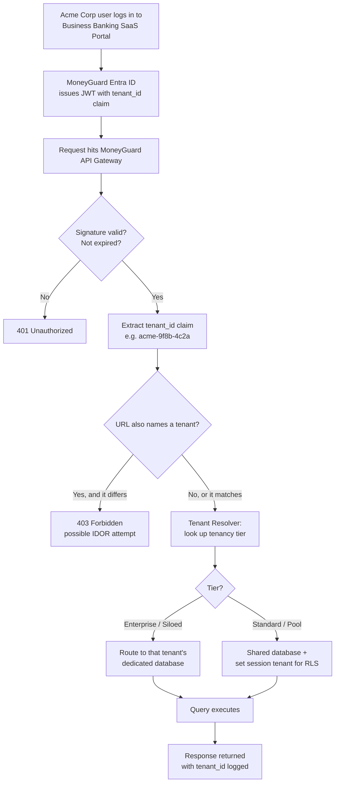
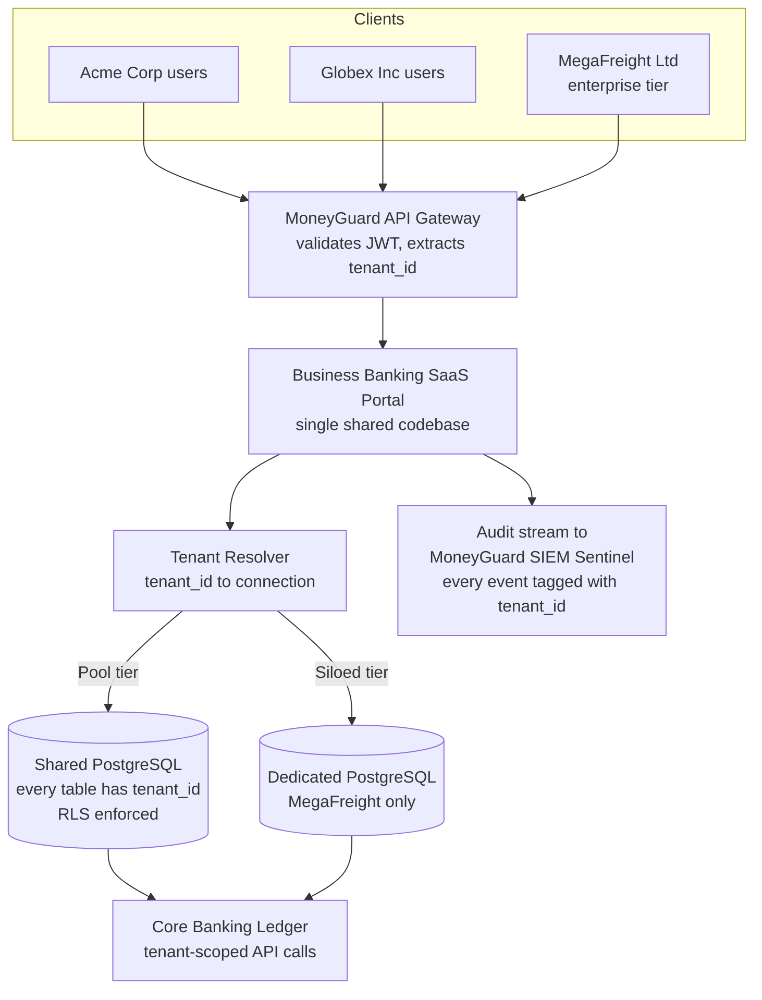

# Tenancy Models: Siloed vs. Pool vs. Bridge

## Overview

**Multi-tenancy** means one running copy of your software serves many separate customers at the same time. Each customer is called a **tenant**. The whole game is making sure Tenant A can never see Tenant B's data — even though they share the same code, the same servers, and possibly the same database.

🏦 **MoneyGuard scenario:** MoneyGuard Bank runs a **Business Banking SaaS Portal** where corporate clients log in to manage payroll and invoicing. Two of those clients are **Acme Corp** and **Globex Inc**. Acme's payroll manager must never see a single row of Globex's payroll. Both companies hit the same URL, the same API Gateway, and the same backend services. This chapter is about how MoneyGuard physically organizes the data so that isolation is guaranteed, not merely hoped for.

There are three standard ways to do it — **Siloed**, **Pool**, and **Bridge** — and each trades cost against isolation.

## Why This Matters

- **A cross-tenant leak is a company-ending event.** If Acme Corp sees Globex Inc's payroll file, MoneyGuard has a breach notification, a regulatory investigation, and two lost clients. In banking, this also means SOX and GDPR exposure.
- **The model you pick is very hard to change later.** Moving from Pool to Siloed after two years of production data is a migration project, not a config change. This is why interviewers ask about it — it's an early, expensive, irreversible architectural decision.
- **Cost scales with the model.** Giving 1,000 corporate clients their own database is possible; giving them their own database *and* patching all 1,000 every month is what actually kills teams.
- **Compliance sometimes decides for you.** A large client may contractually require their data to live in a physically separate database, or in a specific country. Your architecture must be able to say yes.
- **It's the #1 multi-tenant interview question.** "How do you guarantee Customer A can't read Customer B's data?" — you need a crisp, layered answer.

## Key Concepts

- **Tenant** — one customer organization (Acme Corp, Globex Inc). The top-level unit of isolation.
- **Tenant ID (`tenant_id`)** — the unique identifier for a tenant, ideally a **UUID** (Universally Unique Identifier — a 128-bit random ID like `9f8b4c2a-...`). This value travels in the user's token and is the key to every isolation decision.
- **Siloed model** — one physical database (or even one full stack) per tenant.
- **Pool model** — all tenants share the same tables; a `tenant_id` column on every row separates them.
- **Bridge model** — tenants share one database instance but each gets its own **schema** (a named namespace of tables inside a database — think of it as a folder).
- **Noisy neighbor** — one tenant's heavy workload degrading performance for everyone else. A pool-model risk.
- **Blast radius** — how much damage one bug or one breach can do. Siloed = one tenant. Pool = everyone.
- **Cross-tenant data leakage** — the failure mode where a query returns another tenant's rows.
- **Tenant density** — how many tenants you fit per unit of infrastructure. Higher density = lower cost per tenant.

## Detailed Notes

### Concept 1 — The Siloed Model (one database per tenant)

Every tenant gets their own physical database instance. Acme Corp's payroll rows live in `moneyguard_bb_acme`; Globex Inc's live in `moneyguard_bb_globex`. The application code picks the right connection string at request time based on who logged in.

**What you get:** Absolute isolation. A `SELECT * FROM payroll` with no `WHERE` clause is *still* safe, because the connection physically cannot reach the other database. This is the model to reach for when a client's contract or a regulator demands physical separation, or when a single client is so large they need dedicated capacity.

**What you pay:** Everything is multiplied by N. 1,000 clients means 1,000 databases to patch, 1,000 backups to verify, 1,000 schema migrations to run and to roll back if one fails halfway. Cross-tenant analytics ("how many invoices did all our clients process last month?") become a data-warehouse project rather than one query. Cost per tenant is highest, so small clients become unprofitable.

⚠️ The hidden cost of Siloed is not the databases — it's the **migration fan-out**. A schema change that takes 30 seconds in a pool model becomes a multi-hour orchestrated job with partial-failure handling.

### Concept 2 — The Pool Model (shared tables, `tenant_id` column)

All tenants share the same tables. Every single table — `users`, `payroll_batches`, `invoices`, `audit_events` — carries a `tenant_id` column, and every query filters on it.

**What you get:** Highest density and lowest cost. One schema migration updates every tenant at once. Onboarding Globex Inc is an `INSERT INTO tenants` — no infrastructure provisioning at all. Cross-tenant reporting is a single `GROUP BY tenant_id`.

**What you pay:** The isolation now lives in your *code*. One developer forgetting `WHERE tenant_id = ...` on one endpoint is a data breach. This class of bug is so common it has a name in the OWASP API Security Top 10: **BOLA** (Broken Object Level Authorization) and its sibling **BFLA** (Broken Function Level Authorization). You also get noisy-neighbor risk: Acme Corp running a huge payroll import can slow down Globex Inc's dashboard.

The answer to the "developer forgot the WHERE clause" problem is **Row-Level Security**, which pushes enforcement down into the database engine itself. That is the entire subject of the next chapter: [02_Database_Schema_And_Row_Level_Security.md](./02_Database_Schema_And_Row_Level_Security.md).

### Concept 3 — The Bridge Model (shared database, separate schemas)

One database instance, but each tenant gets a named schema: `acme.payroll_batches`, `globex.payroll_batches`. The application sets the PostgreSQL `search_path` (the list of schemas to look in) per request, and unqualified table names resolve to that tenant's copy.

**What you get:** Better density than Siloed (one instance to run) with namespace-level separation. A per-tenant restore is easy — you restore one schema. A tenant can even have slightly different columns if a client needs a custom field.

**What you pay:** Schema count becomes the bottleneck. PostgreSQL slows down on system-catalog lookups when you have tens of thousands of schemas, and connection pooling becomes awkward because a pooled connection carries a `search_path` that belongs to whichever tenant used it last — a genuine source of cross-tenant bugs. Migrations still fan out (N schemas), just within one instance.

### Concept 4 — The comparison table

| Dimension | 🏠 Siloed (DB per tenant) | 🌉 Bridge (schema per tenant) | 🏊 Pool (shared tables + `tenant_id`) |
|---|---|---|---|
| **Isolation strength** | Strongest — physical | Medium — namespace | Weakest by default; strong *with* RLS |
| **Blast radius of a bug** | One tenant | One tenant (usually) | All tenants |
| **Cost per tenant** | Highest | Medium | Lowest |
| **Tenant density** | ~1 per instance | Hundreds per instance | Millions of rows, one instance |
| **Schema migration effort** | N databases | N schemas | 1 migration |
| **Onboarding a new tenant** | Provision infrastructure (minutes–hours) | `CREATE SCHEMA` (seconds) | One `INSERT` (instant) |
| **Cross-tenant analytics** | Hard (needs a warehouse) | Medium | Trivial (`GROUP BY tenant_id`) |
| **Noisy-neighbor risk** | None | Medium | High |
| **Per-tenant encryption key** | Easy | Medium | Hard |
| **Best fit at MoneyGuard** | A regulated mega-client demanding physical separation | Mid-size clients needing custom fields | The default for the thousands of small business clients |

### Concept 5 — The hybrid reality: tiered tenancy

Real SaaS platforms rarely pick one model forever. MoneyGuard runs a **tiered** strategy:

- **Standard tier** (the ~5,000 small business clients): Pool model with Row-Level Security. Cheap, dense, one migration.
- **Enterprise tier** (a handful of very large corporate clients): promoted to Siloed — their own database, sometimes in their own region for data-residency rules.

The critical design rule: **the application code must be identical in both tiers.** The only difference is which connection string the tenant-resolution layer hands back. If Pool and Siloed need different code paths, you have doubled your surface area for bugs. Keep `tenant_id` on every row even in the Siloed tier — it costs almost nothing and it means promoting a tenant from Pool to Silo is a data copy, not a rewrite.

### Concept 6 — Where the tenant ID comes from (and where it must NOT come from)

The `tenant_id` must be derived from something the user cannot forge. In MoneyGuard's Business Banking SaaS Portal, it comes from the validated **JWT** (JSON Web Token — the signed token issued after login; see [Module 04](../04_Edge_Security_Tokens_And_Sessions/README.md)). The API Gateway validates the signature, then the application reads the `tenant_id` claim.

⚠️ **Never** take the tenant ID from a URL path (`/api/tenants/{id}/payroll`), a query string, or a request header that the client controls. If Eve can change `?tenant=acme` to `?tenant=globex` and get data back, you have built an **IDOR** (Insecure Direct Object Reference) vulnerability. If the URL *does* contain a tenant ID for readability, the server must compare it to the token's claim and reject any mismatch with `403 Forbidden`.

### Concept 7 — Users who belong to more than one tenant

Sam Torres is a contractor who does bookkeeping for both Acme Corp and Globex Inc. One human, one email address, two tenants. The clean model is:

- One `users` row per human identity.
- A **membership** row per (user, tenant, role) combination.
- The token carries **exactly one** active `tenant_id` at a time.

To switch context, Sam performs an explicit "switch organization" action, which requests a **new token** scoped to the other tenant. There is never a token that grants access to two tenants at once — that would make every downstream isolation check ambiguous.

## Workflow

How a single request from Acme Corp gets pinned to its tenant:



## Architecture Diagram



## Step-by-Step Process

Choosing and implementing a tenancy model at MoneyGuard:

1. **Write down the isolation requirement.** Ask legal and compliance first, not engineering. Does any contract or regulator demand physical separation or a specific data region? If yes, you need a Siloed tier — full stop.
2. **Estimate tenant count and shape.** 5,000 small clients averaging 200 rows each says Pool. 12 clients averaging 40 million rows each says Siloed. A long tail with a few whales says hybrid.
3. **Pick the default model.** For MoneyGuard's Business Banking SaaS Portal, the default is **Pool**, because most corporate clients are small and cost per tenant matters.
4. **Design the schema with `tenant_id` on every table from day one** — including audit tables, job tables, and file-metadata tables. Retrofitting `tenant_id` later is brutal.
5. **Use UUIDs for all primary keys.** Sequential integers let Eve guess `/invoices/1001` after seeing `/invoices/1000`.
6. **Put `tenant_id` in the token, never in client-controlled input.**
7. **Turn on Row-Level Security** so the database enforces isolation even when application code forgets. (Next chapter.)
8. **Add a defense-in-depth check in the application layer too** — belt and braces. RLS is the safety net, not an excuse to skip the `WHERE` clause.
9. **Tag every log line and every metric with `tenant_id`** so MoneyGuard's SOC can investigate per-tenant and so you can find noisy neighbors.
10. **Build the promotion path early.** Write and test the "move Acme Corp from Pool to its own Silo" runbook *before* a client demands it in a contract negotiation.
11. **Test isolation continuously.** An automated test that logs in as Acme and tries to read a known Globex record, asserting a zero-row or 403 result, should run on every build.

## Commands and Examples

**Resolving the tenant from a validated token (ASP.NET Core middleware).**

```csharp
public class TenantResolutionMiddleware
{
    private readonly RequestDelegate _next;
    public TenantResolutionMiddleware(RequestDelegate next) => _next = next;

    public async Task InvokeAsync(HttpContext ctx, ITenantDirectory directory)
    {
        // The tenant_id comes ONLY from the validated JWT - never from the URL.
        var tenantId = ctx.User.FindFirst("tenant_id")?.Value;
        if (string.IsNullOrEmpty(tenantId))
        {
            ctx.Response.StatusCode = 401; // No tenant context = no access.
            return;
        }

        // Defense in depth: if the route also names a tenant, they MUST match.
        if (ctx.Request.RouteValues.TryGetValue("tenantId", out var fromRoute)
            && !string.Equals(fromRoute?.ToString(), tenantId, StringComparison.Ordinal))
        {
            ctx.Response.StatusCode = 403; // Likely an IDOR probe - log it to Sentinel.
            return;
        }

        // Tier decides Pool vs Siloed; the rest of the app is unaware of the difference.
        var tenant = await directory.LookupAsync(tenantId);
        ctx.Items["TenantId"] = tenant.Id;
        ctx.Items["ConnectionString"] = tenant.ConnectionString;

        await _next(ctx);
    }
}
```

**The tenant registry table (the map that drives the resolver).**

```sql
CREATE TABLE tenants (
    id                UUID PRIMARY KEY DEFAULT gen_random_uuid(),
    slug              TEXT UNIQUE NOT NULL,          -- 'acme-corp', 'globex-inc'
    display_name      TEXT NOT NULL,                 -- 'Acme Corp'
    tenancy_model     TEXT NOT NULL                  -- how this tenant is stored
        CHECK (tenancy_model IN ('pool', 'bridge', 'silo')),
    connection_alias  TEXT NOT NULL DEFAULT 'shared',-- 'shared' or 'silo-megafreight'
    data_region       TEXT NOT NULL DEFAULT 'us-east-1',
    status            TEXT NOT NULL DEFAULT 'active'
        CHECK (status IN ('active', 'suspended', 'offboarding')),
    created_at        TIMESTAMPTZ NOT NULL DEFAULT now()
);

INSERT INTO tenants (slug, display_name, tenancy_model, connection_alias) VALUES
  ('acme-corp',   'Acme Corp',      'pool', 'shared'),
  ('globex-inc',  'Globex Inc',     'pool', 'shared'),
  ('megafreight', 'MegaFreight Ltd','silo', 'silo-megafreight');
```

**A Bridge-model request setting its schema (note the risk).**

```sql
-- Bridge model: each tenant is a schema. Set the search path per request.
SET search_path TO "acme_corp", public;
SELECT * FROM payroll_batches;   -- resolves to acme_corp.payroll_batches

-- DANGER: with connection pooling this setting survives into the NEXT request
-- unless you reset it. Always reset before returning the connection to the pool:
RESET search_path;
```

**An automated cross-tenant isolation test (this should run in CI).**

```csharp
[Fact]
public async Task Acme_Token_Cannot_Read_Globex_Invoice()
{
    var acmeToken   = await TestAuth.LoginAsAsync("priya.ops@acme-corp.example");
    var globexInvoice = SeedData.GlobexInvoiceId; // a real Globex row id

    var res = await Client.GetAsync($"/api/invoices/{globexInvoice}",
                                    bearer: acmeToken);

    // 404 is preferable to 403 here: it does not confirm the record exists.
    Assert.Equal(HttpStatusCode.NotFound, res.StatusCode);
}
```

## Best Practices

- **Default to Pool + Row-Level Security**, and offer Siloed only as a premium tier with a price tag attached.
- **Put `tenant_id` on every table**, no exceptions — including logs, jobs, uploads, and soft-deleted rows.
- **Use UUIDs (v4 or v7) for every primary key.** v7 is time-ordered, which keeps index performance good while staying unguessable.
- **Derive the tenant only from the validated token.**
- **Keep one codebase across tiers.** Tier differences belong in configuration and connection routing, not in `if (tenant.IsEnterprise)` branches scattered through business logic.
- **Tag telemetry with `tenant_id`** so you can spot noisy neighbors and run per-tenant incident response.
- **Rate-limit per tenant, not just per IP**, so Acme Corp's bulk import can't starve Globex Inc.
- **Write the tenant offboarding runbook early.** When Globex Inc leaves, you must be able to prove every row was deleted — GDPR's "right to erasure" applies.
- **Run a continuous isolation test in CI** that actively tries to cross the tenant boundary.

## Common Mistakes

- ⚠️ **Trusting a tenant ID from the URL or a header.** This is the single most common multi-tenant vulnerability. If the client can set it, the client can change it.
- ⚠️ **Sequential integer IDs.** `GET /invoices/1001` after `/invoices/1000` is a free enumeration attack.
- ⚠️ **Forgetting `tenant_id` on "unimportant" tables.** Audit logs, background jobs, and file metadata leak just as badly as payroll rows.
- ⚠️ **Relying on the ORM to always add the filter.** Raw SQL, reporting queries, admin tools, and data-fix scripts routinely bypass the ORM's global filters.
- ⚠️ **Leaking `search_path` across pooled connections** in the Bridge model — a request can silently inherit the previous tenant's schema.
- ⚠️ **Choosing Siloed "to be safe" without costing the operations.** Teams discover the true cost at tenant #200, mid-migration.
- ⚠️ **Caching without the tenant in the key.** A cache key of `user:priya:permissions` collides across tenants; it must be `tenant:acme:user:priya:permissions`.
- ⚠️ **Returning `403 Forbidden` for another tenant's record.** That confirms the record exists. Return `404 Not Found` — the resource genuinely does not exist *for you*.

## Pro Tips

- 💡 **Make the shared-tier database physically incapable of the mistake.** Pool + RLS means even a `SELECT *` with no `WHERE` is safe. Design so the lazy path is the safe path.
- 💡 **Reserve capacity for the promotion path.** Keep `tenant_id` in Siloed tenants' rows too, so promoting or demoting a tenant is a pure data move.
- 💡 **A "tenant switch" is a new token, not a session variable.** This makes multi-tenant contractors like Sam Torres safe by construction.
- 💡 **Add a `tenant_id` dimension to every dashboard.** Half of production debugging in SaaS is "is this everyone, or just one client?"
- 💡 **Use a canary tenant.** Keep an internal test tenant in the shared pool and run isolation probes against it in production continuously.
- 💡 **Interview move:** don't just name the three models — say *"Pool by default, Siloed as a paid tier, and RLS so isolation is enforced by the database rather than by developer discipline."* That one sentence signals real experience.

## Real-World Use Cases

- **Acme Corp onboards (Pool).** Raj Patel, MoneyGuard's IAM administrator, inserts one row into `tenants`. No infrastructure is provisioned. Acme's admin logs in ten minutes later.
- **MegaFreight Ltd demands physical separation.** Their contract requires their financial data in a dedicated database in the EU. MoneyGuard promotes them to the Siloed tier: same application code, different connection alias and region.
- **The noisy neighbour.** Globex Inc kicks off a 400,000-row invoice import at 09:00. Because every query is tagged with `tenant_id`, MoneyGuard's dashboards immediately show the load is Globex-only, and per-tenant rate limits throttle the import instead of degrading Acme's dashboard.
- **Eve probes for IDOR.** An attacker who has compromised an Acme Corp account iterates through invoice UUIDs hoping to hit a Globex record. Every attempt returns `404`, and the burst of 404s is exactly the pattern MoneyGuard's SIEM Sentinel alerts on (see [Module 09](../09_Resilience_Observability_And_SIEM/README.md)).
- **Dana Cole runs a GDPR erasure.** Globex Inc terminates its contract and requests deletion. Because `tenant_id` is on every table, the deletion is a bounded, provable operation with an auditable row count per table.

## Key Takeaways

1. **Multi-tenancy = one system, many customers, zero data crossover.** Isolation is the product requirement, not a nice-to-have.
2. **Three models:** Siloed (database per tenant, maximum isolation, maximum cost), Bridge (schema per tenant, middle ground), Pool (shared tables + `tenant_id`, cheapest and densest).
3. **Pool + Row-Level Security is the modern default**, because it gets Pool's economics with near-Siloed enforcement.
4. **Most mature SaaS is hybrid/tiered** — Pool for the long tail, Siloed for enterprise clients who pay for it.
5. **`tenant_id` must come from the validated token**, and must be present on every table.
6. **Use UUIDs**, never sequential integers, for anything a client can see.
7. **The model is expensive to change**, so decide deliberately and build the promotion path early.

## Glossary

| Term | Meaning |
|---|---|
| **Multi-tenancy** | One deployed application serving many isolated customer organizations. |
| **Tenant** | A single customer organization, e.g. Acme Corp. |
| **`tenant_id`** | The unique identifier for a tenant, carried in the token and stored on every row. |
| **Siloed model** | One dedicated database (or full stack) per tenant. |
| **Pool model** | All tenants share the same tables, separated by a `tenant_id` column. |
| **Bridge model** | Tenants share one database instance but each has its own schema. |
| **Schema** | A named namespace of tables inside a database — like a folder. |
| **UUID** | Universally Unique Identifier; a 128-bit random ID that cannot be guessed. |
| **IDOR** | Insecure Direct Object Reference — accessing another user's or tenant's record by changing an ID in the request. |
| **BOLA / BFLA** | Broken Object / Function Level Authorization — the OWASP names for missing per-object and per-endpoint access checks. |
| **RLS** | Row-Level Security — the database engine filtering rows automatically based on session context. |
| **Noisy neighbor** | One tenant's load degrading performance for others sharing the same resources. |
| **Blast radius** | How many tenants a single bug or breach can affect. |
| **Tenant density** | How many tenants you can host per unit of infrastructure. |
| **Sharding** | Splitting data across multiple database servers — commonly by `tenant_id`. |

## Revision Notes

- Three models, one sentence each: **Silo** = own database. **Bridge** = own schema. **Pool** = own `tenant_id` column.
- Isolation strength: Silo > Bridge > Pool. Cost efficiency: Pool > Bridge > Silo. Migration effort: Pool (1) < Bridge (N schemas) < Silo (N databases).
- Pool's weakness is a forgotten `WHERE tenant_id = ...`. The fix is **RLS**.
- `tenant_id` source of truth = **the validated JWT claim**. Never the URL.
- Always **UUIDs**, never sequential IDs.
- Multi-tenant user (Sam the contractor) switches tenants by getting a **new token**, never by holding two tenants in one token.
- Return **404**, not 403, for another tenant's resource.
- Cache keys must include `tenant_id`.
- Real systems are **tiered**: Pool default, Silo as a paid enterprise option, identical application code across both.

## Interview Questions

**Q1. Walk me through the three multi-tenancy models and tell me which you'd pick for a B2B SaaS with 5,000 small customers and 10 huge ones.**
A: Siloed gives each tenant a database — best isolation, worst cost and operations. Bridge gives each tenant a schema in a shared instance — middle ground, but schema count and pooled-connection `search_path` leakage become problems. Pool shares tables with a `tenant_id` column — cheapest and densest, but isolation depends on every query filtering correctly. For that customer mix I'd run a hybrid: Pool with PostgreSQL Row-Level Security for the 5,000 small tenants, and promote the 10 large ones to Siloed databases as a premium tier. Critically, I'd keep one codebase — the only difference is which connection string the tenant resolver returns, and I'd keep `tenant_id` on rows even in the Siloed tier so promotion is a data copy rather than a rewrite.

**Q2. In a pool model, how do you guarantee Tenant A cannot read Tenant B's data?**
A: Three layers. First, the `tenant_id` comes only from the cryptographically validated JWT, never from client-controlled input. Second, the application filters on it — via ORM global query filters and code review. Third, and most importantly, the database enforces it: PostgreSQL Row-Level Security with a policy comparing each row's `tenant_id` to a per-request session variable that middleware sets from the token. That third layer means even a raw `SELECT * FROM invoices` returns only the current tenant's rows, so a developer's mistake becomes a bug rather than a breach.

**Q3. Where should the tenant ID live — the URL, a header, a subdomain, or the token?**
A: The token, always, because it's signed and the client can't tamper with it. A subdomain like `acme.bank.moneyguard.com` or a path segment is fine for routing and readability, but it must be treated as a *hint*, not as authorization: the server compares it to the token claim and rejects any mismatch with a 403. A tenant ID that is only in a header or query string is an IDOR waiting to happen.

**Q4. A contractor works for two of your customers. How do you model that?**
A: One `users` row for the human, and one membership row per (user, tenant, role) pair — so the same person can be an Admin at Acme Corp and a read-only Viewer at Globex Inc. The token carries exactly one active `tenant_id`. Switching organizations is an explicit action that mints a new token for the other tenant and updates the database session variable. I would never issue a token carrying two tenants, because then every isolation check downstream becomes ambiguous.

**Q5. What's wrong with using auto-increment integer primary keys in a multi-tenant system?**
A: They're guessable. If Acme's invoice is `/invoices/1000`, an attacker tries `/invoices/1001` and may hit Globex's. That's a classic IDOR. They also leak business intelligence — a competitor can estimate your total invoice volume from the ID gap over a week. UUIDs, ideally v7 so they're time-ordered and index-friendly, remove both problems. Note that UUIDs are not an access control mechanism on their own — they raise the cost of enumeration, but you still need RLS and authorization checks.

**Q6. How do you handle a customer who demands their data be physically separate and stored in the EU?**
A: That's exactly the case for a Siloed tier: a dedicated database instance in an EU region, with the tenant registry recording `tenancy_model = 'silo'`, `data_region = 'eu-west-1'`, and a connection alias. The application code is unchanged; the tenant resolver returns a different connection. I'd also make sure backups, log storage, and any SIEM ingestion for that tenant respect the same residency rule — data residency violations usually happen in the telemetry pipeline, not in the primary database.

**Q7. What is the noisy-neighbor problem and how do you mitigate it in a pool model?**
A: One tenant's heavy workload consuming shared CPU, I/O, or connection-pool capacity and degrading everyone else. Mitigations: per-tenant rate limits and quotas at the API Gateway; queueing bulk operations to a separate worker pool with its own concurrency cap; per-tenant metrics so you can detect it in seconds; statement timeouts so no single query can run away; and, as the escape hatch, promoting a persistently heavy tenant to a Siloed database.

**Q8. How would you migrate an existing tenant from the pool to a dedicated database with minimal downtime?**
A: Provision the target database with the same schema. Bulk-copy that tenant's rows filtered by `tenant_id`, then run change-data-capture or a replication stream to keep the copy current. Flip the tenant's `status` to a brief read-only window, drain in-flight writes, verify row counts and checksums per table, then update the tenant registry's `connection_alias` so the resolver points to the new database. Because `tenant_id` still exists on every row in the silo, nothing in the application changes. Keep the pool rows for a defined rollback window before deleting them, and log the deletion for Dana Cole's audit trail.

## Practice Exercises

1. **Model selection memo.** MoneyGuard is launching the Business Banking SaaS Portal in a new market: 3,000 small businesses, plus two national retailers whose contracts require dedicated infrastructure in-country. Write a one-page recommendation naming the model per segment, the cost drivers, and the migration path if a small business grows into an enterprise client.

2. **Find the leak.** You're reviewing this endpoint in the portal:
   ```csharp
   [HttpGet("/api/invoices/{id}")]
   public async Task<IActionResult> Get(Guid id)
       => Ok(await _db.Invoices.FirstOrDefaultAsync(i => i.Id == id));
   ```
   List every way an Acme Corp user could reach a Globex Inc invoice through it, then rewrite it with two independent layers of protection, and state which HTTP status you return and why.

3. **Design the tenant registry.** Extend the `tenants` table in this chapter to support: per-tenant encryption keys, a suspended-for-non-payment state that blocks logins but preserves data, and data residency. Write the `CREATE TABLE` and explain what the tenant resolver does for each new column.

4. **The contractor.** Sam Torres does bookkeeping for both Acme Corp and Globex Inc. Design the tables and the token flow for "switch organization." Then describe, step by step, what must happen to Sam's active token, any server-side session, and any cached permission entries at the moment of the switch.

5. **Break your own isolation.** Write three automated tests that attempt cross-tenant access against the Business Banking SaaS Portal: one via a mismatched URL tenant ID, one via a stale cache key, and one via a direct SQL query with no `WHERE` clause running as the application's database role. State the expected result for each and which defensive layer catches it.

---

⬅ Back to [Module 08 Index](./README.md) | 📖 [Main README](../README.md) | 🏦 [The MoneyGuard Story](../SCENARIO.md)

➡ Next: [02_Database_Schema_And_Row_Level_Security.md](./02_Database_Schema_And_Row_Level_Security.md)
