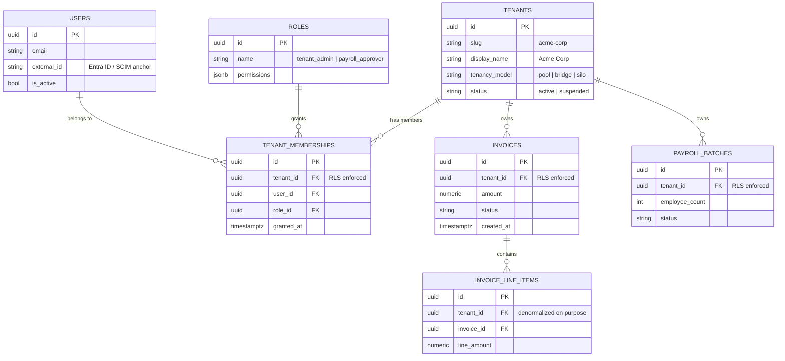

# Database Schema Design and Row-Level Security

## Overview

Picking the Pool tenancy model (shared tables with a `tenant_id` column) buys you great economics — and hands you one very sharp knife: if a single query forgets `WHERE tenant_id = ...`, one customer sees another customer's data. This chapter is about making that mistake *impossible* rather than merely *unlikely*.

Two tools do the work. First, a **relational schema** that correctly models tenants, users, roles, and memberships — so "who can do what, where" is a database fact instead of scattered application logic. Second, **Row-Level Security (RLS)**: a PostgreSQL feature where the database engine itself attaches an invisible filter to every query, so a bare `SELECT * FROM invoices` returns only the current tenant's rows.

🏦 **MoneyGuard scenario:** Alex Kim is building the invoicing service for the **Business Banking SaaS Portal**. **Acme Corp** and **Globex Inc** share the same PostgreSQL tables. Alex ships a new "search invoices" endpoint at 4pm on a Friday and forgets the tenant filter. In a system without RLS, Acme Corp's search results now include Globex Inc's invoices — a reportable breach. With RLS, the endpoint returns only Acme's invoices, because the database refused to hand over anything else. Alex's bug is a code-review comment, not an incident.

## Why This Matters

- **Application code is where isolation goes to die.** ORMs get bypassed by raw SQL, reporting queries, background jobs, admin tools, and one-off data-fix scripts. Any of those can leak.
- **RLS moves enforcement below the application.** It applies to *every* connection using that database role — including a psql session someone opened by hand.
- **It's the answer interviewers want.** "How do you guarantee tenant isolation at the data tier?" has one strong answer: enforce it in the engine, driven by a session variable set from the validated token.
- **Schema shape determines what authorization you can express.** Get the memberships table right and "Sam is an Admin at Acme and a Viewer at Globex" is one row each. Get it wrong and you're writing special cases forever.
- **Compliance auditors ask to see the control.** Dana Cole can read a five-line `CREATE POLICY` statement and verify it. She cannot read 40,000 lines of C# and verify it.

## Key Concepts

- **Row-Level Security (RLS)** — a PostgreSQL feature that automatically adds a filter condition to every `SELECT`, `INSERT`, `UPDATE`, and `DELETE` on a table, based on a policy you define.
- **Policy** — the rule that RLS applies. A `USING` clause controls which rows are *visible*; a `WITH CHECK` clause controls which rows may be *written*.
- **Session variable / GUC** — a per-connection setting (PostgreSQL calls these Grand Unified Configuration parameters). Custom ones like `app.current_tenant` are how the application tells the database who is asking.
- **`current_setting()`** — the SQL function that reads a session variable inside a policy.
- **`BYPASSRLS`** — a role attribute that skips all policies. Superusers and table owners bypass RLS by default, which is a classic footgun.
- **Membership table** — the join table linking a user to a tenant with a role: "Priya is an Admin in Acme Corp."
- **Composite index** — an index on multiple columns, e.g. `(tenant_id, created_at)`. In a pool model, `tenant_id` should lead almost every index.
- **Connection pooling** — reusing database connections across requests. Because session variables live on the connection, pooling and RLS need careful handling.
- **Soft delete** — marking a row deleted instead of removing it. Soft-deleted rows still need tenant scoping.

## Detailed Notes

### Concept 1 — The core schema: tenants, users, roles, memberships

MoneyGuard's Business Banking SaaS Portal needs four building blocks:

- **`tenants`** — the corporate clients: Acme Corp, Globex Inc.
- **`users`** — the humans. One row per person, with an `external_id` anchoring them to the identity provider (the SCIM/Entra ID identifier — see [Module 05](../05_Identity_Lifecycle_And_SCIM/README.md)).
- **`roles`** — named permission sets: `tenant_admin`, `payroll_approver`, `invoice_viewer`.
- **`tenant_memberships`** — the glue: "user X has role Y in tenant Z."

The membership table is what makes multi-tenant authorization tractable. Because the role lives on the *membership*, not on the user, Sam Torres can be an approver at Acme and a viewer at Globex with no special cases. It also means removing Sam from Acme is deleting one row, which is exactly what an auditor wants to see.

⚠️ A tempting shortcut is to put `role` directly on `users`. It works until the first user joins a second tenant, and then it requires a painful migration under time pressure.

### Concept 2 — `tenant_id` belongs on every table

Every business table gets a `tenant_id UUID NOT NULL` column, plus a foreign key to `tenants`. Not just `invoices` — also `payroll_batches`, `uploaded_documents`, `background_jobs`, `notification_preferences`, and `audit_events`.

Two reasons. First, RLS policies need a column to filter on; a table without `tenant_id` cannot be protected by tenant RLS. Second, tenant offboarding and GDPR erasure become a bounded, provable operation: for each table, delete where `tenant_id = ...`, and record the row count.

There's a subtlety with **child tables**. An `invoice_line_items` row could theoretically get its tenant by joining up to `invoices`. Don't do that — denormalize `tenant_id` onto the child table too. Joining to derive the tenant means the policy on the child depends on the parent being filtered correctly, which reintroduces exactly the fragility RLS exists to remove. The extra 16 bytes per row is cheap insurance.

### Concept 3 — How Row-Level Security actually works

RLS has three moving parts:

1. **Enable it on the table:** `ALTER TABLE invoices ENABLE ROW LEVEL SECURITY;` Once enabled, the default is *deny everything* until a policy grants access.
2. **Define a policy** that references a session variable:
   ```sql
   CREATE POLICY tenant_isolation ON invoices
     USING (tenant_id = current_setting('app.current_tenant', true)::uuid);
   ```
3. **Set the session variable per request**, in middleware, from the validated token's `tenant_id` claim.

From then on, the engine rewrites every query. When Alex's buggy endpoint runs `SELECT * FROM invoices WHERE amount > 1000`, PostgreSQL executes `SELECT * FROM invoices WHERE amount > 1000 AND tenant_id = 'acme-uuid'`. Globex's rows are not filtered out of the result — they were never in it. Even `COUNT(*)` returns only Acme's count.

That last point matters for security: an attacker cannot infer the existence of other tenants' rows through counts, aggregates, or timing, because the rows are invisible at the storage-access layer.

### Concept 4 — `USING` vs `WITH CHECK` (reads vs writes)

This distinction trips people up constantly.

| Clause | Applies to | Question it answers |
|---|---|---|
| `USING` | `SELECT`, `UPDATE` (which rows can be targeted), `DELETE` | "Which existing rows can I *see* and act on?" |
| `WITH CHECK` | `INSERT`, `UPDATE` (the resulting row) | "Is the row I'm about to *write* allowed?" |

Without `WITH CHECK`, an Acme Corp user could `INSERT INTO invoices (tenant_id, ...) VALUES ('globex-uuid', ...)` — writing a row into Globex's data that Acme can no longer see. That's data poisoning, and it's silent. Similarly, an `UPDATE` could move an Acme row into Globex's tenant.

⚠️ **A policy with only `USING` protects reads but leaves writes wide open.** Always specify both, or use `FOR ALL ... USING (...) WITH CHECK (...)`.

### Concept 5 — The middleware that sets the session variable

The database can only enforce what the application tells it. The middleware must set `app.current_tenant` on the connection *before* any query runs, from the validated JWT claim.

Two critical implementation details:

**Use a parameterized setting, not string concatenation.** `SET app.current_tenant = '{tenantId}'` built by string interpolation is a SQL injection hole if `tenantId` is ever attacker-influenced. Use `set_config('app.current_tenant', @tenant, true)` with a bound parameter.

**Mind connection pooling.** Session variables live on the connection, and pooled connections are reused. If request A sets Acme and the connection returns to the pool without being reset, request B for Globex might inherit Acme's setting. Two safe patterns:
- Pass `true` as the third argument to `set_config` to make it **transaction-scoped** — it resets automatically at the end of the transaction. This is the safest option and works correctly with connection poolers like PgBouncer in transaction mode.
- Or explicitly `RESET app.current_tenant` when returning the connection.

💡 A third setting must be *absent*, not just empty. `current_setting('app.current_tenant', true)` returns NULL when unset, and `tenant_id = NULL` is never true — so an unconfigured connection sees **zero rows**. That's the correct fail-closed behavior.

### Concept 6 — The `BYPASSRLS` trap

RLS does **not** apply to:
- Superusers (`postgres`).
- The **table owner**, unless you run `ALTER TABLE ... FORCE ROW LEVEL SECURITY`.
- Any role with the `BYPASSRLS` attribute.

This is the single most common way teams accidentally ship RLS that does nothing. If your migration user owns the tables and your application connects as that same user, every policy you wrote is silently inert.

The correct setup:
- A **migration role** that owns the tables (used only by schema migrations).
- A separate **application role** with `NOBYPASSRLS`, holding only `SELECT/INSERT/UPDATE/DELETE` grants, which the app connects as.
- `ALTER TABLE ... FORCE ROW LEVEL SECURITY` on every protected table, so even the owner is subject to policies.

Verify it with a test that connects as the application role and attempts a cross-tenant read. Trust the test, not the intent.

### Concept 7 — Indexing and performance in a pool model

RLS adds a predicate to every query, so `tenant_id` should be the **leading column of almost every index**:

```sql
CREATE INDEX idx_invoices_tenant_created ON invoices (tenant_id, created_at DESC);
```

A one-tenant-heavy pool has a second problem: PostgreSQL's planner uses table-wide statistics, so if Acme Corp has 5 million invoices and Globex has 300, the planner may pick a bad plan for one of them. Mitigations: keep statistics fresh with autovacuum tuning, consider **partitioning by `tenant_id`** (or by hash of it) for very large tables, and set per-statement timeouts so a bad plan degrades one request rather than the whole instance.

Partitioning has an extra benefit: dropping a partition is how you delete an offboarded tenant instantly, rather than a multi-hour `DELETE`.

### Concept 8 — What RLS does *not* solve

RLS handles **tenant isolation**. It does not handle **within-tenant authorization**. Once you're inside Acme Corp, RLS happily shows an intern every Acme invoice — deciding whether that intern may see payroll is RBAC/ABAC/ReBAC's job (see [Module 03](../03_Authorization_And_Policy_Engines/README.md)).

Some teams try to encode user-level permissions into RLS policies. It's possible, but policies become complex, hard to test, and hard for auditors to read, and they run on the database's CPU for every row. The clean split:

- **RLS** = the tenant boundary. Coarse, absolute, database-enforced.
- **Policy engine / application authorization** = what this user can do inside their tenant. Fine-grained, business-specific.

## Workflow

The full path of one request, showing where the tenant context is set:

```mermaid
sequenceDiagram
    autonumber
    participant U as Acme Corp user (Priya's client contact)
    participant GW as MoneyGuard API Gateway
    participant API as Business Banking SaaS Portal API
    participant MW as Tenant Middleware
    participant PG as PostgreSQL (shared pool DB)

    U->>GW: GET /api/invoices?status=unpaid (Bearer JWT)
    GW->>GW: Validate signature, expiry, audience
    GW->>API: Forward request + verified claims
    API->>MW: Begin request pipeline
    MW->>MW: Read tenant_id claim = acme-9f8b-4c2a
    MW->>PG: BEGIN; SELECT set_config('app.current_tenant', $1, true)
    Note over MW,PG: third arg 'true' = transaction-scoped,<br/>auto-resets, pooling-safe
    API->>PG: SELECT * FROM invoices WHERE status='unpaid'
    PG->>PG: RLS rewrites query, appends<br/>AND tenant_id = 'acme-9f8b-4c2a'
    PG-->>API: Only Acme Corp rows
    API-->>GW: 200 OK
    GW-->>U: Invoice list (Globex rows never existed for this query)

    Note over PG: If app.current_tenant were unset,<br/>current_setting() returns NULL<br/>and the query returns ZERO rows (fail-closed)
```

## Architecture Diagram



## Step-by-Step Process

Implementing tenant isolation with RLS, end to end:

1. **Add `tenant_id UUID NOT NULL` to every business table**, including child tables and audit tables. Add a foreign key to `tenants`.
2. **Create two database roles:** `moneyguard_migrator` (owns the tables) and `moneyguard_app` (the application connects as this one, with `NOBYPASSRLS` and only DML grants).
3. **Enable and force RLS** on each table: `ENABLE ROW LEVEL SECURITY` plus `FORCE ROW LEVEL SECURITY` so the owner is not exempt.
4. **Create the isolation policy** with both `USING` and `WITH CHECK`, comparing `tenant_id` to `current_setting('app.current_tenant', true)::uuid`.
5. **Write middleware** that opens a transaction and calls `set_config('app.current_tenant', @tenantId, true)` with the value bound as a parameter, taken from the validated JWT claim.
6. **Index with `tenant_id` first** on every table, and add composite indexes matching your real query patterns.
7. **Keep the application-layer filter too.** RLS is the safety net, not permission to be sloppy — defense in depth also means the query plan is good even before RLS adds its predicate.
8. **Write the negative test:** connect as `moneyguard_app` with Acme's tenant set, query a known Globex invoice ID by primary key, and assert zero rows. Run it in CI on every commit.
9. **Test the unset case:** run a query with no `app.current_tenant` set and assert zero rows — proving the system fails closed.
10. **Test the write path:** attempt `INSERT` with a foreign `tenant_id` and assert the `WITH CHECK` violation.
11. **Monitor:** log the `tenant_id` on every query trace, and alert if any query executes with `app.current_tenant` unset outside of a known maintenance job.

## Commands and Examples

**Schema with `tenant_id` everywhere.**

```sql
CREATE TABLE tenants (
    id           UUID PRIMARY KEY DEFAULT gen_random_uuid(),
    slug         TEXT UNIQUE NOT NULL,
    display_name TEXT NOT NULL,
    status       TEXT NOT NULL DEFAULT 'active',
    created_at   TIMESTAMPTZ NOT NULL DEFAULT now()
);

CREATE TABLE users (
    id          UUID PRIMARY KEY DEFAULT gen_random_uuid(),
    email       CITEXT UNIQUE NOT NULL,
    external_id TEXT UNIQUE,                    -- Entra ID / SCIM anchor
    is_active   BOOLEAN NOT NULL DEFAULT true,
    created_at  TIMESTAMPTZ NOT NULL DEFAULT now()
);

CREATE TABLE roles (
    id          UUID PRIMARY KEY DEFAULT gen_random_uuid(),
    name        TEXT UNIQUE NOT NULL,           -- 'tenant_admin', 'payroll_approver'
    permissions JSONB NOT NULL DEFAULT '[]'
);

-- The glue: one row per (user, tenant) with the role they hold THERE.
CREATE TABLE tenant_memberships (
    id         UUID PRIMARY KEY DEFAULT gen_random_uuid(),
    tenant_id  UUID NOT NULL REFERENCES tenants(id) ON DELETE CASCADE,
    user_id    UUID NOT NULL REFERENCES users(id)   ON DELETE CASCADE,
    role_id    UUID NOT NULL REFERENCES roles(id),
    granted_by UUID REFERENCES users(id),
    granted_at TIMESTAMPTZ NOT NULL DEFAULT now(),
    UNIQUE (tenant_id, user_id)
);

CREATE TABLE invoices (
    id         UUID PRIMARY KEY DEFAULT gen_random_uuid(),
    tenant_id  UUID NOT NULL REFERENCES tenants(id),
    amount     NUMERIC(14,2) NOT NULL,
    status     TEXT NOT NULL DEFAULT 'unpaid',
    created_at TIMESTAMPTZ NOT NULL DEFAULT now()
);

-- tenant_id leads every index, because RLS adds it to every query.
CREATE INDEX idx_invoices_tenant_status  ON invoices (tenant_id, status);
CREATE INDEX idx_invoices_tenant_created ON invoices (tenant_id, created_at DESC);
CREATE INDEX idx_memberships_tenant_user ON tenant_memberships (tenant_id, user_id);
```

**Roles: the application role must NOT bypass RLS.**

```sql
-- Owner of the tables; used only by migrations.
CREATE ROLE moneyguard_migrator LOGIN PASSWORD :'migrator_pw' NOBYPASSRLS;

-- What the Business Banking SaaS Portal actually connects as.
CREATE ROLE moneyguard_app LOGIN PASSWORD :'app_pw' NOBYPASSRLS;

GRANT SELECT, INSERT, UPDATE, DELETE
  ON ALL TABLES IN SCHEMA public TO moneyguard_app;
GRANT USAGE ON SCHEMA public TO moneyguard_app;

-- Verify: this must return 'f' for the app role.
SELECT rolname, rolbypassrls FROM pg_roles
WHERE rolname IN ('moneyguard_app', 'moneyguard_migrator');
```

**Enabling RLS and writing the policy.**

```sql
ALTER TABLE invoices            ENABLE ROW LEVEL SECURITY;
ALTER TABLE invoices            FORCE  ROW LEVEL SECURITY;  -- owner is not exempt
ALTER TABLE tenant_memberships  ENABLE ROW LEVEL SECURITY;
ALTER TABLE tenant_memberships  FORCE  ROW LEVEL SECURITY;

-- USING  -> which rows are VISIBLE (SELECT / UPDATE target / DELETE)
-- WITH CHECK -> which rows may be WRITTEN (INSERT / UPDATE result)
CREATE POLICY tenant_isolation_invoices ON invoices
  FOR ALL
  TO moneyguard_app
  USING      (tenant_id = current_setting('app.current_tenant', true)::uuid)
  WITH CHECK (tenant_id = current_setting('app.current_tenant', true)::uuid);

CREATE POLICY tenant_isolation_memberships ON tenant_memberships
  FOR ALL
  TO moneyguard_app
  USING      (tenant_id = current_setting('app.current_tenant', true)::uuid)
  WITH CHECK (tenant_id = current_setting('app.current_tenant', true)::uuid);
```

**Proving it works in psql.**

```sql
-- Connect as the application role (NOT the owner, NOT postgres).
SET ROLE moneyguard_app;

-- 1. No tenant set at all -> zero rows. Fail-closed by default.
SELECT count(*) FROM invoices;
-- count
-- -----
--     0

-- 2. Acting as Acme Corp.
BEGIN;
SELECT set_config('app.current_tenant', '9f8b4c2a-0000-0000-0000-0000000000ac', true);
SELECT count(*) FROM invoices;            -- e.g. 1,284  (Acme only)
SELECT * FROM invoices
  WHERE id = 'bbbb0000-0000-0000-0000-00000000gl';  -- a known GLOBEX invoice
-- (0 rows)  <- the row exists on disk, but not for this session
COMMIT;

-- 3. Attempting to WRITE into another tenant.
BEGIN;
SELECT set_config('app.current_tenant', '9f8b4c2a-0000-0000-0000-0000000000ac', true);
INSERT INTO invoices (tenant_id, amount)
VALUES ('7c1d0000-0000-0000-0000-0000000000gl', 500.00);
-- ERROR:  new row violates row-level security policy for table "invoices"
ROLLBACK;
```

**Middleware that sets the tenant safely (ASP.NET Core + Npgsql).**

```csharp
public class TenantSessionMiddleware
{
    private readonly RequestDelegate _next;
    public TenantSessionMiddleware(RequestDelegate next) => _next = next;

    public async Task InvokeAsync(HttpContext ctx, BankingDbContext db)
    {
        // tenant_id comes ONLY from the validated JWT claim.
        var tenantId = ctx.User.FindFirst("tenant_id")?.Value;
        if (string.IsNullOrEmpty(tenantId)) { ctx.Response.StatusCode = 401; return; }

        // Open a transaction so the setting is transaction-scoped and
        // cannot leak to the next request through the connection pool.
        await using var tx = await db.Database.BeginTransactionAsync();

        // PARAMETERIZED. Never string-interpolate into SET - that is SQL injection.
        await db.Database.ExecuteSqlInterpolatedAsync(
            $"SELECT set_config('app.current_tenant', {tenantId}, true)");

        await _next(ctx);

        if (ctx.Response.StatusCode < 400) await tx.CommitAsync();
        else                               await tx.RollbackAsync();
    }
}
```

**Partitioning a very large table by tenant (optional, for scale).**

```sql
CREATE TABLE payroll_batches (
    id         UUID NOT NULL DEFAULT gen_random_uuid(),
    tenant_id  UUID NOT NULL,
    run_date   DATE NOT NULL,
    status     TEXT NOT NULL,
    PRIMARY KEY (tenant_id, id)
) PARTITION BY LIST (tenant_id);

-- Big tenants get their own partition; everyone else shares the default.
CREATE TABLE payroll_batches_acme
  PARTITION OF payroll_batches
  FOR VALUES IN ('9f8b4c2a-0000-0000-0000-0000000000ac');

CREATE TABLE payroll_batches_default
  PARTITION OF payroll_batches DEFAULT;

-- Offboarding Acme later becomes instant:
-- DROP TABLE payroll_batches_acme;
```

## Best Practices

- **Enable AND force RLS.** `FORCE ROW LEVEL SECURITY` is what makes the table owner subject to the policy; without it, RLS is often silently inactive.
- **Connect as a `NOBYPASSRLS` role** that is not the table owner and is not a superuser.
- **Always write both `USING` and `WITH CHECK`.** Reads and writes are separate doors.
- **Set the session variable transaction-scoped** (`set_config(..., true)`) so connection pooling can't leak it.
- **Bind the tenant value as a parameter**, never string-interpolate it into `SET`.
- **Denormalize `tenant_id` onto child tables** rather than deriving it via a join.
- **Lead every index with `tenant_id`.**
- **Keep application-level filters as well.** RLS is the last line, not the only line.
- **Test the unset case explicitly** — proving zero rows is proving fail-closed.
- **Use UUID v7** for primary keys: unguessable like v4, but time-ordered so B-tree indexes stay dense.
- **Put `tenant_id` on audit tables too**, so per-tenant investigation and erasure both work.

## Common Mistakes

- ⚠️ **Writing policies but connecting as the table owner or a superuser.** The policies exist, look correct in code review, and do absolutely nothing.
- ⚠️ **Forgetting `WITH CHECK`.** Reads are protected; an attacker or a bug can still insert or move rows into another tenant.
- ⚠️ **String-interpolating the tenant into `SET app.current_tenant = '...'`.** If the claim is ever attacker-controlled, that's SQL injection with a session-variable payload.
- ⚠️ **Session-scoped `set_config` with connection pooling.** Request B inherits request A's tenant. Use transaction scope.
- ⚠️ **`current_setting('app.current_tenant')` without the `true` second argument.** It throws an error instead of returning NULL when unset, so unrelated queries fail confusingly during maintenance and background jobs.
- ⚠️ **Deriving the child row's tenant via a join to the parent.** It reintroduces the "did the parent get filtered?" fragility.
- ⚠️ **Missing `tenant_id` in indexes**, causing full scans once RLS's predicate is added.
- ⚠️ **Putting user-level permissions in RLS policies.** Policies balloon, become untestable, and burn database CPU on every row.
- ⚠️ **Assuming RLS covers background jobs.** A nightly report job with no tenant set will read zero rows, or — worse — be "fixed" by someone granting it `BYPASSRLS`.
- ⚠️ **Forgetting `tenant_id` on soft-deleted rows or archive tables.** They leak just as effectively.

## Pro Tips

- 💡 **Make "no tenant set" mean "no data."** `current_setting(..., true)` returning NULL, compared with `=`, yields NULL — never true. Unset context is automatically fail-closed, which is exactly what you want.
- 💡 **For legitimate cross-tenant jobs, create a dedicated role**, e.g. `moneyguard_reporting`, with a *separate* policy (`USING (true)`) rather than `BYPASSRLS`. That way the exception is explicit, named, and auditable instead of a blanket bypass.
- 💡 **Add an RLS smoke test to your migration pipeline.** After every migration, assert that a query as `moneyguard_app` with no tenant returns zero rows on every RLS-protected table. This catches new tables that were added without policies.
- 💡 **Use `EXPLAIN` to confirm the predicate is being pushed into the index scan**, not applied as a filter after a sequential scan.
- 💡 **Emit `tenant_id` on every log line** so an isolation failure would be visible in the SIEM, and so per-tenant forensics is possible (see [Module 09](../09_Resilience_Observability_And_SIEM/README.md)).
- 💡 **Interview move:** the phrase that lands is *"isolation enforced by the database engine using a session variable set from the validated token, so a forgotten WHERE clause becomes a bug instead of a breach."*

## Real-World Use Cases

- **Alex's Friday bug.** Alex Kim ships an invoice-search endpoint missing the tenant filter. RLS silently constrains it; Acme sees only Acme's invoices. The bug is caught in code review the following Monday. Without RLS, MoneyGuard would be writing a breach notification.
- **The data-fix script.** An engineer opens psql to correct a mis-keyed invoice amount for Acme Corp. Because they connect as `moneyguard_app` and set the tenant, they physically cannot touch a Globex row by typo.
- **Dana Cole's audit.** The compliance officer asks "prove tenant isolation." Raj shows five lines of `CREATE POLICY`, the `rolbypassrls = false` check, and the CI test that attempts a cross-tenant read on every build. That's an auditable control.
- **Globex offboards.** Because `tenant_id` is on every table including audit and archive tables, erasure is a scripted loop over the table list with per-table row counts recorded — provable GDPR compliance.
- **Acme grows to 5 million invoices.** MoneyGuard partitions `payroll_batches` and `invoices` by `tenant_id`, giving Acme its own partitions. Query plans stabilize, and if Acme ever leaves, the delete is a `DROP TABLE` on the partition.
- **Sam the contractor.** Sam switches from Acme to Globex in the portal UI. A new token is minted with `tenant_id = globex`, the next request's middleware sets a different session variable, and the same code returns entirely different data. No branching logic anywhere.

## Key Takeaways

1. **Schema first:** `tenants`, `users`, `roles`, and a `tenant_memberships` join table — role lives on the membership, so one person can hold different roles in different tenants.
2. **`tenant_id` goes on every table**, including child, audit, and archive tables. Denormalize it; don't derive it via joins.
3. **RLS moves isolation from application code into the database engine**, so a forgotten `WHERE` clause is harmless.
4. **`USING` protects reads; `WITH CHECK` protects writes.** You need both.
5. **The session variable must be set per request from the validated token**, parameterized, and transaction-scoped so pooling is safe.
6. **`BYPASSRLS`, superusers, and table owners silently defeat RLS** — use a dedicated `NOBYPASSRLS` app role and `FORCE ROW LEVEL SECURITY`.
7. **Unset tenant = zero rows.** RLS fails closed by design.
8. **Index with `tenant_id` first**, and partition by tenant for very large tables.
9. **RLS handles the tenant boundary, not user permissions inside the tenant** — that's the policy engine's job.

## Glossary

| Term | Meaning |
|---|---|
| **Row-Level Security (RLS)** | PostgreSQL feature that automatically filters rows per query based on a policy. |
| **Policy** | The rule RLS applies to a table, expressed with `USING` and/or `WITH CHECK`. |
| **`USING` clause** | Determines which existing rows are visible to `SELECT`, `UPDATE`, and `DELETE`. |
| **`WITH CHECK` clause** | Determines which rows are permitted by `INSERT` and by the result of an `UPDATE`. |
| **Session variable (GUC)** | A per-connection setting such as `app.current_tenant`, read by `current_setting()`. |
| **`set_config(name, value, is_local)`** | Sets a session variable; `is_local = true` scopes it to the current transaction. |
| **`FORCE ROW LEVEL SECURITY`** | Makes RLS apply to the table owner too, not just to other roles. |
| **`BYPASSRLS`** | A role attribute that skips all RLS policies — dangerous by default. |
| **Membership table** | Join table linking user, tenant, and role. |
| **Composite index** | An index over several columns, e.g. `(tenant_id, created_at)`. |
| **Partitioning** | Splitting one logical table into physical sub-tables, often by `tenant_id`. |
| **Connection pooling** | Reusing database connections across requests; interacts dangerously with session-scoped settings. |
| **UUID v7** | A time-ordered UUID: unguessable like v4 but index-friendly. |
| **Soft delete** | Marking a row as deleted rather than removing it. |

## Revision Notes

- Four tables: `tenants`, `users`, `roles`, `tenant_memberships`. **Role belongs to the membership**, not the user.
- `tenant_id UUID NOT NULL` on **every** table, denormalized onto children.
- RLS in three steps: `ENABLE` + `FORCE` → `CREATE POLICY` → middleware `set_config(..., true)`.
- `USING` = read. `WITH CHECK` = write. Always both.
- App role must be `NOBYPASSRLS` and not the table owner. Verify with `SELECT rolbypassrls FROM pg_roles`.
- Unset `app.current_tenant` → `current_setting(..., true)` returns NULL → comparison is never true → **zero rows** → fail-closed.
- Transaction-scoped setting (`true` third arg) is the pooling-safe pattern.
- Index `(tenant_id, ...)` first. Partition by tenant for huge tables; `DROP` the partition to offboard.
- RLS = tenant boundary only. Within-tenant permissions = policy engine.
- Cross-tenant jobs get a **named role with an explicit `USING (true)` policy**, never `BYPASSRLS`.

## Interview Questions

**Q1. Explain Row-Level Security and why it beats filtering in application code.**
A: RLS is a PostgreSQL feature where you attach a policy to a table, and the engine automatically appends that predicate to every query on it. In a multi-tenant pool model, the policy compares each row's `tenant_id` to a session variable that middleware sets from the validated JWT. It beats application filtering because it can't be bypassed: ORMs get bypassed by raw SQL, reporting queries, background jobs, and someone in psql at 2am. RLS applies at the storage-access layer for every connection using that role, so a `SELECT * FROM invoices` with no `WHERE` clause is still safe. It turns a whole class of breach into a class of bug.

**Q2. What's the difference between `USING` and `WITH CHECK`, and what happens if you only write `USING`?**
A: `USING` controls visibility — which rows `SELECT`, `UPDATE`, and `DELETE` can see and act on. `WITH CHECK` validates rows being written — the row an `INSERT` creates, or the row an `UPDATE` produces. If you only write `USING`, reads are isolated but writes aren't: an Acme Corp session could `INSERT` a row with `tenant_id = globex`, poisoning Globex's data with a row Acme itself can no longer see. It's silent, because no error is raised. Always define both, or use `FOR ALL ... USING (...) WITH CHECK (...)`.

**Q3. I wrote correct RLS policies but cross-tenant queries still return everything. What's wrong?**
A: Almost certainly the connecting role bypasses RLS. Superusers bypass it, roles with the `BYPASSRLS` attribute bypass it, and — the one that catches most people — the **table owner** bypasses it unless you run `ALTER TABLE ... FORCE ROW LEVEL SECURITY`. If the application connects with the same user that ran the migrations, that user owns the tables and every policy is inert. The fix is a separate `NOBYPASSRLS` application role that isn't the owner, plus `FORCE ROW LEVEL SECURITY` on every protected table. I'd verify with `SELECT rolname, rolbypassrls FROM pg_roles` and a CI test that attempts a cross-tenant read as the app role.

**Q4. How do you set the tenant context safely when you're behind a connection pooler?**
A: Use `set_config('app.current_tenant', $1, true)` — the third argument `true` makes the setting transaction-local, so it resets automatically at commit or rollback. That's essential with poolers like PgBouncer in transaction mode, where a connection can be handed to a different request between statements. A plain `SET` is session-scoped and will leak into the next request that reuses the connection, which is a cross-tenant data leak. I'd also bind the value as a parameter rather than interpolating it into the SQL string, since `SET` with string concatenation is injectable.

**Q5. What happens if the middleware forgets to set the tenant?**
A: `current_setting('app.current_tenant', true)` returns NULL, and `tenant_id = NULL` evaluates to NULL — which is not true — so the policy matches no rows and the query returns zero results. That's deliberate fail-closed behavior: a missing tenant context yields no data rather than all data. The important detail is passing `true` as the second argument to `current_setting`; without it, PostgreSQL raises an error for an unset parameter instead of returning NULL, which produces confusing failures in background jobs.

**Q6. How do you handle a legitimate cross-tenant operation, like a monthly platform-wide report?**
A: Not with `BYPASSRLS` — that's a blanket exemption with no audit trail. I'd create a dedicated role, say `moneyguard_reporting`, and give it its own policy on the relevant tables with `USING (true)`. The exception is then explicit, scoped to named tables, visible in `pg_policies` for an auditor, and revocable independently. I'd also restrict that role to read-only, run it against a read replica so it can't affect production latency, and log every use of it to the SIEM.

**Q7. What's the performance cost of RLS, and how do you manage it in a pool with one huge tenant?**
A: The policy predicate is added to the query, so the cost is essentially the cost of that extra condition — negligible if `tenant_id` leads your indexes, and expensive if it doesn't, because you'll get a sequential scan plus a filter. The harder problem is skew: PostgreSQL's planner uses table-wide statistics, so with one tenant holding 90% of rows the plan chosen may be wrong for small tenants or for the big one. Mitigations are aggressive `ANALYZE`, partitioning by `tenant_id` so each partition has its own statistics, and per-statement timeouts so a bad plan degrades one request rather than the instance.

**Q8. Should user permissions live in RLS policies too?**
A: No. RLS should express exactly one thing — the tenant boundary — because that rule is coarse, absolute, and identical for every table. Within-tenant permissions ("can this Acme user approve a payroll run over $50,000?") are business logic: they change frequently, they're contextual, and they belong in a policy engine like OPA or in the application's authorization layer. Encoding them in RLS produces policies nobody can read or test, and it runs authorization logic on database CPU for every candidate row. The clean split is RLS for tenancy, policy engine for permissions.

## Practice Exercises

1. **Write the policies.** Given the `payroll_batches` and `invoice_line_items` tables from this chapter, write the complete SQL to enable, force, and police both tables — including `WITH CHECK` — plus the two indexes you'd add. Explain why `invoice_line_items` carries its own `tenant_id` instead of joining to `invoices`.

2. **Break the RLS.** Set up a local PostgreSQL with two tenants and the invoices table. Then find three separate ways to read Globex's rows while "acting as" Acme: connecting as the owner, connecting as a `BYPASSRLS` role, and leaking a session-scoped setting through a pooled connection. Fix each one and write a test that would have caught it.

3. **Multi-tenant contractor query.** Sam Torres is a member of both Acme Corp and Globex Inc. Write the SQL that lists every tenant Sam belongs to and the role he holds in each — and explain which database role must run it and why the normal `moneyguard_app` role with a tenant set cannot.

4. **The reporting exception.** Design the `moneyguard_reporting` role: the exact `CREATE ROLE`, the policy, the grants, and the three controls you'd put around it (where it runs, what it can touch, how its use is detected). Write the SIEM detection rule you'd want if that role were ever used from an unexpected host.

5. **Offboarding runbook.** Globex Inc terminates its contract. Write the ordered SQL runbook to erase every trace of `tenant_id = globex`, including child tables, audit tables, and any partitions — with a verification query after each step that Dana Cole could attach to a compliance report. State the order of deletion and why foreign keys force that order.

---

⬅ Back to [Module 08 Index](./README.md) | 📖 [Main README](../README.md) | 🏦 [The MoneyGuard Story](../SCENARIO.md)

⬅ Previous: [01_Tenancy_Models.md](./01_Tenancy_Models.md)
