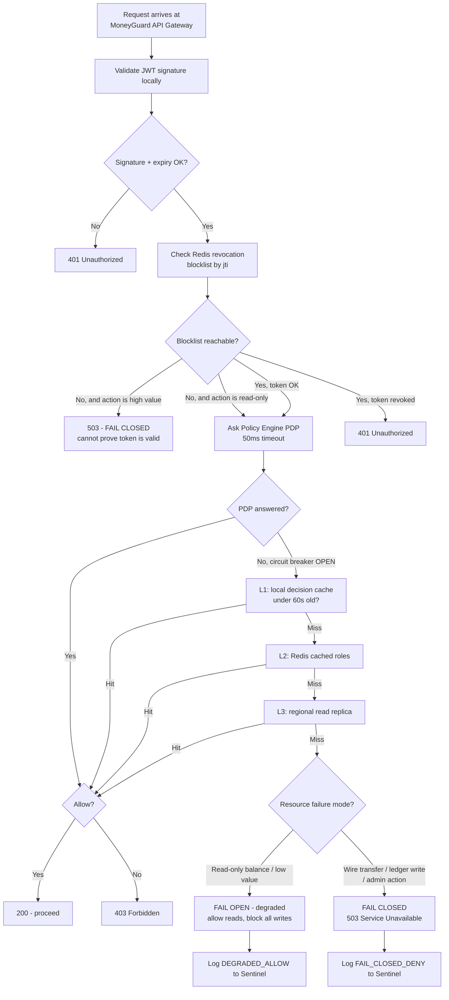
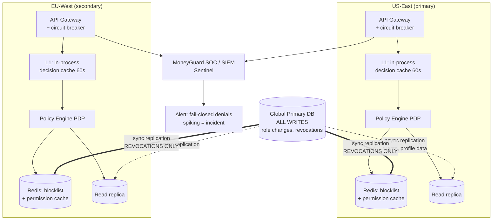

# CAP Theorem and Fail-Open vs. Fail-Closed

## Overview

Every distributed identity system eventually faces the same two questions. First: when the network splits and your servers can't all agree, do you keep answering (and risk answering with stale data) or do you stop answering (and risk an outage)? That's the **CAP theorem**. Second: when your authorization check itself breaks — the policy engine crashed, the database timed out — do you let the request through or block it? That's **fail-open vs. fail-closed**.

These are not academic. They are the questions a system-design interviewer asks after you've drawn the boxes, and they're the questions your on-call engineer answers at 3am whether you designed for them or not.

🏦 **MoneyGuard scenario:** At 02:14 on a Tuesday, the primary authorization database in MoneyGuard's US-East region fails. The **API Gateway** still has traffic pouring in: retail customers checking balances on the **MoneyGuard Mobile App**, tellers using the **Employee Portal**, and the **Business Banking SaaS Portal** serving Acme Corp and Globex Inc. The gateway asks the authorization service "can this user do this?" and gets a timeout. What should it do? Getting this wrong in one direction means an unnecessary outage for millions of customers. Getting it wrong in the other means Eve gets a free pass into the **Core Banking Ledger**.

## Why This Matters

- **Availability failures and security failures have wildly different costs, and the ratio depends on the resource.** A customer who can't see their balance for 90 seconds is annoyed. An attacker who moves $2M out of the Core Banking Ledger is a front-page story.
- **The default behaviour of most libraries is fail-open**, because a timeout usually throws an exception and a poorly written `catch` block swallows it and continues. Security failures are frequently accidents of error handling.
- **Consistency choices create security gaps.** If Raj revokes Sam Torres's access and that revocation takes 5 minutes to replicate, Sam has 5 minutes of access he shouldn't have. That window is a design decision, not an accident.
- **Interviewers use this as a seniority filter.** A junior answer is "fail-closed, always." A senior answer segments by resource sensitivity and explains the availability cost.
- **Regulators care.** Banking supervisors ask about resilience and about how privilege revocation propagates. Both live here.

## Key Concepts

- **CAP theorem** — in a distributed system you can guarantee at most two of **C**onsistency, **A**vailability, and **P**artition tolerance. Since network partitions *will* happen, the real choice is C or A during a partition.
- **Consistency (C)** — every read returns the most recent write. Everyone sees the same data at the same time.
- **Availability (A)** — every request gets a non-error response, even if the data might be slightly stale.
- **Partition tolerance (P)** — the system keeps operating when the network between nodes breaks. Not optional in reality.
- **CP system** — chooses consistency; refuses to answer rather than answer wrongly.
- **AP system** — chooses availability; answers with possibly-stale data.
- **Eventual consistency** — replicas converge to the same value given enough time without new writes.
- **Fail-open (fail-safe)** — on failure, allow. Prioritizes availability.
- **Fail-closed (fail-secure)** — on failure, deny. Prioritizes security.
- **Circuit breaker** — a pattern that stops calling a failing dependency after N failures, returning a fast, predictable result instead of hanging.
- **Graceful degradation** — reducing functionality rather than failing completely.
- **RTO / RPO** — Recovery Time Objective (how long until service is back) and Recovery Point Objective (how much data loss is acceptable).

## Detailed Notes

### Concept 1 — CAP in plain language

Imagine MoneyGuard runs its authorization database in two regions, US-East and EU-West. Normally they replicate to each other in milliseconds. Then a network link fails and they can't talk.

A user in EU-West asks "am I allowed to approve this wire?" The EU node has data from 30 seconds ago and cannot check with US-East. It has exactly two options:

- **Answer with what it has** (Availability). Fast, always responds, but the answer might be based on a permission that was revoked 20 seconds ago.
- **Refuse to answer** (Consistency). It returns an error rather than risk being wrong. Correct, but the user is blocked.

You cannot have both during a partition. That's the whole theorem. Partition tolerance isn't a choice — networks fail — so CAP really reads: *when the network splits, do you pick C or A?*

### Concept 2 — IAM is not one system, so it doesn't have one answer

The important insight for identity systems: **different parts of IAM want different sides of CAP.**

| Operation | Preferred side | Why |
|---|---|---|
| **Authentication** (verifying a login) | **AP** — stay available | If "last login timestamp" is 10 seconds stale across regions, nobody is harmed. Blocking every login worldwide because one replica is behind is a far worse outcome. |
| **Token validation** (checking a JWT signature) | **AP** — stay available | The signature check is local and offline; the public keys change rarely. Cache them and keep working. |
| **Permission grants** (adding access) | **AP-tolerable** | A new permission arriving 5 seconds late is an inconvenience, not a security hole. |
| **Permission revocation** (removing access) | **CP** — stay consistent | This is the security-critical one. A revocation that hasn't propagated is an open door. |
| **Token revocation / blocklist** | **CP** — stay consistent | If Eve's stolen token is blocklisted, every node must honour it immediately. |
| **Money movement authorization** | **CP** — stay consistent | You cannot approve a wire based on stale authority. |

💡 The asymmetry between *granting* and *revoking* is the single most useful idea in this chapter. **Grants can be eventually consistent; revocations must be strongly consistent.** Adding access late is annoying; removing it late is a breach.

### Concept 3 — Fail-open vs. fail-closed

This is a different question from CAP. CAP is about *stale data*. Fail-open/closed is about *no data at all* — the check itself couldn't run.

| | 🔓 Fail-Open (fail-safe) | 🔒 Fail-Closed (fail-secure) |
|---|---|---|
| **Behaviour on failure** | Allow the request | Deny the request |
| **Optimizes for** | Availability, user experience | Security, correctness |
| **Failure mode** | Unauthorized access | Denial of service to legitimate users |
| **Classic example** | A cinema fire exit that unlocks when power dies — people must get out | A bank vault that locks when power dies — money must stay in |
| **Typical use** | Consumer streaming, low-value personalization, analytics, non-security middleware | Financial transactions, admin actions, anything touching money or PII |
| **Attacker leverage** | High — Eve can *cause* the failure (a DoS on the policy engine) to get in | Low — causing a failure only creates an outage, not access |
| **MoneyGuard example** | Marketing banner personalization on the public site: if the personalization service is down, show the generic banner rather than an error page | Wire transfer approval, Core Banking Ledger writes, admin role changes — if the policy engine is unreachable, deny |

⚠️ The decisive argument for fail-closed on sensitive paths: **an attacker can often trigger the failure on purpose.** If Eve knows that overwhelming the policy engine makes it fail open, she has found a way to turn a denial-of-service tool into an authorization bypass. Fail-closed converts that attack into a mere outage — bad, but not a breach.

### Concept 4 — It's not actually binary: graceful degradation

The mature answer isn't "fail-open" or "fail-closed" but a **tiered fallback chain**. MoneyGuard's API Gateway, when the policy engine times out, doesn't immediately choose one of two extremes. It walks a ladder:

1. **Try the policy decision point (PDP)** — the live authorization service. Timeout budget: 50ms.
2. **Fall back to the local cached decision** for this exact (user, action, resource) tuple, if it's under 60 seconds old.
3. **Fall back to the cached role set** for this user from Redis, and evaluate a simplified local rule.
4. **Fall back to a read replica** of the authorization database.
5. **If all of that fails, apply the resource's declared failure mode:**
   - `read-only balance check` → **fail-open with degraded scope** (allow read-only, block all writes).
   - `wire transfer`, `role change`, `ledger write` → **fail-closed**, return `503 Service Unavailable` with a clear message.

This is **graceful degradation**: the system sheds capability, not availability, and it sheds the *most dangerous* capability first. Priya the teller can still look up a balance during the incident; nobody can move money.

### Concept 5 — Circuit breakers: failing fast instead of failing slowly

The worst failure mode isn't "the policy engine says no." It's "the policy engine takes 30 seconds to say nothing," because every waiting request holds a thread, a connection, and memory. That's how one slow dependency takes down the entire gateway — a **cascading failure**.

A **circuit breaker** wraps the call and tracks failures:

- **Closed** (normal): calls pass through. Failures are counted.
- **Open** (tripped): after N failures in a window, calls stop immediately and the declared fallback fires — instantly, no waiting.
- **Half-open** (probing): after a cooldown, let one request through. Success closes the circuit; failure re-opens it.

In .NET the standard library is **Polly**; in Java it's Resilience4j; in a service mesh, Envoy does it for you. The key benefit for security is that the fallback becomes *explicit and declared* rather than "whatever the catch block does," which is where accidental fail-open lives.

### Concept 6 — The revocation gap

Because grants are AP and revocations are CP, the practical question becomes: **how fast does a revocation actually take effect?**

The gap has multiple contributors:
- **Token lifetime.** A JWT valid for 60 minutes is, by default, 60 minutes of access after revocation, because it's validated offline.
- **Cache TTL.** A 5-minute permission cache adds up to 5 minutes.
- **Replication lag.** Cross-region async replication adds seconds.

MoneyGuard's mitigations, layered:
- **Short access-token lifetimes** (5–15 minutes) so the offline-validation window is small.
- **A Redis blocklist of revoked `jti` values** (JWT IDs) checked at the gateway — this is the CP component, and it's why the blocklist must be strongly consistent and highly available.
- **Event-driven cache invalidation**: the moment Raj revokes Sam's access, a purge event fires to every region's cache rather than waiting for a TTL to expire.

The blocklist itself is a fail-closed decision point: **if the blocklist is unreachable, deny high-value operations.** Otherwise Eve's path to using a revoked token is simply to knock over Redis.

### Concept 7 — Multi-region and disaster recovery

MoneyGuard runs identity infrastructure in two regions with a clear split:

- **Writes** (role changes, revocations, new users) go to a **global primary**.
- **Reads** (permission checks, token validation) are served **locally** from a regional read replica plus caches.

This works because IAM reads outnumber writes by roughly 1,000:1. It also means a regional failure degrades writes, not reads — the far less damaging outcome.

Two objectives frame the DR plan:
- **RTO (Recovery Time Objective)** — how long until service is restored. For MoneyGuard's identity plane, minutes.
- **RPO (Recovery Point Objective)** — how much data loss is acceptable. For revocations, effectively zero: a lost revocation is an open door, so revocation writes are synchronously replicated even though ordinary writes are async.

💡 **Chaos engineering** is how you find out whether any of this is true. Kill a replica in staging on a schedule. If your circuit breaker, fallback ladder, and failure modes have never been exercised, they are hypotheses, not controls.

## Workflow

The fallback ladder in action during the US-East database failure:



## Architecture Diagram



## Step-by-Step Process

Designing the resilience posture for a MoneyGuard endpoint:

1. **Classify the resource.** Put every endpoint into a tier: `public-read`, `customer-read`, `customer-write`, `money-movement`, `admin`. This classification is the input to every later decision.
2. **Declare a failure mode per tier**, in configuration, explicitly. `public-read` and `customer-read` may fail open with reduced scope; `customer-write` and above fail closed. Write it down — an undeclared failure mode is whatever the exception handler happens to do.
3. **Set a timeout budget** for every dependency call. No unbounded waits, ever. The PDP gets 50ms; the read replica gets 200ms.
4. **Wrap each dependency in a circuit breaker** with an explicit fallback that matches the declared failure mode.
5. **Build the cache ladder** (L1 in-process → L2 Redis → L3 read replica) so most failures never reach the failure-mode decision at all.
6. **Make revocation strongly consistent.** Synchronously replicate the blocklist; fire event-driven cache purges rather than relying on TTL expiry.
7. **Keep access tokens short-lived** (5–15 minutes) to bound the offline-validation window.
8. **Route writes to the global primary and reads locally.** Reads dominate; keep them fast and regional.
9. **Instrument everything.** Emit a distinct log event and metric for every degraded allow and every fail-closed deny, tagged with the reason and the correlation ID.
10. **Alert on the failure modes, not just the failures.** A spike in `FAIL_CLOSED_DENY` is an incident, and a spike in `DEGRADED_ALLOW` is arguably a bigger one.
11. **Run a game day.** Kill the PDP in staging during load and confirm that balance checks survive and wire transfers are refused. If nobody has ever seen it happen, it doesn't work.

## Commands and Examples

**Declaring the failure mode per resource tier (configuration, not code).**

```yaml
# moneyguard-gateway/authz-failure-modes.yaml
# Every route MUST declare a tier. Unlisted routes default to fail_closed.
default_failure_mode: fail_closed

tiers:
  public_read:
    routes: ["GET /v1/branches", "GET /v1/fx-rates"]
    on_authz_unavailable: fail_open
    reason: "No customer data. An outage here is pure availability loss."

  customer_read:
    routes: ["GET /v1/accounts/*/balance", "GET /v1/transactions"]
    on_authz_unavailable: fail_open_degraded
    degraded_scope: ["read"]          # reads survive, writes are blocked
    max_cache_age_seconds: 300
    reason: "Priya must still answer 'what is my balance' during an incident."

  money_movement:
    routes: ["POST /v1/wires", "POST /v1/payments", "POST /v1/payroll/approve"]
    on_authz_unavailable: fail_closed
    reason: "Cannot prove authority to move funds -> must not move funds."

  admin:
    routes: ["POST /v1/admin/*", "PATCH /v1/roles/*", "DELETE /v1/users/*"]
    on_authz_unavailable: fail_closed
    require_blocklist_reachable: true  # no blocklist = no admin actions, period
    reason: "Highest blast radius. Never guess."
```

**Circuit breaker with an explicit, tier-aware fallback (Polly, .NET).**

```csharp
// The fallback is DECLARED, not left to whatever the catch block does.
var pdpPolicy = Policy<AuthzDecision>
    .Handle<TimeoutException>()
    .Or<HttpRequestException>()
    .CircuitBreakerAsync(
        handledEventsAllowedBeforeBreaking: 10,   // 10 failures...
        durationOfBreak: TimeSpan.FromSeconds(30) // ...then stop calling for 30s
    );

public async Task<AuthzDecision> AuthorizeAsync(AuthzRequest req)
{
    try
    {
        return await pdpPolicy.ExecuteAsync(
            ct => _pdp.EvaluateAsync(req, ct),
            CancellationToken.None);
    }
    catch (Exception ex) when (ex is BrokenCircuitException or TimeoutException)
    {
        // Ladder: L1 -> L2 -> L3 before we ever reach the failure mode.
        var cached = _l1.TryGet(req) ?? await _redis.TryGetAsync(req)
                                     ?? await _replica.TryGetAsync(req);
        if (cached is not null)
        {
            _log.LogWarning("AUTHZ_CACHE_FALLBACK {Tier} {CorrelationId} {AgeSec}",
                            req.Tier, req.CorrelationId, cached.AgeSeconds);
            return cached;
        }

        // Nothing cached. Apply the DECLARED failure mode for this tier.
        return req.Tier switch
        {
            "public_read"    => Allow("FAIL_OPEN"),
            "customer_read"  => AllowReadOnly("DEGRADED_ALLOW"),
            _                => Deny("FAIL_CLOSED", status: 503)
        };
    }
}
```

**⚠️ The accidental fail-open — the bug this chapter exists to prevent.**

```csharp
// ANTI-PATTERN. Do not ship this.
public async Task<bool> IsAllowed(string user, string action)
{
    try
    {
        return await _pdp.CheckAsync(user, action);
    }
    catch
    {
        return true;   // <-- "just don't break the site". This IS an auth bypass.
    }
}
// Eve DoSes the PDP and every check returns true. A denial-of-service
// tool has become an authorization bypass. Default MUST be `false`,
// with any exception declared per resource tier.
```

**Making a revocation propagate immediately (event-driven, not TTL-driven).**

```csharp
// Called when Raj revokes Sam Torres's payroll_approver role.
public async Task RevokeRoleAsync(Guid userId, Guid roleId, Guid actorId)
{
    // 1. CP write: the global primary is the source of truth.
    await _primary.RemoveRoleAsync(userId, roleId);

    // 2. Blocklist every live token for this user, by jti.
    //    Synchronously replicated - a lost revocation is an open door (RPO = 0).
    foreach (var jti in await _sessions.ActiveTokenIdsAsync(userId))
        await _blocklist.AddAsync(jti, ttl: TokenLifetime, replicateSync: true);

    // 3. Purge caches in EVERY region now. Do not wait for TTL expiry.
    await _bus.PublishAsync(new PermissionsPurged(userId, DateTimeOffset.UtcNow));

    // 4. Non-repudiable audit record for Dana Cole.
    _log.LogInformation("ROLE_REVOKED {Subject} {RoleId} {Actor} {CorrelationId}",
                        userId, roleId, actorId, Activity.Current?.Id);
}
```

**Alerting on the failure modes themselves (PromQL).**

```promql
# A spike in fail-closed denials means customers are being blocked -> page on-call.
sum(rate(moneyguard_authz_decisions_total{outcome="FAIL_CLOSED"}[5m])) by (tier)
  > 5

# ANY degraded allow on a money-movement route is a design violation -> page security.
sum(rate(moneyguard_authz_decisions_total{
      outcome="DEGRADED_ALLOW", tier="money_movement"}[5m]))
  > 0
```

## Best Practices

- **Default to fail-closed, then justify every exception in writing.** The exception list should be short and reviewable.
- **Classify resources by sensitivity first.** The failure mode follows from the classification, not from the developer's mood that day.
- **Declare failure modes in configuration**, so they can be reviewed, diffed in a pull request, and audited.
- **Never leave a bare `catch` around an authorization call.** If an exception can produce `allow`, you have a bypass.
- **Set a timeout on every dependency.** Unbounded waits cause cascading failure, which causes the panic that causes the accidental fail-open.
- **Use circuit breakers** so failure is fast and the fallback is deterministic.
- **Grants eventually consistent, revocations strongly consistent.** Design them as two different paths.
- **Short access tokens + a blocklist** to bound the revocation gap.
- **Degrade scope, not availability.** Allow reads, block writes. This preserves most user value at almost no risk.
- **Emit a distinct, searchable event for every degraded decision**, so the SOC can see when the system was operating in a reduced-assurance mode.
- **Run chaos experiments** on the identity plane specifically — it's the dependency everything else has.

## Common Mistakes

- ⚠️ **Accidental fail-open via exception handling.** `catch { return true; }` is the most common authorization bypass in production code.
- ⚠️ **Fail-open on a resource an attacker can reach and can also DoS.** Eve doesn't need to beat your auth; she just needs to break it.
- ⚠️ **Treating "fail-closed always" as the finished answer.** Blocking every read during a regional incident causes an outage that costs more than it prevents. Segment by tier.
- ⚠️ **Caching a permission for an hour.** A fired employee retains access for up to an hour. Cache TTL is a security parameter.
- ⚠️ **Replicating revocations asynchronously "for performance."** This is precisely the write you cannot afford to lose.
- ⚠️ **Long-lived access tokens.** A 24-hour JWT means revocation is theatre unless the blocklist is checked on every call.
- ⚠️ **No timeouts.** A slow dependency exhausts the thread pool, and the whole gateway falls over — a total outage from a partial failure.
- ⚠️ **Never testing the fallback path.** Untested fallback code is the code most likely to throw its own exception at the worst moment.
- ⚠️ **Failing closed silently.** If a fail-closed denial looks identical to an ordinary `403`, nobody realizes there's an incident until the support queue explodes.
- ⚠️ **Assuming CAP forces one global answer.** Different IAM operations legitimately sit on different sides.

## Pro Tips

- 💡 **The one-line rule that settles most debates:** *if failing open would let an attacker in by causing the failure, you must fail closed.* This reframes it from philosophy to threat modelling.
- 💡 **"Fail closed for writes, degraded-open for reads" is the answer that impresses interviewers**, because it shows you're weighing both costs instead of reciting a slogan.
- 💡 **Make the failure mode a required field.** If a route's config doesn't declare a tier, the gateway refuses to start. No silent defaults.
- 💡 **Treat cache TTL as a security control** and put it in the same review process as a firewall rule.
- 💡 **Separate the revocation path from the grant path in your architecture diagram.** Drawing sync replication for revocations and async for everything else instantly communicates that you understand the asymmetry.
- 💡 **Add a "degraded mode" banner in the UI.** If MoneyGuard's Employee Portal tells Priya "some actions are temporarily unavailable," support tickets drop and nobody tries to work around the block.
- 💡 **Log the *reason* for every denial**, not just the denial. "Denied because PDP unreachable" and "denied because policy said no" require completely different responses.

## Real-World Use Cases

- **The 02:14 database failure.** US-East's authorization primary dies. Circuit breakers trip within seconds. Balance checks continue from L1 and Redis caches (degraded-open, reads only). Wire transfers return `503` with "temporarily unavailable — please retry." Sentinel shows a clean spike of `FAIL_CLOSED` on `money_movement` and near-zero customer-visible errors on reads. MoneyGuard loses transaction volume for 8 minutes and loses no money.
- **Eve's DoS-as-bypass attempt.** Eve floods the policy engine hoping the gateway will fail open on transfers. It fails closed instead. She has caused an outage, which the SOC detects in seconds, and gained nothing.
- **Sam Torres's contract ends.** Raj revokes access at 17:00. The synchronous blocklist write plus event-driven cache purge means Sam's live session is dead within about two seconds across both regions — not at the end of a one-hour TTL.
- **The PartnerBank federation hiccup.** PartnerBank's SAML identity provider becomes unreachable. MoneyGuard fails closed on *new* logins from PartnerBank (you can't authenticate someone whose IdP is silent) but leaves already-established sessions running until their tokens expire. Availability preserved where it's safe; security preserved where it isn't.
- **Regional failover drill.** During a quarterly game day, MoneyGuard cuts US-East out of the network. Writes fail over to EU-West's primary within the RTO; the drill reveals that one background reconciliation job had no timeout and hung — a finding worth far more than the drill cost.

## Key Takeaways

1. **CAP theorem:** when the network partitions, you choose Consistency or Availability. Partition tolerance isn't optional.
2. **IAM splits the difference by operation.** Authentication and token validation lean **AP**; permission revocation and money movement lean **CP**.
3. **Grants can be eventually consistent; revocations must not be.** Late access is annoying; late revocation is a breach.
4. **Fail-open vs. fail-closed is about the check not running at all**, which is a different question from stale data.
5. **Default to fail-closed** for anything touching money, admin actions, or personal data.
6. **The decisive argument is attacker leverage:** if Eve can cause the failure, fail-open turns a DoS into a bypass.
7. **The real answer is graceful degradation** — a cache ladder plus a declared per-tier failure mode: degrade *scope*, not availability.
8. **Circuit breakers and timeouts** prevent one slow dependency from cascading into a total outage.
9. **Bound the revocation gap** with short tokens, a synchronously replicated blocklist, and event-driven cache purges.
10. **Untested fallbacks don't work.** Run chaos experiments on the identity plane.

## Glossary

| Term | Meaning |
|---|---|
| **CAP theorem** | You can guarantee at most two of Consistency, Availability, and Partition tolerance. |
| **Consistency (C)** | Every read returns the most recent write. |
| **Availability (A)** | Every request receives a non-error response, possibly with stale data. |
| **Partition tolerance (P)** | The system keeps working when the network between nodes fails. |
| **CP system** | Prefers correctness over answering; returns errors during a partition. |
| **AP system** | Prefers answering over correctness; may return stale data. |
| **Eventual consistency** | Replicas converge on the same value given time without new writes. |
| **Fail-open (fail-safe)** | On failure, allow the request. Prioritizes availability. |
| **Fail-closed (fail-secure)** | On failure, deny the request. Prioritizes security. |
| **Graceful degradation** | Reducing functionality instead of failing entirely. |
| **Circuit breaker** | A pattern that stops calling a failing dependency and returns a fast fallback. |
| **Cascading failure** | One slow or failed component exhausting resources and taking down others. |
| **Revocation gap** | The window between revoking access and that revocation taking effect everywhere. |
| **Blocklist (denylist)** | A store of revoked token IDs (`jti`) checked before honouring a token. |
| **RTO** | Recovery Time Objective — target time to restore service. |
| **RPO** | Recovery Point Objective — acceptable amount of data loss. |
| **Chaos engineering** | Deliberately injecting failures to verify resilience assumptions. |
| **PDP** | Policy Decision Point — the service that answers "is this allowed?" |

## Revision Notes

- **CAP:** pick C or A during a partition. P is mandatory.
- **IAM split:** AuthN/token validation → **AP**. Revocation/money movement → **CP**.
- **Asymmetry to memorize:** grants = eventually consistent OK; revocations = strongly consistent required.
- **Fail-open** = allow on failure (availability). **Fail-closed** = deny on failure (security).
- **Default = fail-closed.** Exception only where an attacker cannot profit from causing the failure.
- **Attacker-leverage test:** can Eve cause the failure? Then fail closed.
- **Real design = ladder:** PDP → L1 cache → Redis → read replica → declared per-tier failure mode.
- **Degrade scope, not availability:** reads survive, writes are blocked.
- **`catch { return true; }` is an authorization bypass.** Default to `false`.
- **Bound the revocation gap:** short tokens (5–15 min) + sync-replicated `jti` blocklist + event-driven cache purge.
- **Circuit breaker states:** Closed → Open → Half-open.
- **RTO** = how fast back up. **RPO** = how much data loss.

## Interview Questions

**Q1. Explain the CAP theorem and how it applies to an identity system.**
A: Under a network partition you can either keep answering with possibly stale data (Availability) or refuse to answer rather than be wrong (Consistency); partition tolerance isn't optional because networks fail. Identity systems don't pick one answer globally — they split by operation. Authentication and JWT signature validation lean AP: a slightly stale "last login" harms nobody, and blocking all logins worldwide because one replica lags is a terrible trade. Permission revocation and money-movement authorization lean CP: acting on a permission that was revoked 30 seconds ago is a security incident. The single most useful framing is that *granting* access can be eventually consistent, while *revoking* it must be strongly consistent.

**Q2. Your authorization engine goes down. Do you fail open or fail closed?**
A: Fail closed by default, and here's the deciding argument: if failing open lets an attacker in, then the attacker can *cause* the failure. A denial-of-service against the policy engine becomes an authorization bypass. Failing closed converts that into a mere outage. But I'd refuse to give one blanket answer — I'd classify resources into tiers. Public read endpoints and low-value reads can fail open, ideally degraded to read-only from cache, so a customer can still see their balance during an incident. Anything touching money, admin actions, or personal data fails closed with a 503. That layered answer is what actually ships.

**Q3. A developer wraps the policy check in a try/catch that returns true on error, arguing "we can't break the site." How do you respond?**
A: That's an authorization bypass, not an availability feature. Any attacker who can make the policy engine throw — a flood, a malformed input, a dependency outage — now gets `allow` on every check. I'd change the default to `false` and, rather than just saying no, give the developer the thing they actually wanted: a declared fallback ladder. Check an in-process decision cache, then Redis, then a read replica; only if all of those miss does the failure mode apply, and that mode is declared per resource tier in configuration where it can be reviewed in a pull request. The developer keeps the site up for reads; the bank keeps its money.

**Q4. How do you make sure a revoked permission takes effect quickly across three regions?**
A: Three layers. First, keep access tokens short — 5 to 15 minutes — so the offline-validation window is bounded even if everything else fails. Second, maintain a revocation blocklist of `jti` values in Redis, checked at the API Gateway, and replicate that blocklist synchronously: a lost revocation is an open door, so its RPO is zero even though ordinary writes replicate asynchronously. Third, fire an event-driven cache purge to every region at the moment of revocation instead of waiting for TTLs to expire. I'd also treat the blocklist as a fail-closed dependency for high-value operations — if it's unreachable, deny — otherwise the attack is simply to knock over Redis.

**Q5. What's a circuit breaker and why does it matter for security, not just availability?**
A: A circuit breaker tracks failures on a dependency; after a threshold it "opens" and short-circuits further calls, returning a fallback instantly instead of waiting on a timeout, then periodically half-opens to probe recovery. The availability benefit is obvious — it prevents a slow dependency from exhausting threads and cascading into a total outage. The security benefit is subtler: without one, teams handle failure ad hoc in catch blocks, and that's exactly where accidental fail-open lives. A circuit breaker forces the fallback to be a named, declared, testable code path, so the security decision is explicit rather than emergent.

**Q6. When is fail-open actually the right choice? Give a concrete example.**
A: When failing closed causes real harm and failing open causes none — physical safety being the canonical case: fire exits unlock when power dies, because trapping people is worse than an unlocked door during an emergency. In software, the test is whether an attacker gains anything from the failure. MoneyGuard's public FX-rate endpoint or marketing personalization can fail open, because the data is public and there's nothing to steal. I'd still constrain it: fail open with *reduced scope* — serve the generic content, not personalized content — and log every occurrence so the SOC can see the system was in a degraded mode.

**Q7. How do caching TTLs relate to security?**
A: A cache TTL is a maximum staleness guarantee, which for permissions means a maximum window of unauthorized access. Caching a user's roles for an hour means a terminated employee keeps working access for up to an hour. So TTL is a security parameter and deserves the same review as a firewall rule. Practically I'd use short TTLs (30–60 seconds) for authorization decisions, and pair them with event-driven invalidation so that revocations don't wait for expiry at all — TTL becomes the backstop for missed events, not the primary mechanism. And every cache key must include the tenant and the user, or you get cross-tenant cache poisoning.

**Q8. How would you test that your fail-closed design actually works?**
A: Chaos engineering, on the identity plane specifically, because everything else depends on it. In staging under realistic load I'd kill the policy engine and assert two things simultaneously: that balance reads still succeed from cache, and that wire transfers return 503 rather than succeeding. Then I'd repeat with Redis down, with the read replica down, and with the network partitioned between regions. I'd also verify the observability side — that each scenario produces a distinct, searchable event in Sentinel, because a fail-closed system that looks identical to normal 403s means nobody knows there's an incident. Finally I'd make it a recurring game day, since these paths rot silently.

## Practice Exercises

1. **Classify the endpoints.** Take ten MoneyGuard endpoints — balance check, transaction history, wire transfer, add payee, change password, approve payroll for Acme Corp, list branches, admin role change, SCIM user provisioning, FX rate lookup — and assign each a tier and a failure mode. For every fail-open choice, write the sentence justifying why an attacker gains nothing from causing that failure.

2. **Find the bypass.** Review this handler and identify every path that could result in `allow` when the policy engine is unreachable, then rewrite it:
   ```csharp
   var decision = await _pdp.CheckAsync(user, action, resource);
   if (decision == null || decision.Allow) return Ok(await DoWork());
   return Forbid();
   ```
   State what `decision == null` does today and what it must do instead.

3. **Design the revocation path.** Sam Torres's contract ends at 17:00 on a Friday. Draw the complete sequence from Raj clicking "revoke" in the admin console to Sam's active session dying in both US-East and EU-West. Label which hops are synchronous and which are asynchronous, and calculate the worst-case revocation gap for your design.

4. **Write the game-day plan.** Design a chaos experiment for MoneyGuard's identity plane: what you break, what you measure, the abort criteria, and the specific pass/fail assertions for reads versus writes. Include the exact SIEM query you'd run afterwards to confirm the system behaved as designed.

5. **Cost the trade-off.** MoneyGuard's Business Banking SaaS Portal serves Acme Corp and Globex Inc. Estimate the business cost of a 10-minute fail-closed outage on payroll approval versus the cost of a single unauthorized payroll approval caused by failing open. Use the result to write the failure-mode policy for that endpoint, and note what additional information you'd need from the business to make the number defensible.

---

⬅ Back to [Module 09 Index](./README.md) | 📖 [Main README](../README.md) | 🏦 [The MoneyGuard Story](../SCENARIO.md)

➡ Next: [02_Caching_Strategies_And_Invalidation.md](./02_Caching_Strategies_And_Invalidation.md)
