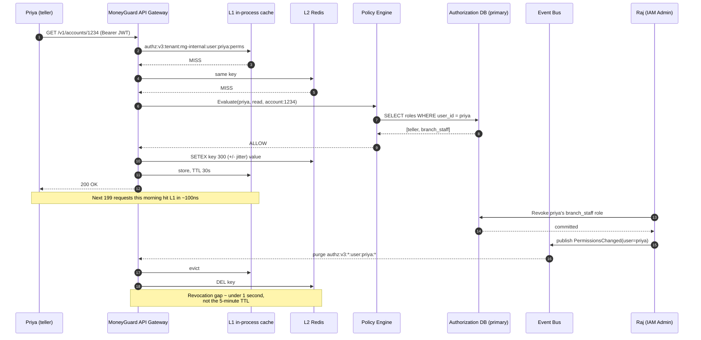
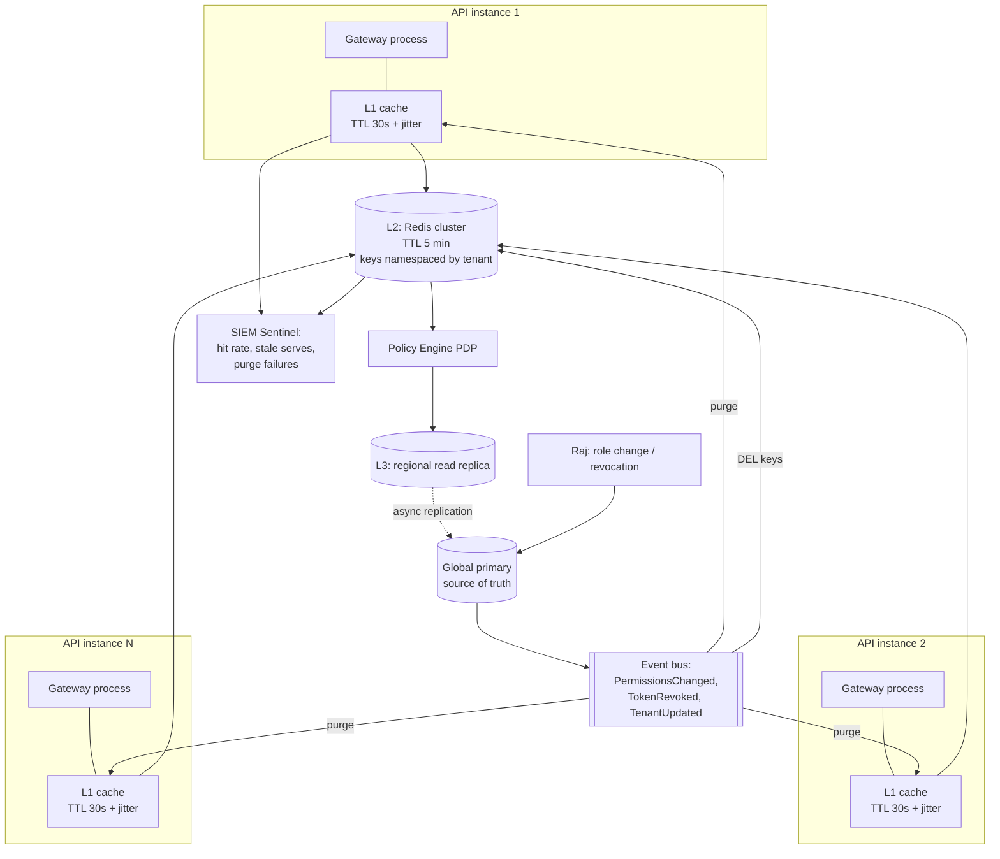

# Caching Strategies and Cache Invalidation

## Overview

Checking "is this user allowed to do this?" against a central database on every single API request is a latency killer. MoneyGuard's **API Gateway** handles tens of thousands of requests per second; a 20ms database round-trip on each one is both slow and a guaranteed way to melt the database. The answer is **caching** — keeping permission answers close to where they're needed.

But caching authorization data has a sharp edge that caching product images does not: **a stale permission is a security hole**. If MoneyGuard caches Sam Torres's `payroll_approver` role for one hour and Raj revokes it at 14:00, Sam can approve payroll until 15:00. The cache didn't just serve old data — it served *access*.

🏦 **MoneyGuard scenario:** Priya Sharma, a teller, opens 200 customer records during a busy morning. Every one of those requests needs an authorization check. Alex Kim's job is to make those checks take microseconds instead of milliseconds — without ever letting a revoked permission survive the revocation. This chapter is how.

## Why This Matters

- **Authorization is on the critical path of every request.** It's the one dependency that, if slow, makes everything slow.
- **Cache TTL is a security parameter.** The time-to-live you pick is literally the maximum window of unauthorized access after a revocation. It belongs in security review, not just performance tuning.
- **Cache invalidation is famously the hard problem.** Phil Karlton's line — "there are only two hard things in Computer Science: cache invalidation and naming things" — is a joke that has cost real companies real breaches.
- **Bad cache keys leak data across tenants.** A key of `user:priya:perms` collides across Acme Corp and Globex Inc in a multi-tenant system. The key must carry the tenant.
- **The cache is a resilience component too.** As Chapter 1 showed, the cache ladder is what lets MoneyGuard degrade gracefully when the policy engine dies — so caching design and failure-mode design are the same conversation.

## Key Concepts

- **Cache hit / miss** — whether the requested value was found in the cache.
- **TTL (Time To Live)** — how long a cached entry is considered valid before it expires.
- **L1 cache** — in-process, in-memory cache local to one application instance. Fastest, smallest, not shared.
- **L2 cache** — a distributed cache such as **Redis**, shared by all instances in a region.
- **L3 / read replica** — a read-only copy of the database, used when caches miss.
- **Cache-aside (lazy loading)** — the application checks the cache; on a miss it loads from the source and populates the cache.
- **Write-through** — writes go to the cache and the database together, keeping them in sync.
- **Invalidation** — actively removing or replacing a cached entry when the underlying data changes.
- **Event-driven invalidation** — publishing a "this changed" event so every cache purges immediately, instead of waiting for TTL expiry.
- **Cache stampede (thundering herd)** — many requests missing on the same key at the same instant and all hitting the database together.
- **Negative caching** — caching a "denied" or "not found" answer, to avoid repeatedly asking about something that doesn't exist.
- **Cache poisoning** — an attacker causing incorrect data to be stored in the cache and served to others.

## Detailed Notes

### Concept 1 — The three-tier cache ladder

MoneyGuard uses three layers, each trading speed for freshness and scope.

| Layer | What it is | Typical latency | TTL at MoneyGuard | Scope | Survives a restart? |
|---|---|---|---|---|---|
| **L1 — in-process memory** | A dictionary inside the .NET API process | ~100 nanoseconds | 30–60 seconds | One process | No |
| **L2 — Redis** | A distributed cache shared across a region | ~1 millisecond | 5 minutes | All instances in a region | Yes (with persistence) |
| **L3 — read replica** | A read-only PostgreSQL replica | ~5–20 milliseconds | n/a (real data, lagging by ms) | Region | Yes |
| **Source of truth** | The global primary database | ~20–100 ms cross-region | n/a | Global | Yes |

The lookup order is L1 → L2 → L3 → primary. In steady state, the vast majority of requests never leave L1.

Why bother with L1 when Redis is only a millisecond away? Because at 50,000 requests per second, a millisecond of network round-trip per request is 50 seconds of aggregate wait time every second — you'd need enormous connection pools and Redis itself becomes a bottleneck and a single point of failure. L1 absorbs the repeated identical questions (Priya asking about the same permission 200 times in a morning) so Redis only sees the interesting ones.

⚠️ L1's weakness is that it's per-process. With 40 API instances, a purge event must reach all 40, and until it does, one instance can still serve a stale answer. This is why L1 TTLs are short — it bounds the damage from a missed purge event.

### Concept 2 — Cache-aside, the standard pattern

Cache-aside (also called lazy loading) is the default for authorization data:

1. Application needs Priya's permissions. It asks the cache.
2. **Hit** → return immediately. Done.
3. **Miss** → query the source of truth, store the result in the cache with a TTL, return it.

Its virtue is that only requested data is cached — you never waste memory on the 49,000 employees who aren't logged in right now. Its weakness is that the first request after an expiry pays the full latency, and if many requests miss simultaneously you get a stampede.

The alternative, **write-through**, updates the cache whenever the database is written. It keeps the cache warm and consistent, but it caches data that may never be read, and it makes writes slower. For IAM, cache-aside plus event-driven invalidation is generally the better fit, because permission *reads* vastly outnumber permission *writes* — roughly 1,000 to 1.

### Concept 3 — What to cache (and what never to cache)

**Good candidates:**
- A user's **role set** within a tenant (`priya → [teller, branch_staff]`). Changes rarely, read constantly.
- **JWKS public keys** (the identity provider's signing keys, used to verify JWT signatures). These change only on key rotation — cache them for hours, with a forced refresh on an unknown `kid`. See [Module 04](../04_Edge_Security_Tokens_And_Sessions/README.md).
- **Policy bundles** — the compiled OPA policies themselves.
- **Tenant metadata** — Acme Corp's plan, region, and connection alias.
- **Full authorization decisions** for a specific (subject, action, resource) tuple, at a short TTL.

**Never cache:**
- ⚠️ **Raw tokens or credentials.** A cache is a copy of a live credential in a system that is often less hardened than your token store.
- ⚠️ **The revocation blocklist as a positive answer.** You may cache "this token is fine" only very briefly, if at all — caching "not revoked" for 5 minutes recreates the exact gap the blocklist exists to close.
- ⚠️ **Anything without the tenant in the key**, in a multi-tenant system.
- ⚠️ **Step-up authentication state** for high-value actions. If a wire transfer requires a fresh MFA challenge, a cached "she already did MFA" defeats the control.

### Concept 4 — Cache keys: the tenant is not optional

A cache key must uniquely identify everything that could change the answer. In MoneyGuard's **Business Banking SaaS Portal**, that means the tenant, the subject, and a version marker:

```
authz:v3:tenant:acme-corp:user:9f8b4c2a:perms
```

Breaking that down:
- `authz` — namespace, so you can flush all authorization keys without touching other caches.
- `v3` — a **schema version**. Bump it when the shape of the cached object changes, and every old entry becomes unreachable instantly. This is far safer than trying to migrate cached objects.
- `tenant:acme-corp` — ⚠️ the critical part. Without it, a key like `user:sam:perms` is ambiguous for a contractor who belongs to both Acme and Globex, and one tenant's answer can be served to the other.
- `user:9f8b4c2a` — the subject, by opaque ID, not by email.

💡 A useful trick is a **tenant-level version counter**. Store `tenant:acme-corp:ver = 42` and include it in every key. To invalidate *everything* for Acme Corp in one operation — say, after a bulk role change — increment the counter. All old keys become orphaned and expire naturally. No scan, no `KEYS *` (which blocks Redis), no fan-out.

### Concept 5 — Invalidation: TTL vs. events

There are two ways an entry stops being served.

**TTL expiry (passive).** The entry simply ages out. Simple, requires no coordination, and always eventually correct. But the window between the change and the expiry is a window of stale authority.

**Event-driven invalidation (active).** When Raj revokes Sam's role, the system publishes a `PermissionsChanged` event; every cache node subscribes and purges the affected keys immediately. Propagation is typically under a second.

The right design uses **both**:

- **Events are the primary mechanism** — they close the revocation gap to near zero.
- **TTL is the backstop** — because events get lost. A node was restarting, the message bus hiccupped, a subscriber crashed. TTL guarantees that even a completely missed event self-heals within the TTL.

This is why TTL choice matters even in an event-driven system: TTL is the answer to "what's the worst case if the event never arrives?"

MoneyGuard's numbers:

| Cached item | TTL | Event invalidation | Worst-case staleness |
|---|---|---|---|
| Authorization decision (L1) | 30 s | Yes | 30 s |
| User role set (L2 Redis) | 5 min | Yes | 5 min |
| Tenant metadata | 15 min | Yes | 15 min |
| JWKS signing keys | 6 h | Forced refresh on unknown `kid` | Until next request with a new key |
| Revocation blocklist | Not cached positively | n/a — always checked | 0 |

### Concept 6 — Cache stampede and how to stop it

At 09:00 on Monday, 8,000 MoneyGuard employees log in within two minutes. If a popular policy bundle's cache entry expires at that moment, thousands of requests miss simultaneously and all hammer the database at once — a **stampede** or **thundering herd**. The database saturates, latency spikes, timeouts fire, circuit breakers trip, and now you're in the fail-closed scenario from Chapter 1.

Three standard defences:

1. **Request coalescing (single-flight).** When N requests miss the same key, only one goes to the database; the rest wait on that in-flight result. In .NET this is what `HybridCache` and `LazyCache` do; in Go it's `singleflight`.
2. **Jittered TTLs.** Instead of every entry expiring at exactly 300 seconds, use 300 seconds ± up to 10% random. This scatters expiries across time so they don't align into a spike.
3. **Probabilistic early refresh.** As an entry approaches expiry, give each request a small and rising chance of refreshing it in the background while still serving the cached value. The entry is refreshed *before* it expires, so no request ever pays the miss.

### Concept 7 — Negative caching, carefully

If Eve probes for 5,000 non-existent user IDs, every one is a cache miss and a database query — a cheap way to attack the database. **Negative caching** stores the "not found" or "denied" answer too.

The asymmetry to remember: **cache denials briefly, cache approvals normally.** A cached denial that's stale means a legitimate user is blocked for a few seconds after being granted access — annoying, safe. A cached approval that's stale means a revoked user retains access — dangerous. So negative entries get short TTLs (5–15 seconds) and, importantly, must be invalidated when a grant occurs, or Priya's brand-new permission won't work for 15 seconds and she'll file a ticket.

### Concept 8 — Cache poisoning and multi-tenant safety

Cache poisoning is when an attacker gets bad data into the cache that is then served to others. In an authorization cache, the realistic vectors are:

- **Key collision from missing tenant scope** — the leak discussed above. Fix: tenant in every key.
- **Trusting client-supplied input in the key.** If a header value becomes part of the cache key without validation, Eve can craft keys deliberately.
- **Caching before authorization rather than after.** If the cache sits in front of the authorization check, the first (authorized) response gets cached and served to a later unauthorized requester. Authorization must happen *before* the cache is consulted for the response, or the cache key must include the identity.
- **A shared Redis without ACLs or TLS.** Anyone who reaches Redis can write any key. Redis must require authentication, use TLS in transit, and be network-isolated.

## Workflow

A cache-aside read, with a miss and a subsequent invalidation:



## Architecture Diagram



## Step-by-Step Process

Designing an authorization cache for MoneyGuard:

1. **Measure first.** Find out what fraction of request latency is authorization. If it's 2%, caching is premature optimization with a security cost.
2. **Decide what to cache.** Role sets, policy bundles, JWKS keys, tenant metadata, short-lived decisions. Explicitly list what must never be cached.
3. **Design the key format** including namespace, schema version, tenant, subject, and — for decisions — action and resource. Write it down as a documented convention.
4. **Set TTLs as a security decision.** Ask "what is the maximum acceptable window of unauthorized access?" and derive the TTL from that answer, not from a performance graph.
5. **Add jitter** to every TTL (±10%) so expiries don't align.
6. **Implement cache-aside with request coalescing** so a miss storm produces one database query, not thousands.
7. **Wire up event-driven invalidation.** Every write path that changes authority — role change, revocation, tenant suspension, SCIM deprovision — must publish an event.
8. **Make purge idempotent and forgiving.** A purge for a key that isn't cached is a no-op; a purge that fails must be retried and, if it can't be delivered, must raise an alert.
9. **Include a tenant version counter** so bulk invalidation is one increment instead of a key scan.
10. **Never use `KEYS *` in production Redis** — it blocks the server. Use the version-counter trick or maintain a set of keys per user.
11. **Secure the cache:** Redis with authentication, TLS in transit, network isolation, and no PII or credentials stored in values.
12. **Instrument:** hit rate per layer, p99 latency per layer, purge event lag, and — most importantly — a counter of decisions served from cache during a PDP outage.
13. **Test the invalidation path** with an automated test: grant, verify, revoke, and assert access is gone within the expected propagation time.

## Commands and Examples

**Key convention and Redis operations.**

```bash
# Key format:
#   authz:<schemaVersion>:tenant:<tenantSlug>:user:<subjectId>:<what>
# The tenant segment is MANDATORY - without it, Sam Torres (a member of both
# Acme Corp and Globex Inc) can be served the wrong tenant's permissions.

# Store a role set with a 5-minute TTL.
SETEX "authz:v3:tenant:acme-corp:user:9f8b4c2a:perms" 300 \
      '{"roles":["payroll_approver"],"ver":42,"cachedAt":"2026-09-03T09:14:22Z"}'

# Read it back.
GET "authz:v3:tenant:acme-corp:user:9f8b4c2a:perms"

# Targeted invalidation when Raj revokes a role.
DEL "authz:v3:tenant:acme-corp:user:9f8b4c2a:perms"

# Bulk invalidation for an ENTIRE tenant - increment the version counter.
# Every key built with the old version becomes unreachable instantly.
INCR "tenantver:acme-corp"          # 42 -> 43

# NEVER do this in production - KEYS blocks the whole Redis server:
#   KEYS authz:v3:tenant:acme-corp:*      <-- DO NOT
# If you must scan, use SCAN with a cursor and a small COUNT.
SCAN 0 MATCH "authz:v3:tenant:acme-corp:*" COUNT 100
```

**Cache-aside with coalescing, jitter, and tenant-scoped keys (.NET).**

```csharp
public class PermissionCache
{
    private readonly HybridCache _cache;   // L1 + L2, with built-in coalescing
    private readonly IPolicyEngine _pdp;
    private readonly ITenantVersions _versions;
    private static readonly Random _jitter = new();

    public async Task<PermissionSet> GetAsync(string tenantSlug, Guid userId, CancellationToken ct)
    {
        // Tenant version in the key = bulk invalidation is a single INCR.
        var ver = await _versions.GetAsync(tenantSlug);
        var key = $"authz:v3:tenant:{tenantSlug}:ver:{ver}:user:{userId}:perms";

        // +/- 10% jitter so 8,000 Monday-morning logins do not all expire together.
        var baseTtl = TimeSpan.FromMinutes(5);
        var ttl = baseTtl * (0.9 + _jitter.NextDouble() * 0.2);

        // HybridCache coalesces concurrent misses on the same key into ONE
        // factory invocation - this is the stampede defence.
        return await _cache.GetOrCreateAsync(
            key,
            async token => await _pdp.LoadPermissionsAsync(tenantSlug, userId, token),
            new HybridCacheEntryOptions
            {
                Expiration      = ttl,                      // L2 (Redis)
                LocalCacheExpiration = TimeSpan.FromSeconds(30) // L1, deliberately shorter
            },
            cancellationToken: ct);
    }
}
```

**Event-driven invalidation on the write path.**

```csharp
// Every authority-changing write publishes an event. No exceptions.
public async Task ChangeRoleAsync(string tenantSlug, Guid userId, Guid roleId, Guid actorId)
{
    await _primary.ApplyRoleChangeAsync(tenantSlug, userId, roleId);

    // Publish BEFORE returning success to the admin, so the UI never shows
    // "done" while stale permissions are still being served somewhere.
    await _bus.PublishAsync(new PermissionsChanged(
        TenantSlug: tenantSlug,
        UserId:     userId,
        ChangedAt:  DateTimeOffset.UtcNow,
        Actor:      actorId));

    _log.LogInformation(
        "PERMISSIONS_CHANGED {TenantSlug} {Subject} {Role} {Actor} {CorrelationId}",
        tenantSlug, userId, roleId, actorId, Activity.Current?.Id);
}

// Every API instance subscribes and purges both cache layers.
public async Task OnPermissionsChanged(PermissionsChanged e)
{
    var ver = await _versions.GetAsync(e.TenantSlug);
    var key = $"authz:v3:tenant:{e.TenantSlug}:ver:{ver}:user:{e.UserId}:perms";

    await _cache.RemoveAsync(key);   // clears L1 and L2

    // If the purge itself fails, that is a SECURITY event - do not swallow it.
    _metrics.Increment("authz.cache.purge", tags: new[] { $"tenant:{e.TenantSlug}" });
}
```

**Monitoring the cache as a security control (PromQL).**

```promql
# Hit rate per layer. A sudden drop means the DB is about to take the load.
sum(rate(authz_cache_hits_total[5m])) by (layer)
  / sum(rate(authz_cache_requests_total[5m])) by (layer)

# Purge failures are a SECURITY alert: stale permissions may be live somewhere.
sum(rate(authz_cache_purge_failures_total[5m])) > 0

# How long after a revocation does the last stale serve occur?
histogram_quantile(0.99,
  sum(rate(authz_revocation_propagation_seconds_bucket[15m])) by (le))
```

**An automated test that proves invalidation works.**

```csharp
[Fact]
public async Task Revoking_A_Role_Takes_Effect_Within_Two_Seconds()
{
    await Admin.GrantRoleAsync("acme-corp", SamId, "payroll_approver");
    Assert.True(await Portal.CanApprovePayrollAsync(SamId));  // warms the cache

    await Admin.RevokeRoleAsync("acme-corp", SamId, "payroll_approver");

    // Event-driven purge, NOT TTL expiry: this must pass in ~1s, not 300s.
    await Eventually.WithinAsync(TimeSpan.FromSeconds(2),
        async () => Assert.False(await Portal.CanApprovePayrollAsync(SamId)));
}
```

## Best Practices

- **Treat TTL as a security control.** Document the maximum acceptable staleness for each cached item and review it like a firewall rule.
- **Use events as the primary invalidation mechanism and TTL as the backstop.** Events close the gap; TTL self-heals a lost event.
- **Put the tenant in every cache key**, always, in a multi-tenant system.
- **Version your keys** (`v3`) so a schema change invalidates everything instantly rather than requiring migration.
- **Use a tenant version counter** for bulk invalidation instead of scanning keys.
- **Add jitter to every TTL** to prevent synchronized expiry.
- **Coalesce concurrent misses** so one key miss produces one backend call.
- **Cache denials briefly, approvals normally.** Stale denials are safe; stale approvals are not.
- **Never cache raw tokens, credentials, or PII.**
- **Never cache "this token is not revoked"** for any meaningful duration — it defeats the blocklist.
- **Secure Redis** with authentication, TLS, and network isolation. A cache holding authorization answers is a security system.
- **Alert on purge failures**, not just cache misses.
- **Test invalidation automatically** in CI: grant → verify → revoke → assert gone within the SLA.

## Common Mistakes

- ⚠️ **Long TTLs on permissions.** A one-hour TTL means a fired employee has an hour of access. This is the classic finding in an IAM audit.
- ⚠️ **Cache keys without the tenant.** In a pool-model multi-tenant system this is a cross-tenant data leak, and it's silent.
- ⚠️ **Relying on TTL alone.** Correct eventually, but "eventually" is measured in exactly the window an attacker needs.
- ⚠️ **Relying on events alone.** Events get lost. Without a TTL backstop, a missed event means indefinitely stale permissions.
- ⚠️ **`KEYS *` in production Redis.** It's O(n) and blocks the entire server — an accidental self-DoS during an incident, which is the worst possible time.
- ⚠️ **Caching the response instead of the decision**, so an authorized user's response gets served to an unauthorized one.
- ⚠️ **No jitter**, producing a synchronized expiry spike that stampedes the database.
- ⚠️ **Swallowing purge failures.** If invalidation silently fails, you have stale authority and no idea.
- ⚠️ **Caching MFA / step-up state.** "She already did MFA" cached for 10 minutes turns a step-up control into a formality.
- ⚠️ **Forgetting to invalidate on *grant*.** Negative caching plus no grant-invalidation means a newly granted permission doesn't work and the user files a ticket.
- ⚠️ **Treating the cache as merely a performance layer.** In MoneyGuard's degraded-mode design it is also a security-relevant availability layer — it deserves monitoring and a runbook.

## Pro Tips

- 💡 **Derive TTL from the security requirement, then check whether performance is acceptable** — not the reverse. If a 30-second TTL doesn't perform, add an L1 layer rather than extending the TTL.
- 💡 **The tenant version counter is the single best invalidation trick.** One `INCR` invalidates an entire tenant's cache with no scan, no fan-out, and no risk of missing a key.
- 💡 **Log the cache age with every decision** (`cachedAt` in the value). During an incident, "this allow was based on data 4 minutes old" is exactly what the SOC needs.
- 💡 **Publish the invalidation event before telling the admin the change succeeded.** Otherwise Raj sees "revoked" while stale permissions are still live, and he stops watching.
- 💡 **Add a metric for revocation propagation time** and treat its p99 as an SLO. It's the number that answers "how long is our security gap?"
- 💡 **In an interview, say "TTL is a security parameter."** It reframes caching from a performance topic to a security topic, which is exactly the seniority signal being tested.
- 💡 **Keep L1 TTL much shorter than L2 TTL.** L1 is the layer most likely to miss a purge event (it's per-process), so bound its damage more tightly.

## Real-World Use Cases

- **Priya's busy morning.** Priya opens 200 customer records in two hours. The first request populates L1 and L2; the remaining 199 are served in about 100 nanoseconds from L1. The authorization database sees roughly 4 queries instead of 200.
- **Monday morning login surge.** 8,000 employees log in between 08:55 and 09:05. Jittered TTLs scatter the expiries, and request coalescing means the JWKS key fetch happens once per instance rather than 8,000 times. The identity provider never notices.
- **Sam's revocation.** Raj revokes Sam Torres's `payroll_approver` role at 17:00 Friday. The `PermissionsChanged` event purges both cache layers in every region in under a second. The 5-minute TTL never comes into play — but it's there in case the event bus had been down.
- **The cross-tenant near-miss.** A code review catches a new endpoint caching under `user:{id}:invoices` with no tenant segment. Because Sam belongs to both Acme Corp and Globex Inc, that key would have served Acme's cached invoice list to a Globex session. Adding the tenant segment and a CI test for key format prevents it.
- **The PDP outage.** During the Chapter 1 incident, the policy engine is unreachable for 8 minutes. Because L1 and L2 are warm, most read requests are served from cache with a logged `AUTHZ_CACHE_FALLBACK` event and an age stamp. Write operations still fail closed. The cache is what turned a total outage into a degraded read-only mode.
- **Eve probes for users.** Eve enumerates 5,000 fake user IDs. Negative caching with a 10-second TTL absorbs the repeats, and the burst of not-found responses is exactly the pattern Sentinel alerts on.

## Key Takeaways

1. **Cache authorization data because it's on the critical path of every request** — but remember a stale permission is a security hole, not just old data.
2. **Three layers:** L1 in-process (~100ns, 30s), L2 Redis (~1ms, 5min), L3 read replica (~10ms). Look them up in order.
3. **Cache-aside is the right pattern for IAM**, because reads outnumber writes by roughly 1,000 to 1.
4. **TTL is a security parameter** — it defines the maximum window of unauthorized access after a revocation.
5. **Use events as the primary invalidation mechanism and TTL as the backstop.** Events are fast but lossy; TTL is slow but guaranteed.
6. **Cache keys must include namespace, schema version, tenant, and subject.** Missing the tenant is a cross-tenant leak.
7. **A tenant version counter turns bulk invalidation into a single `INCR`** — never scan keys in production.
8. **Defend against stampedes** with request coalescing, TTL jitter, and probabilistic early refresh.
9. **Cache denials briefly, approvals normally.** The asymmetry follows from which staleness is dangerous.
10. **Never cache raw tokens, credentials, PII, "not revoked", or step-up MFA state.**
11. **The cache is also a resilience component** — it's what makes graceful degradation possible when the policy engine dies.

## Glossary

| Term | Meaning |
|---|---|
| **Cache hit / miss** | Whether the requested value was found in the cache. |
| **TTL** | Time To Live — how long a cached entry remains valid. |
| **L1 cache** | In-process, in-memory cache local to one application instance. |
| **L2 cache** | Distributed cache (e.g. Redis) shared across instances. |
| **Read replica** | A read-only copy of a database, used to offload reads. |
| **Cache-aside** | Check the cache; on a miss, load from source and populate the cache. |
| **Write-through** | Write to the cache and the database together. |
| **Invalidation** | Actively removing a cached entry when the source data changes. |
| **Event-driven invalidation** | Publishing a change event so caches purge immediately rather than at TTL expiry. |
| **Cache stampede / thundering herd** | Many simultaneous misses on the same key overwhelming the backend. |
| **Request coalescing (single-flight)** | Collapsing concurrent misses on one key into a single backend call. |
| **Jitter** | Random variation added to a TTL to desynchronize expiries. |
| **Negative caching** | Caching a "not found" or "denied" result. |
| **Cache poisoning** | An attacker causing incorrect data to be cached and served to others. |
| **Tenant version counter** | A per-tenant number embedded in cache keys; incrementing it invalidates all of that tenant's entries. |
| **Revocation propagation time** | How long after a revocation the last stale answer is served. |

## Revision Notes

- Ladder: **L1 (in-process, ~100ns, 30s TTL) → L2 (Redis, ~1ms, 5min) → L3 (read replica, ~10ms) → primary.**
- **Cache-aside** is the IAM default; reads outnumber writes ~1000:1.
- **TTL = maximum unauthorized-access window.** It's a security parameter.
- **Events primary, TTL backstop.** Events are fast but lossy; TTL is the self-healing floor.
- Key format: `authz:v3:tenant:<slug>:ver:<n>:user:<id>:perms`. **Tenant is mandatory.**
- **`INCR tenantver:<slug>`** = invalidate an entire tenant in one operation. **Never `KEYS *`.**
- Stampede defences: **coalescing, jitter, probabilistic early refresh.**
- **Cache denials briefly (5–15s), approvals normally.** Invalidate negatives on grant.
- **Never cache:** raw tokens, credentials, PII, "not revoked", step-up MFA state.
- **Purge failure = security alert**, not a warning.
- L1 TTL << L2 TTL, because L1 is likeliest to miss a purge event.
- Cache is also the **degraded-mode** layer from Chapter 1.

## Interview Questions

**Q1. How would you cache authorization decisions without creating a security hole?**
A: Layer it and bound it. L1 in-process with a 30-second TTL absorbs repeated identical questions; L2 Redis with a 5-minute TTL is shared across instances; a read replica sits behind that. The security discipline is threefold. First, TTL is chosen as a security parameter — it's literally the maximum window of unauthorized access after a revocation, so I derive it from "what staleness is acceptable" and then make performance work within that. Second, event-driven invalidation is the primary mechanism: any authority change publishes an event that purges both layers in under a second, so TTL is only the backstop for a lost event. Third, keys are scoped by tenant, subject, and schema version, and I never cache tokens, credentials, or "this token isn't revoked."

**Q2. Why is cache invalidation considered hard, and what specifically goes wrong in IAM?**
A: It's hard because the cache and the source of truth are separate systems with no transaction spanning them, and every propagation path can fail: the event bus drops a message, a node is restarting, a purge partially succeeds across regions. In IAM the failure has teeth — a stale permission is live access. The specific pattern I've seen fail is relying on TTL alone with a comfortable one-hour value, which means a terminated employee keeps working access for an hour. The other is relying on events alone with no TTL, so a single dropped message means indefinitely stale authority. The fix is both mechanisms together, plus alerting on purge failures — a purge that fails silently is the dangerous case.

**Q3. Design the cache key for a multi-tenant SaaS permission cache.**
A: `authz:v3:tenant:acme-corp:ver:42:user:9f8b4c2a:perms`. The `authz` namespace lets me flush all authorization keys independently. `v3` is a schema version, so changing the cached object's shape orphans every old entry instantly rather than requiring migration. The tenant segment is non-negotiable — a contractor like Sam Torres belongs to both Acme Corp and Globex Inc, and a key of `user:sam:perms` would serve one tenant's answer to the other, which is a cross-tenant leak. `ver:42` is a per-tenant version counter: to invalidate an entire tenant after a bulk change, I increment it once, and every old key becomes unreachable without any key scan.

**Q4. What is a cache stampede and how do you prevent it?**
A: When a hot key expires and many concurrent requests all miss it simultaneously, they all hit the backend at once — potentially thousands of identical queries in the same millisecond, saturating the database. That triggers timeouts, which trip circuit breakers, which puts you in a degraded or fail-closed state, so a caching problem becomes an availability incident. Three defences: request coalescing, so concurrent misses on one key produce exactly one backend call and the rest await that result; TTL jitter of around ±10%, so entries don't expire in lockstep; and probabilistic early refresh, where requests near expiry have a rising chance of refreshing the entry in the background while still serving the cached value, so no request ever pays a miss.

**Q5. Should you cache a "denied" decision?**
A: Yes, but with a much shorter TTL than an approval, and with mandatory invalidation on grant. The reasoning is asymmetric risk: a stale *denial* means a legitimately-granted user is blocked for a few extra seconds — annoying but safe. A stale *approval* means a revoked user retains access — dangerous. So I'd cache denials for 5 to 15 seconds, mainly to blunt enumeration attacks where an attacker probes thousands of non-existent IDs and every probe becomes a database query. And I'd make sure the grant path publishes an invalidation event, or a newly granted permission won't work for the TTL duration and the user files a ticket.

**Q6. Your cache purge event bus goes down for 20 minutes. What happens, and was your design correct?**
A: During those 20 minutes, revocations still commit to the database but caches don't purge, so revoked permissions continue to be served until their TTL expires. This is exactly why TTL must exist alongside events: with a 5-minute L2 TTL and a 30-second L1 TTL, the worst-case exposure is 5 minutes rather than 20. The design is correct if — and only if — I also alert on the bus being down, because 5 minutes of stale authority per revocation for 20 minutes is a real risk window that a human should know about. I'd also make high-value operations re-check the blocklist directly rather than trusting cache, so wire transfers aren't exposed at all.

**Q7. How does caching interact with your fail-open/fail-closed design?**
A: They're the same design. The cache ladder *is* the graceful degradation path: when the policy engine is unreachable, the gateway falls back to the L1 decision cache, then Redis, then a read replica, and only if all of those miss does it apply the resource's declared failure mode. So a warm cache turns what would be a total outage into a degraded read-only mode. Two caveats. First, I log every cache-served decision during an outage with its age, so the SOC knows the assurance level was reduced. Second, I don't extend TTLs "so the cache lasts longer during outages" — that trades a permanent security gap for an occasional availability win, which is the wrong direction.

**Q8. What should never go in the cache?**
A: Raw tokens and credentials, because a cache is a copy of a live secret in a system that's usually less hardened than the token store. Personal data, because a cache is rarely covered by the same retention and erasure controls — which matters for GDPR. "This token is not revoked," because caching that positive answer for five minutes recreates the exact gap the blocklist exists to close. Step-up MFA state, because a cached "she already authenticated strongly" turns a step-up control into a formality. And in a multi-tenant system, anything at all under a key that lacks the tenant segment.

## Practice Exercises

1. **Set the TTLs.** For MoneyGuard, choose and justify a TTL for each of: an authorization decision, a user's role set, tenant metadata, JWKS signing keys, and a negative "user not found" entry. For each one, state the worst-case security consequence of the staleness you're accepting, and name the event that would invalidate it early.

2. **Audit the keys.** Review these five cache keys from the Business Banking SaaS Portal and identify the problems: `perms:sam`, `authz:user:9f8b:invoices`, `authz:v2:tenant:acme-corp:user:9f8b:perms` (in a codebase now on v3), `token:eyJhbGci...`, `mfa:verified:priya`. Rewrite each correctly or explain why it must not be cached at all.

3. **Trace a revocation.** Raj revokes Sam Torres's `payroll_approver` role in Acme Corp at 17:00:00. Write the timeline of every system that must change, in order, with expected timings, and calculate the worst-case revocation gap if (a) everything works, (b) the event bus is down, and (c) one of forty API instances missed the purge event.

4. **Design the stampede test.** Write a load test that deliberately causes a stampede on MoneyGuard's JWKS cache at 09:00 Monday. Specify the load profile, what you measure, and the pass criteria. Then describe the three code changes that would make it pass, and which one you'd implement first.

5. **Make the cache observable.** Define five metrics and two alerts that treat the authorization cache as a security control rather than a performance one. For each alert, write the exact condition, the severity, and the first three steps of the runbook the on-call engineer should follow.

---

⬅ Back to [Module 09 Index](./README.md) | 📖 [Main README](../README.md) | 🏦 [The MoneyGuard Story](../SCENARIO.md)

⬅ Previous: [01_CAP_Theorem_And_FailOpen_vs_FailClosed.md](./01_CAP_Theorem_And_FailOpen_vs_FailClosed.md) | ➡ Next: [03_Audit_Logging_And_Observability.md](./03_Audit_Logging_And_Observability.md)
