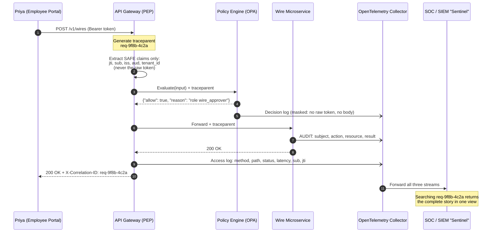

# Audit Logging and Observability

## Overview

In a Zero Trust architecture, continuous verification requires continuous visibility. When a breach, a denied access attempt, or a system failure happens, MoneyGuard's Security Operations Centre must be able to reconstruct the exact lifecycle of a request across the identity provider, the **API Gateway**, the policy engine, and the backend microservices.

But financial institutions face a direct conflict: **security versus privacy**. You must log enough to reconstruct an attack, yet you must never log **PII** (Personally Identifiable Information, like names or social security numbers) or **secrets** (raw tokens, passwords) into central dashboards. If a raw JWT lands in the log platform, any engineer with search access can copy it and impersonate the user.

🏦 **MoneyGuard scenario:** Priya Sharma clicks "Send Wire" in the **Employee Portal**. That single click produces log lines in at least four systems — the portal, the API Gateway, the policy engine, and the wire-transfer microservice. When Dana Cole later asks "who approved this transfer and on what basis?", those four sets of logs must stitch back into one coherent story. This chapter is how MoneyGuard makes that possible without leaking a single credential.

## Why This Matters

- **Accounting is the third A in AAA.** Authentication and Authorization are worthless without a record of what actually happened. See [Module 01](../01_Core_IAM_Concepts/readme.md).
- **Non-repudiation is a compliance requirement.** SOX and GDPR require MoneyGuard to prove who did what, when, and from where — and to prove the record wasn't altered.
- **Incident response is impossible without correlation.** "Something happened at 14:03" is useless if you can't follow that one request across seven services.
- **Logs are themselves a security risk.** A log platform containing raw tokens is a credential store with none of a credential store's protections.
- **Debugging authorization is otherwise guesswork.** "Why was I blocked?" has to have an answer, or people work around your controls.

## Key Concepts

- **Audit log** — a non-repudiable, tamper-evident record of a security-relevant action: *subject, action, resource, result, time*.
- **Application log** — ordinary debugging output. Useful, noisy, disposable.
- **Security event** — a signal of possible attack: 500 failed logins, an admin token from a new country.
- **Structured logging** — emitting logs as machine-parsable key/value objects (JSON) rather than concatenated strings.
- **Correlation ID (trace ID)** — a unique identifier attached to one request and propagated to every downstream service.
- **Distributed tracing** — reconstructing a request's full path across services using correlation IDs and spans.
- **Log sanitization / masking** — stripping or redacting sensitive fields before logs leave the service.
- **`jti`** — the JWT ID claim; a unique identifier for one token. Safe to log; the token itself is not.
- **`sub`** — the subject claim; an opaque user identifier. Log this, not the person's name.
- **OpenTelemetry (OTel)** — the vendor-neutral standard and collector for logs, metrics, and traces.
- **WORM storage** — Write Once, Read Many. Storage that cannot be modified after writing, used for audit trails.
- **The Golden Signals** — latency, traffic, errors, saturation: the four metrics that describe any service's health.

## Detailed Notes

### Concept 1 — Three tiers of telemetry

Not all logs are equal. Treating them identically produces "log fatigue" and an enormous storage bill, and buries the 200 lines that matter under 200 million that don't.

| Tier | Example | Audience | Retention | Deletable by developers? |
|---|---|---|---|---|
| **Application logs** | "Cache miss for key authz:v3:..." | Engineers debugging | 7–30 days | Yes |
| **Audit logs** 🥇 | "Subject `usr_88291a` \| Action `approve_wire` \| Resource `wire:88213` \| Result `success`" | Dana Cole, auditors, regulators | 1–7 years | **No — separate, append-only stream** |
| **Security events** | "500 failed logins from 203.0.113.44 in 60 seconds" | The SOC / Sentinel | 90 days hot, 1 year cold | No |

⚠️ The most important structural rule: **audit logs must go to a different stream than application logs**, and the application's own service account must not be able to delete or modify them. If an attacker who compromises the wire service can also erase the record of what they did, the audit trail is worthless.

### Concept 2 — Structured logging, not string concatenation

The single biggest mistake is string logging:

```csharp
logger.LogInformation("User " + userId + " logged in from " + ip);   // ⚠️ BAD
```

This is unsearchable at scale. The SIEM sees one opaque text blob, so "show me every login from this IP across all services" becomes a regular-expression hunt that's slow, fragile, and breaks the moment someone changes the wording.

Structured logging passes the values as named parameters, so the log platform receives a JSON object with real fields:

```csharp
logger.LogInformation("UserLogin {Subject} {SourceIp} {Result}", sub, ip, "success");
```

There's also a security reason. **Log injection:** if Eve sets her display name to `\nAuditAction: RoleGranted, Result: Success`, and you concatenate that into a log line, she has forged what looks like a genuine system event in your SIEM. Structured logging makes this impossible, because the log aggregator knows which parts are labels and which are data — Eve's string stays a *value* of the `displayName` field and can never become a field name.

### Concept 3 — Correlation IDs and distributed tracing

When Priya clicks "Send Wire," the request touches the portal, the gateway, the policy engine, and the wire microservice. To tie those isolated logs into one story, MoneyGuard uses a **correlation ID**.

1. **The gateway generates it.** The moment a request hits the API Gateway, it mints a unique ID, e.g. `req-9f8b-4c2a`.
2. **It's injected as a header.** `X-Correlation-ID: req-9f8b-4c2a` (or, using the W3C standard, `traceparent`).
3. **Every downstream service propagates it** and includes it in every log line it writes.
4. **The SIEM ties it together.** An analyst searching `req-9f8b-4c2a` in Sentinel sees the complete timeline across the whole estate.

💡 Prefer the **W3C Trace Context** standard (`traceparent`/`tracestate`) over a custom header. It's what OpenTelemetry emits natively, so tracing works across languages and vendors without translation shims. A custom `X-Correlation-ID` is fine as an additional human-readable handle.

Also: **return the correlation ID to the client**, in a response header and on any error screen. When Alex Kim's request gets a 403, the error page shows `req-777x`, he pastes it into a ticket, and support finds the exact decision in seconds instead of asking "roughly what time was that?"

### Concept 4 — What to log and what never to log

MoneyGuard enforces sanitization at the API Gateway *before* logs are forwarded onward.

**🚫 Never log (the drop list):**
- **The `Authorization` header.** `Bearer eyJhb...` is a live credential.
- **The token signature** — the cryptographic segment at the end of a JWT.
- **Request bodies containing** passwords, SSNs, or full account/routing numbers.
- **Query strings carrying secrets**, e.g. `/reset-password?token=secret123`. Mask the whole query string by default and allowlist safe parameters.
- **Session cookies** and API keys.

**✅ Always log (the safe list):**
- **`jti`** — the JWT ID. Lets you track *which token* was used without exposing it. This is the single most valuable claim for incident response.
- **`sub`** — the opaque subject ID (`usr_88291a`), never "Priya Sharma".
- **`iss` and `aud`** — issuer and audience, so you know which IdP minted it and for which service.
- **`tenant_id`** — essential in the multi-tenant Business Banking SaaS Portal (see [Module 08](../08_MultiTenancy_And_Data_Isolation/README.md)).
- **Action and resource** — the HTTP method and path, plus the resource identifier.
- **Source IP and user agent** — the raw material of threat hunting.
- **Result, status code, and latency** — including how long the policy decision took.
- **The decision reason** — *why* the request was denied, not just that it was.

⚠️ Sanitization must be **allowlist-based, not blocklist-based**. A blocklist ("drop the `password` field") misses `passwd`, `pwd`, `new_password`, and the field a developer adds next sprint. An allowlist ("log only these named fields") fails safe: a new sensitive field is excluded by default.

### Concept 5 — Policy engine decision logs

Open Policy Agent (OPA), MoneyGuard's policy decision point, has a native **decision log** feature: every time the gateway asks a question, OPA emits JSON recording the input it received, the policy path it evaluated, and the answer.

That's enormously useful — and dangerous, because the input contains the token payload the gateway sent for evaluation. OPA's **masking configuration** solves it: you declare JSON pointers to fields that must never be written to the log.

The result is a log where the analyst can see exactly *why* Priya was allowed — she held the `wire_approver` role — but cannot see her raw token or the wire amount from the request body.

### Concept 6 — Tamper-evidence and retention

An audit log an attacker can edit is not an audit log. MoneyGuard applies three controls:

- **Append-only / WORM storage.** Audit records go to storage configured Write Once Read Many (S3 Object Lock, Azure immutable blob). Even an administrator cannot silently rewrite history.
- **Hash chaining.** Each audit record includes a hash of the previous record, so deleting or altering any entry breaks the chain and is detectable. This gives cryptographic tamper-*evidence* rather than just access control.
- **Separation of duties.** The service account that writes audit events has append permission only. Nobody in the application's identity domain can delete them.

Retention is a cost-versus-compliance balance. SOX-relevant records typically need years; investigative data needs speed. The standard shape is **hot storage for 30 days** (fast search during an active investigation), then **cold/archive storage** (S3 Glacier or equivalent) for the remainder of the retention period at a fraction of the cost.

### Concept 7 — Logs, metrics, traces, and the Golden Signals

Observability has three data types, and confusing them wastes money:

- **Logs** — discrete events with detail. Expensive per byte. Use for "what exactly happened."
- **Metrics** — numeric aggregates over time. Cheap and fast. Use for "is it healthy right now."
- **Traces** — the causal path of one request across services. Use for "where did the time go / where did it break."

The **Golden Signals** are the four metrics worth alerting on for any service:

| Signal | For MoneyGuard's identity plane |
|---|---|
| **Latency** | p99 of the policy decision, and of token validation |
| **Traffic** | Authentications per second, authorization checks per second |
| **Errors** | 401 rate, 403 rate, and — critically — the *fail-closed denial* rate from Chapter 1 |
| **Saturation** | Policy engine CPU, Redis memory, database connection pool usage |

💡 Alert on **metrics**, then **pivot to traces** to find the affected requests, then **read logs** for detail. Alerting directly on log patterns is slow and expensive; use it only for genuine security detections (Chapter 4).

### Concept 8 — Privacy: logging under GDPR

Under GDPR, log data containing personal information is personal data — with all the obligations attached. MoneyGuard's approach:

- **Pseudonymize by default.** Log `sub: usr_88291a`, never the name or email. The mapping from `sub` to a human lives in the identity store, behind its own access controls, so re-identification is itself an audited action.
- **Separate retention rules.** Application logs age out in 30 days. Audit records are retained under a legal basis (regulatory obligation) that survives an erasure request — but the personal data *inside* them is pseudonymized, so the tension is largely dissolved.
- **Tag every record with `tenant_id`** so a per-tenant export or deletion is bounded and provable.
- **Keep telemetry in-region.** A data-residency requirement is most often violated by the log pipeline, not the primary database — logs are the thing that quietly gets shipped to a US SaaS vendor.

## Workflow

One "Send Wire" request, from click to searchable audit record:



## Architecture Diagram

```mermaid
graph TB
    subgraph "MoneyGuard services"
        PORTAL[Employee Portal]
        GW[API Gateway / PEP]
        PDP[Policy Engine / PDP]
        WIRE[Wire Microservice]
        BBSP[Business Banking SaaS Portal]
    end

    PORTAL --> GW --> PDP
    GW --> WIRE
    BBSP --> GW

    GW -->|structured JSON<br/>sanitized at source| OT[OpenTelemetry Collector<br/>+ masking processor]
    PDP -->|masked decision logs| OT
    WIRE -->|audit events| OT
    BBSP -->|tenant-tagged events| OT

    OT --> SPLIT{Route by stream}
    SPLIT -->|application logs| APP[(Hot log store<br/>30 days<br/>engineers can query)]
    SPLIT -->|security events| SIEM[SOC / SIEM "Sentinel"<br/>detection rules + alerting]
    SPLIT -->|AUDIT stream| WORM[(WORM / append-only store<br/>hash-chained<br/>1-7 years<br/>append-only service account)]

    APP -.->|expire| DELETE[Deleted]
    SIEM --> PAGER[PagerDuty / SOC on-call]
    WORM --> DANA[Dana Cole:<br/>SOX / GDPR evidence]

    METRICS[Golden Signals:<br/>latency, traffic,<br/>errors, saturation] --> ALERTS[Alerting]
    GW --> METRICS
    PDP --> METRICS
```

## Step-by-Step Process

1. **Classify every log statement** into application, audit, or security-event. If it records a security-relevant decision, it's an audit event and must go to the audit stream.
2. **Adopt structured logging everywhere.** Ban string concatenation in log calls with a lint rule, not a code-review convention.
3. **Define the audit event schema** once, centrally: `timestamp, subject, action, resource, tenant_id, result, reason, source_ip, correlation_id, jti`. Every service emits the same shape.
4. **Generate the trace context at the edge** (W3C `traceparent`) and propagate it through every hop, including asynchronous message handlers.
5. **Return the correlation ID to the client** in a response header and on error pages.
6. **Sanitize at the source**, in the service, before the log leaves the process — not downstream in the collector, where a misconfiguration exposes everything.
7. **Use an allowlist** of loggable fields. Anything unlisted is dropped by default.
8. **Configure decision-log masking** on the policy engine for token and body fields.
9. **Route the audit stream to WORM storage** with an append-only service account and hash chaining.
10. **Set tiered retention:** 30 days hot, then archive to cold storage for the compliance period.
11. **Emit the Golden Signals as metrics**, and alert on those rather than on log text.
12. **Test the redaction.** Write an automated test that sends a request with a token and a password field and asserts neither appears anywhere in the emitted logs.
13. **Run an audit drill.** Ask Dana Cole to request the full trail for one wire transfer and time how long it takes to produce.

## Commands and Examples

**A structured JSON audit log line — the canonical MoneyGuard shape.**

```json
{
  "timestamp": "2026-09-03T14:03:22.481Z",
  "stream": "audit",
  "event_type": "AUTHZ_DECISION",
  "correlation_id": "req-9f8b-4c2a",
  "trace_id": "4bf92f3577b34da6a3ce929d0e0e4736",
  "service": "wire-microservice",
  "environment": "production",

  "subject": "usr_88291a",
  "subject_type": "human",
  "tenant_id": "mg-internal",
  "jti": "jwt-55667788",
  "iss": "https://auth.moneyguard.com/",
  "aud": "api://wires",

  "action": "wire.approve",
  "resource": "wire:88213",
  "result": "allow",
  "reason": "role:wire_approver AND amount_below_limit",
  "policy_path": "moneyguard/api/wires/allow",

  "source_ip": "198.51.100.24",
  "user_agent": "MoneyGuardPortal/4.2 (Windows NT 10.0)",
  "http_status": 200,
  "latency_ms": 87,
  "pdp_latency_ms": 4,

  "prev_hash": "b91c...e3f0",
  "hash": "7d2a...19bc"
}
```

Note what is *absent*: no raw token, no signature, no wire amount, no account number, no customer name. Everything present is either an opaque identifier or non-sensitive metadata.

**Structured logging setup with Serilog + OpenTelemetry (.NET).**

```csharp
Log.Logger = new LoggerConfiguration()
    .Enrich.FromLogContext()
    .Enrich.WithProperty("service.name", "wire-microservice")
    .Enrich.WithProperty("deployment.environment", "production")
    .Destructure.ByTransforming<HttpRequest>(r => new { r.Method, r.Path })  // never the body
    .WriteTo.Console(new CompactJsonFormatter())
    .WriteTo.OpenTelemetry(o => o.Endpoint = "http://otel-collector:4317")
    .CreateLogger();

// Emitting an audit event: named parameters, never concatenation.
_auditLog.LogInformation(
    "AUTHZ_DECISION {Subject} {TenantId} {Action} {Resource} {Result} {Reason} {Jti} {SourceIp}",
    sub, tenantId, "wire.approve", $"wire:{wireId}", "allow",
    "role:wire_approver", jti, clientIp);
```

**Gateway middleware: correlation ID plus safe-claim extraction (harvested and hardened).**

```csharp
public class AuditLoggingMiddleware
{
    private readonly RequestDelegate _next;
    private readonly ILogger<AuditLoggingMiddleware> _logger;

    public AuditLoggingMiddleware(RequestDelegate next, ILogger<AuditLoggingMiddleware> logger)
        => (_next, _logger) = (next, logger);

    public async Task InvokeAsync(HttpContext ctx)
    {
        var sw = Stopwatch.StartNew();

        // 1. Accept an inbound trace context, or mint one at the edge.
        var correlationId = ctx.Request.Headers["X-Correlation-ID"].FirstOrDefault()
                            ?? $"req-{Guid.NewGuid():N}";
        ctx.Items["CorrelationId"] = correlationId;
        ctx.Response.Headers["X-Correlation-ID"] = correlationId;  // give it back to the client

        // 2. Extract ONLY safe claims. The raw token never enters a log statement.
        string jti = "anonymous", sub = "anonymous", tenant = "none";
        var authHeader = ctx.Request.Headers.Authorization.ToString();
        if (authHeader.StartsWith("Bearer ", StringComparison.Ordinal))
        {
            var raw = authHeader[7..];
            var handler = new JwtSecurityTokenHandler();
            if (handler.CanReadToken(raw))
            {
                var jwt = handler.ReadJwtToken(raw);   // already signature-verified upstream
                jti    = jwt.Claims.FirstOrDefault(c => c.Type == JwtRegisteredClaimNames.Jti)?.Value ?? "unknown";
                sub    = jwt.Claims.FirstOrDefault(c => c.Type == JwtRegisteredClaimNames.Sub)?.Value ?? "unknown";
                tenant = jwt.Claims.FirstOrDefault(c => c.Type == "tenant_id")?.Value ?? "none";
            }
        }

        await _next(ctx);
        sw.Stop();

        // 3. Structured, sanitized access log.
        _logger.LogInformation(
            "API_ACCESS {CorrelationId} {Method} {Path} {StatusCode} {Subject} {TenantId} {Jti} {LatencyMs} {ClientIp}",
            correlationId, ctx.Request.Method, ctx.Request.Path, ctx.Response.StatusCode,
            sub, tenant, jti, sw.ElapsedMilliseconds,
            ctx.Connection.RemoteIpAddress?.ToString());
    }
}
```

**OPA decision-log masking (`opa-config.yaml`).**

```yaml
decision_logs:
  console: true
  reporting:
    min_delay_seconds: 10
    max_delay_seconds: 60
  # Masking prevents sensitive inputs from ever entering the decision log.
  mask_decision: data.moneyguard.log.mask

# In Rego (moneyguard/log/mask.rego):
#   package moneyguard.log
#   mask contains {"op": "remove", "path": "/input/token/raw"}
#   mask contains {"op": "remove", "path": "/input/request/body"}
#   mask contains {"op": "upsert", "path": "/input/request/headers/authorization",
#                  "value": "[REDACTED]"}
```

**Resulting sanitized decision log in Sentinel.**

```json
{
  "decision_id": "dec-a1b2c3d4",
  "correlation_id": "req-9f8b-4c2a",
  "path": "moneyguard/api/wires/allow",
  "input": {
    "request": { "method": "POST", "path": "/v1/wires", "source_ip": "198.51.100.24" },
    "token":   { "payload": { "jti": "jwt-55667788", "sub": "usr_88291a",
                              "tenant_id": "mg-internal", "roles": ["wire_approver"] } }
  },
  "result": true,
  "metrics": { "timer_rego_query_eval_ns": 450000 }
}
```

The analyst can see exactly *why* Priya was allowed — she holds `wire_approver` — but not her raw token and not the wire amount.

**OpenTelemetry Collector: route streams and enforce a final redaction backstop.**

```yaml
processors:
  # Belt and braces: services sanitize at source, the collector redacts again.
  attributes/redact:
    actions:
      - key: http.request.header.authorization
        action: delete
      - key: http.request.body
        action: delete
      - key: user.email
        action: hash

exporters:
  otlp/siem:   { endpoint: sentinel-ingest.moneyguard.internal:4317 }
  otlp/audit:  { endpoint: audit-worm-writer.moneyguard.internal:4317 }
  otlp/apps:   { endpoint: loki.moneyguard.internal:4317 }

service:
  pipelines:
    logs/audit:
      receivers:  [otlp]
      processors: [attributes/redact, filter/audit_only]
      exporters:  [otlp/audit, otlp/siem]     # audit goes to WORM *and* the SIEM
    logs/application:
      receivers:  [otlp]
      processors: [attributes/redact, filter/app_only]
      exporters:  [otlp/apps]                  # never to WORM - it would swamp it
```

**An automated test that redaction actually works.**

```csharp
[Fact]
public async Task Logs_Never_Contain_Raw_Tokens_Or_Passwords()
{
    var token = TestTokens.ValidFor("usr_88291a");
    await Client.PostAsync("/v1/wires",
        Json(new { amount = 5000, password = "hunter2" }), bearer: token);

    var emitted = TestLogSink.AllLinesAsText();
    Assert.DoesNotContain(token,     emitted);      // no raw JWT
    Assert.DoesNotContain("hunter2", emitted);      // no password
    Assert.DoesNotContain("Bearer ", emitted);      // no auth header
    Assert.Contains("usr_88291a",    emitted);      // but the subject IS logged
    Assert.Contains("req-",          emitted);      // and so is the correlation ID
}
```

## Best Practices

- **Separate audit logs from application logs** into different streams with different retention and different permissions. Developers must not be able to delete audit records.
- **Log the five Ws in every audit event:** who (`sub`), what (action), which (resource), when (timestamp), where (source IP) — plus *why* (the decision reason).
- **Always structured, never concatenated.** Enforce it with a linter.
- **Sanitize at the source**, then redact again in the collector as a backstop.
- **Use an allowlist of loggable fields**, so new sensitive fields are excluded by default.
- **Log `jti`, never the token.** It gives full traceability with zero credential exposure.
- **Log `sub`, never the name.** Pseudonymize by default.
- **Include `tenant_id` on every event** in multi-tenant systems.
- **Propagate W3C trace context** across every hop, including async and queue-based ones.
- **Surface the correlation ID to users** on error screens.
- **Write audit records to WORM storage with hash chaining** for tamper-evidence.
- **Tier retention:** 30 days hot, then cold archive for the compliance period.
- **Alert on metrics, investigate with traces, confirm with logs.**
- **Test redaction in CI**, so a new field can't silently start leaking.

## Common Mistakes

- ⚠️ **Logging the `Authorization` header.** The most common and most damaging logging mistake — it turns the log platform into a credential store.
- ⚠️ **String concatenation in log calls.** Unsearchable, and it enables log injection where Eve forges apparent system events.
- ⚠️ **Blocklist-based redaction.** It misses `pwd`, `passwd`, `secret_2`, and whatever gets added next sprint.
- ⚠️ **Redacting only in the collector.** One misconfiguration and unredacted data has already left every service.
- ⚠️ **Audit logs writable by the application's own service account.** An attacker who owns the service can erase the evidence.
- ⚠️ **No correlation ID.** Investigations degrade to timestamp-matching across systems with unsynchronized clocks.
- ⚠️ **Logging that a request was denied without logging why.** Support can't help, and users route around the control.
- ⚠️ **Logging names and emails.** Creates GDPR obligations across your entire log estate for no operational benefit that `sub` doesn't provide.
- ⚠️ **Shipping logs to a region that violates data residency.** The log pipeline is the usual culprit, not the database.
- ⚠️ **Retaining everything for seven years.** Ruinously expensive and increases breach impact. Tier it.
- ⚠️ **Alerting on raw log volume.** Noisy, expensive, and it trains the SOC to ignore alerts.

## Pro Tips

- 💡 **`jti` is the incident-responder's best friend.** It uniquely identifies a token without exposing it — which makes "the same token used from New York and Moscow within five minutes" a detectable, provable event.
- 💡 **Put the correlation ID on the error page.** It converts "it broke, I don't know when" tickets into thirty-second investigations.
- 💡 **Emit a `reason` field on every deny.** Distinguishing "policy said no" from "PDP unreachable, failed closed" is the difference between a support ticket and an incident.
- 💡 **Hash-chain your audit records.** Cheap to implement, and it upgrades your claim from "we control access to the logs" to "we can prove they weren't altered."
- 💡 **Give the audit writer an append-only role and nothing else.** Separation of duties, enforced by IAM on your own IAM logs.
- 💡 **Log the cache age with cached decisions.** During an incident, knowing a decision was based on four-minute-old data is critical context.
- 💡 **Interview move:** say *"log the `jti` and `sub`, never the raw token or the name — full traceability, zero credential and minimal PII exposure."* It shows you've thought about both sides of the security/privacy conflict.

## Real-World Use Cases

- **The stolen token.** Sentinel raises "impossible travel": `sub usr_88291a` made a call from New York at 13:00 and another from a Moscow-hosted server at 13:05. The analyst searches by `sub` and compares the `jti` values — both requests used `jti: jwt-111`. Priya didn't fly; her token was stolen. The SOC adds `jwt-111` to the Redis blocklist, killing it globally in about a second. **None of this is possible without logging `jti`.**
- **The false positive.** Alex Kim files a ticket: "The gateway keeps returning 403 when I try to restart the ledger service." He supplies the correlation ID from his error screen, `req-777x`. The engineer finds the OPA decision log: the rule `is_corporate_ip` evaluated false because Alex's source IP wasn't in the corporate ranges. Alex had forgotten his VPN. Zero Trust worked exactly as designed, and the investigation took two minutes.
- **Dana's SOX evidence request.** Dana Cole must show an auditor every privileged action on the Core Banking Ledger for Q3. Because audit events carry a consistent schema and live in WORM storage, this is one query plus a hash-chain verification proving nothing was altered.
- **The privacy near-miss.** A code review catches a new endpoint logging the full request body of a payee-creation call — which contains the recipient's account number. The allowlist policy would have dropped it, but the developer had used a raw `LogDebug(body)`. The CI redaction test is extended to cover that field.
- **A tenant investigation.** Globex Inc reports suspicious activity in the Business Banking SaaS Portal. Because every event carries `tenant_id`, the SOC scopes the entire investigation to Globex without ever touching Acme Corp's records — which matters both for speed and for confidentiality.

## Key Takeaways

1. **Three telemetry tiers:** application logs (debug, disposable), audit logs (non-repudiable, protected, long-retention), security events (fed to the SIEM).
2. **Audit logs go to a separate, append-only stream** that the application's own identity cannot delete.
3. **Structured logging is mandatory** — it makes logs searchable and prevents log injection.
4. **Correlation IDs generated at the edge and propagated everywhere** turn scattered logs into one story.
5. **Log `jti` and `sub`; never the raw token, the signature, the body, or the person's name.**
6. **Sanitize at the source with an allowlist**, and redact again at the collector as a backstop.
7. **Mask policy-engine decision logs**, or your PDP will faithfully record the token you were careful not to log.
8. **WORM storage plus hash chaining** gives tamper-evidence, not just access control.
9. **Tier retention:** 30 days hot, then cold archive for the compliance window.
10. **Alert on metrics (the Golden Signals), investigate with traces, confirm with logs.**
11. **Always log the `reason` for a denial** — especially to distinguish a policy deny from a fail-closed deny.

## Glossary

| Term | Meaning |
|---|---|
| **Audit log** | Non-repudiable record of a security-relevant action: subject, action, resource, result, time. |
| **Application log** | Ordinary debugging output; high volume, short retention. |
| **Security event** | Telemetry indicating possible attack activity. |
| **Structured logging** | Emitting logs as machine-parsable key/value objects instead of concatenated strings. |
| **Log injection** | An attacker embedding fake log syntax in user input to forge apparent system events. |
| **Correlation ID** | A unique ID for one request, propagated to every service it touches. |
| **W3C Trace Context** | The standard `traceparent`/`tracestate` headers for propagating trace identity. |
| **Distributed tracing** | Reconstructing a request's path across services from its trace context. |
| **`jti`** | JWT ID claim — a unique identifier for one token. Safe to log. |
| **`sub`** | Subject claim — the opaque user identifier. Log this, not the name. |
| **Sanitization / masking** | Removing or redacting sensitive fields before logs leave the service. |
| **Allowlist redaction** | Logging only explicitly permitted fields, so new fields are excluded by default. |
| **Decision log** | The policy engine's record of each authorization evaluation. |
| **OpenTelemetry (OTel)** | Vendor-neutral standard and collector for logs, metrics, and traces. |
| **WORM** | Write Once Read Many — immutable storage for audit trails. |
| **Hash chaining** | Including the previous record's hash in each record so alterations are detectable. |
| **Golden Signals** | Latency, traffic, errors, saturation. |
| **PII** | Personally Identifiable Information. |
| **Non-repudiation** | The property that an actor cannot credibly deny having performed a recorded action. |

## Revision Notes

- **Three tiers:** application (30 days, deletable) / **audit** (years, WORM, append-only) / security events (SIEM).
- **Structured logging always.** Prevents unsearchable blobs *and* log injection.
- **Correlation ID minted at the gateway**, propagated via W3C `traceparent`, returned to the client.
- **Safe list:** `jti`, `sub`, `iss`, `aud`, `tenant_id`, method, path, source IP, user agent, status, latency, reason.
- **Drop list:** `Authorization` header, token signature, request body, secret query strings, cookies, API keys.
- **Allowlist > blocklist** for redaction. Sanitize at source, redact again at the collector.
- **Mask OPA decision logs** (`/input/token/raw`, `/input/request/body`).
- **Tamper-evidence = WORM + hash chain + append-only service account.**
- **Retention:** 30 days hot → cold archive for the compliance period.
- **Logs / metrics / traces:** alert on metrics, investigate with traces, confirm with logs.
- **Golden Signals:** latency, traffic, errors, saturation.
- **`jti` is what makes "same token, two continents" detectable.**

## Interview Questions

**Q1. What should and should not go into a security audit log?**
A: Log the five Ws plus the why: subject as an opaque ID (`sub`), the action, the resource, the timestamp, the source IP and user agent, the result, and the reason for that result. Add `jti` so you can identify which specific token was used, `tenant_id` in a multi-tenant system, the correlation ID, and latency. Never log the `Authorization` header, the token signature, request bodies containing credentials or account numbers, query strings carrying secrets, or the user's actual name. The principle is full traceability with zero credential exposure and minimal PII — `jti` and `sub` give you everything an investigation needs while keeping the log platform out of scope as a credential store.

**Q2. Why is structured logging a security control, not just a convenience?**
A: Two reasons. Searchability at scale — "every failed login from this IP across all services" must be a field query, not a regex over text blobs, or your investigation loses the race against an active attacker. And log injection: if you concatenate user input into a log line, an attacker who sets their display name to a newline followed by fake log syntax can forge what looks like a genuine system event in your SIEM, potentially masking their real activity or triggering a false investigation. Structured logging passes values as named parameters, so the aggregator always knows which parts are labels and which are data, and hostile input stays a value.

**Q3. Walk me through investigating "who approved this $2M wire transfer?"**
A: Start from the audit stream, filtered by resource — the wire ID — which returns the `AUTHZ_DECISION` record with the subject, the timestamp, the result, and the reason. Take the correlation ID from that record and search it across all streams; that reconstructs the full path: the portal request, the gateway access log, the OPA decision log showing which policy rule matched and why, and the microservice's own audit event. The `jti` tells me exactly which token was used, so I can cross-reference the session — where and when it was issued, from what IP, and whether that same `jti` appears anywhere unexpected. Finally I verify the hash chain on the audit records to prove nothing was altered.

**Q4. How do you reconcile detailed security logging with GDPR?**
A: Pseudonymize by default. Log the opaque subject ID rather than names or emails, so the log estate holds pseudonymous data and the mapping to a human lives in the identity store behind its own access controls — which makes re-identification itself an audited action. Separate the streams so application logs, which are the bulk of the volume, age out in 30 days, while audit records are retained under a clear legal basis, typically a regulatory obligation that survives an erasure request. Tag everything with `tenant_id` so a per-tenant export or deletion is bounded and provable. And watch the pipeline: data residency is more often violated by shipping logs to a foreign SaaS vendor than by the primary database.

**Q5. Your policy engine logs every decision. What's the risk and how do you handle it?**
A: The decision log contains the *input* the gateway sent for evaluation, which typically includes the token payload and often the request body — so the component you rely on for authorization can quietly become the component that leaks the credential you were careful never to log elsewhere. OPA handles this with masking configuration: you declare JSON pointers to fields that are removed or replaced before the decision log is written, typically `/input/token/raw` and `/input/request/body`. The result still shows the analyst why a decision was made — which role matched, which rule fired — without the raw token or the transaction amount. I'd also verify it with a test rather than trusting the config.

**Q6. How do you make audit logs tamper-evident?**
A: Three layers. Access control: the service that writes audit events gets an append-only role and no delete or modify permission, so compromising the application doesn't grant the ability to erase evidence. Immutable storage: audit records land in WORM storage — S3 Object Lock or Azure immutable blobs — where even an administrator cannot silently rewrite history within the retention window. And hash chaining: each record includes a hash of the previous one, so removing or altering any entry breaks the chain and is detectable by verification. The distinction that matters to an auditor is that access control is a claim about who *could* alter the log, while hash chaining is proof about whether anyone *did*.

**Q7. What are the Golden Signals and what would they be for an identity system?**
A: Latency, traffic, errors, and saturation — the four metrics that describe any service's health. For MoneyGuard's identity plane: latency is the p99 of the authorization decision and of token validation, because they sit on the critical path of every request. Traffic is authentications and authorization checks per second. Errors is the 401 and 403 rate, and I'd add a specifically important one — the fail-closed denial rate, because a spike there means the system is refusing legitimate users due to a dependency failure rather than a policy decision. Saturation is policy-engine CPU, Redis memory, and database connection pool usage. I'd alert on these metrics and use traces and logs for the investigation, rather than alerting on log text, which is slow and expensive.

**Q8. A developer says redaction slows things down and asks to do it centrally in the collector instead of in each service. Your response?**
A: Do both, but never *only* the collector. Sanitizing at the source means sensitive data never leaves the process, so one misconfigured collector, one debug exporter, or one network capture doesn't expose everything at once — the blast radius of a mistake is bounded. The collector redaction is a valuable backstop for fields a service forgot, not a replacement. On performance, the cost is negligible compared to the network write that follows, and the honest framing is that we're trading microseconds against the possibility of live credentials sitting in a searchable index. I'd also add a CI test asserting that a request containing a token and a password produces logs containing neither, so the guarantee is enforced rather than assumed.

## Practice Exercises

1. **Design the audit event.** Write the complete JSON schema for a MoneyGuard audit event covering both human actions (Priya approving a wire) and machine actions (the Fraud Detection Pipeline calling the ledger API). Mark every field as required or optional, and for each one state whether it's safe under GDPR and why.

2. **Find the leaks.** Review these five log statements and fix each:
   `logger.LogInfo("Login for " + email + " token=" + rawJwt);`
   `logger.LogDebug("Request body: {Body}", await ReadBodyAsync());`
   `logger.LogWarning("Denied");`
   `logger.LogInfo($"Tenant {tenantSlug} query took {ms}ms for {customerName}");`
   `logger.LogError(ex, "Auth failed for {Password}", pwd);`
   For each, say which rule it breaks and what the corrected line looks like.

3. **Trace the wire.** Priya approves a $2M wire at 14:03. Write out every log record that should exist, in order, across the portal, gateway, policy engine, and wire microservice — with the exact fields each one carries and which stream it lands in. Then write the single SIEM query Dana Cole would run to retrieve the whole story.

4. **Build the redaction allowlist.** Define the allowlist of loggable fields for MoneyGuard's API Gateway. Include the HTTP fields, the JWT claims, and the response fields. Then write the test that proves a newly added `beneficiary_account_number` field is excluded by default without anyone changing the redaction config.

5. **Prove tamper-evidence.** Design the hash-chaining scheme for MoneyGuard's audit stream: what goes into each hash, how you handle concurrent writers from multiple services, how the chain is verified, and what happens operationally when verification fails. Then describe how you'd demonstrate the control to an external auditor in under ten minutes.

---

⬅ Back to [Module 09 Index](./README.md) | 📖 [Main README](../README.md) | 🏦 [The MoneyGuard Story](../SCENARIO.md)

⬅ Previous: [02_Caching_Strategies_And_Invalidation.md](./02_Caching_Strategies_And_Invalidation.md) | ➡ Next: [04_SIEM_And_Threat_Detection.md](./04_SIEM_And_Threat_Detection.md)
