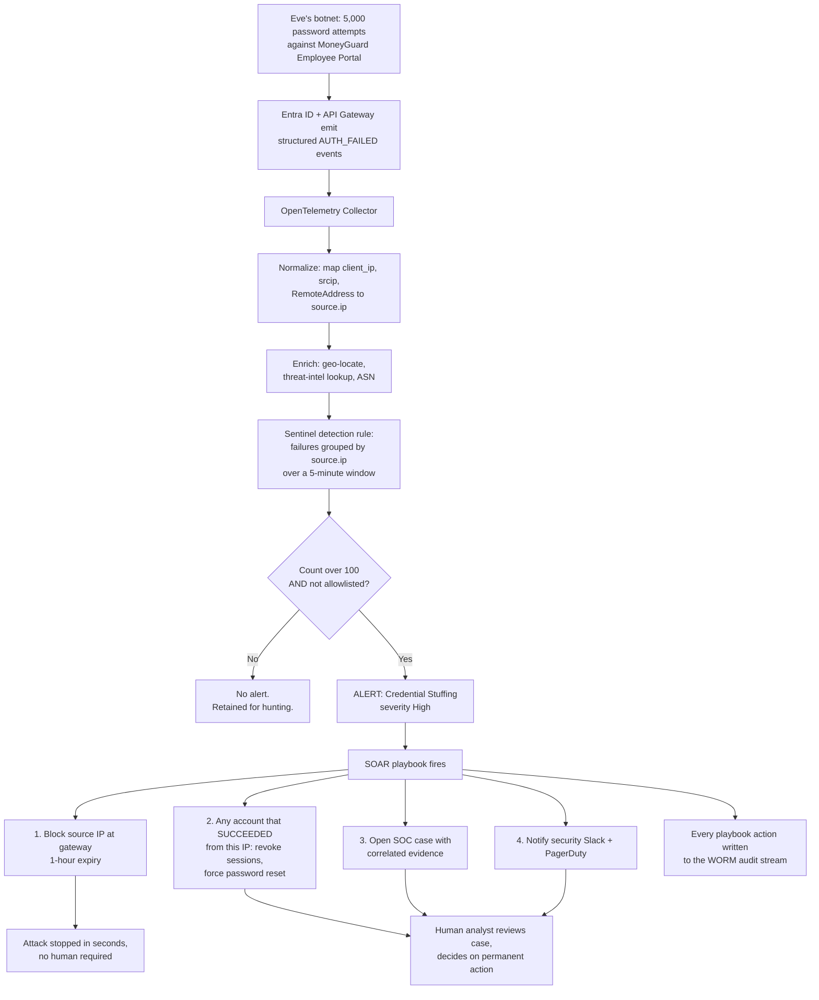

# SIEM and Threat Detection

## Overview

Chapter 3 got clean, structured, sanitized telemetry out of every MoneyGuard service. This chapter is about the brain that consumes it. A **SIEM** — Security Information and Event Management — is the central platform that ingests security telemetry from everywhere, correlates it, detects attack patterns, alerts humans, and increasingly responds automatically.

The core insight is that **individual log lines are almost never suspicious; patterns are.** One failed login is a typo. Five hundred failed logins from one IP address in sixty seconds is credential stuffing. One successful login from London is normal. A successful login from London five minutes after one from Singapore is impossible travel. A SIEM's job is to see the pattern that no single service can see, because no single service has the whole picture.

🏦 **MoneyGuard scenario:** MoneyGuard's SOC runs a SIEM called **Sentinel**. At 03:41 on a Sunday, Sentinel notices that a service account belonging to the **Fraud Detection Pipeline** — which has never in its life made a call outside the Kubernetes cluster — just authenticated from a residential IP address in another country and requested a token for the **Core Banking Ledger**. No individual service saw anything wrong: the credentials were valid, the token was well-formed, the authorization check passed. Only Sentinel, holding the behavioural baseline, could tell that this was Eve.

## Why This Matters

- **Attacks are cross-system by nature.** Eve phishes a credential (identity provider), logs in (portal), escalates (role change), and exfiltrates (ledger API). Four systems, four sets of logs, one attack. Only a SIEM connects them.
- **Detection speed determines damage.** Industry breach reports consistently show attackers dwelling in networks for weeks or months. Every hour of dwell time is more data taken.
- **Compliance requires it.** PCI-DSS, SOX, and most banking supervisory regimes require centralized log review and alerting — a documented detection capability, not just retained logs.
- **Humans cannot watch 50 dashboards.** The SOC needs one queue of ranked, actionable alerts, not fifty consoles.
- **Automated response beats human response on speed.** A credential-stuffing botnet can be blocked in seconds by a playbook and in twenty minutes by a human. Twenty minutes is thousands of attempts.

## Key Concepts

- **SIEM** — Security Information and Event Management. Centralizes, correlates, detects, and alerts on security telemetry. Examples: Splunk, Microsoft Sentinel, Elastic Security, Datadog Cloud SIEM, Chronicle.
- **SOC** — Security Operations Centre. The team that operates the SIEM and responds to alerts.
- **Detection rule** — a query that runs continuously and fires an alert when its condition matches.
- **Correlation** — joining events across sources to identify a pattern no single source reveals.
- **UEBA** — User and Entity Behaviour Analytics. Baselines normal behaviour per identity and flags deviations.
- **SOAR** — Security Orchestration, Automation and Response. Playbooks that act automatically on an alert.
- **Playbook** — an automated response workflow: block the IP, revoke the token, open a ticket, page on-call.
- **True/false positive, true/false negative** — the four detection outcomes. False negatives are missed attacks; false positives cause alert fatigue.
- **Alert fatigue** — when so many low-quality alerts fire that analysts stop reading them. The main cause of missed breaches.
- **MITRE ATT&CK** — an industry-standard catalogue of adversary techniques, used to organize and measure detection coverage.
- **Dwell time** — how long an attacker is present before detection.
- **Hot / cold storage** — fast, expensive searchable storage versus cheap archive.
- **Ingest pipeline** — collection, normalization, and enrichment before the data is queryable.

## Detailed Notes

### Concept 1 — Why not just a database?

A common interview question is "why can't we store logs in PostgreSQL and query them?" Two reasons.

**Scale and search shape.** A SIEM is a write-once, read-many system built to index billions of events per day and return full-text and time-range queries in seconds. A relational database optimized for transactional workloads will not do that, and if you try to run a security investigation on it *while the attack is happening*, your queries queue behind production traffic and you lose the race.

**Purpose-built capability.** A SIEM brings things a database doesn't: continuously-running detection rules, correlation across heterogeneous sources, behavioural baselining, threat-intelligence enrichment, alert lifecycle and case management, tiered hot/cold retention, and immutability guarantees for the evidentiary chain.

### Concept 2 — The pipeline: collect, normalize, enrich, detect, respond

```
Sources → Collector → Normalization → Enrichment → Detection → Alert → Response
```

- **Collect.** MoneyGuard uses an **OpenTelemetry Collector** to gather from the API Gateway, policy engine, Entra ID sign-in logs, AD domain controllers, the Core Banking Ledger, Kubernetes audit logs, and network devices. One agent, one protocol, rather than fifty bespoke forwarders.
- **Normalize.** Every source names things differently — `srcip`, `client_ip`, `RemoteAddress`, `source.ip`. Normalization maps them into one schema (OCSF or the vendor's common information model) so a single rule can query across all sources. **Without normalization, correlation is impossible**, and this is where most SIEM projects actually fail.
- **Enrich.** Add context the raw event lacks: geolocate the IP, look it up in threat-intelligence feeds, attach the user's department and manager from Workday, mark whether the asset is production, attach the `tenant_id`'s customer name.
- **Detect.** Run rules and analytics continuously against the stream.
- **Respond.** Alert a human, or trigger a SOAR playbook, or both.

### Concept 3 — Three kinds of detection

| Type | How it works | Good at | Weak at | MoneyGuard example |
|---|---|---|---|---|
| **Signature / rule-based** | A fixed query: "more than 100 failed logins from one IP in 5 minutes" | Known attack patterns; explainable; tunable | Novel attacks; attackers who stay under the threshold | Credential stuffing detection |
| **Behavioural / UEBA** | Baselines normal per-identity behaviour, flags deviations | Insider threat, compromised accounts, novel techniques | Needs weeks of baseline; harder to explain; noisier | A service account that suddenly calls an API it has never called |
| **Threat intelligence** | Matches observed indicators against known-bad lists | Known malicious IPs, domains, hashes | Only ever catches what's already known | Login from a known botnet IP |

The three are complementary and a real SOC runs all of them. Rules give precise, explainable coverage of known techniques; UEBA covers the unknown; threat intel is cheap high-confidence signal.

💡 **MITRE ATT&CK** is how mature teams measure coverage. Map each detection rule to the technique it covers (e.g. T1110.004 Credential Stuffing, T1078 Valid Accounts) and the gaps become visible on a matrix — which turns "do we have good detection?" from an opinion into a picture.

### Concept 4 — The identity detections that matter most

For an IAM-focused SOC, this is the core rule set:

1. **Credential stuffing / password spraying.** Many failed authentications across many accounts from one source, or one password tried against many accounts. Distinguish the two: stuffing is many passwords against few accounts; spraying is few passwords against many accounts and evades per-account lockout.
2. **Impossible travel.** Two successful authentications for one subject from locations too far apart for the elapsed time. Must account for VPNs and cloud egress, or it produces endless false positives.
3. **Token replay / shared `jti`.** The same `jti` used from two distinct source IPs or ASNs. This is a very high-fidelity signal — a token is meant to be used by one client — and it's only possible because Chapter 3 logs `jti`.
4. **Privilege escalation.** A role grant that adds administrative capability, especially outside change windows, especially self-granted.
5. **Dormant account awakening.** An account unused for 90 days suddenly authenticating — the classic sign of a compromised or improperly-retained account.
6. **Service account anomaly.** A non-human identity calling an API it has never called, from an IP outside its normal range, or at an unusual hour. Machine identities have *tight* baselines, which makes them excellent detection targets.
7. **MFA fatigue / push bombing.** Many MFA prompts to one user in a short window, followed by an approval.
8. **Cross-tenant access attempts.** In the Business Banking SaaS Portal, a burst of 404s or 403s from one tenant probing another tenant's resource IDs.
9. **Fail-closed denial spikes.** From Chapter 1 — a sudden rise in `FAIL_CLOSED` outcomes means a dependency is down, and it may mean Eve is deliberately breaking it.
10. **Audit log gaps.** A service that normally emits 10,000 audit events an hour emitting zero. Silence is a detection.

⚠️ Number 10 is the one teams forget. An attacker's first move after gaining access is often to stop the logging. **Detect the absence of expected telemetry**, not just the presence of bad telemetry.

### Concept 5 — Writing a good detection rule

A rule has five parts: **what** it looks for, **the threshold**, **the time window**, **the exclusions**, and **the response**.

The hard part is the threshold. Set it too low and you drown the SOC in false positives — which is worse than having no rule, because alert fatigue causes real alerts to be ignored. Set it too high and you miss the attack. The practical method:

1. **Run the rule in "audit mode"** against historical data for two weeks. Count how often it would have fired.
2. **Investigate every hit.** If they're all legitimate, the threshold or the logic is wrong.
3. **Add exclusions deliberately and document them.** Excluding the corporate VPN egress from impossible-travel is correct. Excluding "all service accounts" because they're noisy is how breaches happen.
4. **Set a fires-per-day budget.** A rule that fires more than a handful of times a day must either be tuned, auto-triaged, or downgraded from an alert to a dashboard signal.
5. **Review quarterly.** Infrastructure changes; a rule tuned a year ago may now be silent or screaming.

### Concept 6 — SOAR: automated response

Detection without response is just expensive observation. A **SOAR playbook** acts on an alert automatically.

For credential stuffing, MoneyGuard's playbook does this without a human:
1. Confirm the source IP isn't on the corporate allowlist.
2. Call the API Gateway's block-IP endpoint with a 1-hour expiry.
3. Force a password reset and session revocation for any account that *succeeded* from that IP.
4. Open a case in the SOC queue with all correlated evidence attached.
5. Post to the security Slack channel.

The risk is obvious and must be designed for: **an automated response is an attacker-triggerable action.** If Eve can make the playbook block an IP, she can spoof traffic to get MoneyGuard's own payment processor blocked — a denial-of-service delivered through your security tooling. Controls:
- **Never auto-block allowlisted infrastructure** (corporate ranges, partner banks, payment processors).
- **Prefer reversible, time-boxed actions.** A one-hour block, not a permanent one.
- **Escalate impact gradually:** rate-limit → require step-up MFA → block.
- **Require human approval for high-impact actions** — disabling an account, revoking a production service identity.
- **Log every playbook action to the audit stream.** Automation is an actor and needs an audit trail like any other.

### Concept 7 — Retention, cost, and the hot/cold split

SIEM licensing is usually priced on ingest volume, so the instinct to "log everything forever" is financially fatal and increases breach impact.

The standard tiering:

| Tier | Duration | Purpose | Cost |
|---|---|---|---|
| **Hot** | 30–90 days | Active investigation, live detection rules | Highest |
| **Warm** | 90 days – 1 year | Slower search for retrospective hunting | Medium |
| **Cold / archive** | 1–7 years | Compliance retention, rehydrated on demand | Lowest (e.g. S3 Glacier) |

Reduce volume at the source with **filtering** (drop health-check and readiness-probe logs — they are enormous and worthless) and **sampling** (keep 1% of successful, uninteresting requests but **100% of every security-relevant event**). The rule is simple: never sample authentication, authorization, or audit events. Sample debug noise.

### Concept 8 — Detection engineering as a discipline

Mature teams treat detections as software:

- **Rules live in Git**, reviewed by pull request, deployed by CI/CD — the same way [Module 10](../10_IaC_And_Deployment_Security/README.md) treats identity infrastructure.
- **Every rule has a test** with sample events that must fire it and sample events that must not.
- **Purple teaming:** the red team executes a technique, and the measure of success is whether the detection fired and how quickly. This produces real coverage numbers rather than assumed ones.
- **Metrics that matter:** mean time to detect, mean time to respond, false-positive rate per rule, and ATT&CK coverage.

## Workflow

Detecting and stopping a credential-stuffing attack, end to end:



## Architecture Diagram

```mermaid
graph TB
    subgraph "Telemetry sources"
        ENTRA[MoneyGuard Entra ID<br/>sign-in logs]
        AD[MoneyGuard AD<br/>domain controllers]
        GW[API Gateway<br/>access + authz logs]
        PDP[Policy Engine<br/>decision logs]
        LEDGER[Core Banking Ledger<br/>audit events]
        BBSP[Business Banking SaaS Portal<br/>tenant-tagged events]
        K8S[Kubernetes audit<br/>Fraud Detection Pipeline]
    end

    ENTRA --> OT[OpenTelemetry Collector]
    AD --> OT
    GW --> OT
    PDP --> OT
    LEDGER --> OT
    BBSP --> OT
    K8S --> OT

    OT --> NORM[Normalization<br/>common schema OCSF]
    NORM --> ENR[Enrichment<br/>geo-IP, threat intel,<br/>Workday org data, asset criticality]

    ENR --> SIEM[SOC / SIEM "Sentinel"]

    SIEM --> R1[Rule engine<br/>signature detections]
    SIEM --> R2[UEBA<br/>behavioural baselines]
    SIEM --> R3[Threat-intel matching]

    R1 --> Q[Alert queue<br/>ranked by severity]
    R2 --> Q
    R3 --> Q

    Q --> SOAR[SOAR playbooks]
    Q --> ANALYST[SOC analyst<br/>triage + investigation]

    SOAR -->|block IP| GW
    SOAR -->|blocklist jti| REDIS[(Redis revocation<br/>blocklist)]
    SOAR -->|disable account<br/>HUMAN APPROVAL REQUIRED| ENTRA
    SOAR --> TICKET[Case management]

    SIEM --> HOT[(Hot: 30-90 days)]
    HOT --> COLD[(Cold archive: 1-7 years<br/>compliance retention)]
    SOAR --> WORM[(WORM audit stream:<br/>every automated action recorded)]
```

## Step-by-Step Process

Standing up identity threat detection at MoneyGuard:

1. **Inventory the sources.** List every system that emits identity-relevant telemetry: Entra ID, AD, the gateway, the policy engine, the ledger, the SaaS portal, Kubernetes. Missing sources are permanent blind spots.
2. **Standardize the event schema** (Chapter 3) so normalization is trivial rather than a mapping project per source.
3. **Deploy one collector**, not one agent per vendor.
4. **Normalize into a common information model** — this is the step that makes cross-source correlation possible at all.
5. **Enrich** with geo-IP, threat intelligence, organizational data from Workday, and asset criticality.
6. **Start with the ten identity detections** from Concept 4. Don't try to boil the ocean; get high-value coverage first.
7. **Tune in audit mode for two weeks** before any rule is allowed to page a human.
8. **Map every rule to MITRE ATT&CK** and publish the coverage matrix.
9. **Write playbooks for the high-confidence, low-risk responses first** — IP blocking and token revocation before account disabling.
10. **Add guardrails to automation:** allowlists, time-boxed actions, human approval for high impact, and full audit logging of playbook actions.
11. **Build the detection-of-absence rule:** alert when an expected log source goes quiet.
12. **Set retention tiers** and filter health checks out at the collector to control cost.
13. **Store rules in Git** with tests, reviewed by pull request.
14. **Purple team quarterly.** Execute the technique, measure whether detection fired and how fast.
15. **Review the metrics monthly:** MTTD, MTTR, false-positive rate per rule, coverage gaps.

## Commands and Examples

**Credential stuffing detection (Microsoft Sentinel / KQL).**

```kusto
// MoneyGuard: credential stuffing against the Employee Portal.
// Maps to MITRE ATT&CK T1110.004 (Credential Stuffing).
SigninLogs
| where TimeGenerated > ago(5m)
| where ResultType == "50126"                    // invalid username or password
| where AppDisplayName == "MoneyGuard Employee Portal"
// Exclusions are deliberate and documented, never "all service accounts".
| where IPAddress !in (_GetWatchlist('MoneyGuardCorporateEgress') | project IPAddress)
| summarize
    FailedAttempts   = count(),
    TargetedAccounts = dcount(UserPrincipalName),
    FirstSeen        = min(TimeGenerated),
    LastSeen         = max(TimeGenerated),
    SampleAccounts   = make_set(UserPrincipalName, 10)
  by IPAddress, Location = tostring(LocationDetails.countryOrRegion)
| where FailedAttempts > 100 and TargetedAccounts > 20
| extend Severity = iff(FailedAttempts > 1000, "High", "Medium")
| project FirstSeen, LastSeen, IPAddress, Location,
          FailedAttempts, TargetedAccounts, SampleAccounts, Severity
```

**Token replay: the same `jti` from two different networks — a very high-fidelity signal.**

```kusto
// This detection is ONLY possible because we log jti (Chapter 3).
// A token is meant to be used by ONE client. Two ASNs means it was copied.
// MITRE ATT&CK T1550.001 (Application Access Token).
MoneyGuardApiAccess
| where TimeGenerated > ago(15m)
| where isnotempty(Jti)
| summarize
    DistinctIPs  = dcount(SourceIp),
    DistinctASNs = dcount(SourceAsn),
    IPs          = make_set(SourceIp, 5),
    Countries    = make_set(SourceCountry, 5),
    Requests     = count()
  by Jti, Subject
| where DistinctASNs > 1                          // ASN, not IP - mobile users roam
| project Jti, Subject, DistinctIPs, DistinctASNs, IPs, Countries, Requests
| extend Severity = "Critical",
         Response = "Add Jti to Redis blocklist immediately; force re-auth for Subject"
```

**Impossible travel (Splunk SPL).**

```
index=moneyguard_auth event_type="AUTH_SUCCESS"
| iplocation source_ip
| streamstats current=f last(lat) as prev_lat last(lon) as prev_lon
              last(_time) as prev_time by subject
| eval distance_km = round(haversine(prev_lat, prev_lon, lat, lon), 0)
| eval hours_elapsed = (_time - prev_time) / 3600
| eval implied_kmh = distance_km / hours_elapsed
| where distance_km > 500 AND implied_kmh > 900          /* faster than a jet */
| search NOT source_ip IN (corporate_vpn_egress)          /* documented exclusion */
| table _time, subject, prev_lat, prev_lon, lat, lon, distance_km, implied_kmh
```

**Service account anomaly — the 03:41 Sunday detection.**

```kusto
// The Fraud Detection Pipeline's identity has a VERY tight baseline:
// it only ever calls two APIs, only from inside the cluster CIDR.
// Machine identities are the best UEBA targets precisely because they are boring.
let Baseline = MoneyGuardApiAccess
    | where TimeGenerated between (ago(30d) .. ago(1d))
    | where SubjectType == "machine"
    | summarize KnownApis = make_set(TargetApi), KnownCidrs = make_set(SourceCidr)
      by Subject;
MoneyGuardApiAccess
| where TimeGenerated > ago(10m)
| where SubjectType == "machine"
| join kind=inner Baseline on Subject
| where TargetApi !in (KnownApis) or SourceCidr !in (KnownCidrs)
| project TimeGenerated, Subject, TargetApi, SourceIp, SourceCidr, KnownApis, KnownCidrs
| extend Severity = "Critical",
         Note = "Non-human identity deviating from a 30-day baseline"
```

**Cross-tenant probing in the Business Banking SaaS Portal.**

```kusto
// Chapter 08: another tenant's resource returns 404, not 403.
// A burst of 404s on UUID lookups from one tenant = enumeration.
MoneyGuardApiAccess
| where TimeGenerated > ago(10m)
| where HttpStatus == 404 and Path startswith "/api/invoices/"
| summarize NotFoundCount = count(), DistinctIds = dcount(ResourceId)
  by Subject, TenantId
| where NotFoundCount > 50 and DistinctIds > 50
| extend Severity = "High",
         Note = "Possible IDOR enumeration; RLS is holding but the account may be compromised"
```

**Detection of absence — the rule teams forget.**

```kusto
// An attacker's first move is often to stop the logging.
// Alert when an expected source goes quiet.
let Expected = dynamic(["api-gateway","policy-engine","core-banking-ledger",
                        "business-banking-portal","fraud-detection-pipeline"]);
let Seen = MoneyGuardAuditLog
    | where TimeGenerated > ago(15m)
    | summarize Events = count() by Service;
print Service = Expected
| mv-expand Service to typeof(string)
| join kind=leftouter Seen on Service
| where isnull(Events) or Events == 0
| extend Severity = "High",
         Note = "Expected audit telemetry absent - possible tampering or outage"
```

**A SOAR playbook with guardrails (pseudocode).**

```python
def on_credential_stuffing_alert(alert):
    ip = alert.source_ip

    # GUARDRAIL 1: never auto-block our own or a partner's infrastructure.
    # Without this, Eve spoofs traffic to make us block our payment processor.
    if ip in ALLOWLIST_CORPORATE or ip in ALLOWLIST_PARTNERS:
        return escalate_to_human(alert, reason="allowlisted source")

    # GUARDRAIL 2: reversible and time-boxed. Never a permanent block.
    gateway.block_ip(ip, ttl=timedelta(hours=1), reason=alert.id)

    # Any account that SUCCEEDED from this IP is presumed compromised.
    for account in alert.successful_logins_from(ip):
        identity.revoke_all_sessions(account)          # low risk, reversible
        identity.force_password_reset(account)
        # GUARDRAIL 3: disabling an account is high impact -> human approves.
        soc.request_approval(f"Disable {account}?", context=alert)

    case = soc.open_case(alert, evidence=alert.correlated_events)
    slack.post("#security-alerts", case.summary)

    # GUARDRAIL 4: automation is an actor. Audit it like one.
    audit.write(actor="soar:credential-stuffing-playbook",
                action="block_ip", resource=ip,
                result="success", correlation_id=alert.id)
```

## Best Practices

- **Normalize before you detect.** Cross-source correlation is impossible without a common schema, and this is where most SIEM programmes stall.
- **Start with the ten identity detections** rather than attempting full coverage on day one.
- **Tune every rule in audit mode for two weeks** before it is permitted to page anyone.
- **Budget alerts per rule per day.** A noisy rule must be tuned, auto-triaged, or demoted to a dashboard.
- **Document every exclusion** with a reason and an owner. Undocumented exclusions become permanent blind spots.
- **Map rules to MITRE ATT&CK** so coverage is measurable rather than assumed.
- **Detect absence as well as presence.** A silent log source is an alert.
- **Automate the reversible, escalate the irreversible.** Time-boxed IP blocks automatically; account disabling with human approval.
- **Allowlist critical infrastructure** from any automated blocking action.
- **Audit every playbook action** into the WORM stream — automation is an actor.
- **Never sample security events.** Sample debug noise; keep 100% of auth, authz, and audit.
- **Filter health checks at the collector.** They are the largest and least useful volume in most estates.
- **Keep detections in Git** with tests, reviewed by pull request and deployed by CI.
- **Purple team quarterly** and measure MTTD, not just whether a rule exists.

## Common Mistakes

- ⚠️ **Alert fatigue from untuned rules.** The most common and most damaging failure. Analysts stop reading, and the real alert dies in the queue.
- ⚠️ **Ingesting everything to "be safe."** Costs explode, search slows, and the signal drowns.
- ⚠️ **Skipping normalization** and writing per-source rules, which multiplies maintenance and makes correlation impossible.
- ⚠️ **Excluding all service accounts because they're noisy.** Machine identities are prime targets *and* the easiest to baseline — this exclusion throws away your best detections.
- ⚠️ **Detection without response.** An alert nobody can act on within minutes is expensive observation.
- ⚠️ **Automated blocking with no allowlist**, giving Eve a denial-of-service lever through your own tooling.
- ⚠️ **Permanent automated actions.** A permanent block from a false positive is an outage you'll spend hours unwinding.
- ⚠️ **Not detecting missing logs.** Attackers disable logging early; silence must be an alert.
- ⚠️ **Rules maintained by hand in the SIEM console.** No review, no history, no tests, no rollback.
- ⚠️ **Impossible-travel rules with no VPN handling.** They generate constant false positives and get switched off, taking a genuinely useful detection with them.
- ⚠️ **Sampling authentication events** to save money. You will discover the gap during an investigation.
- ⚠️ **No `tenant_id` on events.** In the Business Banking SaaS Portal, an investigation then has to touch every tenant's data — slow, and a confidentiality problem of its own.

## Pro Tips

- 💡 **The `jti` replay detection is the highest-value, lowest-effort identity rule you can write.** A token used from two ASNs is almost never legitimate, and false positives are rare. It exists only because Chapter 3 logs `jti`.
- 💡 **Group by ASN, not IP, for travel and replay rules.** Mobile users change IP constantly within one network; changing ASN mid-session is the real signal.
- 💡 **Machine identities make the best UEBA subjects.** A human's behaviour is genuinely variable; the Fraud Detection Pipeline calls the same two APIs from the same CIDR forever. Deviation is nearly always real.
- 💡 **Write the response before the rule.** If you can't say what an analyst should do when it fires, the rule isn't ready.
- 💡 **Attach the correlation ID to every alert** so the analyst can pivot straight to the full request trace from Chapter 3.
- 💡 **Track "time from event to alert" separately from "time from alert to response."** They have completely different fixes — the first is a pipeline problem, the second is a process problem.
- 💡 **Interview move:** say *"individual events are rarely suspicious; patterns are — the SIEM's value is correlation across sources no single service can see, and detection is only useful if it's tuned enough that humans still read the alerts."*

## Real-World Use Cases

- **The 03:41 service account.** The Fraud Detection Pipeline's identity authenticates from a residential IP in another country and requests a Core Banking Ledger token. Every individual check passed — valid credentials, well-formed token, authorized role. Only Sentinel's 30-day behavioural baseline caught it. The playbook revoked the workload's tokens and paged the on-call. Eve had obtained a leaked Kubernetes service-account token from a misconfigured CI log.
- **Credential stuffing at scale.** Eve's botnet runs 5,000 attempts against the Employee Portal. Sentinel's rule fires after roughly 100 failures from the first IP; the playbook blocks it within seconds, and as the botnet rotates addresses each new one is blocked in turn. Two accounts that did succeed have their sessions revoked and passwords reset automatically. Total human involvement: reviewing the case afterwards.
- **The stolen token.** Priya's JWT is exfiltrated by a malicious browser extension. Ten minutes later the same `jti` appears from a different ASN. The replay rule fires at Critical, the playbook adds the `jti` to the Redis blocklist, and the token is dead globally in about a second — well inside its 15-minute lifetime.
- **Privilege escalation on a Saturday.** A compromised account grants itself the `ledger_admin` role at 22:10 on a Saturday. The rule fires because the change is self-granted, outside the change window, and adds administrative capability. Because disabling an account is high-impact, the playbook requests human approval rather than acting — and the on-call approves within four minutes.
- **Silence from the ledger.** The Core Banking Ledger's audit stream goes to zero events for fifteen minutes. The detection-of-absence rule fires. It turns out to be a misconfigured collector deployment rather than an attack — but it was found in fifteen minutes rather than being discovered during Dana Cole's next audit.
- **Globex probing Acme.** A compromised Globex Inc account in the Business Banking SaaS Portal iterates through invoice UUIDs. Row-Level Security holds, so every response is a 404 — and the burst of 404s is exactly what the enumeration rule detects. The account is suspended and Globex is notified.

## Key Takeaways

1. **A SIEM correlates telemetry across systems** to see attacks no single service can see. Individual events are rarely suspicious; patterns are.
2. **Pipeline:** collect → normalize → enrich → detect → respond. **Normalization is the make-or-break step.**
3. **Three detection types:** signature rules (known patterns), UEBA (behavioural deviation), threat intelligence (known-bad indicators). Run all three.
4. **Ten core identity detections**, including credential stuffing, impossible travel, `jti` replay, service-account anomaly, and privilege escalation.
5. **Detect absence as well as presence** — attackers disable logging first.
6. **Alert fatigue is the primary cause of missed breaches.** Tune in audit mode, budget alerts per day, document every exclusion.
7. **SOAR playbooks respond in seconds** where humans take minutes — but every automated action needs allowlists, time-boxing, escalation for high impact, and its own audit trail.
8. **Machine identities are the best UEBA targets** because their baselines are extremely tight.
9. **Tier retention** — 30–90 days hot, then cold archive — and never sample security events.
10. **Treat detections as code:** Git, tests, pull-request review, CI deployment, quarterly purple teaming.
11. **Map to MITRE ATT&CK** so coverage is measurable rather than asserted.

## Glossary

| Term | Meaning |
|---|---|
| **SIEM** | Security Information and Event Management — the central platform for security telemetry, detection, and alerting. |
| **SOC** | Security Operations Centre — the team that runs the SIEM and responds. |
| **SOAR** | Security Orchestration, Automation and Response — automated response playbooks. |
| **Playbook** | An automated response workflow triggered by an alert. |
| **Detection rule** | A continuously-running query that fires an alert when its condition matches. |
| **Correlation** | Joining events across sources to reveal a pattern no single source shows. |
| **UEBA** | User and Entity Behaviour Analytics — baselining normal behaviour and flagging deviation. |
| **Threat intelligence** | Feeds of known-malicious indicators (IPs, domains, hashes). |
| **Normalization** | Mapping differently-named fields from many sources into one common schema. |
| **Enrichment** | Adding context (geo-IP, org data, threat intel) to raw events. |
| **False positive** | An alert that turns out to be benign. |
| **False negative** | A real attack that produced no alert. |
| **Alert fatigue** | Analysts ignoring alerts because too many are low-quality. |
| **MITRE ATT&CK** | Industry catalogue of adversary techniques, used to measure detection coverage. |
| **Dwell time** | How long an attacker is present before being detected. |
| **MTTD / MTTR** | Mean Time To Detect / Mean Time To Respond. |
| **Credential stuffing** | Trying many stolen password pairs against accounts. |
| **Password spraying** | Trying a few common passwords across many accounts to evade lockout. |
| **Impossible travel** | Two authentications from locations too far apart for the elapsed time. |
| **Token replay** | Reusing a stolen token from a different client or network. |
| **Purple teaming** | Red team executes a technique; blue team measures whether detection fired. |
| **Hot / cold storage** | Fast expensive searchable storage vs. cheap archive. |

## Revision Notes

- **SIEM value = correlation.** One failed login is a typo; 500 from one IP is an attack.
- **Pipeline:** collect → **normalize** → enrich → detect → respond. Normalization is where projects fail.
- **Detection types:** signature (known), UEBA (behavioural), threat intel (known-bad). Use all three.
- **Top identity detections:** credential stuffing, password spraying, impossible travel, **`jti` replay**, privilege escalation, dormant account waking, service-account anomaly, MFA fatigue, cross-tenant probing, fail-closed spikes, **absence of logs**.
- **`jti` replay = highest fidelity, lowest effort.** Group by **ASN**, not IP.
- **Machine identities = best UEBA targets** (tight baselines).
- **Alert fatigue is the number-one failure mode.** Tune in audit mode ~2 weeks; budget alerts/day; document exclusions.
- **SOAR guardrails:** allowlist critical infra, time-box actions, escalate irreversible ones to a human, audit every action.
- **Retention:** 30–90 days hot → cold archive 1–7 years. **Never sample auth/authz/audit.** Filter health checks.
- **Detections as code:** Git + tests + PR review + CI. Purple team quarterly. Measure **MTTD/MTTR**.
- **Map to MITRE ATT&CK** for measurable coverage.

## Interview Questions

**Q1. What does a SIEM give you that a log database doesn't?**
A: Three things. Scale and search shape — it's a write-once, read-many system indexing billions of events a day and returning time-range and full-text queries in seconds, whereas a transactional database will queue your investigation behind production traffic exactly when you're racing an active attacker. Purpose-built detection — continuously running rules, cross-source correlation, behavioural baselining, and threat-intel enrichment, none of which a database does. And operational capability — alert lifecycle and case management, tiered hot/cold retention, and immutability guarantees for the evidentiary chain. The deeper point is that a SIEM's value is correlation across sources: no single service can see that a login, a role change, and an API call are one attack.

**Q2. Design a detection for credential stuffing.**
A: Aggregate authentication failures over a five-minute window, grouped by source IP, and alert when the count exceeds a tuned threshold *and* the number of distinct targeted accounts is high — that second condition is what separates stuffing from one person fumbling their own password. I'd exclude documented corporate egress ranges via a watchlist, not by excluding whole account classes. Then I'd run it in audit mode for two weeks against historical data, investigate every would-be hit, and tune the threshold to a sustainable alerts-per-day budget. I'd pair it with a spraying detection — few passwords across many accounts, which evades per-account lockout and needs grouping by password-hash or by account count rather than by IP volume. And the rule ships with its response playbook, because a detection with no defined action isn't finished.

**Q3. What's the single highest-value identity detection you'd build first, and why?**
A: Token replay — the same `jti` observed from two different ASNs within a short window. It's extremely high fidelity, because a token is meant to be used by exactly one client, so a genuine false positive is rare; grouping by ASN rather than IP handles mobile users roaming. It catches a serious attack — a stolen live credential — that every individual service will happily accept, because the signature is valid and the authorization check passes. And it's cheap: it needs only the `jti` claim in the access log and a fifteen-minute aggregation. The response is equally clean: add the `jti` to the revocation blocklist and force re-authentication, which kills the token globally in about a second.

**Q4. How do you avoid alert fatigue?**
A: Treat it as the primary failure mode, because analysts who stop reading alerts are functionally the same as having no detection. Concretely: run every new rule in audit mode against historical data for two weeks and investigate every hit before it's allowed to page anyone; set an explicit alerts-per-day budget per rule, and if a rule exceeds it, tune it, auto-triage it, or demote it from a page to a dashboard signal; document every exclusion with a reason and an owner so exclusions don't quietly become blind spots; and review rules quarterly, since infrastructure changes make a well-tuned rule either silent or screaming within a year. I'd also track false-positive rate per rule as a first-class metric, so noisy rules are visible rather than merely annoying.

**Q5. What are the risks of automated response, and how do you manage them?**
A: The core risk is that an automated response is an attacker-triggerable action: if Eve can make a playbook block an IP, she can spoof traffic to get your own payment processor or a partner bank blocked — a denial of service delivered through your security tooling. Four guardrails. Allowlist critical infrastructure so it can never be auto-blocked. Prefer reversible, time-boxed actions — a one-hour block rather than a permanent one. Escalate impact gradually: rate-limit, then require step-up MFA, then block. And require human approval for irreversible or high-impact actions like disabling an account or revoking a production workload identity. Finally, every playbook action goes into the WORM audit stream, because automation is an actor and needs an audit trail like any other.

**Q6. Why are service accounts particularly good detection targets?**
A: Because their behaviour is boring, and boring means a tight baseline. A human's activity legitimately varies — different hours, different devices, travel, new projects — so behavioural detections on humans are inherently noisy. The Fraud Detection Pipeline's identity calls the same two APIs from the same cluster CIDR at the same cadence, month after month. Any deviation — a new target API, a source outside the cluster, an unusual hour — is almost certainly real. They're also high-value targets, because machine credentials are often long-lived, over-privileged, and leak through CI logs and config files. So the combination of high attractiveness to attackers and low behavioural variance makes them the best return on detection effort in the whole estate.

**Q7. How would you detect that an attacker has turned off your logging?**
A: A detection-of-absence rule. Maintain a list of services expected to emit audit telemetry, and alert when any of them produces zero events over a window that's short relative to its normal volume — for a service that normally emits 10,000 events an hour, fifteen minutes of silence is anomalous. This matters because disabling or redirecting logging is a standard early move for an attacker, and every presence-based detection you own is blind to it by construction. In practice the rule also earns its keep on plain outages: a misconfigured collector deployment gets caught in fifteen minutes rather than at the next audit. I'd also protect the pipeline itself — append-only permissions on the audit stream, and alert on any change to collector configuration.

**Q8. How do you control SIEM cost without creating blind spots?**
A: Filter and tier, but never sample security events. Filter at the collector — health checks and readiness probes are usually the largest volume in the estate and have essentially no investigative value. Sample aggressively on high-volume, low-value application logs, keeping perhaps 1% of successful uninteresting requests. But keep 100% of authentication, authorization, and audit events, because those are precisely the records an investigation depends on, and you discover the gap at the worst possible moment. Then tier retention: 30 to 90 days hot for live detection and active investigation, then warm, then cold archive for the compliance window with rehydration on demand. The framing I'd use is that we're reducing *noise* volume, not *signal* volume.

## Practice Exercises

1. **Write three detections.** For MoneyGuard, write the full query, threshold, time window, documented exclusions, severity, and response action for: (a) password spraying against the Employee Portal, (b) a dormant account waking after 90 days, and (c) MFA push bombing. For each, state which MITRE ATT&CK technique it maps to.

2. **Tune a noisy rule.** MoneyGuard's impossible-travel rule fires 200 times a day, and the SOC has muted it. Diagnose the likely causes, propose four specific changes, and predict the resulting alert volume. Then explain how you'd verify you haven't introduced a false negative.

3. **Design a playbook.** Write the complete SOAR playbook for the `jti` replay detection: every step, every guardrail, which actions are automatic and which require approval, what gets written to the audit stream, and what the analyst sees in the case. Then describe the failure mode if the Redis blocklist is unreachable when the playbook runs.

4. **Map your coverage.** Take the ten identity detections from this chapter, map them onto MITRE ATT&CK, and identify three identity-related techniques MoneyGuard would have *no* coverage for. For each gap, propose the telemetry source you'd need and the rule you'd write.

5. **Investigate the 03:41 alert.** You are the on-call analyst. Sentinel has fired the service-account anomaly for the Fraud Detection Pipeline. Write your investigation runbook: the first five queries you run in order, what each one tells you, the decision point at which you'd escalate, and the three containment actions you'd take — noting for each whether you'd do it yourself or need approval.

---

⬅ Back to [Module 09 Index](./README.md) | 📖 [Main README](../README.md) | 🏦 [The MoneyGuard Story](../SCENARIO.md)

⬅ Previous: [03_Audit_Logging_And_Observability.md](./03_Audit_Logging_And_Observability.md)
