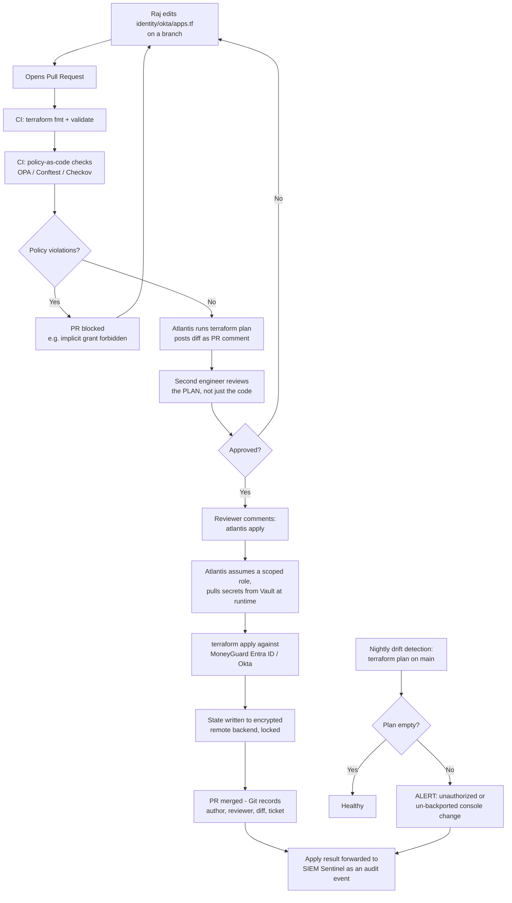

# Infrastructure as Code for Identity

## Overview

**Infrastructure as Code (IaC)** means defining your infrastructure in text files that live in version control, and letting a tool make reality match those files — instead of clicking through a web console. Applied to identity, it means MoneyGuard's OIDC clients, SAML connections, user groups, role definitions, MFA policies, and API scopes are all declared in code, reviewed in pull requests, and applied by automation.

This matters more for identity than for almost anything else, because identity configuration is *security* configuration. A checkbox toggled in an admin console at 4pm on a Friday can disable MFA for 50,000 employees, and nothing records who did it or why.

🏦 **MoneyGuard scenario:** MoneyGuard is onboarding a new corporate client onto the **Business Banking SaaS Portal** and needs a dedicated identity environment: an OIDC application, a set of role definitions, a group, an MFA policy, and API scopes. Doing it by hand takes Raj Patel two days of console clicking, produces no record of what was configured, and will drift from the settings of every other tenant within a month. Doing it as code takes twenty minutes, is reviewed by a second engineer, is identical to every other tenant by construction, and leaves a permanent audit trail in Git.

## Why This Matters

- **Identity config is security config.** An accidentally-disabled MFA policy or an over-broad redirect URI is a vulnerability, not a preference.
- **Console changes have no audit trail worth the name.** "Someone with admin rights changed something" is not evidence Dana Cole can present to an auditor. A Git commit — author, timestamp, diff, reviewer, linked ticket — is.
- **Configuration drift is inevitable without it.** Production and staging diverge, tenant A gets a setting tenant B doesn't, and nobody knows which state is correct.
- **Disaster recovery becomes real.** If your identity provider's configuration exists only in that provider's database, losing it is unrecoverable. If it's in Git, you can rebuild it.
- **Review catches mistakes before they ship.** A pull request showing `mfa_required: true → false` gets caught. The same change in a console does not.
- **It scales.** Onboarding the 200th tenant should cost the same as the second.

## Key Concepts

- **IaC (Infrastructure as Code)** — defining infrastructure in version-controlled files rather than through manual console actions.
- **Declarative** — you describe the *desired end state*; the tool computes how to get there. Contrast with imperative scripting, where you describe the steps.
- **Terraform / OpenTofu** — the dominant declarative IaC tools. OpenTofu is the open-source fork of Terraform after its licence change; the language and workflow are the same.
- **Provider** — a plugin that lets Terraform manage a specific platform's API. There are providers for Okta, Auth0, Azure AD/Entra ID, Keycloak, AWS IAM, and more.
- **Resource** — one managed object, e.g. `okta_app_oauth.business_banking_portal`.
- **State file** — Terraform's record of which real-world objects it manages and their last-known attributes. ⚠️ It contains secrets and must be treated as sensitive.
- **Plan / apply** — `plan` shows what would change; `apply` makes the change. Reviewing the plan is the safety mechanism.
- **Drift** — real-world configuration diverging from the code, usually because someone changed it manually.
- **GitOps** — Git as the single source of truth, with automation reconciling reality to the repository.
- **Atlantis** — a tool that runs `terraform plan` on a pull request and posts the output as a comment, then runs `apply` on a comment command after approval.
- **Module** — a reusable, parameterized package of Terraform resources, e.g. "a standard MoneyGuard tenant."
- **Crossplane** — a Kubernetes-native alternative that manages external infrastructure through Kubernetes custom resources.
- **Policy as Code** — automated guardrails (OPA/Conftest, Sentinel, Checkov) that reject non-compliant configuration before it's applied.

## Detailed Notes

### Concept 1 — Declarative beats imperative for identity

An imperative script says "create this app, then create this group, then assign the group." If it fails halfway, you're left in an unknown state, and running it twice creates duplicates.

A declarative definition says "these resources should exist with these settings." The tool compares desired state to actual state and computes the difference. Running it twice is a no-op — this property is called **idempotence**, and it's what makes IaC safe to run continuously.

For identity this matters enormously, because identity objects are interdependent: an application references a group, the group references a policy, the policy references an authentication method. Terraform builds a dependency graph and orders the operations correctly, and on destruction it reverses that order. Hand-written scripts get this wrong.

### Concept 2 — What identity infrastructure belongs in code

Essentially all of it:

| Category | Examples |
|---|---|
| **Applications / clients** | OIDC clients, SAML service provider connections, redirect URIs, grant types, token lifetimes |
| **Authorization** | API scopes, custom claims, role definitions, group-to-role mappings |
| **Authentication policies** | MFA requirements, password policy, session lifetime, step-up rules, device-trust conditions |
| **Directory structure** | Groups, group rules, attribute schemas, SCIM provisioning connections |
| **Federation** | Identity provider connections (e.g. the PartnerBank SAML federation), attribute mappings |
| **Delegated admin** | Who can administer what within the identity provider itself |
| **Cloud IAM** | AWS IAM roles and policies, Azure RBAC assignments, workload identity federation |

What does **not** belong in code: **the actual humans**. Individual user accounts come from Workday via SCIM (see [Module 05](../05_Identity_Lifecycle_And_SCIM/README.md)), not from Terraform. Managing users in Terraform means a `terraform destroy` typo can delete people, and it fights with the joiner-mover-leaver automation that should own them.

💡 The dividing line: **Terraform owns the containers and rules; the HR-driven lifecycle owns the contents.** Groups and their membership *rules* are code; the members are not.

### Concept 3 — The GitOps workflow

The whole point is that no human has standing write access to production identity configuration. Changes flow through Git.

1. **Raj opens a branch** and edits the `.tf` files.
2. **He opens a pull request.** CI runs `terraform fmt -check`, `terraform validate`, a security scanner, and policy-as-code checks.
3. **Atlantis runs `terraform plan`** automatically and posts the human-readable diff as a PR comment: *"1 to add, 2 to change, 0 to destroy"* with every changed attribute shown.
4. **A second engineer reviews the plan**, not just the code. The plan is what will actually happen.
5. **Approval, then `atlantis apply`** in a comment. Atlantis — not Raj — holds the credentials and applies the change.
6. **The PR is merged**, and Git now records who changed what, when, why, and who approved it.

The security property this produces: **no standing production access for humans.** Raj cannot change MoneyGuard's MFA policy directly, even though he's the IAM administrator. He can only propose a change that someone else approves. That's separation of duties enforced by tooling rather than by policy documents.

⚠️ This only holds if the console's admin permissions are actually locked down. If Raj still has console admin rights "just in case," the entire control is decorative. Break-glass access must be a separate, time-boxed, heavily-alerted path — not everyday permissions.

### Concept 4 — Modules: making the 200th tenant as cheap as the 2nd

MoneyGuard defines a `moneyguard-tenant` Terraform module encapsulating everything a Business Banking client needs: an OIDC application, the standard role set, a group, an MFA policy, and API scopes. Onboarding **Globex Inc** then becomes a handful of lines specifying the name, tier, and region.

The benefits compound:
- **Consistency by construction.** Every tenant gets the same security baseline; drift between tenants becomes impossible rather than merely discouraged.
- **Central improvement.** Hardening the module — say, raising the MFA requirement — applies to every tenant on the next apply.
- **Reviewable change surface.** A one-line module version bump is far easier to review than 200 near-identical resource blocks.

### Concept 5 — State files are sensitive

Terraform's state file records every managed resource and its attributes — **including secrets**. An Okta API token, an OIDC client secret, or a signing key can all end up in state in plaintext.

Rules:
- **Never commit state to Git.** Add `*.tfstate*` to `.gitignore` on day one.
- **Use a remote backend** with encryption at rest, versioning, and access control — S3 with SSE-KMS and versioning, Azure Storage, or Terraform Cloud.
- **Enable state locking** (DynamoDB for S3, native for Azure/Terraform Cloud) so two concurrent applies can't corrupt it.
- **Restrict who can read the backend.** State read access is effectively secret read access.
- **Separate state per environment.** Dev, staging, and production must not share a state file, or a dev mistake can plan changes against production.

### Concept 6 — Policy as Code: guardrails on the guardrails

IaC makes changes reviewable, but humans miss things in review. **Policy as Code** adds automated checks that run in CI and reject non-compliant configuration before it can be applied.

Rules worth enforcing for identity:
- No OIDC client may use the **implicit grant** (deprecated and token-leaking) — authorization code with PKCE only.
- No redirect URI may be a **wildcard** or use plain `http` outside localhost.
- Access token lifetime must not exceed 15 minutes.
- Every application must have an MFA policy attached.
- No `admin` role may be assigned to a group whose membership rule is broader than a named team.
- No resource may be created without an `owner` and `data_classification` tag.

These run as a required CI check. A pull request that violates one cannot be merged, regardless of who approves it.

### Concept 7 — Drift detection

Someone will eventually change something in the console — during an incident, or because they had rights they shouldn't. **Drift detection** is a scheduled `terraform plan` (typically nightly) that runs against production and alerts if the plan is non-empty.

A non-empty nightly plan means one of two things: a legitimate emergency change that must now be back-ported into code, or an unauthorized change that must be investigated. Either way it needs a human. Feeding drift alerts into the SIEM (see [Module 09](../09_Resilience_Observability_And_SIEM/README.md)) makes unauthorized identity configuration changes a *detection*, not a discovery.

### Concept 8 — Crossplane and the Kubernetes-native alternative

**Crossplane** manages external infrastructure through Kubernetes custom resources. Instead of running `terraform apply`, you `kubectl apply` a YAML manifest, and a controller running in the cluster continuously reconciles reality to match it.

| | Terraform / OpenTofu | Crossplane |
|---|---|---|
| **Model** | Run a command to converge | Continuous reconciliation loop |
| **Drift handling** | Detected on the next plan | Corrected automatically and continuously |
| **Interface** | CLI + CI/CD | Kubernetes API + `kubectl` |
| **Provider maturity for IdPs** | Excellent (Okta, Auth0, Entra ID, Keycloak) | Growing, less complete |
| **Best when** | Broad multi-cloud, mature IdP providers, PR-based review | You're already Kubernetes-native and want self-healing |

For MoneyGuard, Terraform is the pragmatic choice for identity provider configuration because the providers are mature; Crossplane is a reasonable choice for the Kubernetes-adjacent infrastructure around the Fraud Detection Pipeline. They coexist.

## Workflow

The GitOps flow for an identity configuration change:



## Architecture Diagram

```mermaid
graph TB
    subgraph "Source of truth"
        GIT[Git repository<br/>moneyguard-identity-infra]
        GIT --- MOD[Modules:<br/>moneyguard-tenant<br/>moneyguard-internal-app]
        GIT --- ENVS[Environments:<br/>dev / staging / production]
    end

    DEV[Raj / Alex] -->|Pull Request only.<br/>No standing prod access.| GIT

    GIT --> CI[CI pipeline<br/>fmt, validate, tfsec, Conftest]
    CI --> ATL[Atlantis<br/>plan on PR, apply on approval]

    VAULT[(HashiCorp Vault /<br/>AWS Secrets Manager)] -->|short-lived creds<br/>injected at runtime| ATL

    ATL --> OKTA[Okta / Entra ID<br/>apps, groups, policies, scopes]
    ATL --> AWS[AWS IAM<br/>roles, policies, OIDC federation]
    ATL --> K8S[Kubernetes RBAC<br/>+ workload identity]

    ATL --> STATE[(Remote state backend<br/>S3 + SSE-KMS + versioning<br/>DynamoDB lock<br/>separate per environment)]

    DRIFT[Nightly drift detection<br/>scheduled terraform plan] --> OKTA
    DRIFT --> ALERT[Alert on non-empty plan]

    ATL --> SIEM[SOC / SIEM "Sentinel"<br/>every apply is an audit event]
    ALERT --> SIEM
    OKTA -->|admin activity logs| SIEM

    SIEM --> DANA[Dana Cole:<br/>who changed what, when,<br/>approved by whom]
```

## Step-by-Step Process

Adopting IaC for MoneyGuard's identity infrastructure:

1. **Create the repository** with a clear layout: `modules/` for reusable packages, `environments/dev|staging|production/` for composition.
2. **Configure remote state per environment**, encrypted, versioned, locked, with tightly restricted read access.
3. **Import what already exists.** Use `terraform import` (or the provider's import blocks) to bring existing production applications under management without recreating them. Do this in read-only stages and verify with an empty plan.
4. **Never store credentials in `.tf` files.** The provider's API token comes from Vault or a secrets manager at runtime (see [Chapter 02](./02_Secrets_Management.md)).
5. **Write the tenant module** encapsulating the standard security baseline.
6. **Add policy-as-code checks** to CI as required status checks.
7. **Deploy Atlantis** (or an equivalent GitOps runner) and give it a scoped service identity — the only identity with production write access.
8. **Revoke standing console admin rights** from humans. Replace with a break-glass path that is time-boxed, requires approval, and alerts the SOC on every use.
9. **Require two-person review** on anything touching authentication policy, admin roles, or federation.
10. **Enable nightly drift detection** and route alerts to the SIEM.
11. **Forward every apply to the SIEM** as an audit event: who, what, when, approved by whom.
12. **Version and tag the modules** so tenants can be upgraded deliberately rather than accidentally.
13. **Test in a real environment.** Apply to staging first; treat `terraform plan` output in staging as the rehearsal for production.
14. **Document the break-glass procedure** and rehearse it, because the day you need it is the day the pipeline is broken.

## Commands and Examples

**An Okta OIDC application for the Business Banking SaaS Portal.**

```hcl
# environments/production/business_banking.tf

terraform {
  required_version = ">= 1.6"
  required_providers {
    okta = { source = "okta/okta", version = "~> 4.9" }   # pin exactly
  }

  backend "s3" {
    bucket         = "moneyguard-tfstate-prod"
    key            = "identity/business-banking.tfstate"
    region         = "us-east-1"
    encrypt        = true
    kms_key_id     = "alias/moneyguard-tfstate"
    dynamodb_table = "moneyguard-tfstate-locks"          # state locking
  }
}

# The API token is NOT here. It is injected at runtime from Vault.
provider "okta" {
  org_name = "moneyguard"
  base_url = "okta.com"
  # api_token sourced from OKTA_API_TOKEN env var, populated by Vault
}

resource "okta_app_oauth" "business_banking_portal" {
  label = "MoneyGuard Business Banking SaaS Portal"
  type  = "web"

  # Authorization Code + PKCE only. Implicit grant is forbidden by policy-as-code.
  grant_types = ["authorization_code", "refresh_token"]
  response_types = ["code"]

  # Exact URIs only - no wildcards, no plain http.
  redirect_uris = [
    "https://business.moneyguard.com/auth/callback",
  ]
  post_logout_redirect_uris = ["https://business.moneyguard.com/signed-out"]

  token_endpoint_auth_method = "private_key_jwt"   # stronger than client_secret
  pkce_required              = true
  refresh_token_rotation     = "ROTATE"
  refresh_token_leeway       = 30

  # Short-lived access tokens bound the revocation gap (Module 09, Ch. 1).
  # Enforced centrally by the policy below.

  lifecycle {
    prevent_destroy = true    # a typo must not delete a production login
  }
}

resource "okta_app_signon_policy_rule" "require_mfa" {
  policy_id  = okta_app_signon_policy.business_banking.id
  name       = "Require phishing-resistant MFA"
  access     = "ALLOW"
  factor_mode = "2FA"

  constraints = [jsonencode({
    knowledge  = { required = true }
    possession = {
      required               = true
      hardwareProtection     = "REQUIRED"   # WebAuthn / FIDO2, not SMS
      phishingResistant      = "REQUIRED"
    }
  })]
}
```

**A reusable tenant module — onboarding Globex Inc in eight lines.**

```hcl
# modules/moneyguard-tenant/variables.tf
variable "tenant_slug"   { type = string }                    # "globex-inc"
variable "display_name"  { type = string }                    # "Globex Inc"
variable "tier"          { type = string, default = "pool" }  # pool | silo
variable "data_region"   { type = string, default = "us-east-1" }

# environments/production/tenants.tf
module "acme_corp" {
  source       = "../../modules/moneyguard-tenant"
  version      = "2.4.0"           # pinned; upgrades are deliberate
  tenant_slug  = "acme-corp"
  display_name = "Acme Corp"
  tier         = "pool"
}

module "globex_inc" {
  source       = "../../modules/moneyguard-tenant"
  version      = "2.4.0"
  tenant_slug  = "globex-inc"
  display_name = "Globex Inc"
  tier         = "pool"
}

module "megafreight" {
  source       = "../../modules/moneyguard-tenant"
  version      = "2.4.0"
  tenant_slug  = "megafreight"
  display_name = "MegaFreight Ltd"
  tier         = "silo"            # dedicated database (Module 08)
  data_region  = "eu-west-1"       # data residency requirement
}
```

**Groups and rules in code — but never the humans in them.**

```hcl
# The GROUP and its RULE are infrastructure. The MEMBERS come from
# Workday via SCIM. Never manage individual users in Terraform:
# a `terraform destroy` typo must not be able to delete Priya.

resource "okta_group" "wire_approvers" {
  name        = "MoneyGuard-Wire-Approvers"
  description = "Staff authorized to approve outbound wire transfers"
}

resource "okta_group_rule" "wire_approvers_rule" {
  name              = "Assign wire approvers from HR attributes"
  status            = "ACTIVE"
  group_assignments = [okta_group.wire_approvers.id]

  # Membership is DERIVED from Workday-sourced attributes, not hand-listed.
  expression_value = <<-EOT
    user.department == "Treasury Operations"
      && user.jobTitle.startsWith("Senior")
      && user.employmentStatus == "ACTIVE"
  EOT
}
```

**A Terraform provider for Auth0, for comparison.**

```hcl
resource "auth0_client" "mobile_app" {
  name                = "MoneyGuard Mobile App"
  app_type            = "native"
  oidc_conformant     = true

  grant_types = ["authorization_code", "refresh_token"]
  callbacks   = ["com.moneyguard.mobile://callback"]

  jwt_configuration {
    lifetime_in_seconds = 900          # 15 minutes - bounds the revocation gap
    alg                 = "RS256"
  }

  refresh_token {
    rotation_type   = "rotating"       # detect replay of a stolen refresh token
    expiration_type = "expiring"
    token_lifetime  = 2592000
  }
}
```

**Policy as code: block dangerous identity configuration in CI (Rego/Conftest).**

```rego
package moneyguard.terraform.identity

import rego.v1

# No implicit grant, ever. It leaks tokens through the browser URL.
deny contains msg if {
    r := input.resource_changes[_]
    r.type == "okta_app_oauth"
    "implicit" in r.change.after.grant_types
    msg := sprintf("%s: implicit grant is forbidden; use authorization_code + PKCE", [r.address])
}

# No wildcard or plaintext redirect URIs.
deny contains msg if {
    r := input.resource_changes[_]
    r.type == "okta_app_oauth"
    uri := r.change.after.redirect_uris[_]
    contains(uri, "*")
    msg := sprintf("%s: wildcard redirect URI %q is forbidden", [r.address, uri])
}

deny contains msg if {
    r := input.resource_changes[_]
    r.type == "okta_app_oauth"
    uri := r.change.after.redirect_uris[_]
    startswith(uri, "http://")
    not startswith(uri, "http://localhost")
    msg := sprintf("%s: plaintext redirect URI %q is forbidden", [r.address, uri])
}

# Access tokens must not outlive 15 minutes (Module 09: bound the revocation gap).
deny contains msg if {
    r := input.resource_changes[_]
    r.type == "auth0_client"
    r.change.after.jwt_configuration[_].lifetime_in_seconds > 900
    msg := sprintf("%s: access token lifetime exceeds 900s", [r.address])
}

# Destroying a production identity application requires an explicit override.
deny contains msg if {
    r := input.resource_changes[_]
    r.type in {"okta_app_oauth", "auth0_client"}
    "delete" in r.change.actions
    not input.variables.allow_identity_destroy.value
    msg := sprintf("%s: deleting a production identity app requires allow_identity_destroy", [r.address])
}
```

**Atlantis configuration: plan on PR, apply only after approval.**

```yaml
# atlantis.yaml
version: 3
automerge: false

projects:
  - name: identity-production
    dir: environments/production
    terraform_version: v1.6.6
    autoplan:
      enabled: true
      when_modified: ["*.tf", "../../modules/**/*.tf"]
    apply_requirements:
      - approved          # a second human must approve the PR
      - mergeable         # branch protection must be satisfied
      - undiverged
    workflow: identity-with-policy-checks

workflows:
  identity-with-policy-checks:
    plan:
      steps:
        - init
        - plan
        - run: terraform show -json $PLANFILE > plan.json
        - run: conftest test plan.json --policy ../../policy/
```

**The CI pipeline (GitHub Actions).**

```yaml
name: identity-infra
on: [pull_request]

permissions:
  id-token: write          # OIDC federation to AWS - no long-lived keys
  contents: read

jobs:
  validate:
    runs-on: ubuntu-latest
    steps:
      - uses: actions/checkout@v4

      # Short-lived credentials via OIDC. No static AWS keys anywhere.
      - uses: aws-actions/configure-aws-credentials@v4
        with:
          role-to-assume: arn:aws:iam::111122223333:role/moneyguard-identity-plan
          aws-region: us-east-1

      - uses: hashicorp/setup-terraform@v3
      - run: terraform fmt -check -recursive
      - run: terraform init -backend=false
      - run: terraform validate

      - name: Scan for insecure identity configuration
        uses: aquasecurity/tfsec-action@v1

      - name: Scan for committed secrets
        uses: gitleaks/gitleaks-action@v2
```

**Nightly drift detection.**

```bash
#!/usr/bin/env bash
# Runs on a schedule. A non-empty plan means someone changed the console.
set -euo pipefail

cd environments/production
terraform init -input=false
if terraform plan -detailed-exitcode -input=false -out=drift.plan; then
  echo "No drift."                       # exit 0 = no changes
else
  code=$?
  if [ "$code" -eq 2 ]; then             # exit 2 = changes present
    terraform show -no-color drift.plan > drift.txt
    # Route to the SIEM: unauthorized identity config change is a DETECTION.
    curl -sS -X POST "$SENTINEL_INGEST_URL" \
      -H 'Content-Type: application/json' \
      -d "$(jq -Rs '{event_type:"IAC_DRIFT_DETECTED",severity:"High",detail:.}' drift.txt)"
    exit 1
  fi
  exit "$code"                           # exit 1 = real error
fi
```

## Best Practices

- **Everything in Git, nothing in the console.** Humans propose; automation applies.
- **Pin provider and module versions exactly.** An unpinned provider upgrade can silently change defaults on a security setting.
- **Separate state per environment**, encrypted, versioned, locked, with restricted read access.
- **Never commit state or `.tfvars` containing secrets.** `.gitignore` them on day one.
- **Terraform owns containers and rules; SCIM owns people.** Do not manage individual users in IaC.
- **`prevent_destroy` on production identity applications.** A typo must not be able to delete a login flow.
- **Require two-person review** for authentication policy, admin roles, and federation changes.
- **Review the plan, not just the diff.** The plan is what will actually happen.
- **Enforce policy as code as a required CI check** so guardrails don't depend on reviewer attention.
- **Give the pipeline a scoped identity with short-lived credentials** (OIDC federation), never a long-lived admin API token.
- **Run drift detection nightly and route it to the SIEM.**
- **Forward every apply to the SIEM** as an audit event.
- **Import existing resources rather than recreating them**, and verify with an empty plan.
- **Keep a documented, alerted, time-boxed break-glass path** — and rehearse it.

## Common Mistakes

- ⚠️ **Committing the state file.** It contains client secrets and API tokens in plaintext, and Git history is forever.
- ⚠️ **Hardcoding the provider API token in a `.tf` file.** The most common secret leak in IaC repositories.
- ⚠️ **Managing individual users in Terraform.** A `terraform destroy` typo deletes people, and it fights the joiner-mover-leaver pipeline.
- ⚠️ **Leaving standing console admin rights** in place after adopting IaC, which makes the entire control decorative.
- ⚠️ **Unpinned provider versions.** A minor upgrade changes a default and silently weakens a security setting.
- ⚠️ **Sharing one state file across environments**, so a dev change can plan against production.
- ⚠️ **Approving a pull request without reading the plan.** The code diff and the plan are not the same thing — a changed variable elsewhere can turn a benign-looking edit into a destructive one.
- ⚠️ **No `prevent_destroy` on production apps.** One reordered resource block and the login flow for 50,000 employees is gone.
- ⚠️ **Ignoring drift** because "someone probably had a good reason." Undetected drift makes the repository a lie.
- ⚠️ **Giving the CI runner permanent admin credentials.** The pipeline becomes the most over-privileged identity in the organization and the most attractive target.
- ⚠️ **No break-glass plan.** The pipeline breaks during an incident and nobody can make an emergency change legitimately, so someone does it illegitimately.
- ⚠️ **Treating IaC adoption as all-or-nothing** and never starting. Import incrementally instead.

## Pro Tips

- 💡 **Import before you write.** Bring existing production resources under management with `terraform import`, then adjust the code until the plan is empty. Writing code first and applying it to existing infrastructure is how you accidentally recreate a production application.
- 💡 **A pull request diff showing `mfa_required: true → false` is the single best security control in this chapter.** That change is invisible in a console and unmissable in a PR.
- 💡 **Give Atlantis a plan-only role and a separate apply role.** Planning needs read access; applying needs write. Most of the pipeline's runtime should hold only the read role.
- 💡 **Tag every resource with `owner`, `ticket`, and `data_classification`**, enforced by policy-as-code. It makes the inevitable "who owns this app?" question answerable.
- 💡 **Treat a non-empty nightly plan as a security detection, not an ops chore.** Route it to the SIEM so unauthorized identity changes are alerted on, not discovered at audit time.
- 💡 **Version your modules and upgrade tenants deliberately.** A floating `source` reference means a module change silently applies to 200 tenants on the next unrelated apply.
- 💡 **Interview move:** say *"identity configuration is security configuration, so it gets the same controls as code — version control, peer review, automated policy checks, and no standing production access for humans."*

## Real-World Use Cases

- **Onboarding Globex Inc.** Raj adds eight lines invoking the `moneyguard-tenant` module. CI validates it, Conftest confirms no forbidden grant types, Atlantis posts a plan showing exactly five resources to create, Alex reviews and approves, and Globex's identity environment exists twenty minutes later — identical to Acme Corp's by construction.
- **The Friday afternoon MFA change.** An engineer proposes relaxing the MFA requirement on an internal tool to unblock a demo. The pull request diff makes the change unmistakable, the policy-as-code check blocks it outright, and the conversation happens in the PR instead of after an incident.
- **The console change that got caught.** During a Saturday incident, someone with break-glass access widens a redirect URI in the Okta console. Monday's nightly drift plan is non-empty, Sentinel raises an alert, and the change is either back-ported into code or reverted — within 48 hours rather than never.
- **Rebuilding after a mistake.** A misconfigured bulk operation wipes a set of group rules. Because they're in Git, recovery is `terraform apply`, and the rules are restored to their exact reviewed state in minutes.
- **Dana Cole's audit.** The auditor asks who authorized the current MFA policy for the Employee Portal. Raj produces the Git commit: the diff, the author, the reviewer, the timestamp, the linked ticket, and the Atlantis apply log. That is a complete answer, produced in one minute.
- **MegaFreight's residency requirement.** MegaFreight Ltd's contract demands EU data residency. It's one module argument — `data_region = "eu-west-1"` and `tier = "silo"` — and the same code path produces a compliant environment (see [Module 08](../08_MultiTenancy_And_Data_Isolation/README.md)).

## Key Takeaways

1. **Identity configuration is security configuration** and deserves the same controls as application code.
2. **Declarative IaC (Terraform/OpenTofu) is idempotent** and orders interdependent identity resources correctly — hand-written scripts don't.
3. **Terraform owns applications, groups, policies, scopes, and federation. SCIM owns the humans.**
4. **GitOps means no standing production access:** humans propose changes in pull requests; a scoped automation identity applies them.
5. **Review the plan, not just the code diff** — the plan is what will actually happen.
6. **Modules make the 200th tenant as cheap and as consistent as the 2nd.**
7. **State files contain secrets** — remote, encrypted, versioned, locked, per-environment, never in Git.
8. **Policy as code enforces guardrails automatically**, so security doesn't depend on a reviewer noticing.
9. **Drift detection turns unauthorized console changes into SIEM detections.**
10. **Pin every version**, and use `prevent_destroy` on production identity applications.
11. **A break-glass path must exist, be time-boxed, be alerted, and be rehearsed.**

## Glossary

| Term | Meaning |
|---|---|
| **IaC** | Infrastructure as Code — defining infrastructure in version-controlled files. |
| **Declarative** | Describing the desired end state; the tool works out the steps. |
| **Idempotent** | Running the same operation repeatedly produces the same result. |
| **Terraform / OpenTofu** | The dominant declarative IaC tools; OpenTofu is the open-source fork. |
| **Provider** | A plugin letting Terraform manage a specific platform's API (Okta, Auth0, Entra ID). |
| **Resource** | One managed object in Terraform. |
| **Module** | A reusable, parameterized package of resources. |
| **State file** | Terraform's record of managed resources; contains secrets and must be protected. |
| **Backend** | Where state is stored — S3, Azure Storage, Terraform Cloud. |
| **Plan / apply** | Preview the changes / make the changes. |
| **Drift** | Real-world configuration diverging from the code. |
| **GitOps** | Git as the single source of truth, with automation reconciling reality to it. |
| **Atlantis** | A tool that runs plan on a pull request and apply on an approved comment. |
| **Policy as Code** | Automated compliance checks (OPA/Conftest, Checkov, tfsec) that block bad configuration. |
| **Crossplane** | Kubernetes-native infrastructure management via custom resources and a reconciliation loop. |
| **`prevent_destroy`** | A Terraform lifecycle setting that blocks accidental deletion of a resource. |
| **Break-glass** | An emergency access path used when normal automation is unavailable. |
| **PKCE** | Proof Key for Code Exchange — the OAuth extension that secures the authorization code flow. |

## Revision Notes

- **IaC = infrastructure in Git.** For identity, config *is* security config.
- **Declarative + idempotent.** Terraform builds a dependency graph and orders operations correctly.
- **In code:** apps/clients, scopes, roles, groups and group *rules*, MFA and session policies, federation, cloud IAM. **Not in code:** individual users — those come from Workday via SCIM.
- **GitOps flow:** branch → PR → CI (fmt, validate, tfsec, Conftest) → Atlantis `plan` as a PR comment → second-person approval → `atlantis apply` → merge.
- **Key property: no standing production access for humans.** Only the pipeline identity can write.
- **Review the PLAN, not just the diff.**
- **State = secrets.** Remote, encrypted, versioned, locked, one per environment, never committed.
- **Pin providers and modules.** Use `prevent_destroy` on production apps.
- **Policy as code** blocks implicit grants, wildcard/`http` redirect URIs, long token lifetimes, missing MFA.
- **Nightly drift detection → SIEM alert.**
- **Crossplane** = Kubernetes-native, continuous reconciliation, self-healing drift; Terraform = mature IdP providers, PR-based review.
- **Break-glass:** separate, time-boxed, alerted, rehearsed.

## Interview Questions

**Q1. Why manage identity provider configuration as code rather than through the admin console?**
A: Because identity configuration is security configuration, and a console gives you none of the controls you'd insist on for security-relevant change. In code you get a reviewable diff — a pull request showing `mfa_required: true → false` is unmissable, whereas the same change in a console is invisible. You get an audit trail an auditor accepts: author, timestamp, diff, reviewer, linked ticket. You get repeatability, so the 200th tenant gets the identical security baseline as the second. You get disaster recovery, because configuration that exists only in the vendor's database is unrecoverable. And critically you get to remove standing production access from humans entirely — engineers propose, and a scoped automation identity applies.

**Q2. What belongs in Terraform and what doesn't, for identity?**
A: Terraform owns the containers and the rules: OIDC and SAML applications, redirect URIs, grant types, token lifetimes, API scopes, role definitions, groups and their membership *rules*, MFA and session policies, federation connections, and cloud IAM roles. It should not own individual user accounts. Those come from the HR system through SCIM, because that's the joiner-mover-leaver pipeline's job — and because managing humans in Terraform means a `terraform destroy` typo can delete people, and the two systems will fight over who owns the record. The line I use is: Terraform owns the containers and the rules; the HR-driven lifecycle owns the contents.

**Q3. Walk me through your GitOps workflow for a change to MFA policy.**
A: The engineer branches, edits the policy resource, and opens a pull request. CI runs formatting, validation, a security scanner, and policy-as-code checks — if the change violates a guardrail, such as removing a required MFA constraint, the PR is blocked regardless of who approves it. Atlantis then runs `terraform plan` and posts the human-readable diff as a comment. A second engineer reviews the *plan*, not just the code, because a variable change elsewhere can make a benign-looking edit destructive. On approval, the reviewer comments `atlantis apply`; Atlantis holds the credentials, pulls a short-lived token from Vault, and applies. The PR merges, and the apply result is forwarded to the SIEM as an audit event. No human ever touched production directly.

**Q4. Your Terraform state file — what's in it and how do you protect it?**
A: It's Terraform's record of every managed resource and its last-known attributes, and critically it can contain secrets in plaintext — an Okta API token, an OIDC client secret, a signing key. So state read access is effectively secret read access. Protections: never commit it, with `*.tfstate*` in `.gitignore` from day one; use a remote backend with encryption at rest and object versioning, so you can recover from corruption; enable state locking, typically DynamoDB with an S3 backend, so two concurrent applies can't corrupt it; restrict backend read permissions to the pipeline identity and a small break-glass group; and use a separate state file per environment so a development mistake can never plan against production.

**Q5. How do you stop someone shipping an insecure identity configuration if the reviewer misses it?**
A: Policy as code, as a required CI check rather than a reviewer responsibility. I'd run Conftest or OPA against the JSON plan output and hard-block a set of rules: no implicit grant — authorization code with PKCE only; no wildcard redirect URIs and no plaintext `http` outside localhost; access token lifetime capped at fifteen minutes; every application must have an MFA policy attached; no admin role assignable to a broadly-scoped group; and deleting a production identity application requires an explicit override variable. The point is that these guardrails don't depend on a human noticing at 6pm on a Friday, and the failure mode is a blocked merge rather than a production incident.

**Q6. What is drift, and what do you do about it?**
A: Drift is when the real configuration diverges from the code, almost always because someone changed something in the console — often legitimately, during an incident, using break-glass access. I detect it with a scheduled nightly `terraform plan` against production using `-detailed-exitcode`; an exit code of 2 means changes are pending, which means drift. Crucially I treat that as a security detection rather than an ops chore: the alert goes to the SIEM, so an unauthorized identity configuration change is something we're alerted on within a day rather than discovering at the next audit. The resolution is one of two things — back-port the emergency change into code, or revert it — and either way a human decides.

**Q7. Compare Terraform and Crossplane for this.**
A: Terraform is run-to-converge: you execute plan and apply, and between runs drift accumulates until the next plan detects it. Crossplane runs a continuous reconciliation loop inside Kubernetes, so it corrects drift automatically and self-heals, and you interact with it through `kubectl` and custom resources rather than a CLI. For identity provider configuration specifically I'd choose Terraform today, because the Okta, Auth0, and Entra ID providers are mature and complete, and because the plan-on-pull-request workflow is exactly the review gate you want for security configuration — Crossplane's auto-reconciliation is a weaker fit where you *want* a human to approve each change. Crossplane is a good fit for the Kubernetes-adjacent infrastructure around workloads. They coexist happily.

**Q8. You've adopted IaC. Should engineers keep console admin access?**
A: No — and if they do, the entire control is decorative, because anyone can bypass the review gate at will. Standing console admin rights should be revoked and replaced with a break-glass path: a separate, higher-privilege role that requires an approval, is time-boxed to something like one hour, is alerted to the SOC on every activation, and produces a ticket. The pipeline identity becomes the only thing with routine production write access, and it should hold short-lived credentials obtained via OIDC federation rather than a static admin API token. The part teams skip is rehearsing break-glass — and the day you need it is the day the pipeline is broken, so an untested emergency path is the same as no emergency path.

## Practice Exercises

1. **Write the module.** Build the `moneyguard-tenant` Terraform module for the Business Banking SaaS Portal: an OIDC application, three role definitions, a group with a membership rule, an MFA policy, and two API scopes. Parameterize it for tier and data region, and state which resources need `prevent_destroy` and why.

2. **Write the guardrails.** Author five Conftest/OPA rules that would block a genuinely dangerous identity change. For each, give the Rego, a sample plan that violates it, and a sample plan that passes. Include at least one rule that catches a *deletion* rather than a bad setting.

3. **Design the break-glass path.** Specify MoneyGuard's emergency access procedure for identity configuration: who can request it, who approves, how long it lasts, what's logged, what alerts fire, and what must happen within 24 hours afterwards. Then write the SIEM detection rule for its use.

4. **Import an existing app.** Describe the exact sequence to bring an existing, already-live Okta application under Terraform management without any downtime or recreation. Include how you verify success, and what the plan output must look like before you consider it done.

5. **Audit the repository.** Given a repo containing a committed `terraform.tfstate`, an unpinned `okta` provider, a hardcoded `api_token`, one shared state file across all environments, and no `prevent_destroy` anywhere — write a prioritized remediation plan with a severity and a fix for each, and say which one you'd do first and why.

---

⬅ Back to [Module 10 Index](./README.md) | 📖 [Main README](../README.md) | 🏦 [The MoneyGuard Story](../SCENARIO.md)

➡ Next: [02_Secrets_Management.md](./02_Secrets_Management.md)
