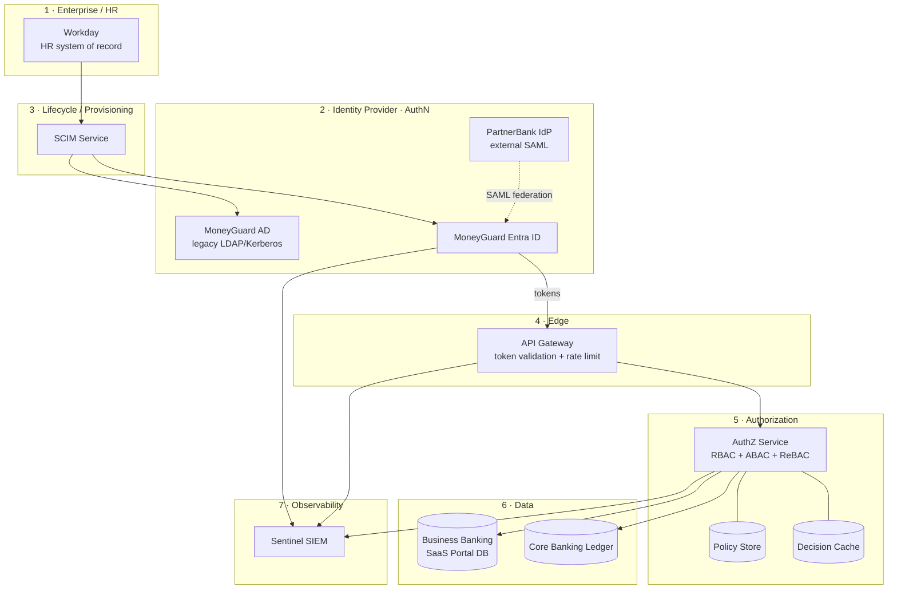
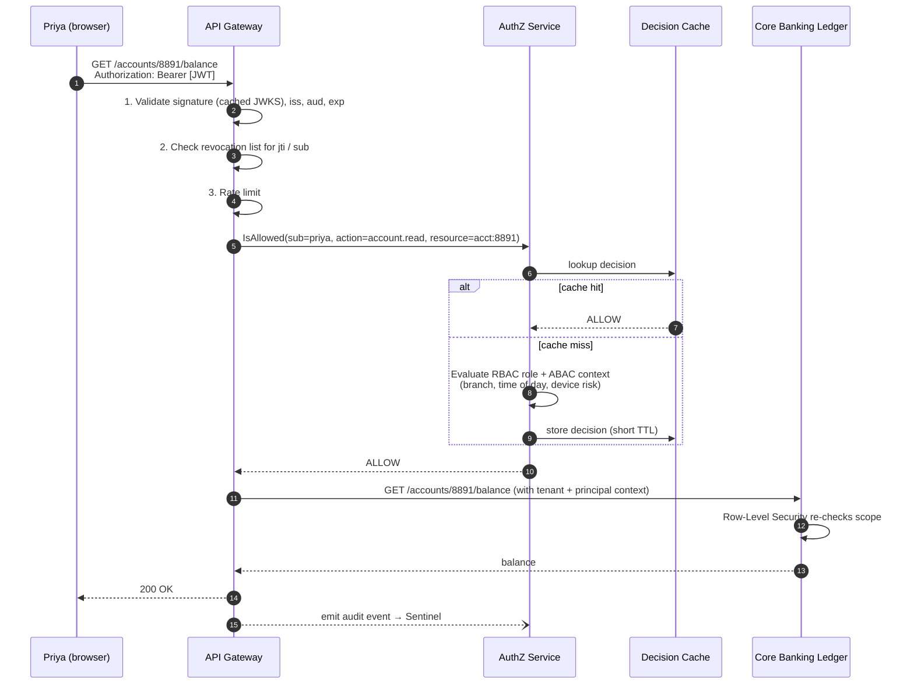
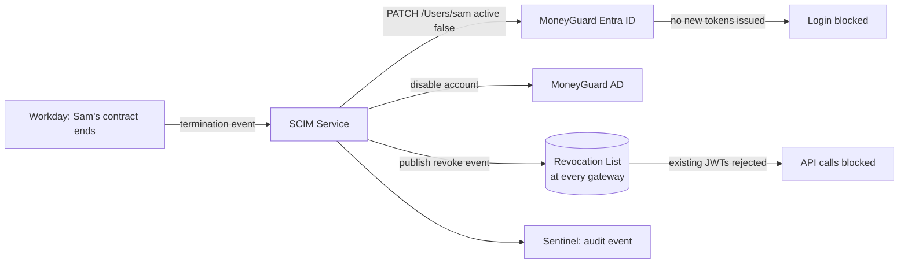

# Chapter 01: The Whiteboard Framework

> **Module 11 · Chapter 1 of 4** — How to structure a 45-minute IAM system design interview so you never run out of things to say, and never say them in the wrong order.

## 📋 Overview

A system design interview is not a knowledge test. It is a **communication test with a knowledge prerequisite**. Two candidates can know identical facts about OAuth 2.0 and Row-Level Security, and one passes while the other fails — purely because of the order in which they said things.

This chapter gives you a repeatable 4-step framework:

```
1. CLARIFY  →  2. HIGH-LEVEL COMPONENTS  →  3. DATA FLOW  →  4. DEEP DIVES & TRADE-OFFS
   (5 min)          (10 min)                   (15 min)          (15 min)
```

We will practice it against one mock prompt for the whole chapter:

> 🏦 **The Mock Prompt**
> *"Design the IAM system for **MoneyGuard Bank**. 50,000 employees must log in with corporate SSO. Millions of retail customers use a web and mobile banking app. Corporate clients like Acme Corp and Globex Inc use a multi-tenant Business Banking SaaS Portal. Internal services like the Fraud Detection Pipeline call the Core Banking Ledger APIs. It must be highly available, auditable for SOX, and secure."*

That prompt is deliberately huge. That is the point — **a good prompt is always too big to answer**, and Step 1 exists to cut it down to something you can actually draw.

## 🎯 Why It Matters

| Failure mode | What it looks like | Which step prevents it |
|---|---|---|
| **Solutioning too early** | You start drawing Redis in minute 2 before knowing if latency even matters. | Step 1 (Clarify) |
| **The blank whiteboard** | Five minutes of silence while you decide where to start. | Step 2 (Components) |
| **The "and then magic happens" gap** | You have boxes but cannot narrate a single request end-to-end. | Step 3 (Data Flow) |
| **The one-trick pony** | You describe *a* design but cannot say why you rejected the alternative. | Step 4 (Trade-offs) |
| **Running out of time** | You spend 40 minutes on the login flow and never mention offboarding or audit. | The clock budget above |

💡 **Pro tip:** Say the framework out loud in your first 30 seconds. *"Let me clarify requirements first, then sketch high-level components, then walk one request end-to-end, then go deep on the areas you care most about."* This single sentence buys you enormous goodwill — the interviewer now knows you have a plan, and they will often steer you toward the deep dive they actually want to grade.

---

## Step 1 — Clarify (≈5 minutes)

**Goal:** turn an unbounded prompt into 3–5 written-on-the-board requirements you will be graded against.

### 1.1 The four question categories

Ask a few questions from each category. Do not ask twenty questions — ask six good ones.

| Category | Questions to ask | Why it changes the design |
|---|---|---|
| **Who are the identities?** | Employees? Retail customers? Corporate/B2B users? Services and workloads? AI agents? | Employees need SSO + SCIM. Customers need self-service registration + MFA. Services need Client Credentials or workload identity — three totally different subsystems. |
| **What are the resources?** | Accounts, ledger entries, loan applications, payroll batches? What is the hierarchy? | The resource hierarchy *is* your authorization model. `Tenant → Company → Account → Transaction` implies ReBAC; a flat list implies RBAC is enough. |
| **What are the non-functional requirements (NFRs)?** | Latency budget for an authorization check? Availability target? Requests per second? Regions? | 10 ms p99 authorization forces local caching. Multi-region forces you to talk about replication lag and CAP. |
| **What is the compliance & threat context?** | SOX, PCI-DSS, GDPR? Insider threat? Account takeover? How fast must offboarding be? | "Deprovisioning within 60 seconds" kills the naive "just use 1-hour JWTs" answer and forces a revocation design. |

⚠️ **Common mistake:** asking clarifying questions and then ignoring the answers. If the interviewer says "authorization checks must be under 10 ms," you must physically write `AuthZ p99 < 10ms` on the board and refer back to it when you introduce a cache.

### 1.2 🏦 What clarification looks like for MoneyGuard

**You ask:**
1. "Are we designing for employees, retail customers, and business clients — or should I focus on one?"
2. "Do we own the employee identities, or is Workday the system of record?"
3. "What's the latency budget for an authorization check on the Core Banking Ledger?"
4. "When Priya is terminated in Workday, how fast must her access actually stop?"
5. "Are business-banking tenants like Acme Corp allowed to bring their own identity provider?"
6. "Is there any regulatory driver I should design around — SOX, PCI?"

**The interviewer answers (typical):**
- Cover all three populations, but employees and business clients in most depth.
- Workday is the HR system of record. Identity flows outward from it.
- Under 20 ms p99 for authorization; the ledger itself is the bottleneck, not us.
- Termination must take effect in **under 60 seconds**, bank-wide.
- Yes — Acme Corp wants SAML federation from their own IdP.
- SOX. Every privileged action on the ledger must be attributable to a named human.

**You write these on the board as "The Laws of the System":**

> 1. **HR is the source of truth.** Workday drives every employee identity event. We never create employees by hand.
> 2. **Zero Trust.** Every request is authenticated and authorized. There is no trusted internal network — a call from inside the datacenter is treated like a call from the internet.
> 3. **Atomic deprovisioning.** A termination in Workday must revoke all access in under 60 seconds.
> 4. **Fail closed.** If we cannot verify a permission on the ledger, the answer is *no*.
> 5. **Everything is attributable.** Every ledger write maps to a named human or a named workload, in an immutable log.

💡 **Pro tip:** naming them "Laws" is not showmanship — it gives you something to point at in Step 4. When the interviewer asks "what if the authorization service is down?", you point at Law 4 and the answer writes itself.

### 1.3 Back-of-the-envelope numbers

Do this quickly; it justifies your caching and scaling choices later.

| Quantity | Estimate | Implication |
|---|---|---|
| Employees | 50,000 | Logins ≈ 50k/day ≈ 2/sec peak. Tiny. AuthN is **not** the scaling problem. |
| Retail customers | ~5,000,000, ~10% daily active | 500k logins/day, spiky at 8am. Still modest for an IdP. |
| API calls needing an authorization check | ~10,000 req/sec | **This** is the scaling problem. 10k authorization checks/sec is why you cache. |
| Audit events | ~50,000/sec at peak (every decision) | You cannot write these synchronously to a relational DB. Asynchronous pipeline required. |

> **The single most valuable insight to say out loud:** *"Authentication happens once per session; authorization happens on every single request. So I'll spend most of my scaling energy on the authorization path, not the login path."* This is the sentence that separates people who have built IAM from people who have read about it.

---

## Step 2 — High-Level Components (≈10 minutes)

**Goal:** get boxes on the board, grouped into zones, before you draw a single arrow.

### 2.1 The six zones

Every IAM architecture — at every company you will ever interview at — decomposes into these six zones. Memorize them; they are your blank-whiteboard insurance policy.

| # | Zone | What lives here | MoneyGuard example |
|---|---|---|---|
| 1 | **Enterprise / HR** | The systems of record that *originate* identity | Workday |
| 2 | **Identity Provider (AuthN)** | Where credentials are verified and tokens are minted | MoneyGuard Entra ID, MoneyGuard AD, PartnerBank's IdP |
| 3 | **Lifecycle / Provisioning** | The pipes that move identity data between systems | SCIM service, joiner-mover-leaver workflows |
| 4 | **Edge** | The single front door that validates tokens and enforces coarse policy | API Gateway |
| 5 | **Authorization (AuthZ)** | The brain that answers "can this principal do this action on this resource?" | AuthZ service + policy store + cache |
| 6 | **Data** | Where the protected resources actually live, with isolation enforced | Core Banking Ledger, Business Banking SaaS Portal database |
| 7 | **Observability** | Logs, metrics, and detection | Sentinel (SIEM) |

(Yes, that's seven rows for "six zones" — Observability is the zone people forget, which is exactly why it is listed last and why you should draw it first among the "extras.")

### 2.2 The sketch

Draw this fast and loosely. Details come in Step 3.



### 2.3 What to say while you draw

Narrate the *responsibility* of each box in one sentence. Interviewers grade the narration, not the rectangle.

- **Workday** — "The only place a human identity is born. If it isn't in Workday, the person doesn't exist."
- **SCIM service** — "The pipe. It pushes creates, updates, and — critically — deactivations outward. This is what makes Law 3 possible."
- **Entra ID** — "Verifies credentials, enforces MFA, and mints short-lived tokens. It is the only thing that ever sees a password."
- **API Gateway** — "The bouncer. Validates the token signature, checks a revocation list, rate-limits. Coarse-grained only."
- **AuthZ service** — "The judge. Answers `IsAllowed(principal, action, resource)`. It is the only place permission logic lives, so it can be changed in real time."
- **Core Banking Ledger** — "The crown jewels. Defence in depth: even if the gateway and AuthZ both fail, the database enforces its own isolation."
- **Sentinel** — "The security cameras. It doesn't stop anything; it notices."

⚠️ **Common mistake:** drawing permission logic *inside* each microservice. If ten services each implement their own authorization checks, you have ten places to audit, ten places to get it wrong, and no way to answer "who can touch the ledger?" A **decoupled** authorization service is almost always the right answer in an interview — and the reason is auditability, not elegance.

---

## Step 3 — Data Flow (≈15 minutes)

**Goal:** pick 2–3 concrete journeys and narrate them end-to-end, step by step, naming the protocol and the token at each hop.

This is the heart of the interview. Boxes are cheap; **flows are where you demonstrate you have actually shipped this.**

### 3.1 Which flows to pick

Pick flows that between them exercise different parts of your diagram:

| Flow | Exercises | Pick it when… |
|---|---|---|
| **A. Human login (SSO)** | IdP, tokens, MFA, edge | Always. This is the default opener. |
| **B. An authorized action** | Edge, AuthZ, cache, data isolation | Always. This is where the scaling story lives. |
| **C. Joiner/Leaver** | HR, SCIM, revocation | When the prompt mentions enterprises, compliance, or offboarding. |
| **D. Service-to-service** | Workload identity, client credentials, mTLS | When the prompt mentions microservices, jobs, pipelines, or AI agents. |
| **E. Step-up authentication** | MFA, `acr` claim, risk | When the prompt mentions money movement or destructive actions. |

For MoneyGuard, do **A**, then **B**, then whichever of C/D/E the interviewer leans toward.

### 3.2 🏦 Flow A — Priya logs into the MoneyGuard Employee Portal

Priya Sharma is a new bank teller. She opens the Employee Portal.

```mermaid
sequenceDiagram
    autonumber
    participant P as Priya (browser)
    participant EP as Employee Portal (OIDC Relying Party)
    participant E as MoneyGuard Entra ID (IdP)

    P->>EP: GET /dashboard (no session)
    EP->>EP: Generate state, nonce, PKCE verifier + challenge
    EP-->>P: 302 redirect to Entra ID<br/>(response_type=code, state, nonce, code_challenge=S256)
    P->>E: GET /authorize
    E-->>P: Prompt password + MFA (Passkey)
    P->>E: Authenticates
    E-->>P: 302 back to portal with code and state
    P->>EP: GET /callback with code and state
    EP->>EP: CHECK 1 — state matches the cookie? (CSRF)
    EP->>E: POST /token (code + code_verifier + client credentials)
    E->>E: CHECK 2 — SHA-256(verifier) == challenge? (PKCE)
    E-->>EP: ID Token (JWT) + Access Token
    EP->>EP: Verify signature via JWKS; CHECK 3 — nonce matches cookie? (replay)
    EP-->>P: Set HttpOnly session cookie — logged in
```

**Narrate the three security checks explicitly** — `state` defeats CSRF, `PKCE` defeats authorization-code interception, `nonce` defeats ID-token replay. Naming all three, and correctly saying which attack each stops, is one of the highest-signal 30 seconds available to you in an IAM interview.

Add the two variations in one sentence each:
- **PartnerBank's staff** hit the same portal but are federated in over **SAML 2.0** — an XML assertion signed by PartnerBank's IdP, delivered by HTTP-POST binding, with Entra ID acting as the broker so downstream apps only ever see OIDC.
- **The MoneyGuard Mobile App** is a public client — no client secret can be kept on a phone — so it uses **Authorization Code + PKCE**, with the code exchange ideally brokered by MoneyGuard's own backend.

### 3.3 🏦 Flow B — Priya views a customer account balance

This is the flow that runs 10,000 times per second.



**The four sentences to say here:**

1. *"The gateway does cheap, coarse checks — signature, expiry, revocation, rate limit. It never makes fine-grained decisions."*
2. *"Fine-grained decisions go to one decoupled service, so permissions can change in real time and there is exactly one place to audit."*
3. *"We cache decisions with a short TTL because 10,000 checks per second cannot each hit a database — but the cache is invalidated by an event when a role changes, so the TTL is a safety net, not the primary correctness mechanism."*
4. *"Even if both layers were bypassed by a bug, Row-Level Security in the database is the last line of defence."*

### 3.4 🏦 Flow C — Sam Torres's contract ends (the kill switch)



**The key line:** *"Disabling him in the IdP stops **new** logins immediately, but his existing access token is valid for another 14 minutes. To meet the 60-second law, the SCIM worker also publishes a revocation event that every API Gateway instance consumes, so in-flight tokens die too. Without that second step, you have a 15-minute window where a terminated contractor still has access — and that is exactly the gap an auditor like Dana Cole will find."*

### 3.5 🏦 Flow D — The Fraud Detection Pipeline calls the Ledger

No human. No browser. No password.

```mermaid
sequenceDiagram
    autonumber
    participant POD as Fraud Detection Pod (Kubernetes)
    participant PLAT as Platform / Workload Identity
    participant STS as Token Service
    participant L as Core Banking Ledger API

    PLAT->>POD: Inject short-lived signed identity token (projected, auto-rotating)
    POD->>STS: Exchange identity token for access token<br/>(scope=transactions:read)
    STS->>STS: Verify platform signature; check workload is registered
    STS-->>POD: Access token (15 min, narrow scope)
    POD->>L: GET /transactions?since=... (Bearer token, over mTLS)
    L->>L: Validate signature + scope + client certificate binding
    L-->>POD: transaction stream
```

**The line that scores:** *"There is no static secret anywhere in this flow. The pod's identity is derived from the platform — its 'DNA' — not from a password baked into a container image. That kills the 'secret zero' problem: there is no long-lived credential to leak into a Git repo, and no rotation runbook to forget."*

---

## Step 4 — Deep Dives & Trade-offs (≈15 minutes)

**Goal:** prove you know why your design could be wrong, and what you'd do instead.

The interviewer will steer this. But you should have a prepared 2-minute answer for each of these seven, because one of them is coming.

### 4.1 The seven deep dives

#### Deep dive 1 — JWT vs. opaque tokens

| | JWT (self-contained) | Opaque token (reference) |
|---|---|---|
| Validation | Local, signature only. Fast, no network call. | Requires a call to the IdP's introspection endpoint. |
| Revocation | Hard — valid until expiry unless you add a blocklist. | Easy — delete it server-side. |
| Size | Large; sent on every request. | Small. |
| Leaks data? | Yes — claims are Base64, not encrypted. Never put PII in one. | No. |

> **The answer:** *"Short-lived JWTs (10–15 min) at the edge for speed, plus a distributed revocation list so we can still kill a session instantly. Refresh tokens are opaque and stored server-side so they can be revoked properly. Pure statelessness is a myth in a high-security system — we choose where to reintroduce state, deliberately."*

#### Deep dive 2 — Why not just put permissions in the JWT?

> **The answer:** *"Because a JWT is immutable once signed. If Raj demotes Sam from Admin to Viewer, but Sam's token says Admin and lasts an hour, Sam stays an admin for 55 more minutes. Roles in the token are a cache with no invalidation. Coarse identity claims — subject, tenant, `acr` — go in the token; fine-grained permissions stay behind a service we can change in real time."*

⚠️ Nuance worth adding: for very high-volume, low-sensitivity reads, embedding coarse claims is a legitimate optimization. Say that — it shows judgment rather than dogma.

#### Deep dive 3 — RBAC vs. ABAC vs. ReBAC

| Model | Answers | Good for | Breaks down when |
|---|---|---|---|
| **RBAC** (role-based) | "Tellers can read accounts." | Employees, coarse job functions. Easy to audit. | Role explosion — you end up with `Teller_Branch_12_ReadOnly_Weekends`. |
| **ABAC** (attribute-based) | "Tellers can read accounts **at their own branch, during business hours, from a managed device**." | Contextual and risk-based decisions. | Hard to answer "who can access X?" — you must evaluate policy over all users. |
| **ReBAC** (relationship-based, Google Zanzibar style) | "Priya can read this account because she is assigned to the customer who owns it." | Deep resource hierarchies, sharing, B2B tenancy. | Operationally heavier; needs a purpose-built graph store. |

> **The answer:** *"RBAC as the backbone because auditors need to read it. ABAC conditions layered on top for context — branch, time, device risk. ReBAC where the relationship genuinely is the permission, like Acme Corp's admin managing only Acme Corp's payroll batches. Most real systems are a hybrid, and pretending otherwise is a red flag."*

#### Deep dive 4 — Fail-open vs. fail-closed

> **The answer:** *"Fail closed on anything touching money or the ledger — Law 4. But be specific about the failure: return a `503 Service Unavailable`, not a `403 Forbidden`, so the client and the on-call engineer can tell 'the system is broken' from 'you don't have permission.' For genuinely low-risk reads — a user seeing their own profile photo — a stale-while-revalidate cache read is a reasonable availability trade. Blanket fail-closed everywhere sounds rigorous but takes the whole bank down when one cache node hiccups."*

#### Deep dive 5 — Multi-tenancy for the Business Banking SaaS Portal

> **The answer:** *"Pool model — shared tables with a `tenant_id` on every row — with PostgreSQL Row-Level Security as the enforcement mechanism. The middleware sets the tenant from the validated token at the start of every transaction, and the database physically cannot return another tenant's rows. This means an application bug degrades to 'returns nothing' instead of 'leaks Globex Inc's payroll to Acme Corp.' For a tenant with a regulatory requirement for physical separation, we offer a siloed database as a premium tier — that's the bridge model."*

#### Deep dive 6 — Step-up authentication

> **The answer:** *"A valid session is not consent for every action. When Alex Kim initiates a $2M wire, the API inspects the `acr` claim — the Authentication Context Class Reference — in the token. If the session was established with a password only, the API returns a challenge, and the UI prompts for a passkey tap right now. This is enforced server-side at the API, never client-side in the UI, because Eve does not use our UI."*

#### Deep dive 7 — Scaling and caching

> **The answer:** *"Stateless AuthZ service behind a load balancer, scaled horizontally. Two cache layers: an in-process L1 for microseconds and a distributed L2 for cross-instance sharing. Invalidation is event-driven on role and policy changes, with a short TTL as a backstop. JWKS public keys are cached at every gateway so that if Entra ID goes down, existing tokens still validate — only *new* logins fail. And the policy store is partitioned by tenant, which improves locality and limits blast radius."*

### 4.2 The trade-off sentence pattern

Every trade-off answer should follow this shape:

> **"I'd choose X, because [requirement from Step 1]. The cost is Y. If [different requirement] were true instead, I'd choose Z."**

Example: *"I'd choose fail-closed, because Law 4 says money movement must be verifiable. The cost is that an AuthZ outage becomes a full outage. If this were a read-only marketing site, I'd fail open and log loudly instead."*

That sentence structure alone will carry you through questions you have never seen before.

---

## ⚠️ Common Mistakes

| Mistake | Why it hurts | Fix |
|---|---|---|
| Confusing authentication with authorization | The single most common IAM interview failure. | AuthN = *who are you* (once per session). AuthZ = *what may you do* (every request). |
| Designing login only | Interviewers care far more about offboarding and audit — that's where real breaches live. | Always volunteer the Leaver flow. |
| Storing permissions in the JWT without caveat | Signals you've never dealt with a revocation incident. | See Deep Dive 2. |
| Forgetting non-human identities | Most identities in a modern bank are machines, not people. | Mention service accounts, workload identity, and their lifecycle. |
| No audit story | SOX exists. Dana Cole exists. | Draw Sentinel in Step 2, not as an afterthought. |
| Silent whiteboarding | The interviewer can only grade what you say. | Narrate continuously, even while drawing. |
| Arguing instead of adapting | If the interviewer pushes back, they're usually testing flexibility. | *"That's fair — if we assume X, then I'd change the design like this."* |

## 💡 Pro Tips

- **Write the Laws on the corner of the board and never erase them.** Every later answer points back to one of them.
- **Timebox out loud.** *"I've got the components down; unless you'd rather go deeper here, I'll walk a request end-to-end next."*
- **Have one opinionated take.** *"I'd buy the identity broker and build the authorization layer, because parsing SAML from a hundred partner IdPs is undifferentiated heavy lifting, but our permission model is our actual business logic."* Opinions with reasons read as seniority.
- **When stuck, walk the lifecycle:** Joiner → Mover → Leaver. There is always something to say in that frame.
- **Draw the attacker.** Adding "here is where Eve tries a credential-stuffing attack, and here is the rate limiter that stops it" turns an architecture diagram into a threat model, which very few candidates do.

## 🔑 Key Takeaways

1. The framework is **Clarify → Components → Data Flow → Deep Dives**, roughly 5/10/15/15 minutes.
2. Clarification produces **written laws** you point back to for the rest of the interview.
3. Every IAM system decomposes into **HR → IdP → Lifecycle → Edge → AuthZ → Data → Observability**. That's your blank-whiteboard insurance.
4. **AuthN happens once; AuthZ happens on every request.** Spend your scaling energy accordingly.
5. Data flows, not boxes, are what get graded. Narrate protocols and tokens at every hop.
6. Trade-offs follow the pattern **"X because [law]; cost is Y; if [other law] then Z."**

## 📖 Glossary

| Term | Meaning |
|---|---|
| **NFR** | Non-Functional Requirement — latency, availability, throughput, compliance. The constraints that shape architecture. |
| **IdP** | Identity Provider — the system that verifies credentials and issues tokens (MoneyGuard Entra ID). |
| **SP / RP** | Service Provider (SAML) / Relying Party (OIDC) — the application trusting the IdP. |
| **SCIM** | System for Cross-domain Identity Management — the standard protocol for pushing user create/update/deactivate between systems. |
| **PKCE** | Proof Key for Code Exchange — binds the authorization code to the client that started the flow. |
| **`acr`** | Authentication Context Class Reference — a token claim recording *how strongly* the user authenticated. Used for step-up. |
| **RLS** | Row-Level Security — database-enforced row filtering, the last line of tenant isolation. |
| **Fail closed** | On error or uncertainty, deny. The correct default for anything touching money. |

## 📝 Revision Cheat-Sheet

```
STEP 1 · CLARIFY (5m)
  Who?  (humans / customers / B2B / workloads)
  What? (resource hierarchy)
  NFRs? (latency, availability, RPS, regions)
  Risk? (compliance, threat model, offboarding SLA)
  → Write 3-5 LAWS on the board.

STEP 2 · COMPONENTS (10m)
  HR → IdP → Lifecycle → Edge → AuthZ → Data → Observability
  One sentence of responsibility per box.

STEP 3 · DATA FLOW (15m)
  A. Human SSO login (state / PKCE / nonce)
  B. Authorized request (gateway → authz → cache → RLS)
  C. Leaver kill switch (SCIM + revocation event)
  D. Workload identity (no static secrets)
  E. Step-up for high-risk actions (acr claim)

STEP 4 · DEEP DIVES (15m)
  JWT vs opaque · permissions-in-token · RBAC/ABAC/ReBAC
  fail-open vs closed · multi-tenancy/RLS · step-up · caching & scale
  Pattern: "X because [law]; cost is Y; if [other law] then Z."
```

---

⬅ [Module 11 Index](./README.md) | Next: [02 · MoneyGuard Full Architecture Walkthrough](./02_MoneyGuard_Full_Architecture_Walkthrough.md) ➡

⬅ Back to [Main README](../README.md) | 🏦 [The MoneyGuard Scenario](../SCENARIO.md)
