# Chapter 02: The MoneyGuard Full Architecture Walkthrough

> **Module 11 · Chapter 2 of 4** — The capstone. One diagram, one narration, and a map from every box on that diagram back to the module that taught it.

## 📋 Overview

Every previous module in this repository taught one slice of identity in isolation: a login flow here, a provisioning protocol there, a database isolation trick somewhere else. This chapter is where the slices become a **single system**.

🏦 What follows is MoneyGuard Bank's complete identity architecture — from the moment an HR record is created in Workday, through every token, gateway, policy decision and database row, to the audit event landing in Sentinel. If you can draw this diagram from memory and narrate a request through it, you have understood this repository.

**Prerequisite:** modules 01–10. This chapter deliberately does not re-teach OIDC or SCIM; it assumes you know them and shows you where they *sit*.

## 🎯 Why It Matters

Real IAM failures are almost never "we implemented OAuth wrong." They are **seam failures**:

- The IdP disabled the account, but the API Gateway kept honouring the old token for 55 minutes.
- SCIM deactivated the user, but the authorization cache still had a five-minute-old `ALLOW`.
- The application filtered by tenant, but a background job forgot to, and Acme Corp saw Globex Inc's payroll.
- Everything worked, but nothing was logged, so nobody could prove it to the auditor.

Seams only become visible when you draw the whole system. That is what this chapter is for.

---

## 🗺️ The Full Architecture

```mermaid
flowchart TD
%% ==================== ZONE 1: ENTERPRISE / HR ====================
    subgraph Z1["1 · Enterprise & HR — the origin of identity"]
        WD["Workday<br/><i>HR system of record</i>"]
        HRE["Joiner / Mover / Leaver<br/>events"]
        WD --> HRE
    end

%% ==================== ZONE 2: LIFECYCLE ====================
    subgraph Z2["2 · Lifecycle & Provisioning"]
        SCIMS["SCIM Service<br/><i>/Users · /Groups</i>"]
        RECON["Reconciliation Job<br/><i>drift &amp; orphan detection</i>"]
        JITP["JIT Provisioning<br/><i>fallback on first login</i>"]
        SCIMS --- RECON
    end

%% ==================== ZONE 3: IDENTITY PROVIDER ====================
    subgraph Z3["3 · Identity Providers — AuthN"]
        ENTRA["MoneyGuard Entra ID<br/><i>primary IdP · OIDC + SAML</i>"]
        AD["MoneyGuard AD<br/><i>legacy LDAP / Kerberos</i>"]
        CIAM["Customer Identity Store<br/><i>retail banking users</i>"]
        MFA["MFA Engine<br/><i>Passkeys / FIDO2 · TOTP · push</i>"]
        RISK["Risk &amp; Device Signals<br/><i>impossible travel, new device</i>"]
        JWKS["JWKS Endpoint<br/><i>public signing keys</i>"]
        ENTRA --- MFA
        ENTRA --- RISK
        ENTRA --- JWKS
        CIAM --- MFA
    end

    subgraph Z3B["3b · External Federation"]
        PBIDP["PartnerBank IdP<br/><i>SAML 2.0</i>"]
        ACMEIDP["Acme Corp IdP<br/><i>tenant BYO-SSO</i>"]
    end

%% ==================== ZONE 4: CLIENTS ====================
    subgraph Z4["4 · Clients"]
        PORTAL["MoneyGuard Employee Portal<br/><i>OIDC Relying Party</i>"]
        MOBILE["MoneyGuard Mobile App<br/><i>public client · PKCE</i>"]
        BBSP["Business Banking SaaS Portal<br/><i>multi-tenant B2B</i>"]
        CLI["Admin CLI / Tooling<br/><i>device code flow</i>"]
    end

%% ==================== ZONE 5: WORKLOADS ====================
    subgraph Z5["5 · Workload &amp; Machine Identity"]
        FRAUD["Fraud Detection Pipeline<br/><i>Kubernetes pods</i>"]
        WLID["Workload Identity Provider<br/><i>SPIFFE / IRSA · projected tokens</i>"]
        STS["Token Service<br/><i>client credentials · token exchange</i>"]
        VAULT["Secrets Manager / Vault<br/><i>dynamic, short-lived creds</i>"]
        FRAUD --> WLID --> STS
        STS --- VAULT
    end

%% ==================== ZONE 6: EDGE ====================
    subgraph Z6["6 · Edge — the single front door"]
        WAF["WAF · Rate Limiter<br/><i>credential stuffing defence</i>"]
        GW["API Gateway<br/><i>validate sig · iss · aud · exp</i>"]
        REVOKE[("Revocation List<br/><i>jti / sub kill switch</i>")]
        MTLS["mTLS Termination<br/><i>client certificate binding</i>"]
        WAF --> GW
        GW --- REVOKE
        GW --- MTLS
    end

%% ==================== ZONE 7: AUTHORIZATION ====================
    subgraph Z7["7 · Authorization — the brain"]
        PEP["Policy Enforcement Point<br/><i>sidecar / middleware</i>"]
        PDP["AuthZ Service · PDP<br/><i>IsAllowed(principal, action, resource)</i>"]
        OPA["Policy Engine<br/><i>OPA / Rego · ABAC rules</i>"]
        REBAC["Relationship Graph<br/><i>Zanzibar-style ReBAC</i>"]
        L1["L1 Cache<br/><i>in-process, ms TTL</i>"]
        L2[("L2 Cache<br/><i>Redis, short TTL</i>")]
        PSTORE[("Policy Store<br/><i>roles · bindings · policies</i>")]
        STEPUP["Step-Up Gate<br/><i>checks acr claim</i>"]
        PEP --> PDP
        PDP --- OPA
        PDP --- REBAC
        PDP --- L1
        L1 -.miss.-> L2
        L2 -.miss.-> PSTORE
        PDP --- STEPUP
    end

%% ==================== ZONE 8: DATA ====================
    subgraph Z8["8 · Data — the crown jewels"]
        LEDGER[("Core Banking Ledger<br/><i>accounts · transactions</i>")]
        BBDB[("Business Banking DB<br/><i>pooled + Row-Level Security</i>")]
        TENANTS["Tenants: Acme Corp · Globex Inc<br/><i>tenant_id on every row</i>"]
        BBDB --- TENANTS
    end

%% ==================== ZONE 9: OBSERVABILITY ====================
    subgraph Z9["9 · Observability &amp; Response"]
        LOGS["Structured JSON Audit Log<br/><i>actor · action · resource · result</i>"]
        SIEM["Sentinel SIEM<br/><i>correlation &amp; detection</i>"]
        SOC["SOC / On-call<br/><i>Dana Cole · Raj Patel</i>"]
        LOGS --> SIEM --> SOC
        SOC -.->|force revoke| REVOKE
    end

%% ==================== ZONE 10: IaC ====================
    subgraph Z10["10 · Infrastructure as Code"]
        GIT["Git — identity config as code<br/><i>Terraform · policies · roles</i>"]
        CICD["CI/CD Pipeline<br/><i>plan → review → apply</i>"]
        GIT --> CICD
    end

%% ==================== FLOWS ====================
    HRE -->|"provision / update / deactivate"| SCIMS
    SCIMS -->|"SCIM PATCH / POST"| ENTRA
    SCIMS -->|"LDAP write"| AD
    SCIMS -->|"role &amp; group bindings"| PSTORE
    SCIMS -->|"publish revoke event"| REVOKE
    SCIMS -->|"invalidate"| L2
    AD -.->|"sync / password hash"| ENTRA
    JITP -.->|"if no SCIM record"| ENTRA

    PBIDP -->|"SAML assertion"| ENTRA
    ACMEIDP -->|"SAML / OIDC"| ENTRA

    PORTAL -->|"OIDC auth code + PKCE"| ENTRA
    BBSP -->|"OIDC auth code + PKCE"| ENTRA
    MOBILE -->|"OIDC auth code + PKCE"| CIAM
    CLI -->|"device code flow"| ENTRA

    ENTRA -->|"ID Token + Access Token"| PORTAL
    ENTRA -->|"tokens"| BBSP
    CIAM -->|"tokens"| MOBILE

    PORTAL -->|"Bearer token"| WAF
    MOBILE -->|"Bearer token"| WAF
    BBSP -->|"Bearer token"| WAF
    CLI -->|"Bearer token"| WAF
    STS -->|"Bearer token + mTLS"| WAF

    JWKS -.->|"cached public keys"| GW
    GW -->|"authenticated principal"| PEP
    PDP -->|"ALLOW"| LEDGER
    PDP -->|"ALLOW"| BBDB
    STEPUP -.->|"insufficient acr → challenge"| MFA

    GW --> LOGS
    PDP --> LOGS
    ENTRA --> LOGS
    SCIMS --> LOGS
    LEDGER --> LOGS
    STS --> LOGS

    CICD -->|"apply"| ENTRA
    CICD -->|"apply"| PSTORE
    CICD -->|"apply"| GW
    CICD -->|"apply"| VAULT
```



---

## 📖 The Written Walkthrough

Read this alongside the diagram. Each section is one zone, and each ends with the seam that connects it to the next.

### Zone 1 — Enterprise & HR: identity is *born* in Workday

🏦 Priya Sharma accepts an offer as a bank teller. HR creates her record in **Workday** with a start date, a job code (`TELLER_II`), a cost centre, a manager, and a branch.

Nothing about identity has happened yet — and that is the point. **Workday is the system of record.** The architectural law is: *no human identity is created anywhere in MoneyGuard except as a downstream consequence of a Workday event.* If someone can hand-create an account in Entra ID, you have an unauditable back door, and there is no way to answer Dana Cole's question *"list every account belonging to someone who no longer works here."*

Workday emits three event types, and they are the entire human lifecycle:

| Event | Trigger | Downstream effect |
|---|---|---|
| **Joiner** | Priya's start date arrives | Account created and pre-provisioned with baseline access |
| **Mover** | Priya is promoted to Loan Officer | Old entitlements **removed**, new ones granted |
| **Leaver** | Sam Torres's contract ends | Everything revoked, in under 60 seconds |

⚠️ **The seam that breaks here:** Mover events. Most organisations handle Joiner and Leaver correctly and get Mover wrong — they *add* the new role and forget to *remove* the old one. Do this for five years and Raj Patel accumulates the access of every job he has ever held. That is **privilege creep**, and it is how a single compromised account turns into a bank-wide breach.

> 📘 Taught in [Module 01 · Core IAM Concepts](../01_Core_IAM_Concepts/README.md) and [Module 05 · Identity Lifecycle & SCIM](../05_Identity_Lifecycle_And_SCIM/README.md).

### Zone 2 — Lifecycle: SCIM is the pipe

The **SCIM Service** (System for Cross-domain Identity Management) is the plumbing that turns a Workday event into changes everywhere else.

On Priya's Joiner event, SCIM issues a `POST /Users` to Entra ID with her attributes and — crucially — an **`externalId`** that is Workday's immutable employee number, not her email address.

> 💡 **`externalId` is the anchor.** Priya Sharma may marry and become Priya Rao; her email changes, her display name changes. If any system joined identities on email, that rename silently creates a duplicate account and orphans the old one. The `externalId` never changes. This one design decision prevents an entire genus of bug.

SCIM also writes her baseline role bindings into the **Policy Store**, so that when she logs in for the very first time, her access is already correct. That is the difference between SCIM and **JIT (Just-In-Time) provisioning**: JIT only creates the user *after* their first login, which means Raj cannot pre-assign her to a branch group before day one. JIT remains in the diagram as a fallback — useful for federated partner users who may never be in Workday — but SCIM is the primary path.

On Sam's Leaver event, SCIM fans out four ways simultaneously:
1. `PATCH /Users/sam {"active": false}` to Entra ID — no new tokens will be issued.
2. Disable in MoneyGuard AD — legacy apps lock him out.
3. **Publish a revocation event** to the edge revocation list — existing tokens die.
4. **Invalidate the L2 authorization cache** — no stale `ALLOW` survives.

⚠️ **The seam that breaks here:** doing only step 1. Disabling in the IdP is the step everyone remembers, and on its own it leaves a window equal to the access-token lifetime — 15 minutes of a terminated contractor still holding valid access. Steps 3 and 4 are what actually make "under 60 seconds" true.

A **Reconciliation Job** runs nightly, comparing Workday's roster against every downstream directory to catch drift — accounts that exist downstream with no Workday owner (orphans) and Workday employees missing downstream (gaps). SCIM is a push protocol over an unreliable network; reconciliation is how you find the pushes that silently failed.

> 📘 Taught in [Module 05 · Identity Lifecycle & SCIM](../05_Identity_Lifecycle_And_SCIM/README.md).

### Zone 3 — Identity Providers: the only place a credential is ever seen

**MoneyGuard Entra ID** is the front door for employees and business clients. **MoneyGuard AD** remains for thirty years of legacy on-premise apps that speak LDAP and Kerberos, kept in sync so there is one password, not two. A separate **Customer Identity Store** handles millions of retail banking customers — deliberately separated from the employee directory, because customer identity has completely different scale, self-service, and blast-radius characteristics from employee identity.

Three things attach to the IdP:

- **The MFA Engine.** Priya uses a **passkey** (FIDO2/WebAuthn). This matters because passkeys are *phishing-resistant*: the credential is cryptographically bound to `moneyguard.com`, so when Eve sends Priya a link to `moneyguard-secure-login.com`, the browser simply will not release it. A one-time code over SMS would have been typed straight into Eve's proxy.
- **Risk & Device Signals.** Login from a new device, from an impossible-travel location, or at 3am triggers a stronger challenge. This is what makes authentication *continuous* rather than a single gate at the door.
- **The JWKS endpoint** publishes the IdP's public signing keys. Every API Gateway caches them, which is why token validation needs no network call — and why, if Entra ID goes down entirely, existing sessions keep working and only *new* logins fail.

**External federation** enters here too. PartnerBank's staff authenticate against PartnerBank's own IdP over SAML 2.0; Entra ID acts as the broker, converting an XML assertion into the same OIDC token every downstream MoneyGuard service already understands. Acme Corp does the same for the Business Banking SaaS Portal. This is the "buy the AuthN broker, build the AuthZ layer" principle: normalising a hundred partner IdPs is undifferentiated heavy lifting; MoneyGuard's permission model is its actual business logic.

The IdP emits tokens:

| Token | Purpose | Lifetime | Notes |
|---|---|---|---|
| **ID Token** | Proves *who* logged in, to the application | Single use at login | JWT. Contains `sub`, `nonce`, and `acr`. |
| **Access Token** | Presented to APIs | 10–15 min | Short by design — this is half the revocation strategy. |
| **Refresh Token** | Obtains new access tokens | Hours to days | Opaque and server-side, so it can genuinely be revoked. |

⚠️ **The seam that breaks here:** treating the ID Token as an API credential. The ID Token is for the *client* — it says who the user is. The Access Token is for the *API* — it says what may be done. Sending an ID Token to an API is a classic audience-confusion bug, which is exactly why the gateway validates the `aud` claim.

> 📘 Taught in [Module 02 · AuthN & Federation](../02_AuthN_Federation/README.md) and [Module 07 · Advanced Authentication & MFA](../07_Advanced_Authentication_And_MFA/README.md).

### Zone 4 — Clients: four shapes, one protocol family

| Client | Type | Flow | Why |
|---|---|---|---|
| **MoneyGuard Employee Portal** | Confidential (has a backend) | OIDC Authorization Code + PKCE | Backend holds the client secret; tokens never reach the browser. |
| **MoneyGuard Mobile App** | Public (no secret possible) | Authorization Code + PKCE | A decompiled app has no secret to steal; PKCE proves the caller. |
| **Business Banking SaaS Portal** | Confidential, multi-tenant | OIDC + tenant-routed SSO | Resolves the tenant *before* choosing which IdP to redirect to. |
| **Admin CLI** | Input-constrained | Device Code Flow | No browser in a terminal; the user authenticates on a phone instead. |

All four converge on the same thing: a short-lived Access Token in an `Authorization: Bearer` header. Downstream, **every one of them resolves to the same principal identity**, so the authorization service treats a CLI request and a browser request identically. Different front doors, one set of rules.

The three security parameters ride along on every browser flow — `state` (defeats CSRF), `PKCE` (defeats authorization-code interception), `nonce` (defeats ID-token replay). Each defeats a different, specific attack, and all three are required.

> 📘 Taught in [Module 02 · AuthN & Federation](../02_AuthN_Federation/README.md).

### Zone 5 — Workload identity: the machines outnumber the humans

MoneyGuard's **Fraud Detection Pipeline** is a set of Kubernetes pods that score transactions in near real-time. It needs to read from the Core Banking Ledger, continuously, with no human present.

The naive version — an API key baked into the container image — is the single most common source of real-world breaches. It never expires, it gets committed to Git, it is nearly impossible to rotate, and it usually carries far more privilege than the job needs.

Instead, the pod receives a short-lived, auto-rotating **projected identity token** from the platform, signed by the cluster. That token is its *DNA*: it proves "I am the fraud-scorer service account, in the fraud namespace, in the production cluster." The pod exchanges that token at the **Token Service** for a narrow-scoped access token (`scope=transactions:read`, 15 minutes), and calls the ledger — over **mutual TLS**, so the ledger verifies the caller's certificate at the transport layer before a single byte of HTTP is parsed.

There is no static secret anywhere in this flow. That is the **"secret zero" problem** solved: not by storing the secret better, but by not having one.

⚠️ **The seam that breaks here:** non-human identities with no lifecycle. Human accounts get deprovisioned because Workday fires an event. Service accounts get created during an incident at 2am and live forever. Every workload identity needs an owner, an expiry, and a place in the reconciliation job — otherwise your least-privilege programme covers only the minority of your identities.

> 📘 Taught in [Module 06 · Machine Identity & Workload Auth](../06_Machine_Identity_And_Workload_Auth/README.md) and [Module 01 · Core IAM Concepts](../01_Core_IAM_Concepts/README.md) (service accounts).

### Zone 6 — The Edge: cheap checks, done once, for everyone

Every request — human or machine, mobile or CLI — enters through the same front door. The edge does four things, all of them *coarse* and *fast*:

1. **WAF and rate limiting.** When Eve runs a credential-stuffing attack with a million leaked passwords, this is what stops it. Rate limiting is an identity control, not just an availability control.
2. **Token validation.** Verify the signature against the cached JWKS key, then check `iss` (did our IdP issue this?), `aud` (was it meant for us?), and `exp` (is it still alive?). Purely local — no network call, so this scales to 10,000 requests per second trivially.
3. **Revocation check.** Look up the token's `jti` or the subject in the distributed **revocation list**. This is the kill switch: it is what makes Sam's termination effective in seconds instead of minutes, and it is what the SOC uses to eject a compromised session immediately.
4. **mTLS termination** for workload traffic, binding the token to the client certificate that presented it — so a stolen token used from a different machine is rejected.

What the edge deliberately does **not** do is decide whether Priya may read account 8891. That is a fine-grained, resource-specific decision, and centralising it at the gateway would mean the gateway needs to know about every resource in the bank.

> 💡 **The pattern name:** the gateway is a coarse **PEP** (Policy Enforcement Point). The fine-grained PEP lives next to each service, and both call the same **PDP** (Policy Decision Point). Using this vocabulary correctly in an interview is a strong signal.

> 📘 Taught in [Module 04 · Edge Security, Tokens & Sessions](../04_Edge_Security_Tokens_And_Sessions/README.md).

### Zone 7 — Authorization: one brain, many enforcement points

The **AuthZ Service** answers exactly one question: `IsAllowed(principal, action, resource, context) → ALLOW | DENY`.

It is decoupled — deliberately. If authorization logic lived inside each microservice, MoneyGuard would have dozens of independent implementations, dozens of places to introduce a bug, and no single answer to *"who can write to the ledger?"* A central PDP means permissions can be changed in real time and audited in one place.

Three models compose inside it:

| Model | MoneyGuard example |
|---|---|
| **RBAC** | Priya has the `Teller` role; tellers may read customer accounts. The backbone, because auditors can read it. |
| **ABAC** | ...but only for accounts at *her own branch*, during *business hours*, from a *managed device*. Context that a role alone cannot express. |
| **ReBAC** | Acme Corp's admin may approve a payroll batch *because* a relationship exists: `user:admin → member → tenant:acme → owns → batch:9931`. Zanzibar-style graph traversal, for when the relationship *is* the permission. |

**Caching is what makes this survivable at 10,000 checks per second.** An L1 in-process cache answers in microseconds; an L2 Redis cache is shared across instances; only a miss on both reaches the policy store. But the critical detail is that **the TTL is not the correctness mechanism** — the SCIM service and the admin console *publish invalidation events* when a role or policy changes. The short TTL is a backstop for a missed event, not the primary path. Relying on TTL alone means a demotion takes effect "eventually," which is not an answer you can give a regulator.

The **Step-Up Gate** handles the highest-risk actions. When Alex Kim initiates a large wire transfer, the PDP inspects the `acr` claim in the token. If the session was established with a password only, the request is rejected with a challenge, and the UI prompts for a passkey tap *right now*. A valid session is not blanket consent for every action — and this check is enforced server-side at the API, because Eve does not use MoneyGuard's UI.

⚠️ **The seam that breaks here:** putting roles inside the JWT. A JWT is immutable once signed. If Raj demotes Sam from Admin to Viewer, but Sam's token says `role: Admin` and lasts an hour, Sam is an admin for 55 more minutes. Roles-in-token is a cache with no invalidation. Coarse identity claims (`sub`, `tenant`, `acr`) belong in the token; fine-grained permissions stay behind the PDP.

> 📘 Taught in [Module 03 · Authorization & Policy Engines](../03_Authorization_And_Policy_Engines/README.md), with the caching and failure behaviour in [Module 09 · Resilience, Observability & SIEM](../09_Resilience_Observability_And_SIEM/README.md).

### Zone 8 — Data: the last line of defence

Two very different data stores, protected differently.

The **Core Banking Ledger** is the crown jewels. Access is narrow and heavily audited, and every write carries the identity of the human or workload that caused it — SOX requires attribution, not just a successful transaction.

The **Business Banking SaaS Portal database** is multi-tenant: Acme Corp and Globex Inc share tables, distinguished by a `tenant_id` column on every single row. Isolation is enforced with **PostgreSQL Row-Level Security (RLS)**. The middleware sets the session's tenant from the *validated token* at the start of every transaction, and a policy on the table restricts every query to matching rows:

```sql
ALTER TABLE payroll_batches ENABLE ROW LEVEL SECURITY;

CREATE POLICY tenant_isolation ON payroll_batches
    USING (tenant_id = current_setting('app.current_tenant')::uuid);
```

Why bother, when the application already filters by tenant? **Because defence in depth means assuming the application has a bug.** With RLS, a developer who forgets a `WHERE tenant_id = ...` clause gets an empty result set. Without it, they get Globex Inc's payroll rendered in Acme Corp's browser — a breach that ends the product.

This is the **pool** tenancy model. For a client with a hard regulatory requirement for physical separation, MoneyGuard offers a dedicated database as a premium tier — the **bridge** model — accepting the higher operational cost for the tenants that pay for it.

⚠️ **The seam that breaks here:** background jobs. Web requests carry a validated token and set the tenant correctly. Nightly batch jobs, report generators, and data exports run without a user context, quietly bypass the RLS session variable, and are where multi-tenant leaks actually happen. Every non-request code path needs an explicit tenant scope.

> 📘 Taught in [Module 08 · Multi-Tenancy & Data Isolation](../08_MultiTenancy_And_Data_Isolation/README.md).

### Zone 9 — Observability: you cannot defend what you cannot see

Every component in the diagram emits a **structured JSON audit event**: actor, action, resource, result, source IP, device, tenant, and a trace ID that stitches one request together across all of them.

Structured, not free text — because the consumer is a machine. **Sentinel**, MoneyGuard's SIEM, correlates across sources to detect what no single component could:

| Detection | Requires correlating… |
|---|---|
| Credential stuffing | Thousands of failed logins across many accounts from few IPs — IdP + WAF logs |
| Impossible travel | Successful logins from two continents minutes apart — IdP + geo |
| Privilege escalation | A role grant immediately followed by use of that role — policy store + PDP decisions |
| Insider data theft | Normal-looking reads, but 100× the usual volume — PDP + ledger access logs |
| Orphaned account use | Activity from an account with no active Workday record — SCIM + IdP |

The logs must be **append-only and tamper-evident**. An attacker's last move is always to delete the evidence; if the same credentials that grant ledger access can also edit the audit log, the log proves nothing to Dana Cole or to a regulator.

And the loop closes: when Sentinel detects a compromised session, the SOC pushes an entry to the **revocation list** at the edge, and the session dies bank-wide within seconds. Detection without a response path is a very expensive way to be told you were breached.

⚠️ **The seam that breaks here:** logging only failures. `DENY` events are interesting, but the breach is almost always a series of successful, individually-authorised actions. You must log `ALLOW` on sensitive resources too — sampling if volume demands, but never at zero.

> 📘 Taught in [Module 09 · Resilience, Observability & SIEM](../09_Resilience_Observability_And_SIEM/README.md).

### Zone 10 — Infrastructure as Code: the configuration is part of the system

Every element of this architecture that can be configured *is* configured from Git: Entra ID application registrations, SCIM mappings, gateway policies, OPA rule bundles, role definitions, and RLS policies. A change is a pull request; the pipeline plans it, a second human reviews it, and only then is it applied.

This delivers three things nothing else can:
- **An audit trail of intent.** Not just "this role changed" but *who proposed it, who approved it, and why* — which is precisely what a SOX auditor asks for.
- **Separation of duties, enforced mechanically.** The person who proposes a privileged role change cannot be the person who approves it.
- **Reproducibility.** A new region, or a dedicated environment for a large corporate client, is deployed from the same definitions rather than reconstructed by clicking through consoles.

And the secrets themselves never enter Git. They live in the **Secrets Manager**, injected at runtime, ideally as dynamic short-lived credentials rather than long-lived static ones.

> 📘 Taught in [Module 10 · IaC & Deployment Security](../10_IaC_And_Deployment_Security/README.md).

---

## 🧭 Two Requests, Traced End-to-End

### 🏦 Trace 1 — Priya reads a customer's balance (the happy path, 10,000×/sec)

| # | Where | What happens |
|---|---|---|
| 1 | Employee Portal | Priya's browser sends her session cookie; the portal attaches its Access Token. |
| 2 | WAF / Rate limiter | Request is under quota. Pass. |
| 3 | API Gateway | Signature verified against cached JWKS. `iss`, `aud`, `exp` all valid. |
| 4 | Revocation list | `jti` not present. Not revoked. |
| 5 | PEP → PDP | `IsAllowed(priya, account.read, acct:8891, {branch: 12, device: managed, time: 10:14})` |
| 6 | L1 cache | Miss. |
| 7 | L2 cache | Hit — `ALLOW`, written 8 seconds ago. |
| 8 | Core Banking Ledger | Returns the balance; logs the read with Priya's identity. |
| 9 | Sentinel | Audit event: `{actor: priya, action: account.read, resource: acct:8891, result: allow, trace: ...}` |

Total added latency: single-digit milliseconds, dominated by two cache lookups.

### 🏦 Trace 2 — Sam Torres's contract ends at 17:00 (the kill switch)

| # | Where | What happens | Elapsed |
|---|---|---|---|
| 1 | Workday | Termination effective. Leaver event emitted. | t+0s |
| 2 | SCIM Service | Consumes the event; begins fan-out. | t+2s |
| 3 | Entra ID | `PATCH /Users/sam {"active": false}` — no further tokens issued. | t+3s |
| 4 | MoneyGuard AD | Account disabled — legacy apps locked. | t+4s |
| 5 | Revocation list | Revoke event published; every gateway instance consumes it. | t+5s |
| 6 | L2 cache | All cached decisions for `sam` invalidated. | t+5s |
| 7 | Any in-flight request | Gateway finds `sam` on the revocation list → `401`. | t+6s |
| 8 | Sentinel | Deprovisioning event logged for Dana Cole's audit report. | t+7s |
| 9 | Reconciliation job | Overnight sweep confirms no residual access anywhere. | t+8h |

**Under 60 seconds, achieved.** Note that steps 5 and 6 — the ones most designs omit — are what turn "he can't log in again" into "he cannot do anything, right now."

---

## 🗺️ Component → Module Map

Every box in the capstone diagram, and where in this repository it is taught.

| Architecture component | What it does | Module |
|---|---|---|
| Workday (HR system of record) | Originates every human identity event | [01 · Core IAM Concepts](../01_Core_IAM_Concepts/README.md) |
| Joiner / Mover / Leaver lifecycle | The three events that drive all human access | [01 · Core IAM Concepts](../01_Core_IAM_Concepts/README.md) |
| Least privilege & access models | Why Priya gets a teller's access and nothing more | [01 · Core IAM Concepts](../01_Core_IAM_Concepts/README.md) |
| Service accounts / non-human identity | Identities without a person behind them | [01 · Core IAM Concepts](../01_Core_IAM_Concepts/README.md) |
| MoneyGuard Entra ID (primary IdP) | Verifies credentials, mints tokens | [02 · AuthN & Federation](../02_AuthN_Federation/README.md) |
| MoneyGuard AD (legacy directory) | LDAP/Kerberos for on-premise apps | [01 · Core IAM Concepts](../01_Core_IAM_Concepts/README.md) |
| PartnerBank / Acme Corp federation | SAML 2.0 trust with external IdPs | [02 · AuthN & Federation](../02_AuthN_Federation/README.md) |
| OIDC Authorization Code + PKCE | The login flow for portal, mobile, and B2B | [02 · AuthN & Federation](../02_AuthN_Federation/README.md) |
| `state` / `nonce` / PKCE parameters | CSRF, replay, and code-interception defences | [02 · AuthN & Federation](../02_AuthN_Federation/README.md) |
| Zero Trust posture | No trusted internal network; verify every request | [02 · AuthN & Federation](../02_AuthN_Federation/README.md) |
| AuthZ Service (PDP) | `IsAllowed(principal, action, resource)` | [03 · Authorization & Policy Engines](../03_Authorization_And_Policy_Engines/README.md) |
| RBAC / ABAC | Roles plus contextual conditions | [03 · Authorization & Policy Engines](../03_Authorization_And_Policy_Engines/README.md) |
| ReBAC relationship graph | Zanzibar-style permission-by-relationship | [03 · Authorization & Policy Engines](../03_Authorization_And_Policy_Engines/README.md) |
| Policy engine (OPA / Rego) | Externalised, versionable policy evaluation | [03 · Authorization & Policy Engines](../03_Authorization_And_Policy_Engines/README.md) |
| API Gateway | Coarse PEP: signature, `iss`/`aud`/`exp`, rate limit | [04 · Edge Security, Tokens & Sessions](../04_Edge_Security_Tokens_And_Sessions/README.md) |
| JWT vs. opaque tokens | The trade-off behind token design | [04 · Edge Security, Tokens & Sessions](../04_Edge_Security_Tokens_And_Sessions/README.md) |
| JWKS endpoint & key rotation | Distributing and rotating public signing keys | [04 · Edge Security, Tokens & Sessions](../04_Edge_Security_Tokens_And_Sessions/README.md) |
| Revocation list / kill switch | Killing live sessions in seconds | [04 · Edge Security, Tokens & Sessions](../04_Edge_Security_Tokens_And_Sessions/README.md) |
| Session management | Cookies, lifetimes, and logout semantics | [04 · Edge Security, Tokens & Sessions](../04_Edge_Security_Tokens_And_Sessions/README.md) |
| SCIM Service (`/Users`, `/Groups`) | The provisioning and deprovisioning pipe | [05 · Identity Lifecycle & SCIM](../05_Identity_Lifecycle_And_SCIM/README.md) |
| JIT provisioning | Create-on-first-login fallback | [05 · Identity Lifecycle & SCIM](../05_Identity_Lifecycle_And_SCIM/README.md) |
| `externalId` anchoring | Never join identities on email | [05 · Identity Lifecycle & SCIM](../05_Identity_Lifecycle_And_SCIM/README.md) |
| Reconciliation / drift detection | Catching orphans and failed syncs | [05 · Identity Lifecycle & SCIM](../05_Identity_Lifecycle_And_SCIM/README.md) |
| Fraud Detection Pipeline identity | Kubernetes workloads as first-class principals | [06 · Machine Identity & Workload Auth](../06_Machine_Identity_And_Workload_Auth/README.md) |
| Workload identity (SPIFFE / IRSA) | Platform-derived identity, no static secrets | [06 · Machine Identity & Workload Auth](../06_Machine_Identity_And_Workload_Auth/README.md) |
| OAuth Client Credentials grant | Machine-to-machine token acquisition | [06 · Machine Identity & Workload Auth](../06_Machine_Identity_And_Workload_Auth/README.md) |
| Mutual TLS (mTLS) | Transport-layer caller verification | [06 · Machine Identity & Workload Auth](../06_Machine_Identity_And_Workload_Auth/README.md) |
| MFA Engine | Second-factor challenge | [07 · Advanced Authentication & MFA](../07_Advanced_Authentication_And_MFA/README.md) |
| Passkeys / FIDO2 / WebAuthn | Phishing-resistant authentication | [07 · Advanced Authentication & MFA](../07_Advanced_Authentication_And_MFA/README.md) |
| Step-up gate & `acr` claim | Re-authentication for high-risk actions | [07 · Advanced Authentication & MFA](../07_Advanced_Authentication_And_MFA/README.md) |
| Risk & device signals | Adaptive, context-aware authentication | [07 · Advanced Authentication & MFA](../07_Advanced_Authentication_And_MFA/README.md) |
| Business Banking SaaS Portal | The multi-tenant B2B application | [08 · Multi-Tenancy & Data Isolation](../08_MultiTenancy_And_Data_Isolation/README.md) |
| Pool / silo / bridge tenancy | Choosing an isolation model per tenant | [08 · Multi-Tenancy & Data Isolation](../08_MultiTenancy_And_Data_Isolation/README.md) |
| `tenant_id` schema design | Modelling tenants, users, roles, bindings | [08 · Multi-Tenancy & Data Isolation](../08_MultiTenancy_And_Data_Isolation/README.md) |
| PostgreSQL Row-Level Security | Database-enforced tenant isolation | [08 · Multi-Tenancy & Data Isolation](../08_MultiTenancy_And_Data_Isolation/README.md) |
| L1 / L2 decision caching | Making 10k checks/sec affordable | [09 · Resilience, Observability & SIEM](../09_Resilience_Observability_And_SIEM/README.md) |
| Fail-open vs. fail-closed | What to do when the PDP is unreachable | [09 · Resilience, Observability & SIEM](../09_Resilience_Observability_And_SIEM/README.md) |
| CAP trade-offs in IAM | Consistency vs. availability for access data | [09 · Resilience, Observability & SIEM](../09_Resilience_Observability_And_SIEM/README.md) |
| Structured JSON audit log | Machine-readable, tamper-evident evidence | [09 · Resilience, Observability & SIEM](../09_Resilience_Observability_And_SIEM/README.md) |
| Sentinel SIEM & detections | Correlation, alerting, and SOC response | [09 · Resilience, Observability & SIEM](../09_Resilience_Observability_And_SIEM/README.md) |
| Git-defined identity config | Terraform for IdP, roles, and policies | [10 · IaC & Deployment Security](../10_IaC_And_Deployment_Security/README.md) |
| CI/CD plan → review → apply | Separation of duties, enforced by pipeline | [10 · IaC & Deployment Security](../10_IaC_And_Deployment_Security/README.md) |
| Secrets Manager / Vault | Dynamic short-lived credentials, never in Git | [10 · IaC & Deployment Security](../10_IaC_And_Deployment_Security/README.md) |
| The 4-step whiteboard framework | How to present all of the above in 45 minutes | [11 · Ch. 01](./01_The_Whiteboard_Framework.md) |

---

## ⚠️ The Seven Seams (where real systems break)

A condensed list of every ⚠️ above — these are the failure modes that only appear when you look at the whole system.

| # | Seam | Symptom | Fix in the diagram |
|---|---|---|---|
| 1 | Mover events add but never remove | Privilege creep over years | SCIM must revoke old bindings, not just grant new ones |
| 2 | Deprovisioning stops at the IdP | Terminated user retains access for the token lifetime | Revocation event to the edge + cache invalidation |
| 3 | Roles baked into the JWT | Demotions take up to an hour to bite | Coarse claims in the token; permissions behind the PDP |
| 4 | Cache invalidation by TTL only | Access changes are "eventually" correct | Event-driven invalidation, TTL as backstop |
| 5 | Tenant isolation only in application code | One missing `WHERE` clause becomes a data breach | RLS at the database, and tenant scope in batch jobs |
| 6 | Non-human identities with no lifecycle | Immortal service accounts nobody owns | Owners, expiry, and reconciliation for workloads too |
| 7 | Logging failures but not successes | The breach is invisible because every step was authorised | Log `ALLOW` on sensitive resources; tamper-evident storage |

## 💡 Pro Tips

- **Draw the zones before the boxes.** Ten labelled boxes with no grouping look like a mess; the same boxes in seven labelled zones look like an architecture.
- **The revocation list is the highest-signal box you can draw.** Almost nobody draws it, and it is the difference between a design that meets a 60-second offboarding requirement and one that quietly doesn't.
- **Say "PEP" and "PDP."** Enforcement points are many and cheap; decision points are one and authoritative. That single distinction organises the whole authorization zone.
- **Trace one request end-to-end, out loud, before you finish.** If you cannot narrate it, the diagram is decoration.
- **Name the seam.** Volunteering "here's where this design would break, and here's how I'd catch it" is the clearest seniority signal available in a system design interview.

## 🔑 Key Takeaways

1. Identity flows **outward from HR**: Workday → SCIM → IdP → tokens → edge → authorization → data, with observability watching every hop.
2. **Authentication is one-time and centralised; authorization is per-request and cached.** The two have completely different scaling profiles.
3. **Revocation is a two-part design** — short token lifetimes *plus* a distributed kill switch. Neither alone is sufficient.
4. **Defence in depth is literal here:** gateway, then PDP, then Row-Level Security. Three independent layers, each assuming the ones above it have a bug.
5. **Machines are identities too** — with a lifecycle, an owner, least privilege, and no static secrets.
6. **The audit log is a control, not a byproduct.** Structured, immutable, and correlated, or it proves nothing.
7. **The whole configuration lives in Git**, which is what makes separation of duties and SOX attestation mechanically enforceable rather than aspirational.

## 📖 Glossary

| Term | Meaning |
|---|---|
| **PEP** | Policy Enforcement Point — where a decision is *applied* (gateway, sidecar, middleware). Many of them. |
| **PDP** | Policy Decision Point — where a decision is *made* (the AuthZ service). One of them. |
| **JWKS** | JSON Web Key Set — the endpoint publishing an IdP's public signing keys, cached by every validator. |
| **`jti`** | JWT ID — a unique token identifier, used for targeted revocation. |
| **`acr`** | Authentication Context Class Reference — records how strongly the user authenticated; drives step-up. |
| **`externalId`** | The immutable identifier from the source system used to join identities across systems. Never email. |
| **RLS** | Row-Level Security — database-enforced row filtering by tenant. |
| **SPIFFE** | Secure Production Identity Framework For Everyone — a standard for platform-issued workload identity. |
| **mTLS** | Mutual TLS — both client and server present certificates during the handshake. |
| **Secret zero** | The bootstrap credential problem: the secret needed to get all the other secrets. Solved by platform-derived identity. |
| **Privilege creep** | Accumulated entitlements from past roles never revoked on a Mover event. |
| **SIEM** | Security Information and Event Management — log correlation and detection (MoneyGuard's is "Sentinel"). |

## 📝 Revision Cheat-Sheet

```
THE MONEYGUARD STACK, TOP TO BOTTOM

  Workday                  identity is born here; nowhere else
    ↓ SCIM (externalId anchor, fan-out on Leaver)
  Entra ID / AD / CIAM     credentials verified; tokens minted
    ↓ OIDC + PKCE + state + nonce   |   SAML from PartnerBank & Acme
  Clients                  portal · mobile · B2B portal · CLI
    ↓ Bearer token         (workloads: SPIFFE → STS → mTLS, no static secrets)
  WAF → API Gateway        sig · iss · aud · exp · REVOCATION LIST · rate limit
    ↓ authenticated principal
  PEP → PDP                RBAC + ABAC + ReBAC · L1/L2 cache · step-up on acr
    ↓ ALLOW
  Ledger / Tenant DB       Row-Level Security = last line of defence
    ↓ every hop emits
  Structured JSON → Sentinel SIEM → SOC → (force revoke, loop closed)

  All config: Git → CI/CD → applied. Secrets: Vault, never Git.
```

---

⬅ [01 · The Whiteboard Framework](./01_The_Whiteboard_Framework.md) | [Module 11 Index](./README.md) | Next: [03 · Interview Questions & Answers](./03_Interview_Questions_And_Answers.md) ➡

⬅ Back to [Main README](../README.md) | 🏦 [The MoneyGuard Scenario](../SCENARIO.md)
